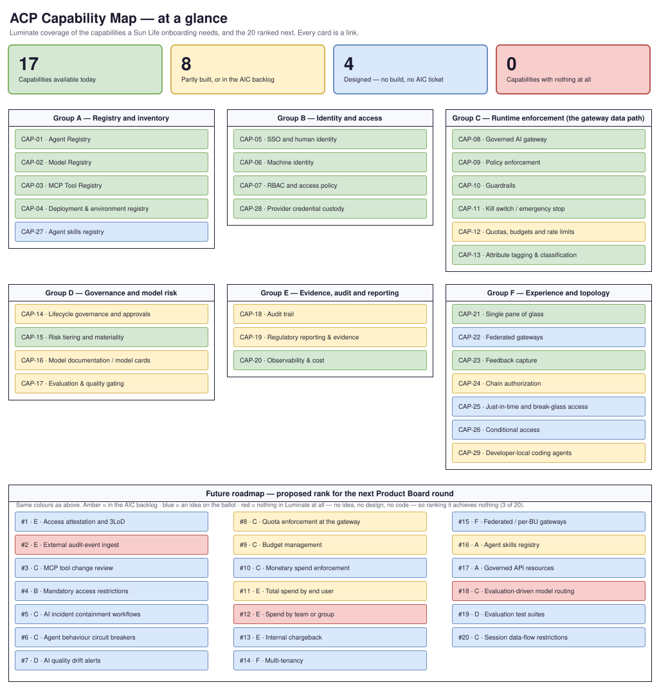

# ACP Capability Map — at a glance

> One page, no prose. **Every card in the diagram is a link** — the capabilities jump to
> their row on the detailed map, and the 20 ranked roadmap items jump to their detail on the
> Future Roadmap.
>
> **Owner**: Seth Chalmers (ACP Product) · Generated from the detailed map's §4 catalogue and
> the roadmap's §1–§2 tables by `scripts/render_capability_map.py --export`, so it cannot
> disagree with either.

## Reading the colours

One code across the whole picture, on a single question: **has it been built, is anyone building
it, has anyone designed it?**

| | Capability card | Roadmap card |
|---|---|---|
| 🟩 **Green** | Available in Luminate today | — |
| 🟨 **Amber** | Partly built, or in the AIC backlog | The consortium has accepted it; an `AIC` epic exists |
| 🟦 **Blue** | Designed — no build and no AIC ticket | Proposed or designed; no `AIC` ticket, so it is on the ballot |
| 🟥 **Red** | No build, no ticket, not designed | Not even an idea — ranking it achieves nothing until one is raised |

The detailed catalogue keeps a fifth state, **⚠️ modelled but not enforced** — a control you can
configure that nothing enforces at runtime. It shares the amber band here because a picture cannot
carry that distinction safely, and it is the one verdict worth reading the
[full row](capability-map.md#status-legend) for. Quotas are the live example.

The colour is the only marking. Which capabilities are **mandatory** for every onboarding is a
separate question the picture no longer tries to answer — it is in
[the governance baseline](capability-map.md#3-the-governance-baseline--mandatory-for-every-onboarding),
where it can be stated rather than encoded.

## The two views underneath this one

| Page | Answers | Verified against |
|---|---|---|
| **[Full capability catalogue](capability-map.md)** | *What can ACP do for my use case today?* | Built code on `AI-Consortium/luminate` `origin/main` |
| **[Future Roadmap](capability-roadmap.md)** | *What is coming, when, and what do we rank?* | `ACPDIS` ideas, `AIC` epics and the open design PRs |

The split is deliberate: one changes at a consortium release, the other changes daily. Read the
catalogue before promising a use case anything; read the roadmap before a Product Board round.

## Jump to a group

Groups A–E exist because a regulator requires them. Group F exists because builders and
business units need it — it is the only elective group. See
[who requires each group](capability-map.md#who-requires-each-group).

- [Group A — Registry and inventory](capability-map.md#group-a--registry-and-inventory) — CAP-01…04, CAP-27
- [Group B — Identity and access](capability-map.md#group-b--identity-and-access) — CAP-05…07, CAP-28
- [Group C — Runtime enforcement](capability-map.md#group-c--runtime-enforcement-the-gateway-data-path) — CAP-08…13
- [Group D — Governance and model risk](capability-map.md#group-d--governance-and-model-risk) — CAP-14…17
- [Group E — Evidence, audit and reporting](capability-map.md#group-e--evidence-audit-and-reporting) — CAP-18…20
- [Group F — Experience and topology](capability-map.md#group-f--experience-and-topology) — CAP-21…26, CAP-29

## More detail

- **[Full capability catalogue](capability-map.md#4-capability-catalogue)** — what each CAP-*n*
  covers, its governance class, and how the status was verified
- **[Gap register](capability-map.md#6-gap-register)** — where Sun Life needs something the
  consortium does not yet cover, and which track would close it
- **[Future Roadmap](capability-roadmap.md)** — work underway, work accepted and waiting for
  capacity, and **[the ballot](capability-roadmap.md#5-the-full-ballot)** a Product
  Board representative ranks
- **[Sun Life asks with no consortium track](capability-roadmap.md#6-not-in-luminate-at-all)**
  — the gaps that cannot even be ranked until an idea is raised
- **[Regulatory traceability](capability-map.md#7-regulatory-traceability)** — which capabilities
  carry which obligation
- **[Capability gap escalation](process/capability-gap-escalation.md)** — the route when a use
  case needs something that is not available
