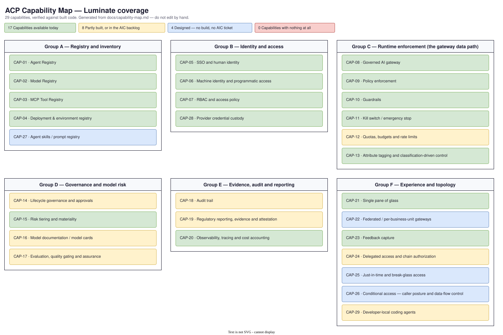

# ACP Capability Map — Luminate

> **What this is**: the single, living list of what the Agentic Control Plane can do for a
> business use case, what it cannot do yet, and which parts are **mandatory regardless of
> whether the use case asks for them**.
>
> **Who it is for**: use-case teams in discovery, the Product Team writing D0/D1 specs,
> regional/EA architects joining onboarding sessions, and the consortium roadmap.
>
> **Scope**: **Luminate only.** The Sun Life internal MVP is not a delivery target and has
> been removed from this map. Where the MVP proved a capability, it appears as an input to a
> consortium contribution, not as an alternative platform.
>
> **Last verified**: 2026-09-14 against `AI-Consortium/luminate` `origin/main` @ `654c3199`
> and `AI-Consortium/luminate-designs` `origin/main` @ `d477c13`.
> **Owner**: Seth Chalmers (ACP Product) · **Cadence**: re-verified at each consortium release
> and before each onboarding wave.
>
> **The forward roadmap has moved.** What is designed-but-not-built, what is scheduled, and
> what a Sun Life representative can put on a Product Board ballot now live on
> **[ACP Capability Map — Future Roadmap](capability-roadmap.md)**. This page is what exists
> today; that page is what is coming.

> ⚠️ **Verify against the live consortium repos, never a local clone.** The authoritative
> checkouts are `Code/Luminate/luminate` and `Code/Luminate/luminate-designs`, both tracking
> GHE `AI-Consortium`. The copies under `EDAE ACP/` are **one-time clones and are stale** —
> the `luminate` one has run 80+ commits behind and has already produced three wrong verdicts
> in a published spec. `git fetch` first, then verify against `origin/main`.

---

## 1. How to use this map

### In a use-case discovery session (D0)

Walk the catalogue in section 4 **group by group** and let the team choose. Two rules:

1. **State the mandatory baseline first** (section 3). Those capabilities apply whether or
   not the team raises them. A team that never mentions a kill switch still gets one — the
   conversation is about *how it is exercised*, not *whether they want it*.
2. **Confirm every capability out loud, in the session.** Do not infer a requirement from a
   meeting transcript. A capability is "required" only when the use case says so against a
   named capability ID, and that is what gets written into the D0.

The output of the session is a filled-in **Capability Requirements** table in the use case's
`d0-discovery.md` — capability IDs, why they are needed, and priority. That table is the
onboarding scope, and it is what the use case signs off against.

### In requirements (D1)

Every functional requirement traces to a capability ID. Anything a use case needs that this
map marks 🟡 / ⚠️ / 📐 / ❌ becomes a row in the D1 **Capability Gaps** register and follows
[Capability Gap Escalation](process/capability-gap-escalation.md).

### Status legend

| Symbol | Status | What it means for a use case |
|---|---|---|
| ✅ | **Available** | Shipping and enforced at runtime. Rely on it today. |
| ⚠️ | **Modelled, not enforced** | You can configure it and the UI/API accept it, but **nothing enforces it at runtime**. Do **not** present it to Risk as a control. |
| 🟡 | **Partial** | Usable, but a material sub-capability is missing. The missing part is named in the row. |
| 📐 | **Designed** | Specified upstream, no shipping code. Needs consortium delivery before a use case can depend on it. |
| ❌ | **Gap** | Neither built nor specified. Requires a consortium idea before it can be scheduled. |

⚠️ is the most important state in this document. A modelled-but-unenforced control is worse
than an absent one, because it reads as green on a slide and holds nothing at runtime.

**The diagrams colour by delivery, not by these five states.** A picture answers a coarser
question — built, being built, designed, or nothing — so ⚠️ and 🟡 share one band there. The
distinction above survives in this column and in each row's text, which is where it belongs: it
needs a sentence, and a legend chip cannot carry it.

### How much comfort 📐 Designed should give you

Less than it sounds. Of the 41 designs in `luminate-designs`, **two are APPROVED — the
Organizational Model and Portal RBAC. Every other design is `Status: Draft` with
`Decision: Pending`**, several since Q1. A 📐 verdict therefore means *"someone has written
down how this could work"*, not *"this is agreed and scheduled"*.

When a use case needs a 📐 capability, treat it as a gap with a head start, not as a
commitment. The design shortens the build; it does not schedule it. Whether it is *scheduled*
is a separate question, answered on the [Future Roadmap](capability-roadmap.md) — a design
with no `AIC` epic behind it has not been funded by anybody.

### Governance legend

| Marking | Meaning |
|---|---|
| **Mandatory** | Applies to every use case onboarding to ACP. Not negotiable, not elective, and not conditional on the team asking for it. |
| **Conditional** | Mandatory when the stated trigger is true (e.g. the agent calls MCP tools). |
| **Optional** | Elective — the use case opts in based on its own needs. |

---

## 2. What is in scope for this map

This map covers **ACP platform capabilities** — things that are, or would be, a change to a
Luminate component (registry, gateway, policy engine, portal).

It deliberately excludes the **Sun Life integration surface** (section 5): the work of making
ACP speak to Sun Life's identity, secrets, network, GRC and observability estates. That work
is absorbed by the harness and the Sun Life deployment; it never becomes a consortium
component change. Keeping the two apart is what makes the consortium roadmap conversation
tractable — otherwise every Sun Life plumbing task looks like a product gap.

---

## 3. The governance baseline — mandatory for every onboarding

These apply to every use case regardless of what it asks for. They are the price of admission
to ACP, and they are what lets ACP answer to OSFI E-23, B-13 and the NIST AI RMF on the use
case's behalf.

| Capability | Why it is mandatory | Luminate today |
|---|---|---|
| [CAP-01](#cap-01) Agent registration | Nothing ungoverned runs. An unregistered agent is shadow AI. | ✅ |
| [CAP-02](#cap-02) Model registration | Model inventory is the base obligation of E-23. | ✅ |
| [CAP-04](#cap-04) Deployment registration | Governance attaches to a deployment, not an idea of one. | ✅ |
| [CAP-05](#cap-05) SSO / human identity | Every action attributable to a person. | ✅ |
| [CAP-06](#cap-06) Machine identity | Every non-human caller attributable to a principal. | ✅ |
| [CAP-07](#cap-07) RBAC and access policy | Least privilege (B-13 Principle 15). | ✅ |
| [CAP-08](#cap-08) Traffic through the governed gateway | Controls only exist on the path they sit on. Bypassing the gateway voids every other control here. | ✅ |
| [CAP-09](#cap-09) Policy enforcement | Fail-closed authorization on every call. | ✅ |
| [CAP-10](#cap-10) Guardrails | PII and banned-content control on prompt and response. | ✅ |
| [CAP-11](#cap-11) Kill switch | Incident response (B-13 Principle 17). **Nobody asks for this; everybody gets it.** | ✅ |
| [CAP-12](#cap-12) Quotas and budgets | Bounded blast radius and bounded spend. | ⚠️ |
| [CAP-13](#cap-13) Attribute tagging | Classification and applicability are driven by attributes; without tags nothing else can target the resource. | ✅ |
| [CAP-14](#cap-14) Lifecycle governance | Controlled change (E-23 deployment/decommission, B-13 Principle 8). | 🟡 |
| [CAP-15](#cap-15) Risk tiering | Rigour must be proportionate to materiality (E-23). | ✅ |
| [CAP-18](#cap-18) Audit trail | Tamper-evident record of what happened. | ✅ |
| [CAP-20](#cap-20) Observability and cost accounting | You cannot monitor what you do not measure (E-23 ongoing monitoring). | ✅ |

**One of the sixteen mandatory items is not enforceable today** — CAP-12 (quotas and budgets).
It is the platform's remaining P0 debt, it is not caused by any one use case, and it blocks the
same governance claim for every onboarding. See the gap register in section 6.

**This changed materially in September.** CAP-11 and CAP-15 were both unenforceable at the last
verification, and the reason was the same in each case: governance derived a verdict that no
access decision read. That link now exists. `facts.py` publishes the governance status of every
resource under a rule promoted to **enforce**, and `authz.rego` gates `allow` on
`not governance_denied` for models, MCP servers and agents. A suspended resource is refused; a
non-compliant one is refused; a stale or untrusted status is refused. What remains outstanding
is a genuine spend control — nothing debits a quota, and there is no monetary dimension.

> **The precondition worth stating out loud.** Denial follows the rule's **enforcement mode**. A
> resource governed by a rule still in *observe* is absent from the policy input entirely rather
> than present and ignored, so it decides exactly as it did before governance existed. Promoting
> a rule to enforce is a deliberate, per-environment act gated on an acknowledged impact report.
> A Sun Life deployment that has not promoted its rules has the capability and not the control.

---

## 4. Capability catalogue

Consortium references point at the delta spec in `acp-consortium-specs` that carries the
upstream contribution for that capability.

*Generated from the tables below by `scripts/render_capability_map.py --export`, so it cannot
drift from them. Re-run it whenever a status changes. Colour is the only marking: which
capabilities are mandatory is stated in [section 3](#3-the-governance-baseline--mandatory-for-every-onboarding)
rather than encoded in the picture. For a one-page version without the prose, see
[ACP Capability Map — at a glance](capability-map-summary.md).*

### Who requires each group

The question every governance forum asks first: *whose requirement is this?* Groups A–E exist
because a regulator or a named accountable executive requires them; Group F exists because
builders and business units need it. That distinction is what lets a prioritisation
conversation separate "we are examined on this" from "we would like this".

| Group | Primary regulatory driver | Accountable Sun Life sponsor | Elective? |
|---|---|---|---|
| A — Registry and inventory | OSFI E-23 (inventory), B-13 P5 (asset inventory) | Model Risk (E-23 inventory obligation) | No |
| B — Identity and access | OSFI B-13 P15 (IAM, least privilege) | Information Security | No |
| C — Runtime enforcement | OSFI B-13 P16/P17, E-23 (controls on the decision path) | Information Security + Model Risk | No |
| D — Governance and model risk | OSFI E-23 (tiering, documentation, validation, change) | Model Risk | No |
| E — Evidence, audit and reporting | OSFI E-23 (board reporting, examination evidence), B-13 P16 | Model Risk + Internal Audit | No |
| F — Experience and topology | — none. Builder and business-unit need. | ACP Product | **Yes** |

> **Named sponsors are still to be confirmed.** The sponsor column records the *function*
> accountable for the requirement, not a person who has signed. The traceability the
> governance forum asked for — a named executive, their stated requirement, and their criteria
> for success, per group — is being gathered through the governance-mode work and is not
> represented here yet. Do not present this column as sign-off.

### Group A — Registry and inventory

*"What AI do we have, and where does it run?"*

| ID | Capability | What the use case gets | Status | Governance | Consortium |
|---|---|---|---|---|---|
| **CAP-01** | **Agent Registry** | A registered, discoverable identity for every agent, with owner, status and attributes. | ✅ Available | Mandatory | `agent-registry` · [EACPP-646](https://sunlife.atlassian.net/browse/EACPP-646) |
| **CAP-02** | **Model Registry** | Catalogue of approved models, providers, regional offerings and pricing. | ✅ Available | Mandatory | `model-registry` · [EACPP-650](https://sunlife.atlassian.net/browse/EACPP-650) |
| **CAP-03** | **MCP Tool Registry** | Registered MCP servers and tools with approval state and access levels; tools bound to agents rather than assumed. | ✅ Available | Conditional — *mandatory if the agent calls any MCP tool* | `mcp-registry` · [EACPP-651](https://sunlife.atlassian.net/browse/EACPP-651) |
| **CAP-04** | **Deployment & environment registry** | One record per running instance, scoped by environment and gateway, uniform across agents, models, MCP servers and applications. | ✅ Available | Mandatory | — |
| **CAP-27** | **Agent skills / prompt registry** | Nothing. A governed catalogue of reusable agent skills and prompts — reviewed-before-adoptable versions, integrity pinning, provenance on import, ownership and per-business-unit visibility — is designed upstream in a draft PR and has a consortium epic, but no code exists. Sun Life's existing prompt library is ungoverned and unowned; the catalogue is the mechanism that would fix that, **not** a substitute for naming an owner. | 📐 Designed | Optional | consortium [AIC-153](https://ai-consortium.atlassian.net/browse/AIC-153) · idea [ACPDIS-21](https://ai-consortium.atlassian.net/browse/ACPDIS-21) · [roadmap](capability-roadmap.md#4-accepted-awaiting-capacity) |

### Group B — Identity and access

| ID | Capability | What the use case gets | Status | Governance | Consortium |
|---|---|---|---|---|---|
| **CAP-05** | **SSO and human identity** | OIDC federation; every human action attributable to a named user and their groups. | ✅ Available | Mandatory | `enterprise-identity-federation` · [EACPP-644](https://sunlife.atlassian.net/browse/EACPP-644) |
| **CAP-06** | **Machine identity and programmatic access** | Service principals and API keys for non-interactive callers, resolved to an owning entity at authn. | ✅ Available — hardening in flight upstream | Mandatory | `programmatic-registry-api` · [EACPP-759](https://sunlife.atlassian.net/browse/EACPP-759) · consortium [AIC-37](https://ai-consortium.atlassian.net/browse/AIC-37), [AIC-434](https://ai-consortium.atlassian.net/browse/AIC-434), [AIC-493](https://ai-consortium.atlassian.net/browse/AIC-493) |
| **CAP-07** | **RBAC and access policy** | Role bindings plus declarative access policies with source/target selectors and tag filters, evaluated on every call. | ✅ Available | Mandatory | `enterprise-identity-federation` · [EACPP-644](https://sunlife.atlassian.net/browse/EACPP-644) |
| **CAP-28** | **Provider credential custody** | Provider API keys are written into the enterprise secret store — HashiCorp Vault KV v2, AWS Secrets Manager or GCP Secret Manager — and Luminate keeps only a `secret_ref`; the value never lands in its own database. Create, rotate and delete are driven from the portal against the store. The Vault backend authenticates with a Kubernetes service-account JWT, re-read on each login, and refuses a non-TLS address outside debug. Keyless access (IRSA, workload identity federation) stores nothing at all. **Not enabled in the Sun Life deployment** — `CREDENTIAL_BACKENDS` is unset, so the portal offers no backend; see [INT-02](#int-02). | ✅ Available | Conditional — *mandatory if a provider is reached with a stored API key* | `llm-credential-management` · consortium [AIC-27](https://ai-consortium.atlassian.net/browse/AIC-27) · idea [ACPDIS-32](https://ai-consortium.atlassian.net/browse/ACPDIS-32) |

### Group C — Runtime enforcement (the gateway data path)

*Everything in this group only applies to traffic that goes through the gateway. That is why
CAP-08 is mandatory: it is the carrier for all the rest.*

| ID | Capability | What the use case gets | Status | Governance | Consortium |
|---|---|---|---|---|---|
| **CAP-08** | **Governed AI gateway** | A single egress path for LLM, MCP and A2A traffic, with provider-agnostic routing (Bedrock, Vertex, Anthropic, Ollama and others) driven by registry configuration. | ✅ Available | Mandatory | `distributed-gateway` · [EACPP-770](https://sunlife.atlassian.net/browse/EACPP-770) |
| **CAP-09** | **Policy enforcement** | Rego (Regorus) authorization evaluated inline on every request, fail-closed, with versioned policy bundles. | ✅ Available | Mandatory | — |
| **CAP-10** | **Guardrails** | Banned-word, PII (Presidio) and Model Armor scanning on **both** the request and the response, with block / redact / warn outcomes, and each evaluation persisted. | ✅ Available | Mandatory | — |
| **CAP-11** | **Kill switch / emergency stop** | Suspending a governed resource sets `governance_state` to `SUSPENDED`; the blast radius is computed and shown before the operator acts (deployments and access policies naming the resource); the suspension is **refused** until that cascade has been previewed; the transition is audited; and — new in September — the derived `non_compliant` status is published into the policy input and **`authz.rego` refuses the call**. Stopping an agent is now an incident-response control rather than a status edit. Two things to know: denial follows the rule's **enforcement mode**, so a resource under a rule still in *observe* decides as it always did; and propagation to dependent bindings is still deferred, so the cascade is shown rather than applied. | ✅ Available | **Mandatory** | `governance-mode` · [EACPP-915](https://sunlife.atlassian.net/browse/EACPP-915) · consortium [AIC-442](https://ai-consortium.atlassian.net/browse/AIC-442) |
| **CAP-12** | **Quotas, budgets and rate limits** | Full authoring model — dimensions, periods from 1s to 1mo, per-source or combined counting, source/target selectors, protected hard caps bounded by the provider ceiling, CRUD API, approval routing. The policy engine **resolves** applicable quotas and returns `matched_quota_ids`. **Missing**: the counter store. Nothing debits and nothing blocks. See the detail below — this row is the one most often misread. | ⚠️ **Modelled, not enforced** | **Mandatory** | `inference-economics` · [EACPP-834](https://sunlife.atlassian.net/browse/EACPP-834) |
| **CAP-13** | **Attribute tagging and classification-driven control** | Admin-curated attribute definitions with applicability and cardinality rules, applied to any entity, and consumed by access policies, quota selectors and governance applicability rules. Data classification is expressed here. | ✅ Available | Mandatory | `ai-ready-data` · [EACPP-652](https://sunlife.atlassian.net/browse/EACPP-652) |

> **Read CAP-12 carefully before promising a use case a budget.** The quota model is genuinely
> good and the authoring surface is real, which is exactly why it is easy to mistake for a
> control. Until the counter store lands, a quota is documentation.

#### CAP-12 in detail — what "budget" actually means today

This is the row that most often gets misread in a discovery session, so it is worth being
precise about where the line falls.

**What is real.** The `Quota` model is the platform's budget primitive and it is well built:
source and target selectors across nine source types and five target types, `(dimension,
period, value)` limits, per-source vs combined counting, defaults that an explicit quota can
replace, protected hard caps that the deployment service bounds by the provider's own
ceiling, revocation, expiry, and dormancy cleanup. Quota mutations route through
`ApprovalRequest`. `authz.rego` gathers the quotas that match a call.

**Where it stops.** Nothing debits a counter:

- The gateway has **zero** references to quotas anywhere in its tree.
- `matched_quota_ids` is consumed in exactly one place — `backend/app/authz/services.py` —
  where it is sorted, recorded on a span as `matched_quota_count`, and returned on the
  decision. That is **telemetry, not enforcement**.
- `quotas.rego` states the position plainly: attribute filters are deferred and
  *"over-gathering is safe while nothing debits counters"*.

**Spend is a later phase, not a missing feature.** `QuotaMutationClass` already carries
`quota.spend` and `quota.source_budget` for approval-routing purposes, but the dimension enum
cannot express spend. The code says so directly — *"`spend` is not creatable yet (the
dimension enum stops at requests/tokens)"* (`quotas/services.py`) and *"`spend`,
`concurrency`, and `error_rate` land additively in later phases"* (`quotas/models.py`). The
Quotas D2 design lists `dimension=spend` as **Phase 2**, dependent on the Pricing Catalog,
Usage & Cost Tracking and Langfuse. **So there is no cost or dollar budget in Luminate today,
and none is scheduled in the current slice.**

**Two further limits worth knowing.** Project- and organization-sourced quotas are refused at
save — *"not enforceable yet; they arrive with the pools slice"*. And the legacy
`AccessPolicy.rate_limit_*` fields were removed on 2026-07-09 in favour of quotas; they never
enforced either, so nothing regressed, but any Sun Life material that still cites them is out
of date.

**The gap has a proven shape.** The Rate Limiting D1 design specifies the missing piece:
enforcement at the AuthZ API with a **shared Redis-backed counter store**, request counters
incrementing atomically at the check, and token counters credited post-response from the
provider-reported count. A working prototype exists on the unmerged branch
`feature/ACP-222-rate-limiting-prototype` (post-response credit model, 429 propagation). The
design has been `Draft / Decision: Pending` since 2026-05-15. **The ask is to schedule the
build, not to re-specify it.**

### Group D — Governance and model risk

| ID | Capability | What the use case gets | Status | Governance | Consortium |
|---|---|---|---|---|---|
| **CAP-14** | **Lifecycle governance and approvals** | A governed lifecycle now exists beside the operational one — `governance_state` with guarded transitions (`IN_SCOPE_UNASSESSED` → `ASSESSED` → `SUSPENDED` / `OUT_OF_SCOPE` / `RETIRED`), versioned rulesets with applicability rules, obligation resolution from (framework, risk band) to a required-control set, and `compliance_state` **derived** from evidence rather than asserted — fail-closed, with absence of evidence landing on `unknown` rather than `non_compliant`. Enforcement is per rule and per environment, and promotion to enforcing is refused until an impact report has been acknowledged. **The derivation is no longer advisory**: `authz.rego` denies on `governance_non_compliant`, `governance_status_stale` and `governance_status_untrusted`. Time-bound exceptions and break-glass are built. **Missing**: multi-step / segregation-of-duties approval chains, and the evidence chain in flight upstream — action plans on findings, the validation behind a verdict, and an inventory of what a resource consumes. | 🟡 Partial | Mandatory | `governance-mode` · [EACPP-915](https://sunlife.atlassian.net/browse/EACPP-915) · consortium [AIC-441](https://ai-consortium.atlassian.net/browse/AIC-441), [AIC-442](https://ai-consortium.atlassian.net/browse/AIC-442), [AIC-801](https://ai-consortium.atlassian.net/browse/AIC-801)–[AIC-804](https://ai-consortium.atlassian.net/browse/AIC-804) · [roadmap](capability-roadmap.md#2-work-underway) |
| **CAP-15** | **Risk tiering and materiality** | Rigour is genuinely proportionate to the band, and now enforced. Obligation resolution turns *(framework, band)* into a concrete required control set, approval depth, freshness horizon, cadence, capture policy, severity threshold and minimum trust tier — *"frameworks state what is required; the band states how much"* — a resource carrying no band raises rather than passing, and the resulting compliance state is read by `authz.rego`, which refuses the call. **Who assigns the band is a Sun Life question, not a consortium gap.** `obligations.py` reads it from a governance-authoritative attribute and says outright that it *"will come from Risk Triage"*, isolating the swap to a single function — a seam left open on purpose. Sun Life fills it with `acp-risk-classification`, which scores against versioned content packs and publishes a band with its own revision; it supplies a **band, never a verdict**, because Governance Mode keeps obligation resolution in core. See [INT-11](#int-11). | ✅ Available — *band supplied by Sun Life* | **Mandatory** | `governance-risk-triage` · [EACPP-648](https://sunlife.atlassian.net/browse/EACPP-648) · `governance-intake` · [EACPP-877](https://sunlife.atlassian.net/browse/EACPP-877) · consortium [AIC-442](https://ai-consortium.atlassian.net/browse/AIC-442) |
| **CAP-16** | **Model documentation / model cards** | Still nothing on `origin/main` — the model catalogue carries providers, offerings and pricing, and no purpose, limitation, training-data or evaluation record. **A build is in flight**: Sun Life is writing a structured card per registered model or agent, following the published Hugging Face model-card section set and the descriptive subset of the A2A agent card, widened with the governance questions neither format asks. It imports an existing card and stores the sha256 of exactly what was read, so a changed source produces a changed digest. Until it merges, an evidence pack reports governance state without describing the thing being governed. | 🟡 Partial — build in flight | Conditional — *mandatory where the model is in scope of E-23* | `model-registry` · [EACPP-650](https://sunlife.atlassian.net/browse/EACPP-650) · consortium [AIC-805](https://ai-consortium.atlassian.net/browse/AIC-805) · [roadmap](capability-roadmap.md#2-work-underway) |
| **CAP-17** | **Evaluation, quality gating and assurance** | Guardrail evaluations are persisted, and feedback enrichment uses an LLM-as-judge for triage scoring. Evaluation proper is **being built now** — Sun Life is writing it upstream against [AIC-38](https://ai-consortium.atlassian.net/browse/AIC-38): evaluation evidence read and recorded with a looked-up tier, the obligation deciding what is measured and the risk band deciding the bar, and degradation published as a signal governance adjudicates. None of it is on `origin/main` yet. **Missing until it merges**: pre-production model/agent evaluation, evaluation tied to the model lifecycle, drift detection, auto-demotion, and adversarial / red-team testing. | 🟡 Partial — build in flight | Conditional — *mandatory where the use case makes or influences a customer-affecting decision* | `model-agent-evaluation` · [EACPP-647](https://sunlife.atlassian.net/browse/EACPP-647), `ai-red-teaming` · [EACPP-842](https://sunlife.atlassian.net/browse/EACPP-842) · consortium [AIC-38](https://ai-consortium.atlassian.net/browse/AIC-38) · [roadmap](capability-roadmap.md#2-work-underway) |

### Group E — Evidence, audit and reporting

| ID | Capability | What the use case gets | Status | Governance | Consortium |
|---|---|---|---|---|---|
| **CAP-18** | **Audit trail** | Append-only `audit_events` with database-enforced immutability, per-class detail payloads, sensitivity tiers, sampling, and fidelity pinned to FULL for decisions, denials and high-sensitivity events. Two delivery profiles over one store: control-plane writes are synchronous and record-or-fail inside the caller's transaction; data-plane writes are non-blocking, with decisions/denials/high-sensitivity on a reserved non-droppable lane. The gateway reaches it over the `luminate.audit.v1.CaptureIngest` gRPC service. **Missing**: any external-producer path — the contract states *"there is deliberately no public producer REST endpoint; producers call these functions in-process"*. A Sun Life system that is not the gateway has no supported way to contribute events. | 🟡 Partial | Mandatory | `observability-monitoring` · [EACPP-826](https://sunlife.atlassian.net/browse/EACPP-826) |
| **CAP-19** | **Regulatory reporting, evidence and attestation** | A governance-scoped compliance export ships today: published scope, the obligation actually in force, how each required control stands and why, the verdicts, the findings and the audit trail behind them — with the version, obligation and evidence digests it was built from, and captured content deliberately excluded. It refuses to omit a resource it could not read, because a silent drop reads as a clean bill of health. **Missing**, and owned by the Compliance Reporting design (D1, no build): the regime catalog, cross-framework crosswalks, coverage scoring, and the **signed, immutable evidence pack** with attestor signoffs and a GRC-consumable envelope. The shipped pack says so in its own payload rather than letting a reader assume otherwise. Also missing: three-lines-of-defence attestation. | 🟡 Partial | Mandatory | `regulatory-reporting` · [EACPP-649](https://sunlife.atlassian.net/browse/EACPP-649) · consortium [AIC-154](https://ai-consortium.atlassian.net/browse/AIC-154) · [roadmap](capability-roadmap.md#2-work-underway) |
| **CAP-20** | **Observability, tracing and cost accounting** | Langfuse traces and usage, OpenTelemetry spans emitted by the gateway on every request, and a model pricing catalogue driving cost attribution. **Missing**: forwarding audit events to an external SIEM from the control plane (Sun Life ships infrastructure logs separately — see [INT-05](#int-05)). | ✅ Available | Mandatory | `observability-monitoring` · [EACPP-826](https://sunlife.atlassian.net/browse/EACPP-826) |

### Group F — Experience and topology

| ID | Capability | What the use case gets | Status | Governance | Consortium |
|---|---|---|---|---|---|
| **CAP-21** | **Single pane of glass** | A portal covering agents, models, MCP servers, deployments, access policies, approvals, audit events, guardrails, feedback, IAM, pricing and usage. | ✅ Available | Optional — *but it is how most teams will meet every mandatory obligation above* | — |
| **CAP-22** | **Federated / per-business-unit gateways** | One control plane, multiple gateways scoped by environment and location. Per-BU federation with central compliance, and the tenant isolation it depends on, are **not prioritised** — the work did not make the MVP and neither has a consortium epic. Both now have an idea behind them: gateway *topology* — who operates the gateway a unit's traffic egresses through — is [ACPDIS-124](https://ai-consortium.atlassian.net/browse/ACPDIS-124), and the tenant boundary *within* a deployment is [ACPDIS-83](https://ai-consortium.atlassian.net/browse/ACPDIS-83). This is the one row on the map whose forward path is a **ballot item, not a schedule**: see [the roadmap ballot](capability-roadmap.md#5-the-full-ballot). | 📐 Designed — **not prioritised** | Optional | `distributed-gateway` · [EACPP-770](https://sunlife.atlassian.net/browse/EACPP-770) · ideas [ACPDIS-124](https://ai-consortium.atlassian.net/browse/ACPDIS-124), [ACPDIS-83](https://ai-consortium.atlassian.net/browse/ACPDIS-83) |
| **CAP-23** | **Feedback capture** | User feedback captured against interactions, with asynchronous LLM enrichment and a triage inbox. | ✅ Available | Optional | — |
| **CAP-24** | **Delegated access and chain authorization** | OAuth 2.0 authorization server for scoped, user-consented delegated access, and a `VerifyDelegatedToken` authz RPC. **On-behalf-of chains are built** ([AIC-483](https://ai-consortium.atlassian.net/browse/AIC-483)): RFC 8693 token exchange carries the signed-in user to every hop, with the token narrowed to each deployment's audience, a delegation ceiling per entity, real-time revocation, and machine identities exchanged the same way. Verified end to end on dev (chatbot → agent → model + MCP tool, `acp-samples` `examples/obo`). Still open: stepwise consent increases ([AIC-490](https://ai-consortium.atlassian.net/browse/AIC-490)) and a revocation-cascade race ([AIC-1055](https://ai-consortium.atlassian.net/browse/AIC-1055)); the chain-authorization design's trust contracts declared on the resource and identity-forwarded vs identity-blind autonomy have no code. Relevant to any multi-agent or agent-calls-agent use case. **Per-user third-party credentials are absent**: an agent acting for a user cannot reach a vendor SaaS behind its own authorization server *as that user* — the third-party identity modes are enum-only, and the one asked for is a shared per-deployment credential. Consortium ask: [ACPDIS-165](https://ai-consortium.atlassian.net/browse/ACPDIS-165). | 🟡 Partial | Conditional — *mandatory where an agent calls another agent or acts for a user* | `distributed-gateway` · [EACPP-770](https://sunlife.atlassian.net/browse/EACPP-770) · [EACPP-1444](https://sunlife.atlassian.net/browse/EACPP-1444) |
| **CAP-25** | **Just-in-time and break-glass access** | Time-bound, workflow-bound, schedule-bound and emergency access. Designed (D1, `Draft / Decision: Pending`), not built. Access today is standing. | 📐 Designed | Optional | — |
| **CAP-26** | **Conditional access — caller posture and data-flow control** | Per-call context (geo, device, MFA, network zone, attestation) refining authorization, and session-scoped flow attributes (sensitivity, provenance, tenant, jurisdiction). Both designed (D1, `Draft / Decision: Pending`), neither built. Jurisdiction control matters for any use case with data-residency obligations. | 📐 Designed | Conditional — *mandatory where data residency or jurisdiction is in scope* | — |
| **CAP-29** | **Developer-local coding agents** | An AI coding agent running on a developer workstation — Claude Code, Copilot, Codex — as a governed ACP caller rather than a vendor-account client. Proven for **Claude Code only**: native Anthropic Messages through the gateway, streaming, token refresh via an API-key helper, and access-policy denial all measured end to end, and the MCP lane enumerates governed tools and honours the policy. Note the reachable model set is narrower than the catalogue: [CAP-28](#cap-28)-style provider approval and the model allow-list are maintained separately from the registry and have drifted, so a listed model can be denied at the provider. **Missing: the caller is attributable as a workload, not as a person.** A human bearer token authenticates but carries no `luminate_sub`, so the call bills to nobody; the per-user path is deployed (Entra federated into Keycloak, PKCE public client for CLIs) and has never been exercised by a human; audit `actor_id` is null and `actor_type` is `system`, so who called is readable but not joinable. Also open upstream: the gateway 401s a valid bearer when `x-api-key` is also present, gateway tokens last 300s with no device flow, and MCP policy enforces at the **server**, not the tool. **Any other client must pass the FR-2 admission test before it is added to this row** — prove a custom base URL, prove which header carries the credential, prove whether it refreshes. A vendor claim of "supports third-party inference" is not evidence. Which assistants Sun Life has *approved* is a separate, non-consortium question: [INT-12](#int-12). | 🟡 Partial | Conditional — *mandatory once a coding agent on a workstation reaches a model or an MCP tool through ACP* | `anthropic-client-acp-integration` · [EACPP-1324](https://sunlife.atlassian.net/browse/EACPP-1324) · [EACPP-1319](https://sunlife.atlassian.net/browse/EACPP-1319) |

---

## 5. The Sun Life integration surface

Not consortium scope. These are the seams between ACP and the Sun Life estate. They are
absorbed by **the harness** and the Sun Life deployment, and a use-case need in this column
never becomes a consortium component change.

| ID | Integration surface | Absorbed by |
|---|---|---|
| **INT-01** | Identity — Okta / Entra tenant, group-to-role mapping, token issuance | Deployment configuration + harness |
| **INT-02** | Secrets — two separate paths. **Platform secrets** (`SECRET_KEY`, database password, API-key pepper, gateway secret) reach the pods as Kubernetes Secrets; dev runs interim hand-made Secrets until the `luminate` namespace is onboarded to the Vault Secrets Operator. **Provider credentials** ([CAP-28](#cap-28)) do not travel that path — Luminate writes them to Vault itself, which needs `CREDENTIAL_BACKENDS=vault` plus a Vault address, KV mount and Kubernetes auth role. Neither path is wired today. | Deployment configuration |
| **INT-03** | Network and ingress — Traefik / Gateway API, private endpoints, egress control | Deployment configuration |
| **INT-04** | Model access — Bedrock consumer-account model, IRSA, regional routing | Harness + deployment |
| **INT-05** | Observability shipping — Splunk OTel collector, log and metric forwarding | Platform (Sun Life) |
| **INT-06** | GRC and ITSM systems of record — Archer, ServiceNow, APM/CMRM | Harness + `archer-grc-sync` spec |
| **INT-07** | Data and storage — RDS, S3, Snowflake, AI-ready data products | Data platform |
| **INT-08** | Build and release — Jenkins JTE, Quay/Artifactory, deployment pipelines | Platform (Sun Life) |
| **INT-09** | Agent runtime hosting — AgentCore, EKS, Lambda and the SDK a workload uses to reach ACP. **Not the developer workstation.** `acp-harness-sdk` is the integration layer an agent *runtime* uses to register and route; it carries nothing for a coding agent on a laptop. That caller is [CAP-29](#cap-29), and its approval surface is [INT-12](#int-12). | `acp-harness-sdk` spec |
| **INT-10** | Compliance regime configuration — Sun Life's own control catalogue, band vocabulary and obligation profiles for E-23 and B-13 | Deployment configuration + `governance-intake` spec |
| **INT-11** | Risk band derivation — the questionnaire, scoring rule and matrix that decide *which* band a resource carries, published with its own revision for Governance Mode to resolve against | `acp-risk-classification` service + `governance-risk-triage` / `governance-intake` specs |
| **INT-12** | Developer workstation tooling — which AI coding assistants are approved, the channel they install from, and the GDS software request that clears a new one. The curated VS Code extension repository carries **GitHub Copilot and MDx**; it carries no Anthropic, Codex or Gemini client. A package being *fetchable* through a proxy or an artifact-repository remote cache is **not** approval — a remote cache is a passthrough, not a curated list. Pairs with [CAP-29](#cap-29): the platform capability is consortium scope, this is not. | Sun Life software approval (GDS) + harness |

> **Three different things in this programme are called a "harness", and conflating them is
> how an external proposal gets mistaken for a fit.** `acp-harness-sdk` is the integration layer
> an agent **runtime** uses ([INT-09](#int-09)). `acp-slm-harness` is a small-local-model supply
> chain, and is not a caller at all. A **coding harness** is an AI coding agent on a developer
> workstation — [CAP-29](#cap-29). Name which one is meant before assessing an ask against it.

**The delineation rule.** If the ask is *"make ACP talk to \<Sun Life system\>"*, it is
integration — the harness absorbs it and it stays on the Sun Life side. If the ask is
*"ACP itself must behave differently"* — a change to a registry, the gateway, the policy
engine or the portal — it is a component change and it goes to the consortium. See
[Capability Gap Escalation](process/capability-gap-escalation.md).

---

## 6. Gap register

What a use case **cannot** get today, ordered by how much it blocks the governance claim ACP
makes on the use case's behalf. None of these are caused by a single use case; every one of
them affects every onboarding.

### P0 — blocks a mandatory capability

| Capability | Gap | Consortium track |
|---|---|---|
| [CAP-12](#cap-12) Quotas | No counter store, no gateway enforcement. The model resolves and `matched_quota_ids` is recorded as telemetry; nothing debits. A configured quota holds nothing. Redis-backed design and a working prototype both exist — the ask is scheduling, not specification. | [EACPP-834](https://sunlife.atlassian.net/browse/EACPP-834) |
| [CAP-12](#cap-12) Spend budgets | No cost or dollar dimension exists and none is in the current slice; `dimension=spend` is Phase 2, gated on the pricing catalogue and cost tracking. Any use case asking for a **dollar** budget cannot be served. | [EACPP-834](https://sunlife.atlassian.net/browse/EACPP-834) |
| [CAP-19](#cap-19) Evidence and reporting | A governance-scoped export ships. The **signed, immutable evidence pack** an examiner would expect — with crosswalks, coverage scoring and attestor signoffs — belongs to Compliance Reporting, which has a D1 and a build in flight. | [EACPP-649](https://sunlife.atlassian.net/browse/EACPP-649), [AIC-154](https://ai-consortium.atlassian.net/browse/AIC-154) |

### P1 — degrades a mandatory or commonly-required capability

| Capability | Gap | Consortium track |
|---|---|---|
| [CAP-14](#cap-14) Lifecycle | The governed lifecycle, obligation resolution and compliance derivation are built **and now enforced at the access layer**. What remains: multi-step / segregation-of-duties approval chains, and the evidence chain in flight upstream. | [EACPP-915](https://sunlife.atlassian.net/browse/EACPP-915), [AIC-441](https://ai-consortium.atlassian.net/browse/AIC-441) |
| [CAP-16](#cap-16) Model cards | No E-23 model documentation on the model record **yet** — a structured card for models and agents is in flight upstream. | [EACPP-650](https://sunlife.atlassian.net/browse/EACPP-650), [AIC-805](https://ai-consortium.atlassian.net/browse/AIC-805) |
| [CAP-17](#cap-17) Evaluation | No pre-production evaluation, drift detection, auto-demotion or adversarial testing. | [EACPP-647](https://sunlife.atlassian.net/browse/EACPP-647), [EACPP-842](https://sunlife.atlassian.net/browse/EACPP-842) |
| [CAP-18](#cap-18) External audit ingest | No producer profile for a Sun Life system that is not the gateway. | [EACPP-826](https://sunlife.atlassian.net/browse/EACPP-826) |
| [CAP-29](#cap-29) Coding agents | The developer at the keyboard is not the principal. A human bearer token authenticates but carries no `luminate_sub`, audit `actor_id` is null, and the per-user path has never been exercised end to end — so a workstation coding agent cannot be shown to satisfy [CAP-05](#cap-05) or [CAP-18](#cap-18) for the human driving it. Shared client credentials collapse a whole population onto one service principal, and that loss happens at capture, so it cannot be recovered downstream. | [EACPP-1324](https://sunlife.atlassian.net/browse/EACPP-1324), [EACPP-1319](https://sunlife.atlassian.net/browse/EACPP-1319) |

### P2 — maturity

| Capability | Gap | Consortium track |
|---|---|---|
| [CAP-19](#cap-19) Attestation | No three-lines-of-defence records or access-review cadence; access is standing. Now a [ballot item](capability-roadmap.md#5-the-full-ballot). | [EACPP-649](https://sunlife.atlassian.net/browse/EACPP-649), [ACPDIS-125](https://ai-consortium.atlassian.net/browse/ACPDIS-125) |
| [CAP-20](#cap-20) SIEM export | No audit forwarding from the control plane store. | [EACPP-826](https://sunlife.atlassian.net/browse/EACPP-826) |
| [CAP-22](#cap-22) Federation | Per-BU gateway federation and tenant isolation designed, **not prioritised**, no consortium epic. Both are now [ballot items](capability-roadmap.md#5-the-full-ballot) — [ACPDIS-124](https://ai-consortium.atlassian.net/browse/ACPDIS-124) and [ACPDIS-83](https://ai-consortium.atlassian.net/browse/ACPDIS-83). | [EACPP-770](https://sunlife.atlassian.net/browse/EACPP-770) |
| [CAP-27](#cap-27) Agent skills | No skills or prompt catalogue in code. Epic accepted, design in a draft PR. | [AIC-153](https://ai-consortium.atlassian.net/browse/AIC-153) |

### Not even designed

Worth separating, because these need a consortium **idea** before they can even be specified,
which is a longer road than the items above. Each is a row in
[§6 of the Future Roadmap](capability-roadmap.md#6-not-in-luminate-at-all),
which carries the escalation ask:

- Model cards / E-23 model documentation ([CAP-16](#cap-16)) — no design document exists
- Three lines of defence and access attestation ([CAP-19](#cap-19)) — no design; idea raised as [ACPDIS-125](https://ai-consortium.atlassian.net/browse/ACPDIS-125)
- SIEM export ([CAP-20](#cap-20)) — no design document exists
- External audit-event producer path ([CAP-18](#cap-18)) — explicitly excluded by the contract

Two items have left this list. Drift detection, auto-demotion and red-teaming
([CAP-17](#cap-17)) are covered by the evaluation design now in review. And the risk **triage**
that derives a band ([CAP-15](#cap-15)) was never a consortium item to begin with — Luminate
left the seam open deliberately and Sun Life fills it ([INT-11](#int-11)).

---

## 6a. The forward roadmap

Moved. What is designed-but-not-built, what is scheduled and when, and what a Sun Life
representative can put on a Product Board ballot now live on their own page:

**→ [ACP Capability Map — Future Roadmap](capability-roadmap.md)**

It is a separate document because it answers a different question and moves at a different
speed. This page is verified against built code and changes at a consortium release; the
roadmap is verified against `ACPDIS`, `AIC` and the open design PRs, and changes daily. Keeping
them together meant one stale half discredited the other.

The roadmap carries, for every entry, the capability group it lands in on the
[At a Glance view](capability-map-summary.md), the design behind it, the consortium epic
funding it, and the release window that epic currently sits in.

---

## 7. Regulatory traceability

Why the mandatory column is mandatory. Sun Life's obligations do not move because a use case
did not raise them in discovery.

| Obligation | Source | Capabilities that carry it |
|---|---|---|
| Complete model and agent inventory | OSFI E-23 | CAP-01, CAP-02, CAP-04 |
| Risk tiering proportionate to materiality | OSFI E-23 | CAP-15 |
| Model documentation, limitations, bias | OSFI E-23 | CAP-16 |
| Independent validation before production | OSFI E-23 | CAP-17 |
| Ongoing monitoring and drift detection | OSFI E-23 | CAP-17, CAP-20 |
| Controlled change and decommission | OSFI E-23, B-13 P8 | CAP-14 |
| Board and senior management reporting | OSFI E-23 | CAP-19 |
| Examination evidence | OSFI E-23 | CAP-19 |
| Technology asset inventory and classification | OSFI B-13 P5 | CAP-01–CAP-04, CAP-13 |
| Identity and access management, least privilege | OSFI B-13 P15 | CAP-05, CAP-06, CAP-07, CAP-28 |
| Centralised logging | OSFI B-13 P16 | CAP-18, CAP-20 |
| Incident response | OSFI B-13 P17 | CAP-11 |
| Data security driven by classification | OSFI B-13 | CAP-10, CAP-13 |
| Third-party and vendor risk | OSFI B-10 | CAP-02, CAP-16 |
| GOVERN — policy, roles, accountability | NIST AI RMF | CAP-07, CAP-14, CAP-19 |
| MAP — context and risk classification | NIST AI RMF | CAP-01, CAP-13, CAP-15 |
| MEASURE — evaluation and metrics | NIST AI RMF | CAP-17, CAP-20 |
| MANAGE — response and evidence | NIST AI RMF | CAP-11, CAP-18, CAP-19 |

Full guideline text is in [docs/reference/](reference/README.md).

---

## 8. Keeping this map current

This is a living document. It is wrong the moment a consortium release lands and nobody
re-checks it, and a stale map is how a use case gets promised a control that does not exist.

**Re-verification protocol** — run at each consortium release and before each onboarding wave:

1. `git fetch` **both** live repos and verify against `origin/main`:
   - `Code/Luminate/luminate` — what is built
   - `Code/Luminate/luminate-designs` — what is designed, and at what status

   Never verify against a local clone under `EDAE ACP/`. Those are one-time clones, they go
   stale silently, and the `luminate` one has already produced three wrong verdicts in a
   published spec. Never verify against a feature branch either — an unmerged prototype is
   not a capability, which is exactly the trap the rate-limiting branch sets for CAP-12.
2. For each 🟡 / ⚠️ / 📐 / ❌ row, re-check whether the named missing part now exists. For
   each ✅ row, confirm it is still on the enforcement path.
3. Distinguish *the model exists* from *it is enforced*. That distinction is the whole point
   of the ⚠️ state — find the runtime consumer, not just a table and a serializer. A field
   that is only read to be logged is telemetry, not a control.
4. For 📐 rows, re-read the design's `Status` and `Decision` fields. A design moving from
   `Pending` to a decision is the single most useful thing to report back to a waiting use
   case.
5. Update the header `Last verified` line with the date and both commit SHAs.
6. Regenerate the §4 diagram: `python3 scripts/render_capability_map.py --export`. It is built
   from the catalogue tables, so skipping this step is the one way it can go stale.
7. Refresh the [Future Roadmap](capability-roadmap.md) in the same pass — anything that moved
   to ✅ here must come off that page, or the two start disagreeing.
8. Re-sync to Confluence:
   `CONFLUENCE_SPACE_KEY=T1KACP python3 scripts/sync_to_confluence.py --capability-map`.
   The space key must be set inline — the shared credential file exports `DPEP`, which would
   publish the map into the wrong space.

The full procedure — which source feeds which column of which of the three views, and what
not to infer from each — is in
[`.github/skills/capability-map-refresh/SKILL.md`](https://bitbucket.sunlifecorp.com/projects/EDAEACP/repos/acp-product-specs/browse/.github/skills/capability-map-refresh/SKILL.md).
Run it with `/capability-map-refresh`.

**When a capability changes state**, update the affected onboarding specs — a use case that
was told "P1 fast follow" on CAP-12 needs to know when it lands, and a use case that was told
"available" needs to know if it regressed.

## Related

- [ACP Capability Map — at a glance](capability-map-summary.md) — the one-page view this page hangs off
- [ACP Capability Map — Future Roadmap](capability-roadmap.md) — what is coming, when, and what can be voted on
- [Capability Gap Escalation](process/capability-gap-escalation.md) — what to do when a use case needs something this map marks 🟡 / ⚠️ / 📐 / ❌
- [D0→D4 Overview](process/d0-d4-overview.md) — the gate process this map feeds
- [Regulatory reference material](reference/README.md) — OSFI and NIST source guidelines

### Where the consortium record lives

The Consortium column above names a delta spec in `acp-consortium-specs` and the Sun Life epic
that funds it. The consortium's own record sits in three separate places, none of which is
`sunlife.atlassian.net`. An EACPP ticket is what *we* committed to; it is not evidence the
consortium agreed to anything.

| Space | Where | What it holds |
|---|---|---|
| **Designs** | [`AI-Consortium/luminate-designs`](https://ai-consortium.ghe.com/AI-Consortium/luminate-designs) on GitHub Enterprise | The D1/D2/D3 design per capability. A design PRs **before** the code. This is the authority for the 📐 verdicts here and for the design column on the [roadmap](capability-roadmap.md) |
| **Discovery** | [`ai-consortium.atlassian.net`](https://ai-consortium.atlassian.net/jira/polaris/projects/ACPDIS/ideas) — project `ACPDIS` | The idea funnel. An ask that is not here **cannot be ranked** at a Product Board round |
| **Delivery** | [`ai-consortium.atlassian.net`](https://ai-consortium.atlassian.net) — project `AIC` | Consortium epics and stories. Separate tenant from `sunlife.atlassian.net`, separate numbering |
| **Decisions** | [Consortium Confluence](https://ai-consortium.atlassian.net/wiki/spaces/luminate/overview) | Squads, ways of working, decision records |

Access notes, all from
[`acp-consortium-devkit`](https://bitbucket.sunlifecorp.com/projects/EDAEACP/repos/acp-consortium-devkit/browse/AGENTS.md):

- GitHub Enterprise is **HTTPS only** via the `gh` CLI OAuth flow — `gh auth login` then
  `gh auth setup-git`. SSH is blocked by the corporate network policy, so do not configure keys.
  Scope commands with `GH_HOST=ai-consortium.ghe.com`.
- The **same Atlassian account and API token** that reaches `sunlife.atlassian.net` also reaches
  the consortium tenant — no second credential to provision.
- `context/consortium/contribution-ledger.md` in the devkit is the running Sun Life → consortium
  index: one row per contribution, carrying the AIC epic, the design PR and the code PR. It is
  the source for the consortium epics cited in the table above, and the place to add a row when
  a new contribution lands.

