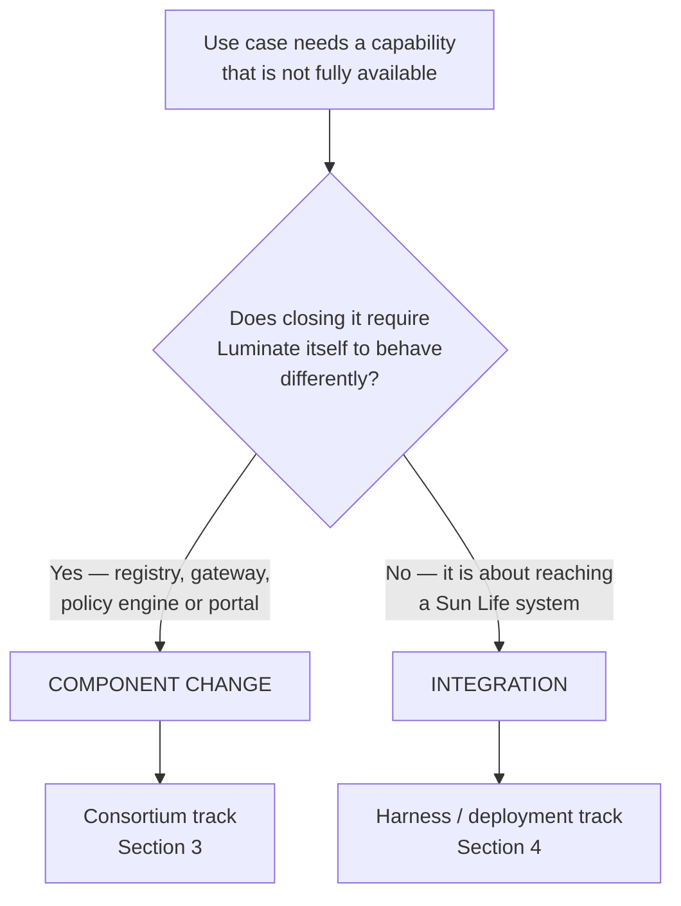

# Capability Gap Escalation

> **When to use this**: a use case needs something the [ACP Capability Map](../capability-map.md)
> marks 🟡 Partial, ⚠️ Modelled-not-enforced, 📐 Designed or ❌ Gap.
>
> **What this decides**: whether the gap is Sun Life's to close or the consortium's, and how a
> consortium ask gets from a discovery session into the Luminate backlog.

---

## 1. The delineation rule

Before anything else, classify the gap. This is the one decision that determines everything
downstream, and getting it wrong is expensive in both directions — a Sun Life plumbing task
raised as a consortium idea wastes the voting process, and a genuine product gap absorbed by
the harness quietly forks Sun Life away from the product.

| | **Component change → consortium** | **Integration → Sun Life** |
|---|---|---|
| The ask sounds like | "ACP must enforce / record / expose …" | "ACP must talk to \<Sun Life system\>" |
| Examples | Per-agent kill switch; quota counter store; model cards; evidence packs; risk triage | Okta tenant wiring; Vault secrets; Traefik ingress; Bedrock consumer accounts; Splunk forwarding; Archer sync |
| Closed by | A consortium idea → spec → upstream delivery | The harness, the Sun Life deployment, or a platform team |
| Tracked in | `acp-consortium-specs` + the consortium board | `acp-product-specs` + the product team board |

**The harness is the load-bearing abstraction here.** It exists precisely so that integrating
with Sun Life's estate does not require an ACP component change. If an integration ask is
pushing toward a component change, that is a signal the harness boundary is wrong — raise it
as a harness design question before raising it as a consortium idea.

**Edge case — shared gaps.** Some asks are both, and they split rather than pick a side.
Audit forwarding is the canonical example: emitting audit events from the ACP store to an
external consumer is a component change; shipping them into Sun Life's Splunk tenant is
integration. Split the ask and track each half on its own side.

---

## 2. Where gaps are identified

Gaps surface in three places, and all three land in the same register:

| Source | Recorded in |
|---|---|
| **Use-case discovery (D0)** — the team selects a capability the map does not fully deliver | The Capability Requirements table in `specs/<spec_type>/<component>/d0-discovery.md`, with the status carried over from the map |
| **Requirements (D1)** — a functional requirement has no capability that satisfies it | The Capability Gaps register in `specs/<spec_type>/<component>/d1-requirements.md` |
| **Operating the platform** — something breaks or falls short in use | A defect on the product team board, then triaged through this process |

Do not open a consortium ask straight from a meeting. The gap has to be written into a spec
first — that is what makes it reviewable, traceable to a use case, and defensible in the
consortium prioritisation conversation.

---

## 3. The consortium track

For gaps classified as **component change**.

### Step 1 — Register it on the Sun Life side

Raise a Jira issue on the product team board (`EACPP`), linked to the onboarding spec's epic.
This is the Sun Life record of the ask, and it is what keeps the use case's dependency
visible even after the work moves upstream.

Record in the issue:

- The capability ID from the map (e.g. `CAP-12`)
- Which use case needs it, and whether it is a launch blocker or a fast follow
- Whether the capability is **mandatory** in the map — a mandatory gap affects *every*
  onboarding, not just the one that found it, and should be framed that way

### Step 2 — Specify it

If the ask needs design before it can be built, write or extend the component's delta spec in
`acp-consortium-specs` under `specs/<component>/`. That repo is the Sun Life-side design
surface that consortium engineers pull from.

A delta spec states: what Luminate does today, what is missing, what should change, and what
the Sun Life MVP already proved about the shape of the solution. It is an upstream
contribution proposal, not a Sun Life feature request.

### Step 3 — Raise it as a consortium idea

Component-level change enters the consortium through the **idea backlog** and goes through
the full process — ideas are prioritised first, then voted.

**Stewards**: Seth Chalmers or Walter. Do not raise ideas directly from a use-case session;
they come through the product team so that related asks are consolidated and the Sun Life
position is coherent.

### Step 4 — Prioritise

The Sun Life position on relative priority is agreed by Seth, Walter and Rob, with Dana
maintaining the cross-workstream view. Priority evidence is the strongest asset here, and it
comes from the specs: *"these three business groups have signed off that they need CAP-12,
and it is mandatory for all of them"* carries the vote in a way that *"we would like quotas"*
does not.

### Step 5 — Close the loop

Once the work is accepted and moves into the consortium:

- Close the Sun Life ticket, **referencing the consortium ticket** — do not leave duplicate
  open work items tracking the same thing on both sides
- Update the affected onboarding specs so the dependent use cases can see where the ask sits
- When it ships, re-verify and update the [capability map](../capability-map.md) — a
  capability moving from ⚠️ to ✅ is exactly the kind of change use cases are waiting on

---

## 4. The Sun Life track

For gaps classified as **integration**.

These stay entirely on the Sun Life side and follow the normal product team spec process —
D0 through D3 in `acp-product-specs`, delivered through the harness, the deployment repos or
a platform team. There is no consortium interaction and no idea to raise.

Harness scope questions are supported by Ranjula's team.

If, during design, an integration ask turns out to require a component change after all,
re-classify it and pick up the consortium track at step 1. That reclassification is a normal
outcome, not a failure — it is usually the point at which the harness boundary gets sharper.

---

## 5. Roles

| Role | Who | Responsibility |
|---|---|---|
| Gap identification | Product team, in D0/D1 with the use case | Name the capability, confirm the need with the use case, write it into the spec |
| Classification | Product team | Apply the delineation rule; split shared asks |
| Consortium idea steward | Seth, Walter | Raise and shepherd ideas through the consortium process |
| Sun Life prioritisation | Seth, Walter, Rob | Agree the Sun Life position before the consortium vote |
| Cross-workstream reporting | Dana | Aggregate Sun Life and consortium status into the delivery view |
| Harness scope | Ranjula's team | Decide what the harness absorbs versus what surfaces as a product gap |
| Architecture representation | Regional / EA architects | Ensure the use case's requirements are represented in ACP terms, not just business terms |

---

## 6. Anti-patterns

- **Raising a consortium idea from a meeting transcript.** The gap must be written into a
  spec and confirmed with the use case first.
- **Classifying by who is inconvenienced rather than by what changes.** The test is whether
  Luminate behaves differently — not whether Sun Life or the consortium finds it easier.
- **Absorbing a component gap into the harness to unblock a date.** That is how Sun Life
  forks away from the product. Escalate it and, if needed, ship a documented interim measure
  that is explicitly temporary.
- **Leaving the Sun Life ticket open after the work moves upstream.** Two open tickets for
  one ask means two different statuses in the delivery view.
- **Presenting a ⚠️ modelled-not-enforced capability as available.** It reads as green and
  holds nothing at runtime. Say what is missing.
- **Treating a mandatory-capability gap as one use case's problem.** If the map marks it
  mandatory, every onboarding inherits it — frame and prioritise it that way.

---

## 7. Worked example — governance mode

The pattern this process describes has already run end to end.

A delta analysis between the Sun Life internal build and Luminate identified that Luminate
had no way to decide which resources were in governance scope or which frameworks applied to
them. That is squarely a component change — it needs the platform itself to behave
differently. It was specified as a delta spec in `acp-consortium-specs`
(`specs/governance-mode/`, [EACPP-915](https://sunlife.atlassian.net/browse/EACPP-915)),
raised into the consortium, and accepted.

It has since landed upstream as the `governance` app: versioned governance rulesets with
monotonic generations and draft-then-activate semantics, and applicability rules that match
on governance-authoritative attributes and assign frameworks. The remaining work — a runtime
consumer for the rulesets and the framework catalogue itself — is tracked as the [CAP-14](../capability-map.md#cap-14)
and [CAP-19](../capability-map.md#cap-19) gaps rather than being re-raised as new asks.

## Related

- [ACP Capability Map](../capability-map.md) — the capability catalogue and gap register
- [ACP Capability Map — Future Roadmap](../capability-roadmap.md) — where an escalated gap
  ends up: [§5](../capability-roadmap.md#5-the-full-ballot) once it is an `ACPDIS`
  idea, and [§6](../capability-roadmap.md#6-not-in-luminate-at-all) while it is
  still only a Sun Life ask. An ask that never becomes an idea **cannot be ranked** at a
  Product Board round, which is what escalation is ultimately for
- [D0→D4 Overview](d0-d4-overview.md) — the gate process
- [GitOps Workflow](gitops-workflow.md) — how spec changes are reviewed and merged
