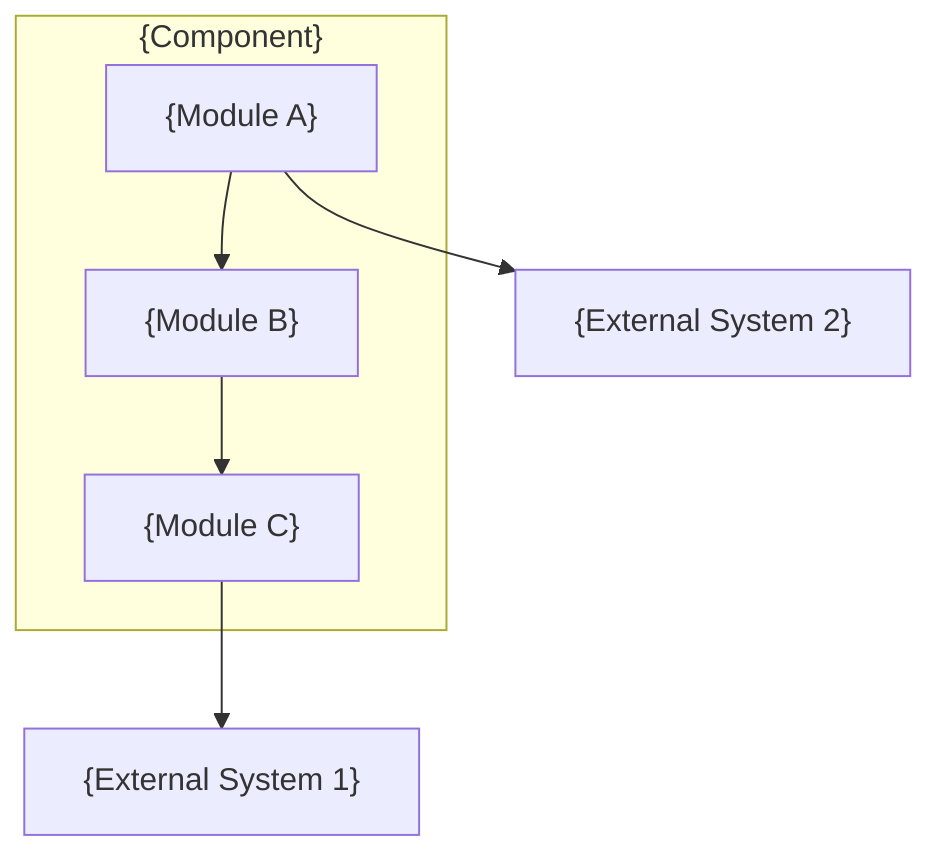
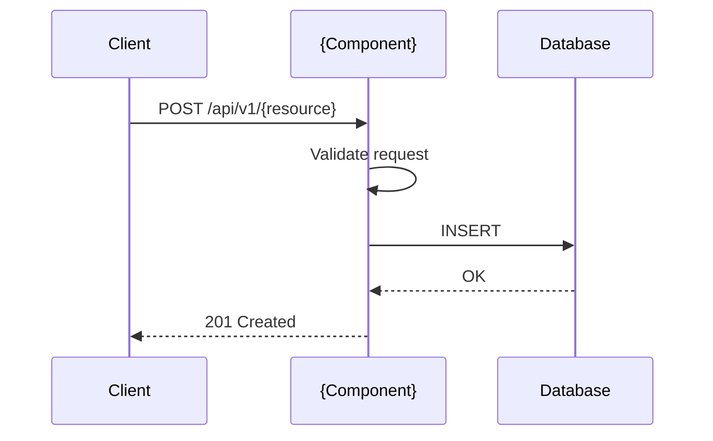
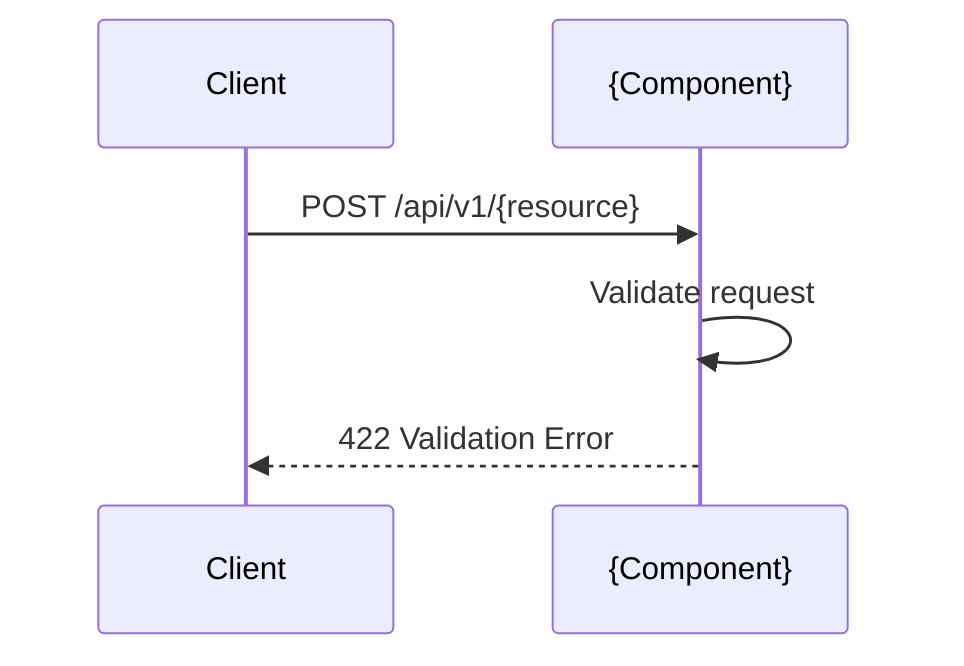
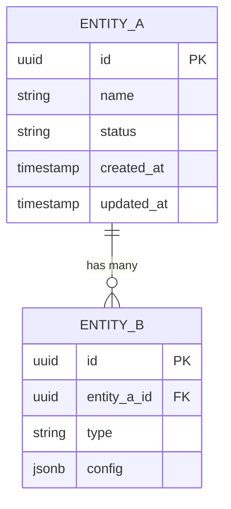

# {Component Name} — D2: Design

> **Gate**: D2 — Design | **Status**: Draft | **Epic**: {EPIC-KEY}

## Architecture Overview



## Key Design Decisions

| Decision | Choice | Alternatives Considered | Rationale |
|----------|--------|------------------------|-----------|
| {What decision} | {What we chose} | {What else we considered} | {Why this choice} |

## Sequence Diagrams

### Flow 1: {Primary Flow Name}



### Flow 2: {Error/Edge Case Flow}



## API Design

### `POST /api/v1/{resource}`

**Request**:
```json
{
  "field1": "string",
  "field2": 42,
  "metadata": {
    "key": "value"
  }
}
```

**Response (201)**:
```json
{
  "id": "uuid",
  "field1": "string",
  "field2": 42,
  "created_at": "2026-01-01T00:00:00Z",
  "status": "active"
}
```

**Error Response (422)**:
```json
{
  "detail": [
    {
      "loc": ["body", "field1"],
      "msg": "field required",
      "type": "value_error.missing"
    }
  ]
}
```

## Data Model



### Database Schema

```sql
CREATE TABLE {entity_a} (
    id          UUID PRIMARY KEY DEFAULT gen_random_uuid(),
    name        VARCHAR(255) NOT NULL,
    status      VARCHAR(50) NOT NULL DEFAULT 'active',
    created_at  TIMESTAMPTZ NOT NULL DEFAULT now(),
    updated_at  TIMESTAMPTZ NOT NULL DEFAULT now()
);

CREATE INDEX idx_{entity_a}_status ON {entity_a}(status);
```

## Error Handling Strategy

| Error Category | HTTP Status | Error Code | Behavior |
|---------------|-------------|------------|----------|
| Validation error | 422 | `VALIDATION_ERROR` | Return field-level errors |
| Not found | 404 | `NOT_FOUND` | Return resource type and ID |
| Conflict | 409 | `CONFLICT` | Return conflicting field |
| Internal error | 500 | `INTERNAL_ERROR` | Log, return generic message |

## Security Considerations

- **Authentication**: {OAuth2 JWT / API key / mTLS}
- **Authorization**: {RBAC / ABAC / clearance-based}
- **Input validation**: {Pydantic models / JSON Schema}
- **Secrets**: {AWS Secrets Manager / env vars}
- **Audit**: {All mutations logged with actor and timestamp}

## Testing Strategy

| Layer | Framework | Coverage Target | Key Scenarios |
|-------|-----------|----------------|---------------|
| Unit | pytest | ≥ 90% | Business logic, validators, transformers |
| Integration | pytest + testcontainers | ≥ 80% | Database queries, API endpoints |
| E2E | Playwright / httpx | Critical paths | Happy path + key error scenarios |

## Observability

| Signal | Tool | Details |
|--------|------|---------|
| Metrics | Prometheus | Request count, latency p50/p95/p99, error rate |
| Logging | Structured JSON | Request ID, actor, operation, duration |
| Tracing | OpenTelemetry | Span per API call, downstream service calls |
| Alerting | Grafana | Error rate > 5%, latency p95 > 500ms |

## Migration/Rollback Plan

{If modifying an existing system:}
- **Forward migration**: {Steps to deploy the change}
- **Backward compatibility**: {How old clients continue to work}
- **Rollback procedure**: {Steps to revert if issues found}
- **Data migration**: {Any schema changes and how to handle them}

## Requirement Traceability

| D1 Requirement | Design Component | Verified By |
|---------------|-----------------|-------------|
| FR-1 | {API endpoint / module} | {Test ID} |
| NFR-1 (latency) | {Caching / query optimization} | {Performance test} |
| US-1 AC-1 | {Sequence flow 1} | {E2E test} |
