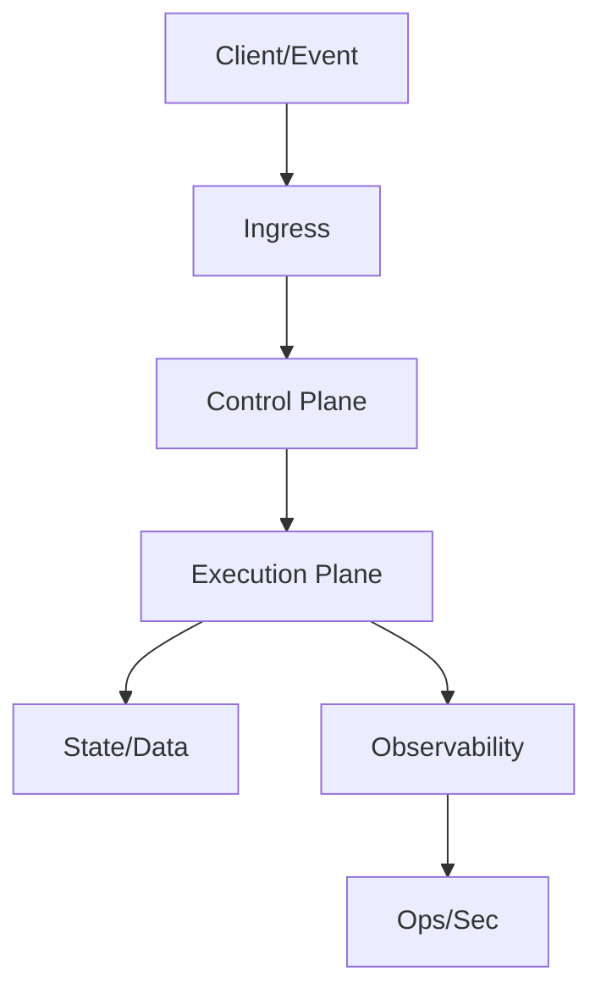

# Design Pattern: [Pattern Name]

**Document status:** [Draft | Candidate Standard | Approved Standard | Deprecated]  
**Pattern owner:** [Team/Role]  
**Approvers:** [EA | Security | Platform | Ops]  
**Version:** [MAJOR.MINOR]  
**Last updated:** [YYYY-MM-DD]  
**Review cadence:** [Quarterly | Semi-annual]  
**Primary audience:** [Enterprise architects, solution architects, engineering, security, operations]  
**Pattern category:** [Application | Integration | Data | Platform | Security | AI/ML]  
**Cloud scope:** [AWS | Azure | GCP | Multi-cloud | On-prem | Hybrid]  
**Technology neutrality:** [Required | Preferred | Not required]

---

## 1. Executive Summary
[2-3 paragraphs describing purpose, value, and where this pattern applies.]

> **Governing principle:** [Single most important architecture rule]

## 2. Business Context and Outcomes
### 2.1 Business capability supported
[Capability/domain]
### 2.2 Measurable outcomes
| Outcome | KPI | Target |
|---|---|---|
| [Outcome] | [Metric] | [Target] |

## 3. Problem Statement and Intent
### 3.1 Problem
[What goes wrong without this pattern]
### 3.2 Pattern intent
[What this pattern standardizes]
### 3.3 Non-goals
[What this pattern intentionally does not cover]

## 4. Pattern Summary
| Attribute | Description |
|---|---|
| Pattern name | [Name] |
| Pattern type | [Type] |
| Primary runtime/orchestrator | [Service/Platform] |
| Reliability model | [Retries, idempotency, isolation, etc.] |
| Security model | [Identity, authz, encryption, boundaries] |
| Best suited for | [Use cases] |
| Not suited for | [Anti-use cases] |
| Maturity | [Conceptual | Validated | Production-proven] |

## 5. Applicability
### 5.1 Good fit
| Use case | Why fit |
|---|---|
| [Use case] | [Rationale] |

### 5.2 Poor fit
| Use case | Why not fit |
|---|---|
| [Use case] | [Rationale] |

## 6. Reference Architecture
### 6.1 Architecture diagram

### 6.2 Logical layers
| Layer | Responsibility |
|---|---|
| [Layer] | [Responsibility] |

## 7. Core Design Principles
### 7.1 [Principle name]
[1-2 sentence rule]
### 7.2 [Principle name]
[1-2 sentence rule]
### 7.3 [Principle name]
[1-2 sentence rule]

## 8. Component Model
### 8.1 Component catalog
| Component | Purpose | Failure mode | Scaling model |
|---|---|---|---|
| [Component] | [Purpose] | [Failure mode] | [Horizontal/Vertical/etc.] |

### 8.2 Interaction contracts
| Interface | Protocol | Contract | Versioning |
|---|---|---|---|
| [Interface] | [HTTP/gRPC/Event] | [Schema/API] | [Strategy] |

## 9. Non-Functional Requirements (NFR)
| NFR | Target | Validation method |
|---|---|---|
| Availability | [e.g., 99.9%] | [Test/monitoring] |
| Latency | [e.g., P95 < 2s] | [Load test] |
| Throughput | [Target] | [Perf test] |
| RTO | [Target] | [DR test] |
| RPO | [Target] | [Backup/restore test] |

## 10. Security and Compliance Baseline
### 10.1 Identity and access model
| Identity type | Scope | Least-privilege guidance |
|---|---|---|
| [Workload/User] | [Scope] | [Guidance] |

### 10.2 Control baseline
| Control ID | Standard/Policy | Requirement | Applies when | Evidence artifact |
|---|---|---|---|---|
| [CTRL-001] | [ISO/NIST/Internal] | [Requirement] | [Condition] | [Log/report/config] |

### 10.3 Threat model
| Threat | Risk | Mitigation | Residual risk |
|---|---|---|---|
| [Threat] | [Risk] | [Control] | [Residual] |

## 11. Data and State Architecture
### 11.1 Data classification and boundaries
| Data class | Allowed | Boundary rules | Retention |
|---|---:|---|---|
| [Class] | Yes/No | [Rule] | [Duration] |

### 11.2 State management
| State type | Storage | Consistency | TTL/retention |
|---|---|---|---|
| [Type] | [Store] | [Strong/Eventual] | [TTL] |

## 12. Reliability and Resilience Patterns
| Pattern | Trigger | Behavior | Recovery |
|---|---|---|---|
| Retry/backoff | [Trigger] | [Behavior] | [Recovery] |
| Circuit breaker | [Trigger] | [Behavior] | [Recovery] |
| Fallback | [Trigger] | [Behavior] | [Recovery] |

## 13. Observability and Audit
### 13.1 Minimum telemetry
| Signal | Required fields | Retention |
|---|---|---|
| Logs | [Fields] | [Duration] |
| Metrics | [Fields] | [Duration] |
| Traces | [Fields] | [Duration] |

### 13.2 Alerts and SLOs
| Alert | Threshold | On-call action |
|---|---|---|
| [Alert] | [Threshold] | [Action] |

## 14. Deployment and Environment Strategy
### 14.1 IaC scope
[What must be deployed through IaC]
### 14.2 Environments
| Environment | Purpose | Entry criteria |
|---|---|---|
| Dev | [Purpose] | [Criteria] |
| Test | [Purpose] | [Criteria] |
| Pre-prod | [Purpose] | [Criteria] |
| Prod | [Purpose] | [Criteria] |

### 14.3 Release and rollback
| Phase | Change scope | Rollback strategy |
|---|---|---|
| [Phase] | [Scope] | [Strategy] |

## 15. Operations and Support Model
### 15.1 Ownership (RACI)
| Role | Responsible | Accountable | Consulted | Informed |
|---|---|---|---|---|
| [Role] | [Y/N] | [Y/N] | [Y/N] | [Y/N] |

### 15.2 Runbook topics
- [Incident response]
- [Capacity management]
- [Security event handling]
- [DR failover/failback]

## 16. Cost Model and FinOps
| Cost driver | Unit economics | Optimization lever |
|---|---|---|
| [Driver] | [$/unit] | [Optimization] |

## 17. Risks, Assumptions, Constraints, Decisions
### 17.1 Risks
| Risk | Impact | Mitigation | Owner |
|---|---|---|---|
| [Risk] | [Impact] | [Mitigation] | [Owner] |

### 17.2 Assumptions and constraints
- [Assumption]
- [Constraint]

### 17.3 ADR references
- [ADR-001: Title]
- [ADR-002: Title]

## 18. Anti-Patterns
| Anti-pattern | Why problematic | Preferred approach |
|---|---|---|
| [Anti-pattern] | [Issue] | [Preferred] |

## 19. Decision Matrix
| Question | Recommendation |
|---|---|
| [Question] | [Recommendation] |

## 20. Implementation Checklist
### 20.1 Architecture
- [ ] [Item]
### 20.2 Security
- [ ] [Item]
### 20.3 Reliability
- [ ] [Item]
### 20.4 Operations
- [ ] [Item]
### 20.5 Compliance/Audit
- [ ] [Item]

## 21. Reference Implementation (Optional)
[Concrete implementation example, clearly marked non-prescriptive.]

## 22. Source References
- [Reference title + URL]
- [Policy/standard references]
- [Internal architecture decisions]
