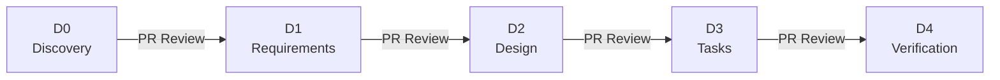

# ACP Specs — Spec-Driven Development

Component-level specifications for the **Enterprise Agentic Control Plane** (ACP),
organized in a D0→D4 maturity gate model.

## What Is This?

This site publishes the ACP specification repository as browsable documentation.
Specs are the source of truth for design decisions, requirements, and implementation
plans — reviewed via pull requests and synced to Confluence for broader visibility.

## D0→D4 Maturity Gates

| Gate | Name | Purpose | Artifact |
|------|------|---------|----------|
| **D0** | Discovery | Problem statement, opportunity, stakeholders | `d0-discovery.md` |
| **D1** | Requirements | User stories, acceptance criteria, API contracts | `d1-requirements.md` |
| **D2** | Design | Architecture, sequence diagrams, data models | `d2-design.md` |
| **D3** | Implementation Plan | Sprint-ready tasks, dependencies, estimates | `d3-tasks.md` |
| **D4** | Verification | Test results, performance, security, release | `d4-verification.md` |

## Quick Links

- [Status Dashboard](specs/README.md) — All 18 components with current gate status
- [D0→D4 Process](process/d0-d4-overview.md) — Full process guide
- [Design Review Guide](process/design-review-guide.md) — How to conduct design reviews
- [Templates](https://bitbucket.sunlifecorp.com/projects/EDAEACP/repos/acp-product-specs/browse/docs/templates) — Spec templates for new components

## Spec Lifecycle

## Jira Boards

- [Spec-Driven Epic Board](https://sunlife.atlassian.net/jira/software/c/projects/EACPP/boards/23827)
- [Spec-Driven Stories Board](https://sunlife.atlassian.net/jira/software/c/projects/EACPP/boards/23828)
