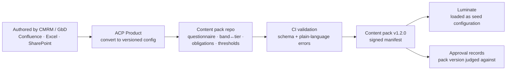

# Governance Content Packs — D0: Discovery

> **Gate**: D0 — Discovery | **Status**: Draft | **Epic**: TBD
> **Owner**: ACP Product (Seth Chalmers) · **Content authorities**: CMRM (Ryan Bolick), GbD (Duncan Wyllie, Kathryn Vandenberg)
> **Source**: [12 August 2026 alignment session](../governance-intake/artifacts/2026-08-12-model-risk-gbd-alignment-minutes.md) ·
> [decisions & actions](../governance-intake/artifacts/2026-08-12-decisions-and-actions.md) (D18, D4, D5, D9, D16)

## Problem Statement

The content that governs AI use cases at Sun Life — the questionnaire, the validation
obligations, the metric thresholds, the risk-tier map — is authored in Confluence, Excel and
SharePoint. None of it is in a form the platform can load. Today the only route from a published
guide to enforced behaviour is a person re-keying it into code or a screen.

That was tolerable while ACP was an internal build where one change landed in one repo. It is not
tolerable now. Per decision **D18** the *engine* goes upstream to Luminate and is shared with other
consortium members, while Sun Life's *content* stays ours. If our content is not machine-readable
and versioned, the only way to change Sun Life behaviour is to change shared consortium code —
which defeats the point of the split and makes our tiers, thresholds and gate names someone else's
maintenance burden.

There is a second, sharper problem. Thresholds and obligations change. If an approval does not
record **which version** of the questionnaire, obligation set and thresholds it was judged against,
then raising a threshold silently changes the compliance status of everything already approved, and
no past decision can be reproduced for an auditor.

## Background & Drivers

- **D18 — engine upstream, content ours.** Sun Life content must be versioned configuration in a
  git repository, not a document.
- **D4 / D5 — "policies" are renamed "obligations"**, and the schema must be domain-agnostic:
  privacy and other risk domains will author against the same convention, not a model-risk-shaped
  one.
- **D9 — content authority stays with CMRM and GbD; ACP Product maintains the mechanics.** The
  same rule was requested for the band ↔ tier map, the obligation set, the gate bindings and the
  metric thresholds. Solving it once, here, avoids answering it four times.
- **D16 — the metric library needs calibration metadata**, so the metric content is not just a list
  of names; it carries what "calibrated" means and how a judge is proven to be tested.
- **CMRM already authors in YAML** (`ValidationPolicySpecifications_CMRM.yaml`). The structured
  form partially exists. The work is agreeing the field set and building the release path — not
  inventing a format, and explicitly **not** introducing a translation step between two formats,
  which becomes a permanent source of drift.

## Opportunity

One pipeline, four content types, one version number:

Authors change nothing about how they work. The platform stops guessing.

## Scope

### In Scope

| # | Capability | Description |
|---|-----------|-------------|
| 1 | Content pack schema | One schema per content type: questionnaire, band↔tier map, obligation set, metric thresholds. Domain-agnostic obligation shape (D5). |
| 2 | Content repository | Versioned git repo holding the packs; CMRM/GbD contribute or review here, ACP Product maintains. |
| 3 | Conversion | Published CMRM/GbD content (Field Guide xlsx, Confluence obligation registry, Metric Selection Guide) → pack files, kept in step as sources change. |
| 4 | Automated validation | CI schema validation with plain-language errors, so an author sees what is wrong without running anything. |
| 5 | Semantic diff / review | Changes proposed with a readable summary of what changed in meaning; the content owner approves the substance, not the file. |
| 6 | Versioned release | Numbered content pack (semver) with a manifest covering all four content types together. |
| 7 | Luminate seed load | Packs consumed as seed configuration by the governance engines — never hardcoded values. |
| 8 | Version pinning in approvals | An approval, gate decision or evidence record carries the pack version it was judged against (reproducibility). |
| 9 | Metric calibration metadata | Thresholds carry calibration requirements so an uncalibrated LLM-as-judge is detectable (D16). |

### Out of Scope

- The **engines** that consume the packs — consortium (`EACPP-915` Governance Mode,
  `governance-risk-triage` EACPP-648, `model-agent-evaluation` EACPP-647).
- Authoring the content itself — CMRM and GbD remain the content authorities.
- Ryan's granular per-obligation assessment rubrics — a human process design; ACP consumes the
  output as content.
- Replacing Confluence or Excel as the authoring surface.

## Stakeholders

| Stakeholder | Role | Key Concern |
|-------------|------|-------------|
| Ryan Bolick | CMRM / Model Risk | Owns obligation content, questionnaire, metric guide; must not be forced into a new authoring tool |
| Kathryn Vandenberg | Governance-by-Design | Consistency across risk domains; requirements carried identically in GbD and ACP |
| Duncan Wyllie | GbD | Assessment module content; standard question capture beyond model risk |
| Seth Chalmers | ACP Product | Owns the pipeline, schema and release mechanics |
| Colin Bell | ACP | Consortium/product split discipline; nothing Sun Life-specific upstream |
| Consortium engineering | Luminate | Packs must load as seed config with no member-specific code |

## Open Questions

| # | Question | Owner |
|---|---|---|
| CP-Q1 | Do CMRM/GbD contribute to the pack repo directly, or only review the semantic diff of an ACP-authored change? | Ryan, Duncan, Seth |
| CP-Q2 | Is the pack repo Bitbucket (Sun Life) or the consortium GitHub Enterprise? Content is Sun Life-confidential, which argues Bitbucket. | Seth, Colin |
| CP-Q3 | One pack version spanning all four content types, or independent versions per type? One number is simpler to cite in an approval; independent versions churn less. | Seth |
| CP-Q4 | On a pack upgrade, are already-approved assets re-evaluated, grandfathered, or flagged? | Ryan, Kathryn |
| CP-Q5 | Does the obligation schema converge with CMRM's existing `ValidationPolicySpecifications_CMRM.yaml`, or is that file the pack? Preference is the latter — no translation step. | Ryan, Seth |

## References

- Alignment brief §1, §2, §6, §11 — `acp-consortium-specs/governance-docs/acp_model_risk_gov_by_design_alignment_brief.md`
- Decisions & actions register — [D4, D5, D9, D16, D18; A1, A6, A13](../governance-intake/artifacts/2026-08-12-decisions-and-actions.md)
- Roadmap §2 C3/C5, §3.2 — [governance-alignment-roadmap](../governance-intake/artifacts/2026-08-12-governance-alignment-roadmap.md)
- CMRM obligations (Confluence): <https://sunlife.atlassian.net/wiki/x/BYHFVBo>
- CMRM per-obligation specs (Confluence, WIP): <https://sunlife.atlassian.net/wiki/x/UALAVBo>
- GenAI Evaluation Metric Selection Guide: <https://sunlife.atlassian.net/wiki/x/u4EuVRo>
- GenAI Model Risk Classification Field Guide (xlsx): <https://sunlifefinancial.sharepoint.com/sites/RiskMgmt/CMRM/RefMat_Public/RiskClass/GenAI_ModelRiskClassification_FieldGuide.xlsx>
- Consuming specs: [`governance-intake`](../governance-intake/d0-discovery.md) · consortium Governance Mode `EACPP-915`
