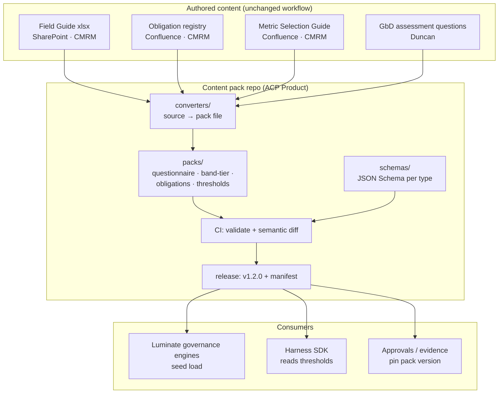

# Governance Content Packs — D2: Design

> **Gate**: D2 — Design | **Status**: Draft | **D1 Approved**: TBD
> Sun Life content mechanics. Nothing here ships to the consortium; the packs are member configuration.

## Design Overview



## Design Decisions

### DD-1 — CMRM's YAML is the pack, not a source for the pack
Where CMRM already authors structured content (`ValidationPolicySpecifications_CMRM.yaml`), that
file becomes the pack file directly, with the schema adjusted to fit it rather than the reverse. A
converter exists only where the source is genuinely unstructured (xlsx, Confluence prose).
This is the single most important decision in the spec: a translation layer between two structured
formats is a permanent drift generator. **Effort S / Risk Low** — the risk is organisational
(agreeing the field set three ways, D6), not technical.

### DD-2 — Schema per content type, one version for the pack
Four JSON Schemas, each independently versioned; one semver pack that binds a specific version of
each. An approval cites one number. Resolves CP-Q3 in favour of a single citable version, at the
cost of a version bump when any type changes. **Effort S / Risk Low.**

### DD-3 — `domain` is first-class on the obligation schema
Modelled from day one with model risk **and** privacy present, so the shape cannot silently become
model-risk-only (D5). Domain owners add their own obligations without a schema change.
**Effort S / Risk Med** — the risk is that a domain arrives with a requirement the shape cannot
express; mitigated by an extension map validated per domain.

### DD-4 — Execution mode and prerequisites make obligations a dependency graph
`execution_mode` ∈ {human, hybrid, automated} and `prerequisites: [obligation_id]`. The gate engine
walks the graph; an obligation cannot be satisfied before its prerequisites are. Human-only
obligations are terminal for automation — the engine may record but never satisfy them (D10, D11).
Documentation ingestion (change log, assumptions, methodology) is expressed as the root
prerequisite set, not as special-case code. **Effort M / Risk Low.**

### DD-5 — Validation in CI with author-readable errors
JSON Schema for structure, plus semantic rules schema cannot express (prerequisite cycles, dangling
references, a band with no obligations, a threshold with no metric). Errors name the file, the
entry and the expectation in plain language. **Effort M / Risk Low.**

### DD-6 — Semantic diff is the review surface
CI renders what changed in meaning — "MBCT-DOC-2 added, applies to bands A/AA", "faithfulness
threshold 0.80 → 0.85 for band B" — and that summary is what the content owner approves. The file
diff remains available but is not the review artifact. **Effort M / Risk Low.**

### DD-7 — Pack version is pinned into every governance decision
Approvals, gate decisions and evidence records carry `content_pack_version`. Without this, raising a
threshold silently re-scores everything already approved and no past decision is reproducible.
Requires a field on the consortium side — coordinate with `EACPP-915` T5/T6.
**Effort S / Risk Med** — the risk is a cross-team dependency, not complexity.

### DD-8 — Packs are Sun Life-confidential and live in Bitbucket
Resolves CP-Q2: the pack repo is `EDAEACP/acp-governance-content` on Bitbucket. Luminate receives a
pack as a deployment-time artifact, not by cloning a repo the consortium can read.
**Effort S / Risk Low.**

## Pack layout

```
acp-governance-content/
  schemas/
    questionnaire.schema.json
    band-tier-map.schema.json
    obligations.schema.json
    thresholds.schema.json
  packs/
    questionnaire/genai-model-risk-field-guide.yaml
    band-tier-map/sunlife-model-risk-tiers.yaml
    obligations/mbct-genai-validation.yaml      # CMRM-authored, used as-is (DD-1)
    obligations/privacy.yaml                    # second domain from day one (DD-3)
    thresholds/genai-evaluation-metrics.yaml
  converters/                                   # only for unstructured sources
  manifest.yaml                                 # pack version + per-file checksums
```

## Migration / Adoption Path

1. Agree the obligation field set three ways (ACP / CMRM / GbD) — blocking for everything else.
2. Stand up the repo, schemas and CI validation with the existing CMRM YAML as the first pack file.
3. Convert the Field Guide and band↔tier map; release `v0.1.0`.
4. Convert the metric guide into thresholds; add calibration metadata.
5. Wire the Luminate seed load and the `content_pack_version` pin on approvals.
6. Add the semantic diff and the upgrade policy.

## Non-Goals

- Becoming the authoring tool. If a risk specialist has to learn git to do their job, this design
  has failed.
- Holding evidence, decisions or any runtime record. Packs are input configuration only.
- Covering the "30 other risks" outside this governance scope (Mark Jarvis, 41:19) — a domain is
  added only when its owner brings obligations to author.
