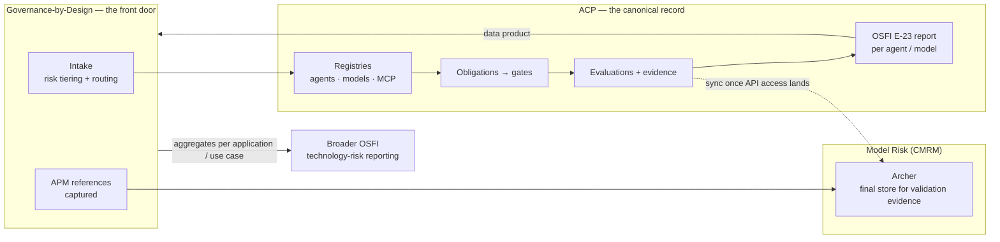

# ACP × Model Risk × Governance-by-Design — Decisions & Actions Register

> **Component**: `governance-intake` · **Type**: Artifact (decisions & actions register)
> **Status**: Draft for circulation — please correct anything mis-recorded.

Source: [alignment session, 12 August 2026](2026-08-12-model-risk-gbd-alignment-minutes.md) (53m).
Every row below is traceable to a timestamp in that transcript. Nothing has been added that was not said.

*In plain terms: what we agreed, who owns it, and what happens next.*

---

## 1. The shape of the agreement

**Read it as:** GbD is the front door and the aggregator. ACP is the system of record for everything
that happens after registration. Archer remains the final resting place for validation evidence,
but nothing in ACP waits on it.

---

## 2. Decisions

| # | Decision | Raised by | Time | Consequence |
|---|---|---|---|---|
| **D1** | **ACP is the canonical record** for agents, models, MCP tools, decisions, traces and evidence. | Seth | 14:54 | Everything needed for a governance report is produced in ACP. |
| **D2** | **No dependency on Archer** to produce a report. Archer bidirectional sync comes later, once API access lands. | Seth | 31:34, 32:57 | Archer integration is de-risked off the critical path. |
| **D3** | Archer remains the **final store for validation evidence**, use-case registration and model-risk classification. ACP is the mechanism that collects, packages and pushes. | Ryan | 23:31, 31:22 | ACP → Archer is a publish, not a fork of the record. |
| **D4** | **Rename "policies" → "obligations"** to avoid collision with actual Sun Life policy terminology (there are six). | Ryan | 12:32 | Ripples through every ACP governance doc and the data model. |
| **D5** | **Other risk domains** (privacy, and others) define their obligations using the **same convention**. | Ryan / Kathryn | 12:51, 13:09 | Obligation schema must be domain-agnostic, not model-risk-shaped. |
| **D6** | This is **"a bit of a triangle"** — ACP, GbD and Model Risk must stay aligned, with consistent Archer integration and consistent information carried across both systems. | Kathryn | 13:09 | Any schema change needs three-way sign-off. |
| **D7** | **Reporting splits by scope.** OSFI **E-23** reporting is handled by **ACP at a high level**, per agent/model. Broader OSFI **technology-risk** reporting comes out of **GbD**, per application/use case. | Kathryn | 42:09 | Two report surfaces, one data source. |
| **D8** | **GbD is a consumer of ACP's data products** — *"we would be a consumer of your data products, essentially."* | Duncan | 42:05 | ACP must expose governance data as a stable, documented read interface. |
| **D9** | **Risk classification: ACP Product maintains the API/module; the content is owned by Model Risk + GbD.** GbD already has an assessment module + risk-scoring engine that could expose an API. **Interface still to be decided.** | Seth / Duncan | 9:09, 9:53 | Build the module against an interface, not against a fixed questionnaire. |
| **D10** | **Human-first, then codify.** Ryan is writing granular per-obligation assessments with actionable success criteria; the process runs human-driven first and is then translated into something an agent can ingest. | Ryan | 18:28, 19:43 | Every gate needs a manual mode; automation is an upgrade, not a precondition. |
| **D11** | **Documentation-ingestion is the first step** (change log, assumptions, methodology). Later assessments take that documentation as **prerequisites**. | Ryan | 20:34 | Obligations have a dependency chain; gates check prerequisites. |
| **D12** | **Don't force one evaluation tool.** Offer a **baseline evaluation suite covering ~80% of workloads**, easily usable — but the **model owner is ultimately responsible** under policy. | Colin | 49:00 | ACP stays tool-agnostic; the baseline is a convenience, not a mandate. |
| **D13** | Resolution to Kalyan's concern that unbounded adapters are an operational nightmare: the **harness + normalised evidence contract** makes ACP tool-agnostic — teams use any tool as long as they feed the evaluation API. | Seth / Kalyan | 45:17, 46:46, 43:45 | The contract is the standard, not the tool list. |
| **D14** | **Three layers of evaluation / observability** (Colin's framing, agreed by all): (a) **registration/onboarding** — assess risk, determine required evaluations, run them; (b) **scheduled/periodic** re-evaluation driven by risk; (c) **per-inference execution** — pull one execution end-to-end when a client asks *"why was I denied?"*. Aggregate at (a) and (b); (c) stays in operational observability but must be retrievable. | Colin | 35:05–38:16 | Defines what is aggregated vs what is merely retrievable. |
| **D15** | **APM records** tie technology dependencies to Archer use cases, rather than inventing a platform-level record in Archer. **GbD intake captures APM references** and passes them on. | Ryan / Duncan | 23:53, 24:26 | No new Archer record type; ACP passes APM through. |
| **D16** | **Metric library with calibration.** Need to detect uncalibrated LLM-as-judge and ensure teams test their judges. | Ryan | 50:08 | Calibration is a first-class feature of the metric library, not a note. |
| **D17** | **"ACP on a page" draft 1 committed by the 21st**, to be layered with Anirban's orchestration work. | Colin | 3:45, 4:52 | Hard date. Feeds the deployment conversation. |
| **D18** | Engine goes **upstream to Luminate**; Sun Life content stays **ours, as versioned configuration in a git repository**. | Seth | 5:02 | Every capability generally yields two linked work items. |

### Open questions (raised, not closed)

| # | Question | Raised by | Time |
|---|---|---|---|
| **Q1** | Could a **synthetic / mock Archer** be stood up so Archer access isn't the blocker? | Ryan | 32:33 |
| **Q2** | What is the right **interface** between GbD's assessment module / risk-scoring engine and ACP's risk-classification module? | Duncan | 9:09 |
| **Q3** | How do we avoid **duplicating evidence artifacts** between evaluation tools and ACP, and how are artifacts scheduled and linked back to a use case / risk requirement? | Kalyan | 27:36 |
| **Q4** | Is Archer doing **ongoing monitoring** today, and should GbD provide that instead given it will hold the data anyway? | Kathryn | 33:54 |
| **Q5** | Which directives should teams **prioritise first** as they onboard to ACP? | Robert | 41:31 |
| **Q6** | Scope discipline — there are *"30 other risks that aren't handled by this"*; keep the boundary explicit. | Mark | 41:19 |
| **Q7** | Composable sub-agents: assessing at **application level and agent level** — agreed as direction, explicitly *"a long way in the future"*. | Colin | 42:26 |

---

## 3. Actions

| # | Action | Owner | Depends on | Notes |
|---|---|---|---|---|
| **A1** | Rename **policies → obligations** across ACP governance specs, drafts and the data model. | Seth | D4 | Only where it means *governance requirement*; access/network policy keeps its name. |
| **A2** | Publish **"ACP on a page" draft 1**, layered with orchestration approaches. | Colin (with Anirban) | — | **Committed for the 21st.** |
| **A3** | Send **deployment specs** to Anirban; link ACP specs for reference. | Seth | — | Promised in-session (5:02). |
| **A4** | Send the **DBTS ET slide deck** (open decisions) to Anirban. | Colin | — | Promised in-session (3:45). |
| **A5** | Provide **feedback on Mohamed's agent risk-classification proposal** — confirm it aligns with model-risk expectations. | Ryan's team | — | In flight; *"we'll have some feedback for you soon."* |
| **A6** | Continue building **granular per-obligation assessments** with success criteria and rubric. | Ryan | D10 | Human-followable first; agent-ingestible second. |
| **A7** | Define the **documentation-ingestion step** (change log, assumptions, methodology) as the first gate. | Ryan → Seth | D11 | Deterministic checks plus an agent quality check. |
| **A8** | Design **ACP's obligation registry + gate engine** so obligations map to gates, evidence needs and human-in-the-loop approvals per risk band. | Seth | D4, D5, D10, D11 | Low risk ⇒ fewer steps. |
| **A9** | Expose ACP governance data as a **documented data product** GbD can consume. | Seth | D7, D8 | Contract needed before GbD builds against it. |
| **A10** | Confirm scope of the **ACP-produced OSFI E-23 report** vs GbD technology-risk reporting. | Seth + Kathryn | D7 | Avoid two teams reporting the same control. |
| **A11** | Stand up a **synthetic / mock Archer** so Archer access is not on the critical path. | Seth | Q1, D2 | Answer given: lean on ACP registries; mock the sync target. |
| **A12** | Design **evidence storage** to avoid duplicating artifacts, with scheduling and linkage to use case / risk requirement. | Seth + Kalyan | Q3 | Data may stay in workload accounts; the record comes back to ACP. |
| **A13** | Build the **metric library with calibration checks** (detect uncalibrated LLM-as-judge; prove judges are tested). | Seth | D16 | Port Ryan's metric-selection guidance into the product. |
| **A14** | Define the **baseline evaluation suite** covering ~80% of workloads, easily usable, not mandated. | Colin / Mark / Ryan / Kalyan | D12, D13 | Decision is organisational, not architectural. |
| **A15** | Capture **APM references** at intake and pass them through to Archer use cases. | Duncan → Ryan | D15 | ACP inherits and forwards. |
| **A16** | Agree the **risk-classification interface** between GbD's assessment module and ACP. | Seth + Duncan | Q2, D9 | Explicitly taken offline. |
| **A17** | Map **what information is needed at what stage of maturity**, end-to-end: intake → approval → build → test → lineage. | Kathryn + Ryan | D6 | Other governance domains want the same information. |
| **A18** | Agree **Archer integration + model-risk oversight** across the three parties. | Kathryn + Ryan + Seth | D3, D6 | The "triangle" conversation. |

---

## 4. Follow-up meetings promised in the session

| # | Meeting | Participants | Purpose | Time promised |
|---|---|---|---|---|
| **M1** | Risk-classification interface | Seth + **Duncan** | API interface between GbD's assessment module / scoring engine and ACP; who maintains what. | 10:45 |
| **M2** | Evidence artifact storage | Seth + **Kalyan** | Avoid duplicating artifacts between eval tools and ACP; scheduling; linkage of artifacts to use case / risk requirement. | 43:45 |
| **M3** | Agent risk-classification proposal | **Ryan's team** → Kathryn / Seth | Feedback on Mohamed's proposal. | 8:02 |
| **M4** | Information at stage of maturity | **Kathryn + Ryan** | End-to-end workflow; where approvals occur; where lineage data goes. | 21:21 |
| **M5** | Archer integration + model-risk oversight | ACP / GbD / Model Risk | What full Archer integration and model-risk oversight look like. | 13:09 |
| **M6** | Tooling standardisation | **Colin / Mark / Ryan / Kalyan** | Baseline suite vs open choice; enterprise evaluation strategy. | 48:34 |
| **M7** | Deployment / orchestration | **Anirban + Colin** (+ Seth sending specs) | Runtime deployment, orchestration approaches, "ACP on a page". | 2:52 |

---

## 5. Terminology fixed in this session

| Old | New | Why |
|---|---|---|
| Policies (as YAML) | **Obligations** | "Policy" already means one of six Sun Life corporate policies. |
| Policy registry | **Obligation registry** | Same reason. |
| — | **Access policy / gateway policy** | Unchanged — this genuinely is policy in the enforcement sense. |
| Evaluation tool integrations | **Evidence producers** | Any tool can produce evidence; ACP normalises it. |
| Report | **E-23 report (ACP)** vs **technology-risk report (GbD)** | Two different audiences and scopes. |
