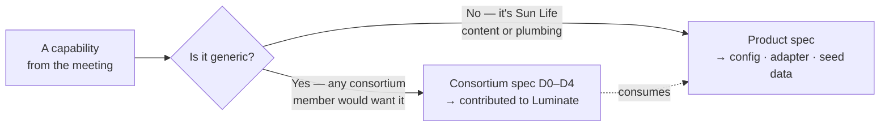
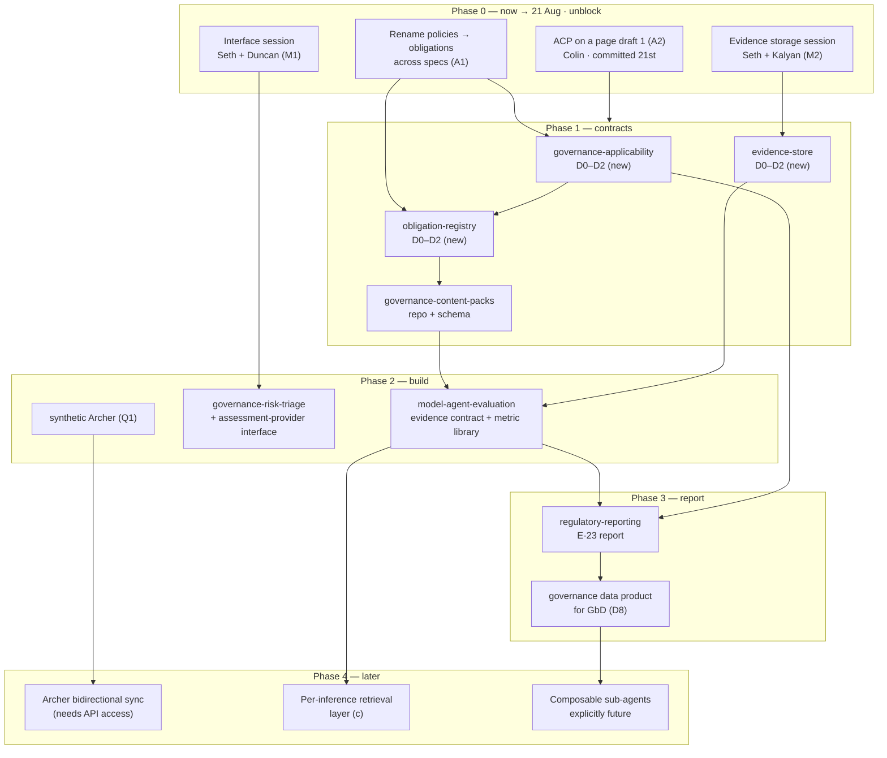

# Governance Mode — Action Plan, Work Split & Spec Breakdown

> **Component**: `governance-intake` · **Type**: Artifact (roadmap & work breakdown)
> **Status**: Proposal — for review before specs and epics are created.

Derived from the [12 August 2026 alignment session](2026-08-12-model-risk-gbd-alignment-minutes.md)
and its [decisions & actions register](2026-08-12-decisions-and-actions.md).
Roadmap idea: **ACPDIS-81** · D1 design PR: **luminate-designs #122**.

*In plain terms: what gets built, in what order, by whom, and which ticket it lives under.*

---

## 1. The splitting rule

**Rule** (Decision D18): the **engine** goes upstream to Luminate; the **content** stays ours as
versioned configuration. Most capabilities therefore produce **two linked items** — one consortium,
one product. Anything that is neither is called out in §5.

**Guardrail**: Archer, Collibra, sub-classification codes, Sun Life tier names, PIA/ISRA/ATG and
OSFI frequencies are **member configuration** — never consortium core.

---

## 2. Capability → work split

| # | Capability (from the meeting) | Consortium — generic engine | Product — Sun Life content |
|---|---|---|---|
| C1 | Attribute-driven **governance applicability** & enforcement (which regime applies, governed vs ungoverned) | **NEW** `governance-applicability` | `governance-intake` — Sun Life applicability rules |
| C2 | **Risk classification** module (D9) | `governance-risk-triage` (EACPP-648) + external assessment-provider interface | `governance-intake` — CMRM Field Guide, band ↔ MRM tier map, GbD API adapter |
| C3 | **Obligations** as data + gates + human-first execution (D4, D5, D10, D11) | **NEW** `obligation-registry` | **NEW** `governance-content-packs` — CMRM's 40 obligations / 9 domains as seed |
| C4 | **Evaluation framework**, tool-agnostic evidence producers (D12, D13) | `model-agent-evaluation` (EACPP-647) | `acp-aws-harness-sdk` (EACPP-791) — baseline suite, Openlayer/Langfuse wiring |
| C5 | **Metric library + judge calibration** (D16) | `model-agent-evaluation` (extend) | `governance-content-packs` — Ryan's metric-selection guide as seed |
| C6 | **Evidence store** — canonical record, no duplication (D1, Q3) | **NEW** `evidence-store` | `governance-intake` — Sun Life retention, workload-account placement |
| C7 | **E-23 report** + governance **data products** for GbD (D7, D8) | `regulatory-reporting` (EACPP-649) | `governance-intake` — OSFI frequencies, report templates, GbD feed |
| C8 | **Three layers** of evaluation/observability (D14) — layer (c) retrievability | `observability-monitoring` (EACPP-826) | `sunlife-deployment` (EACPP-596) — Splunk/Langfuse wiring |
| C9 | **Machine access** to registries (prerequisite for all of the above) | `programmatic-registry-api` (EACPP-759) | — |
| C10 | **Lifecycle states** carrying governance status | `agent-registry` (646) · `model-registry` (650) · `mcp-registry` (651) | `governance-intake` — Sun Life gate names, LoD sign-off |
| C11 | **Archer / GRC sync** + synthetic Archer + APM pass-through (D2, D3, D15, Q1) | generic GRC connector in `governance-risk-triage` | **NEW** `archer-grc-sync` — Archer adapter, mock Archer, APM references |

---

## 3. Proposed spec / epic breakdown

### 3.1 Consortium specs (`acp-consortium-specs` → Luminate)

| Spec | Epic | State | Change needed |
|---|---|---|---|
| `governance-applicability` | **new** | — | **Create D0–D3.** Attributes → applicable frameworks/obligations; governed vs ungoverned; enforcement at the gateway; recompute/backfill. Sections 1–8 of the Governance Mode D2 draft. |
| `obligation-registry` | **new** | — | **Create D0–D3.** Obligation schema (domain-agnostic), dependency chain, documentation prerequisites, gate binding per risk band, human / hybrid / automated execution modes. Sections 9 + 11 of the draft. |
| `evidence-store` | **new** | — | **Create D0–D3.** Canonical evidence record, reference-vs-copy semantics, scheduling, linkage to use case + obligation, retention. Section 10 of the draft. |
| `governance-risk-triage` | EACPP-648 | D3 draft | **Amend.** Add external assessment-provider interface (D9); rename policy→obligation; keep GRC connector generic. |
| `model-agent-evaluation` | EACPP-647 | D3 draft | **Amend.** Evidence contract v1; producer adapters; risk-driven scheduling; metric library + calibration (D16). |
| `regulatory-reporting` | EACPP-649 | D3 draft | **Amend.** E-23 scope statement (D7); governance **data-product read API** for downstream aggregators (D8); rename policy→obligation. |
| `observability-monitoring` | EACPP-826 | D3 draft | **Amend.** Layer-(c) requirement: retrieve one execution end-to-end on demand (D14). |
| `programmatic-registry-api` | EACPP-759 | D3 draft | No change — dependency only. |
| `agent-registry` / `model-registry` / `mcp-registry` | 646 / 650 / 651 | D3 draft | **Amend.** Governance status on the lifecycle FSM. |

**Why three new specs rather than one "Governance Mode" epic:** they have different reviewers,
different upstream dependencies and different delivery dates. Applicability is an authorisation
concern; obligations are a governance-content concern; evidence is a storage concern. Bundling them
would make the design PR unreviewable and block all three on the slowest.

> *Alternative if you prefer a smaller footprint:* fold `evidence-store` into `model-agent-evaluation`
> (they share a reviewer and a data model). That gives **two** new consortium specs instead of three.

### 3.2 Product specs (`acp-product-specs`)

| Spec | Epic | State | Change needed |
|---|---|---|---|
| `governance-intake` | EACPP-877 | D0–D3 | **Amended.** Obligations rename, reporting split, GbD-as-consumer, three layers, APM capture, band↔tier — tasks T8–T13 (EACPP-1015–1020). |
| `governance-content-packs` | **EACPP-990** | D0–D3 | **Created.** The git repository + schema + CI that turns CMRM/GbD content (obligations, questionnaire, metric guide) into versioned configuration ACP ingests. Tasks EACPP-991–1002. |
| `archer-grc-sync` | **EACPP-1003** | D0–D3 | **Created.** Archer adapter, **synthetic/mock Archer** (Q1), APM reference pass-through, bidirectional sync once API access lands. Tasks EACPP-1004–1014. |
| `acp-aws-harness-sdk` | EACPP-791 | D0–D3 | **Amended.** Baseline evaluation suite (~80% of workloads), judge calibration, threshold awareness, governance metadata at registration — tasks T24–T27 (EACPP-1021–1024). |
| `sunlife-deployment` | EACPP-596 | D0–D3 | **Amend.** "ACP on a page" + orchestration linkage (A2, A3) — tracked as EACPP-1026. |
| *(coordination, not a spec)* | **EACPP-1025** | — | **Created.** Alignment follow-ups FU1–FU10 (EACPP-1026–1035) — the conversations and decisions the delivery epics depend on. See [follow-up verification](2026-08-12-followup-verification.md). |

---

## 4. Sequenced plan

### What unblocks what

| Blocker | Blocks | Why |
|---|---|---|
| Obligations rename (A1) | `obligation-registry`, all governance specs | Schema field names derive from the term. |
| M1 — risk-classification interface | `governance-risk-triage` amendment | Can't design the provider interface without knowing GbD's shape. |
| M2 — evidence storage | `evidence-store` D2 | Reference-vs-copy decision is the core design choice. |
| Obligation schema | `governance-content-packs` | Content can't be authored until the shape is fixed. |
| Evidence contract v1 | Metric library, E-23 report, harness SDK | Everything downstream reads this contract. |
| Archer API access | Bidirectional sync only | **Deliberately not on the critical path** (D2). |
| Ryan's granular assessments (A6) | Automated gate execution | Human mode ships first (D10). |

---

## 5. Genuinely neither consortium nor product

| Item | Owner | Why it isn't a spec |
|---|---|---|
| "ACP on a page" + DBTS ET decision slide | Colin | Communication artifact with a date, not a build item. |
| Ryan's granular per-obligation assessments & rubric | CMRM | A human process design. ACP consumes the output as content. |
| GbD assessment module + risk-scoring engine | Governance-by-Design | Their build. ACP integrates via an API (M1). |
| Feedback on Mohamed's agent risk-classification proposal | Ryan's team | An organisational review (A5). |
| Enterprise evaluation-tooling standardisation decision | Colin / Mark / Ryan / Kalyan | A policy decision (M6). ACP's architecture is deliberately indifferent to the outcome. |
| "Which directives to prioritise" guidance for onboarding teams (Q5) | GbD + Model Risk | Guidance, not code. |
| Archer's own model-validation section | CMRM | Existing system of record; we publish to it. |

---

## 6. Risks

| Risk | Mitigation |
|---|---|
| Two teams report the same control from different systems (D7) | Fix scope boundary in writing before either report is built (A10). |
| Obligation schema shaped only around model risk (D5) | Domain field is first-class; privacy modelled as a second domain from day one. |
| Adapter sprawl for evidence producers (Kalyan, 45:17) | Contract-first: ACP accepts normalised evidence; adapters are the producer's problem. |
| Evidence duplicated across tools and ACP (Q3) | Reference-by-default; copy only what a report must contain (M2). |
| Three-way drift between ACP / GbD / Model Risk (D6) | Schema changes need three-way sign-off; the "triangle" meeting (M5) is standing. |
| Scope creep into the "30 other risks" (Q6) | Explicit non-goals section in every governance spec. |

---

## 7. What we are asking for

| Ask | From | By |
|---|---|---|
| Confirm the decisions register is accurate | All attendees | Before circulation |
| Confirm the consortium / product split (§2) | Colin, Kathryn | Phase 1 start |
| Approve the spec breakdown (§3), including 3 new consortium specs | Colin | Phase 1 start |
| Book M1, M2, M4, M5, M6 | Seth | This week |
| Obligation schema review | Ryan, Kathryn, Duncan | Phase 1 |
