# Governance Intake — CMRM × Governance-by-Design × ACP Alignment Brief

> **Component**: `governance-intake` · **Type**: Artifact (alignment pre-read)
> **Status**: Draft for discussion — nothing here is settled.

**Purpose.** A short pre-read for the alignment session. For each agenda item: where we are, a proposed way forward, and the specific decision we'd like to leave the meeting with.

**Background.** Fuller detail on operating layers, item-by-item mapping, and the policy-YAML convergence lives in `model-risk-govbydesign-alignment.md` in the `acp-consortium-specs` repository (`governance-docs/`).

---

## Table of Contents

- 0. The context that shapes everything else
- 1. Reusable risk-classification module
- 2. Policy-as-YAML
- 3. Intake to lifecycle contract
- 4. Validation requirements
- 5. Evaluations and evidence
- 6. Evaluation metric guide
- 7. Evidence storage and Archer
- 8. Overlapping tooling (Openlayer and similar)
- 9. Product and Consortium delivery
- 10. Ownership and cadence
- 11. Proposed mechanism — how content becomes configuration
- 12. The agent harness SDK — how evidence gets produced
- 13. The intake experience — restarting the workstream
- Themes worth a few minutes
- Reference material

---

## 0. The context that shapes everything else

ACP is now delivered on the **Consortium (Luminate) codebase** rather than a purely internal build. Practically, that means the shared *engine* is built upstream with the other consortium members, while Sun Life's *content* — our questionnaire, policies, tiers, thresholds — stays ours and is supplied as configuration.

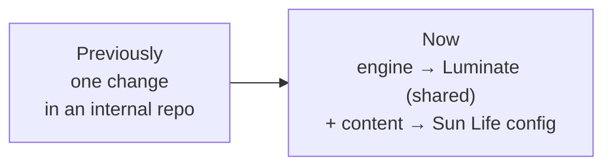

**What this means for today:** most agenda items resolve into two pieces of work — a generic engine and the Sun Life content that drives it — each with its own owner. Naming both, per item, is the main outcome we're after.

A recurring theme in the proposals below: **content should live as versioned configuration in a repository**, not only as documents. That's what lets the same questionnaire, policy set, and thresholds drive the product automatically rather than being re-keyed by hand. Section 11 proposes a concrete mechanism for that.

---

## 1. Reusable risk-classification module

*In plain terms: one shared questionnaire that works out how risky an AI use case is, so every team gets the same answer instead of each inventing their own assessment.*

**Where we are.** A working questionnaire engine already exists (in the ACP UI), and the design is specced as `governance-risk-triage` (**EACPP-648**, D0–D3 drafted). The goal is one shared module every stream consumes, seeded from CMRM's GenAI Model Risk Classification Field Guide.

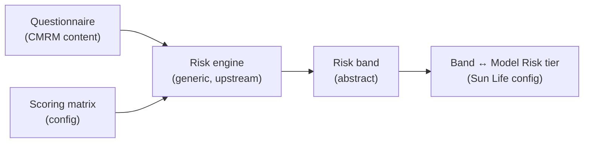

**Proposal.** The engine stays generic and knows only abstract bands. Sun Life's tier names and the band ↔ Model Risk tier mapping are supplied as configuration, so the shared engine remains usable by all members and our mapping can change without a code change.

**Suggested approach for the mapping table.** Rather than maintaining it as a document, hold it as a small versioned file in the governance-content repo (§11), with CMRM as the content authority and the **ACP Product team maintaining the file and its validation**. That gives CMRM full control of the values while the platform gets something it can consume automatically and version.

**Decision requested:** confirm that band ↔ tier is configuration, and that ACP Product maintains the artifact on CMRM's behalf.

## 2. Policy-as-YAML

*In plain terms: CMRM has written 40 numbered validation requirements ("policies") that a GenAI use case must satisfy before release. Putting them in a structured file, rather than only in prose, lets the platform track and evidence each one automatically instead of a person chasing them by hand.*

**What a "policy" actually is.** One checkable requirement, with an ID. From the [CMRM registry](https://sunlife.atlassian.net/wiki/spaces/CMRM/pages/113091379461/MBCT+GenAI+Validation+Proposed+Policies+-+DRAFT) (v0.1.0 draft, 40 policies across 9 domains):

| ID | Requirement | Mode | Depends on |
|----|-------------|------|-----------|
| MBCT-INV-1 | Use case is inventoried in Archer | Hybrid | — |
| MBCT-RCL-1 | Risk classification record is complete and approved by CMRM | Hybrid | MBCT-INV-1 |
| MBCT-DOC-2 | Methodology, assumption, and platform description exists and is of high quality | Hybrid | MBCT-INV-2 |
| MBCT-HMR-6 | Human validator provides the final fit-for-purpose opinion | **Human-only** | (late in chain) |

**What makes it more than a checklist.** Each policy carries structured attributes — prerequisites, automation mode, accountable specialist, report destination. That turns the set into a **dependency chain**: an opinion or sign-off cannot be reached before the evidence beneath it exists. 33 policies are "hybrid" (automation assists, a human reviews); 7 are human-only gates that automation may never cross.

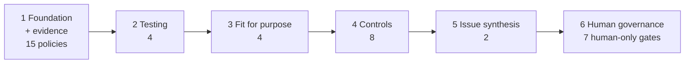

**What it accomplishes once it's structured.** The platform can answer, per use case and without manual chasing:

- which of the 40 policies apply, given the risk level (Level A/AA route differently from B/C);
- which are satisfied, and what evidence proves it;
- what is blocked, and by which unmet prerequisite;
- which steps a human must perform, so automation never crosses those gates.

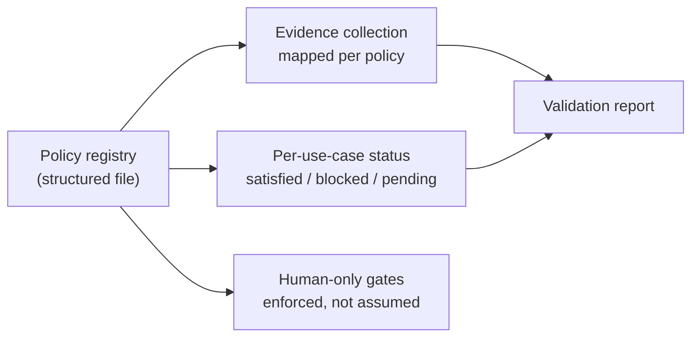

**Where we are.** CMRM already maintains the source as a YAML file (`ValidationPolicySpecifications_CMRM.yaml`) — so the structured form exists; the work is agreeing the field set the platform consumes and wiring evidence to it. ACP's side is the framework → control → evidence registry that reporting is built on.

**Proposal.** One schema, two clear roles: **CMRM owns the policy content, ACP maintains the schema** and everything downstream. Avoid a translation step between two formats — it becomes a permanent maintenance job and a permanent source of drift. ACP Product can validate the file automatically (plain-language errors for a missing or malformed field) so authors get feedback without running anything themselves.

> Worth noting: the registry's own leadership questions ask whether *"Archer, ACP, Openlayer, or Langfuse evidence flows are available, current, and auditable"* — which is exactly what sections 5, 7, and 8 below are proposing to answer.

**Decision requested:** agree a single schema, and that policies are authored once against it.

## 3. Intake → lifecycle contract

*In plain terms: connecting "how risky did we say this is?" to "what is it actually allowed to do?" — so the risk rating decides whether an agent or model can be approved and go live, automatically.*

**Where we are.** The specs propose that the risk band drives lifecycle through **approval outcomes on the existing approvals engine**, rather than introducing a separate state machine. Intake feeds the questionnaire; the resulting band determines what happens next.

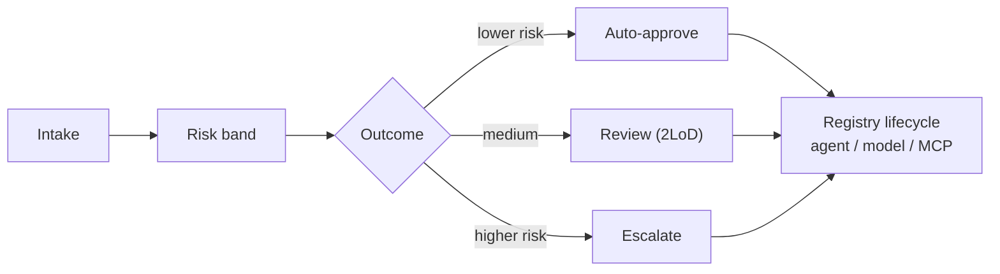

**Proposal.** Three outcomes — auto-approve, review, escalate — expressed as approval policy, with the band-to-outcome thresholds held in the same versioned configuration (§11).

**Open question worth settling.** Does the band gate **deployment** (whether something can go live) or **access** (whether it can be reached at runtime)? The Governance Mode design implies both. Our suggestion is that both should read the same evidence so they can't disagree: lifecycle governs promotion, access enforcement governs reachability.

**Decision requested:** confirm the three outcomes and which band triggers each.

## 4. Validation requirements

*In plain terms: turning each written policy into a real check that has to pass before something proceeds, with a named team signing it off.*

**Where we are.** Each policy needs to become an enforceable gate, per band, with the appropriate line of defence signing off — moving from document-and-attest toward policy → gate → evidence.

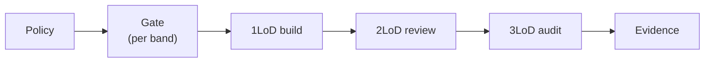

**Proposal.** Lines of defence are represented as **roles in configuration** rather than in the shared codebase, so Sun Life's operating model maps cleanly onto a platform other members also use.

**Open question.** Are gates blocking or advisory in lower environments? Our suggestion: advisory in development, blocking from staging onward (see the Governance Mode D2, environments section), so teams can iterate freely but nothing reaches production ungated.

**Decision requested:** the policy → gate mapping per band, and the sign-off role per gate.

## 5. Evaluations & evidence

*In plain terms: running tests on an AI system (accuracy, safety, and so on) and keeping the results in a form an auditor or regulator would accept as proof.*

**Where we are.** `model-agent-evaluation` (**EACPP-647**) covers the evaluation engine; `regulatory-reporting` (**EACPP-649**) covers evidence and export. The connection that matters is that an evaluation result becomes **audit-ready evidence mapped to a control**.

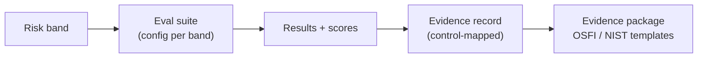

**Proposal.** Which evaluations run per band is configuration; the evidence package format stays generic with regulatory frameworks as templates, so a new framework is an added template rather than new code.

**Where the evidence comes from.** Results have to be produced by the teams building the systems, not collected by hand. The **agent harness SDK** is the natural vehicle — see section 12.

**Decision requested:** who attests that an evidence package is audit-ready — 2LoD or GRC?

## 6. Evaluation metric guide

*In plain terms: agreeing which measurements matter and what score is good enough, for each risk level — and making sure developers can actually see and meet that bar.*

**Where we are.** CMRM has published the [GenAI Evaluation Metric Selection Guide](https://sunlife.atlassian.net/wiki/spaces/CMRM/pages/113098260923/GenAI+Evaluation+Metric+Selection+Guide), plus worked metric-portfolio examples. The question is how that guidance reaches developers in practice.

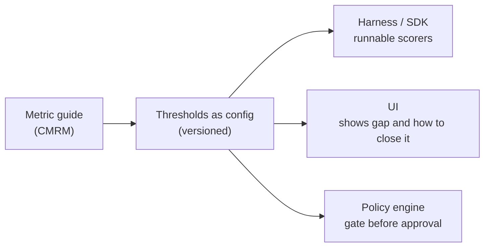

**Proposal.** Guidance changes behaviour when it is runnable, visible, and enforced from a **single set of versioned thresholds**. Rather than re-implementing the guide in three places, the thresholds live once in configuration (§11) and the harness, the UI, and the gate all read from it.

**Suggested approach for the guide itself.** ACP Product can translate the published guide into that threshold file and keep it in step, so CMRM continues to author in Confluence as today while the platform consumes a machine-readable equivalent. The worked examples in `metrics_selection_agent_files.zip` are a good starting point for validating the translation. The **runnable** half of this — scorers a developer can actually execute — lands in the harness SDK (section 12).

**Open question — worth flagging.** Thresholds need to be **versioned**, and approvals need to record which version they were judged against. Otherwise raising a threshold silently changes the compliance status of everything already approved.

**Decision requested:** the mandatory metrics and thresholds per band required before an asset can be approved and activated.

## 7. Evidence storage and Archer

*In plain terms: where the proof is kept so we can produce a governance report on demand, and how that relates to Archer, the risk system we use today.*

**Where we are.** Archer is the enterprise GRC system of record. ACP holds the runtime facts a governance report needs — evaluations, approvals, decisions, provenance, audit trail. Bidirectional sync depends on Archer API onboarding, which is still in progress.

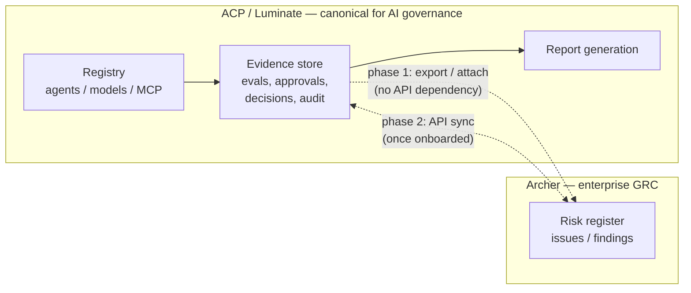

**Proposal.** Treat these as complementary rather than competing: **ACP is canonical for AI asset governance and evidence; Archer remains the enterprise risk register.** Importantly, ACP should be able to produce a complete report **without** depending on the Archer integration, so reporting is never blocked by onboarding timelines. Sync is then a valuable enhancement delivered in two phases — export/attachment first, API sync once access is available.

**Questions we'd like input on:**
- What must be retained to *reproduce* a report — results only, or also inputs, prompts, and traces? This drives storage and privacy design.
- Retention period, and whether the evidence store must be append-only and tamper-evident.
- If sync is implemented, which side is authoritative when values differ.
- The minimum Archer object we would sync to (asset, issue, or attestation) — helpful to know *before* onboarding, so the access request can be scoped precisely.
- Who leads the Archer onboarding conversation, since it's the longest-lead item here.

## 8. Overlapping tooling (Openlayer and similar)

*In plain terms: vendor products that also test and score AI systems — how we use them for what they're good at without ending up with several competing records of the truth.*

**Where we are — better than it may appear.** ACP already ingests and normalizes external evaluation results, and Openlayer is wired end-to-end today.

| Capability (`acp-evaluation`) | Status |
|---|---|
| `POST /ingest/scores` — batch external scores, normalized, routed to registries | Built |
| `POST /ingest/webhooks/{provider}` — signature-verified | Built (Openlayer) |
| Normalization of external → internal score format | Built |
| Risk band accepted at ingest, driving thresholds | Built |
| Evidence request model (`source`, `suite`, `scores`, `evidence_url`, `run_id`) | Modelled, not yet wired |

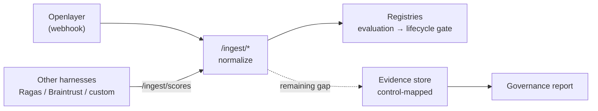

**The remaining gap** is the dotted line: evaluation scores currently drive *lifecycle*, but are not yet persisted as **control-mapped evidence**, which is what a report needs. Closing it is the highest-value next step in this area.

**Proposal.** Position external tools as **evidence producers** that normalize into ACP, with lifecycle and approval state remaining in the platform — so a complete report can always be produced from one place. Publishing a short **evidence contract** (the fields a tool must emit) means new tools can be onboarded without bespoke integration work each time.

**Practical sequencing.** The generic version of this is specified upstream but currently a lower priority, so we suggest: use the existing ingest path now, agree the evidence contract, close the evidence gap in the Sun Life build, and contribute the generalized version upstream once proven. The adapters that let each tool emit that contract belong in the harness SDK (section 12), which keeps vendor-specific code out of the platform entirely.

**Decision requested:** who owns the evidence contract, and confirmation that lifecycle/approval state stays with the platform.

## 9. Product and Consortium delivery

*In plain terms: deciding which work we build for Sun Life specifically, and which we contribute to the shared platform we now build with other members.*

**Where we are.** The operating rule is already documented: generic capability is specified and contributed upstream to Luminate; Sun Life-specific content is delivered by the Product team as configuration and adapters.

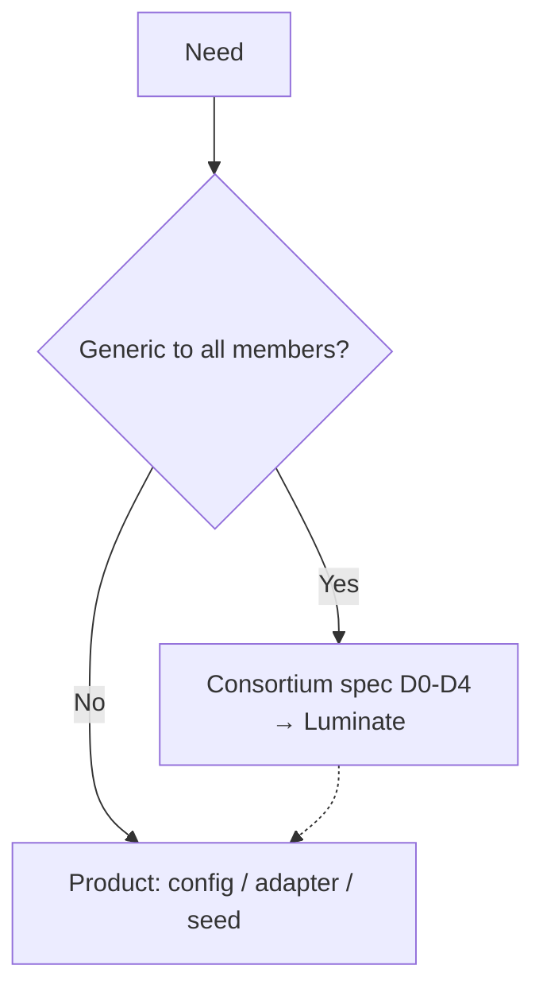

**Proposal.** For each item above, name the two pieces of work and their owners. The risk to manage is duplicated effort — continuing to extend the internal build while the upstream platform evolves separately — so contributing the generic core early, once proven, keeps the two in step.

**A useful example.** The harness SDK (section 12) is entirely Product-team work that needs no upstream change to start, because it talks to the platform over its published APIs. It is the fastest route to visible progress while the shared engine work proceeds in parallel.

**Worth agreeing:** our approach if an upstream contribution is deferred — carry it locally, wait, or deliver via configuration in the interim.

## 10. Ownership and cadence

*In plain terms: who owns which piece, and how often we meet to keep it moving.*

| Area | Proposed owner |
|------|----------------|
| Questionnaire, policy content, metric guide | **CMRM** |
| Process, GRC, lines of defence, intake, Archer relationship | **GbD** |
| Engine, schema, SDK/UI, evidence store, content pipeline | **ACP** |
| Sun Life deployment, adapters, seed configuration | **ACP Product** |

**Suggestion:** a regular short review and a single shared decision log, so agreements made here remain visible and don't need to be revisited.

## 11. Proposed mechanism — how content becomes configuration

*In plain terms: how guidance written by the risk teams (in Confluence or Excel) becomes something the platform can actually run on, automatically and reliably.*

Several items above depend on the same thing: getting CMRM and GbD content into the product reliably. Rather than solving that separately each time, we suggest one shared path.

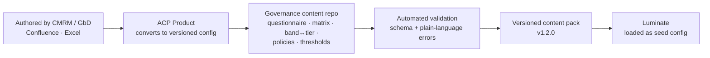

**How it would work in practice**

- **Authors keep their current tools.** CMRM and GbD continue to author in Confluence and Excel; nothing about their workflow needs to change.
- **ACP Product owns the pipeline.** The Product team converts published content into versioned configuration files and keeps them in step, so the content owners review meaning rather than format.
- **Content is reviewed as content.** Changes are proposed with a readable summary of what changed, and the content owner approves that summary — the approval is on the substance, not the file.
- **Validation is automatic.** Errors are caught before anything ships, with messages in plain language.
- **Everything is versioned together** as a numbered content pack, so an approval can record exactly which questionnaire, policy set, and thresholds it was judged against — and we can reproduce any past decision.
- **Luminate consumes it as seed configuration**, never as hardcoded values, which is also what keeps the shared engine usable by other consortium members.

**Why this matters:** it resolves the "who maintains this artifact" question consistently across items 1, 2, 4, and 6 — content authority stays with CMRM and GbD, while the mechanics stay with ACP Product.

**Decision requested:** agreement in principle to a single governance content pipeline, maintained by ACP Product, sourced from CMRM/GbD content.

---

## 12. The agent harness SDK — how evidence gets produced

*In plain terms: a small library the delivery teams already install in their agents. It's where "run these metrics and send the results" can live, so evidence is produced automatically as a by-product of building, rather than assembled by hand later.*

**Where we are.** The harness SDK is in production use (v0.10.0, installed from the internal package repository) and already carries the plumbing governance needs:

| Already there | Why it matters for governance |
|---|---|
| Every request stamped with a **session id and correlation id** | The join key that ties evidence back to a specific run |
| **Agent identity** sent on every call | Attribution without the developer doing anything |
| Registration declares name, owner, type, autonomy, approved models | The governance metadata the risk assessment needs |
| Typed governance errors (policy denied, guardrail blocked, rate limited, kill switch) carrying reason + correlation id | Enforcement outcomes are already observable as evidence |

What it does **not** do yet is emit metrics or submit evidence — that is designed but not built.

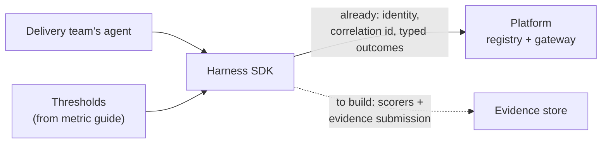

**Why this is the right vehicle**

- It is **already in the developers' hands** — governance that arrives as a library upgrade is adopted; governance that arrives as a document is not.
- It talks to the platform over **published APIs only** (no shared internals), so Product can build it without waiting on upstream platform changes.
- It is the natural home for **evaluation adapters** — the tools teams already use emit results through one contract, keeping vendor-specific code out of the platform (section 8).
- It closes the loop from section 6: the metric guide's thresholds become **scorers a developer can actually run**, with results landing as evidence automatically.

**Proposed scope for the Product team**

| Capability | What it delivers |
|---|---|
| Submit scores / evidence | Results reach the platform against the agreed evidence contract, tagged with run and suite |
| Evaluation adapters | Common evaluation tools plug in without each team writing integration code |
| Threshold awareness | The SDK reads the versioned thresholds (section 11) so a team sees pass/fail locally, before submission |
| Governance metadata at registration | Risk tier and classification travel with the agent, not just its name and owner |

**Two gaps worth naming**

- Registration currently sends a **fixed agent type and autonomy level** rather than the team's real values, and carries **no risk tier or classification** — so the risk assessment can't yet be driven from what the agent declares. Small change, high leverage for sections 1 and 3.
- The SDK is a **Sun Life artifact with no consortium equivalent**. That is fine and fast for now; worth a deliberate decision later on whether a vendor-neutral version is contributed upstream.

**Decision requested:** confirm the harness SDK as the delivery vehicle for metric collection and evidence production, owned by ACP Product, sequenced against the evidence contract (section 8).

## 13. The intake experience — restarting the workstream

*In plain terms: the actual screen a team fills in to register an agent and get it risk-classified. We were building this together — CMRM, Governance-by-Design and ACP — and it needs a home now that the platform is Luminate.*

**Where we are.** The joint work on an **AI-assisted risk triage / intake / registration form** is the piece with no clear landing place today. The spec's current position is that the intake flow must be **frontend-agnostic** — an API contract that any front end can drive, with Amazon Quick as the first UX and all logic and storage in the platform. That decision still holds and is the thing that keeps our options open.

**The question to settle:** where the screen itself lives going forward.

| Option | What it means | Trade-off |
|---|---|---|
| **Amazon Quick** (today's plan) | Form built outside the platform, calling the intake API | Fast, but a separate place to maintain and a separate place users go |
| **Luminate core** | Intake screen contributed upstream as a platform feature | Every member gets it, but our questionnaire is not their questionnaire |
| **Luminate org plugin** | Our screen, our data, running inside the platform | Member-specific by design; depends on the plugin capability landing |

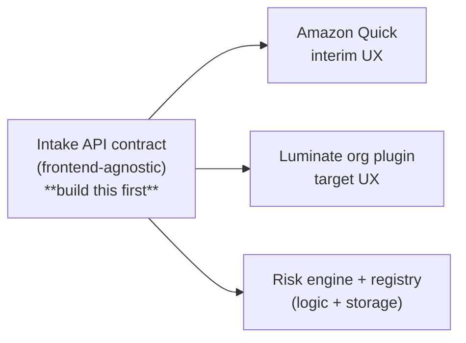

**Proposal.** Build to the **API contract first** — it is required by every option and is the genuine unblocker. Then target the **org plugin** as the home for the screen, because the questionnaire, tiers, and gate names are ours rather than the consortium's; a plugin is exactly the shape for a member-specific screen with its own data. Amazon Quick remains a legitimate interim UX in the meantime, and nothing is wasted either way because both call the same contract.

**One boundary to respect.** A plugin can present the form, capture answers, and show status — but the **risk band, the gates and the approval decisions stay in the platform**, because they must hold when nobody is logged in. Plugins extend what an operator can see and do; they do not decide what is allowed.

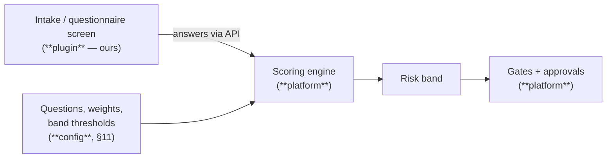

**On the AI-assisted part.** The opportunity is to pre-fill what the platform already knows — registry metadata, declared owner, models in use, data classification — so a team confirms and corrects rather than starting from a blank form, with the assistant citing where each answer came from. Two constraints: a draft answer is a **suggestion until a human confirms it**, and this must never touch the human-only gates in the validation policy set (§2). Assisted intake is about removing typing, not removing judgement.

**Dependencies worth naming**

- The **plugin capability is still in design** in the consortium and under active review, so the timeline is not ours to set. The API-first sequencing means we are not blocked by it.
- Programmatic access to the registries is needed for any non-portal front end to submit intake.
- The questionnaire content itself comes through the content pipeline in §11.

**To restart the workstream, we suggest:**

1. Confirm the intake API contract and publish it — unblocks every option.
2. Agree the target home for the screen (recommendation: org plugin, Quick as interim).
3. Re-form the working group across CMRM, GbD and ACP Product with a named owner per part: questionnaire content, process/gates, and the screen itself.
4. Scope the assisted pre-fill as a follow-on, once the plain form works end to end.

**Decision requested:** agree API-first sequencing, and the target home for the intake screen.

## Themes worth a few minutes

- **A single source of truth per domain** — policy content and evidence records each need one authoritative home.
- **Archer onboarding lead time** — worth designing so nothing is blocked while it progresses.
- **Keeping Sun Life specifics in configuration** — tiers, sub-codes, gate names, and review frequencies stay ours, which keeps the shared engine viable.
- **Version discipline** — evaluations, thresholds, and policies change over time; approvals should record the version they were assessed against.
- **Exemptions** — a documented, authorized, and audited exception path.

---

## Reference material

**CMRM source material** (Confluence space `CMRM`) — the content inputs the platform consumes:

| Page | Relates to | Short link |
|------|-----------|-----------|
| [MBCT GenAI Validation Proposed Policies — DRAFT](https://sunlife.atlassian.net/wiki/spaces/CMRM/pages/113091379461/MBCT+GenAI+Validation+Proposed+Policies+-+DRAFT) | §4 validation requirements | `/wiki/x/BYHFVBo` |
| [MBCT GenAI Validation Specs — DRAFT](https://sunlife.atlassian.net/wiki/spaces/CMRM/pages/113091019344/MBCT+GenAI+Validation+Specs+-+DRAFT) — per-policy specs, work in progress | §2 policy-as-YAML | `/wiki/x/UALAVBo` |
| [GenAI Evaluation Metric Selection Guide](https://sunlife.atlassian.net/wiki/spaces/CMRM/pages/113098260923/GenAI+Evaluation+Metric+Selection+Guide) | §6 metric guide | `/wiki/x/u4EuVRo` |

- [GenAI Model Risk Classification Field Guide (xlsx)](https://sunlifefinancial.sharepoint.com/sites/RiskMgmt/CMRM/RefMat_Public/RiskClass/GenAI_ModelRiskClassification_FieldGuide.xlsx) — SharePoint; the questionnaire behind §1.
- `metrics_selection_agent_files.zip` — `MetricSelectionAgent_v2.zip`, `NSR_Metric_Portfolio.html`, `claims-assistant-metric-portfolio.html`; worked metric-portfolio examples supporting §6.

**Related specs (this repository):** `specs/governance/governance-intake/` (D0–D3) · `specs/acp-aws-harness-sdk/` (§12) · `specs/platform/slm-pipeline/`

**Related documents (`acp-consortium-specs` → `governance-docs/`):** alignment background · Governance Mode D2 draft · capability map · gap analysis
