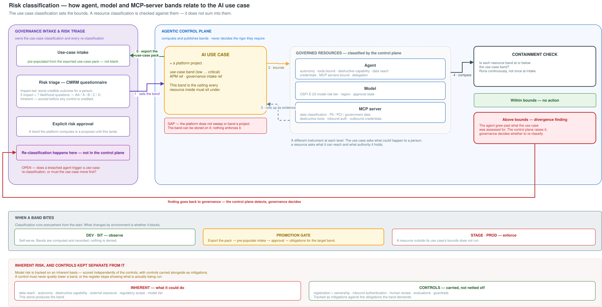
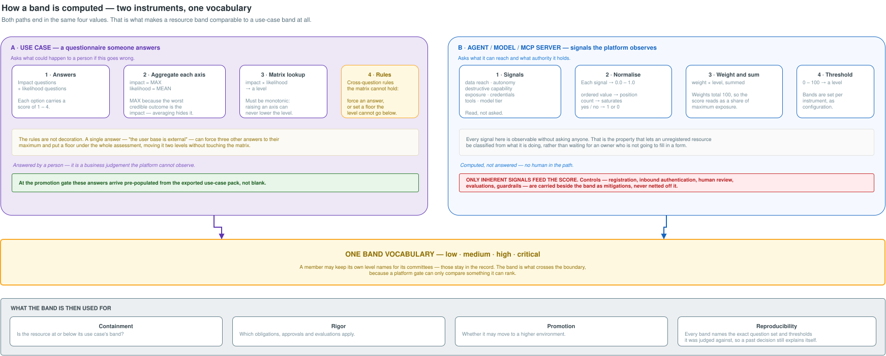

# Risk Classification — Architecture Overview

> **Status**: Draft · **Epic**: [EACPP-877](https://sunlife.atlassian.net/browse/EACPP-877)
> **Sources**: the
> [risk classification module workshop, 15 September 2026](references/2026-09-15-risk-classification-module-workshop.docx);
> and the cross-team governance working session of 14 September 2026, whose transcript lands with
> the `archer-grc-sync` spec under a separate pull request.

Two pictures. The first is how an agent, model or MCP-server classification relates to the AI use
case above it. The second is how a band is actually computed, kept deliberately high level so it
can be talked through rather than read.

The short version of the first: **the use case sets the bounds, and a resource classification is
checked against them.** It does not sum into them.

---

## 1 · How the levels relate



### The steps

| # | Step | Owned by |
|---|---|---|
| **0** | At the promotion gate, the control plane **exports a classification pack for the whole use case** — the inventory of every agent, model and MCP server in it, each one's band, and the evidence behind them. The governance intake form is pre-populated from that pack. | Control plane |
| **1** | The use case is classified on the intake questionnaire — impact-led, *what is the worst credible outcome for a person* — producing the use-case band. | Governance |
| **2** | That band becomes the **ceiling** for every resource inside the use case. | — |
| **3** | Each resource is classified on its own instrument and rolls up as **evidence** — the inventory governance reads to know whether the use case is actually compliant. | Control plane |
| **4** | Each resource band is compared against the ceiling, **continuously** rather than once at intake. | Control plane |
| **5** | A resource above the ceiling is a **divergence finding**. The control plane detects it; **governance decides** whether to re-classify. | Control plane → Governance |

### Why step 0 matters more than it looks

By the time a use case is ready to leave the lower environments, the control plane has already
classified everything inside it. Intake therefore does not have to start from a blank form and a
person's memory of what they intended to build.

Two consequences:

- **The intake burden inverts.** A reviewer attests to what the platform observed rather than
  re-entering it. That is what makes classifying at inception affordable instead of a tax on every
  experiment — the objection that otherwise sinks *classify everything from the start*.
- **The use-case classification is grounded in what is actually deployed**, not what was proposed
  months earlier. That is the same divergence problem step 5 catches after the fact, prevented
  before it starts.

What the pack cannot supply is the impact judgement — *who is affected and how badly* is a business
question no platform can observe. The likelihood side, which turns on autonomy, tooling and how
verifiable the outputs are, is largely already known. **How that line falls decides how much of the
form survives**, and it is RC-Q7.

### What was settled

- **A platform project is the AI use case.** The roll-up anchors on the thing that already
  organises work rather than a new entity, and it is where the APM reference and the governance
  intake reference hang — one identifier correlating the control plane, governance, service
  management and architecture.
- **Bounds, not aggregation.** This is the decision most likely to be mis-implemented: "roll-up"
  sounds like `max(children)` and it is not that. The use-case band is set independently, from
  impact; the child is checked against it. Aggregating would let one high-autonomy agent silently
  redefine the use case's risk — which is exactly the review that is supposed to fire.
- **Divergence has to be detectable.** A classification is a point-in-time statement and what it
  describes keeps moving. The case that matters is the agent that grew after its use case was
  assessed.
- **Re-classification belongs to governance.** The control plane raises the finding and stops.
- **Inherent risk, controls kept separate.** Model risk is tracked independently of the controls,
  with those controls carried alongside as mitigations.
- **Classification runs everywhere; it only bites above the lower environments.** Registration is
  not the gate — deploying and promoting is.

---

## 2 · How a band is computed



Two instruments, because the two levels ask different questions — but **one band vocabulary**,
because a gate can only compare something it can rank. That shared vocabulary is what makes the
containment check in the first diagram possible at all.

| | Use case | Agent / model / MCP server |
|---|---|---|
| **Asks** | What could happen to a person if this goes wrong? | What can it reach, and what authority does it hold? |
| **Input** | Answers to a questionnaire | Attributes the platform observes |
| **Method** | Impact = MAX of its questions, likelihood = MEAN; the pair indexes a matrix; cross-question rules then force answers or set a floor | Each signal normalises to 0–1, is weighted and summed to 0–100, and falls into a band |
| **Answered by** | A person — a business judgement | Nobody — computed from what is there |

Three things in that table are worth pausing on:

- **MAX for impact, MEAN for likelihood.** The worst credible outcome *is* the impact, so averaging
  would let four mild answers dilute one severe one. Likelihood is several independent contributors
  to how often it goes wrong, so a mean belongs there.
- **The matrix must be monotonic.** Raising either axis can never lower the level. This is checked
  when the content loads, because a non-monotonic table has shipped before.
- **The rules are not decoration.** A single answer — *the user base is external* — can force three
  other answers to their maximum and put a floor under the whole assessment, moving it two levels
  without the matrix changing at all.

And the property that makes the right-hand column usable for discovery: every signal is observable
without asking anyone. An unregistered resource can be classified from what it is doing, rather
than waiting for an owner who is not going to fill in a form.

---

## 3 · The actual calculation, per resource type

The section above is the shape. This is the arithmetic as it runs today, from the shipped content
packs — the numbers below are computed, not illustrative.

### The observed side, in four lines

Agents, models and MCP servers share one calculation. Only the signals and the cut points differ.

```
normalise   ordinal → index ÷ (choices − 1)      e.g. confidential in
                                                 [public, internal, confidential, restricted] = 2÷3 = 0.67
            count   → min(raw, saturation) ÷ saturation
            flag    → 1.0 or 0.0
contribute  weight × normalised
score       round(Σ contributions)               weights sum to exactly 100, so score is 0–100
band        first threshold the score falls under
```

Weights summing to 100 is enforced when the pack loads, so a score is a percentage of the worst
case that resource type could be — not an arbitrary total that shifts when a signal is added.

### Agents — `acp-agentic@1.0.0`, 11 signals

**low ≤ 30 · medium ≤ 60 · high ≤ 85 · critical above**

**Value** is what the registry holds for that agent — the attribute as recorded, not a judgement
entered for the assessment. The points are that value's position on the scale × the weight.

| Signal | Value | Scale (low → high) | Weight | Points |
|---|---|---|---:|---:|
| `data_reach` | `confidential` | public → internal → **confidential** → restricted | 18 | 12.0 |
| `autonomy` | `acts_with_approval` | advisory → drafts for approval → **acts with approval** → acts autonomously | 18 | 12.0 |
| `destructive_tools` | `true` | holds a tool that writes, deletes, transacts or executes | 10 | 10.0 |
| `regulatory_scope` | `regulated` | none → internal policy → **regulated** → highly regulated | 10 | 6.67 |
| `credentials_held` | `scoped_write` | none → scoped read → **scoped write** → broad | 8 | 5.33 |
| `external_exposure` | `business_unit` | single user → team → **business unit** → enterprise → external | 10 | 5.0 |
| `model_tier` | `tier2` | none → tier 3 → **tier 2** → tier 1 | 6 | 4.0 |
| `tool_count` | `6` | count, saturating at 10 | 6 | 3.6 |
| `mcp_servers_bound` | `2` | count, saturating at 5 | 4 | 1.6 |
| `registration_status` | `registered_owned` | **registered+owned** → registered unowned → self-registered → undiscovered | 8 | 0.0 |
| `delegates_to_agents` | `false` | can invoke other agents, so its reach exceeds its own bindings | 2 | 0.0 |
| | | | **100** | **60 → `medium`** |

That agent sits one point under the `high` cut. Worth noting how it gets there: no single signal
dominates, it is the accumulation. Two signals contribute nothing — and one of those, being
registered and owned, is the reason it reads `medium` rather than higher. See the first observation
below.

### Models — the questionnaire is a use-case instrument, so a model's band is ingested

**Corrected after the 15 Sep workshop.** This page previously described the questionnaire as
applying to a model. It does not. The questionnaire assesses **an application of a model** — which
is a use case — and a model considered on its own cannot be scored by it, because every question it
asks depends on what the model is being used for.

So for a model as a registry entry, the band is **ingested, not computed**: the model-risk process
produces it before the model reaches the control plane, with its own GRC record and approvals. What
the control plane computes for a model is the deployed-reach question — what it is wired to and
what it may do — which is the agentic instrument below, not the questionnaire.

The questionnaire therefore belongs to the **use case**, and this is the shape of it there:

```
impact      MAX of 5 questions          worst credible outcome, scored 1–4
likelihood  MEAN of 7 questions, rounded  error rate, oversight, autonomy, verifiability …
level       matrix[impact_likelihood]   4×4 → A (highest) … D (lowest)
rules       cross-question overrides    force answers to maximum, or floor the level
```

Here the **Value** column is an answer rather than an observed attribute — this is the half a
person fills in, and the half the exported pack is trying to pre-fill.

| Question | Asks | Value | Score |
|---|---|---|---:|
| `impact_q1` | Is the user base external to Sun Life? | `no` | — *(rule trigger, not scored)* |
| `impact_q2` | Worst outcome if it failed to treat individuals fairly | `medium` | 3 |
| `impact_q3` | Reputational impact if output were incorrect and all controls failed | `medium` | 3 |
| `impact_q4` | How critical is factual or numerical accuracy | `low` | 2 |
| `impact_q5` | Most severe adverse outcome from incorrect output | `medium` | 3 |
| | | **MAX** | **3** |
| `likelihood_q1` | Absolute error rate | `medium` | 3 |
| `likelihood_q2` | Relative error rate against a human baseline | `low` | 2 |
| `likelihood_q3` | Likelihood of performance degrading over time | `medium` | 3 |
| `likelihood_q4` | Complexity of the application design | `low` | 2 |
| `likelihood_q5` | Level of automatic decision making | `low` | 2 |
| `likelihood_q6` | How easily outputs can be verified by users | `medium` | 3 |
| `likelihood_q7` | Time or volume constraints on human review | `low` | 2 |
| | | **MEAN 2.43 → round** | **2** |

Matrix cell `3_2` → **C (Medium Risk) → band `medium`, tier 2**.

Three things that table makes visible. Impact would have been **2.75 on a mean** and is **3 on a
MAX** — one severe answer carrying the axis, which is the intent. `impact_q1` scores nothing at
all: it is a rule trigger, and answering it `yes` forces the human-oversight questions to their
maximum **and** floors the result at C regardless of what the matrix returns.

And the first two likelihood questions are **error rates measured in percentages** — the kind of
thing evaluations produce and memory does not. Wiring evaluation results into those answers is the
single largest reduction in what a person has to supply, and it makes the likelihood axis move when
the system's actual behaviour moves.

### MCP servers — `acp-mcp-server@1.0.0`, 7 signals

**low ≤ 11 · medium ≤ 28 · high ≤ 46 · critical above**

| Signal | Value | Scale (low → high) | Weight | Points |
|---|---|---|---:|---:|
| `serves_pii` | `true` | exposes personal information | 18 | 18.0 |
| `data_classification` | `confidential` | public → internal → **confidential** → restricted | 23 | 15.33 |
| `destructive_tools` | `true` | exposes a tool that writes, deletes, transacts or executes | 12 | 12.0 |
| `holds_outbound_credentials` | `true` | holds downstream credentials on a caller's behalf | 6 | 6.0 |
| `serves_government_data` | `false` | exposes government-issued identifiers | 18 | 0.0 |
| `serves_pci` | `false` | exposes cardholder data | 12 | 0.0 |
| `no_inbound_auth` | `false` | accepts calls without authenticating the caller | 11 | 0.0 |
| | | | **100** | **51 → `critical`** |

Note how far a single `true` travels here: `serves_pii` alone is 18 points against a `high` cut of
46. Three flags and one ordinal are enough to reach `critical`.

An MCP server is scored almost entirely on *what it exposes*, because that is what a binding
inherits. Autonomy does not appear — a server has none; it is reach that the agent binding it
acquires.

### Three things to take issue with

- **The scores are not comparable across the three.** 51 is `critical` for an MCP server; 60 is
  `medium` for an agent. The cut points are calibrated to each distribution, so only the **band**
  carries meaning across resource types — which is the whole reason the vocabulary is shared and
  the raw score is not. If the band is the contract, the score should probably not be published
  next to it without that caveat.
- **An unobserved signal scores zero, so partial knowledge reads *low*.** A discovery scan that
  finds an unregistered agent calling four tools, and knows nothing else, scores 10 → **`low`**.
  The result is flagged provisional and names the nine missing signals, but the *band* — the thing
  a gate reads — says low. For the rogue-agent case that is backwards, and it is the one place the
  arithmetic works against the intent.
- **Being well-governed lowers the band.** `registration_status` is 8 points and `no_inbound_auth`
  is 11 — both controls, both inside the score. This is the concrete form of the inherent-versus-
  control finding below: the weights show exactly how many points a control is currently worth.

---

## What this changes in the module as built

| Finding | Today | Needs |
|---|---|---|
| **Controls are mixed into the score** | Registration status, inbound authentication and credential posture sit in the same weighted score as data reach and autonomy. Being registered and owned *lowers* the band. | Split each instrument into inherent and control signals. The band comes from inherent alone; controls ride alongside as mitigations. This is the finding that directly contradicts how model risk is tracked. |
| **No use-case level** | Bands are published per agent, model and MCP server. There is no project band, no ceiling, no containment check. | A use-case band, the bounds relation, and the check. |
| **No divergence finding** | A band that rises is published, and nothing compares it to anything. | Emit a finding when a resource band exceeds its use case's ceiling. |
| **No pack export** | Classification output is per resource and read one at a time. | A use-case-level pack that pre-populates the intake form. |
| **No environment dimension** | A band is a band. | Bands carry an environment so lower environments observe while higher ones enforce. |
| **The questionnaire is pointed at the wrong subject** | The pack declares it applies to an application, an agent *and* a model. It assesses an *application of a model*, which is a use case. | Apply it at the use-case level only. A model's own band is **ingested** from the model-risk process, not computed here. |
| **Only one risk domain is modelled** | Everything here is model risk. Privacy, information security and third-party risk run their own instruments on scales that barely resemble each other. | Retain each domain's result independently and recomputably, derive the composite from them, and carry disagreement rather than taking the higher and discarding the rest. |
| **Publication is gate-shaped** | A band is written when it is computed and read one resource at a time. | Governance monitors continuously and aggregates for second line against risk appetite, so the profile has to be **pullable** — current and historical, per resource, per use case, and in aggregate. |
| **Error rate is answered from memory** | The two likelihood questions that ask for measured error percentages are filled in by a person. | Evaluations measure exactly that. Admit them as the answer, so the inherent level moves when behaviour moves. |
| **The platform cannot govern a project** | A project is a valid attribute target, so a band can be *stored* on it. It is not swept, not band-covered, and carries no governance state. | Storable is not enforceable. Either the platform extends governance to projects, or the use-case band never gates. **This needs deciding.** |

## Open questions for the session

| # | Question |
|---|---|
| ~~**RC-Q1**~~ | ~~Does a breached agent trigger a use-case re-classification, or must the use case move first?~~ **Answered 15 Sep**: it is stopped in the enforcing environments immediately, and that stop raises the re-evaluation signal. It does not keep operating while the re-evaluation is pending. |
| **RC-Q2** | Which signals are inherent and which are controls? The split is the decision; the arithmetic follows. |
| **RC-Q3** | Should the platform govern a project, or is the use-case band unenforceable by design? |
| **RC-Q4** | What happens to resources in a use case whose band is *lowered*? Every child is then over-provisioned against its new ceiling. |
| **RC-Q5** | Is the use-case band per environment, or one band with per-environment enforcement? |
| **RC-Q6** | Who assigns a resource to a use case, and what happens to one that belongs to none? |
| **RC-Q7** | How much of the intake form can the exported pack actually answer? *Narrowed*: evaluations can answer the error-rate questions outright, and the agentic attributes are observed. What remains is who consumes the output and whether a person acts on it. |
| **RC-Q8** | Should an unobserved signal score zero, or its worst case? Today partial knowledge reads *low*, which is the wrong direction for a discovered rogue resource. |
| **RC-Q9** | Should the raw score be published alongside the band at all? It is not comparable across resource types, and publishing it invites comparison. |
| **RC-Q10** | How is one composite band derived from domains whose scales do not correspond? Obligations need a single band, but mapping a four-level grade onto a low/moderate/high/critical rating is an assertion, not a calculation. |
| **RC-Q11** | Who arbitrates when two domains disagree, and what does the resource do while the conflict is open? |
| **RC-Q12** | The same use case gets a risk profile from the control plane and from governance. Which is shown where, and what stops a user seeing two different numbers for one thing? |
| **RC-Q13** | Does the enterprise tiering instrument become the use-case instrument, or sit alongside the model-risk questionnaire? Running both is the outcome nobody chose. |
| **RC-Q14** | A lower environment can expose production data. Does that enforce despite the environment — and what else breaks the observe-only assumption? |

## Where the detail lives

- [D1 — Requirements](d1-requirements.md) — FR-24 … FR-30 carry the roll-up and the export
- [D2 — Design](d2-design.md) — DD-18 … DD-23
- [D3 — Tasks](d3-tasks.md) — T22 … T28
- [Platform integration review](artifacts/2026-09-09-luminate-band-integration-review.md) — the
  verified integration surface this builds on
