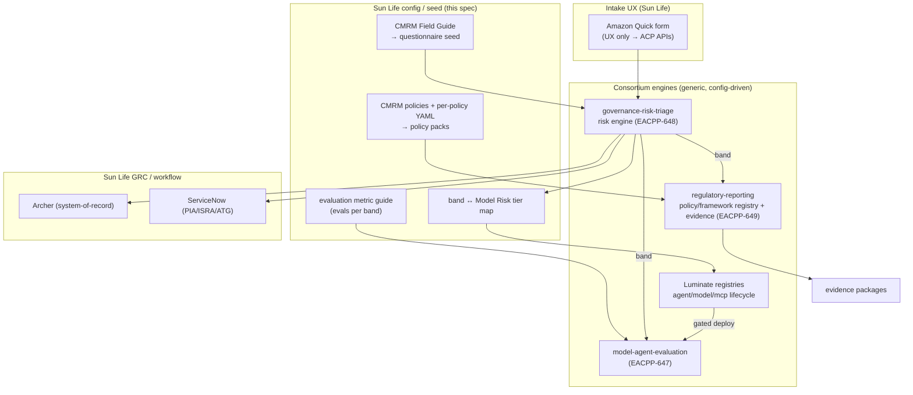
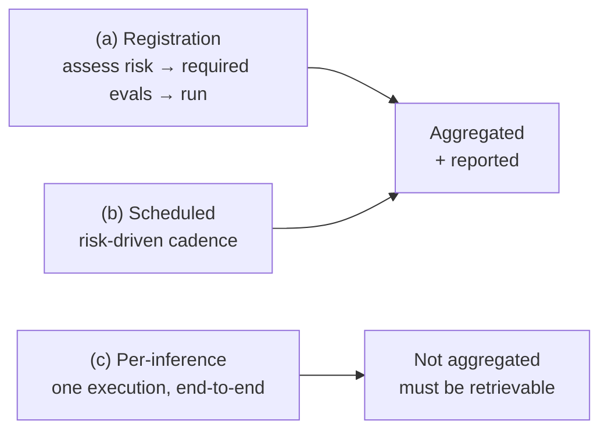

# Governance Intake & Risk Classification (Sun Life) — D2: Design

> **Gate**: D2 — Design | **Status**: Draft | **D1 Approved**: TBD
> Sun Life **integration + configuration** over the consortium engines. "Consume, don't fork."
> **Amended** 9 September 2026 — DD-13 to DD-17 carry the
> [Luminate integration review](artifacts/2026-09-09-luminate-band-integration-review.md).
> Governance Mode is **built** in `luminate` `origin/main`; the earlier framing of it as
> design-pending is stale.
> **Amended again** 14 September 2026 — DD-18 to DD-23 carry the Archer × ACP × GbD working
> session. The picture is in [Architecture Overview](d2-architecture-overview.md).
> **Amended again** 15 September 2026 — DD-24 to DD-29 carry the
> [risk classification module workshop](references/2026-09-15-risk-classification-module-workshop.docx).
> **DD-24 corrects this spec**: the model-risk questionnaire assesses an *application of a model*,
> so it applies at the use-case level and not to a model in isolation.

## Design Overview

## Design Decisions

### DD-1 — Quick is UX, ACP is logic (frontend-agnostic contract)
The Amazon Quick form calls ACP/Luminate APIs; all logic + storage live in ACP. Define the
intake API contract so **any** frontend can drive it (Quick is replaceable). **Effort M / Risk
Med** (Quick availability is the main risk; contract insulates us).

### DD-2 — Seed the reusable risk engine with the CMRM Field Guide
Configure the consortium `governance-risk-triage` engine with the CMRM questionnaire, scoring
(impact MAX / likelihood AVG), and matrix as **seed config** — no Sun Life risk engine is
built. The band↔tier map is Sun Life config. **Effort S-M / Risk Low.**

### DD-3 — Ingest CMRM policies + per-policy YAML into the compliance registry
Load the CMRM **policies list** and **per-policy YAML** as **policy packs** into the
`regulatory-reporting` framework/policy registry (Framework/Control/ControlEvidenceMapping +
validation requirements). CMRM is the single source of truth; ACP ingests. **Effort M / Risk
Low** (schema convergence tracked in the consortium spec).

### DD-4 — Validation gates + required evals keyed to risk band
Bind per-band **validation requirements** (gates: validations/PIA/ISRA/ATG/MRM + 1LoD/2LoD/3LoD)
and the **evaluation metric guide** (required eval suites/scorers/thresholds) as Sun Life
config over the generic engines; enforce before APPROVED/ACTIVE. **Effort M / Risk Low.**

### DD-5 — Risk band drives the Luminate lifecycle + gated deployment
Map risk band to lifecycle outcome: auto-approve below band, require-review / escalate above,
gated deployment per tier — via the Luminate Agent/Model/MCP registry lifecycle (not a new
state machine). **Effort M / Risk Med** (touches lifecycle; coordinate with registries).

### DD-6 — Archer + ServiceNow adapters (SLF GRC)
Bi-directional Archer sync (risk record ↔ tier/lifecycle status) and ServiceNow routing
(PIA/ISRA/ATG work items) as Sun Life adapters, config-driven field mapping (no vendor FieldIds
in code), circuit-breaker/retry. **Effort M / Risk Med.**

### DD-7 — Audit-ready evidence
Every intake, assessment, gate, and GRC exchange emits an audit event; evidence packages via
`regulatory-reporting`. **Effort S / Risk Low.**

### DD-8 — Two report surfaces, one data source (D7, D8)
ACP produces the **OSFI E-23** report per agent/model. GbD produces the broader OSFI
**technology-risk** report per application/use case, consuming ACP governance data as a **documented
read interface** — Duncan: *"we would be a consumer of your data products, essentially."* The read
interface is versioned and published before GbD builds against it; the scope boundary between the
two reports is written down before either is built. **Effort M / Risk Med** — the risk is
organisational (two teams reporting the same control), not technical.

### DD-9 — Three layers of evaluation, aggregated differently (D14)
Colin's framing, agreed in session:

Layers (a) and (b) are aggregated into the governance record. Layer (c) — *"why did I get denied?"* —
stays in operational observability and is pulled on demand via the trace/context graph. Conflating
them is what makes an evidence store unaffordable. **Effort M / Risk Med.**

### DD-10 — Reference by default; copy only what a record must hold (Q3, D1)
Kalyan's duplication concern is settled structurally rather than by policy: evaluation artifacts
produced by Openlayer, Langfuse, Bedrock evaluations or any other producer are **referenced** from
the ACP evidence record. Data may remain in workload accounts. Only the material a report or an
Archer validation record must physically contain is copied. **Effort M / Risk Med** — the boundary
is settled in the Seth/Kalyan offline session (M2) before build.

### DD-11 — Obligations, not policies; domain-agnostic (D4, D5)
Schema fields, API surface and documentation use **obligation** for a checkable governance
requirement, reserving **policy** for access/gateway enforcement. `domain` is first-class so privacy
and other risk domains author against the same shape. Content lives in versioned packs
(`governance-content-packs`), not in this spec. **Effort S / Risk Low** — cheap now, expensive once
schemas are published.

### DD-12 — APM references carried, not invented (D15)
`apm_refs` is captured at GbD intake, carried on the registry record, and published with the Archer
use case. ACP inherits and forwards; it does not create a platform-level record type in Archer.
Detail in [`archer-grc-sync`](../../integration/archer-grc-sync/d2-design.md) DD-5. **Effort S / Risk Low.**

### DD-13 — The band is published to Luminate as a governance-authoritative attribute (LB-1)
Luminate's `resolve_obligations` reads the band from a `risk-band` attribute and raises
`BandNotResolvable` for a governed resource carrying none, so Governance Mode cannot resolve rigor
until ACP publishes one. ACP writes the band against `(entity_type, entity_id)`; Luminate's
`post_save` on the attribute republishes governance status automatically. This works with **zero
Luminate code changes** and does not wait on the unmerged Org Plugins design. **Effort S-M / Risk
Low.**

### DD-14 — Two vocabularies, and only one of them crosses the boundary (LB-7)
The committee's `AA`/`A`/`B`/`C`/`D` and the platform's `low`/`medium`/`high`/`critical` are both
real and neither replaces the other. Luminate's ranked set is exactly the second, and a value
outside it resolves but is unrankable — safe, silent, and useless to any consumer that needs to
compare. So the band map is the boundary: ACP holds the level, Luminate receives the band.
**Effort S / Risk Low.**

### DD-15 — The band token crosses; the record stays in ACP (LB-3)
A Luminate `EntityAttribute` holds one curated string, so the version token, pack digests,
contributing packs and rationale cannot travel with it. The full record stays in ACP and is
retrievable by the same `(entity_type, entity_id)`. FR-19 is the residual: Luminate must still be
able to name what the band was judged against, and the cheapest form is a second
governance-authoritative attribute carrying the pack revision. That trades vocabulary hygiene for
auditability and is the decision to take at the review. **Effort M / Risk Med.**

### DD-16 — The evidence path is deferred, not designed around (LB-Q1)
Governance Mode's evidence contract is the natural home for a classification record, but a
`ServicePrincipal` cannot be registered as an `EvidenceProducer` — the relation points at the
Django user model. A machine submission is accepted, attributed to `unregistered:`, counted toward
nothing, and returned as `201`. Designing around a silent failure would bake it in, so evidence is
deferred until producer onboarding exists upstream and raised as a consortium defect meanwhile.
**Effort S now / M later / Risk Med.**

### DD-17 — Classification is triggered by the intake flow, not by Luminate (LB-5)
Luminate emits no outbound events — no webhooks, and the internal `pg_notify` path is lossy and
in-cluster. So nothing can tell ACP that a resource was registered or materially changed. Intake
pushes the classification as part of the flow it already owns, and a scheduled reconciliation sweep
catches resources registered outside it. The sweep is what makes the design honest about the
cases intake does not see. **Effort M / Risk Med.**

### DD-18 — A platform project is the AI use case (RC-1)
Rather than invent a use-case entity, the roll-up anchors on the project that already organises
work in the platform. The project carries the use-case band, the APM reference and the governance
intake reference, which is also what lets one identifier correlate the control plane, the
governance platform, service management and architecture. **Effort S-M / Risk Med** — the risk is
RC-Q3: the platform does not govern a project today.

### DD-19 — The use-case band is a ceiling, and the resource band is checked against it (RC-2)
The word "roll-up" invites `max(children)`, and that is the wrong shape. The use-case band is set
independently, from impact, by the governance process; a resource classification is then **checked
for containment** against it. Aggregating instead would let a single high-autonomy agent silently
redefine the use case's risk, which is exactly the review that is supposed to be triggered. The
upward direction still exists, but it carries **evidence** — the inventory the governance platform
reads — not a band. **Effort M / Risk Low.**

### DD-20 — Divergence is a finding, and re-classification is not the control plane's (RC-3, RC-4)
A resource that classifies above its use case's ceiling is not an error and not something the
control plane resolves. It raises the finding; the governance process decides whether to
re-classify. The check runs continuously rather than at intake, because the case that matters is
the agent that grew after the use case was assessed — a classification is a point-in-time
statement, and what it describes keeps moving. **Effort M / Risk Med.**

### DD-21 — Inherent risk produces the band; controls are carried beside it (RC-5)
Model risk is tracked on an inherent basis — scored independently of the controls, with those
controls carried alongside as separate mitigations. The module as built does not do this:
`registration_status`, inbound authentication and credential posture sit in the same weighted score
as data reach and autonomy, so being registered and owned **lowers** the band. That is a control
credited into an inherent score, and it makes the register describe a safer estate than the one
being run. Each pack splits into inherent and control sections; only inherent produces the band.
**Effort M / Risk Med.**

### DD-22 — Same band vocabulary, a different instrument per level (RC-7)
Whether one questionnaire can serve both levels was raised and does not need to be resolved in the
affirmative: a use case asks what could happen to a person, a resource asks what it can reach and
what authority it holds. Those are different instruments. What they must share is the **band
vocabulary**, because that is the only thing that makes containment checkable. **Effort S / Risk
Low.**

### DD-23 — The promotion gate exports a classification pack; intake does not start blank (RC-8)
By the time a use case is promoted out of the lower environments, the control plane has already
classified every agent, model and MCP server inside it, and holds the inventory, each band and the
evidence behind it. So the governance intake form is **pre-populated from that pack** rather than
filled in from memory.

Two things follow that are worth stating plainly. The intake burden inverts — a reviewer attests to
what the platform observed instead of re-entering it, which is what makes classification at
inception affordable rather than a tax on every experiment. And the use-case classification becomes
grounded in what is **actually deployed** rather than what someone intended to deploy months
earlier, which is the same divergence problem DD-20 solves after the fact, solved here before it
starts. **Effort M / Risk Med.**

### DD-24 — The questionnaire is a use-case instrument, and a model's band is ingested, not computed (RC-9)

This corrects an earlier reading in this spec. The model-risk questionnaire was described as
applying to an application, an agent *and* a model, and it does not: it is written to assess **an
application of a model**, which is a use case. A model considered on its own — weights, a provider,
a context window — is not something the questionnaire can score, because everything it asks about
depends on what the model is being used for.

So the instrument applies at the use-case level only. For a model as a registry entry, the risk
record is produced **before** the model reaches the control plane, by the existing model-risk
process, with its own GRC record and approvals. The control plane **ingests** that classification
rather than recomputing one, which is what the external-assessment path already exists to do.

What the control plane does compute for a model is the deployed-reach question — what it is wired
to, what it is permitted to do — which is the agentic instrument, not the questionnaire. The two
are not competing assessments of the same thing; they assess different things and only one of them
is ours. **Effort S / Risk Low** — the correction is to `applies_to` on the pack and to the
narrative, not to an engine.

### DD-25 — Containment is a ceiling, not a maximum, and not a promotion (RC-2)

Asked directly: if a use case processes confidential information and an agent inside it does not,
does the use-case answer supersede the agent's, and should the roll-up take the highest of the
levels involved? **No, to both.** The use-case band is a **ceiling**. A resource assessed below it
stays where it is assessed and is not pulled up to meet it; being under the ceiling is the normal,
expected case and needs no action.

The check has force only in one direction. A resource that reaches something its use case was never
assessed for — the worked example was an agent binding an MCP server exposing government data when
the use case's questionnaire never contemplated it — has exceeded the ceiling. It is **stopped in
the enforcing environments**, and that stop is what raises the re-evaluation signal at the use-case
level. It does not continue operating while the re-evaluation is pending.

Worth separating from composition, because the two look similar and are not: taking the **highest
band across several instruments assessing one resource** is right and is what publication does.
Taking the highest band across the **levels of a hierarchy** is the thing rejected here. **Effort S
/ Risk Low.**

### DD-26 — Domain results are retained, and disagreement is surfaced rather than resolved (RC-9, RC-10)

Model risk is one domain. Privacy, information security and third-party risk each run their own
instrument on their own scale, and those scales have little resemblance to one another. The design
constraint stated in the workshop is that each domain must remain able to reach **its own questions
and recompute its own result**, which rules out collapsing everything into one score at intake and
keeping only that.

So a classification retains its per-domain results as first-class, with the composite band derived
from them and traceable back to each. Where domains disagree, the disagreement is **carried beside
the composite rather than resolved by taking the higher**. A composite still has to be produced,
because obligations must resolve against a single band — but a conflict that silently becomes a
maximum has hidden the one case that needed a person. How the composite is derived across
non-corresponding scales is open (RC-Q10), and so is who arbitrates (RC-Q11). **Effort L / Risk
High** — this is the largest structural change in this amendment.

### DD-27 — The approved classification is authoritative; ours is an input to it (RC-9)

Both the control plane and Governance by Design will hold a risk profile for the same use case, and
the concern raised was not ownership but **contradiction** — two surfaces showing a user different
answers for one thing.

The precedence is settled: the classification the governance process approves is the source of
truth. What the control plane computes internally is a **provisional input** to that decision and
evidence afterwards, never a competing verdict. The interim position where the control plane holds
the use-case inventory is a consequence of the GRC sync not existing yet, not a claim on the
record. Precedence does not by itself settle what each surface displays, which is RC-Q12. **Effort
S / Risk Med.**

### DD-28 — The band buys obligations through applicability rules, and that translation is the deliverable (RC-13)

A band on its own changes nothing. What a governance owner needs is the translation from a band
into what a resource may reach, what actions it may take and what it must evidence — and that
translation is authored, not inferred: a governance administrator writes obligations against
**applicability rules** over resource kind, jurisdiction, region and band, so that, for example,
agents in one region at one band acquire a stated evaluation cadence.

This is the point at which the module stops being a scoring service. Classification produces the
band; the obligation mapping is what makes the band consequential, and it is enforced at the
gateway. Each risk domain is therefore being asked for two things it can state without knowing
anything about the platform: the **dimensions** it classifies on, and the **obligations** it
expects at each level. **Effort M / Risk Med.**

### DD-29 — What a band does not assert

Raised as a question about data reach and worth writing down, because the answer is a limitation
rather than a feature. Reach is scored as the **highest classification the resource can touch
through any binding** — four bound servers, one of them exposing restricted data, makes the reach
restricted and takes the full weight.

That measures what a resource *can* reach. It does not verify that it only reads the records it was
approved for. The band is a statement about exposure, not a proof of data-scope compliance, and the
control that keeps access inside an approved dataset lives in policy enforcement, not in the score.
Reading the band as the latter would be a material misunderstanding of what it certifies. **Effort
S / Risk Low.**

## Sun Life Configuration (summary)

| Config artifact | Source | Consumed by |
|---|---|---|
| Questionnaire seed | CMRM Field Guide | `governance-risk-triage` |
| Band ↔ tier map | Sun Life / CMRM | intake → lifecycle |
| Obligation packs (validation reqs) | CMRM obligations + per-obligation YAML | `regulatory-reporting` |
| Evaluation metric guide | CMRM + ACP | `model-agent-evaluation` |
| Archer / ServiceNow field maps | GbD / ITRM | GRC adapters |

All five are delivered as versioned **content packs** rather than ad-hoc configuration — see
[`governance-content-packs`](../governance-content-packs/d0-discovery.md). The Archer half of the GRC
adapter is specified separately in [`archer-grc-sync`](../../integration/archer-grc-sync/d0-discovery.md);
ServiceNow routing stays here.

## Migration / Adoption Path

1. Intake API contract + Quick UX (DD-1).
2. Seed risk engine w/ Field Guide + band↔tier (DD-2).
3. Ingest policies + per-policy YAML (DD-3); per-band validation + eval gates (DD-4).
4. Risk band → Luminate lifecycle + gated deploy (DD-5).
5. Archer + ServiceNow adapters (DD-6); evidence (DD-7).
6. Retire the legacy internal intake (EACPP-21) once parity is reached on Luminate.

## Governance-by-Design Notes

- **Content is owned by CMRM, mechanism by the consortium, integration by ACP** — no stream
  re-implements another's work.
- **Everything Sun Life-specific is config/seed** — the same generic engines serve other
  consortium members with their own questionnaires/policies.
- **Auditable end-to-end** — intake → risk → gates → lifecycle → GRC, all evidenced.
