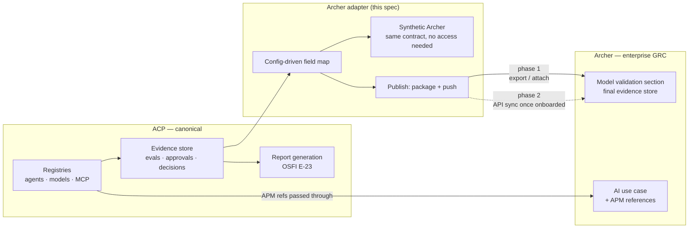

# Archer GRC Sync — D0: Discovery

> **Gate**: D0 — Discovery | **Status**: Draft | **Epic**: EACPP-1003
> **Owner**: ACP Product (Seth Chalmers) · **Counterparties**: CMRM (Ryan Bolick), GbD (Duncan Wyllie, Kathryn Vandenberg), Rob Chin
> **Source**: [12 August 2026 alignment session](../../governance/governance-intake/artifacts/2026-08-12-model-risk-gbd-alignment-minutes.md) ·
> [decisions & actions](../../governance/governance-intake/artifacts/2026-08-12-decisions-and-actions.md) (D1, D2, D3, D15, Q1)

> **Amendment — 9 September 2026. The platform underneath this D0 changed.**
> This discovery was written when ACP was a Sun Life build with its own agent registry, its own
> evidence store and a consortium `GRCConnector` protocol to implement. The platform is now
> **Luminate**, which has since built a governance subsystem of its own — obligation profiles,
> an append-only evidence contract, a published governance status that denies at the access layer,
> and a compliance export. Luminate's Governance Mode D2 — **a Sun Life-authored design** — places an
> Archer sync out of core and routes it to a plugin consuming that export.
>
> The problem statement below still holds and the decisions it records (D1, D2, D3, D15, Q1) are
> unchanged. What is obsolete is the **solution shape**: there is no ACP-owned evidence store to
> package from and no `GRCConnector` to implement. Bidirectional sync remains in scope; the inbound
> half is now delivered as named contributions to Luminate rather than as adapter writes. Read
> [D1 §0](d1-requirements.md#0-what-changed-the-target-is-luminate) and [§2](d1-requirements.md#2-direction-bidirectional-with-the-deciding-record-still-inside-luminate)
> before building anything from this page.

## Problem Statement

Two things were established in the alignment session that look contradictory and are not:

- **Archer remains the final store** for validation evidence, use-case registration and model-risk
  classification (D3, Ryan at 23:31 and 31:22 — *"it'll need to live in Archer as the final spot"*).
- **ACP must be able to produce a complete governance report without Archer** (D2, Seth at 31:34) —
  because Archer API onboarding is the longest-lead item on the board and pinning delivery to it
  would block everything behind an access request nobody controls.

The resolution is that ACP is canonical for AI-asset governance and **publishes** to Archer; Archer
is not forked, mirrored or waited on. What is missing is the adapter that makes that publication
real, and — more urgently — a way to build and test the whole chain *before* API access exists.
Ryan asked this directly at 32:33: *"is there like a synthetic Archer we could use to mock it up,
so as to not make Archer be the blocker?"*

There is a third, smaller problem. Technology dependencies need to tie to Archer use cases. The
agreed approach (D15) is to link **APM records** to use cases rather than invent a platform-level
record type in Archer, which would be redundant. GbD's intake is already looking to capture APM
references, so ACP inherits them and passes them through — but only if the field is carried
end-to-end from intake to publication.

## Background & Drivers

- **D1** — ACP is the canonical record for agents, models, MCP tools, decisions, traces and evidence.
- **D2** — no dependency on Archer to produce a report; sync is an enhancement, not a precondition.
- **D3** — ACP collects, packages and pushes; Archer stores. This is a publish, not a fork.
- **D15** — APM records tie technology dependencies to Archer use cases; no new Archer record type.
- **Q1** — a synthetic/mock Archer is explicitly requested so access is not the blocker.
- The consortium already specifies a generic `GRCConnector` protocol and an Archer reference
  connector (`EACPP-648` T5/T6, tickets EACPP-675/676). This spec is the **Sun Life instance**:
  real field maps, real credentials, the mock, and the APM field — not a second connector.

## Opportunity

Building against the mock means the entire chain — evidence packaging, field mapping, publication,
decomposition of a use case into agents and models — is finished and tested before the access
request is answered. When access lands, the target changes; the code does not.

## Scope

### In Scope

| # | Capability | Description |
|---|-----------|-------------|
| 1 | Synthetic Archer | A mock target implementing the Archer contract, used for development, tests and demos while API onboarding proceeds (Q1). |
| 2 | Field mapping | Sun Life Archer field map held as configuration — no vendor field ids in code. |
| 3 | Phase 1 publication | Package an evidence bundle and export/attach it to the Archer model-validation section, with no API dependency. |
| 4 | Phase 2 bidirectional sync | ACP risk tier / lifecycle status ↔ Archer risk record, once API access is granted. |
| 5 | Use-case decomposition | An AI use case originating in Archer decomposes into the agent / model / MCP registry entries it comprises. |
| 6 | ACD linkage | The Archer Control Domain identifier held as registry metadata, so agents and models roll up to the correct Archer AI use case. |
| 7 | APM pass-through | APM references captured at GbD intake are carried on the registry record and published with the use case (D15). |
| 8 | Authority rules | Which side wins per field when values differ, declared before any write is enabled. |
| 9 | Onboarding scoping | Determine the minimum Archer object to sync to (asset / issue / attestation) so the access request can be scoped precisely. |

### Out of Scope

- The generic `GRCConnector` protocol and reference connector — consortium `EACPP-648` (T5/T6).
- The evidence store and evidence contract themselves — `governance-intake` and consortium
  Governance Mode `EACPP-915`.
- Archer's own model-validation process and record design — CMRM owns it; ACP publishes into it.
- Replacing Archer, or holding the enterprise risk register in ACP.
- ServiceNow PIA/ISRA/ATG routing — remains in `governance-intake` T6 (EACPP-883).

## Stakeholders

| Stakeholder | Role | Key Concern |
|-------------|------|-------------|
| Ryan Bolick | CMRM | Archer is the final store; evidence must arrive in the model-validation section in a usable shape |
| Kathryn Vandenberg | GbD | Consistent Archer integration across ACP and GbD; end-to-end governance lineage |
| Duncan Wyllie | GbD | Intake captures APM references and passes them on |
| Robert Chin | Risk | Who pushes what into Archer; avoiding over-polluting Archer with ACP detail |
| Seth Chalmers | ACP Product | Delivering the chain without waiting on access |
| Archer platform team | GRC platform | API onboarding, credentials, rate limits, object scope |

## Open Questions

| # | Question | Owner |
|---|---|---|
| AR-Q1 | Who leads the Archer API onboarding conversation? It is the longest-lead item and currently unassigned. | Seth, Kathryn, Ryan |
| AR-Q2 | Minimum Archer object to sync to — asset, issue, or attestation? Needed *before* the access request so it can be scoped. | Ryan, Rob |
| AR-Q3 | On divergence, which side is authoritative per field? | Ryan, Seth |
| AR-Q4 | Is Archer doing ongoing monitoring today, and should GbD provide that instead given it will hold the data anyway? (Kathryn, 33:54) | Kathryn, Ryan |
| AR-Q5 | Does the APM reference originate at GbD intake only, or can ACP capture it at registration when intake was bypassed? | Duncan, Seth |
| AR-Q6 | Retention and tamper-evidence: is the ACP-side evidence store required to be append-only if Archer is the legal record? | Ryan, Kathryn |

## References

- Alignment brief §7 — `acp-consortium-specs/governance-docs/acp_model_risk_gov_by_design_alignment_brief.md`
- Decisions & actions register — [D1, D2, D3, D15; Q1, Q4; A11, A15, A18](../../governance/governance-intake/artifacts/2026-08-12-decisions-and-actions.md)
- Roadmap §2 C11, §3.2 — [governance-alignment-roadmap](../../governance/governance-intake/artifacts/2026-08-12-governance-alignment-roadmap.md)
- Consortium GRC connector: `EACPP-648` T5 (EACPP-675), T6 (EACPP-676)
- Related product spec: [`governance-intake`](../../governance/governance-intake/d0-discovery.md) (EACPP-877)
- Legacy internal Archer work: EACPP-64, EACPP-140, EACPP-424, EACPP-486
