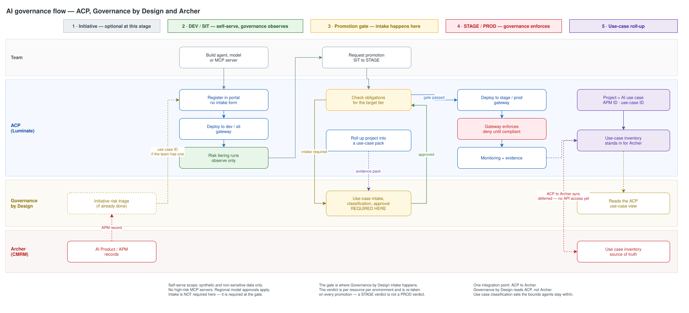

# Archer GRC Sync — Architecture Overview

> **Status**: Draft · **Epic**: EACPP-1003
> **Agreed**: Archer × ACP × GbD working session, 14 September 2026 (transcript in `references/`)
> **Attendees**: Kalyan Adhikari · Ryan Bolick · Seth Chalmers · Robert Chin · Mohamed Elghazouly ·
> Niall Kirk · Walter Kurzatz · Ranjula Rowel · Kathryn Vandenberg · Duncan Wyllie

One picture of how an AI use case moves from intake to production across the three systems, and
where each one has authority. Everything below is deliberately short; the reasoning, the evidence
and the open questions live in the gate documents linked from each section.

## How to read it

| Phase | What happens | Detail |
|---|---|---|
| **1 · Initiative** | Optional at this stage. A team that has already been through Governance by Design intake carries its use case ID in; a team that has not can still register and work in DEV and SIT. | [D1 §0.4](d1-requirements.md) |
| **2 · DEV / SIT** | The team registers and deploys **self-serve**. Risk tiering runs, but governance **observes** — it does not block. | [D2 — Environments](d2-design.md) |
| **3 · Promotion gate** | Promotion into STAGE is where **Governance by Design intake happens**: use-case classification, approval, and the obligations for the target tier. | [D2 — Promotion gate](d2-design.md) |
| **4 · STAGE / PROD** | Governance **enforces**. The gateway denies a resource that is not compliant. Monitoring and evidence run continuously. | [D2 — Enforcement](d2-design.md) |
| **5 · Use-case roll-up** | A Luminate **project is the AI use case**. ACP aggregates its agents, models and MCP servers into a use-case view that GbD reads and that will publish to Archer. | [D2 — Roll-up](d2-design.md) · [D1 §3](d1-requirements.md) |

## What was agreed

- **Registration is not the gate.** Registering happens in every environment. What is gated is
  **deploying and promoting into STAGE and PROD**. Putting classification ahead of registration
  would put model risk in front of every experiment.
- **Intake is not a prerequisite for DEV or SIT.** Teams that want to do intake first can — that is
  the current state today — and their use case ID is carried through. Teams that have not can still
  register and work. Intake becomes required at the promotion gate.
- **Risk tiering runs from the start, but only bites above SIT.** Agent tiering happens early, as
  Governance by Design intends. In DEV and SIT it is observation; the same rules block at the gate.
- **Self-serve has a scope.** Synthetic and non-sensitive data only, no high-risk MCP servers, and
  regional model approvals still apply.
- **Governance by Design integrates with ACP, not with Archer.** ACP owns the single Archer
  integration point. This replaces the two direct GbD → Archer arrows in the original flow.
- **A Luminate project is an AI use case.** ACP holds the **use case inventory as a stand-in**
  until Archer API access lands, keyed so it can be reconciled later.
- **APM is the common identifier.** The project carries an APM ID and the GbD use-case ID, so
  ACP, Governance by Design, risk and architecture can all join on the same record.
- **Use case classification sets the bounds; agent classification checks the agent stays inside
  them.** Divergence must be detectable, and reclassification goes back through GbD.
- **Model risk is tracked on an inherent basis.** ACP's controls are recorded as mitigations
  against that inherent rating, not netted off it.

## What is not built yet

| Gap | Consequence |
|---|---|
| **Archer API access** | The adapter is written and adapted for Luminate; credentials are still outstanding, so the ACP → Archer sync is deferred. The ACP-side use case inventory is what carries the integration until then. |
| **The approved band reaching ACP** | Obligations resolve from the band; without one, resolution is indeterminate and denies. This is the gap that gates the promotion gate. |
| **Archer write-back** | Approval and remediation flowing back from Archer is **not required for day one** — handled manually in the interim. |

Full inventory: [D1 §3 — registry content gaps](d1-requirements.md) (RG-1…RG-12) and the
[capability gap escalation process](../../../process/capability-gap-escalation.md).

## Where the detail lives

| Document | Contains |
|---|---|
| [D0 — Discovery](d0-discovery.md) | Problem statement, stakeholders, the decisions this spec inherits |
| [D1 — Requirements](d1-requirements.md) | Direction and authority, registry content gaps, functional and non-functional requirements, open questions |
| [D2 — Design](d2-design.md) | The interface register, design decisions, lifecycle projection, authority model |
| [D3 — Tasks](d3-tasks.md) | Implementation plan and sequencing |

Related: [`gateway-environment-strategy`](../../platform/gateway-environment-strategy/d2-design/promotion.md)
(EACPP-1089) for the promotion model this flow sits on, and
[`governance-intake`](../../governance/governance-intake/d0-discovery.md) (EACPP-877) for the obligation content.

## Next step

Walk a hypothetical use case end to end across the three systems — Ryan's ask in the session — to
stress-test the model before anything is built against it. That exercise needs Governance by Design
in the room and does not need any of the systems running.
