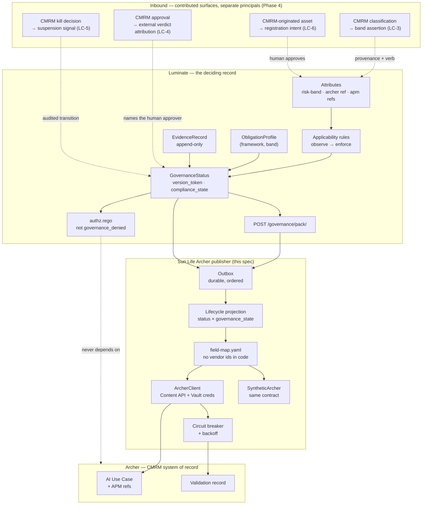

# Archer GRC Sync — D2: Design

> **Gate**: D2 — Design | **Status**: Draft | **D1 Approved**: TBD
> Sun Life publication of Luminate's governance position into Archer, plus the inbound contributions
> that make the return path real. **Luminate stays the deciding record.**
> **Verified against**: `luminate` @ `origin/main` `a0d31c10e` · `luminate-designs` @ `origin/main` `013d406`.

## End-to-end governance flow

> The picture and the summary live on
> [Archer GRC Sync — Architecture Overview](d2-architecture-overview.md). This section carries the
> detail behind it: what each phase does, the interface register, and what is still undecided.
>
> **Revised after the 14 September 2026 session (transcript in `references/`).** Two things changed materially:
> the flow is now split by environment, and Governance by Design integrates with **ACP** rather
> than with Archer directly.

### Where governance sits in the delivery lifecycle

Everything else follows from one property: **governance is scoped per environment, and it observes
before it enforces.**

Three consequences, from
[`gateway-environment-strategy`](../../platform/gateway-environment-strategy/d2-design/promotion.md) (EACPP-1089):

**Registration is not the gate.** Registering a resource is a team action in *every* environment
(DD-8). What is gated is **deploying and promoting into STAGE and PROD**. A team registers, builds
and runs in DEV and SIT without waiting on a governance decision — those tiers carry synthetic and
non-sensitive data, so the risk that justifies the gate is not present there.

**The verdict is per `(resource, environment)` and re-taken on promotion.** A STAGE verdict is
evidence *toward* the PROD verdict rather than a substitute for it, because the resource may carry
different attributes, quotas and audience in PROD. No single approval unlocks the remaining
lifecycle.

**Production is a deployment, not a status field.** Promotion creates a new `Deployment` in the
target environment against the same catalogue resource. Credentials, quotas and access policies are
deliberately re-established rather than inherited.

### DEV and SIT — the self-serve path

The team registers in the portal with **no intake form**, deploys to the dev or sit gateway, and
operates. Risk tiering still runs — agent tiering is meant to happen early, which is what
Governance by Design intends — but its result is **recorded, not enforced**.

What bounds the self-serve path:

| Bound | Why |
|---|---|
| Synthetic and non-sensitive data only | The premise of the whole accelerated path. Today this is policy rather than an enforced control — see `gateway-environment-strategy` DD-10. |
| No high-risk MCP servers | A tool binding is the fastest route from a sandbox to a system of record. |
| Regional model approvals still apply | The model registry gates which models are available in which region; the AI platform team owns those entries. |

**Governance by Design intake is deliberately not on that list.** A team that has already been
through intake carries its use case ID in from the start, and that is the current state today. A
team that has not can still register and work in DEV and SIT. Intake becomes required at the
promotion gate — requiring it earlier would reintroduce the wait the self-serve path exists to
remove.

### The promotion gate — where intake happens

Promotion from SIT into STAGE is the first point at which Governance by Design intake is required:
use-case level intake, classification and approval, plus the obligations for the target tier and
whatever evaluations CMRM specifies.

ACP's contribution at the gate is the **roll-up**: what was built and observed in DEV and SIT is
aggregated into a use-case level pack, so the intake is answered from evidence rather than from
memory.

**Use case classification sets the bounds; agent classification checks the agent stays inside
them.** If an agent's classification diverges from the use case it operates under, that must be
detectable, and reclassification goes back through the Governance by Design risk classification
rather than being decided agent-side.

**Model risk is tracked on an inherent basis.** Onboarding to ACP confers real governance,
oversight and observability, and those are legitimately recorded as **mitigations** — but they are
tracked against the inherent rating, not netted off it before the rating is set.

### Use-case roll-up — a Luminate project is the AI use case

ACP is granular: agents, models, MCP servers. Archer and Governance by Design are use-case level.
The join is the **Luminate project**.

| Concept | Holds |
|---|---|
| **Project** | The AI use case. Carries the APM ID and the GbD use-case ID. |
| **Resources under it** | Agents, models and MCP servers, each with its own governance state per environment. |
| **Use-case view** | The aggregate ACP publishes: composition, governance state, evidence, monitoring references. |

Two consequences worth stating plainly:

- **ACP holds the use case inventory as a stand-in for Archer.** Archer is the intended source of
  truth, but API access is not available. Building the inventory ACP-side now means the
  reconciliation is a sync when access lands, not a rebuild.
- **APM is the common identifier.** It already spans Governance by Design, service management,
  risk and architecture. Carrying it on the project is what lets those records join without
  inventing a new correlation key.

### Interface register

**Supersedes the INT-001…011 set in the previous revision.** The GbD → Archer arrows are gone:
Governance by Design integrates with ACP, and ACP owns the single Archer integration point.

| Ref | Direction | Carries | State |
|---|---|---|---|
| **I-1** | GbD → ACP | Use case ID whenever intake has happened; approved classification (the band) at the gate | **Needed.** The band is the blocking one — see below |
| **I-2** | ACP → GbD | Use-case view: composition and governance state of every resource under the project | **Needed.** The aggregate exists; the published view does not |
| **I-3** | ACP → GbD | Evidence pack at the promotion gate | Compliance export exists; machine-authored evidence is `unattested` until LC-2 |
| **I-4** | GbD → ACP | Approval or remediation outcome for the use case | **Needed** |
| **I-5** | ACP → Archer | Use-case inventory, compliance pack, monitoring reference | **Deferred — no API access.** Adapter written and adapted for Luminate |
| **I-6** | Archer → ACP | Suspension on a CMRM stop decision | **Not day one.** Manual in the interim, wanted eventually |
| **I-7** | APM ↔ ACP | APM ID carried on the project | **Needed** — the join key |
| **I-8** | ACP → ServiceNow | Privacy, ISRA and ATG evidence | `governance-intake` T6 (EACPP-883). Not Archer — those domains are not CMRM's |

### What Luminate decides, and what it needs

Luminate is the deciding record for scope, obligations, compliance state and the runtime
consequence, and derives all of it from its own inputs — which is what lets the access layer fail
closed. Two inputs originate with CMRM.

**The band, and it is load-bearing.** Obligations resolve from `(framework_ref, band)`. Where a
band cannot be resolved the status is `indeterminate`, which **denies** under an enforced rule. So
the CMRM-approved classification has to reach the resource as its `risk-band` attribute **before**
it comes into scope at STAGE — band first, then scope. Obligation resolution already anticipates an
external risk-triage decision, so this completes a seam the platform left open. I-1 is that path
and it does not exist yet.

**A stop decision needs to reach the access layer.** `governance_state = suspended` produces
`compliance_state = non_compliant`, which denies at the gateway for any resource under an enforced
rule. Today a CMRM stop reaches that state only when a person acts in Luminate on the strength of
the Archer decision. That interim is acceptable — it was agreed a write-back is not required for
day one — but it should be written down rather than assumed (OQ-A2).

Two things ACP will not assert, to keep the GRC record honest:

- **Per-tool authorization.** `AccessPolicy.allowed_tool_ids` exists in the model but no access
  policy target is a tool and no runtime rule reads it. Server-level MCP bindings are the honest
  unit (DD-6).
- **A registration created from an approved record.** Registration is a first-class Luminate action
  with its own authorization; the use case correlates to resources that already exist.

### Open with CMRM and GbD

| # | Question |
|---|---|
| 1 | **Can the same risk classification questionnaire serve both levels?** Use case and agent are different subjects with overlapping questions. Probably yes with a tweak, but it is undecided. |
| 2 | **Reclassification trigger.** When an agent's classification diverges from its use case, does the use case get reclassified first, or does the agent's rating inform an updated use-case rating? |
| 3 | **What project-level metadata is mandatory** for the roll-up to be answerable — APM ID, GbD use-case ID, owner, and what else? |
| 4 | **Does ACP become the front door for non-agentic GenAI too?** Models and apps already follow the same registry and promotion path; the boundary of "agent" is an architecture question in flight. |
| 5 | **What happens when a publication fails?** Publication runs through a durable outbox with a circuit breaker (DD-7); the Archer side needs matching retry and idempotency semantics. |

## Design Overview

The dotted inbound arrows are the point of the diagram. They are **not** adapter writes and they do
not share the publisher's principal. Each is a distinct, capability-scoped, audited Luminate surface
carrying external provenance, and each is a contribution that does not exist upstream yet (D1 §2).
Luminate still derives scope, obligations and compliance state from its own inputs — Archer supplies
premises, Luminate draws the conclusion. That is what keeps the deciding record inside the system
that has to fail closed, while making the CMRM decision consequential rather than advisory.

## Design Decisions

### DD-1 — The publisher cannot write, and the inbound path is a different principal
The publisher holds `governance.pack.export` and read access, and **no write verb on any governance
object**. It is not "designed not to write back"; it is *unable* to. A reviewer checks one principal's
permission set rather than reading the code for absent writes.

The Phase-4 inbound surfaces (LC-3…LC-6) do not relax this. Each is a **separate principal holding a
single named verb**, so "the adapter published a pack" and "CMRM asserted a band" are different
identities in the audit trail and can be revoked independently. Collapsing them into one service
account would recreate exactly the unaudited path Governance Mode D2 was written to prevent — the
split is the control. **Effort S / Risk Low.**

### DD-2 — Consume the export, not the database
Publication reads `POST /api/v1/governance/pack/` and the published `GovernanceStatus`. It does not
re-derive compliance, re-resolve obligations or query the governance tables directly. Two reasons:
the export is the boundary the platform design names, and a second derivation path would eventually
disagree with the first, at which point Archer holds a number Luminate cannot reproduce.
**Effort S / Risk Low.**

### DD-3 — The lifecycle projection is declared, and it is lossy on purpose
Archer's UC-012 wants one lifecycle field. Luminate has two orthogonal axes — `AgentStatus`
(operational: is the platform serving it) and `GovernanceState` (governance: has it cleared its
obligations) — separated deliberately, because a resource that has not cleared its obligations is
still operationally active until the access layer acts on it.

Collapsing two axes into one loses information, so the projection is **declared configuration** with
an explicit precedence, not logic buried in a mapper:

| Luminate | → Archer UC-012 |
|---|---|
| `governance_state = retired` | `Decommissioned` |
| `governance_state = suspended` | `Suspended` |
| `governance_state = approved` + `status = active` | `Active` |
| `governance_state = approved` + `status != active` | `Approved` |
| `governance_state = assessed` | `Evaluating` |
| `governance_state = in_scope_unassessed` | `Registered` |
| `governance_state ∈ {not_evaluated, out_of_scope}` | `Registered` — with `out_of_scope` published as a distinct reason field |

`Deployed` has **no resource-level equivalent** and is deliberately not synthesised: in Luminate it
is a property of a `Deployment` row, not of the agent. If Archer needs it, it comes from the
deployment surface as a separate field, not by guessing from status. **Effort S / Risk Med** — the
risk is that CMRM reads `Registered` as "nothing has happened" when it may mean `out_of_scope`,
which is why the reason field is not optional.

### DD-4 — External identifiers: decide the shape before building the map
RG-1 is unresolved and it is the first thing that will be built against, so the design records the
three candidates rather than picking one silently (OQ-A1):

| Option | Cost |
|---|---|
| **A. Member attribute, one `AttributeValue` per resource** | Works today, no upstream change. Grows the vocabulary unboundedly — the attribute system is built for enumerable dimensions, and the admin surfaces will show thousands of one-use values. |
| **B. Free-form external-ref field, contributed upstream** | Correct shape. Needs consortium agreement and a migration; the platform has so far resisted per-vendor fields, though an opaque external ref is vendor-neutral. |
| **C. Mapping table in the adapter** | No platform change and no vocabulary pollution. But the correlation then lives outside the governed record, so the identifier is invisible to the export, to the audit trail, and to anyone reading Luminate. |

Recommendation is **B, with A as the interim** — A is reversible and unblocks Phase 0, B is where it
should end up. C is recorded because it is tempting and it quietly breaks the property that makes the
whole integration auditable. **Effort M / Risk Med.**

### DD-5 — The band is an ingestion, not a sync
The CMRM-approved classification becomes the `risk-band` governance-authoritative attribute on the
resource. `obligations.py` already anticipates exactly this — the band "will come from Risk Triage",
and `_band_for` is the named swap point — so this rides the seam the platform left open rather than
cutting a new one.

Two properties that are not negotiable. It is authored under `governance.metadata.update` by an
authorized actor, so the band has the same provenance as any other governance-authoritative
attribute. And it is **not** written by the publisher (DD-1), because a band written by the adapter
would be scope-and-rigor decided outside the platform.

The failure mode is worth naming: `BandNotResolvable` resolves `indeterminate`, which **denies**. A
resource brought into scope before its band arrives is stopped, not merely unassessed. Ordering
therefore matters — band first, then scope. **Effort M / Risk High** — this is the one place where
getting the sequence wrong takes traffic down.

### DD-6 — Publish what is enforced; report what is not, as what it is
RG-7 is a correctness trap rather than a missing field. `AccessPolicy.allowed_tool_ids` exists in the
model and the serializer, but no `AccessPolicyTargetType` is a tool and no `.rego` rule reads it, so
publishing it to Archer would place a control in the GRC system of record that nothing enforces.

The rule: the publisher may present a binding as a **control** only where a runtime consumer denies
on it. Model bindings qualify (`allowed_models` in `authz.rego`). Server-level MCP bindings qualify.
Per-tool bindings do not, and are published — if at all — as declared intent, labelled as such.
**Effort S / Risk Low**, and it is the difference between a governance report and a misleading one.

### DD-7 — Durable outbox, not a synchronous call
Governance events write to an outbox; the publisher drains it. An Archer outage delays publication
and never fails a decision, and ordering is preserved so a status cannot be published before the
registration it depends on. This is what makes NFR-1 structurally true rather than a promise.
**Effort M / Risk Low.**

### DD-8 — Synthetic Archer is a first-class deliverable
`SyntheticArcher` implements the same contract as the real client, is selected by configuration,
persists what it receives, and shares one contract test suite with the real one. Building against it
is what takes Archer access off the critical path (Q1). If it may diverge from the real contract it
validates nothing (NFR-6). **Effort M / Risk Low.**

### DD-9 — Field map as configuration, resolved at startup
`field-map.yaml` maps published concepts to Archer application / level / field ids, validated at
startup so a bad map fails loudly rather than silently writing the wrong field. No vendor id ever
appears in code. **Effort S / Risk Low.**

### DD-10 — Carry the disclaimer, do not launder it
The compliance pack states in its own payload that it is not the signed evidence pack — no
cryptographic signing, no immutable artifact, no attestor signoffs. An auditor handed a document
titled "evidence pack" will assume all four.

The publisher must carry that statement onto the Archer record. This is not caution for its own
sake: a limitation recorded only in a design document is one the person reading the Archer record
never sees, and Archer is precisely where someone will read it years later. **Effort S / Risk Low.**

### DD-11 — Every exchange is audited with the version token
Attempted, succeeded, failed and conflicted exchanges each emit an audit event carrying the
`version_token`, `generation` and `obligation_revision` of the status published, so an Archer
artifact can always be resolved back to the platform state that produced it — and a reader comparing
the two can tell whether it still describes reality. **Effort S / Risk Low.**

## What this design deletes from the previous D2

Recorded rather than quietly dropped, because these were approved-in-draft positions:

| Was | Now | Why |
|---|---|---|
| **DD-1** SyntheticArcher against the consortium `GRCConnector` protocol | DD-8, against the Archer Content API contract | There is no `GRCConnector` in Luminate. The consortium ticket (`EACPP-648` T5/T6) was written for the internal build. |
| **DD-4** publish-by-reference from an ACP evidence store | DD-2, consume the compliance export | ACP has no evidence store on Luminate. `EvidenceRecord` is Luminate's, append-only, and already better than what was proposed. |
| **DD-5** `acd_ref` / `apm_refs` as registry metadata ACP owns | DD-4, member-defined attributes on a Luminate resource | The registry is not ours to add fields to. RG-1 is the consequence. |
| **DD-6** Phase 2 write path gated on a per-field authority table | DD-1 + D1 §2 contributions | Narrowed, not deleted. Outbound fields have one authority — Luminate — so there is nothing to arbitrate. The table returns for the four Phase-4 inbound fields only, and gates LC-3…LC-6 rather than the Phase-2 publication. |
| **DD-7** use-case decomposition as a mapping | Retained as FR-2 correlation | Unchanged in substance, and now backed by platform design rather than only by this spec's judgement. |

## Authority model

Outbound, there is one authority for every governance field — **Luminate** — and Archer is the store
of record for the published artifact. Inbound, four fields have a CMRM authority, and each is gated
on its contribution landing. The right-hand column is what must be true **before** LC-3…LC-6 are
built; it is OQ-A7, and it is empty in one place on purpose.

| Field | Deciding system | Archer's role | Conflict rule |
|---|---|---|---|
| Scope, compliance state, verdict, governance state | Luminate | Published copy | Luminate — nothing to arbitrate |
| Evidence and control outcomes | Luminate (append-only) | Final store of the published pack | Luminate |
| Risk band | **CMRM**, asserted into Luminate with provenance (LC-3) | Canonical source of the classification | **TBD — OQ-A7.** A resource whose Archer band and Luminate band disagree is the case nobody has decided, and `BandNotResolvable` denies |
| Approval / verdict attribution | **CMRM** human, recorded with external reference (LC-4) | Canonical source of the approval | CMRM for *who approved*; Luminate for *what that entitles* |
| Stop / kill decision | **CMRM**, landing as an audited suspension (LC-5) | Canonical source of the decision | CMRM — a stop is never overridden by the platform |
| Registration intent | **CMRM** proposes, Luminate human approves (LC-6) | Originator | Luminate — an intent is a request, not a create |
| AI Use Case, APM references | Archer | Canonical | Archer |

Until LC-3…LC-6 land, every row in the middle of this table is carried by a person acting in two
systems. That is the interim, and OQ-A2 is where it gets written down rather than assumed.

## Migration / Adoption Path

1. **Decide OQ-A1** (external identifier shape) and OQ-A3 (band authorship). Nothing else is safe to build first.
2. Member attributes for the external identifier and APM refs; SyntheticArcher + contract suite; `field-map.yaml` skeleton.
3. Lifecycle projection as declared configuration, with the `out_of_scope` reason field.
4. Outbox + Phase 1 export/attach publication; prove Luminate's governance answer is unchanged with publication disabled.
5. Band ingestion path, sequenced band-before-scope (DD-5).
6. Access-request scoping statement (AR-Q2) — in parallel, gating nothing.
7. Real Archer client against the granted scope, passing the same contract suite (Phase 2).
8. Producer identity (RG-10) resolved upstream or by interim service user; then ACP-authored evidence (Phase 3).

## Non-Goals

- Becoming the enterprise risk register, or holding it in Luminate.
- Writing scope, band, verdict or governance state from Archer.
- Building an evidence store, obligation model or compliance report — Luminate has all three.
- Contributing an Archer connector to Luminate core. Governance Mode D2 rules it out and the
  reasoning is sound: it would make the consortium release depend on a commercial product most
  members do not run.
- Per-tool authorization. That is a Luminate capability gap (RG-7) and belongs in the capability-gap
  escalation process, not in this adapter.
