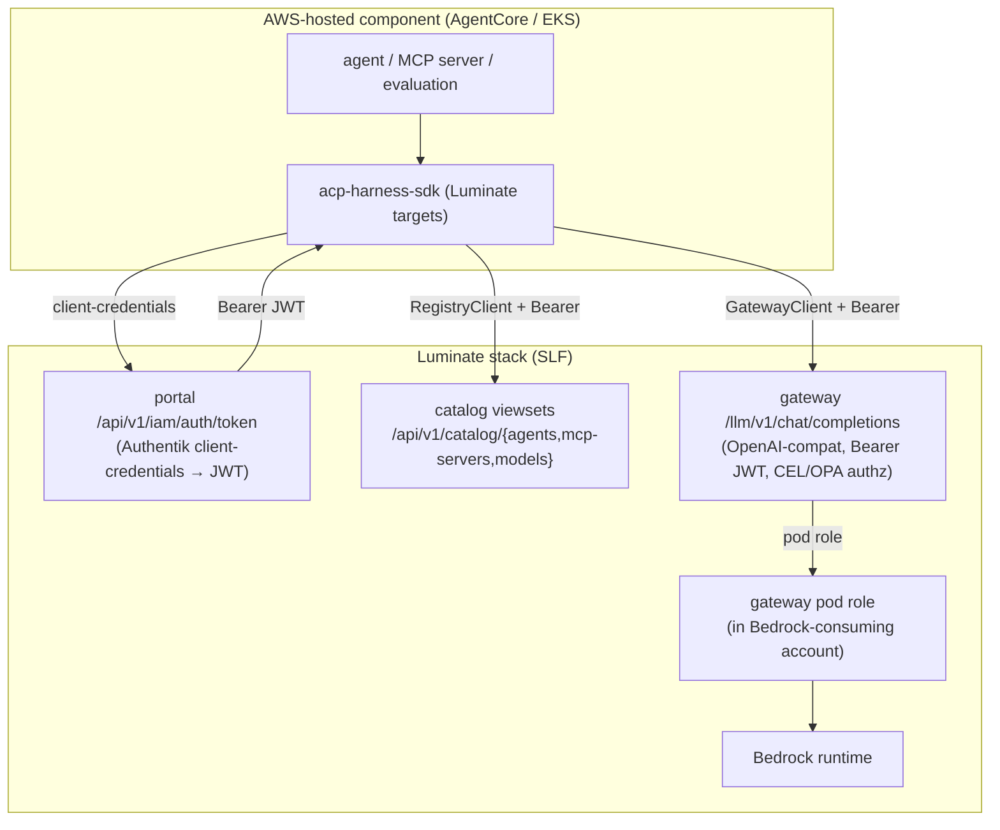
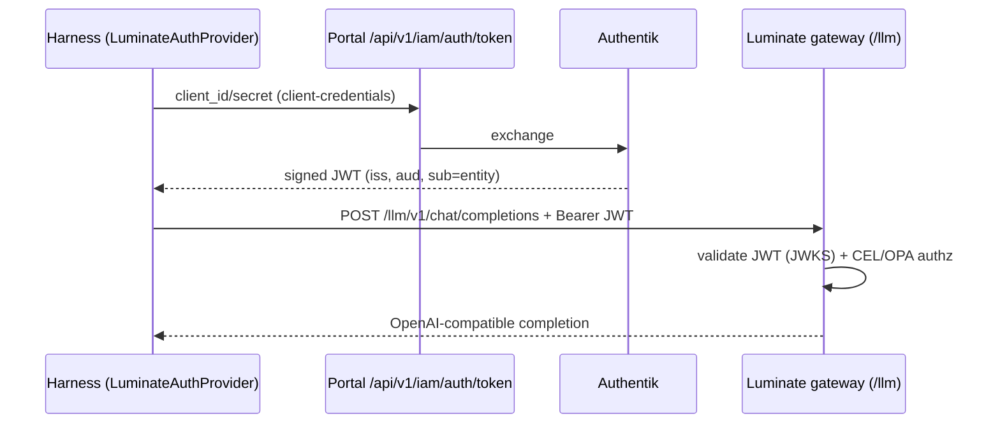

# AWS Harness Integration with Luminate — D2: Design

> **Gate**: D2 — Design | **Status**: Draft | **D1 Approved**: TBD
> Update the AWS Harness SDK to speak Luminate's gateway, catalog, and token APIs — no
> consumer call-site changes, config/targets only.

## Design Overview

## Auth Flow (Luminate)

## Design Decisions

### DD-1 — GatewayClient targets Luminate `/llm` with Bearer JWT
Add a Luminate gateway mode: base URL `{gateway}/llm`, path `/v1/chat/completions` and
`/v1/models`, OpenAI-compatible body (unchanged). **Replace the `x-acp-agent-id` header
with `Authorization: Bearer <JWT>`** from the token provider (DD-3). Streaming tool-call
normalization is handled gateway-side, so no client change. **Fixes FR-1/FR-2.**

### DD-2 — RegistryClient targets Luminate catalog viewsets
Repoint registration/read to `/api/v1/catalog/{agents,mcp-servers,models}` (DRF
create/list/retrieve). Add a **payload mapper** from harness inputs → Luminate schema:

| Harness input | Luminate field |
|---|---|
| name | `name` (+ derived `key`) |
| type/framework | `type`, `framework` / `transport` (MCP) |
| — (config) | **`project`** (required, from settings) |
| — (visibility) | **`scope_tokens`** (from settings) |
| tags | **mandatory tags** (validated on create) |
| platform/model config | `configuration` (JSON) |

`self_register()` becomes `POST /api/v1/catalog/agents` with the mapped payload + Bearer
JWT. **Fixes FR-4/FR-5/FR-6.**

### DD-3 — LuminateAuthProvider (portal token endpoint)
New provider obtains a JWT from **`POST /api/v1/iam/auth/token`** (client-credentials,
Authentik-backed), caches with refresh skew, and supplies the Bearer token to both the
catalog client and the gateway client. Keep the existing `OktaAuthProvider` interface so
the token source is **pluggable** (Authentik now; Okta/Entra later — the gateway is
IdP-agnostic via issuer/JWKS). **Fixes FR-3/FR-10.**

### DD-4 — Drop cross-account assume-role for Luminate
When `target=luminate`, the harness performs **no** cross-account role assumption; model
calls go through the Luminate gateway, which invokes Bedrock via its **pod role** in the
consuming account (Ian Q7). This removes the IRSA assume-role step from the component's
identity for the Luminate path. **Fixes FR-7.**

### DD-5 — ACPSettings: Luminate targets
Add config: `portal_base_url`, `catalog_prefix` (`/api/v1/catalog`), `gateway_llm_url`
(`.../llm`), `token_endpoint` (`/api/v1/iam/auth/token`), `project`, `scope_tokens`, and
default `tags`. A `target` switch (`internal` | `luminate`) selects endpoint set + auth +
attribution so both stacks are supported during migration. **Fixes FR-9/NFR-2.**

### DD-6 — Migrate `acp-agentcore-sample` examples
The **`acp-agentcore-sample`** examples (agent, ai-ready-data agent, MCP, A2A) — some still
on boto3 Converse/Nova — are updated to the Luminate-supporting harness version and move
their model calls to `GatewayClient` against Luminate `/llm`. Provide a migration snippet
(boto3 Converse → `GatewayClient.chat`). **Fixes FR-8/NFR-4.**

### DD-7 — Contract tests against Luminate
httpx MockTransport tests asserting: gateway calls hit `/llm/v1/chat/completions` with a
Bearer header; registration hits the catalog viewset with a schema-valid payload (project +
tags); token provider hits `/api/v1/iam/auth/token`. **Fixes NFR-5.**

## Migration / Adoption Path

1. Add `LuminateAuthProvider` + `target=luminate` config (DD-3, DD-5).
2. Repoint `GatewayClient` to `/llm` + Bearer (DD-1).
3. Repoint `RegistryClient` to catalog viewsets + schema mapper (DD-2).
4. Drop cross-account role on the Luminate path (DD-4).
5. Update + migrate the `acp-agentcore-sample` examples to the Luminate gateway (DD-6).
6. Add Luminate contract tests (DD-7).

## Boundaries (no duplication)

- **`sunlife-deployment` DD-6** owns the **gateway-side** Bedrock-in-consuming-account role
  model; this spec only *consumes* it (drops the harness's own assume-role for Luminate).
- **`sunlife-deployment` DD-5** owns the M2M/cost discussion; referenced, not re-specified.
- Luminate API contracts are the fixed target — no Luminate changes are proposed here.
