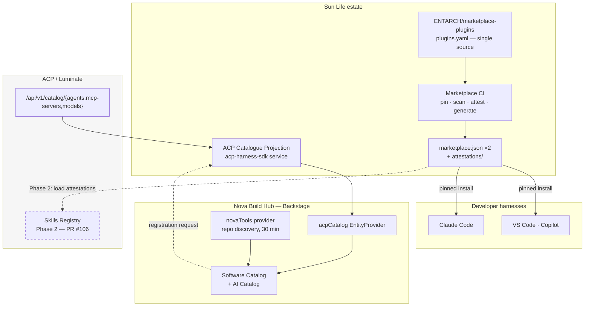
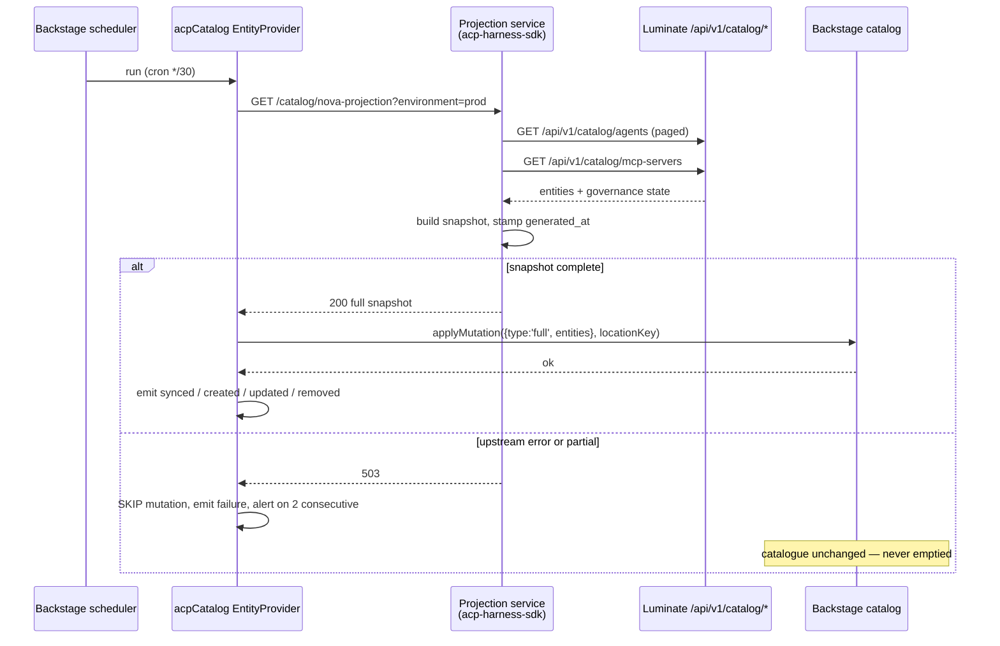
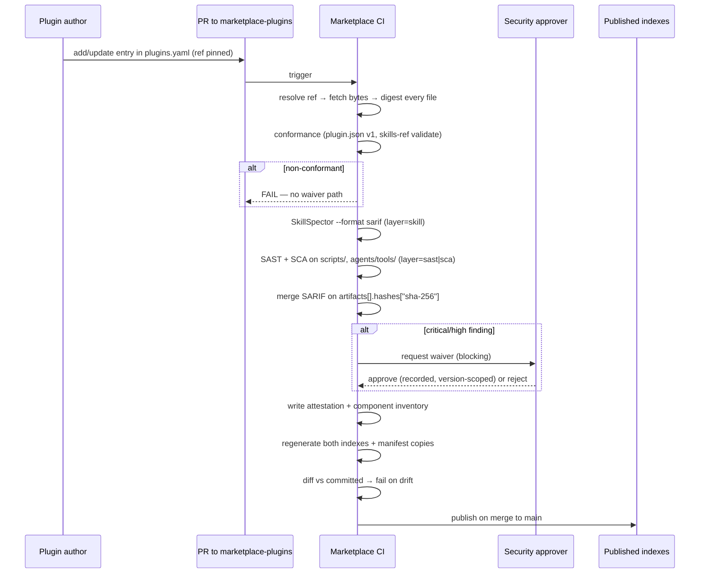
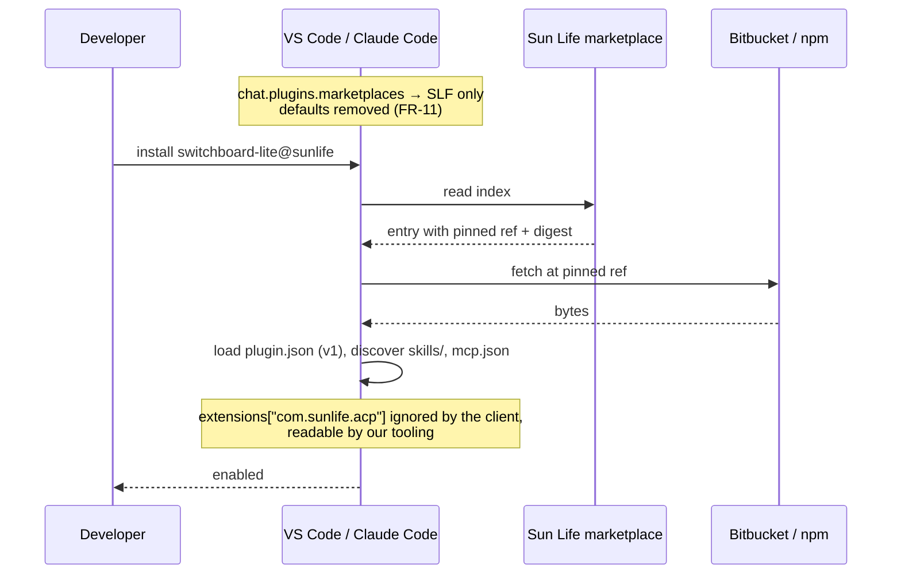
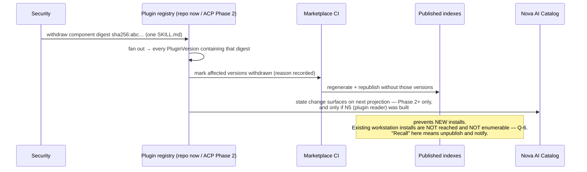

# NOVA & ACP Integration — D2: Design

> **Gate**: D2 — Design | **Status**: Draft | **Epic**: [EACPP-895](https://sunlife.atlassian.net/browse/EACPP-895)

Reads on from [D1: Requirements](d1-requirements.md). Every design decision below is written
against the constraint established in D1 [§3](d1-requirements.md#3-what-acp-can-hold-today-verified):
**ACP cannot store a plugin or a skill today, and the design that would let it is an unmerged
draft.** The shape of this design is a direct consequence — nothing on the critical path waits
on a consortium decision, and nothing built now is discarded if that decision goes our way.

---

## 1. Design overview — three seams, three owners, three schedules



| Seam | Direction | Owner | Cadence | Depends on a consortium decision? |
|---|---|---|---|---|
| **A** — catalogue projection | ACP → Nova | Sun Life (harness) + InnerVerse | 30 min, scheduled | **No** |
| **B** — plugin supply chain | Git → marketplace → harness | EA + marketplace CI | Per merge | **No** (Phase 2 optional) |
| **C** — runtime | Harness/Nova runtime → ACP | Deferred | — | Yes — [G-4](d1-requirements.md#10-capability-gaps) |

The single most important structural property: **A and B are independent.** Neither blocks the
other, they have different owners, and either can ship alone and be worth having.

---

## 2. Design decisions

### DD-1 — The projection service is Sun Life side, not a Luminate feature

Seam A needs an endpoint shaped for a Backstage full-mutation provider. Luminate already
exposes the underlying data at `/api/v1/catalog/agents`, `/catalog/mcp-servers`,
`/catalog/models` and `/catalog/applications` (verified, `backend/app/api_router.py:181-195`,
`origin/main` `31f908e90`). What it does not expose is a Nova-shaped, snapshot-consistent,
paginated projection with Backstage annotations.

**Decision**: build the projection as a small read-only service in the Sun Life harness estate
(`acp-harness-sdk`), reading Luminate's existing catalogue APIs. Do **not** ask the consortium
for a Nova-shaped endpoint.

**Rationale**: this is the capability map's delineation rule applied as written — an ask of the
form *"make ACP talk to \<Sun Life system\>"* is integration, the harness absorbs it, and it
stays on the Sun Life side. A `nova-projection` endpoint inside Luminate would be a
Sun-Life-specific shape in a consortium product, which is both a harder sell and a worse design.
It also means Seam A's delivery date is ours to set.

**Cost of being wrong**: if another member later wants the same projection, it promotes from the
harness into the product. That is the normal direction of travel and is cheap. The reverse —
un-picking a member-specific endpoint from a shared product — is not.

### DD-2 — Full mutation with skip-on-error, and `acp_id` as the only join key

The provider follows `APICatalogProvider`: `applyMutation({ type: 'full', entities })` with a
stable `locationKey`. Full mutation means **the absence of an entity is a delete instruction**,
which makes two things load-bearing:

1. **A failed or partial fetch must skip the mutation entirely.** Never apply an empty or
   short full mutation — it would delete every projected entity in Nova. The projection endpoint
   therefore returns a complete snapshot or an error, never a best-effort subset.
2. **The join key is `acp_id`, never the name.** Backstage entity names are mutable and
   human-authored; ACP ids are not. The Backstage entity name is derived from the ACP id where
   the name is ambiguous.

Interval is **30 minutes**, not the API catalogue's 6 hours: governance state (an approval
revoked, an agent deactivated) is time-sensitive in a way an API inventory is not, and 30
minutes already matches `novaTools`.

### DD-3 — Govern the plugin; inventory the skill; recall across both

The reconciliation from D1 [§4.1](d1-requirements.md#41-plugin-or-skill-which-is-the-unit-of-governance),
stated as a data-model rule:

```
Plugin ──1:N──▶ PluginVersion ──1:N──▶ Component {skill | agent_definition | mcp_server | script}
                      │                              │
                      └── ScanAttestation ◀───────────┘  joined on sha256
```

- The **approval decision** attaches to `PluginVersion` — because in a coding harness that is the only thing that can be allowed or denied.
- The **review evidence** attaches to `Component` — because that is what a scanner scores, and what an OWASP AST finding is raised against.
- A **withdrawal is authored against a `Component` digest and executed against every `PluginVersion` containing it.** One poisoned `SKILL.md` sha-256 fans out to the set of plugin versions to unpublish.

That fan-out is the point: a skill appearing in three plugins is withdrawn from all three by one
action, which a plugin-only model cannot express. It is **not** a claim of superior reach. The
Skills Registry's recall reaches further *within its own runtime* — adoption is pinned per agent
and bundles are served at load time, so a pulled version stops being served and every adopter is
flagged. Republishing a marketplace index prevents new installs and reaches no existing
workstation ([D1 FR-10](d1-requirements.md#fr-10-withdraw-a-version-and-state-the-limit-of-that-reach)).
The two mechanisms cover different runtimes; neither substitutes for the other.

### DD-4 — Agent Plugins v1 is the floor; governance rides in `extensions`

Manifest shape per plugin, root `plugin.json`:

```json
{
  "$schema": "https://agent-plugins.org/schemas/1.0.0/plugin.schema.json",
  "name": "switchboard-lite",
  "version": "0.1.0",
  "description": "...",
  "author": { "name": "ICT CCIO DevTools" },
  "repository": "https://bitbucket.sunlifecorp.com/scm/entarch/marketplace-git-plugin.git",
  "license": "MIT",
  "extensions": {
    "com.sunlife.acp": {
      "acpPluginId": "01a0...",
      "approval": { "state": "published", "by": "af89", "at": "2026-09-04T14:02:11Z" },
      "attestation": "./.sunlife/attestation.sarif.json",
      "componentDigests": "./.sunlife/components.json",
      "riskScore": 12,
      "harnessTargets": ["vscode-copilot", "claude-code"]
    },
    "com.anthropic.claude-code": {
      "agents": ["./agents/theCodeFather.agent.md"]
    }
  }
}
```

**Why this and not a bespoke schema.** Agent Plugins v1's manifest is *closed*, and §8
reserves reverse-domain `extensions` namespaces for exactly this purpose, with a guarantee that a
client which does not implement the namespace **ignores it without validating it**. So the
governance block is inert in every conformant client and readable by ours. Nothing else on offer
has that property.

**And a hard rule ships with it: the manifest block is not authoritative.** Anything a plugin
ships can claim `"state": "published"`. The block is a **mirror, for display and tooling
convenience only**; the attestation store is the sole source of an approval decision, and no tool
may read a verdict out of a plugin's own manifest. Stated explicitly because the first integration
anyone writes will otherwise trust it.

**What this fixes in the demo repo today.** All three git-sourced plugins fail to load under a v1
client, for two different reasons:

| Plugin | Defect | v1 clause |
|---|---|---|
| `plugin-docs-basics`, `plugin-governance-suite` | No root `plugin.json` (the manifest sits at `.claude-plugin/`), and no `$schema` | §5.1 location; §5.3 required field — fatal |
| `switchboard-lite` | Root manifest exists but declares `"$schema": ".../claude-code-plugin-manifest.json"`, which is not a recognised Agent Plugins identifier | §5.2 — the client MUST reject an unsupported declared version |

Note what is **not** the cause: the unknown top-level fields (`agents`, `skills`, `id`, `targets`,
`requiredSkills`) are explicitly **non-fatal** under §5.2 and §11.3 — a client must *report and
ignore* them and keep loading. Getting this right changes the fix: those manifests need a
`$schema` and a root location, not a field purge.

**What it does not fix**: v1 defines no marketplace at all. The index stays Claude-Code-schema'd
and generated (DD-5), constrained by the SLF profile in DD-12, because there is no standard
alternative to move to.


### DD-5 — The marketplace index is a build artefact, not a source file

Single source of truth: `plugins.yaml` in `ENTARCH/marketplace-plugins`. CI generates, per
merge: both marketplace indexes, every per-plugin manifest copy, and the attestation set.
CI then regenerates and **fails on any diff against the committed files**.

```
plugins.yaml ──▶ generate ──┬──▶ .claude-plugin/marketplace.json
                            ├──▶ .github/plugin/marketplace.json
                            ├──▶ plugins/*/plugin.json  (+ client copies)
                            └──▶ attestations/<plugin>@<sha>.sarif.json
                                        │
                                   diff vs committed ──▶ fail
```

**Rationale**: the README currently instructs a human to "keep both marketplace files in sync"
([M-2](d1-requirements.md#2-what-the-plugin-marketplace-is-today-verified)). Hand-synced
duplicates drift; here drift means *a plugin approved under one harness is not the artefact
installed under another*, which quietly voids the approval. This repo already applies exactly
this pattern to `specs/README.md` and `epic-mapping.json`, and the CI stage that enforces it is
about fifteen lines.

### DD-6 — Governance records live in the marketplace repo now, schema-identical to ACP later

Until the Skills Registry exists, `PluginVersion`, `Component`, `Waiver` and `ScanAttestation`
are committed artefacts under `attestations/` in the marketplace repo, written to the **exact
schema** of D1 [§8](d1-requirements.md#8-data-model-requirements).

**Rationale**: the alternative — wait for PR #106 — puts a Sun Life delivery date behind a
consortium design that is a *draft* whose own dependency (API Resources, PR #105) is also a
draft. That is an unbounded wait for something with no owner and no decision date. Meanwhile a
branch-protected repo whose generated paths are written only by CI is an adequate store for
records that are only ever machine-written.

**Stated precisely, because the adjectives matter.** This store is *CI-written, branch-protected
and review-gated*. It is **not** append-only and the records are **not cryptographically
signed**: a git repository can be force-pushed, and a repo admin can rewrite history. Signing is
deliberately deferred rather than claimed — there is no key custody model, no rotation plan and,
since no harness verifies anything (Flow 3), no verifier downstream. If signing is wanted, it
needs its own decision: scheme (cosign/Sigstore or GPG), who holds the key, and who checks it.
Until then, the control is repository governance, which is defensible as long as it is described
as that.

**Migration**: Phase 2 loads the records. Because the schema is identical, the migration is an
import loop, not a redesign — and if the consortium declines G-2, Sun Life keeps a working
system rather than a blocked one.

**What is genuinely lost by not having ACP hold them**: cross-entity queries ("which agents
adopted a skill that was later withdrawn") need a join across two stores until Phase 2.
Acknowledged, not hand-waved.

### DD-7 — One attestation bundle per plugin version, joined on SHA-256

Scanners emit SARIF 2.1.0. Each run populates `runs[].artifacts[]` with
`location.uri` + `hashes["sha-256"]`, each `result` points at `artifactLocation.index`, and
`result.properties.layer` names the producing class (`skill` · `sast` · `sca` · `conformance`).
Merging N reports is grouping `artifacts[]` across runs on the digest — no re-hashing, no
coordination between tools.

This is the OWASP multi-scanner interoperability pattern used as designed, and it has a
property that matters more than tidiness: **a finding self-invalidates when the file changes.**
The digest that pins the artefact (DD-8) is the same digest that anchors the finding, which is
what makes "this version was scanned" a checkable statement rather than a claim.

Verdict policy:

| Layer | Blocking | Waiver |
|---|---|---|
| Conformance (manifest + `skills-ref validate`) | Yes — always | None. A non-conformant skill is one a client silently skips |
| **Index-entry profile** (DD-12) | Yes — always | None |
| Skill scan, critical/high | Yes | Named security approver, recorded in the attestation, expires with the version |
| Skill declares `allowed-tools` | Yes — held for human review | Reviewer sign-off. The Agent Skills spec defines it as tools *"pre-approved to run"*, so it **removes a confirmation prompt** in any client implementing it. It is privilege-elevating, and `Bash(...)` patterns especially so |
| Skill scan, medium/low | No — advisory | — |
| SAST/SCA, critical/high | Yes | Existing Sun Life waiver process |

**Waivers cannot be self-served.** A waiver is an *input* to the gate, and DD-5 diff-fails
generated artefacts, so a waiver placed in the author's own change would be self-approval by
construction. Waivers therefore live on a restricted path with their own CODEOWNERS, and CI
rejects any waiver whose approver is the version's author. ACP cannot enforce this for us —
[CAP-14](../../../capability-map.md#cap-14) has no multi-step or SoD approvals — so it is enforced
in CI or not at all ([G-8](d1-requirements.md#10-capability-gaps)).

### DD-8 — Content-addressed publication

Every index entry pins immutably, using the schema's **`sha`** field — not `ref`:

```yaml
# plugins.yaml
- name: switchboard-lite
  source:
    type: git-subdir
    url: https://bitbucket.sunlifecorp.com/scm/entarch/marketplace-git-plugin.git
    path: plugins/switchboard-lite
    sha: 7f3c9a1e4b8d2f6c0a5e9b3d7c1f4a8e2b6d0c9f   # ← the whole point
  version: 0.1.0
  manifestDigest: sha256:…
```

**The field choice is not cosmetic.** `claude-code-marketplace.json` defines both `ref`
(*"Git branch or tag… Defaults to the default branch"*) and `sha` (*"Specific commit SHA"*,
constrained `^[a-f0-9]{40}$`). Putting a hex string in `ref` relies on undefined client behaviour.
And a **tag is not an immutable pin** — it can be deleted and re-pushed at a different commit — so
`sha` is the only acceptable value.

**Rationale**: today's entries carry `url` + `path` and nothing else
([M-1](d1-requirements.md#2-what-the-plugin-marketplace-is-today-verified)), so the installed
bytes are whatever the default branch says at install time. Every downstream control — review,
approval, attestation, withdrawal — is a statement about bytes. Without a pin they are statements
about a name, and a name is not an artefact. One field per entry.

**Consequence to accept**: a plugin update becomes an explicit index change with a new sha. That
is the intent — it makes upstream re-publishes visible instead of silent, which is the exact
failure mode the Skills Registry D1 calls out. The cost is that staleness becomes silent instead,
which is why an update-available signal is required rather than optional
([Q-11](d1-requirements.md#open-questions)).

**Note the digest asymmetry**: the source pin is a SHA-1 commit id; the component inventory uses
SHA-256. The **SHA-256 file digests are the authoritative binding** between an artefact and its
findings. The commit sha is only how the bytes are fetched.

### DD-9 — The registered/discovered delta is a first-class output

Nova discovers agents from source (`novaTools`); ACP projects governed agents (Seam A). The
**difference is the shadow-AI inventory**, and it is the one number this integration produces
that neither system can produce alone.

**Decision**: model `unregistered` as an explicit state on the Nova entity and expose the count
as a projection-service metric. Do not filter unregistered agents out of the AI Catalog.

**Rationale**: the instinct is to show a clean catalogue. A clean catalogue that omits
ungoverned agents is worse than useless — it converts an unknown into a false negative, and it
removes the only incentive a team has to register.

### DD-10 — Nova requests registration; Nova never writes governance state

The reverse direction (Nova → ACP) is a **registration request**, not a write. Nova submits
source-of-record fields it owns per D1
[FR-2](d1-requirements.md#fr-2-split-the-system-of-record-by-field-not-by-entity) — repo,
pipeline, APM number, owning team. ACP creates the entity, assigns the id, and owns every
governance field from that moment.

**Rationale**: a developer portal that can write approval state is not a developer portal, it is
a second control plane. The field-ownership table only holds if one side of it is enforced at
the API boundary rather than by convention.

### DD-11 — The gatekeeper plugin is instrumentation until it is mandatory

`@sunlife/agentic-gatekeeper` is distributed as a plugin and, per the marketplace README,
**Copilot CLI cannot consume npm sources**
([M-6](d1-requirements.md#2-what-the-plugin-marketplace-is-today-verified)). A control the
developer installs, and cannot install uniformly, is a default.

**Decision**: treat it as a telemetry and notice channel. Do not attribute enforcement to it in
any control narrative until (a) it is installable on every harness in use, and (b) its absence
is detectable. Re-source it as `git-subdir` to remove the Copilot CLI limitation — a
same-afternoon fix that at least makes (a) true.

---

### DD-12 — The index is a higher-privilege artefact than any plugin it lists

The marketplace index is not a list of pointers. Per `claude-code-marketplace.json`, a plugin
*entry* may itself declare `hooks`, `mcpServers`, `lspServers`, `commands`, `settings`,
`dependencies` and `monitors` — the last documented verbatim as *"Background watch scripts the
host arms as persistent Monitor tasks (**unsandboxed, same trust tier as hooks**)"*.
`strict: false` means *"the marketplace entry provides the manifest"*, bypassing the plugin folder
entirely. Top-level `allowCrossMarketplaceDependenciesOn` permits auto-install from another
marketplace.

Meanwhile the documented consumption path is `…/marketplace-plugins.git#main` — **a branch tip,
re-read on every resolution.** No harness supports pinning or verifying an index.

**The consequence**: one merge to `main` of `marketplace-plugins` places unsandboxed commands on
every configured workstation — without touching a plugin repo, without a component digest
changing, and without Flow 2's gate ever seeing a plugin. DD-8 does nothing about it, because
DD-8 pins what the index *points at*, not the index itself.

**Decision** — four controls, none of which substitutes for the missing client-side pinning:

| Control | Mechanism |
|---|---|
| Narrow the schema | CI validates every entry against an SLF profile that **forbids** inline `hooks`, `mcpServers`, `lspServers`, `commands`, `monitors` and `settings`. If a plugin needs them they belong in the plugin, where the gate can see them |
| Force a real manifest | `strict: true` on every entry — an entry must never supply the manifest |
| Close dependency resolution | `dependencies` absent on every entry; top-level `allowCrossMarketplaceDependenciesOn` an explicit empty list, so a plugin cannot pull from a marketplace [FR-11](d1-requirements.md#fr-11-restrict-harnesses-to-approved-marketplaces) never authorised |
| Treat the repo as production | Branch protection with required review on `main`, **tag-write restriction**, no force-push, CI as sole writer of generated paths. Currently **assumed, not verified** — [Q-10](d1-requirements.md#open-questions) |

Residual risk is recorded as [G-6](d1-requirements.md#10-capability-gaps) and is not closable by
Sun Life alone — it needs index signing or pinning from the harness vendors. Raise it with them,
and state it plainly in any control narrative rather than burying it.


## 3. Flows

### Flow 1 — Catalogue projection (Seam A, every 30 minutes)



The `alt` branch is the whole reason this diagram exists. A full mutation applied to a partial
snapshot deletes the difference, so "fetch failed" and "these entities no longer exist" must
never be represented the same way.

### Flow 2 — Plugin publication gate (Seam B, per merge)



### Flow 3 — Developer install



The client does not verify the digest — no harness does. The pin's value is that **the bytes
delivered are determined by the index, not by a branch tip**, so the scanned artefact and the
installed artefact are the same object. That is a supply-chain property, not a client feature.

### Flow 4 — Recall



The Nova arm is dashed in intent: plugins are **not** projected in Phase 0 or 1, and the
Nova-side plugin reader is N5, marked *optional*. Until one of those exists, withdrawal is
visible in the index and the attestation store only.

---

## 4. Contracts

### 4.1 Projection endpoint

```
GET /catalog/nova-projection?environment={env}&kind={agent|mcp_server|model}&page={n}
Authorization: Bearer <service principal JWT>
```

| Property | Value | Why |
|---|---|---|
| Consistency | Snapshot per `generated_at`; every page from the same snapshot | Full mutation across inconsistent pages deletes real entities |
| Failure | `503` with no body on any upstream failure | Forces the provider's skip path (DD-2) |
| Page size | ≤ 500 | Bounded memory in the provider |
| Auth | OAuth2 client credentials; scoped read-only | [G-3](d1-requirements.md#10-capability-gaps) — interim: scoped API key |

### 4.2 Backstage entity emitted

```yaml
apiVersion: backstage.io/v1alpha1
kind: Component
metadata:
  name: fdes-pharmacy-agent
  namespace: <per Q-1 — do not build until settled>
  annotations:
    sunlife.com/provider: acp
    sunlife.com/provider-type: agent-control-plane
    sunlife.com/acp-id: 01a01b8b-bb5b-72aa-9c81-25518df6612b
    sunlife.com/acp-url: https://luminate.../agents/01a01b8b-...
    sunlife.com/governance-state: active
    sunlife.com/approval-state: approved
    sunlife.com/apm-number: "<from Nova, echoed>"
    sunlife.com/agent-framework: langgraph
    sunlife.com/agentic: "true"
    sunlife.com/last-synced: 2026-09-04T14:00:00Z
spec:
  type: agent            # ← or ai-skills / skill, per Q-1
  lifecycle: production
  owner: group:default/<team>
```

Annotation prefix, provider annotations and `Group` emission mirror `APICatalogProvider`
deliberately: the reviewer on the Nova side should be able to diff this against a provider
they already run.

> **Blocked on [Q-1](d1-requirements.md#open-questions).** The approved model says
> `spec.type: ai-skills` in the default namespace; the shipped AI Catalog filters
> `metadata.namespace === 'nova-tools'` with `spec.type ∈ project|agent|skill`. An entity
> emitted against the wrong one **validates and then does not appear**. Do not write the
> provider before this is answered — it is a one-question meeting item and an expensive guess.

### 4.3 Provider registration (Nova side)

```ts
// backstage/packages/backend-catalog-providers/src/acp-providers/acpCatalogEntityProvider.ts
export class ACPCatalogProvider implements EntityProvider {
  getProviderName() { return 'acp-catalog'; }
  async refresh() {
    const snapshot = await fetchSnapshot(this.baseUrl, this.token);
    if (!snapshot.complete) { this.logger.error('skip mutation'); return; }
    await this.connection.applyMutation({
      type: 'full',
      entities: snapshot.entities.map(toEntity).map(e => ({ entity: e, locationKey: this.locationKey })),
    });
  }
}
```

```yaml
catalog:
  providers:
    catalog-providers:
      acpCatalog:
        baseUrl: https://<acp-projection>/catalog/nova-projection
        environment: prod
        schedule: { frequency: { minutes: 30 }, timeout: { minutes: 10 } }
```

### 4.4 Attestation record

```json
{
  "pluginVersion": { "plugin": "switchboard-lite", "version": "0.1.0",
    "sourcePin": { "type": "git-subdir", "sha": "7f3c9a1e…", "path": "plugins/switchboard-lite" },
    "manifestDigest": "sha256:…", "manifestStandard": "agent-plugins-1.0.0",
    "classification": "internal",
    "state": "published", "approvedBy": "af89", "approvedAt": "2026-09-04T14:02:11Z" },
  "components": [
    { "type": "skill", "path": "skills/api-platform/SKILL.md", "sha256": "…",
      "declaredName": null, "conformance": "invalid: frontmatter missing required 'name'" },
    { "type": "reference", "path": "skills/ai-dlc/.aidlc-rule-details/common/terminology.md", "sha256": "…" },
    { "type": "script", "path": "agents/tools/azure_ad_tool.py", "sha256": "…" },
    { "type": "agent_definition", "path": "agents/theCodeFather.agent.md", "sha256": "…" }
  ],
  "attestations": [
    { "layer": "skill", "tool": "skillspector", "toolVersion": "…", "verdict": "pass",
      "riskScore": 12, "reportUri": "attestations/switchboard-lite@7f3c9a1e.sarif.json" },
    { "layer": "index-entry", "tool": "slf-marketplace-profile", "verdict": "pass" }
  ],
  "waivers": []
}
```

Two things in that payload are taken from the real repo rather than invented. The
`conformance: invalid` row: `skills/api-platform/SKILL.md` carries only `description`, and the
Agent Skills spec requires `name` and requires it to match the parent directory — a conformant
client **skips that skill silently**, so an inventory recording it as governed without the flag
would assert control over something the agent never loaded. And the `reference` row: that one
file is one of ~40 under a **dot-directory**, which is where most of `switchboard-lite`'s
instruction bytes actually live.

---

## 5. What each side builds

### Sun Life — marketplace (Seam B, no external dependency)

| # | Item | Where |
|---|---|---|
| B1 | `plugins.yaml` as single source; migrate the 4 existing entries | `ENTARCH/marketplace-plugins` |
| B2 | Add `ref` pins to every `git-subdir` entry | same |
| B3 | Generator: indexes ×2, manifest copies, attestation set | same |
| B4 | CI: regenerate + diff-fail | same |
| B5 | CI: conformance (Agent Plugins v1 schema, `skills-ref validate`) | same |
| B6 | CI: SkillSpector → SARIF; wire SAST/SCA over `scripts/` + `agents/tools/` | same |
| B7 | SARIF merge on sha-256 with `properties.layer` | same |
| B8 | Fix the four findings the gate will immediately raise: missing `name` in `api-platform/SKILL.md` and the undefined `argument-hint` in `ai-dlc/SKILL.md`; a root `plugin.json` with a valid `$schema` for `plugin-docs-basics` and `plugin-governance-suite`; a recognised Agent Plugins `$schema` for `switchboard-lite`; `agentic-gatekeeper` re-sourced to `git-subdir` | `ENTARCH/marketplace-git-plugin` |
| B9 | Harden the index repo per DD-12: SLF schema profile, `strict: true`, empty cross-marketplace allowlist, branch + tag protection. Verify [Q-10](d1-requirements.md#open-questions) **first** | `ENTARCH/marketplace-plugins` |
| B10 | Classification declaration per plugin version ([Q-9](d1-requirements.md#open-questions)) | same |

### Sun Life — endpoint configuration (Seam C, Phase 0)

| # | Item | Where | Owner |
|---|---|---|---|
| C1 | Configure `chat.plugins.marketplaces` and Claude Code marketplaces to the SLF index; remove the vendor defaults | Managed workstation configuration | **GDS / endpoint management — needs a named owner** |

Carried here rather than left implicit because
[FR-11](d1-requirements.md#fr-11-restrict-harnesses-to-approved-marketplaces) is what turns
Phase 0 from a curated list into a control, and assumption
[A-5](d1-requirements.md#11-constraints-and-assumptions) is currently unowned.

### Sun Life — projection service (Seam A)

| # | Item | Where |
|---|---|---|
| A1 | Read-only projection over Luminate catalogue APIs | `acp-harness-sdk` |
| A2 | Snapshot consistency + 503-on-partial | same |
| A3 | Service-principal auth (interim: scoped API key — [G-3](d1-requirements.md#10-capability-gaps)) | same + SLF deployment |
| A4 | Registered/discovered delta metric (DD-9) | same |

### Nova / InnerVerse

| # | Item | Depends on |
|---|---|---|
| N1 | Answer [Q-1](d1-requirements.md#open-questions) — which entity model | — |
| N2 | `ACPCatalogProvider` on the `APICatalogProvider` pattern | A1, N1 |
| N3 | Register the provider; add config block | N2 |
| N4 | Surface `unregistered` in the AI Catalog | N1 |
| N5 | *(optional)* `marketplace.json` reader in `novaTools` — [Q-4](d1-requirements.md#open-questions) | B3 |

### Consortium — ask, do not build

| # | Ask | Ticket |
|---|---|---|
| C1 | Move PR [#106](https://ai-consortium.ghe.com/AI-Consortium/luminate-designs/pull/106) (Skills Registry) to a decision | new EACPP |
| C2 | Amend #106 to add a **bundle/plugin containment level** above `Skill`, per DD-3 — not because the current design is wrong for its own runtime, but because it does not reach the coding-harness case, where the only control point is the plugin | comment on #106 while it is still draft |
| C3 | Machine identity on by default + multi-issuer (**both** `SERVICE_PRINCIPAL_AUTH_ENABLED` and `SERVICE_PRINCIPAL_AUTH_SCOPE_ENFORCED`) | existing [CAP-06](../../../capability-map.md#cap-06) track — attach, do not duplicate |
| C4 | External audit producer profile | [EACPP-826](https://sunlife.atlassian.net/browse/EACPP-826) |

> Naming collision, deliberate: `C1` in the Sun Life endpoint table above is a build item;
> `C1`–`C4` here are consortium asks. D3 will prefix them (`SLF-C1`, `CON-C1`).

C2 is the highest-leverage item in this document. It is a comment on a draft PR, it costs
nothing now, and if #106 is approved without a bundle level then Sun Life owns the
plugin↔skill relation permanently and every other member re-solves it.

---

## 6. Phased delivery

| Phase | Content | Blocked by | Value if it stops here |
|---|---|---|---|
| **0** | B1–B10, C1 (endpoint config). Pinned, generated, scanned, attested marketplace on a hardened index, consumed by centrally-configured harnesses | Nothing platform-side. Needs an **endpoint-management owner** for C1 and a [Q-10](d1-requirements.md#open-questions) answer before B9 | A defensible supply chain for agent instructions and bundled code. **Without C1** it degrades to an attested marketplace for those who opt in — still worth having, not a control |
| **1** | A1–A4, N1–N4, plus automated MCP reconciliation ([FR-9](d1-requirements.md#fr-9-enumerate-every-declared-mcp-server-against-the-mcp-registry)) | [Q-1](d1-requirements.md#open-questions), [G-3](d1-requirements.md#10-capability-gaps) workaround | One catalogue; the shadow-AI number becomes measurable |
| **2** | Load attestations into ACP; installation tracking (conditional on [Q-6](d1-requirements.md#open-questions)); cross-store queries collapse | Consortium C1 + C2 | Full lifecycle governance in one system of record |
| **3** | Runtime telemetry from `nova-agentgateway` | Consortium C4, plus the [FR-14](d1-requirements.md#fr-14-state-the-runtime-delineation-in-writing) delineation agreed | Runtime attribution |

Phases 0 and 1 are independent and can run concurrently under different owners. Phase 0 is the
one to start: it needs no meeting outcome, no consortium decision and no Nova change.

---

## 7. Security considerations

| Threat | Control | Where |
|---|---|---|
| **Malicious index entry — the highest-privilege path** | A `hooks`/`monitors`/`mcpServers` block inline in an index entry executes unsandboxed on every configured workstation, with no plugin, no digest change and no gate. Controls: SLF schema profile forbidding those fields, `strict: true`, empty cross-marketplace allowlist, branch + tag protection. **Residual risk remains** — no client pins or verifies an index | DD-12, [G-6](d1-requirements.md#10-capability-gaps) |
| Poisoned skill instructions (AST01) | SkillSpector at publication; blocking on critical/high; waiver recorded per version, author not equal to approver | DD-7 |
| Over-privileged skill (AST03) | `allowed-tools` is **privilege-elevating** — the Agent Skills spec defines it as tools *"pre-approved to run"*, so it removes a confirmation prompt. Its presence is a **blocking review trigger**, not a disclaimer. "Not a grant" describes ACP's authorisation model, never the harness's behaviour | DD-7 |
| Capability drift on re-publish (AST07) | Immutable `sha` pin; any change is a new version, a new digest and a new scan | DD-8 |
| Instruction payload hidden outside `SKILL.md` | `reference` and `asset` components are digested, including dot-directories such as `.aidlc-rule-details/` — that is where most of the bytes are | D1 section 8 |
| Malicious bundled code | SAST/SCA over `scripts/` and `agents/tools/` | DD-7 |
| Secrets in manifests | Both plugin standards state `env`/`headers` are visible package data; secret-scan the manifest set. `azure_ad_tool.py` warrants a specific look | B6 |
| Ungoverned MCP egress from a workstation | Reconcile all three declaration sites — `mcp.json`, manifest `mcpServers`, index-entry `mcpServers`/`channels` — against ACP's MCP registry | [FR-9](d1-requirements.md#fr-9-enumerate-every-declared-mcp-server-against-the-mcp-registry) |
| Self-approval | Waivers on a restricted CODEOWNERS path; CI rejects approver == author. ACP cannot enforce SoD ([CAP-14](../../../capability-map.md#cap-14)) | DD-7, [G-8](d1-requirements.md#10-capability-gaps) |
| Forged approval state | The `extensions["com.sunlife.acp"]` block is plugin-supplied and therefore attacker-controlled. It is a **non-authoritative mirror**; the attestation store is the only source of a verdict | DD-4 |
| Compromised marketplace repo | Branch protection + required reviews + tag-write restriction; CI identity the only writer of `attestations/`; approvals recorded with a named identity. **Not yet verified in place** | DD-5, DD-12, [Q-10](d1-requirements.md#open-questions) |
| Projection endpoint exposure | Read-only, scoped service principal, environment-filtered; payload carries no credentials | DD-1, section 4.1 |
| **Projection *post-ingestion* exposure** | A different threat with a different answer. Once ingested, the Backstage software catalog is readable by the whole Nova user base — so the full ACP agent inventory, including `governance-state: revoked` against a named agent, becomes broadly-readable internal data. Endpoint auth does not address this. It may well be the intent (DD-9 argues for visibility), but it is a **decision to take explicitly**, not a side effect | [Q-1](d1-requirements.md#open-questions) + Nova read model |
| Classification of vendored content | A crawled internal knowledge base shipped inside a plugin is redistributable internal documentation. No scanner catches it | [Q-9](d1-requirements.md#open-questions) |
| Nova over-writes governance state | Registration is a request; governance fields rejected at the API boundary | DD-10 |
| **Approval theatre** | The `sha` pin (DD-8) is what makes an approval bind to bytes. Without it, every control above certifies a name | DD-8 |


The last row is the one to defend in review. Everything else in this table is conventional
supply-chain hygiene; that row is the reason the hygiene means anything.

---

## 8. Observability

| Signal | Source | Alert |
|---|---|---|
| Projection sync: in/out counts, created/updated/removed, duration | Projection service + provider | 2 consecutive failures; removals > 10% of catalogue in one run |
| Registered vs discovered delta | Projection service (DD-9) | Trend, reported — not alerted |
| Plugin publications, withdrawals, waivers granted | Marketplace CI | Any waiver on critical |
| Scan verdicts by layer and risk score distribution | SARIF merge | New critical on a previously-clean plugin |
| Index generation drift | CI diff step | Any diff — hard fail |
| Index-entry profile violation | CI (DD-12) | Any — hard fail, no waiver path |
| Conformance failures | CI | Any — no waiver path |
| Pinned version superseded (update available) | Index generator | Reported to plugin consumers; the cost of DD-8's explicit updates ([Q-11](d1-requirements.md#open-questions)) |

A removals-percentage alert on the projection is deliberate: it is the smoke detector for a
partial snapshot slipping past the skip path in DD-2 and quietly deleting real entities.

**Alerts need an owner before the gate goes blocking.** "New critical on a previously-clean
plugin" is an incident on an artefact already installed on developer machines, and
[G-7](d1-requirements.md#10-capability-gaps) means nobody can enumerate which ones. Naming the
owning team, the runbook and a response SLA is part of the Phase 0 exit criteria, not a
later refinement — [Q-11](d1-requirements.md#open-questions).

---

## 9. Migration and rollback

| Change | Rollback |
|---|---|
| `plugins.yaml` + generator (B1–B4) | Revert the commit; the generated files are the current files. Zero developer impact |
| Pinning (B2) | Removing a `ref` reverts to branch-tip behaviour. Non-breaking either way |
| Scan gate (B5–B7) | Run advisory-only for one sprint, then flip to blocking. Rollback = flip back |
| Projection + provider (A, N) | Remove the provider's config block. Backstage full mutation removes its entities on the next run; `novaTools`-discovered entities are untouched (different `locationKey`) |
| Phase 2 load | Attestation files remain the source; the ACP load is additive and re-runnable |

Nothing in Phases 0–1 modifies Luminate, so there is no consortium-side rollback surface.

---

## 10. Requirement traceability

| D1 requirement | Design | Phase |
|---|---|---|
| [FR-1](d1-requirements.md#fr-1-publish-an-acp-catalogue-endpoint-the-nova-provider-can-consume) | DD-1, §4.1 | 1 |
| [FR-2](d1-requirements.md#fr-2-split-the-system-of-record-by-field-not-by-entity) | DD-10, §4.2 | 1 |
| [FR-3](d1-requirements.md#fr-3-represent-unregistered-agents-rather-than-hiding-them) | DD-9 | 1 |
| [FR-4](d1-requirements.md#fr-4-match-the-api-platform-providers-operational-contract) | DD-2, §4.3 | 1 |
| [FR-5](d1-requirements.md#fr-5-pin-every-marketplace-source-and-the-index-itself-immutably) | DD-8, DD-12 | 0 |
| [FR-6](d1-requirements.md#fr-6-generate-the-marketplace-indexes-stop-hand-syncing-them) | DD-5 | 0 |
| [FR-7](d1-requirements.md#fr-7-gate-publication-on-a-skill-aware-scan-plus-conventional-sastsca) | DD-7, DD-12, Flow 2 | 0 |
| [FR-8](d1-requirements.md#fr-8-record-a-plugin-version-its-components-and-its-verdict-in-acp) | DD-3, DD-6, §4.4 | 0 → 2 |
| [FR-9](d1-requirements.md#fr-9-enumerate-every-declared-mcp-server-against-the-mcp-registry) | §7 | 0 (enumerate) → 1 (reconcile) |
| [FR-10](d1-requirements.md#fr-10-withdraw-a-version-and-state-the-limit-of-that-reach) | DD-3, Flow 4 | 0 → 2 |
| [FR-11](d1-requirements.md#fr-11-restrict-harnesses-to-approved-marketplaces) | §5 SLF endpoint table (C1), Flow 3 | 0 |
| [FR-12](d1-requirements.md#fr-12-do-not-claim-per-skill-runtime-enforcement) | DD-3, DD-11, DD-12, Flow 4 note | — |
| [FR-13](d1-requirements.md#fr-13-microvm-and-harness-session-telemetry-deferred-with-a-stated-condition) | §6 Phase 3 | 3 |
| [FR-14](d1-requirements.md#fr-14-state-the-runtime-delineation-in-writing) | §11 step 5 — the delineation is agreed **at the meeting**; only the telemetry that depends on it waits for Phase 3 | — (Phase 3 entry condition) |
| NFR-1..9 | DD-2, DD-5, §4.1, §8 | 0–1 |

---

## 11. Toward D3

D3 is not written, deliberately: three of its inputs are meeting outcomes, not engineering
decisions. Sequenced by what unblocks what.

1. **Settle [Q-1](d1-requirements.md#open-questions)** (Nova entity model, including where the APM number comes from). One question, blocks all of Seam A. Nothing in N2–N4 should start before it
2. **Settle [Q-2](d1-requirements.md#open-questions)** (is `ENTARCH/marketplace-plugins` production?) and **verify [Q-10](d1-requirements.md#open-questions)** (branch and tag protection). Together they decide where Phase 0 is built and whether B9 is a check or a project
3. **Post C2 on PR [#106](https://ai-consortium.ghe.com/AI-Consortium/luminate-designs/pull/106)** — cheapest while it is a draft, and it is a draft today
4. **Agree [FR-14](d1-requirements.md#fr-14-state-the-runtime-delineation-in-writing) at the meeting** — one page on which traffic traverses which gateway, and whether Nova-Backstage-as-MCP is registered in ACP. Costs an agenda item now; costs a re-architecture later
5. **Name an owner for [Q-11](d1-requirements.md#open-questions)** (plugin security incidents and staleness) before the gate goes blocking
6. **Start Phase 0 regardless of 1–5.** B2 (pinning, in the `sha` field) alone is worth doing this week: it is one field per entry and every other control depends on it
7. Break Phase 0 and Phase 1 into D3 tasks with `Depends` edges, prefixing the two `C` series (`SLF-C1`, `CON-C1`…); Phase 2 stays a single placeholder until consortium C1 has a decision date

---

## References

- [D0: Discovery](d0-discovery.md) · [D1: Requirements](d1-requirements.md)
- [ACP Capability Map](../../../capability-map.md) · [Capability Gap Escalation](../../../process/capability-gap-escalation.md)
- Luminate **D1 Skills Registry** — PR [#106](https://ai-consortium.ghe.com/AI-Consortium/luminate-designs/pull/106) (draft) · **D1 API Resources** — PR [#105](https://ai-consortium.ghe.com/AI-Consortium/luminate-designs/pull/105) (draft)
- [Agent Plugins v1.0.0](https://agent-plugins.org/specification) · [Agent Skills](https://agentskills.io/specification) · [OWASP skill-scanner-integration](https://owasp.org/www-project-agentic-skills-top-10/skill-scanner-integration) · [SkillSpector](https://github.com/NVIDIA/SkillSpector)
- Nova: `IDP/idp_backstage` (`backend-catalog-providers/src/api-providers/apiCatalogEntityProvider.ts`), `IDP/idp-backstage-sunlife-system-model`
- Marketplace: [`ENTARCH/marketplace-plugins`](https://bitbucket.sunlifecorp.com/projects/ENTARCH/repos/marketplace-plugins/browse) · `ENTARCH/marketplace-git-plugin`
- Luminate catalogue routes verified at `backend/app/api_router.py:181-195`, `origin/main` `31f908e90`
