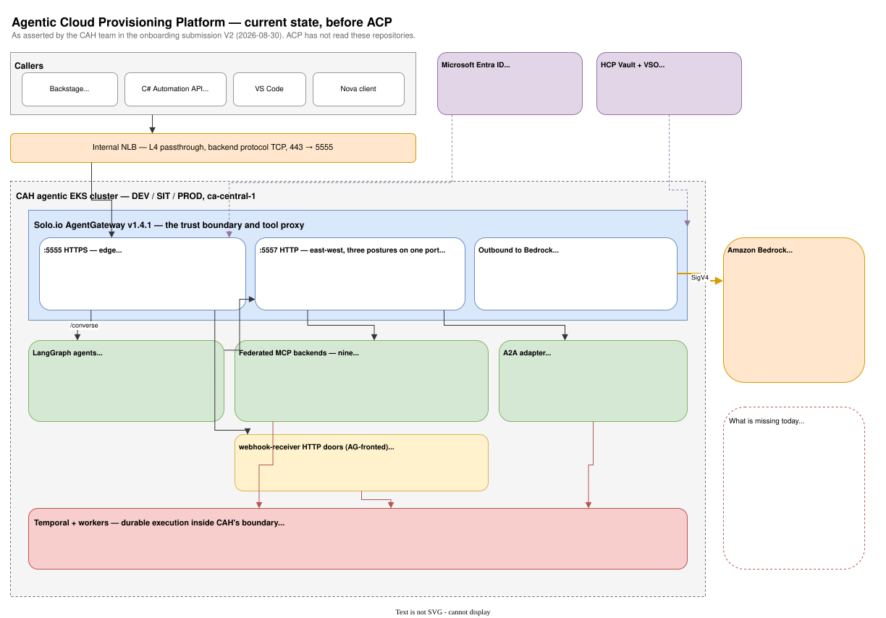

# Agentic Cloud Provisioning Platform — D1: Requirements

> **Gate**: D1 — Requirements | **Status**: Approved 2026-09-02 | **Epic**: [EACPP-1163](https://sunlife.atlassian.net/browse/EACPP-1163)
>
> Platform statements are verified against `luminate` at `origin/main` `1c477cec` and
> `luminate-sunlife-deploy` at `origin/main` `0bba585`, read 2026-08-31. CAH statements are taken
> from the team's own code-grounded [submission](references/2026-08-30-onboarding-submission-v2.md)
> and are marked as asserted rather than verified — ACP has not read the CAH repositories.

## 0. The framing that shapes every requirement

Three facts set the shape of this document, and none of them is about protocol.

**The integration seam is already correct.** CAH runs Solo.io agentgateway `v1.4.1`. ACP runs
agentgateway `v1.4.1` — `gateway/Dockerfile`, `ARG AGENTGATEWAY_VERSION=v1.4.1`, corroborated by
`gateway/docs/config-dump-verification.md` ("Target: agentgateway v1.4.1, git `163ea21`"). There is
no protocol translation, no wire-format negotiation and no MCP semantics to re-establish. Almost
every requirement below is therefore a *configuration and topology* requirement.

**The blocker is reachability, and it is unscheduled.** Every gateway values file in
`luminate-sunlife-deploy/values/gateways/` sets `slf.traefik.enabled: false`, and `prod-dev.yaml`
states why in full: *"the gateway route needs
gw-dev.apps.slf-eks-t1k-ca-prod.aws.sunlifecorp.com to exist in DNS with a matching certificate
SAN. It does not — there is no wildcard, and an unrequested host is NXDOMAIN exactly like an
invented one. Tracked as EACPP-1155."* EACPP-1155 is in **Funnel**. Until it lands, an ACP gateway
is in-cluster only, and a CAH pod in a different cluster and account cannot reach one.

**The submission's front-door options are both unbuildable, and the session already chose the
third.** CAH's preference was gateway-of-gateways; its fallback was ACP's gateway as a front door
"in our cluster". A gateway is a Helm release of `helm/luminate-portal` with the portal components
switched off, installed into an ACP cluster namespace; it dials
`luminate-backend.luminate.svc.cluster.local:50051` with `GATEWAY_PORTAL_GRPC_USE_TLS: "false"`,
and the portal's NetworkPolicy admits gateways by **namespace** via
`networkPolicy.extraGatewayNamespaces`. A gateway in CAH's cluster cannot resolve that name, would
not be admitted by that policy, and would be carrying plaintext gRPC across an account boundary.
Seth's *"swap the gateway, essentially"* resolves to the only buildable shape: **CAH's traffic
egresses to an ACP-operated gateway inside an ACP cluster.**

## 1. What CAH runs today — as asserted

Four layers, four owners, per the submission. ACP has not read these repositories; this is the
team's own account and it is detailed enough to design against.

### The surface

| Listener | Role | Inbound auth (asserted) |
|---|---|---|
| `:5555` HTTPS | Edge MCP, LangGraph edge routes, AG-fronted REST prefixes | Entra `jwtAuth` `mode: strict`, plus `authorization.rules` on `jwt.appid` and `jwt.tid`. Server cert from HCP Vault via VSO (`agentgateway-tls-cert`), terminated in-pod. Internal NLB, L4 passthrough, 443 → 5555 |
| `:5557` HTTP | A2A catch-all, in-cluster `/mcp`, PROD platform model routes | Three different postures on one port: A2A has Entra `jwtAuth` with the audience pinned to the A2A client id; `/mcp` has **no** jwtAuth and relies on pod identity plus NetworkPolicy; the model routes use an `apiKey` policy (`mode: strict`) with the wire header `Authorization: Bearer <platform-key>` |
| `:5559` gRPC | Worker → Temporal | Internal. Explicitly not an ACP interface |
| `:19000` | agentgateway `adminAddr`, localhost-bound | Local admin only |

### Behind the surface

- **Nine federated MCP backends**: `webhook-receiver` (FastMCP name `provisioning-tools`),
  `secops-mcp`, `cmdb-mcp`, `observability-mcp`, `provisioning-mcp`, `finops-mcp`, `devtools-mcp`,
  `aws-identity-mcp`, `datagravity-mcp`.
- **Named capabilities**, several with dual entry — an MCP tool *and* an HTTP door on
  webhook-receiver. Workload account provisioning is the reference: `trigger_workload_provisioning`
  / `check_workload_provisioning_status` / `approve_provisioning` on `provisioning-mcp`, and
  `POST /trigger-workload-provisioning`, `GET /workload-provisioning-status/{workflow_id}`,
  `POST /approve-provisioning/{workflow_id}`, `POST /reject-provisioning/{workflow_id}` on
  webhook-receiver.
- **An A2A adapter**: `GET /.well-known/agent.json`, JSON-RPC 2.0 A2A v0.2 `tasks/send` and SSE
  `tasks/sendSubscribe`. Holds only a Temporal client — no Bitbucket token, no Bedrock credential.
  NetworkPolicy admits only AgentGateway.
- **Models**: `us.anthropic.claude-sonnet-4-5-20250929-v1:0` for assistant chat, an Opus pin for
  the CloudFlux profile with a Sonnet 4.5 overlay fallback, and `amazon.titan-embed-text-v2:0` for
  embeddings. Outbound to Bedrock is SigV4, primary identity IRSA on the AgentGateway
  ServiceAccount, fallback an IAM user credential projected from Vault. Caller pods in
  `ca-central-1`; the model may resolve in `us-east-1`.

### What CAH measures today

Basic token tracking for assistant usage. LangGraph mints a server-side UUID `request_id` and may
store an optional `X-Correlation-ID` as `upstream_correlation_id`; **neither is used for auth, and
the submission states no first-party `traceparent` handling was found**. The durable handle is
`workflow_id`, format `workload-acct-{account_name.lower()}-{uuid4.hex[:8]}`.

## 2. What ACP enforces today — verified

| Capability | State at `1c477cec` | Consequence for CAH |
|---|---|---|
| Client-facing surface | One HTTP front with path prefixes. `gateway/app/middleware/proxy.py` `_resolve_route()` maps `/llm/` → 4000, `/mcp/` → 3000, `/a2a/` → 5000 | Those ports are **internal** agentgateway listeners behind the gateway process, not a client contract. CAH's "keep 5555, remap 3000" framing does not apply — clients see one host and three prefixes |
| LLM path | `/llm/v1/chat/completions`, plus `/v1/messages`, `/v1/embeddings`, `/v1/rerank`, `/v1/responses` | CAH's chat and embedding routes map directly. Titan embeddings go to `/llm/v1/embeddings` |
| MCP path | `/mcp/{endpoint_name}/...`; the endpoint is the first segment after the prefix | Each CAH MCP backend becomes one endpoint name |
| A2A | **Implemented.** `ResourceTranslator.translate()` loops `bundle.agent_assignments`; `_build_a2a_bind()` emits one route per assignment on the A2A port, path-prefixed by `endpoint_name`, with a route-level `urlRewrite` restoring the RPC path. Verified against the pinned v1.4.1 binary and `tests/integration/test_a2a_config_verification.py` | Traffic class 4 is servable. CAH would be its first third-party consumer |
| Inbound credentials | `X-API-Key`; or `Authorization: Bearer` with `lum_` (API key), `lud_at_` (delegated token), else a validated JWT — `gateway/app/middleware/authn.py` | CAH's `apiKey` policy maps to `X-API-Key` or `Bearer lum_` with no client change in shape |
| API key scoping | Per user, application, **agent**, or MCP server | The unit of attribution. One key per agent is what makes cost and audit granular |
| Authorization | Per-request gRPC `luminate.authz.v1.Authz/CheckAccess` to the control plane. `gateway/app/providers/portal_grpc.py` returns `AuthzDecision(deny, reason="portal_unreachable")` on any failure. **No decision cache, no TTL, no permissive mode** | Fail-closed is literal. The submission's `failureMode: allow` test posture does not exist |
| Policy targets | `AccessPolicyTargetType` = `mcp_server`, `agent`, `model`, `location`, `environment`. Sources add `user`, `user_group`, `application` | **None of them is a tool.** The MCP server is the finest boundary policy can name |
| MCP backend auth | `MCPServerIdentityMode` has **five** values, three implemented: `delegated_exchange` (default), **`token_forward`** — *"forwards the caller's validated bearer token to the backend as-is, for servers that trust the same issuer as the gateway"* — and `gateway_identity` (*"a first-class mode for servers that need none"*). `injected_credential` and `external_exchange` are for backends fronted by a **third-party authorization server** and are *"not implemented yet"* | **Two usable modes for CAH, not one.** `gateway_identity` fits the read-only tier. `token_forward` is what lets a side-effecting backend know **who** invoked it — see FR-14. *(An earlier revision of this row listed four values and omitted `token_forward`; that error is what put the whole estate on `gateway_identity`.)* |
| Config propagation | Long-lived bidi gRPC `GatewayManagement.Connect`; the portal yields `ConnectAccepted` then `ConfigPushed`, and pushes on change. `gateway/app/services/stream_client.py` | **Push, not 15-second polling, and not Redis pubsub.** The submission's §10 describes a different product. Propagation is faster than assumed but must still be measured, not quoted |
| Guardrails | Request- and response-side scanning with block / redact / warn; blocked requests short-circuit with 422; `x-luminate-guardrails-applied` and `-warned` on the response | Applies to provisioning payloads — account names, AD groups, owner emails |
| Correlation | `x-luminate-session-id` is caller-supplied, capped at 128 raw characters, namespaced `{entity_type}:{entity_id}:{raw}`, mapped to the Langfuse session id; falls back to the `traceparent` trace-id. `gateway/app/middleware/authz.py` | The whole of FR-25. ACP invents nothing when the caller declares nothing |
| Attribution headers | `x-luminate-` `model-id`, `offering-id`, `model-pricing-key`, `entity-id`, `entity-type`, `entity-name`, `principal-id`, `session-id` — `gateway/app/middleware/proxy_forward.py` | The fields cost and audit are keyed on |
| Providers | `ModelProviderType` includes `BEDROCK` and `ANTHROPIC`; `ProviderAuthMethod` = `api_key` \| `keyless` (IRSA / workload identity); region is per offering | CAH's three models are registerable as-is |
| Bedrock credentials | A pod-level `~/.aws/config` from `helm/luminate-portal/templates/gateway/aws-config-configmap.yaml`: `[profile base]` `role_arn = {{ .Values.gateway.aws.hubRoleArn }}` via web identity, then `[profile chain]` `role_arn = {{ .Values.gateway.aws.spokeRoleArn }}`, `source_profile = base` | **One spoke account per gateway release.** There is no per-offering role ARN and no `aws_role:` backend implementation. Calling Bedrock in CAH's account means a CAH-dedicated gateway |
| Cost ledger | `ProjectUsageDaily` — `usage_date`, `project_id`/`name`, **`cost_centre`**, `entity_type`/`id`/`name`, `model`, `provider`, `user`, token counts. `/api/v1/chargeback/{rows,summary,export}` | Cost centre and project work today. **There is no run, session or capability dimension** |
| Usage | `/api/v1/metrics` — per model, per agent, per entity, read from Langfuse per request | Per-entity separation is a query |
| Machine identity to the control plane | `BearerServicePrincipalAuthentication` exists; `SERVICE_PRINCIPAL_AUTH_ENABLED` defaults to `False` in code and is `"false"` in all four Sun Life values files, blocked on the same DNS work as EACPP-1155. One issuer, one JWKS URI, one audience | Control-plane automation is blocked. The data path is not — it uses gateway API keys |
| Audit | `backend/app/audit_events/ingest.py`: *"There is deliberately no public producer REST endpoint; producers call these directly."* The gateway uses `luminate.audit.v1.CaptureIngest` | Backstage cannot contribute its approval record to ACP's store |
| Observability ingestion | Luminate instruments itself; there is no external OTLP receiver. Traces exist because the request traversed the gateway | *"emit OTel to the collector and ACP auto-ingests"* is false |
| Langfuse | `LANGFUSE_HOST`, `LANGFUSE_PUBLIC_KEY`, `LANGFUSE_SECRET_KEY` are single scalars; one instance per environment cluster, one project | CAH does not get its own project. Tenancy is by header |
| Secret backends | `secret_backends/` contains `aws_sm.py`, `gcp_sm.py`, `env.py`. `vault`, `azure_kv`, `aws_role` are enum choices and docstring schemes only; `test_backends_registry.py` asserts `unknown backend 'vault'` | HashiCorp Vault is not an implemented credential backend |
| Quotas | `QuotaDimension` = `requests`, `tokens`. Comment in `quotas/models.py`: *"`spend`, `concurrency`, and `error_rate` land additively in later phases"*. Nothing debits a counter | No spend limit is expressible, let alone enforceable |
| Containment | Deactivating an entity removes it from the policy facts and the next `ConfigPushed`. `AgentStatus` = `active`/`inactive`/`deprecated`/`unknown`, no transition guard, no stop endpoint | The kill boundary that genuinely exists is the **gateway** (DD-3), then the entity status |

## 3. Functional Requirements

### Traffic class 1 — front door

#### FR-1: One front door, and it is ACP's

CAH's governed traffic reaches an ACP gateway. CAH's own AgentGateway does not remain in the
governed path as a second policy point — the session settled this. CAH may keep its gateway for
traffic that is out of ACP scope (worker → Temporal on `:5559`, purely internal east-west), and
that traffic is documented as ungoverned rather than implied to be governed.

#### FR-2: The ACP gateway is reachable from a CAH cluster

A named hostname, a DNS record and a certificate SAN, over a network path from CAH's agentic EKS
accounts. This is EACPP-1155 plus D-4. It is the first thing on the critical path and nothing in
this document can be demonstrated without it.

#### FR-3: One gateway release per CAH environment

DD-3 makes the gateway the failure domain, the capacity pool and the kill boundary. CAH's DEV, SIT
and PROD each get a release. A single gateway serving several CAH environments is refused for the
reason the deployment already records: *"one gateway carrying four `GatewayEnvironment` mappings
would make a DEV agent's runaway loop a PROD incident."*

#### FR-4: CAH callers present an ACP credential

Backstage, the C# Automation API and each LangGraph agent present `X-API-Key` or
`Authorization: Bearer lum_…`. CAH's `apiKey` route policy already uses the bearer shape, so the
client change is the value and the endpoint, not the mechanism.

#### FR-5: The retired Entra check is replaced explicitly, not implicitly

CAH's edge authorization is `jwt.appid` and `jwt.tid` rules. Its replacement is an ACP access
policy naming the source (application or agent) and the target (model, MCP server or agent). The
requirement is that the replacement is **written down as a mapping** — each existing rule to the
policy that replaces it — and reviewed by CAH's security reviewers, because the trust anchor
changes from an Entra tenant claim to an ACP-issued credential plus a network path.

#### FR-6: A refusal is legible

An ACP denial reaches the CAH caller as a distinguishable outcome that names ACP as the decider,
separable from a CAH validation `400`, a rate-limit `429` and a Temporal `503`. `portal_unreachable`
in particular must not be indistinguishable from a policy refusal, because one is an incident and
the other is the system working.

### Traffic class 2 — model

#### FR-7: The three models are registered with regional offerings and pricing

`us.anthropic.claude-sonnet-4-5-20250929-v1:0`, the CloudFlux Opus pin, and
`amazon.titan-embed-text-v2:0`, each as a Bedrock provider offering with its region, so cost is
derived rather than estimated. Where a profile pins a model that has no approved ACP offering, the
pin is reconciled before launch rather than falling back silently.

#### FR-8: The account Bedrock is called in is a decision, not a default

Two options, and they are not equivalent:

| Option | What it needs | What it costs |
|---|---|---|
| **A — ACP's shared spoke** (`131935619052`, as prod runs today) | Nothing. It already works | Bedrock spend leaves CAH's account. CAH's submission requires it in their account |
| **B — CAH's workload account** | A CAH-dedicated gateway release with `gateway.aws.spokeRoleArn` pointing at a CAH role, and that role's trust policy extended to ACP's hub role `arn:aws:iam::035722575935:role/delegated/luminate-gateway-irsa` | Gateway count becomes environments × spoke accounts. Deployment and IAM work, no code change |

Option B is what the submission asks for and it is achievable. The requirement is that it is chosen
deliberately, with the gateway-count consequence understood.

#### FR-9: No Bedrock credential in a CAH pod on the governed path

When a LangGraph agent's inference goes through ACP, the agent holds an ACP API key and no SigV4
identity. CAH's IRSA-on-AgentGateway and Vault-projected IAM user fallback are retired for that
path. This is the observable form of "the gateway holds the credential".

#### FR-10: Cross-region inference is declared

Caller pods are `ca-central-1`; the submission states the model may resolve in `us-east-1`. Region
is a property of the ACP offering. Whichever region the approved offering names is the one that
applies, and any residency consequence is recorded rather than inherited from CAH's current config.

#### FR-11: Provider-reported usage supersedes CAH's own token tracking

On the governed path the token counts and model identity are the ones ACP resolved. CAH's
spend-by-model artifacts may be retained for one release to quantify the variance, then dropped, so
two competing figures do not both circulate.

#### FR-12: Long conversations survive the credential

An assistant session and a durable capability poll both span minutes. Whatever credential the
caller holds is valid for the whole operation or refreshes without a caller-visible failure.

### Traffic class 3 — tool / MCP

#### FR-13: Each federated backend is registered as an MCP server with an endpoint name

Nine backends, nine endpoint names, reachable at `/mcp/{endpoint_name}/...`. Owner, approval state
and access level are set at registration, which is what turns the catalogue into an inventory.

#### FR-14: The identity mode follows the trust tier

> **Revised 2026-09-08.** This requirement previously put every backend in `gateway_identity`, on
> the basis that the enum had four values. It has five, and the omitted one — `token_forward` — is
> built and is exactly the mode for a backend that trusts the gateway's issuer.

DD-5 already splits CAH's MCP servers by what they can do to the estate. The identity mode follows
the same line, because the question *"does this backend need to know who is calling?"* has the same
answer as *"can this backend change anything?"*:

| Tier | Mode | Why |
|---|---|---|
| **Tier 1** — read-only helpers (`search_business_apps`, `search_computers`, CMDB, observability) | `gateway_identity` | The backend needs no identity. ACP has already authorized the call, and the mode is first-class for exactly this — not a fallback |
| **Tier 2** — durable, no estate mutation (cost analysis, APM, audit, incident summary) | `gateway_identity` initially, `token_forward` when a backend wants attribution | Nothing is mutated, so caller identity is useful rather than load-bearing |
| **Tier 3** — side-effecting (`provisioning-mcp`: `trigger_workload_provisioning`, `approve_provisioning`) | **`token_forward`** | A backend that creates AWS accounts should know **who** asked before it starts. This is also what recovers the caller identity DD-6 otherwise concedes is lost when the Entra `appid`/`tid` check disappears |

`token_forward` costs CAH one thing and gives back another. The cost: `provisioning-mcp` must
validate ACP's issuer, so CAH takes a dependency on ACP's JWKS — which is a public endpoint, but a
dependency nonetheless. The gain: the side-effecting tier stops being anonymous at its own trust
boundary.

**Read the forwarded token as attribution, not entitlement.** Its audience is the gateway's, not
`provisioning-mcp`'s. It answers *who called*; it does not carry permission to provision. ACP has
already made that decision at the gateway, and a backend that re-derives entitlement from an
audience that was never meant for it is the classic confused-deputy shape.

`injected_credential` and `external_exchange` remain unimplemented and CAH still does not need
them — they are for backends fronted by their own authorization server. If a CAH backend ever gains
one, it lands in an unimplemented mode and must be raised then.

#### FR-15: MCP servers are split by trust boundary

This is the requirement with real consequences for CAH's topology. Policy's finest target is the
server. `webhook-receiver` today hosts read-only helpers *and* `trigger_workload_provisioning`.
A policy that permits one permits the other.

The requirement is that side-effecting capabilities are separated from read-only ones onto distinct
MCP servers, so that "may query CMDB" and "may create an AWS account" are separately grantable.
Minimum split:

| Boundary | Servers / tools |
|---|---|
| Read-only | `cmdb-mcp`, `observability-mcp`, `datagravity-mcp`, `search_business_apps_tool`, `search_computers_tool`, `devtools-mcp` |
| Durable, non-mutating to the estate | `finops-mcp` cost analysis, APM utilisation analysis, software audit, incident summary |
| Side-effecting on the estate | `provisioning-mcp` trigger / status / approve |

Without the split, per-tool authorization is being promised on a substrate that cannot deliver it.

#### FR-16: The AG-fronted HTTP doors are governed or declared out of scope

Workload provisioning has an HTTP door as well as an MCP door, and the submission records that
webhook-receiver **bypasses** its `WEBHOOK_AUTH_TOKEN` for AG-fronted prefixes — the gateway is the
only thing standing in front of them. If those prefixes move behind ACP, ACP is the authorization
point and the bypass is safe. If they do not, they are an ungoverned path into the same workflow
and must be stated as such, not left ambiguous.

#### FR-17: Approve and reject are treated as privileged, not as status calls

`approve_provisioning` and `POST /reject-provisioning/{workflow_id}` are the human-decision points
of a workflow that creates AWS accounts. They carry a distinct policy from trigger and status.
Under FR-15's split they are separately targetable.

#### FR-18: Dual-entry divergence is intentional and recorded

The MCP submit door takes eight fields; the HTTP door takes the full workload form. Both converge
on the same workflow and share the handle. The requirement is not parity — it is that the
divergence is declared in the registry so a caller is not surprised by which fields survive.

#### FR-19: Capability contracts are pinned, and discovery is a fallback

Submission open question 3, answered as a requirement: the ACP registry holds a pinned tool
catalogue with a version string per tool schema. Runtime `list_tools` remains available for drift
detection, not as the source of truth, because a governed catalogue that changes underneath a
policy is not governed.

### Traffic class 4 — A2A

#### FR-20: The adapter is registered as an ACP agent endpoint

One `AgentAssignment` whose `backend_endpoint` is the adapter's `host:port`, path-prefixed by
`endpoint_name`. The gateway restores the real RPC path with a route-level `urlRewrite`, so
`tasks/send` and `tasks/sendSubscribe` reach the adapter unchanged.

#### FR-21: The adapter admits only the ACP gateway

CAH's NetworkPolicy already admits only AgentGateway. Under the swap that becomes the ACP gateway.
The requirement is that the policy is updated rather than widened — an adapter reachable both
through ACP and directly is an ungoverned path with a governed path next to it.

#### FR-22: The A2A hop's identity model is stated

`AgentAssignment` carries no `backend_auth` enum; a non-empty `delegated_identity_audience` is the
only signal that a downstream exchange is wanted. The requirement is a decision: gateway identity
(the adapter trusts the network path, as it does today), or a delegated exchange with an audience.
The submission asks where governance sits for its JWT-terminate-then-opaque-forward shape. The
answer is the ACP gateway's A2A route, per endpoint name — and the adapter stops terminating Entra.

### Cross-cutting

#### FR-23: Registration granularity is resolved, and it is not "the surface alone"

The gateway surface is a **deployment**, and CAH's clusters are **environments** — both are
registerable and both should be registered. But the entity a credential resolves to is the unit of
cost, audit and containment, so each LangGraph agent (Nova, CloudFlux, Stratosphere, and each
future agent) is registered as an ACP agent with its own scoped key.

The submission's concern — that ACP not require a per-persona inventory — is honoured: personas are
CAH's `AGENT_PROFILE` concern and stay there. What ACP needs is one registered identity per
independently-credentialed caller. Without it, SC-9b, per-agent audit and any containment finer
than "stop the gateway" are all unavailable.

#### FR-24: Capabilities are separately attributable

The submission asks for cost per capability. The ledger has no capability dimension, so the only
way to get it is for the capability to *be* an entity — a registered MCP server (FR-15) or a
registered application. The requirement stands; D2 chooses the mechanism.

#### FR-25: `workflow_id` travels as the ACP session identifier

Callers send `x-luminate-session-id` carrying the durable handle, or `conversation_id` for
assistant traffic. The gateway sanitises it, caps the raw part at 128 characters and namespaces it
`{entity_type}:{entity_id}:{raw}`. The handle format `workload-acct-{name}-{8 hex}` is well inside
the cap.

Where nothing is sent, the `traceparent` trace-id is used. The submission notes CAH emits no
first-party `traceparent` today, so **sending the header is the requirement** — the fallback is a
fallback, not a plan.

#### FR-26: One operation is findable by both identifiers

A durable operation is retrievable in ACP by the session identifier and in Temporal by
`workflow_id`, and they are the same string. The submission calls this intentional; this
requirement makes it load-bearing.

#### FR-27: Cost is retrievable at cost-centre and project granularity

`ProjectUsageDaily` carries `cost_centre` as a column and CAH already collects `cost_centre` on the
provisioning form with a validated pattern. The join exists on both sides. Per-run cost does not
and is tracked as a gap, not as a build task.

#### FR-28: The spend requirement stands, and what ships is detection

The submission asks for budget dimensions. What can be built is threshold alerting from usage and
cost data per entity and period. What cannot be built is a cap: nothing debits a quota counter and
`spend` is not an expressible dimension. Every artefact carrying this control says which of the two
it is.

#### FR-29: Evidence is allocated per class, and the gaps are named

| Evidence class (submission §12) | Where it lives after the swap |
|---|---|
| Traces — who called which model or tool | **ACP.** Gateway spans and Langfuse traces on the governed path |
| Authz / policy decisions | **ACP.** Per-call `CheckAccess` decisions, including denials |
| Approvals | **Backstage and Temporal**, correlated by handle. ACP has no external audit producer path, so the approval record cannot be contributed to ACP's store. The ACP-side record is the `approve_provisioning` *call* and its authorization, not the human decision behind it |
| Registry snapshots — what was allowed at time T | **ACP**, for registered entities. Coverage is exactly as good as FR-23's answer |

#### FR-30: Containment is defined at the boundary that exists

Submission §10 asks binary versus graduated. The answer:

| Level | Mechanism | Reality |
|---|---|---|
| All CAH traffic in one environment | Stop or scale down that environment's gateway release | Real, immediate, and the only true kill. This is DD-3's boundary |
| One agent, model or MCP server | Deactivate the entity; it drops from the policy facts and the next `ConfigPushed` | Real but **not instantaneous** — a config push, not a stop signal. Measure it |
| One tool | — | **Does not exist.** Only reachable by splitting servers per FR-15 |

There is no stop endpoint, no cascade and no audited stop event. Propagation must be measured for
CAH's gateway and the number published.

#### FR-31: The operating model exists before PROD

SLAs, incident response and remediation for a data path CAH depends on. Named in session as not yet
stood up. This is a requirement on ACP, not on CAH, and it is what gates PROD rather than any
technical item.

#### FR-32: Control-plane availability is treated as CAH's availability

Because authorization is a synchronous per-request call with no cache, and one backend deployment
serves all four workload environments, ACP's control-plane availability is CAH's availability on
the governed path. It is stated as a number in the operating model, not left implicit.

#### FR-33: ACP's Keycloak issues CAH's machine credentials, and rotates them

CAH's non-interactive callers — Backstage, the C# Automation API, each LangGraph agent — obtain
their credentials from ACP rather than from a CAH-local issuer. This was already implicit in FR-4;
it is stated separately because Matthew Clark's question in session (00:06:41) was not *whether*
but **how they rotate**, and the answer is a requirement rather than a reassurance.

Rotation is self-service through the portal, and ACP resolves provider credentials from AWS Secrets
Manager, Google and Azure today. HashiCorp Vault — Sun Life's standard, and the one Matthew named —
is **not** a supported backend (G-L, L-10). The correction owed to him is that Vault is an enum
choice and a docstring scheme, not an implementation. Until it lands, CAH's copy of an ACP-issued
secret lives in CAH's own Vault and the rotation is a two-sided act.

A credential is minted **per registered ACP entity**, which is why FR-23 settles registration
granularity first: the credential and the unit of cost, audit and containment are the same object.

#### FR-34: Temporal and ACP share a root of trust; neither is the other's identity provider

> **Revised 2026-09-08**, twice. First drafted as *"Temporal validates an ACP-issued token"* — which
> no path supports. Then as a capability gap — which framed the question wrongly. The history is
> kept because the wrong first version was published.

Matthew Clark's question (00:14:57) was *"do we do something custom, use Entra, or leverage the
ACP's key cloak?"*. The answer is **Entra**, and it is a better answer than the one he was offered.

**Layer 1 — the enterprise IdP is the root of trust for both systems.**

| Need | Issuer | Note |
|---|---|---|
| Temporal Web UI human SSO | **Entra**, directly | Temporal supports OIDC for the Web UI |
| Temporal worker authentication | **mTLS / SPIFFE**, or Entra client credentials | mTLS is Temporal's own recommendation for workers |
| Temporal namespace authorization | **Temporal's own claim mapper** | Namespace entitlement is Temporal's to decide |
| ACP portal human SSO | Entra, **federated into** ACP's Keycloak | The designed, built path |
| ACP data-plane callers | ACP's Keycloak, per registered entity (FR-33) | Unchanged |

One root of trust, two consumers, and nobody becomes anybody's identity provider. This needs no new
platform capability, which is why it is the recommendation rather than a compromise.

**Why not ACP's Keycloak, on the architecture rather than on preference.** Luminate federates
identity *inward*: Keycloak is an aggregator in front of the platform, and a customer's own IdP is
configured as an upstream federation source behind it. Its own designs close the door in terms:
*"Luminate does not become an identity provider that third-party applications use to authenticate
their own users"* (user-oauth D1), and *"bundled IdPs are provided for convenience, not as mandated
providers"* (gateway-authentication D1). The code agrees — credentials are minted per registered
entity, and the entity types are `agent`, `application`, `mcp_server`, `gateway`. Temporal is none
of them. So the ask is not merely unbuilt: it **inverts a designed direction of trust**. That is the
real answer to *"is that then sprawl to the ACP?"* — yes, and structurally, not just
organisationally.

**Layer 2 — ACP identity reaches CAH's boundary, and stops there.** The side-effecting tier is
served in `token_forward` (FR-14), so `provisioning-mcp` sees the authenticated caller. ACP's
identity travels exactly one hop past the gateway, to the trust boundary that needs it.

**Layer 3 — Temporal receives an assertion, never a token.** Having authenticated the caller at
layer 2, `provisioning-mcp` stamps the decision into the workflow input: who invoked, which
capability, and the correlation handle that FR-25 already carries. Temporal then authorizes its own
namespaces by its own rules.

This is Luminate's own `chain-authorization` principle — each link authorizes for itself rather than
one token traversing the whole chain. It also avoids two specific failures: audience confusion, and
coupling a workflow engine's availability to a governance plane's key material.

**The staging the sponsor asked for, arrived at honestly.** *"If it's custom and version two is key
cloak or whatever… think about it in versions versus perfection at the gate, but the perfection part
is be secure how you do it"* (00:15:47). There is no version two here: layer 1 is the destination,
not a stepping stone, and CAH can build it today without waiting for ACP.

## 4. Non-Functional Requirements

| ID | Category | Requirement | Target |
|---|---|---|---|
| NFR-1 | Latency | Gateway overhead per LLM call, excluding model time | < 200 ms p95 added; the end-to-end delta on a real conversation is **measured in the PoC**, not asserted |
| NFR-2 | Latency | Authorization call overhead, given it is synchronous and uncached | < 50 ms p95, measured across the CAH-to-ACP network path, not in-cluster |
| NFR-3 | Latency | MCP tool invocation overhead for a read-only tool | < 150 ms p95 added |
| NFR-4 | Availability | The governed path is at least as available as what it replaces | Stated as a number in the operating model (FR-31). CAH's current path has no ACP dependency; the swap adds one |
| NFR-5 | Availability | Behaviour when the control plane is unreachable is documented and rehearsed | Every governed call denies. The runbook says what CAH does, not just what ACP does |
| NFR-6 | Security | No Bedrock or model-provider credential in a CAH pod on the governed path | Verified by inspecting the rendered pod spec, not by intent |
| NFR-7 | Security | The A2A adapter and MCP backends admit only the ACP gateway | NetworkPolicy inspected in each CAH cluster |
| NFR-8 | Security | Transport from a CAH cluster to the ACP gateway is TLS with a verifiable server certificate | Verified without `-k`, chain to the Sun Life issuing CA |
| NFR-9 | Attribution | Every governed request carries an entity and, for durable operations, a session identifier | 100%. A durable call with no session id is a defect |
| NFR-10 | Observability | Policy decisions, guardrail outcomes and token or cost per call are retrievable for a named operation | No manual log correlation |
| NFR-11 | Reversibility | Reverting a CAH agent to the pre-ACP path is configuration, not a rebuild | Proven by exercising it in DEV |
| NFR-12 | Guardrail suitability | Provisioning payloads — account names, AD groups, owner emails, cost centres — do not trigger false blocks at a rate that makes runs unreliable | False-block rate quantified in the PoC before SIT |
| NFR-13 | Capacity | The gateway release sized for CAH's concurrency | CAH states a requests-per-second and concurrent-conversation target; the release is sized and load-tested against it. Currently unstated |
| NFR-14 | Rate limiting | CAH's own limits are understood as unchanged | Workload trigger is 5 per 60 s **per process instance**, in-memory, so replicas count independently. ACP adds no counter (nothing debits). Neither side should describe this as a platform quota |

## 5. Capability gaps — prioritised

| ID | Capability | What is missing | Classification | Impact | Escalation |
|---|---|---|---|---|---|
| **G-A** | [CAP-08](../../../capability-map.md#cap-08) Gateway reachability | No gateway has a hostname, DNS record or certificate SAN. `slf.traefik.enabled: false` everywhere, by design, pending DNS | **Integration** (deployment) | **Blocks everything.** No CAH pod can reach an ACP gateway | [EACPP-1155](https://sunlife.atlassian.net/browse/EACPP-1155), currently **Funnel**. Attach CAH as a named consumer |
| **G-B** | [CAP-22](../../../capability-map.md#cap-22) Gateway topology | A gateway is a `luminate-portal` release in an ACP cluster, dialling an in-cluster service name over plaintext gRPC, admitted by a namespace-scoped NetworkPolicy. There is no supported remote-gateway deployment | **Component change** | Closes both of the submission's front-door options. The buildable shape is CAH egress to an ACP-hosted gateway | Consortium — this is CAP-22 federated gateways, 📐 Designed. CAH is a named demand signal |
| **G-C** | [CAP-09](../../../capability-map.md#cap-09) Policy enforcement | No permissive or non-blocking mode. `portal_unreachable` → `deny`, no cache | **Component change** — *and arguably correct behaviour* | The submission's `failureMode: allow` test posture is unavailable. Every governed call has a hard control-plane dependency | Not a defect to fix; a fact to design around. Raise only if a soak-test posture is genuinely required |
| **G-D** | [CAP-07](../../../capability-map.md#cap-07) Per-tool authorization | `AccessPolicyTargetType` names no tool. `AccessPolicy.allowed_tool_ids` appears at runtime only in `audit_snapshot()` | **Component change** | Read-only and side-effecting tools on one MCP server cannot be separately governed | Consortium. Mitigated by FR-15's split, which genuinely enforces |
| **G-E** | [CAP-11](../../../capability-map.md#cap-11) Kill switch | Status edit plus config push. No stop endpoint, no cascade, no audited stop event, no design | **Component change** | For a platform that creates AWS accounts, this is the control that matters most | [EACPP-646](https://sunlife.atlassian.net/browse/EACPP-646). Interim in §"Interim measures" |
| **G-F** | [CAP-12](../../../capability-map.md#cap-12) Quotas | No counter store; nothing debits | **Component change** | The submission's budget asks cannot be enforced | [EACPP-834](https://sunlife.atlassian.net/browse/EACPP-834) |
| **G-G** | [CAP-12](../../../capability-map.md#cap-12) Spend dimension | The enum stops at requests and tokens | **Component change** | **No dollar budget can be expressed at all**, which is different from "not enforced" | [EACPP-834](https://sunlife.atlassian.net/browse/EACPP-834). Keep the distinction in every downstream artefact |
| **G-H** | [CAP-20](../../../capability-map.md#cap-20) Cost granularity | `ProjectUsageDaily` has no run, session or capability dimension | **Component change** | Per-run and per-capability cost unavailable from the finance surface | Already raised by another onboarding. Add CAH as a second named consumer |
| **G-I** | [CAP-18](../../../capability-map.md#cap-18) Audit producer | *"deliberately no public producer REST endpoint"* | **Component change** | Backstage approval provenance cannot enter ACP's store | [EACPP-826](https://sunlife.atlassian.net/browse/EACPP-826) |
| **G-J** | [CAP-06](../../../capability-map.md#cap-06) Machine identity | Default-off in all four environments, blocked on the same DNS work; one issuer | **Integration** | Control-plane automation blocked. **Does not block the data path** | Deployment work, sequenced behind G-A |
| **G-K** | [CAP-20](../../../capability-map.md#cap-20) Langfuse tenancy | One instance, one project per environment. Single-scalar keys | **Component change** | CAH's expectation of "a project in there" is unmet. Attribution is by header instead | New. Raise only if header attribution proves insufficient — it may well be sufficient |
| **G-L** | INT-02 Secrets | No `vault` credential backend; `azure_kv` and `aws_role` likewise named-not-built | **Component change** | Provider credentials cannot be resolved from HCP Vault, which is Sun Life's standard | New. Distinct from VSO syncing Luminate's *own* secrets, which works |
| **G-M** | ~~[CAP-06](../../../capability-map.md#cap-06) ACP as Temporal's identity provider~~ | **WITHDRAWN 2026-09-08, same day it was raised.** It was a gap only while the question was framed as *"make ACP the issuer"*. Reframed against Luminate's actual grain (FR-34), Entra is the root of trust for both systems, ACP identity reaches CAH's boundary via the **built** `token_forward` mode, and Temporal receives an assertion rather than a token | — | **None.** Every layer is either built or CAH's own code | **Do not raise.** Raising it would ask the consortium to invert a designed direction of trust that its own designs rule out in terms. Recorded so the question is not re-opened from scratch |

### The three that decide the shape of this onboarding

**G-A is the schedule.** It is deployment work with no consortium dependency, and it is the only
item on the critical path for slice 1. It is also unscheduled. Everything else in this document can
be designed in parallel; nothing can be demonstrated until it lands.

**G-B closes an option the submission still holds open.** The team accepted a full swap already, so
this is not a disappointment — but it changes *where the gateway runs*, which changes the network
design, the certificate ownership and the failure domain. It is better named at D1 than discovered
when someone tries to `helm install` into a CAH cluster.

**G-D is the one that changes CAH's own code.** Everything else is ACP-side configuration. Splitting
MCP servers by trust boundary is work in CAH's repositories, and it is the difference between
"provisioning is governed" and "anything on webhook-receiver is governed identically". It should be
raised while the topology is still soft.

### Interim measures

| Gap | Interim measure | Removed when |
|---|---|---|
| G-A | None available. This is a hard stop for the pilot; there is no in-cluster workaround from another account | EACPP-1155 lands |
| G-B | Accept the ACP-hosted gateway. Design the network path as the deliverable rather than the gateway placement | CAP-22 federated gateways ships |
| G-C | Stage the cutover per traffic class and per agent so a control-plane failure has a bounded blast radius, and rehearse the deny path | A cached or permissive posture exists, if one is ever wanted |
| G-D | Split MCP servers by trust boundary (FR-15). Genuinely enforces at server granularity | Tool-level policy targets exist |
| G-E | Two-layer containment: deactivate the entity in ACP **and** be able to stop the gateway release for that environment. Measure and publish the entity-level propagation delay | A first-class stop control exists |
| G-F, G-G | Threshold alerting on usage and cost. Every artefact says "monitoring, not enforcement" | The counter store lands; the spend dimension lands |
| G-H | Correlate ACP's Langfuse session grouping to CAH's Temporal record on the handle, outside the chargeback surface. Model capabilities as entities (FR-24) for the capability dimension | The ledger carries a run dimension |
| G-I | Approval provenance stays in Backstage and Temporal, joined on the handle. State it in the evidence table rather than implying ACP holds it | An external-producer audit path exists |
| G-J | Use gateway API keys for the data path; do control-plane registration through the portal by a human | Machine auth is enabled |
| G-K | Attribute by `x-luminate-entity-*` headers and filter in the portal | Per-project Langfuse tenancy exists, if it is ever needed |
| G-L | Keep provider credentials in AWS Secrets Manager, which is implemented; keep Luminate's own secrets in Vault via VSO, which works | A Vault credential backend lands |
| G-M | Withdrawn — there is nothing to work around. Entra issues for Temporal, ACP's Keycloak issues for callers into ACP, and `token_forward` carries caller identity to CAH's side-effecting tier | n/a |

## 5a. Luminate register — what to verify, and what to raise

> The gap register says what is missing. This says **what to do about it against Luminate**, and
> keeps the requirement alive even where the platform cannot meet it, so a later re-verification
> can tell whether the platform moved.

| ID | Verify in Luminate | Answer as of `1c477cec` / `0bba585` | Raise if absent | Serves |
|---|---|---|---|---|
| **L-1** | Can a workload outside the ACP cluster reach a gateway? | **No.** `slf.traefik.enabled: false` on every gateway; no hostname, DNS or SAN exists | Escalate EACPP-1155 with CAH attached as consumer | FR-2, G-A |
| **L-2** | Can a gateway run outside the ACP cluster? | **No.** In-cluster service name, plaintext gRPC, namespace-scoped NetworkPolicy | Raise as CAP-22 demand. Do not design around it in slice 1 | FR-1, G-B |
| **L-3** | Can the gateway call Bedrock in a consumer's own AWS account? | **Yes, via deployment** — one `spokeRoleArn` per gateway release, hub role chained from IRSA. **No** per-offering role | Nothing to raise. Record the gateway-count consequence in D2 | FR-8 |
| **L-4** | Is there any non-blocking authorization posture? | **No.** Deny on `portal_unreachable`, no cache, no TTL | Do not raise as a defect. Correct the submission's expectation | FR-6, G-C |
| **L-5** | Can a policy target a single MCP tool? | **No.** Five target types, none a tool | Consortium raise; mitigate with FR-15 | FR-15, G-D |
| **L-6** | Can the gateway serve an MCP backend that needs no credential — and can it serve one that wants the caller's identity? | **Both.** `gateway_identity` is implemented, and so is **`token_forward`**, which passes the caller's validated bearer token to a backend that trusts the gateway's issuer. Five modes, three built | Nothing. Set the mode explicitly per server, per tier (FR-14) — the default is `delegated_exchange`, so silence picks the wrong one | FR-14 |
| **L-7** | Is A2A actually served, or only routed? | **Served.** `_build_a2a_bind`, per-assignment routes, verified against v1.4.1 with an integration test | Nothing to raise — but CAH is the first third-party consumer, so treat it as unproven in the field | FR-20 |
| **L-8** | How fast does deactivation take effect? | Entity drops from the policy facts and the next `ConfigPushed`. Push-based, so faster than polling — **but the interval is undocumented** | Measure it for CAH's gateway and publish the number. Raise a stop control ([EACPP-646](https://sunlife.atlassian.net/browse/EACPP-646)) | FR-30, G-E |
| **L-9** | Can cost be retrieved per capability or per run? | **No.** Ledger dimensions are date, project, cost centre, entity, model, provider, user | Add a run dimension (existing raise). Model capabilities as entities in the meantime | FR-24, FR-27, G-H |
| **L-10** | Can a provider credential be resolved from HashiCorp Vault? | **No.** `vault` is an enum choice and a docstring scheme; the backend registry rejects it | Raise a Vault credential backend. Correct the session statement to Matthew Clark | G-L |
| **L-11** | Can an external system contribute an audit event? | **No public producer endpoint**, by stated design | Raise an external-producer profile ([EACPP-826](https://sunlife.atlassian.net/browse/EACPP-826)) | FR-29, G-I |
| **L-12** | Does a consumer get its own Langfuse project? | **No.** Single host and key pair per environment | Raise only if header attribution proves insufficient | G-K |
| **L-13** | Can ACP's Keycloak issue a credential to a relying party that is not a registered ACP entity? | **No, and by design.** Issuance is keyed to an entity type — `agent`, `application`, `mcp_server`, `gateway`. Federation runs *inward*: Keycloak brokers upstream IdPs for portal SSO. user-oauth D1 states the non-goal outright: *"Luminate does not become an identity provider that third-party applications use to authenticate their own users"* | **Nothing to raise.** This is a designed boundary, not a gap. Route Temporal to Entra (FR-34) | FR-34 |
| **L-14** | Can the gateway pass the caller's identity to a backend it does not credential? | **Yes — `token_forward`, and it is built.** *"Forwards the caller's validated bearer token to the backend as-is, for servers that trust the same issuer as the gateway."* Present at `1c477cec`, the SHA this document verified against | Nothing. This is the mechanism FR-14's Tier 3 rests on. It was missed once already — enumerate the enum from source, not from a previous spec | FR-14, FR-34 |

**How to use this table.** L-1 is the only row that blocks the committed slice, and it is
deployment work. L-3, L-6 and L-7 are the three where the answer is *better* than the submission
assumed — they should be said out loud, because an onboarding conversation that only reports gaps
is not an accurate one. L-5 and L-10 are the two that need a correction delivered to a named person.

## 6. Data model requirements

| Entity | Key fields | Relationships |
|---|---|---|
| ACP Environment | one per CAH workload environment (DEV, SIT, PROD) | Bound to exactly one gateway (FR-3) |
| ACP Gateway | release name, namespace, `spokeRoleArn`, OAuth client | One per CAH environment; the failure and kill boundary |
| ACP Deployment | the CAH gateway surface per environment | The registered "surface" the submission asks for |
| ACP Agent | one per LangGraph agent — `nova`, `cloudflux`, `stratosphere`, … — with `cost_centre`, business application, environment attributes | Holds a scoped API key; the unit of cost, audit and containment (FR-23) |
| ACP Application | Backstage; the C# Automation API | Policy sources for the HTTP doors |
| ACP MCP Server | one per federated backend, split per FR-15, with `identity_mode: gateway_identity` | Policy target; the finest grantable boundary |
| ACP Agent endpoint (A2A) | the adapter, `backend_endpoint`, `endpoint_name` | Policy target for traffic class 4 |
| ACP Model + offering | the three Bedrock models, region, pricing | Source of cost |
| ACP API key | scoped per agent / application, `lum_` prefix, hashed | The attribution mechanism |
| Correlation identifier | `workflow_id` for durable capabilities, `conversation_id` for assistant traffic | Sent as `x-luminate-session-id`; namespaced by the gateway; joins ACP to Temporal |
| `cost_centre` | validated `^([A-Za-z]{1,5}-)?[0-9]{3,10}$` on CAH's form; a column on `ProjectUsageDaily` | The chargeback join, on both sides already |

## 7. Edge cases

| Scenario | Expected behaviour |
|---|---|
| Control plane unreachable mid-conversation | Every subsequent governed call denies with `portal_unreachable`. The caller must distinguish this from a policy refusal (FR-6) and must not retry it as a transient model error |
| A durable workflow is running when its agent is deactivated | The workflow continues — it is Temporal's, not ACP's. Subsequent *governed calls* by that agent are refused. Containment stops new invocation, not work in flight. This must be stated, not assumed |
| Approval arrives after the workflow timed out | Existing CAH behaviour: outer Temporal status `COMPLETED`, business status `TIMED_OUT`. ACP records the authorized `approve_provisioning` call regardless. The two-layer status model is CAH's contract and ACP does not flatten it |
| Guardrail blocks a provisioning payload | 422 from the gateway. Distinguishable from CAH's own `400` validation failure. The payload contains AD groups and owner emails, so this is a realistic case, not a hypothetical |
| A caller sends no session identifier | The `traceparent` trace-id is used. For a durable capability this loses the join to Temporal, so it is a defect under NFR-9 rather than a graceful degradation |
| Two agents send the same raw run id | Namespacing to `{entity_type}:{entity_id}:{raw}` keeps them apart. This only works if the agents are separate entities — another consequence of FR-23 |
| A session identifier exceeds 128 characters | Truncated deterministically. `workload-acct-{name}-{8 hex}` cannot reach it; a caller-invented id could |
| `CONTINUED_AS_NEW` on a long workflow | The caller polls the same handle. The ACP session id is unchanged, so correlation survives the run boundary |
| Rate limit hit at CAH's receiver | `429` from CAH, not from ACP. Neither side should report it as a platform quota (NFR-14) |
| Bedrock cross-region resolution | If the approved offering is `us-east-1` while callers are `ca-central-1`, that is a declared property of the offering, not an accident (FR-10) |
| A CAH MCP backend later gains its own authorization server | It lands in `injected_credential`, which is unimplemented, and would be served with **no credential** — a failure, not an insecure fallback. Raise at that point |

## 8. Constraints and assumptions

**Constraints**

- ACP receives no Temporal endpoints, namespaces, task queues or worker credentials. Port 5559 is
  not an ACP interface. The submission states this as non-negotiable and ACP accepts it.
- **ACP never contacts Temporal at all.** The durable path terminates at CAH's MCP backend, which
  holds its own Temporal client. ACP's identity travels one hop past the gateway, to that backend,
  and stops (FR-14, FR-34).
- ACP's Keycloak issues for callers **into ACP** only. Temporal's own OAuth belongs to Entra, which
  is both the best-practice answer and the one that needs nothing built (FR-34).
- The gateway is the failure domain and the kill boundary (DD-3). One gateway per CAH environment
  follows from that and is not negotiable downward.
- Authorization is fail-closed and uncached. There is no configuration that changes this.
- Policy targets an MCP server, not a tool.
- A gateway release has exactly one Bedrock spoke account.
- CAH's DEV connects to ACP's PROD control plane. This is the standing design (DD-1), not an
  exception granted to CAH.

**Assumptions**

- CAH's submission is accurate about CAH's own code. ACP has not read those repositories, and any
  requirement that depends on a CAH-side detail is marked as asserted.
- CAH accepts retiring its edge Entra `appid`/`tid` check on the governed path. Settled in session;
  their security reviewers have not yet signed it.
- CAH is willing to split MCP servers by trust boundary. Not yet discussed.
- Both sides remain on agentgateway `v1.4.1` for the pilot, and a version change is a joint
  decision — Srikanth's stated concern.
- The CAH network path to ACP is an engineering task with an owner, not a policy obstacle.

## 9. Traceability

| Requirement | D0 criterion | Capability | Gap |
|---|---|---|---|
| FR-1, FR-3 | SC-1 | CAP-08, CAP-04 | G-B |
| FR-2 | SC-1 | CAP-08 | **G-A** |
| FR-4, FR-5, FR-6 | SC-5 | CAP-06, CAP-07, CAP-09 | G-C |
| FR-7, FR-10, FR-11 | SC-2 | CAP-02 | — |
| FR-8, FR-9 | SC-3 | CAP-08, INT-04 | — |
| FR-12 | SC-2, SC-7 | CAP-06 | — |
| FR-13, FR-14, FR-18, FR-19 | SC-4 | CAP-03 | — |
| FR-15, FR-16, FR-17 | SC-5, SC-7 | CAP-03, CAP-07 | **G-D** |
| FR-20, FR-21, FR-22 | SC-6 | CAP-24, CAP-08 | — |
| FR-23, FR-24 | SC-9b, SC-11 | CAP-01, CAP-04 | — |
| FR-25, FR-26 | SC-8 | CAP-20 | G-H |
| FR-27, FR-28 | SC-9, SC-9b | CAP-20, CAP-12 | G-F, G-G, G-H |
| FR-29 | SC-11 | CAP-18, CAP-19 | G-I |
| FR-30 | SC-10 | CAP-11 | G-E |
| FR-31, FR-32 | SC-11 | — | — |
| FR-33 | SC-5, SC-7 | CAP-06 | G-J, G-L |
| FR-34 | SC-12 | CAP-06 | — (G-M withdrawn) |
| NFR-1 – NFR-5 | SC-1, SC-2 | CAP-08 | G-C |
| NFR-6 – NFR-8 | SC-3, SC-6 | CAP-06 | — |
| NFR-9, NFR-10 | SC-8 | CAP-20 | — |
| NFR-12 | SC-2 | CAP-10 | — |

## 10. Open questions

Settled by the D2 approval of 2026-09-02:

- [x] **Bedrock account: A or B?** (FR-8) — **B**, CAH's own account. [DD-3](d2-design.md)
- [x] **Registration granularity** (FR-23) — surface **and** agents. [DD-4](d2-design.md)
- [x] **Will CAH split its MCP servers** (FR-15)? — **Yes**, three trust tiers. [DD-5](d2-design.md)
- [x] **Is the A2A hop gateway-identity or delegated-exchange** (FR-22)? — **Gateway identity**, revisited only if the adapter needs to act as a named user downstream. [DD-7](d2-design.md)

Still open, each carried by a named [D3](d3-tasks.md) task:

- [ ] **When does EACPP-1155 land?** Everything else is parallelisable; this is not. — T1
- [ ] **Who builds the CAH ⇄ ACP network path**, and what is it — peering, PrivateLink, Transit Gateway? — T2
- [ ] **Which ACP environment does CAH's SIT map to** — ACP's `sit` gateway or its `test`? — T4
- [ ] **What is CAH's concurrency target** (NFR-13)? Nothing on record. — T4
- [ ] **Does CAH's security review accept** losing the edge Entra check on the governed path? — T19
- [ ] **What availability number does ACP commit to** for the control plane (FR-32, NFR-4)? — gates P7
- [ ] **What is the tool-schema version string** ACP publishes per tool (FR-19)? The submission asks
      for it directly and there is no convention yet.
- [ ] **Does CAH accept header-based Langfuse attribution** instead of its own project (G-K)?
- [ ] **What happens to CAH's `X-Correlation-ID`** — is it dropped, or echoed alongside the session id?

## References

- [Onboarding submission V2](references/2026-08-30-onboarding-submission-v2.md) — the CAH team's
  own code-grounded account, including the full workload-provisioning contract in Appendix A.
- [Use-case review transcript, 2026-08-29](references/2026-08-29-use-case-review-transcript.txt)
  and the [original captions](references/2026-08-29-use-case-review.vtt).
- [ACP Capability Map](../../../capability-map.md) ·
  [Capability Gap Escalation](../../../process/capability-gap-escalation.md)
- `luminate` `origin/main` `1c477cec` — `gateway/app/middleware/{authn,authz,proxy,proxy_forward}.py`,
  `gateway/app/services/{resource_translator,stream_client,agent_endpoint_auth}.py`,
  `gateway/app/providers/portal_grpc.py`, `gateway/docs/config-dump-verification.md`,
  `backend/app/{metrics,quotas,access_policies,mcp_servers,credentials,audit_events}/`.
- `luminate-sunlife-deploy` `origin/main` `0bba585` — `values/values-{dev,test,stage,prod}.yaml`,
  `values/gateways/{README.md,prod-dev.yaml}`,
  `helm/luminate-portal/templates/gateway/aws-config-configmap.yaml`, `deploy-checklists/prod.md`.
