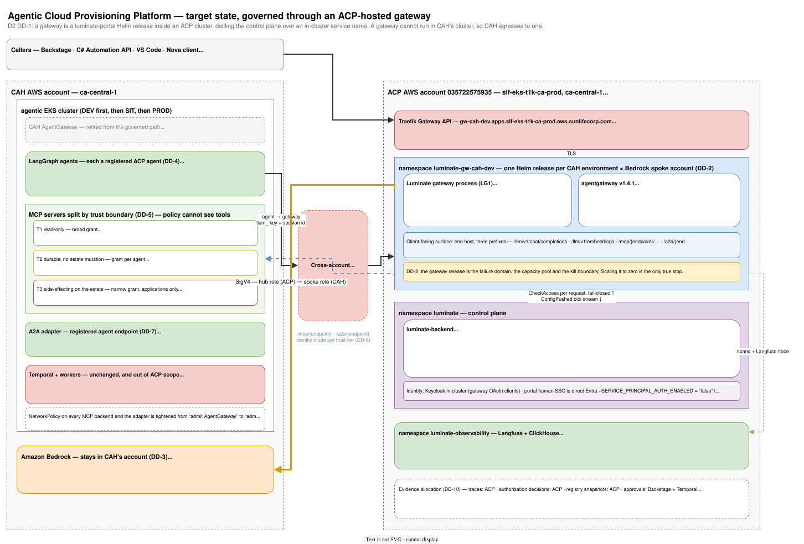
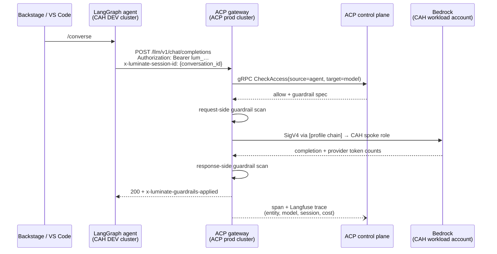
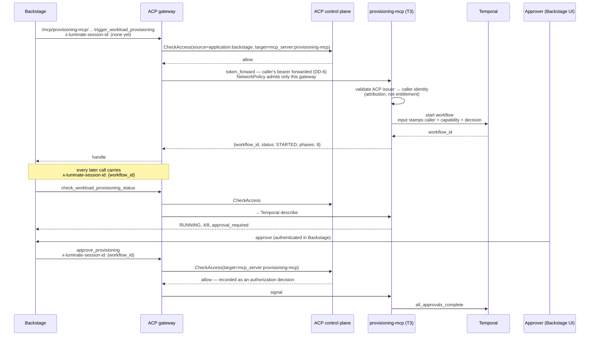
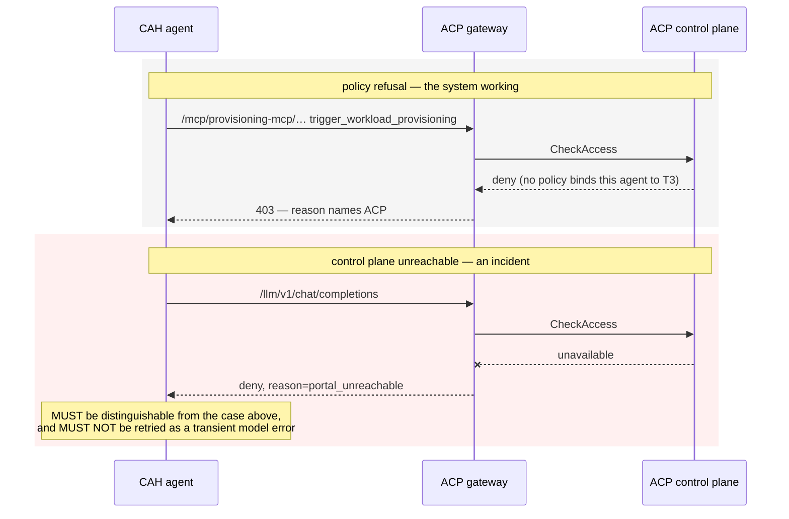

# Agentic Cloud Provisioning Platform — D2: Design

> **Gate**: D2 — Design | **Status**: Approved 2026-09-02 | **Epic**: [EACPP-1163](https://sunlife.atlassian.net/browse/EACPP-1163)
>
> Design against `luminate` `origin/main` `1c477cec` and `luminate-sunlife-deploy` `origin/main`
> `0bba585`. Every decision below names what it is grounded in, and every one that depends on
> something unbuilt says so.

!!! warning "Amended 2026-09-10 — read [D3 §What is already true](d3-tasks.md) first"
    Two of the deployment facts this design was grounded in have since changed, and one modelling
    choice was wrong. The decisions (DD-1 through DD-13) all still hold; **their implementation in
    §5 and §6 does not**, and D3 is the current instruction.

    - **The gateway hostname is no longer a blocker.** `gw-dev`, `gw-sit` and `gw-stage` on the
      prod cluster now resolve, are covered by the existing Sun Life Issuing CA3 certificate to
      2027-03-18, and return a governed `401`. The "every gateway sets `traefik.enabled: false`"
      premise behind DD-1's illustrative `gw-cah-dev` hostname is stale.
    - **CAH does not get its own `Environment` rows.** `dev`, `sit`, `stage`, `prod` are global,
      already exist and are correctly ordered. The `cah-dev`/`cah-sit`/`cah-prod` sketch in §5 is
      **withdrawn** — it forked a global model and dropped STAGE. See D3 T5.
    - **A CAH-specific gateway release is now a fork, not the default.** The shared per-environment
      gateways are the model ([gateway strategy DD-3](../../platform/gateway-environment-strategy/d2-design/topology.md)).
      D3 T7 records the two triggers that would justify a dedicated release.

    The `values/gateways/prod-cah-dev.yaml` and `Environment: cah-*` snippets in §5 are retained as
    the record of what was reviewed. Do not build from them.

## 1. Design overview — one front door, four classes, three deliveries

The submission offered ACP two front-door options and the session chose the second. The deployment
supports neither of them literally, and supports something close enough to the second that the
choice still holds: **CAH's clusters egress to an ACP-operated gateway inside an ACP cluster.**
That is the whole topology decision, and everything else in this document follows from it.



What changes for CAH:

| Today | After |
|---|---|
| CAH AgentGateway is the trust boundary, verifying Entra `appid`/`tid` at `:5555` | An ACP gateway is the trust boundary, verifying an ACP credential and authorizing per call |
| Agents hold, or sit behind, a SigV4 identity to Bedrock | Agents hold an ACP API key; the gateway holds the AWS credential |
| MCP federation is CAH's config | MCP servers are ACP registry entries; routing is a config push |
| The A2A adapter terminates Entra, then opaque-forwards | The ACP gateway terminates and authorizes; the adapter trusts the network path |
| Langfuse would have been CAH's | ACP's, attributed by header |
| `workflow_id` is CAH's handle | Still CAH's handle — and also the ACP session id |

What does not change: Temporal, the workflows, the activities, the LangGraph graphs, the prompts,
the capability contracts, the two-layer status model, and CAH's ownership of all of it.

Three deliveries, in dependency order:

1. **Unblock** — a reachable gateway and a network path. No CAH work; entirely ACP deployment.
2. **Slice 1** — assistant model traffic and read-only MCP through ACP, in DEV.
3. **Slice 2** — one durable dual-entry capability governed end to end, plus the A2A adapter.

## 2. Design decisions

### DD-1 — The gateway runs in ACP's cluster, and CAH egresses to it

A gateway is a Helm release of `helm/luminate-portal` with `backend`, `frontend` and `worker`
disabled, installed into an ACP cluster namespace. It reaches the control plane at
`luminate-backend.luminate.svc.cluster.local:50051` with `GATEWAY_PORTAL_GRPC_USE_TLS: "false"`,
and the portal's NetworkPolicy admits it because its namespace is listed in
`networkPolicy.extraGatewayNamespaces`. All three of those are cluster-local facts.

Putting a gateway in CAH's cluster would require an externally-resolvable portal gRPC endpoint,
TLS on that hop, and a NetworkPolicy model that is not namespace-scoped. None of that exists, and
building it is CAP-22 federated gateways — 📐 Designed, not built.

**Decision.** CAH's DEV cluster reaches `luminate-gw-cah-dev.apps.slf-eks-t1k-ca-prod.aws.sunlifecorp.com`
(name illustrative, subject to EACPP-1155) over TLS. The gateway lives in the ACP prod cluster,
account `035722575935`, because that is where the single control plane lives (DD-1 of the
gateway-environment strategy).

**Consequence to state plainly.** The governed hop is now cross-account and cross-cluster. CAH's
own in-cluster east-west traffic — worker → Temporal, agent → its own services — is unaffected and
stays ungoverned by design.

### DD-2 — One gateway release per CAH environment, and per Bedrock spoke account

DD-3 of the gateway-environment strategy already forces the first half: the gateway is the failure
domain, the capacity pool and the kill boundary, so CAH's DEV, SIT and PROD get separate releases.

The second half is the finding in
[L-3](d1-requirements.md#l-3). The gateway's AWS identity comes from a pod-level `~/.aws/config`
rendered by `helm/luminate-portal/templates/gateway/aws-config-configmap.yaml`:

```ini
[profile base]
role_arn = {{ .Values.gateway.aws.hubRoleArn }}     # web identity, ACP account
web_identity_token_file = /var/run/secrets/sts-token/token

[profile chain]
role_arn = {{ .Values.gateway.aws.spokeRoleArn }}   # one value, per release
source_profile = base
```

`spokeRoleArn` is a single scalar. There is no per-offering, per-model or per-provider role ARN
anywhere in the backend or the gateway. So a gateway release reaches exactly one Bedrock account.

**Decision.** Gateway releases are keyed by (CAH environment × Bedrock spoke account). For the
pilot that is one release. If CAH later wants DEV inference in a different account from PROD, that
is another release, not another offering.

### DD-3 — Bedrock is called in CAH's account, and the IAM to do it is additive

The submission requires it: *"Model calls route through the gateway to Bedrock in our workload
account via assumed role."* The mechanism exists — it is exactly how ACP prod already reaches the
shared spoke `131935619052`.

**Decision.** Option B from [FR-8](d1-requirements.md). CAH creates a role in its workload account
whose trust policy admits ACP's hub role
`arn:aws:iam::035722575935:role/delegated/luminate-gateway-irsa`, granting only
`bedrock:InvokeModel` and `bedrock:Converse` on the approved model ARNs. The CAH gateway release
sets `gateway.aws.spokeRoleArn` to it.

Note the least-privilege precedent from ACP's existing spoke: invocation only, not discovery —
`ListFoundationModels` correctly returns `AccessDenied`. Match it.

**Why not option A.** It works today and needs nothing. It also puts CAH's inference spend in
ACP's account, which inverts the chargeback story the submission's §11 is built on. Take the IAM
work.

### DD-4 — Register the surface *and* the agents

The submission asks ACP to onboard "the AgentGateway surface / service identity, not a per-agent
inventory". Half of that is right and half of it forfeits things CAH is asking for elsewhere.

The entity a credential resolves to is the unit of attribution: API keys scope per user,
application, **agent** or MCP server, and the gateway stamps `x-luminate-entity-id`,
`-entity-type` and `-entity-name` from it. One registered surface means one entity, therefore one
row in `ProjectUsageDaily`, one audit subject, one policy source and one containment target for
Nova, CloudFlux, Stratosphere and everything added later.

**Decision.** Register three tiers:

| Tier | ACP object | Count | What it buys |
|---|---|---|---|
| The environment | `Environment` | **4 — the platform's shared `dev`, `sit`, `stage`, `prod`** | Policy and quota scoping; the promotion path |
| The surface | `Deployment` + `Gateway` | 1 per environment | The "surface identity" the submission asks for; the kill boundary |
| The caller | `Agent` (one per LangGraph agent), `Application` (Backstage, C# Automation API) | ~5 today, open-ended | Per-agent cost, audit, policy and containment |

CAH's internal `AGENT_PROFILE` personas stay CAH's. What ACP needs is one registered identity per
independently-credentialed caller — which is a registry row and a key, not a governance programme.

**Test for whether this was worth it.** Ask "what did CloudFlux spend last month, and can I stop
only CloudFlux?" Under surface-only registration, neither question has an answer.

### DD-5 — MCP servers are split by trust boundary, because policy cannot see tools

`AccessPolicyTargetType` is `mcp_server`, `agent`, `model`, `location`, `environment`. None is a
tool. `AccessPolicy.allowed_tool_ids` exists on the model but at runtime appears only in
`audit_snapshot()` — it is authoring metadata, not enforcement.

CAH's `webhook-receiver` currently hosts `search_business_apps_tool` next to
`trigger_workload_provisioning`. One policy grant covers both.

**Decision.** Three trust tiers, each its own registered MCP server:

| Tier | Contents | Policy posture |
|---|---|---|
| **T1 — read-only** | `cmdb-mcp`, `observability-mcp`, `datagravity-mcp`, `devtools-mcp`, `search_business_apps_tool`, `search_computers_tool` | Broad grant to CAH agents |
| **T2 — durable, no estate mutation** | cost analysis, APM utilisation analysis, software audit, incident summary | Grant per agent that needs it |
| **T3 — side-effecting on the estate** | `provisioning-mcp`: `trigger_workload_provisioning`, `check_…_status`, `approve_provisioning` | Narrow grant; `approve` separated again if CAH can carry a fourth server |

This is the only change in the design that lands in CAH's repositories, and it is the one worth
paying for: it is the difference between "provisioning is governed" and "everything on
webhook-receiver is governed identically". The three tiers are a floor, not a ceiling — a fourth
server isolating approve from trigger is better still.

**What it does not do.** It does not close [G-D](d1-requirements.md). Per-tool policy remains a
consortium item. It makes the server boundary meaningful in the meantime.

### DD-6 — The identity mode follows the trust tier, and NetworkPolicy is the compensating control

> **Revised 2026-09-08.** This decision originally put every backend in `gateway_identity` because
> *"`MCPServerIdentityMode` has four values"*. It has **five**. The omitted one, `token_forward`, is
> built, was present at the SHA this design verified against, and is described as being *"for
> servers that trust the same issuer as the gateway"* — which is the case this decision was
> reasoning about. The miscount is what produced the concession two paragraphs down.

Three modes are implemented: `delegated_exchange` (the default), `token_forward`, and
`gateway_identity`. `injected_credential` and `external_exchange` front a *third-party authorization
server* and are not implemented — CAH needs neither.

**Decision.** The mode follows DD-5's trust tier, because *"does this backend need to know who is
calling?"* has the same answer as *"can this backend change anything?"*:

| Tier | Mode | Rationale |
|---|---|---|
| Tier 1 — read-only helpers | `gateway_identity` | Needs no identity. First-class mode for exactly this, not a fallback |
| Tier 2 — durable, no estate mutation | `gateway_identity`, moving to `token_forward` on request | Identity is useful, not load-bearing |
| **Tier 3 — side-effecting (`provisioning-mcp`)** | **`token_forward`** | A backend that creates AWS accounts should know who asked before it starts |

**This is also what closes the concession.** Today CAH's edge MCP at `:5555` is fronted by Entra
`jwtAuth` with `appid`/`tid` rules. After the swap the ACP gateway is the caller and cannot present
an Entra token, so under the original decision those routes were reached with **no identity at
all** — the Entra check did not move, it disappeared. With `token_forward` on Tier 3 it does move:
the backend still gets an authenticated caller, from a different issuer. That is a materially easier
conversation with CAH's security reviewers than "we removed it and compensated elsewhere".

**Decision.** The compensating control is explicit and layered:

1. ACP authorizes every call before it leaves the gateway — a stronger check than `appid`/`tid`,
   because it names source, target and environment.
2. **Tier 3 backends validate the forwarded caller token** against ACP's issuer, so the
   side-effecting tier is not anonymous at its own boundary. Read it as **attribution, not
   entitlement**: the audience is the gateway's, and ACP has already made the access decision.
3. CAH's NetworkPolicy on each MCP backend is **tightened to admit only the ACP gateway's egress**,
   replacing "admit AgentGateway" with a specific source.
4. The mapping from each retired `appid`/`tid` rule to the ACP policy that replaces it is written
   down and reviewed by CAH's security reviewers.

Step 4 is not paperwork. It is the artefact that makes this defensible at ETAB.

**What `token_forward` costs.** `provisioning-mcp` takes a dependency on ACP's JWKS — a public
endpoint, but a dependency. Tier 1 deliberately does not pay it.

### DD-7 — A2A: gateway identity first, delegated exchange when there is a reason

A2A is served: `_build_a2a_bind()` emits one route per `AgentAssignment` on the A2A port, path
prefixed by `endpoint_name`, with a route-level `urlRewrite` restoring the JSON-RPC path. Verified
against the pinned v1.4.1 binary and `tests/integration/test_a2a_config_verification.py`.
`AgentAssignment` carries no `backend_auth` enum — a non-empty `delegated_identity_audience` is the
only signal an exchange is wanted.

CAH's adapter holds only a Temporal client. It has no downstream credential to exchange for.

**Decision.** Register the adapter with an empty `delegated_identity_audience` — gateway identity.
Its NetworkPolicy admits only the ACP gateway, replacing today's "only AgentGateway", and it stops
terminating Entra. The delegated exchange is revisited only if the adapter ever needs to act as a
named user downstream, which is the same trigger as the submission's OBO discussion.

**Caveat to carry forward.** CAH would be the first third-party consumer of the A2A path. It is
verified against the binary; it has never carried a foreign adapter. That belongs in the PoC exit
criteria, not in the assumptions.

### DD-8 — Design for fail-closed rather than asking for a permissive mode

The submission expects `failureMode: allow` while ACP tests. There is no such mode. Every governed
request makes a synchronous gRPC `CheckAccess`; `gateway/app/providers/portal_grpc.py` returns
`deny` with reason `portal_unreachable` on any failure, and there is no decision cache and no TTL.

Asking for a permissive mode would be asking ACP to weaken the property that makes the governance
claim true. The right response is to bound the blast radius during the cutover.

**Decision.** Three mechanics:

1. **Stage the cutover per traffic class and per agent.** One agent's model traffic first, then
   its read-only MCP, then the rest. At every point some CAH traffic is on the old path.
2. **Keep the pre-ACP path revertible by configuration** (NFR-11) for the whole pilot, and prove
   the revert works before it is needed rather than during an incident.
3. **Write the deny runbook.** `portal_unreachable` is an ACP incident, not a CAH bug. CAH's
   callers must surface it distinctly (FR-6), and the runbook says who is paged.

**And treat the dependency as a number.** One backend deployment serves all four workload
environments. Its availability is CAH's availability on the governed path, and the operating model
(FR-31) has to say what that number is before PROD.

### DD-9 — `workflow_id` is the ACP session id; the two stores stay separate

The mechanism is already there and it is caller-driven: `x-luminate-session-id` is read in
`gateway/app/middleware/authz.py`, sanitised, capped at 128 raw characters, namespaced
`{entity_type}:{entity_id}:{raw}`, and mapped to the Langfuse session id. It falls back to the
`traceparent` trace-id and invents nothing when the caller declares nothing.

**Decision.**

| Traffic | Header value |
|---|---|
| Durable capability (MCP or HTTP door) | the `workflow_id` handle |
| Assistant conversation | the `conversation_id` |
| A2A task | the adapter's task id |

Namespacing matters here: two CAH agents both sending `run-1` would collide in a project-global
Langfuse session space, and `{entity_type}:{entity_id}:{raw}` keeps them apart — which only works
because DD-4 made them separate entities.

**Do not merge the stores.** Temporal history stays the source of truth for durable progress inside
CAH's boundary; ACP correlates on gateway, MCP and LLM spans. The submission says ACP should not
read Temporal, and it is right. The join is the handle.

**What ACP does not do**: ingest CAH's own OTel. There is no external OTLP receiver — ACP sees a
call because it went through the gateway. CAH's collector path is unchanged and stays CAH's.

### DD-10 — Evidence is allocated, and the approval gap is written into the contract

CAH's §12 lists four evidence classes. Three land in ACP. One does not, and pretending otherwise is
the failure mode that gets found at an audit rather than at a design review.

| Class | Holder | Mechanism |
|---|---|---|
| Traces | ACP | Gateway spans, Langfuse traces on the governed path |
| Authorization decisions | ACP | Per-call `CheckAccess` outcomes including denials |
| Registry snapshots | ACP | Registered entities per DD-4; coverage equals registration coverage |
| **Approvals** | **Backstage + Temporal** | `audit_events` ingest states there is *deliberately no public producer REST endpoint*. ACP records the authorized `approve_provisioning` **call**; the human decision behind it stays in Backstage |

**Decision.** The evidence contract is written with that split visible, joined on the handle. The
external-producer path is raised as [L-11](d1-requirements.md#l-11) against
[EACPP-826](https://sunlife.atlassian.net/browse/EACPP-826), with CAH as a named consumer. Until it
exists, "ACP holds the approval" is not said.

The submission's own position on this is sound — approval provenance is intact at the Backstage
layer, and the call presents as the Backstage service identity — so this is a documentation
decision, not a control gap. It becomes one only if someone claims ACP holds it.

### DD-11 — Containment is two-layer, and one layer has a number nobody has measured

The submission asks binary versus graduated. Neither, exactly:

| Layer | Action | Effect | Speed |
|---|---|---|---|
| **Environment** | Scale the CAH gateway release to zero | All CAH governed traffic in that environment stops | Immediate. This is the real kill, and DD-3 of the gateway strategy is why it is available at all |
| **Entity** | Deactivate an agent, model or MCP server | It drops from the policy facts and the next `ConfigPushed` | Push-based, so faster than a poll — **but the interval is undocumented** |
| **Tool** | — | — | Does not exist. Reachable only via DD-5's split |

**Decision.** Both layers are wired and rehearsed in the PoC, and the entity-level propagation delay
is **measured for CAH's gateway and published**. A quoted number is not acceptable here: the
submission already carries "~15 seconds" and "Redis pubsub", neither of which describes this
platform.

**State the limit honestly.** Containment stops *new invocation*. A Temporal workflow already
running continues — it is CAH's engine, not ACP's. Stopping in-flight durable work is a CAH control,
and the two together are what an incident response actually needs.

### DD-12 — ACP is the meter; capability granularity comes from entity modelling

The submission's §11 asks for four cost dimensions. Against `ProjectUsageDaily` — `usage_date`,
`project_id`, `cost_centre`, `entity_type`/`id`/`name`, `model`, `provider`, `user`, tokens:

| Ask | Available | How |
|---|---|---|
| Per business unit / cost centre | ✅ | `cost_centre` is a column on the ledger and a validated field on CAH's form. The join exists on both sides |
| Per project | ✅ | `project_id` filter on `/api/v1/chargeback/{rows,summary,export}` |
| Per capability | ⚠️ **by construction** | Only if the capability is an entity. DD-5's split makes each tier an MCP server, so T3 spend separates from T1 spend |
| Per run / handle | ❌ | No run dimension on the ledger. Per-run exists only as a Langfuse session grouping — joinable, but not from the finance surface |

**Decision.** ACP is accountable for metering, attribution and the provider billing relationship.
Cost recovery to CAH's consuming teams stays with CAH and Finance. Per-capability separation is
bought with DD-5, which is being done anyway for authorization reasons — a second reason to do it.
Per-run is raised as [L-9](d1-requirements.md#l-9), with CAH as a second named consumer behind an
existing raise.

**And the budget conversation.** What ships is detection: threshold alerting per entity and period,
computed from usage and cost. What does not ship is a cap — nothing debits a quota counter and
`spend` is not an expressible dimension. Every artefact says which one it is showing.

### DD-13 — ACP's Keycloak issues the credentials for reaching ACP, and stops there

Matthew Clark raised this in session (00:14:57) and answered it himself: *"maybe you could leverage
the ACP's key cloak. And I'm like, well. Maybe, but is that then sprawl to the ACP?"*. It was parked
at D0 approval and is now in scope. The question is real, and it has a boundary rather than a
yes/no answer.

**Decision.** Three layers, each with the root of trust that belongs to it. None of them requires a
platform change, which is why this is the recommendation rather than a compromise.

**Layer 1 — Entra is the root of trust for both systems.** Temporal Web UI SSO goes to Entra
directly; Temporal worker authentication uses mTLS/SPIFFE (Temporal's own recommendation) or Entra
client credentials; Temporal namespace entitlement stays Temporal's own claim mapping. ACP's portal
SSO already federates Entra *into* Keycloak, and ACP's data plane keeps issuing per registered
entity (FR-33). One root, two consumers, no new capability.

**Layer 2 — ACP identity reaches CAH's boundary and stops.** Tier 3 is served in `token_forward`
(DD-6), so `provisioning-mcp` sees the authenticated caller before it starts a workflow that creates
AWS accounts.

**Layer 3 — Temporal receives an assertion, never a token.** `provisioning-mcp` stamps caller,
capability and the correlation handle into the workflow input. Temporal authorizes its own
namespaces by its own rules. This is the `chain-authorization` principle — each link authorizes for
itself — and it avoids audience confusion and coupling Temporal's availability to ACP's key
material.

**Why not ACP's Keycloak, on the architecture rather than on taste.** Luminate federates identity
**inward**: Keycloak is an aggregator in front of the platform, and a customer's own IdP is
configured as an upstream federation source behind it. Its designs say so outright — *"Luminate does
not become an identity provider that third-party applications use to authenticate their own users"*
(user-oauth D1) and *"bundled IdPs are provided for convenience, not as mandated providers"*
(gateway-authentication D1). The code agrees: credentials are minted per registered entity, and the
entity types are `agent`, `application`, `mcp_server`, `gateway`. Temporal is none of them.

So the original ask does not merely lack an implementation — it **inverts a designed direction of
trust**. That is the substantive answer to Matthew Clark's *"is that then sprawl to the ACP?"*
(00:14:57): yes, and structurally rather than organisationally. He was right to ask, and the answer
he was offered by others was the wrong one.

| Asked for | Answer | Where it goes |
|---|---|---|
| Machine credentials for callers reaching ACP | **ACP's Keycloak** | FR-33, slice 1 |
| Caller identity at CAH's side-effecting backend | **`token_forward`** | DD-6, built |
| Temporal Web UI human SSO | **Entra** | Layer 1. Nothing for ACP to build |
| Temporal worker authentication | **mTLS/SPIFFE or Entra** | Layer 1 |
| Temporal namespace authorization | **Temporal's own claim mapper** | Layer 3 |

**The staging the sponsor asked for, arrived at honestly.** *"If it's custom and version two is key
cloak or whatever… versions versus perfection at the gate… the perfection part is be secure how you
do it"* (00:15:47). There is no version two: layer 1 is the destination, and CAH can build it now
without waiting on ACP.

**The correction that has to travel with this.** Matthew's rotation question assumed HashiCorp
Vault. ACP resolves provider credentials from AWS Secrets Manager, Google and Azure — `vault` is an
enum choice and a docstring scheme, not an implementation ([L-10](d1-requirements.md#l-10), G-L).
Answering the Keycloak question without delivering that correction would leave the half he actually
cares about wrong.

## 3. Request paths

### Flow 1 — governed assistant inference



The credential in the pod is `lum_…`. There is no AWS identity in the LangGraph pod at all — that
is FR-9, and it is checked by reading the rendered pod spec, not by asserting it.

### Flow 2 — governed durable capability, submit to approval



Two things this diagram is deliberately honest about. The submit call has no session id yet — the
handle does not exist until Temporal returns it, so the first call correlates by `traceparent` and
every subsequent call by the handle. And the approval that ACP records is the *authorized call*;
the human decision that produced it lives in Backstage (DD-10).

### Flow 3 — refusal, and control-plane loss



Collapsing these two into one error class is the most likely integration defect in the whole
design, which is why FR-6 exists and why it is a PoC exit criterion.

## 4. Configuration design

### ACP — gateway release for CAH DEV

```yaml
# values/gateways/prod-cah-dev.yaml  (illustrative)
namespace: luminate-gw-cah-dev
backend:  { enabled: false }
frontend: { enabled: false }
worker:   { enabled: false }

gateway:
  enabled: true
  replicas: 2
  autoscaling: { maxReplicas: 3 }
  aws:
    enabled: true
    region: ca-central-1
    hubRoleArn:   "arn:aws:iam::035722575935:role/delegated/luminate-gateway-irsa"
    spokeRoleArn: "arn:aws:iam::<CAH-ACCOUNT>:role/delegated/cah-bedrock-xaccount"   # DD-3
  config:
    LUMINATE_ENVIRONMENT: dev

slf:
  traefik:
    enabled: true                     # requires EACPP-1155
    aiGateway:
      hostname: gw-cah-dev.apps.slf-eks-t1k-ca-prod.aws.sunlifecorp.com
  namespaceAnnotations:
    com.sunlife/description: "Luminate AI gateway - CAH agentic stack, DEV"
    com.sunlife/costcenter: "<CAH cost centre>"
```

Then, on the **portal** release — the step the gateway README says not to skip, because without it
the gateway never receives a config push:

```yaml
networkPolicy:
  extraGatewayNamespaces:
    - luminate-gw-cah-dev
```

### ACP — registry shape

```
Environment: cah-dev, cah-sit, cah-prod
  └── Gateway: luminate-gw-cah-dev   →  Deployment: cah-agentic-surface-dev
        ├── Agent:       cah-nova, cah-cloudflux, cah-stratosphere          (API key each)
        ├── Application: backstage, cah-automation-api                      (API key each)
        ├── MCP server:  cah-tools-readonly        (T1, gateway_identity)
        ├── MCP server:  cah-analysis-durable      (T2, gateway_identity)
        ├── MCP server:  cah-provisioning          (T3, gateway_identity)
        ├── Agent endpoint: cah-a2a-adapter        (delegated_identity_audience: "")
        └── Models:      claude-sonnet-4-5 · claude-opus (pin) · titan-embed-text-v2
```

Access policies, minimum set:

| Source | Target | Rationale |
|---|---|---|
| every CAH agent | `cah-tools-readonly` | Broad; read-only by construction |
| `cah-nova`, `cah-cloudflux` | the two chat models | Profile pins reconciled to approved offerings (FR-7) |
| every CAH agent | `titan-embed-text-v2` | Platform embeddings |
| `cah-cloudflux` only | `cah-analysis-durable` | Narrower than today |
| `backstage`, `cah-automation-api` | `cah-provisioning` | The side-effecting tier. Agents do **not** get this by default |
| `cah-nova` | `cah-a2a-adapter` | The one path the submission says exists today |

### CAH — client change

```python
# before: SigV4 to Bedrock, or CAH AgentGateway with an Entra token
# after:  one base URL, one key, one header
llm = ChatOpenAI(
    base_url="https://gw-cah-dev.apps.slf-eks-t1k-ca-prod.aws.sunlifecorp.com/llm/v1",
    api_key=os.environ["ACP_GATEWAY_API_KEY"],          # lum_…
    model="<acp-registered-model-id>",
    default_headers={"x-luminate-session-id": conversation_id},   # DD-9
)
```

The MCP change is the endpoint URL and the same credential. The A2A change is the adapter's
NetworkPolicy source and removing its Entra termination.

## 5. What each side builds

### ACP — deployment

| Item | Detail | Blocks |
|---|---|---|
| Gateway hostname, DNS, certificate SAN | [EACPP-1155](https://sunlife.atlassian.net/browse/EACPP-1155) | **Everything** |
| Network path from CAH accounts to the ACP gateway | Peering / PrivateLink / TGW — owner unassigned | Everything |
| Gateway release per CAH environment | DD-2; start with DEV | Slice 1 |
| Portal `extraGatewayNamespaces` + upgrade | Or no config push arrives | Slice 1 |
| `Environment` rows via `LexoRank.get_lexorank_in_between` | A plain create appends after PROD and breaks the promotion order | Slice 1 |
| `provision-gateway.sh` — Gateway, GatewayEnvironment, OAuth client, secret | The `GatewayEnvironment` row is not optional: without it the deployment form's gateway dropdown is silently empty | Slice 1 |
| Registry entries per DD-4 | Manual via the portal — machine auth is off (G-J) | Slice 1 |
| Machine credentials issued per registered entity, and the rotation path written down | DD-13, FR-33. Deliver the Vault correction with it | Slice 1 |
| Measure and publish entity-level propagation delay | DD-11 | PoC exit |
| Operating model — SLA, incident response, remediation | FR-31 | **PROD** |

### CAH — engineering

| Item | Detail | Blocks |
|---|---|---|
| Split MCP servers into T1 / T2 / T3 | DD-5. The only change in CAH's repositories | Slice 1 (T1), Slice 2 (T3) |
| Point `get_llm()`-equivalent at the ACP gateway | One base URL, one key | Slice 1 |
| Send `x-luminate-session-id` | Handle for durable, conversation id for chat | Slice 2 |
| Distinguish `portal_unreachable` from a policy deny | FR-6, DD-8 | Slice 1 |
| Bedrock role in CAH's account trusting ACP's hub | DD-3 | Slice 1 |
| Tighten NetworkPolicy on MCP backends and the A2A adapter to the ACP gateway | DD-6, DD-7 | Slice 1 / 2 |
| Retire the Entra `appid`/`tid` rules on governed routes, with the mapping written down | DD-6 step 3 | Security review |
| Stop the A2A adapter terminating Entra | DD-7 | Slice 2 |
| Hold the ACP-issued secret in CAH's Vault and rehearse a rotation from both sides | FR-33. Two-sided until a Vault credential backend lands (G-L) | Slice 1 |
| Validate the forwarded caller token on the Tier 3 backend against ACP's issuer | DD-6, FR-14. Attribution, not entitlement. Stamp caller + capability + decision into the workflow input (DD-13 layer 3) | Slice 2 |
| Point Temporal's Web UI and workers at Entra | DD-13 layer 1. CAH-side, needs nothing from ACP, and can start now | Independent |
| State a concurrency target | NFR-13 | Sizing |

### Luminate — verify, then raise

| Item | Action |
|---|---|
| [L-1](d1-requirements.md#l-1) gateway reachability | Escalate EACPP-1155 with CAH attached |
| [L-2](d1-requirements.md#l-2) remote gateway | Raise as CAP-22 demand; do not design around it |
| [L-5](d1-requirements.md#l-5) per-tool policy | Consortium raise; mitigated by DD-5 |
| [L-8](d1-requirements.md#l-8) stop control | [EACPP-646](https://sunlife.atlassian.net/browse/EACPP-646); measure the interval |
| [L-9](d1-requirements.md#l-9) per-run cost | Second named consumer on the existing raise |
| [L-10](d1-requirements.md#l-10) Vault credential backend | New raise. Deliver the correction to Matthew Clark first |
| [L-11](d1-requirements.md#l-11) external audit producer | [EACPP-826](https://sunlife.atlassian.net/browse/EACPP-826) |
| [L-13](d1-requirements.md#l-13) ACP as a third-party IdP | **Nothing to raise.** A designed boundary, not a gap — route Temporal to Entra (DD-13) |
| [L-14](d1-requirements.md#l-14) `token_forward` | Nothing to raise — it is built. Set the mode explicitly per tier; the default is `delegated_exchange`, so silence picks the wrong one |

## 6. Phased delivery

| Phase | Scope | Exit | Depends on |
|---|---|---|---|
| **P0 — Unblock** | Hostname, DNS, SAN, network path, one gateway release, portal allow-list | A `curl` from a CAH DEV pod reaches the gateway and gets a governed 401 | EACPP-1155 |
| **P1 — Slice 1a: model** | One agent's assistant traffic through ACP. Models registered. Bedrock in CAH's account | SC-2, SC-3. Guardrail false-block rate quantified | P0, DD-3 |
| **P2 — Slice 1b: read-only MCP** | T1 registered and served. Policy refusal demonstrated | SC-4, SC-5 | P1, DD-5 (T1 split) |
| **P3 — Slice 2a: durable capability** | T3 registered; provisioning trigger → approve → status through ACP; session id wired | SC-7, SC-8 | P2, DD-5 (T3 split) |
| **P4 — Slice 2b: A2A** | Adapter registered; NetworkPolicy tightened; Entra termination removed | SC-6 | P3 |
| **P5 — Containment and cost** | Both containment layers rehearsed and timed; chargeback reconciled on `cost_centre` | SC-9, SC-10 | P3 |
| **P6 — SIT** | Second gateway release; the whole set repeated | Joint acceptance criteria | P5 |
| **P7 — PROD** | Third release | **The operating model exists** (FR-31) | P6, D-6 |

P1 and P2 together are the submission's slice 1, and they are what unblocks the ETAB conversation.
P3 onward is the submission's slice 2 and does not gate it.

## 7. PoC definition

### Scope — deliberately narrow

One CAH agent, in DEV, through one ACP gateway. Assistant model traffic plus the T1 read-only MCP
tier. Nothing durable, nothing side-effecting, no A2A.

### Exit criteria — all measurable

| # | Criterion | Measurement |
|---|---|---|
| 1 | A CAH DEV pod reaches the gateway over TLS | Verified without `-k`; chain to the Sun Life issuing CA |
| 2 | A conversation completes through ACP | Trace present with entity, model and session id |
| 3 | No AWS credential in the pod | Rendered pod spec inspected |
| 4 | Bedrock is invoked in the intended account | CloudTrail entry in that account |
| 5 | Gateway overhead is quantified | p50/p95/p99 added latency, LLM and MCP, over the real network path |
| 6 | Authorization overhead is quantified | p95 for `CheckAccess`, cross-account, not in-cluster |
| 7 | A refusal is legible | 403 naming ACP, distinct from a CAH `400` |
| 8 | `portal_unreachable` is distinguishable from a deny | Induced, observed, and handled distinctly by the caller |
| 9 | Guardrail false-block rate on real payloads | Percentage over ≥ 100 real provisioning-shaped payloads |
| 10 | Containment works, and is timed | Deactivate an entity; measure to first refusal. Scale the release to zero; confirm total stop |
| 11 | Cost lands on the right cost centre | One period reconciles from `/api/v1/chargeback/summary` |
| 12 | Revert is proven | Agent returns to the pre-ACP path by configuration, no rebuild |

### Explicitly out of PoC scope

Durable capability invocation, the approval path, A2A, SIT and PROD, chargeback recovery
mechanics, and any claim about per-run cost.

### What "good" looks like

Every number in the table above exists and is written down — particularly 5, 6, 9 and 10, which are
the four the platform has never measured over a cross-account path. A PoC that produces twelve
green ticks and no numbers has not de-risked anything.

## 8. Risks specific to this design

| Risk | Mitigation |
|---|---|
| P0 has no owner and its dependency is in Funnel | Name an owner for the network path at D2 review; escalate EACPP-1155 with CAH attached as a named consumer |
| The cross-account hop makes `CheckAccess` latency materially worse than in-cluster | PoC exit criterion 6 measures it before any commitment. If it is bad, the answer is a discussion about caching, not a silent acceptance |
| DD-5 lands in CAH's backlog and slips | It is required for T1 in slice 1, which is the smallest possible split. Raise it in the same conversation as the capability confirmation |
| Losing edge Entra is discovered by a security reviewer after cutover | DD-6 step 3 makes the mapping an artefact with a named reviewer, before P1 |
| A2A works against the binary and not against CAH's adapter | P4 is sequenced last and has its own exit criterion. Failure there does not affect P1–P3 |
| Two sources of usage truth — CAH's spend-by-model and ACP's ledger | FR-11: retain both for one release to quantify the variance, then drop CAH's |
| The gateway release is under-sized because no concurrency target exists | NFR-13 is an open question with an owner. Size on a stated number, not on the default |
| CAH ships to PROD on its own timeline while ACP's operating model is absent | P7 is explicitly gated on FR-31. Say it now, in writing, rather than at the PROD change window |

## 9. Observability

What ACP holds after the swap: gateway spans per governed request; Langfuse traces with model,
token counts and cost; guardrail evaluations; authorization decisions including denials; and the
daily usage ledger keyed by cost centre, project, entity and model.

What ACP does not hold: anything CAH's own OTel emits, because there is no external OTLP receiver.
CAH's collector path continues unchanged and is CAH's.

The join between them is DD-9's session id, and it works in one direction only unless CAH sends the
header — which is why NFR-9 makes a durable call with no session id a defect rather than a
degradation.

Langfuse is one instance and one project per environment. CAH's traces sit alongside every other
consumer's, separated by `x-luminate-entity-*` and the namespaced session id. The submission's
expectation of a dedicated project is not met, and header attribution is very likely sufficient —
but the team should confirm that rather than discover it.

## 10. Migration and rollback

**Migration** is per agent and per traffic class, never wholesale. An agent's model traffic moves
first; its read-only MCP next; its durable capabilities last. At every point the pre-ACP path is
one configuration key away.

**Rollback** is that key. NFR-11 requires no image rebuild, and PoC exit criterion 12 proves it
before it is needed. The rollback triggers are: sustained `portal_unreachable`, a guardrail
false-block rate that makes runs unreliable, or added latency outside the NFR-1 and NFR-2 budgets.

**What cannot be rolled back** is DD-5's server split, and that is fine — splitting MCP servers by
trust boundary is a good change on its own terms and survives whatever happens to this onboarding.

## 11. Requirement traceability

| Design decision | Requirements | Gaps addressed |
|---|---|---|
| DD-1 gateway placement | FR-1, FR-2 | G-A, G-B |
| DD-2 release per environment × spoke | FR-3, FR-8 | — |
| DD-3 Bedrock in CAH's account | FR-8, FR-9, FR-10 | — |
| DD-4 register surface and agents | FR-23, FR-24, FR-29 | — |
| DD-5 trust-boundary split | FR-15, FR-16, FR-17, FR-24 | G-D |
| DD-6 identity mode per trust tier + NetworkPolicy | FR-5, FR-13, FR-14 | — |
| DD-7 A2A | FR-20, FR-21, FR-22 | — |
| DD-8 design for fail-closed | FR-6, FR-32, NFR-4, NFR-5 | G-C |
| DD-9 session id | FR-25, FR-26 | G-H |
| DD-10 evidence allocation | FR-29 | G-I |
| DD-11 containment | FR-30 | G-E |
| DD-12 cost | FR-27, FR-28 | G-F, G-G, G-H |
| DD-13 Keycloak issuer for the governed edge | FR-33, FR-34 | G-L |

## 12. Toward D3

This design was **approved at the review of 2026-09-02**, and [D3](d3-tasks.md) plans the basic
onboarding from it — D2's *Unblock* and *Slice 1*, ending in a PoC record with numbers in it.
Slice 2 and the SIT/PROD phases are sequenced but deliberately not broken down until slice 1 has
produced measurements.

Of the four things D3 was said to depend on, two were settled by approving this design and two are
scheduling rather than design:

| Precondition | Outcome | Carried as |
|---|---|---|
| **EACPP-1155 has a date** | Still open. Not ACP's to grant, and P0 has no start without it | [D3 T1](d3-tasks.md) |
| **The network path has an owner** | Still open. Named as a review action | [D3 T2](d3-tasks.md) |
| **The Bedrock account decision** (DD-3) | **Decided** — option B, CAH's own account | [D3 T3](d3-tasks.md) |
| **CAH accepts DD-4 and DD-5** | **Accepted** — register the agents, split the MCP servers | [D3 T10, T17](d3-tasks.md) |

Everything else in this design is ACP deployment work, and it is estimated in D3.

## References

- [D0 Discovery](d0-discovery.md) · [D1 Requirements](d1-requirements.md) · [D3 Tasks](d3-tasks.md)
- [Onboarding submission V2](references/2026-08-30-onboarding-submission-v2.md) —
  Appendix A carries the full workload-provisioning contract, the OpenAPI stub, the MCP tool
  schema, the error model and the auth-path matrix.
- [Use-case review transcript, 2026-08-29](references/2026-08-29-use-case-review-transcript.txt)
- [ACP Capability Map](../../../capability-map.md) ·
  [Capability Gap Escalation](../../../process/capability-gap-escalation.md)
- `luminate-sunlife-deploy` — `values/gateways/README.md` (the gateway-addition procedure and its
  load-bearing ordering), `helm/luminate-portal/templates/gateway/aws-config-configmap.yaml`.
