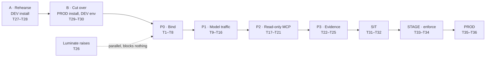

# Agentic Cloud Provisioning Platform — D3: Implementation Plan

> **Gate**: D3 — Tasks | **Status**: Draft | **D2 Approved**: 2026-09-02
> **Epic**: [EACPP-1163](https://sunlife.atlassian.net/browse/EACPP-1163) · Board label `acp-product-team`
> **Reads on**: [D0](d0-discovery.md) · [D1](d1-requirements.md) · [D2](d2-design.md)
>
> **Revised 2026-09-10** — reconciled against the platform's promotion process and the live state of
> the `dev` and `prod` Luminate installs. Adds the DEV-install rehearsal (T27–T28), the cutover
> (T29–T30) and the full DEV → SIT → STAGE → PROD promotion (T31–T36); retires T1 as the
> critical-path gate **on the shared-gateway path**, leaving T2 and T7.
>
> **T27–T30 are numbered after T26 but run before T9.** Work the phases in the order they appear
> below, not by task number.

## Scope of this D3

The design review of 2026-09-02 accepted [D2](d2-design.md) as written — including the four
decisions that put work in CAH's backlog: the gateway runs in ACP's cluster (DD-1), Bedrock is
called in CAH's account (DD-3), the agents are registered and not just the surface (DD-4), and the
MCP servers are split by trust boundary (DD-5).

This plan now covers **the whole path to a CAH production release**: a rehearsal in the Luminate
DEV install, the cutover to the PROD install, slice 1 evidence in the DEV workload environment, and
the **DEV → SIT → STAGE → PROD** promotion along the four `ca-central-1` environment gateways.

**Deliberately still not in this D3**: slice 2 — durable capability invocation, the approval path
and the A2A adapter (D2 phases P3–P4). They are sequenced in
[§Later phases](#later-phases-not-planned-here) and get their own D3 update once slice 1 has
produced measurements.

## The two axes this plan kept collapsing

Everything below only reads correctly once these are held apart. They are different things and the
words are not interchangeable — the same four names appear on both.

| Axis | What it is | Values | Whose SDLC |
|---|---|---|---|
| **Install** | Which Luminate deployment — a whole cluster, database and catalogue | `dev` (sandbox), `test`, `stage`, **`prod`** | **ACP's** |
| **Environment** | A row inside one install's catalogue, with its own gateway | `dev` → `sit` → `stage` → `prod` | **CAH's** |

[Gateway strategy DD-1](../../platform/gateway-environment-strategy/d2-design/topology.md) designates the **prod
install** as the control plane for business workloads, and the **test install** as platform
verification *and the P1 pilot workload plane*. This plan places CAH in the **prod install**, not the
test install, because the four-environment promotion path exists only there — the test install has no
STAGE and CAH's deliverable is a PROD release, not a pilot that stops. **That is a deliberate
departure from DD-1's P1 language**; it needs the platform lead's confirmation and is not settled by
any measurement below.

The consequence, said plainly: CAH's DEV workload runs on production infrastructure, in a production
account, on a production cluster. That is the model, not an accident.

When this plan says **DEV install** it means ACP's sandbox. **DEV** on its own means the workload
environment inside the prod install.

!!! note "Three names for one gateway — use the portal row name in any `Deployment` binding"
    | Helm release / namespace | Portal `Gateway` row | Hostname |
    |---|---|---|
    | `luminate-gw-dev` | `luminate-gateway-dev` | `gw-dev.apps.slf-eks-t1k-ca-prod…` |
    | `luminate-gw-sit` | `luminate-gateway-sit` | `gw-sit.apps.slf-eks-t1k-ca-prod…` |
    | `luminate-gw-stage` | `luminate-gateway-stage` | `gw-stage.apps.slf-eks-t1k-ca-prod…` |
    | `luminate-portal` (ns `luminate`) | `Luminate Gateway (prod)` | `gateway.apps.slf-eks-t1k-ca-prod…` |

    The PROD gateway is **embedded in the portal release**, not a separate one. `helm list` alone
    therefore shows three gateways and looks like a gap; `kubectl get deploy -A` shows four.

## What is already true — measured 2026-09-10, not assumed

The original P0 was written against a platform that no longer exists. Verified against both live
clusters (the `dev` sandbox and `prod`; the `test` and `stage` installs are DD-1's model and were
**not** measured):

| Claim in the first draft | Measured today | Consequence |
|---|---|---|
| "Every ACP gateway sets `slf.traefik.enabled: false`" | **False.** `prod-dev`, `prod-sit`, `prod-stage` all set it `true` with hostnames | T1 is not the gate on the shared path |
| The gateway hostname does not exist | `gw-dev` / `gw-sit` / `gw-stage` / `gateway` `.apps.slf-eks-t1k-ca-prod…` **all resolve** | No DNS request needed for any of the four |
| A certificate SAN is needed | The prod cert carries **all four**, Sun Life Issuing CA3, valid to **2027-03-18** | No Venafi request needed |
| Reachability is unproven | All four return **HTTP 401 over verified TLS** (no `-k`) from off-cluster | See the caveat below |
| CAH needs `cah-dev`/`cah-sit`/`cah-prod` environments | `dev`, `sit`, `stage`, `prod` **already exist**, LexoRanks `mzzzzz` < `qgmzzz` < `rwtmzz` < `tmzzzz` | Nothing to create — and STAGE was missing from the plan |
| CAH needs its own gateway release | **Four** gateway workloads run, `2/2` each, one per environment, each mapped via `GatewayEnvironment` | Use them |
| The portal must be told about the gateways | `networkPolicy.extraGatewayNamespaces` already reads `[luminate-gw-dev, luminate-gw-sit, luminate-gw-stage]` | Nothing to add |
| The promotion path is untested | `acp-harness-sample` and `claude-3-haiku` have `Deployment` rows in all four environments | The **shape** is constructible — see the caveat below |

!!! warning "Two of those rows say less than they appear to"
    **The 401 is a pre-authentication result.** It proves DNS resolves from the corporate network,
    TLS terminates on a trusted chain, and something demands credentials. It does **not** prove an
    authenticated request reaches a deployment (that is T16) and it says nothing about reachability
    **from CAH** (that is T8, and it is why T2 matters).

    **Four deployments are not a promotion.** `Deployment` has no provenance column — audit-event
    only, consortium ask 3 in [gateway strategy DD-4](../../platform/gateway-environment-strategy/d2-design/promotion.md).
    A resource present in four environments is indistinguishable from four rows created directly, and
    no audit events were read. Both resources are also **ACP-owned**, so neither exercised the gated
    STAGE/PROD path where a verdict must come from outside the owner's chain. Treat the mechanism as
    demonstrated and the **gated process as unevidenced**.

**The single largest change this makes**: `EACPP-1155` was carried as *"the gate on everything"*.
It gated a **bespoke** `gw-cah-dev` hostname. Against the **shared** environment gateways there is
nothing to wait for, and P0 can start immediately. That holds **only on the shared-gateway path** —
if T7 forks to a dedicated release, the hostname, SAN and DNS work returns in full, four times over.

!!! warning "The DEV install cannot rehearse the part of this plan that is new"
    Its `Environment` rows are `dev`, `sit`, `prod` — **no `stage`** — and all 13 of its deployments
    sit in `Dev`. It has never held a promotion and structurally cannot model the STAGE gate, which is
    exactly where the process changes. It also reproduces the three-environment shape T5 withdraws;
    do not read its layout as the target model.

    It also has **no externally reachable gateway lane**: single-SAN certificate, `luminate-gw-sit`
    with Traefik disabled, and the portal host answering `/llm/v1/…` with the SPA rather than a
    gateway. T27 is therefore a **registration-shape** rehearsal only, and T28 decides how CAH
    reaches it.

## What changed since D2 §12

D2 said D3 could not be written until four things were decided. All four now have answers.

| D2 §12 precondition | Status | Lands as |
|---|---|---|
| EACPP-1155 has a date | **No longer blocking.** Satisfied for the shared gateways; only a bespoke hostname would need it | T1 — reframed, downgraded |
| The network path has an owner | **Still open** — the one real P0 dependency | T2 |
| The Bedrock account decision (DD-3) | **Decided** — option B, CAH's own account | T3 |
| CAH accepts DD-4 and DD-5 | **Accepted** at the review | T10, T17 |

## Sequencing

**Two things gate P0**, and neither is T1. The **network path** (T2) has no owner and is the one to
chase. The **shared-vs-dedicated decision** (T7) also gates, and it cannot be taken until T3 settles
which Bedrock account CAH's models must be invoked in.

---

## Tasks

### A · Rehearse in the Luminate DEV install

The DEV install is ACP's sandbox — start it, stop it, redeploy it freely
([gateway strategy DD-1](../../platform/gateway-environment-strategy/d2-design/topology.md)). It already carries
real pilot content (`pharmacy-chatbot`, `underwriting-tools`, `claims-tools`, `policy-assistant`,
`gemma-slm`), so CAH is not the first workload through it.

**Why rehearse at all**, given the prod install is where the work has to land: the registration
shape in DD-4 and the MCP split in DD-5 are the two things most likely to be wrong first time, and
both are cheap to get wrong here and expensive to get wrong in a catalogue that carries a
governance record. Nothing produced here is promoted — **the rehearsal is thrown away**, and saying
so now is what stops someone trying to migrate it later.

| Task | Description | Depends |
|------|-------------|---------|
| **T27** | **Rehearse the slice-1 registration in the DEV install, then discard it.** Register the surface, the three agents, the two applications, the models and the read-only MCP tier against `luminate.apps.slf-eks-t1k-ca-dev…`, as T9–T12 and T17–T18 describe them. Exit is a **written list of what the portal made you do differently from the design** — field by field. A rehearsal that produces no corrections was not a rehearsal, it was a demo. **Time-box it, and capture the list as you go**: the sandbox is redeployed freely and without notice, and a rehearsal in flight is not recoverable. If the box expires, T29 proceeds with whatever list exists. Registration shape only — the DEV install has no `stage` row and cannot rehearse the promotion path. (D2 DD-4, DD-5) | T28 |
| **T28** | **Decide how CAH reaches the DEV install — three options, and one of them is mispriced.** **(a) Use the existing DEV portal hostname.** T27 exercises the **portal**, not a gateway, and `luminate.apps.slf-eks-t1k-ca-dev…` already resolves and already presents a valid certificate. The open question is only whether CAH's people can route to it — an access question, not a Venafi one. The single-SAN certificate and the disabled Traefik matter for the *gateway lane*, which T27 never touches. **(b) ACP drives the rehearsal in-cluster** and CAH watches — costs nothing, still catches registration-shape errors, but the corrections are then ACP's rather than CAH's and are worth less. **(c) Rehearse in the `test` install**, which DD-1 assigns to platform verification and the P1 pilot plane and which is not wiped without notice. **Price (a) and (c) before defaulting to (b).** (D2 DD-1) | — |

### B · Cut over to the PROD install

| Task | Description | Depends |
|------|-------------|---------|
| **T29** | **Carry the rehearsal's corrections into the PROD install, and fix the registration plan before anything is created.** T27 produces a list of what the portal actually required; this task applies it to T9–T12 and T17–T18 — names, modes, field values, ordering — so the real catalogue is built right the first time. The PROD install is where the governance verdict, the audit trail and the promotion history live; the rehearsal carries none of it. Register **once**, into `dev`; the later environments are deployments of these same rows, not new rows. Exit: an amended registration plan, not a registered agent — P1 does the creating. (D2 DD-4) | T27, T5 |
| **T30** | **Write down what was discarded at the cutover, and confirm the DEV install is not a dependency.** One page naming **CAH's own rehearsal rows specifically** — the sandbox already holds 13 deployments belonging to other pilots, and a cleanup that works from "what is in Dev" takes out someone else's work. Then an explicit statement that no CAH path resolves to `slf-eks-t1k-ca-dev`. This exists because the failure mode is silent — a rehearsal endpoint left in a config file works right up until the sandbox is redeployed, which it is, deliberately and without notice. If T28 chose (b), the "no CAH path" half is satisfied by construction; say so rather than auditing it. | T28, T29, T14 |

### P0 · Bind to the platform — shared gateways and shared environments

No CAH application code changes in this phase.

| Task | Description | Depends |
|------|-------------|---------|
| **T1** [EACPP-1178](https://sunlife.atlassian.net/browse/EACPP-1178) | **Confirm CAH uses the shared `gw-dev` gateway, and close EACPP-1155 as a CAH dependency.** Measured 2026-09-10: `gw-dev.apps.slf-eks-t1k-ca-prod.aws.sunlifecorp.com` resolves, presents a Sun Life Issuing CA3 certificate valid to 2027-03-18 carrying all three workload-gateway SANs, and returns a governed `401`. **There is nothing to request.** A bespoke `gw-cah-dev` hostname would reinstate the DNS and Venafi wait, and buys only a dedicated failure domain — which is a capacity decision, not a pilot one. Output: a one-line decision recorded here, and EACPP-1155 detached from this plan's critical path. (D2 DD-1, §5) | — |
| **T2** [EACPP-1179](https://sunlife.atlassian.net/browse/EACPP-1179) | **Name an owner and pick a mechanism for the CAH ⇄ ACP network path.** Peering, PrivateLink or Transit Gateway, from CAH's DEV account to the ACP prod cluster in `035722575935`. The gateway resolves to **private** addresses (`10.229.80–82.x`) behind the prod Traefik NLB, so public DNS resolving is not the same as CAH being able to reach it. This dependency had no owner at D2 and it is now **the only thing gating P0**. Output: a named owner, a chosen mechanism and a date — not an architecture document. (D2 DD-1, §8) | — |
| **T3** [EACPP-1180](https://sunlife.atlassian.net/browse/EACPP-1180) | **Create the Bedrock cross-account role in CAH's workload account.** Trust policy admits `arn:aws:iam::035722575935:role/delegated/luminate-gateway-irsa`; permissions are `bedrock:InvokeModel` and `bedrock:Converse` on the approved model ARNs only. Match the least-privilege precedent from ACP's existing spoke — invocation but **not** discovery, so `ListFoundationModels` returns `AccessDenied`. **Note the consequence of sharing `gw-dev`**: `gateway.aws.spokeRoleArn` is a single scalar per release, so a shared gateway reaches one Bedrock account. If CAH's models must be invoked in CAH's account, that forces the dedicated-release fork in T7 — settle which of the two matters more before building the role. (D2 DD-2, DD-3) | — |
| **T4** [EACPP-1181](https://sunlife.atlassian.net/browse/EACPP-1181) | **Settle the two sizing and mapping questions left open in D1.** CAH's SIT maps to the platform's **`sit`** environment — that is now answered by DD-2 of the gateway strategy and needs only confirmation, not a decision. What remains open is CAH's stated concurrency target (NFR-13), which sizes the shared gateway's headroom rather than a dedicated release. Output: a number written into this spec. (D1 §10) | — |
| **T5** [EACPP-1182](https://sunlife.atlassian.net/browse/EACPP-1182) | **Confirm CAH uses the four existing global environments — create nothing.** `dev`, `sit`, `stage` and `prod` already exist in the prod install, correctly LexoRanked, each joined to its gateway through `GatewayEnvironment`. **There is no per-tenant environment binding in the schema**: CAH's association with an environment exists only as `Deployment` rows, created in T9–T12. The earlier plan to create `cah-dev`/`cah-sit`/`cah-prod` is **withdrawn** — `Environment` is global, `CrossEnvironmentRule` is evaluated between two `Environment` rows, and per-tenant rows would give CAH a promotion path no other workload shares and no governance rule can reason about, while silently dropping STAGE. Output: a recorded confirmation, not a change. (D2 DD-2, DD-4; [gateway strategy DD-2](../../platform/gateway-environment-strategy/d2-design/topology.md)) | T4 |
| **T6** [EACPP-1183](https://sunlife.atlassian.net/browse/EACPP-1183) | **Confirm the portal already admits the three workload gateway namespaces.** Measured 2026-09-10: `networkPolicy.extraGatewayNamespaces` on the `luminate-portal` release reads `[luminate-gw-dev, luminate-gw-sit, luminate-gw-stage]`, and all four gateway workloads report `2/2` — the PROD one being embedded in the portal release itself, in namespace `luminate`, which is why it needs no entry. **Nothing to add.** This task becomes real work **only** if T7 takes the dedicated-release fork — in which case the new namespace must be added and the portal upgraded **before** the gateway starts, or the config push never arrives and there is no error at the gateway end. (D2 DD-1, §4) | — |
| **T7** [EACPP-1184](https://sunlife.atlassian.net/browse/EACPP-1184) | **Establish whether a dedicated release is even available, then decide.** First the question nobody has asked: does `GatewayEnvironment` permit **two** `Gateway` rows against the same `Environment`, and is DD-3's *"one per workload environment per region"* an invariant or a description of today? **If it is an invariant the fork does not exist** — and a CAH-account Bedrock requirement (T3) stops being a cost and becomes a blocker that must be escalated as a platform change, because `spokeRoleArn` is a single scalar and there is no second release to put a different one in. If the fork does exist, the default is **shared**: `gw-dev` is reachable, certificate-covered and already serving other workloads. A dedicated release is warranted by exactly two things — a differing Bedrock spoke account, or a need to stop CAH's traffic without stopping everyone else's in that environment (DD-11). Neither is free: each dedicated release reinstates T1's hostname, SAN and DNS work, four times across the promotion path. Output: the availability answer, the decision, and the named trigger. (D2 DD-2, §4, §5) | T1, T3, T5, T6 |
| **T8** [EACPP-1185](https://sunlife.atlassian.net/browse/EACPP-1185) | **Prove reachability from a CAH DEV pod.** A `curl` over TLS **without `-k`**, chaining to the Sun Life issuing CA, that returns a governed `401` rather than a connection failure. The same call already succeeds from an ACP laptop, so **this test is now entirely about T2's network path** — a failure here is a routing finding, not a platform one, and that distinction is what makes it quick to act on. This is P0's exit and PoC exit criterion 1. (D2 §6 P0, §7) | T2, T7 |

### P1 · Slice 1a — assistant model traffic through ACP

| Task | Description | Depends |
|------|-------------|---------|
| **T9** [EACPP-1186](https://sunlife.atlassian.net/browse/EACPP-1186) | **Register the surface.** `Deployment: cah-agentic-surface` in environment `dev`, bound to `Gateway: luminate-gateway-dev`. This is the "surface identity" the submission asked for and the kill boundary DD-11 relies on. **Drop the `-dev` suffix from the resource name** — the environment is a field on the deployment, not part of the identity, and a name that carries it invites the four-copies mistake T31 exists to prevent. (D2 DD-4, §4) | T8, T29 |
| **T10** [EACPP-1187](https://sunlife.atlassian.net/browse/EACPP-1187) | **Register the callers as separate entities.** One `Agent` per LangGraph agent — `cah-nova`, `cah-cloudflux`, `cah-stratosphere` — plus `Application` rows for Backstage and the C# automation API. Registration is manual via the portal because machine auth is off (G-J). The test that this was worth doing: *"what did CloudFlux spend last month, and can I stop only CloudFlux?"* Under surface-only registration neither question has an answer. (D2 DD-4) | T9 |
| **T11** [EACPP-1188](https://sunlife.atlassian.net/browse/EACPP-1188) | **Confirm the models and reconcile CAH's profile pins.** `claude-sonnet-4-5`, the pinned Claude Opus and `titan-embed-text-v2` registered and reachable through the release. Reconcile the model IDs pinned in CAH's `AGENT_PROFILE` personas against ACP's approved offerings and record any that do not map (FR-7). Note the **Gateway Slug** — it is what agent code references and changing it later changes every caller. (D2 §4) | T9 |
| **T12** [EACPP-1189](https://sunlife.atlassian.net/browse/EACPP-1189) | **Author the minimum access-policy set, deliberately differentiated.** Every CAH agent to `titan-embed-text-v2`; `cah-nova` and `cah-cloudflux` to the chat models. Give at least two agents **different** model grants so a cross-agent denial is demonstrable rather than asserted — with uniform grants a passing test proves nothing. Attach guardrails at the same time. (D2 §4, DD-5) | T10, T11 |
| **T13** [EACPP-1190](https://sunlife.atlassian.net/browse/EACPP-1190) | **Issue one credential per registered entity, and write down how it rotates.** Deployments tab → Generate Credentials. The **secret is shown once** — have it pasted straight into CAH's secret store as it is issued, never sent by email or chat. Exactly one active credential per (resource, gateway); a second issue attempt returns a conflict. ACP's Keycloak is the issuer (DD-13, FR-33), so the rotation path is part of the deliverable, not a follow-up — and it carries the correction owed to Matthew Clark: **HashiCorp Vault is not a supported credential backend** ([L-10](d1-requirements.md#l-10), G-L), so until it lands CAH holds its copy in CAH's own Vault and rotation is a two-sided act. Rehearse one rotation before P1 exits. (D2 DD-4, DD-13) | T12 |
| **T14** [EACPP-1191](https://sunlife.atlassian.net/browse/EACPP-1191) | **Point CAH's `get_llm()` equivalent at the ACP gateway.** One base URL, one `lum_…` key, and `x-luminate-session-id` carrying the conversation id. Must be **revertible by configuration with no image rebuild** (NFR-11) — that constraint is what makes T24 possible and it is cheaper to honour now than to retrofit. (D2 DD-8, DD-9, §4) | T13 |
| **T15** [EACPP-1192](https://sunlife.atlassian.net/browse/EACPP-1192) | **Make `portal_unreachable` distinguishable from a policy deny in CAH's callers, and write the deny runbook.** There is no `failureMode: allow` and no decision cache: every governed request makes a synchronous `CheckAccess` and any failure returns `deny` with reason `portal_unreachable`. A control-plane outage is an ACP incident, not a CAH bug, and the runbook names who is paged. (D2 DD-8, FR-6) | T14 |
| **T16** [EACPP-1193](https://sunlife.atlassian.net/browse/EACPP-1193) | **Run a real conversation end to end and measure it.** Not a synthetic call. Capture added latency p50/p95/p99 over the real cross-account path, `CheckAccess` p95 cross-account rather than in-cluster, the CloudTrail entry proving Bedrock was invoked in CAH's account, and an inspection of the rendered pod spec showing no AWS credential in the pod. Four of these numbers have never been measured over a cross-account path. (D2 §7 criteria 2–6) | T15 |

### P2 · Slice 1b — read-only MCP through ACP

D2 names the three MCP trust tiers **T1 / T2 / T3**. To avoid colliding with the task ids on this
page they are written **Tier 1 / Tier 2 / Tier 3** below; they are the same three tiers.

| Task | Description | Depends |
|------|-------------|---------|
| **T17** [EACPP-1194](https://sunlife.atlassian.net/browse/EACPP-1194) | **Split CAH's MCP servers by trust boundary, starting with the read-only Tier 1.** Move `search_business_apps_tool` and `search_computers_tool` off `webhook-receiver`, which today hosts them next to `trigger_workload_provisioning`, so one policy grant no longer covers both. This is the only change in the design that lands in CAH's repositories, and it is the difference between *"provisioning is governed"* and *"everything on webhook-receiver is governed identically"*. It cannot be rolled back, and that is fine — it is a good change on its own terms. (D2 DD-5) | T8 |
| **T18** [EACPP-1195](https://sunlife.atlassian.net/browse/EACPP-1195) | **Register `cah-tools-readonly` as an MCP server in `gateway_identity` mode.** Read-only helpers need no caller identity, and `gateway_identity` is a first-class mode for exactly that — not a fallback. **Set the mode explicitly**: the model default is `delegated_exchange`, so leaving it unset picks the wrong one. Broad grant to CAH agents; read-only by construction. The side-effecting tier is different and uses `token_forward` — see the P4 note. (D2 DD-6, §4) | T12, T17 |
| **T19** [EACPP-1196](https://sunlife.atlassian.net/browse/EACPP-1196) | **Tighten the NetworkPolicy on the Tier 1 backends and write down the Entra mapping.** Replace *"admit AgentGateway"* with *"admit only the ACP gateway's egress"*, then record the mapping from each retired Entra `appid`/`tid` rule to the ACP policy that replaces it, and get it reviewed by CAH's security reviewers. The edge Entra check does not move — it disappears — so this artefact is what makes the swap defensible at ETAB. It is not paperwork. (D2 DD-6 steps 2–3) | T18 |
| **T20** [EACPP-1197](https://sunlife.atlassian.net/browse/EACPP-1197) | **Demonstrate a legible refusal.** Trigger both a cross-agent model denial and an MCP denial, and confirm each returns a `403` that names ACP and is distinguishable from a CAH `400`. Then induce `portal_unreachable` and confirm the caller handles it distinctly from a deny, per T15. (D2 §7 criteria 7–8) | T15, T19 |
| **T21** [EACPP-1198](https://sunlife.atlassian.net/browse/EACPP-1198) | **Quantify the guardrail false-block rate on real payloads.** A percentage over **≥ 100 real provisioning-shaped payloads**, not a sample of ten. Provisioning arguments contain account identifiers, CIDR blocks and role ARNs, which is exactly the shape guardrails tend to false-positive on, and the number decides whether guardrails ship enabled. (D2 §7 criterion 9) | T18 |

### P3 · Containment, cost, and the record that unblocks ETAB

| Task | Description | Depends |
|------|-------------|---------|
| **T22** [EACPP-1199](https://sunlife.atlassian.net/browse/EACPP-1199) | **Rehearse and time both containment layers.** Deactivate one entity and measure the interval to first refusal — the propagation delay is the number nobody has measured. Then scale the gateway release to zero and confirm all CAH governed traffic in the environment stops. Note for the record that a **tool-level** stop does not exist and is reachable only via DD-5's tier split. (D2 DD-11, §7 criterion 10) | T20 |
| **T23** [EACPP-1200](https://sunlife.atlassian.net/browse/EACPP-1200) | **Reconcile one period of cost on `cost_centre`.** Pull `/api/v1/chargeback/summary` and confirm CAH's spend lands on the right cost centre and separates per agent. Per-tier separation is a by-product of DD-5: read-only spend separates from provisioning spend because each tier is its own entity. Do **not** claim per-run cost — that gap is open and T26 raises it. (D2 DD-12, §7 criterion 11) | T16, T18 |
| **T24** [EACPP-1201](https://sunlife.atlassian.net/browse/EACPP-1201) | **Prove the revert before it is needed.** Return one agent to the pre-ACP path by configuration alone, with no image rebuild, then return it to the governed path. Proving this during an incident is not proving it. The rollback triggers are sustained `portal_unreachable`, a T21 false-block rate that makes runs unreliable, or latency outside the NFR-1/NFR-2 budgets. (D2 §10, §7 criterion 12) | T16 |
| **T25** [EACPP-1202](https://sunlife.atlassian.net/browse/EACPP-1202) | **Publish the PoC record and the ETAB-facing governance statement.** All twelve exit criteria with the **numbers** against them, plus the defensible written statement of what ACP governs and what it does not — the deliverable the executive sponsor made a precondition for the ETAB submission. A record with twelve green ticks and no numbers has not de-risked anything, and criteria 5, 6, 9 and 10 are the four the platform has never measured. (D2 §7, D0) | T21, T22, T23, T24 |

### Parallel · Luminate verify-then-raise

| Task | Description | Depends |
|------|-------------|---------|
| **T26** [EACPP-1203](https://sunlife.atlassian.net/browse/EACPP-1203) | **Raise the capability gaps CAH's onboarding evidences, with CAH named as the consumer.** [L-2](d1-requirements.md#l-2) remote gateway as a CAP-22 demand — do not design around it; [L-5](d1-requirements.md#l-5) per-tool policy to the consortium, mitigated but not closed by DD-5; [L-9](d1-requirements.md#l-9) per-run cost as a second named consumer on the existing raise; [L-10](d1-requirements.md#l-10) Vault credential backend as a new raise. Attach CAH to the open [EACPP-646](https://sunlife.atlassian.net/browse/EACPP-646) stop-control and [EACPP-826](https://sunlife.atlassian.net/browse/EACPP-826) external audit producer items. **Do not raise the Temporal-IdP item** — G-M was withdrawn the day it was raised (D1 §5); it would ask the consortium to invert a designed direction of trust. A gap with two named consumers is prioritised differently from one with none. (D2 §5) | — |

---

### C · Promotion — DEV → SIT → STAGE → PROD

This is the platform's promotion process, not a CAH-specific one. It is documented for builders in
[Promoting Your Agent](https://bitbucket.sunlifecorp.com/projects/EDAEACP/repos/luminate-user-guides/browse/docs/building/promoting-your-agent.md)
and designed in [gateway strategy DD-4](../../platform/gateway-environment-strategy/d2-design/promotion.md).

**The rule that makes the audit story work**: CAH's agents are registered **once**. Promotion adds a
`Deployment` against the next environment's gateway — it does not copy the agent. Registering
`cah-nova-sit` alongside `cah-nova` produces two unrelated resources and destroys the ability to say
that what runs in production is what passed review.

**What does not carry forward**, and must be re-established in each target: credentials (they hang
off `(resource, gateway)`), quotas (target-tier defaults, not DEV's), access policies, and the
governance verdict. That asymmetry is deliberate — inheriting DEV's grants is how a test audience
reaches production.

**The line is between SIT and STAGE.** Up to SIT, CAH self-serves and governance findings are
recorded but do not block. From STAGE, findings block and a platform administrator makes the change.

| Task | Description | Depends |
|------|-------------|---------|
| **T31** | **Promote the slice-1 set from DEV to SIT, and split it by owner first.** Add a `Deployment` against `luminate-gateway-sit` for each registered entity, **and for the models and the MCP server** — a model reachable in DEV is not reachable in SIT, and the failure presents as a broken agent rather than a missing deployment. **CAH-owned resources CAH creates; ACP-owned catalogue models are an ACP action** and must be requested with lead time, before the agent deployments cut over. (`claude-3-haiku` already has deployments in all four environments — confirm which of CAH's other models do not.) Re-author the access policies for SIT rather than expecting them to follow. Issue SIT credentials; the DEV key returns `401` against `gw-sit`. **If CAH runs a separate AWS account per environment, T2's network path work repeats for the SIT account** — raise it at T31 start, not at test time. Exit: the T16 conversation and the T20 refusal both reproduce against `gw-sit.apps.slf-eks-t1k-ca-prod.aws.sunlifecorp.com`. (Gateway strategy DD-4) | T25 |
| **T32** | **Clear CAH's governance findings in SIT, where they are still cheap.** From STAGE onward a finding blocks the promotion; in SIT it is recorded and informational. Work the record down to zero open findings **before** requesting STAGE, and record any that cannot be cleared with the reason and a named accepting owner **outside CAH's ownership chain** — the platform will not take a verdict from the resource's own owner. **A clean SIT record does not carry**: `GovernanceStatus` is keyed `(resource, environment)` and the STAGE verdict is issued fresh (DD-4). Clearing findings in SIT buys a cheaper STAGE review, not a shorter one. | T31 |
| **T33** | **Request and receive the STAGE promotion — gated, and not CAH's to perform.** CAH raises the request with SIT evidence; a project owner approves; an ACP platform administrator creates the deployments and issues credentials. The user guide states the platform **refuses a verdict from the resource's own owner** — that was **not** measured on 2026-09-10, so confirm before T33 whether it is a code-level constraint or a documented expectation, and name the approver role that satisfies it. If it is only an expectation, T33 has no technical gate and the control is procedural. Evidence to bring: a SIT trace, a clean record from T32, and confirmation that the models and MCP servers exist in STAGE. Exit: deployments exist against `luminate-gateway-stage`. | T32 |
| **T34** | **Verify in STAGE against real integrations, and re-measure what STAGE changes.** STAGE is production-like and governance **enforces**, so two things need re-measuring rather than assuming they carry from DEV: the guardrail false-block rate on real (not synthetic) payloads, and the added latency under enforcement. Re-run the T21 and T16 measurements here and record the deltas. **Someone must make CAH's real downstream systems available in STAGE** — that is a CAH action, not a Luminate one, and it needs an owner and a date before T33 completes. A block during T34 is a **finding**, and findings block from STAGE: it stops T35 until cleared through T32's process, re-run against STAGE. | T33 |
| **T35** | **Request and receive the PROD promotion — gated on the ACP operating model existing.** Same gated path as T33, against `Luminate Gateway (prod)` — which is the gateway **embedded in the portal release** at `gateway.apps.slf-eks-t1k-ca-prod.aws.sunlifecorp.com`, not a separate release. This task is **explicitly blocked on FR-31**: a named SLA, an incident-response path and a remediation process for the ACP platform itself. Said now, in writing, rather than discovered at the PROD change window — because at that point the only options are to accept an ungoverned dependency or to stop the release. If FR-31 is not met, this is the task that says so. | T34 |
| **T36** | **Confirm PROD steady state, and hand over the run book.** The T22 containment rehearsal repeated against PROD, one chargeback period reconciled on `cost_centre`, and a named on-call path on both sides. CAH keeps its DEV and SIT deployments — that is where the next change is tested, and reaping them is a housekeeping decision, not part of this promotion. | T35 |

---

## Promotion checklist — what repeats in each environment

The same seven things, three times. Anything not on this list does **not** repeat, because it hangs
off the catalogue resource rather than the deployment. **The actor column is the part people miss**
— it is the whole difference between SIT and STAGE.

| # | Step | Actor in SIT | Actor in STAGE / PROD |
|---|---|---|---|
| 0 | Network path from the source CAH account to the target gateway | CAH + ACP, per account | CAH + ACP, per account |
| 1 | `Deployment` for each **agent** and **application** | CAH — self-serve | ACP platform administrator |
| 2 | `Deployment` for each **model** and **MCP server** | CAH, or ACP for catalogue models | ACP platform administrator |
| 3 | Re-author **access policies** for the target | CAH | ACP platform administrator |
| 4 | Apply **target-tier quotas** | CAH | ACP platform administrator |
| 5 | Issue a **new credential** per entity | CAH | ACP platform administrator |
| 6 | Re-verify the **governance record** | Recorded, non-blocking | **Blocking**, verdict from outside CAH's ownership chain |

Row 0 is easy to forget and expensive to discover: the four gateways resolve to **different** private
addresses, so a network path to `gw-dev` is not a network path to `gw-sit`. If CAH runs one AWS
account per environment, T2 repeats three more times and no task owns those yet.

Rows 1 and 2 are the same operation on different objects, and row 2 is the one that gets skipped —
its failure looks like a broken agent rather than a missing deployment.

## PoC exit criteria

Carried from [D2 §7](d2-design.md) unchanged, with the task that produces each. Every row needs a
value, not a tick. **These twelve are the DEV gate** — they close P3 and unblock ETAB, and T31
starts from them.

| # | Criterion | Produced by |
|---|---|---|
| 1 | A CAH DEV pod reaches the gateway over TLS, verified without `-k` | T8 |
| 2 | A conversation completes through ACP, with entity, model and session id in the trace | T16 |
| 3 | No AWS credential in the pod — rendered pod spec inspected | T16 |
| 4 | Bedrock invoked in CAH's account — CloudTrail entry in that account | T16 |
| 5 | Gateway overhead quantified — p50/p95/p99 added latency, LLM and MCP | T16, T18 |
| 6 | Authorization overhead quantified — `CheckAccess` p95, cross-account | T16 |
| 7 | A refusal is legible — `403` naming ACP, distinct from a CAH `400` | T20 |
| 8 | `portal_unreachable` distinguishable from a deny, and handled distinctly | T15, T20 |
| 9 | Guardrail false-block rate over ≥ 100 real payloads | T21 |
| 10 | Containment works and is timed — entity deactivation, and release to zero | T22 |
| 11 | Cost lands on the right cost centre for one period | T23 |
| 12 | Revert is proven by configuration, no rebuild | T24 |

**Criterion 1 already passes on the platform side** — `gw-dev` answers with a governed `401` over a
verified chain from off-cluster. What T8 still proves is CAH's half of it, which is why T2 rather
than T1 is the thing to chase.

**Criteria 5, 6 and 9 are re-measured at T34.** STAGE enforces where DEV observes, and a guardrail
threshold tuned on DEV payloads is the most likely thing to fail first under enforcement.

## Later phases, not planned here

Sequenced in [D2 §6](d2-design.md) and deliberately left unbroken-down until slice 1 produces
measurements.

| Phase | Scope | Why it waits |
|---|---|---|
| **P4 — Slice 2a: durable capability** | The side-effecting Tier 3 (`cah-provisioning`) registered **in `token_forward`** so the backend sees the caller (DD-6, FR-14); trigger → approve → status through ACP; session id wired to `workflow_id`; the workflow input stamps caller + capability + decision (DD-13 layer 3) | Needs DD-5's Tier 3 split, which follows T17, and the approval-path evidence gap in DD-10 |
| **P5 — Slice 2b: A2A** | Adapter registered with empty `delegated_identity_audience`; NetworkPolicy tightened; Entra termination removed | CAH would be the **first third-party consumer** of the A2A path. Verified against the binary, never carried a foreign adapter |

Both follow the same T31–T36 promotion path once they land in DEV — they add scope to the catalogue,
not a second promotion mechanism.

## Risks carried into execution

| Risk | Where it bites | Response |
|---|---|---|
| **T2 has no owner and P0 cannot start** | Everything | This is now the only P0 blocker — T1 was retired by measurement. A single named owner and a mechanism, not an architecture study |
| The cross-account hop makes `CheckAccess` materially worse than in-cluster | T16 | Measured before commitment. If it is bad the answer is a conversation about caching, not silent acceptance |
| T17 lands in CAH's backlog and slips | P2 entirely | It is the smallest possible split, and it was accepted at the D2 review. Track it as a CAH commitment with a date |
| Losing the edge Entra check is discovered by a security reviewer after cutover | T19 | T19 makes the mapping an artefact with a named reviewer, **before** P2 completes |
| **CAH registers per-environment resources instead of promoting one** | T31 onward | The one failure that cannot be repaired later without re-running the governance record. T31 states it; T29 registers once, in `dev`, on purpose |
| **STAGE refuses what SIT allowed** | T33, T34 | Findings block from STAGE. T32 clears them in SIT where it is cheap, and T34 re-measures guardrails on real payloads rather than carrying the DEV number |
| **The rehearsal install becomes a dependency** | T30 | The DEV install is redeployed without notice by design. T30 makes the absence of any `slf-eks-t1k-ca-dev` reference an explicit check, not an assumption |
| CAH ships to PROD on its own timeline while ACP's operating model is absent | T35 | T35 is gated on FR-31 in writing, today — not at the change window |
| Two sources of usage truth — CAH's spend-by-model and ACP's ledger | T23 | Retain both for one release to quantify the variance, then drop CAH's (FR-11) |

## References

- [D0 Discovery](d0-discovery.md) · [D1 Requirements](d1-requirements.md) · [D2 Design](d2-design.md)
- **Promoting Your Agent** —
  [luminate-user-guides `docs/building/promoting-your-agent.md`](https://bitbucket.sunlifecorp.com/projects/EDAEACP/repos/luminate-user-guides/browse/docs/building/promoting-your-agent.md)
  is the builder-facing process T31–T36 implement. Where this plan and that guide disagree, the
  guide is right and this plan is the defect
- [Onboarding submission V2](references/2026-08-30-onboarding-submission-v2.md) — Appendix A carries
  the workload-provisioning contract, the OpenAPI stub, the MCP tool schema and the auth-path matrix
- [Use-case review transcript, 2026-08-29](references/2026-08-29-use-case-review-transcript.txt)
- [Gateway & Environment Strategy](../../platform/gateway-environment-strategy/d2-design/index.md) —
  [Topology DD-1/DD-2/DD-3](../../platform/gateway-environment-strategy/d2-design/topology.md) defines the
  install-vs-environment split and the four shared gateways;
  [Promotion DD-4](../../platform/gateway-environment-strategy/d2-design/promotion.md) defines what carries
  forward and what is re-established
- `luminate-sunlife-deploy` — `values/gateways/README.md` (the gateway-addition procedure and its
  load-bearing ordering)
