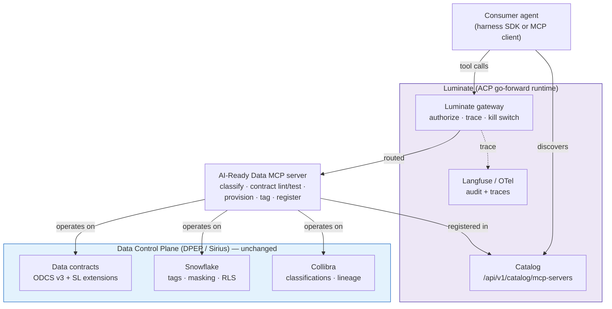
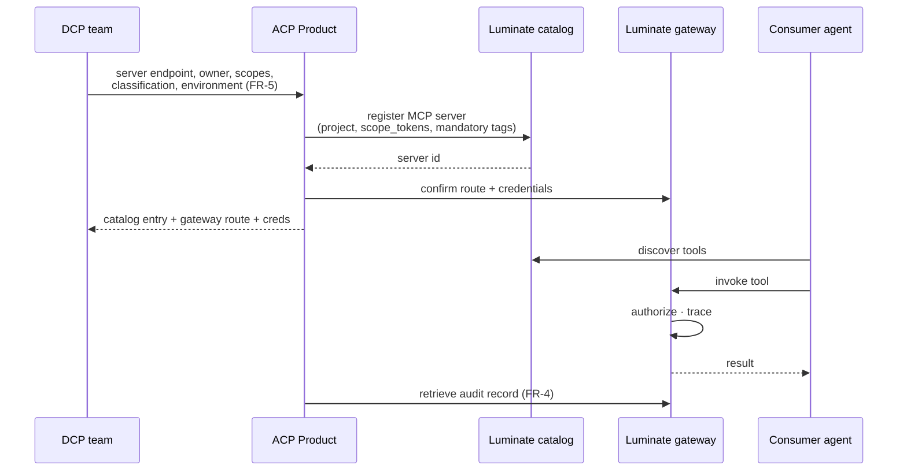

# Onboard the AI-Ready Data Use Case to ACP — D2: Design

> **Gate**: D2 — Design | **Status**: Approved 2026-09-08 | **Epic**: [EACPP-1077](https://sunlife.atlassian.net/browse/EACPP-1077)
>
> **Verified against Luminate `origin/main` @ `284008a19`, 2026-09-08.** The catalog path,
> `scope_tokens` and the `status` disable are confirmed in the source. Two controls the earlier
> draft did not account for — delegated identity and the governance state — are now DD-9 and DD-10.

## Architecture Overview

Two planes, one guardrail chain. The **Data Control Plane** (DPEP / Sirius) certifies and protects
the *data* — classification, contracts, Snowflake tags, masking, RLS. The **Agentic Control Plane**
on Luminate governs the *agent's route* to it — catalog registration, authorization, tracing and the
kill switch. This spec builds only the seam: the AI-Ready Data tooling registered as a governed MCP
server and reached through the Luminate gateway.

**What ACP does not do here:** it does not read contracts, hold a `DataProduct` model, compute
clearance intersections, map Snowflake roles or publish lineage. Those were the internal-build
design and are retired (D0, D1).

## Key Design Decisions

| # | Decision | Choice | Alternatives | Rationale |
|---|----------|--------|--------------|-----------|
| DD-1 | Runtime | **Luminate** catalog + gateway | Internal `ai-gateway` / `management-plane` | The internal build is not go-forward; `sunlife-deployment` is the target runtime |
| DD-2 | ACP's role | **Registration + routing + testing** | Full classification enforcement in ACP | The DCP already enforces at the data tier; duplicating it creates two authorities and a drift surface |
| DD-3 | Enforcement point for data rules | **Data tier (DCP)** | ACP gateway field-level redaction | ACP governs the agent, not the data. Restated as NFR-1 |
| DD-4 | Registration unit | **One MCP server, many tools** | One catalog entry per tool | Matches the Luminate catalog shape and the MCP protocol; tool metadata rides with the server |
| DD-5 | Rollout order | **Read-only tools first, mutating second** | All tools at once | Lets the pilot prove the path without waiting on approval for write-capable tooling (FR-8) |
| DD-6 | Programmatic access | **`acp-harness-sdk`**, Luminate target | Bespoke client per consumer | One upgradable integration path; already specced in `aws-harness-integration` |
| DD-7 | Documentation home | **`luminate-user-guides`** + onboarding guide | This spec | Guides are regenerated and maintained with the platform; a spec is a point-in-time artifact |
| DD-8 | Catalog record ownership | **DCP team owns content, ACP owns the path** | ACP owns the record | The use case knows its own scopes and endpoints; ACP should not become a metadata bottleneck |
| DD-9 | Identity reaching the data tier | **Register with `requires_delegated_identity = true`** | The gateway's own service identity | DD-3 puts enforcement at the data tier, and Snowflake RLS and masking key on *who is asking*. Reached with the gateway's identity, Snowflake sees one service principal and the caller's clearance is never applied — the enforcement DD-3 depends on would evaluate the wrong subject while appearing to work. The field exchanges the token for the invoking user instead |
| DD-10 | Governance lifecycle | **Drive `governance_state` to `approved` as part of onboarding** | Leave it at the default | Every registry row starts at `not_evaluated`. The field is read-only on the API and moves only through the guarded transition action, so reaching `approved` is a deliberate step rather than a side effect of registering. `not_evaluated` and `out_of_scope` are deliberately distinguishable, so leaving it unset is not the same as deciding it is ungoverned |

## Registration Flow

## Test Design (FR-4)

The test path is the deliverable, not a one-off verification. It must be runnable by the use-case
team.

| Step | Check | Evidence |
|---|---|---|
| 1. Register | Server appears in the catalog with owner, scopes and tags | Catalog entry retrievable by id |
| 2. Discover | Tools listed with metadata | Tool list returned from the catalog |
| 3. Invoke (read-only) | A `classify` or `lint` call succeeds through the gateway | Tool result returned |
| 4. Audit | The invocation is retrievable after the fact | Trace/audit record with agent id, tool, outcome |
| 5. Kill switch | Traffic stops when the server's `status` is set to `inactive` | Subsequent call rejected |
| 6. Latency | Gateway-routed call vs direct call in dev (NFR-4) | Recorded comparison |
| 7. Delegated identity | A tool call reaches the data tier as the **invoking user**, not as the gateway | Two callers with different clearances get different results from the same tool (DD-9) |
| 8. Governance state | The server reaches `approved` rather than sitting at `not_evaluated` | Catalog entry shows the state and its reason; the audit trail holds the transition (DD-10) |

**On the two axes.** `status` is operational — it decides whether the platform serves the server,
and it is what step 5 exercises. `governance_state` is the governance record, and the two are
deliberately independent: a server that has not cleared its obligations is still operationally
active. Today the gateway does **not** read `governance_state`, so step 8 evidences the record
rather than an enforcement point. Worth stating plainly, because "it is approved in the catalogue"
and "the platform would stop it" are not yet the same sentence.

Where the consumer is SDK-based, steps 3–4 run through
[`acp-harness-sdk`](https://bitbucket.sunlifecorp.com/projects/EDAEACP/repos/acp-harness-sdk/browse)
against the Luminate target, mirroring the SDK's own local quickstart.

## Interfaces

| Interface | Direction | Notes |
|---|---|---|
| Luminate catalog — `/api/v1/catalog/mcp-servers` | ACP → Luminate | Registration; project + `scope_tokens` + mandatory tags per the Luminate schema |
| Luminate gateway | Agent → Luminate → MCP server | Governed tool egress; Bearer-JWT auth |
| `acp-harness-sdk` | Consumer → Luminate | `RegistryClient` / `GatewayClient`, Luminate target (`aws-harness-integration` T2–T4) |
| Observability (Langfuse / OTel) | Luminate → ACP | Audit and trace retrieval for step 4 |

## What we are explicitly not building

Recorded so the retired design is not re-proposed: `acp-core` `DataProduct` / `DataProductField` /
`ClearanceMapping` types, the contract ingestion and sync job, `ClassificationGuard` field-level
allow/redact/deny, `resolve_role()` clearance→Snowflake mapping and drift reconciliation, the
`is_ai_ready()` lifecycle precondition, the Collibra lineage/reconciliation job, and the
classification-compliance and masking-effectiveness reports.
