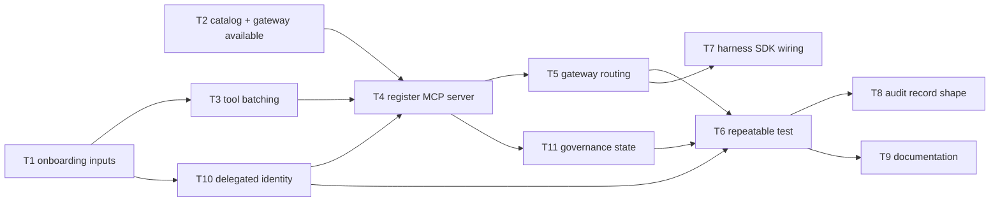

# Onboard the AI-Ready Data Use Case to ACP — D3: Implementation Plan

> **Gate**: D3 — Tasks | **Status**: Draft | **Epic**: [EACPP-1077](https://sunlife.atlassian.net/browse/EACPP-1077)
> **Replaces** the internal-build plan (EACPP-545 T1–T10, ~32 points across 3 sprints) with a
> narrower registration-and-testing scope on Luminate. See [D0](d0-discovery.md#scope-change-from-the-internal-build).
>
> **D0–D2 approved 2026-09-08.** Onboarding of the AI-Ready Data MCP server begins against dev
> Luminate. D3 is the gate being worked.

## Reference material

Each task names the portal path and the guide that documents it, so the steps are not reinvented
here and stay correct as the platform changes.

| Document | Where |
|---|---|
| **Register an MCP Server** — the primary guide for T1–T6 | [`docs/building/register-mcp-server.md`](https://bitbucket-static.sunlifecorp.com/pages/EDAEACP/luminate-user-guides/bb-pages/browse/building/register-mcp-server/) |
| Projects — project is permanent on the record | [`docs/getting-started/projects.md`](https://bitbucket-static.sunlifecorp.com/pages/EDAEACP/luminate-user-guides/bb-pages/browse/getting-started/projects/) |
| Getting Access · Roles — MCP Server Administrator | [`access.md`](https://bitbucket-static.sunlifecorp.com/pages/EDAEACP/luminate-user-guides/bb-pages/browse/getting-started/access/) · [`roles.md`](https://bitbucket-static.sunlifecorp.com/pages/EDAEACP/luminate-user-guides/bb-pages/browse/reference/roles/) |
| Deploying — platform-administrator step | [`docs/administration/deploying.md`](https://bitbucket-static.sunlifecorp.com/pages/EDAEACP/luminate-user-guides/bb-pages/browse/administration/deploying/) |
| Issuing Credentials — only if a tool calls Luminate back | [`docs/administration/credentials.md`](https://bitbucket-static.sunlifecorp.com/pages/EDAEACP/luminate-user-guides/bb-pages/browse/administration/credentials/) |
| Harness SDK — T7 | [`docs/building/harness-sdk.md`](https://bitbucket-static.sunlifecorp.com/pages/EDAEACP/luminate-user-guides/bb-pages/browse/building/harness-sdk/) |
| Troubleshooting | [`docs/reference/troubleshooting.md`](https://bitbucket-static.sunlifecorp.com/pages/EDAEACP/luminate-user-guides/bb-pages/browse/reference/troubleshooting/) |
| Spec D2 — design decisions | [Confluence 113223238130](https://sunlife.atlassian.net/wiki/spaces/T1KACP/pages/113223238130) |

## Overview

Eleven tasks, sequenced so the onboarding inputs and a live catalog land first, then the two
governance attributes are settled, then registration, routing, the repeatable test and
documentation. No new runtime service is built.

## Tasks

| Task | Description | Depends |
|------|-------------|---------|
| **T1** [EACPP-1078](https://sunlife.atlassian.net/browse/EACPP-1078) | **Collect the onboarding inputs from the DCP team**, and check the two that can stop the onboarding dead. **Transport must be Streamable HTTP or HTTP SSE** — a `stdio` server runs as a local subprocess, so there is nothing for Luminate to connect to; it can be registered but never deployed. And the **URL must be complete**, with scheme *and* path (`https://host/mcp` for streamable HTTP, `https://host/sse` for SSE) — the guide calls this the most common thing to get wrong, and nothing verifies reachability at registration. Also collect: server name (unique), key (lowercase-and-hyphens, **permanent**), project (**permanent**), owner, classification, target environments, and the short endpoint name T5 will need. Record it as a reusable template. (FR-5, DD-8; guide: *Register an MCP Server* §*Before you start*, §1) | — |
| **T2** [EACPP-1079](https://sunlife.atlassian.net/browse/EACPP-1079) | **Confirm the Luminate dev catalog and gateway are available, and get the role.** Registering needs **MCP Server Administrator on the owning project** — without it the catalog looks empty or the action fails after the button is visible, since the portal does not hide what you lack permission for. Request it as *who / what role / which project / why* and confirm under **IAM → Role Bindings**. Agree the target environment(s) with the use-case team. (Dependency on EACPP-596; guides: *Getting Access*, *Roles*) | — |
| **T3** [EACPP-1080](https://sunlife.atlassian.net/browse/EACPP-1080) | Agree the **tool batching** — read-only tools (classify, contract lint/test) first, mutating tools (provision, tag, register) second — and record the split. (FR-8, DD-5) | T1 |
| **T10** [EACPP-1288](https://sunlife.atlassian.net/browse/EACPP-1288) | **Settle delegated identity before registering.** Decide `requires_delegated_identity`, which reaches the server with a token exchanged for the invoking user rather than the gateway's own identity. DD-3 puts enforcement at the data tier, and Snowflake RLS and masking key on who is asking — so with the gateway's identity every caller looks like one service principal and no clearance is applied. Confirm with the DCP team which principal their masking policies actually evaluate, and that the exchanged token is one Snowflake will accept. **If this is wrong the path still works and the governance silently does not.** (DD-9) | T1 |
| **T4** [EACPP-1081](https://sunlife.atlassian.net/browse/EACPP-1081) | **Register the AI-Ready Data MCP server** — **Catalog → MCP Servers → Create**. Server Name (unique), Key (**permanent**), Project (**permanent**), Transport matching T1, Status *Active*, plus optional Version, Provider ID (`Internal`) and Documentation URL. Take a moment over Key and Project: neither can be changed later, and **once deployed the server cannot be deleted**. A rejected key is almost always capitals, spaces or underscores. Then confirm the tools appear under the **Capabilities** tab with their metadata. (FR-1, FR-2, DD-4; guide: *Register an MCP Server* §2) | T1, T2, T3, T10 |
| **T5** [EACPP-1082](https://sunlife.atlassian.net/browse/EACPP-1082) | **Get it deployed — registering alone does not make it reachable.** A registered server is visible but not callable; the deploy step is what creates the URL, and it is **platform-administrator only**. Send them the server name, the environment, the full URL from T1 and a short endpoint name. The gateway picks the change up within seconds with nothing to deploy on the DCP side. Agents then reach it at `https://<luminate-gateway>/mcp/<endpoint-name>`. Confirm calls are authorized, traced, and stopped by the operational `status` flag — that is the axis that actually halts traffic. Tell the platform team if the URL ever changes; the deployment points at a fixed address. (FR-3; guides: *Register an MCP Server* §3–§4, *Deploying*) | T4 |
| **T11** [EACPP-1289](https://sunlife.atlassian.net/browse/EACPP-1289) | **Move the server off `not_evaluated`.** Every registry row starts there and the field is read-only on the API, so it only moves through the guarded transition action — registering does not touch it. Assemble the evidence the governance rules require, get the verdict recorded, and confirm the state and its reason on the catalog entry. Note the gateway does not read this field today, so this is the governance record rather than an enforcement point; do not let it be reported as "the platform would stop it". (DD-10) | T4 |
| **T6** [EACPP-1083](https://sunlife.atlassian.net/browse/EACPP-1083) | Build the **repeatable end-to-end test** — point an MCP client at `https://<luminate-gateway>/mcp/<endpoint-name>` and list tools, then invoke → retrieve audit → kill switch → latency → delegated identity → governance state. Runnable by the use-case team unaided, and covering the traps below so they are not diagnosed live. (FR-4, D2 test table, NFR-4; guide: *Register an MCP Server* §4) | T5, T10, T11 |
| **T7** [EACPP-1084](https://sunlife.atlassian.net/browse/EACPP-1084) | Where the use case calls programmatically, wire it through **`acp-harness-sdk`** against the Luminate target instead of a bespoke client. (FR-6, DD-6) | T5 |
| **T8** [EACPP-1085](https://sunlife.atlassian.net/browse/EACPP-1085) | Confirm the **audit record shape** returned for a tool call satisfies the governance record `governance-intake` expects; raise a consortium ask if it does not. (FR-9, NFR-3) | T6 |
| **T9** [EACPP-1086](https://sunlife.atlassian.net/browse/EACPP-1086) | Contribute the **onboarding path to `luminate-user-guides`** and cross-link it from the ACP onboarding guide, so the path is maintained with the platform. (FR-7, NFR-5, DD-7) | T6 |

## Sequencing

## Known traps

Pre-empted from the registration and troubleshooting guides so they are not diagnosed live.

| Symptom | Cause | Action |
|---|---|---|
| Registered, but the URL does not respond | Not deployed \u2014 registering only creates the catalog entry | Ask a platform administrator for deployment (T5) |
| Deployed, calls time out | Luminate cannot reach the server | Check the route and the network policy between them |
| Deployed, but nothing appears | URL missing its scheme or its path | Re-check against `https://host/mcp` \u00b7 `https://host/sse` |
| Tool list comes back empty | Server not exposing tools on that transport | Test the server directly before blaming the gateway |
| Nothing works and the server is `stdio` | Cannot be onboarded at all | Switch it to HTTP \u2014 catch this in T1, not here |
| Catalog appears empty | No role binding, the default for a new account | Request **MCP Server Administrator** (T2). It is never absence |
| Button visible but the action fails | The portal does not hide actions you lack permission for | Check the role binding |
| Key rejected at registration | Capitals, spaces or underscores | Lowercase with hyphens |
| Catalog entry will not delete | A deployment still exists \u2014 and once deployed it cannot be deleted | Plan the key and project before T4, not after |

**Credentials are probably not needed.** They are only required if a tool of ours calls *Luminate*
back \u2014 asking an approved model for a completion, for example. The AI-Ready Data tools call
Snowflake, Collibra and the contract store, so the step is skipped unless a tool starts requesting
completions.

**Luminate is not the DCP's access control.** The guide is explicit that authentication and
authorisation stay inside the MCP server, with the gateway as an additional layer rather than a
replacement. That is the same point DD-3 makes from the other direction, and DD-9 is what keeps it
honest \u2014 the server can only apply the caller's clearance if the caller's identity actually reaches
it.

## Definition of Done

- AI-Ready Data MCP server registered in the Luminate catalog; tools discoverable with metadata.
- The server is reached as the **invoking user**, so the data tier's masking and RLS evaluate the
  right subject rather than one shared service principal.
- The server's `governance_state` is `approved` with a recorded reason, not left at `not_evaluated`.
- Tool traffic flows through the Luminate gateway — authorized, traced, killable — with no direct
  unaudited calls from onboarded consumers.
- The end-to-end test runs green and is executed by the use-case team without ACP assistance.
- Any SDK-based caller integrates through `acp-harness-sdk` on the Luminate target.
- The audit record is confirmed sufficient for the governance record, or a consortium ask is raised.
- The onboarding path is published in `luminate-user-guides` and linked from the onboarding guide.

## Explicitly not in this plan

The retired internal-build tasks: `DataProduct` read model and contract sync (T1), governed
clearance↔sub-code mapping (T2), gateway classification enforcement (T3), clearance→Snowflake RBAC
mapping (T4), the AI-readiness lifecycle gate (T6), Collibra lineage and reconciliation (T7),
classification-compliance reporting (T8) and data-access telemetry attribution (T9). See
[D1 → Out of Scope](d1-requirements.md#out-of-scope).

## References

- Spec: [D0](d0-discovery.md) · [D1](d1-requirements.md) · [D2](d2-design.md)
- Retired predecessor: `T1KACP/acp-specs/specs/ai-ready-data` (EACPP-545)
- Luminate user guides: [`EDAEACP/luminate-user-guides`](https://bitbucket.sunlifecorp.com/projects/EDAEACP/repos/luminate-user-guides/browse)
- Harness SDK: [repo](https://bitbucket.sunlifecorp.com/projects/EDAEACP/repos/acp-harness-sdk/browse) ·
  [user guide](https://bitbucket-static.sunlifecorp.com/pages/EDAEACP/acp-harness-sdk/bb-pages/browse/user-guide/) ·
  [local quickstart](https://bitbucket.sunlifecorp.com/projects/EDAEACP/repos/acp-harness-sdk/browse/examples/local/README.md)
- Depends on: [`sunlife-deployment`](../../platform/sunlife-deployment/d3-tasks.md) (EACPP-596) ·
  [`aws-harness-integration`](../../integration/aws-harness-integration/d3-tasks.md) (EACPP-707)
