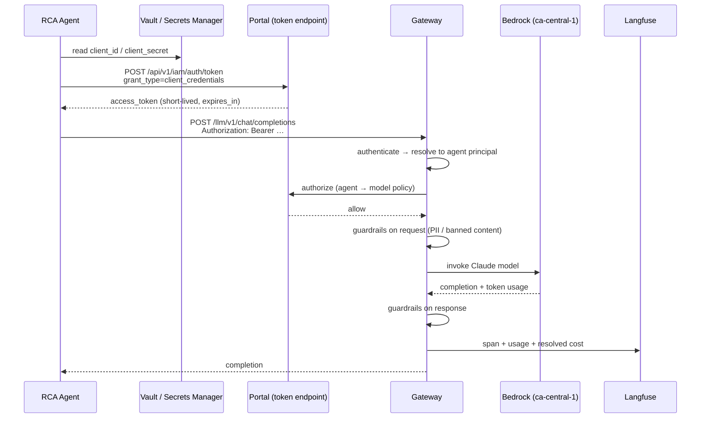
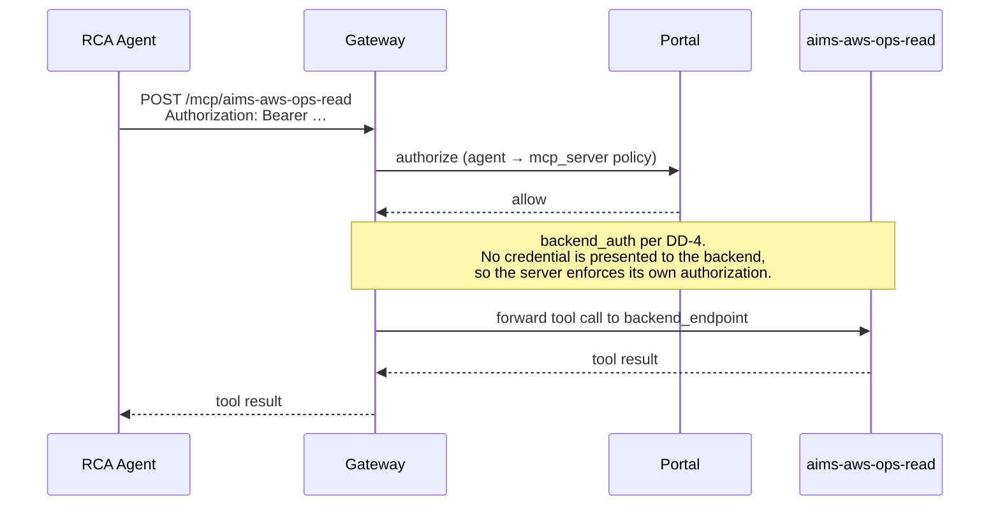
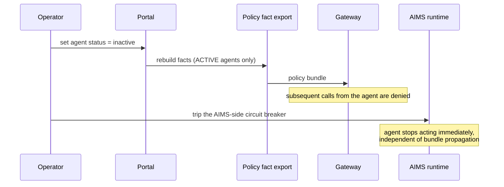

# Onboarding Corp IT's use case: AIMS — D2: Design

> **Gate**: D2 — Design | **Status**: Draft | **D1 Approved**: TBD
> **Epic**: [EACPP-909](https://sunlife.atlassian.net/browse/EACPP-909) · Board label `acp-product-team`

This is an **onboarding design**, not a build design. Almost nothing here is new code: it is the
configuration, topology and operating decisions that put AIMS onto Luminate using what ships today,
plus the explicit shape of each interim measure standing in for a capability that does not.

Where a decision exists only because a capability is missing, it says so and cites the gap.

---

## 1. Target topology

*Source: [`assets/aims-target-topology.drawio`](assets/aims-target-topology.drawio) — edit the `.drawio`, then re-export with
`draw.io --export --format svg --embed-svg-fonts false --border 12 --output assets/aims-target-topology.svg assets/aims-target-topology.drawio`.*

Three things the diagram is deliberately saying:

- **Every solid arrow out of an AIMS component goes through the gateway.** That is the only path on
  which policy, guardrails, audit, tracing and cost exist. A direct provider call is not "less
  governed" — it is ungoverned.
- **The dashed red agent-to-agent arrows do not pass through Luminate.** They cannot today (G3). Each
  agent re-enters the gateway on its own identity for its own egress, so attribution is per hop.
- **The thick arrow back into the estate is the load-bearing one.** Traffic leaves AIMS to be
  governed and returns to reach the MCP servers on cluster-internal Service addresses, below the
  Okta-fronted Route (DD-4). If that network path does not exist, the MCP half of the POC does not
  happen — which is why T13 proves it before any deployment is created.

---

## 2. Design decisions

### DD-1 — One folder, one project, permanent by design
Folder `Corp IT`, project `AIMS`. Everything AIMS registers lives in that one project.

Project is permanent on every resource and cost rolls up per project, so this is a one-way door
taken deliberately rather than by accident. A project per AIMS sub-project (there are up to nine,
E-1) would fragment the cost view and multiply the access grants for no governance benefit; a
project per environment is wrong because environment is already a first-class dimension on
deployments. The named project **Owner** is an AIMS person, which is what stops routine access
requests reaching the ACP Product Team.
**Effort S / Risk Low.**

### DD-2 — The detection pipeline is an Application, not an Agent
The Glue-failure watcher is a workload that calls a model; it is not an agent. Registering it as an
Application gives it the same identity, deployment, credential and policy treatment while keeping
the agent inventory meaning what it says. An inventory in which every workload is an "agent" cannot
answer an E-23 question about agents.
**Effort S / Risk Low.**

### DD-3 — Two models, Bedrock offerings, keyless where possible
Register Haiku and Sonnet as separate catalog entries with stable gateway slugs. Each gets one
offering: provider `bedrock`, `aws_region = ca-central-1`, authentication **`keyless`** (pod
workload identity — IRSA) in preference to `api_key`, because a keyless offering stores no secret at
all. `api_key` is the fallback only if IRSA is unavailable on the gateway's account path.

The gateway slug is what every AIMS caller names, so it is chosen once and never changed. Confirm a
**pricing catalogue entry resolves for each offering** at registration time — without one, cost
attribution silently reports zero and the CAP-20 claim quietly fails.
**Effort S / Risk Low.**

### DD-4 — Reach AIMS MCP servers below the Okta hop *(interim measure for G1)*
The load-bearing decision, and the one most likely to change the plan if Q4 comes back badly.

AIMS's MCP servers sit behind Okta on the API platform. The gateway's identity modes for a backend
fronted by a third-party authorization server — `injected_credential` and `external_exchange` — are
**declared but not implemented**, and a server configured in either mode is served like
`gateway_identity`: **no credential is sent at all**. `token_forward` is not a substitute, because it
only works where the backend trusts the gateway's own issuer, and Okta does not.

| Option | Verdict |
|---|---|
| `token_forward` | ✗ Okta will not validate a Keycloak-issued token |
| `injected_credential` / `external_exchange` | ✗ Not implemented; silently degrades to no credential |
| **Register the backend on a cluster-internal Service address, below the Okta-fronted Route** | ✓ **Chosen for the POC** |
| Wait for the capability | ✗ Blocks the POC on a consortium delivery |

The chosen path requires the gateway to have a network route to the AIMS namespace and the MCP
server to keep enforcing its own authorization internally — Luminate is an additional layer, never a
replacement for the server's own controls. Nothing probes reachability at deploy time, so the
network path is proven in the spike (**T13**) before any deployment is created.
**Effort M / Risk Med** — the risk is entirely in whether that network path exists (Q4).

### DD-5 — One MCP server per trust boundary *(interim measure for G2)*
AIMS asked for "which agents should have access to which tools". The platform authorizes per
**server**; `allowed_tool_ids` is modelled, serialized and written into `audit_snapshot()`, but no
`.rego` file mentions a tool and the gateway has no reference to it. Configuring it would produce a
control that reads as green and holds nothing.

So the design gets tool-level separation from server-level policy: **split by blast radius, not by
system.** AWS operations becomes two registered servers — `aims-aws-ops-read` and
`aims-aws-ops-write` — sharing an implementation but exposing disjoint tool sets on different
transports/paths. The RCA agent gets a policy to the read server and no policy to the write server,
which the gateway *does* enforce.

This is the highest-value decision in the design: it converts an unenforceable requirement into an
enforced one using only what ships. The cost is that adding a tool means deciding which server it
belongs on — a judgement that is now explicit rather than implicit.
**Effort M / Risk Low.**

### DD-6 — Agent-to-agent hops stay outside the gateway, and are never described as governed
The gateway resolves an `/a2a/` prefix, and `AgentAssignment` rides in the portal bundle, but
`ResourceTranslator.translate()` iterates only LLM and MCP assignments — the agent list is counted in
a log line. The gateway's own documentation states that nothing A2A reaches agentgateway.

AIMS agents therefore call each other **directly, at their own service addresses**. Each agent
authenticates to the gateway independently for its own model and tool calls, so governance is
complete *per hop* and absent *between hops*. Any AIMS-facing material must say this. The portal
displays a `/a2a/<endpoint-name>` Catalog Endpoint on an agent deployment; that value is an
identifier, not an address that answers, and teams routinely lose time to it.
**Effort S / Risk Med** — the risk is presentational, and it is the kind that ends up on a slide.

### DD-7 — One credential per (resource, gateway), stored per runtime
A credential is scoped to a deployment, so an agent deployed to two gateways holds two. Never a
shared AIMS credential — that would collapse per-agent attribution (NFR-5) and make the kill switch
meaningless.

| Runtime | Secret store | Delivery |
|---|---|---|
| OpenShift | HashiCorp Vault → `VaultStaticSecret` with `refreshAfter` | Kubernetes Secret → `envFrom` |
| Lambda | AWS Secrets Manager, one JSON secret per agent | Harness SDK reads it directly; role scoped to that one ARN |

The Secrets Manager shape is the four-key JSON the harness SDK already consumes (`token_url`,
`client_id`, `client_secret`, `scope`), so `ACP_TARGET=luminate` and
`LuminateAuthProvider.from_secrets_manager(...)` need no bespoke glue. Tokens are fetched on demand,
held in memory and never written to disk; the secret is re-read at token-fetch time so a rotation —
which has **no overlap window** — does not require a redeploy.

Until **AIC-589** ships, a freshly issued credential lacks the audience the gateway checks and every
call fails with `upstream authentication failed`. Rotating does not help. The platform team attaches
the audience after issue; this is a step in T10, not a troubleshooting surprise.
**Effort S / Risk Med.**

### DD-8 — Two independent levers to stop an agent *(interim measure for G4)*
Setting an agent to `inactive` removes it from the policy fact export, which publishes only ACTIVE
agents, so the next bundle stops authorizing it. That is a real effect but it is a **status edit
travelling through a config path**, not an incident-response control: no dedicated action, no
cascade, no audited stop event.

The design therefore does not rely on it alone. AIMS keeps an **application-side circuit breaker**
it owns — a flag its agents check before acting. Two levers with independent failure modes, and a
runbook (T18) that names both, names the owner, and records the **measured** propagation time of the
platform lever rather than an assumed one. An unmeasured interval is not a control.
**Effort S / Risk Med** — the residual risk is that neither lever is fast enough for an agent with
write access, which is precisely why S4 does not start until G4 and G11 are resolved.

### DD-9 — Platform measures requests; AIMS measures incidents; they join on the trace id
The gateway stamps Langfuse-shaped spans carrying `luminate_entity_type`, `luminate_entity_id` and
`luminate_model_id`, and the pricing catalogue is pushed to Langfuse so per-request cost resolves.
That delivers cost and latency **per agent and per model** — the whole of AIMS's cost-profile ask.

It does not deliver *task completion*, *time to diagnosis* or *which query types take longer*,
because the platform has no notion of a task (G8). Rather than wait for one, AIMS emits its own task
record — incident id, outcome, duration — carrying the platform **trace identifier**, and the two
datasets join on it. Platform owns the request; AIMS owns the task; the trace id is the contract.
**Effort M / Risk Low.**

### DD-10 — Dev only, one gateway, one environment
Test, stage and prod are not available. The POC runs entirely on the dev environment against its
single gateway. Every credential, deployment and policy created is dev-scoped and will need
re-creating per environment later — a deployment is per (resource, gateway) and does not travel.
Design for that repetition now rather than discovering it at promotion.
**Effort S / Risk Low.**

### DD-11 — The split of duties is fixed by the platform, so plan around it
Five actions cannot be delegated by any role, including project *Owner*: deploying to a gateway,
issuing/rotating/revoking credentials, creating gateways/environments/locations, setting quotas, and
managing governance attributes. Every one of those routes to the ACP Product Team.

| Step | AIMS | ACP Product Team |
|---|---|---|
| Create the project, name its Owner | — | ✓ |
| Grant roles inside the project | ✓ *(once an Owner exists)* | ✓ |
| Register agents, models, MCP servers, applications | ✓ | — |
| Create deployments | — | ✓ |
| Issue and attach credentials | — | ✓ |
| Create access policies | — | ✓ |
| Set governance attributes | — | ✓ |
| Store secrets in Vault / Secrets Manager | ✓ | — |
| Wire the runtime and run the verification call | ✓ | — |

The single highest-leverage move is DD-1's named Owner: it removes routine access requests from the
critical path. Deployment and credential issuance stay on it by design.
**Effort S / Risk Low.**

---

## 3. Key flows

### Flow 1 — A governed model call

A `403` here means no access policy for that model — or a model name that is not deployed on this
gateway. Both surface as the same `upstream authentication failed` message, so the **status code is
the diagnostic, not the body**.

### Flow 2 — A governed MCP tool call

Authorization is evaluated against the **server**, not the tool (G2) — which is exactly why the read
and write servers are separate registrations (DD-5).

### Flow 3 — Stopping an agent

Both levers are pulled, in that order. The runbook records the measured interval between the status
edit and the first denial (T18); until measured, no interval may be quoted.

---

## 4. What gets registered

The concrete object inventory. This table is the input to the D3 tasks and the checklist for D4.

| Object | Type | Key | Owner action | Notes |
|---|---|---|---|---|
| Corp IT | Folder | — | ACP Product Team | Only if Corp IT needs more than one project |
| AIMS | Project | `aims` | ACP Product Team | Owner is an AIMS person (DD-1) |
| RCA Agent | Agent | `aims-rca` | AIMS | Type *Task*; framework per Q2 |
| Incident Correlation Agent | Agent | `aims-incident-correlation` | AIMS | Type *Task* |
| Remediation Agent | Agent | `aims-remediation` | AIMS | **S4 — do not register until G4 and G11 resolve** |
| Detection pipeline | Application | `aims-detection-pipeline` | AIMS | DD-2 |
| Claude Haiku | Model | `anthropic-claude-haiku` | AIMS | Gateway slug fixed at registration; exact version in T5 |
| Claude Sonnet | Model | `anthropic-claude-sonnet` | AIMS | As above |
| Haiku offering | Model offering | — | ACP Product Team | `bedrock` · `ca-central-1` · keyless (DD-3) |
| Sonnet offering | Model offering | — | ACP Product Team | As above |
| Jira tools | MCP server | `aims-jira` | AIMS | Transport `http` or `sse` — never `stdio` |
| Teams tools | MCP server | `aims-teams` | AIMS | |
| Knowledge base | MCP server | `aims-knowledge-base` | AIMS | |
| AWS operations (read) | MCP server | `aims-aws-ops-read` | AIMS | DD-5 |
| AWS operations (write) | MCP server | `aims-aws-ops-write` | AIMS | DD-5 — **register, do not policy, until S4** |
| Deployments | Deployment | one per resource | ACP Product Team | dev gateway; endpoint name becomes the URL path |
| Credentials | Machine identity | one per (resource, gateway) | ACP Product Team | DD-7; attach audience per AIC-589 |

**Naming.** Every key is lowercase-hyphen, `aims-` prefixed, and **permanent**. A rejected key is
almost always capitals, spaces or underscores. A resource cannot move project and cannot be deleted
once deployed, so the review of this table in T1 is the last cheap moment to change any of it.

---

## 5. Access policy matrix

Absence of a row is a denial. This matrix is the authoritative statement of FR-8 and FR-9.

| Source | Haiku | Sonnet | `aims-jira` | `aims-teams` | `aims-knowledge-base` | `aims-aws-ops-read` | `aims-aws-ops-write` |
|---|:--:|:--:|:--:|:--:|:--:|:--:|:--:|
| Detection pipeline *(app)* | ✓ | — | — | — | — | — | — |
| RCA Agent | ✓ | ✓ | — | — | ✓ | ✓ | — |
| Incident Correlation Agent | ✓ | ✓ | ✓ | ✓ | ✓ | ✓ | — |
| Remediation Agent *(S4)* | — | ✓ | ✓ | ✓ | ✓ | ✓ | ✓ **behind an approval gate** |

Three properties worth stating explicitly, because each is a control someone will ask about:

- **No agent in the POC reaches the write server.** The only path to infrastructure change is the S4
  agent, and it does not exist yet.
- **The detection pipeline reaches one model and no tools.** It summarises; it does not act.
- **Haiku is the default and Sonnet the escalation.** The cheaper model handles routine
  classification; correlation and reasoning escalate. This is a cost decision expressed as policy,
  which is the only place it can currently be expressed at all (G5, G6).

---

## 6. Security

- **Authentication**: OAuth2 client credentials per (resource, gateway), exchanged at the portal for
  a short-lived bearer. Human access is SSO only.
- **Authorization**: fail-closed at the gateway on every call, evaluated against the §5 matrix. AIMS
  MCP servers retain their own internal authorization — the gateway is an additional layer, never a
  replacement (and under DD-4 it presents no credential, so the server's own control is the only
  one on that hop).
- **Secrets**: Vault or Secrets Manager only. Show-once at issue; one active credential per pair;
  rotation has no overlap window and is a coordinated cutover, not background maintenance.
- **Guardrails**: request *and* response scanning enabled before the first real Glue diagnostic
  flows. Log excerpts and stack traces are the highest-likelihood carrier of unexpected personal
  data in this use case, and they are exactly what an RCA prompt contains (Q7).
- **Residency**: `ca-central-1` for the Bedrock offering, the gateway and Langfuse.
- **Audit**: every governed call recorded immutably. AIMS's own detection events cannot be
  contributed to that trail (G13) — the audit record covers governed calls, not the whole incident.
- **Blast radius**: no shared credential, no write-server policy, two stop levers.

---

## 7. Observability and cost

| Signal | Where it comes from | What AIMS gets |
|---|---|---|
| Trace | Gateway Langfuse spans | Which agent called which model or tool, when |
| Usage | Provider-reported token counts | Input/output tokens per request |
| Cost | Pricing catalogue pushed to Langfuse, matched per offering | Per-request cost, attributable per agent **and** per model |
| Latency | Gateway request timing | Per-request latency; **not** per task (G8) |
| Decisions | Authorization records | Allow/deny per call, with the reason |
| Task outcome | **AIMS emits this**, keyed by trace id | Time-to-diagnosis, completion, per-incident cost (DD-9) |

Two verification points that are easy to skip and expensive to skip:

1. **Cost is zero until a pricing entry resolves for the offering.** Zero cost looks identical to no
   traffic. Confirm a non-zero figure in T12, not at the end of the POC.
2. **Attribution is per agent only if each agent has its own credential.** A shared credential
   produces a clean-looking dashboard attributing everything to one principal.

---

## 8. Interim measures and their exit conditions

Restated from the D1 gap register as design commitments, so that each has an owner and a removal
condition rather than becoming permanent by default.

| Gap | Interim measure in this design | Exit condition |
|---|---|---|
| G1 | DD-4 — register the backend below the Okta hop | `external_exchange` or `injected_credential` implemented |
| G2 | DD-5 — one server per trust boundary | `allowed_tool_ids` evaluated at the gateway |
| G3 | DD-6 — direct hops, per-hop attribution, never described as governed | Translator emits A2A assignments |
| G4 | DD-8 — two levers plus a measured runbook | A first-class kill control ships |
| G5, G6 | §5 model tiering as a cost lever, plus alerting on Langfuse metrics | Counter store lands; `spend` dimension arrives |
| G8 | DD-9 — trace-id join | A task/outcome model exists upstream |
| G10 | Manual evidence assembly from audit and usage exports | A reporting capability with OSFI in its framework set |

**None of these are the destination.** Each carries an escalation ticket per the gap-escalation
process, and each should be revisited when the capability map is re-verified.

---

## 9. Verification strategy

| Layer | What is proven | How |
|---|---|---|
| Access | AIMS engineers see a non-empty catalog | Sign in; catalog returns AIMS resources |
| Registration | Every §4 object exists with the right key and project | Portal review against §4 |
| Identity | Each agent holds its own working credential | Token exchange returns an `access_token` per agent |
| Egress — model | The full chain works: credential → token → gateway → policy → guardrail → Bedrock | A governed completion returning text (T12) |
| Egress — MCP | Tools are reachable and listable through the governed URL | MCP client against `/mcp/<endpoint-name>` (T16) |
| Authorization | Denials happen where the matrix says they should | Negative test: RCA agent → write server must `403` |
| Attribution | Cost and latency land against the right agent and model | Usage & Cost tab shows non-zero, correctly attributed |
| Stop | The kill lever works and its interval is known | Status edit; measure time to first denial (T18) |
| Guardrails | A prompt carrying personal data is blocked or redacted | Deliberate probe with synthetic data (T20) |

**The negative tests carry more weight than the positive ones.** A working completion proves the
happy path; a correctly refused call to the write server proves the control that Corp IT risk is
actually being asked to rely on.

---

## 10. Requirement traceability

| D1 requirement | Design element | Verified by |
|---|---|---|
| FR-1, FR-2 | §4 inventory, DD-1, DD-2 | Registration review |
| FR-3 | DD-3, §4 offerings | Governed completion |
| FR-4, FR-7 | §4 MCP entries, DD-4 | MCP tool listing |
| FR-5 | DD-7 | Token exchange per agent |
| FR-6, FR-8 | Flow 1, §5 matrix | Completion + negative test |
| FR-9 | **DD-5** | RCA → write server denied |
| FR-10 | §6 guardrails | Guardrail probe |
| FR-11, FR-16 | **DD-8**, Flow 3 | Measured stop drill |
| FR-12, FR-15 | **DD-9**, §7 | Non-zero attributed cost |
| FR-13 | §6 audit | Audit record inspection |
| FR-14 | §4, §6 | Attribute review |
| FR-17 | §5 (S4 row) | Deferred — gated on G11 |
| FR-18 | **DD-6** | Documentation review |
| FR-19 | DD-10 | Documented dev/local delta |
| FR-20 | Out of design scope — AIMS-owned method | Deferred — gated on G7 |

---

## 11. Non-goals

- **Hosting anything.** Luminate does not run AIMS agents or AIMS MCP servers. They stay where they are.
- **Replacing AIMS's own authorization.** Particularly under DD-4, where the gateway presents no credential and the server's own control is the only one on that hop.
- **Making the multi-agent hops governed.** Not possible today; DD-6 states the position instead of engineering around it.
- **Enforcing a budget.** Nothing debits a counter. §5's model tiering shapes cost; it does not cap it.
- **Producing OSFI evidence automatically.** The platform governs; it does not yet report (G10).
- **Designing the S4 Remediation Agent.** Its requirements are captured in D1 so the gaps are visible early; its design waits on G4, G11 and a risk decision.

## References

- Spec: [D0](d0-discovery.md) · [D1](d1-requirements.md) · [D3](d3-tasks.md)
- Epic: [EACPP-909](https://sunlife.atlassian.net/browse/EACPP-909)
- [Luminate User Guides](https://bitbucket.sunlifecorp.com/projects/EDAEACP/repos/luminate-user-guides) — the procedures behind every "owner action" in §4
- [ACP Capability Map](https://bitbucket.sunlifecorp.com/projects/EDAEACP/repos/acp-product-specs/browse/docs/capability-map.md) · [Capability Gap Escalation](https://bitbucket.sunlifecorp.com/projects/EDAEACP/repos/acp-product-specs/browse/docs/process/capability-gap-escalation.md)
- Capability verification: `AI-Consortium/luminate` `origin/main` @ `b04b0021`, 2026-08-28
