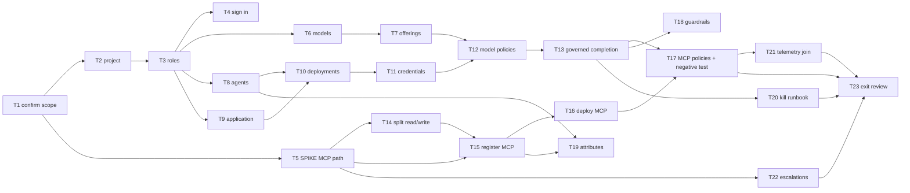

# Onboarding Corp IT's use case: AIMS — D3: Implementation Plan

> **Gate**: D3 — Tasks | **Status**: Draft | **D2 Approved**: TBD
> **Epic**: [EACPP-909](https://sunlife.atlassian.net/browse/EACPP-909) · Board label `acp-product-team`

## Scope

**The POC and the first onboarding activities only.** Two agents, one application, two models and
five MCP servers onto the **dev** environment, proving governed model egress and governed tool
egress end to end, with the mandatory governance baseline configured and the kill lever measured.

Explicitly **not** in this plan: the S4 Remediation Agent, any production or non-dev environment,
evaluation tooling, and anything that depends on a capability the D1 gap register marks as missing.
Those are captured as escalations (**T22**), not as tasks.

Every task that touches the portal follows a published procedure in the
[Luminate User Guides](https://bitbucket.sunlifecorp.com/projects/EDAEACP/repos/luminate-user-guides).
This plan does not restate those procedures — it names which one applies, and records the AIMS-specific
values to use. §"Which guide for which step" is the index.

---

## Tasks

| Task | Description | Depends |
|------|-------------|---------|
| **T1** | **Confirm the capability selection and close the open questions.** Working session with AIMS (Dragna Sikimic). Walk the D1 §3 table capability by capability and have AIMS confirm each against a named CAP id — it is a reconstruction from the reference document today, not a confirmed selection. Close Q1 (which of the nine AIMS projects are in scope, and whether any of the three production workloads are), Q2 (Lambda vs OpenShift vs "proxies"), Q4 (**is there a cluster-internal path to the MCP servers** — the critical one), Q5 (Bedrock account and model access), Q7 (data classification of Glue diagnostics). Also walk the D1 §7 correction table: AIMS's own document claims five controls that do not hold, and they need to hear it from us before they hear it from Risk. | — |
| **T2** | **Create the project and name its Owner.** ACP Product Team creates the `AIMS` project, under a `Corp IT` folder if Corp IT needs more than one. The Owner is an **AIMS person**, not a platform administrator — that is what lets AIMS grant access to its own team and keeps routine requests off the platform team's queue. Project is permanent on every resource registered into it, so confirm the name and placement in T1 first. Guide: *Projects & Folders*. | T1 |
| **T3** | **Grant roles at the project.** Bind *Agent Administrator*, *Model Administrator* and *MCP Server Administrator* to the **AIMS team group**, not to individuals — a group binding survives people joining and leaving. Scope is the project, never the organization. Note that among the per-type Editor roles only *Model Editor* can create, so anyone onboarding something new needs the Administrator role. Guides: *Granting Access*, *Getting Access*, *Roles & Permissions*. | T2 |
| **T4** | **AIMS engineers sign in and confirm they can see the project.** Dev portal, **Continue with SSO**; accounts are created on first sign-in, no pre-provisioning. Confirm the catalog is **not** empty — an empty catalog is the single most common false alarm and is always a missing role binding, not a broken platform. Guide: *Signing In*. | T3 |
| **T5** | **SPIKE — resolve MCP backend reachability and authentication.** The highest-risk unknown in the whole onboarding (gap **G1**). AIMS's MCP servers sit behind Okta on the API platform; the gateway's identity modes for a third-party-authorized backend (`injected_credential`, `external_exchange`) are **declared but not implemented**, and a server in either mode is served with **no credential at all**. Determine whether the gateway can reach the servers on a cluster-internal Service address below the Okta hop (D2 DD-4), confirm the network path actually works before any deployment is created, and confirm each server keeps enforcing its own authorization internally. **Run this in sprint 1 regardless of where the MCP tasks land** — a bad answer changes the plan, and finding that out late is the expensive outcome. | T1 |
| **T6** | **Register the two models.** Claude **Haiku** and **Sonnet** as separate catalog entries in the AIMS project. Set Author *Anthropic*, Type, Context Window, Max Tokens, and a **Gateway Slug** that every AIMS caller will name — it is effectively permanent because changing it means changing every caller. Confirm the exact model versions in this task; the D2 inventory deliberately leaves them open. Guide: *Register a Model*. | T3 |
| **T7** | **Create the Bedrock offerings.** ACP Product Team attaches one offering per model: provider `bedrock`, region `ca-central-1`, authentication **keyless** (IRSA workload identity) in preference to an API key, because a keyless offering stores no secret. Then confirm a **pricing catalogue entry resolves** for each offering — without one, cost silently reports zero and zero is indistinguishable from no traffic. A model with no offering exists but cannot be called. | T6 |
| **T8** | **Register the two POC agents.** `aims-rca` (RCA Agent) and `aims-incident-correlation` (Incident Correlation Agent) in the AIMS project. Keys are lowercase-hyphen and **permanent**; project is permanent. Set Type and Framework from the Q2 answer. Do **not** register the Remediation Agent — it is S4 and gated on gaps G4 and G11. Guide: *Register an Agent*. | T3 |
| **T9** | **Register the detection pipeline as an Application.** The Glue-failure watcher is a workload that calls a model, not an agent — registering it as an Application (**AI Catalog → Apps → Add Application**) gives it identity, deployment, credentials and policy while keeping the agent inventory meaning what it says (D2 DD-2). Guide: *Issuing Credentials*, "Applications". | T3 |
| **T10** | **Create deployments for the two agents and the application.** ACP Product Team, on the dev gateway, one deployment each. This is the step that makes a catalog entry real: credentials hang off a **deployment**, not off the catalog entry, and there is no *Generate* button anywhere until one exists. If the Gateway dropdown is empty, the gateway is not bound to that environment — an empty list, not an error message. Guide: *Deploying Resources*. | T8, T9 |
| **T11** | **Issue credentials and get them into a secret store.** One credential per (resource, gateway) — never a shared AIMS credential, which would collapse per-agent attribution and make the kill lever meaningless. The secret is **shown once**; AIMS writes it straight into Vault (`VaultStaticSecret` with `refreshAfter`, for OpenShift) or AWS Secrets Manager (one JSON secret with `token_url`/`client_id`/`client_secret`/`scope`, for Lambda) as it is issued. **Then ask the platform team to attach the gateway audience** — until **AIC-589** ships, a new credential lacks it and every call fails with `upstream authentication failed`; rotating does not help. Guides: *Issuing Credentials*, *Using Your Credentials*. | T10 |
| **T12** | **Create the agent-to-model access policies.** Per the D2 §5 matrix: detection pipeline → Haiku; RCA → Haiku + Sonnet; Correlation → Haiku + Sonnet. Absence of a policy is a denial, so the matrix is the whole statement of who may call what. Access policies are an ACP Product Team action. | T7, T11 |
| **T13** | **Prove governed model egress end to end.** From each AIMS runtime, exchange the credential for a token and make a real completion through the gateway — the harness SDK does the exchange, caching and re-minting (`ACP_TARGET=luminate`, `LuminateAuthProvider.from_secrets_manager(...)`). Install `acp-harness-sdk`, **not** the `acp-aws-harness-sdk` the guide still names — see the note below. A completion that returns text proves the entire chain: credential, token, gateway, policy, guardrail, model. Then confirm **non-zero, correctly attributed cost** on the agent's Usage & Cost tab, and **measure the added latency** so NFR-2's budget is set from a measurement rather than a guess. Guides: *Connecting with the Harness SDK*, *Using Your Credentials*. | T12 |
| **T14** | **Split AWS operations into a read server and a write server.** The interim measure for gap **G2** and the design's highest-value decision (D2 DD-5). Per-tool authorization does not exist — `allowed_tool_ids` is modelled, serialized and audited but never evaluated — so tool-level separation is achieved by registering two servers with disjoint tool sets. AIMS exposes `aims-aws-ops-read` and `aims-aws-ops-write` on separate paths. Also confirm every AIMS MCP server uses `http` or `sse`: a `stdio` server can be catalogued but can never be deployed. | T5 |
| **T15** | **Register the MCP servers.** `aims-jira`, `aims-teams`, `aims-knowledge-base`, `aims-aws-ops-read`, `aims-aws-ops-write` in the AIMS project. The most common failure is the URL: it needs **both a scheme and a path** (`https://host/mcp`, not `https://host`). Use the address decided in T5, not the Okta-fronted Route. Register the write server now but leave it with no access policy until S4. Guide: *Register an MCP Server*. | T5, T14 |
| **T16** | **Deploy the MCP servers and verify the tools list.** ACP Product Team creates a deployment per server with a short lowercase **endpoint name**, which becomes the URL path agents call. Nothing probes reachability, so a deployment with an unreachable backend is created happily and fails at call time — **check the push's skip list**, which the requesting team cannot see and which is the usual answer to "we registered it and nothing happened". Then point an MCP client at `/mcp/<endpoint-name>` and confirm the tools appear. Guide: *Deploying Resources*. | T15 |
| **T17** | **Create the agent-to-MCP policies and run the negative test.** Per the D2 §5 matrix: RCA → knowledge base + AWS ops **read**; Correlation → Jira, Teams, knowledge base, AWS ops **read**. Then prove the control that actually matters: the **RCA agent calling `aims-aws-ops-write` must be refused**. A working call proves the happy path; a correctly refused one proves the control Corp IT risk is being asked to rely on. | T13, T16 |
| **T18** | **Configure guardrails and probe them.** Request **and** response scanning for AIMS traffic — mandatory baseline (CAP-10), not optional, and not something AIMS raised. Glue diagnostics, log excerpts and stack traces are the highest-likelihood carrier of unexpected personal data in this use case and are exactly what an RCA prompt contains. Configure from the Q7 classification answer, then probe with synthetic personal data and confirm the block or redaction is recorded. | T13 |
| **T19** | **Tag the governance attributes.** Owner, data classification and risk tier on every AIMS agent, model and MCP server — mandatory baseline (CAP-13, CAP-15). Attributes are what policy, quota selectors and governance applicability rules target; an untagged resource cannot be reached by any of them. Record plainly that **nothing derives or acts on the risk tier today** (gap G9) so the tag is not mistaken for proportionate rigour. ACP Product Team action. | T8, T15 |
| **T20** | **Write and rehearse the kill-switch runbook, and measure it.** AIMS named kill switches explicitly; what exists is a status edit that removes the agent from the ACTIVE-only policy fact export (gap **G4**). The runbook names **both** levers — the platform status edit and the AIMS-side circuit breaker AIMS owns (D2 DD-8) — names the owner (Q8), and records the **measured** interval from status edit to first denial. Do the drill against a live agent. An unmeasured interval is not a control and no interval may be quoted until this task produces one. | T13 |
| **T21** | **Wire the telemetry join and review the cost view.** The platform gives per-request cost, tokens and latency attributed per agent and per model; it has **no concept of a task**, so task completion, time-to-diagnosis and "which query types take longer" cannot come from it (gap G8). Agree the **trace identifier as the contract**: AIMS emits its own task records keyed by it, and the two datasets join (D2 DD-9). Then review a week of real traffic in the portal and confirm the numbers are attributed to the right agents. | T17 |
| **T22** | **Raise the capability gap escalations.** One EACPP issue per D1 gap register row, linked to EACPP-909, each recording the CAP id, whether it blocks the POC or is a fast follow, and **whether the map marks it mandatory** — a mandatory gap affects every onboarding, not just AIMS, and must be framed that way to carry weight in prioritisation. G1, G2 and G3 have no existing consortium track and need new tickets; G4–G11 and G13 attach to the tracks named in the register. Do not raise consortium ideas directly — they go through Seth or Walter so related asks are consolidated. | T5 |
| **T23** | **POC exit review, and update the capability map.** Walk the D2 §9 verification table with AIMS and Corp IT risk, state plainly which of AIMS's original success criteria are met and which are gated on a gap, and confirm every interim measure has a named owner and a removal condition rather than becoming permanent by default. Then **push the four corrected verdicts back into the capability map** — per-tool control, MCP backend authentication, kill-switch propagation and the A2A translator position are all sharper than the map currently states, and a stale map is how the next use case gets promised a control that does not exist. | T17, T20, T21, T22 |

---

## Luminate support checks

Eleven of the twenty-three tasks lean on a capability the map does **not** record as fully
available. Each row below becomes a **warning panel at the top of the generated Jira ticket**, so
whoever picks the task up re-verifies before building rather than trusting a spec written earlier.

The verdicts in this spec were taken on **2026-08-28** against `origin/main` @ `b04b0021`. That is a
snapshot with a shelf life: a gap may have closed, and a capability marked ✅ may have regressed off
the enforcement path. Re-verify against the live repository — never against the capability map, and
never against a feature branch, because an unmerged prototype is not a capability.

| Task | Luminate support | What to re-verify at pick-up |
|------|------------------|------------------------------|
| T1 | Whole gap register · D1 §6 | Every row, before the session. Telling AIMS a control is missing when it shipped last week is as damaging as the reverse. |
| T5 | G1 · CAP-03 | Whether `injected_credential` or `external_exchange` are implemented. Today a server in either mode is served like `gateway_identity` — **no credential is sent at all**. |
| T11 | CAP-06 · AIC-589 | Whether a newly issued credential now carries the gateway audience. If it does, drop the manual attach step. |
| T14 | G2 · CAP-03 | Whether `allowed_tool_ids` is evaluated at the gateway. If it is, the read/write server split may no longer be necessary. |
| T15 | G1 · CAP-03 | Same as T5 — which backend address gets registered depends entirely on the answer. |
| T17 | G2 · CAP-07 | Whether authorization can discriminate an individual tool, or still only an MCP server. |
| T19 | G9 · CAP-15 | Whether anything yet derives or acts on a risk tier, or it remains an inert attribute. |
| T20 | G4 · CAP-11 | Whether a first-class kill control exists, or stopping an agent is still a status edit reaching the gateway through a config path. |
| T21 | G8 · CAP-20 | Whether the platform has gained any notion of a task or an outcome, which would make the trace-id join unnecessary. |
| T22 | G1–G13 | Every row, before raising tickets. A gap that has closed should not be escalated. |
| T23 | G1–G13 · capability map | Every row again — this is the task that writes the corrected verdicts back to the map. |

The remaining twelve tasks (T2, T3, T4, T6, T7, T8, T9, T10, T12, T13, T16, T18) rely only on
capabilities verified as ✅ Available and carry no warning.

---

## Dependency graph

---

## Sprint allocation

### Sprint 1 — foundations, the spike, and governed model egress

| Task | Owner | Definition of Done |
|------|-------|--------------------|
| T1 | Product Team + AIMS | Capability selection confirmed against CAP ids; Q1, Q2, Q4, Q5, Q7 answered and written into D1 |
| T2 | Product Team | `AIMS` project exists with an AIMS person as Owner |
| T3 | Product Team | Three administrator roles bound to the AIMS **group** at project scope |
| T4 | AIMS | Every engineer signs in and sees a non-empty catalog |
| T5 | AIMS + Product Team | A reachable backend address per MCP server, agreed and network-proven, or an escalation raised if there is none |
| T6 | AIMS | Haiku and Sonnet registered with fixed gateway slugs and confirmed versions |
| T7 | Product Team | One Bedrock offering per model in `ca-central-1`; pricing entry confirmed to resolve |
| T8 | AIMS | `aims-rca` and `aims-incident-correlation` registered |
| T9 | AIMS | `aims-detection-pipeline` registered as an Application |
| T10 | Product Team | Three deployments on the dev gateway |
| T11 | Product Team + AIMS | One credential per deployment, in Vault or Secrets Manager, gateway audience attached |
| T12 | Product Team | Model policies match the D2 §5 matrix exactly |
| T13 | AIMS | A governed completion from each runtime; non-zero attributed cost; latency measured |

### Sprint 2 — governed tool egress, the governance baseline, and close-out

| Task | Owner | Definition of Done |
|------|-------|--------------------|
| T14 | AIMS | AWS operations split into read and write servers with disjoint tool sets |
| T15 | AIMS | Five MCP servers registered with complete URLs (scheme **and** path) |
| T16 | Product Team | Deployments created, skip list clean, tools listable at `/mcp/<endpoint-name>` |
| T17 | Product Team + AIMS | Matrix policies in place; **RCA → write server refused** |
| T18 | Product Team | Request and response guardrails active; probe blocked or redacted, and recorded |
| T19 | Product Team | Owner, classification and risk tier on every AIMS resource |
| T20 | AIMS + Product Team | Runbook written, drill run, propagation interval measured and published |
| T21 | AIMS + Product Team | Trace-id join agreed; a week of traffic reviewed and correctly attributed |
| T22 | Product Team | One EACPP issue per gap, linked to EACPP-909, mandatory gaps framed as platform-wide |
| T23 | Product Team + AIMS + Corp IT risk | Verification table walked; capability map updated with the four corrected verdicts |

---

## Which guide for which step

The D3 tasks deliberately do not restate procedure. This is the index into
[luminate-user-guides](https://bitbucket.sunlifecorp.com/projects/EDAEACP/repos/luminate-user-guides).

| Step | Guide | The thing teams get wrong |
|------|-------|---------------------------|
| T2 | [Projects & Folders](https://bitbucket.sunlifecorp.com/projects/EDAEACP/repos/luminate-user-guides/browse/docs/getting-started/projects.md) | Project is permanent on every resource — a resource cannot be moved, and cannot be deleted once deployed |
| T3 | [Granting Access](https://bitbucket.sunlifecorp.com/projects/EDAEACP/repos/luminate-user-guides/browse/docs/administration/granting-access.md) · [Roles & Permissions](https://bitbucket.sunlifecorp.com/projects/EDAEACP/repos/luminate-user-guides/browse/docs/reference/roles.md) | Only *Model Editor* among the per-type Editors can create; onboarding something new needs *Administrator* |
| T4 | [Signing In](https://bitbucket.sunlifecorp.com/projects/EDAEACP/repos/luminate-user-guides/browse/docs/getting-started/signing-in.md) · [Getting Access](https://bitbucket.sunlifecorp.com/projects/EDAEACP/repos/luminate-user-guides/browse/docs/getting-started/access.md) | An empty catalog is a missing role binding, not a broken platform |
| T6 | [Register a Model](https://bitbucket.sunlifecorp.com/projects/EDAEACP/repos/luminate-user-guides/browse/docs/building/register-model.md) | The model exists but nothing can call it until an offering is attached |
| T8 | [Register an Agent](https://bitbucket.sunlifecorp.com/projects/EDAEACP/repos/luminate-user-guides/browse/docs/building/register-agent.md) | Registering grants no access to models or tools — that is a separate access policy |
| T9, T11 | [Issuing Credentials](https://bitbucket.sunlifecorp.com/projects/EDAEACP/repos/luminate-user-guides/browse/docs/administration/credentials.md) | Credentials hang off a **deployment**, not a catalog entry; the secret is shown once; one active per pair, no rotation overlap |
| T10, T16 | [Deploying Resources](https://bitbucket.sunlifecorp.com/projects/EDAEACP/repos/luminate-user-guides/browse/docs/administration/deploying.md) | A malformed target is **skipped, not rejected** — the skip list is the answer teams cannot see |
| T13 | [Using Your Credentials](https://bitbucket.sunlifecorp.com/projects/EDAEACP/repos/luminate-user-guides/browse/docs/building/using-credentials.md) · [Harness SDK](https://bitbucket.sunlifecorp.com/projects/EDAEACP/repos/luminate-user-guides/browse/docs/building/harness-sdk.md) | The gateway returns the same message for 401 and 403 — read the **status code**, not the body |
| T15 | [Register an MCP Server](https://bitbucket.sunlifecorp.com/projects/EDAEACP/repos/luminate-user-guides/browse/docs/building/register-mcp-server.md) | The URL needs a scheme **and** a path; `stdio` can be catalogued but never deployed |
| Any failure | [Troubleshooting](https://bitbucket.sunlifecorp.com/projects/EDAEACP/repos/luminate-user-guides/browse/docs/reference/troubleshooting.md) | — |

Three things AIMS will hit that no guide fully prevents, so raise them in T1 rather than letting them
be discovered: a freshly issued credential may not carry the gateway audience (**AIC-589**, T11); an
agent deployment displays a `/a2a/<endpoint-name>` **Catalog Endpoint that is an identifier, not an
address that answers** — teams consistently read it as "here is where my agent is reachable"; and the
**Harness SDK guide is out of date on the package name**. It still says
`pip install 'acp-aws-harness-sdk[aws]'` against `T1KACP`, but the SDK dropped the AWS qualifier when
it moved to [`EDAEACP/acp-harness-sdk`](https://bitbucket.sunlifecorp.com/projects/EDAEACP/repos/acp-harness-sdk)
(EACPP-791), and the import is now `acp_harness_sdk`. Raise a fix against the guide.

---

## Risk mitigation

| Risk (from D0 / D1) | Mitigation | Sprint |
|---|---|---|
| MCP servers unreachable behind Okta (**G1**) — the plan's biggest unknown | **T5** spike, run first, before anything depends on it | S1 |
| A control is claimed that does not hold | T1 walks the D1 §7 correction table with AIMS directly | S1 |
| Cost reports zero and nobody notices | T7 confirms the pricing entry resolves; T13 confirms a non-zero figure | S1 |
| Latency extends time-to-diagnosis (NFR-2) | T13 measures before a budget is agreed, not after | S1 |
| An agent reaches a tool it should not (**G2**) | T14 split, then **T17's negative test** proves the refusal | S2 |
| Kill lever too slow, or assumed rather than known (**G4**) | T20 drill produces a measured interval; AIMS-side breaker is the second lever | S2 |
| Interim measures quietly become permanent | T23 requires a named owner and a removal condition for each | S2 |
| Gaps stay invisible to prioritisation | T22 raises one ticket per gap, mandatory ones framed platform-wide | S2 |

---

## Definition of Done for the POC

- The D2 §4 inventory exists in the portal, in one project, with an AIMS Owner.
- A governed completion returns text from **each** AIMS runtime, on its **own** credential.
- Tools are listable and callable at `/mcp/<endpoint-name>` for every deployed AIMS MCP server.
- **The RCA agent is refused when it calls the AWS operations write server.**
- Request and response guardrails are active and a probe is demonstrably blocked or redacted.
- Cost, tokens and latency are non-zero and correctly attributed per agent and per model.
- The kill-switch runbook exists, has been rehearsed, and quotes a **measured** propagation interval.
- Every gap has an EACPP ticket; every interim measure has an owner and a removal condition.
- The capability map carries the four corrected verdicts.

## Jira ticket map

> Created 2026-09-03 under [EACPP-909](https://sunlife.atlassian.net/browse/EACPP-909) by
> `scripts/create_jira_from_spec.py`, which is idempotent by task id. The 30 `Blocks` links
> implied by the *Depends* column were created with them.
>
> The keys live in this table rather than as a Jira column in the task table above, on purpose:
> a Jira column makes the generator treat every row as uncached and rewrite the description of
> every existing ticket on the next run. Keep it here.

| Task | Jira Key | Status |
|------|----------|--------|
| T1 | [EACPP-1231](https://sunlife.atlassian.net/browse/EACPP-1231) | Done |
| T2 | [EACPP-1232](https://sunlife.atlassian.net/browse/EACPP-1232) | Done |
| T3 | [EACPP-1233](https://sunlife.atlassian.net/browse/EACPP-1233) | Done |
| T4 | [EACPP-1234](https://sunlife.atlassian.net/browse/EACPP-1234) | Done |
| T5 | [EACPP-1235](https://sunlife.atlassian.net/browse/EACPP-1235) | Rejected |
| T6 | [EACPP-1236](https://sunlife.atlassian.net/browse/EACPP-1236) | Done |
| T7 | [EACPP-1237](https://sunlife.atlassian.net/browse/EACPP-1237) | Done |
| T8 | [EACPP-1238](https://sunlife.atlassian.net/browse/EACPP-1238) | Done |
| T9 | [EACPP-1239](https://sunlife.atlassian.net/browse/EACPP-1239) | Done |
| T10 | [EACPP-1240](https://sunlife.atlassian.net/browse/EACPP-1240) | Done |
| T11 | [EACPP-1241](https://sunlife.atlassian.net/browse/EACPP-1241) | Done |
| T12 | [EACPP-1242](https://sunlife.atlassian.net/browse/EACPP-1242) | Done |
| T13 | [EACPP-1243](https://sunlife.atlassian.net/browse/EACPP-1243) | Done |
| T14 | [EACPP-1244](https://sunlife.atlassian.net/browse/EACPP-1244) | Rejected |
| T15 | [EACPP-1245](https://sunlife.atlassian.net/browse/EACPP-1245) | Rejected |
| T16 | [EACPP-1246](https://sunlife.atlassian.net/browse/EACPP-1246) | Rejected |
| T17 | [EACPP-1247](https://sunlife.atlassian.net/browse/EACPP-1247) | Rejected |
| T18 | [EACPP-1248](https://sunlife.atlassian.net/browse/EACPP-1248) | Integrating/Validating |
| T19 | [EACPP-1249](https://sunlife.atlassian.net/browse/EACPP-1249) | Funnel |
| T20 | [EACPP-1250](https://sunlife.atlassian.net/browse/EACPP-1250) | Done |
| T21 | [EACPP-1251](https://sunlife.atlassian.net/browse/EACPP-1251) | Integrating/Validating |
| T22 | [EACPP-1252](https://sunlife.atlassian.net/browse/EACPP-1252) | Funnel |
| T23 | [EACPP-1253](https://sunlife.atlassian.net/browse/EACPP-1253) | Funnel |

Statuses read from Jira on 2026-10-06. Jira is the system of record; this table is a snapshot.

**T18 (2026-10-05).** The first probe failed for a platform reason, not an AIMS one. The DEV install
had no `pii_detection` evaluator, so all 18 evaluations of the AIMS guardrail recorded
`guardrail_evaluator_unresolved` and the traffic passed unscanned. The evaluator now runs on both
DEV gateways ([guardrails-enablement](../../platform/guardrails-enablement/d3-tasks.md) T3–T8,
`luminate-sunlife-deploy` PR #28).

With the guardrail's exact config, PII is now blocked on both the request and the response. One
open decision remains before the re-test, and it belongs to Q7: the entity list includes `URL`,
`LOCATION` and `IP_ADDRESS` with action `block`, which rejects ordinary Glue diagnostics (an
`s3://` path is a URL). Narrow the list to personal-data entities, or switch the action to `redact`.

## References

- Spec: [D0](d0-discovery.md) · [D1](d1-requirements.md) · [D2](d2-design.md)
- Epic: [EACPP-909](https://sunlife.atlassian.net/browse/EACPP-909)
- [Luminate User Guides](https://bitbucket.sunlifecorp.com/projects/EDAEACP/repos/luminate-user-guides) — every portal procedure referenced above
- [ACP Capability Map](https://bitbucket.sunlifecorp.com/projects/EDAEACP/repos/acp-product-specs/browse/docs/capability-map.md) · [Capability Gap Escalation](https://bitbucket.sunlifecorp.com/projects/EDAEACP/repos/acp-product-specs/browse/docs/process/capability-gap-escalation.md)
- Harness SDK: [`acp-harness-sdk`](https://bitbucket.sunlifecorp.com/projects/EDAEACP/repos/acp-harness-sdk) — renamed from `acp-aws-harness-sdk` when it moved out of `T1KACP` (EACPP-791); import package is now `acp_harness_sdk`
