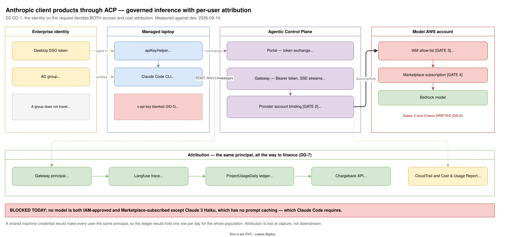
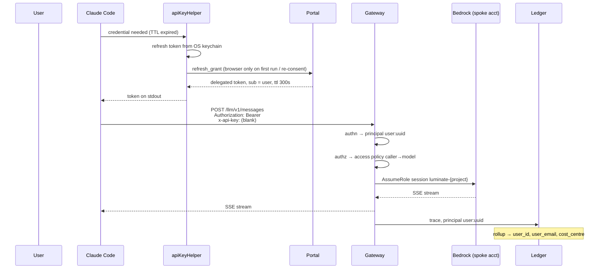

# Anthropic Client Product & ACP Integration — D2: Design

> **Gate**: D2 — Design | **Status**: Draft (tentative) | **Epic**: EACPP-1319
>
> This is a **tentative** design. It is grounded in a working spike against the dev
> install on 2026-09-14 — Claude Code was driven through the Luminate gateway and the
> failure modes below were reproduced, isolated and root-caused rather than inferred.
> Two decisions (DD-2, DD-6) are recommendations awaiting a governance owner.

## 1. Architecture overview



The shape is deliberately conventional. Everything novel is in **which identity travels
on the request**, because that single choice decides both access control and cost
attribution (D1 §3).

Read the diagram left to right: identity entitles the laptop, the laptop mints a per-user
token and calls the gateway, the gateway authorizes and signs into a model account, and
the same principal continues along the bottom band into the cost ledger. The four numbered
gates are the things that can refuse a call, and they live in two different estates.

> **Sample implementation.** A working reference for the client side is maintained at
> **[`EDAEACP/acp-claude-code-harness`](https://bitbucket.sunlifecorp.com/projects/EDAEACP/repos/acp-claude-code-harness/browse)**
> — preflight checks, the settings template, the token helper, and a header probe that
> records what the CLI actually sends. The findings in this D2 were produced with it. The
> repo carries **no environment specifics**; every account, host and credential is a
> variable, so it is safe to hand to a team that is onboarding.

### What was proven working

| | Evidence |
|---|---|
| Native Anthropic `/v1/messages` through the gateway | 200, well-formed Messages body |
| SSE streaming | 200, real incremental events |
| `apiKeyHelper` credential refresh | Helper re-run on TTL, verified |
| Luminate access policy enforcement | Correct 403 before the grant, pass after |
| Cross-account role assumption into the model account | Verified; session name `luminate-{project}` observed in the AWS denial |

### What is still blocked

**Nothing, for a working session.** Claude Code runs end to end against the governed
gateway and returns real model output. The entitlement problem was routed around rather
than solved: `DISABLE_PROMPT_CACHING=1` stops Claude Code sending the `cache_control`
blocks that a non-caching model rejects, so the one model that clears all four gates is
enough. Proved with a controlled pair — same token, same model, one variable: without
`cache_control` **200**, with it **403**.

A prompt-caching-capable model still needs the approval decision in the model AWS account
(D1 §5), but it is now an optimisation, not a blocker.

**What has not been demonstrated, as distinct from blocked:** every measured call carried a
**service-account** token, not the per-user token DD-1 prescribes. The attribution chain
was traced through code and schema rather than watched carrying a human identity (§11, gap
**G-15**).

**Where cost attribution actually lands — and the silent failure worth naming.** The trace
store receives each call as `userId = {entity_type}:{entity_id}` with a real cost figure,
which is the attribution this design depends on. But the portal's usage and cost tables
stay **empty**, because the rollup that feeds them reads a **ClickHouse** instance that is
not configured. The job runs every minute and no-ops. Its own warning names the danger:

> *"ClickHouse is not configured; leaving the table untouched. Every pass will no-op and the
> freshness heartbeat will not advance, so the dashboard reports usage **ageing** rather
> than an outage."*

So the cost dashboard degrades to *plausible and stale* rather than *visibly broken*. A
finance reviewer would see numbers, not an error. Gap **G-16**.

---

## 2. Key design decisions

### DD-1 — Claude Code presents a **per-user delegated token**, not a shared machine credential

**Decision.** The credential Claude Code presents identifies the human, not the fleet.

**Why.** The gateway derives `luminate_principal_id = {entity_type}:{entity_id}` from the
JWT `sub`, and that value is what reaches the cost ledger. A shared client-credentials
identity makes every user `service_principal:<one uuid>`. The ledger would then hold one
row per day for the entire population, and no downstream reporting can recover the
breakdown — the information was never captured.

**Rejected alternative — shared machine credential + a caller-supplied user header.**
Cheaper, and the gateway does forward attribution headers. Rejected because a
self-asserted header is not an authenticated claim: any user could send any other user's
id, which makes the resulting chargeback unusable as a financial record and actively
misleading in an audit.

> **Not yet exercised.** Every measured call in this document used a service-account
> `client_credentials` token — the shape this decision rejects. See §11 and gap **G-15**.

### DD-2 — The AD group is the **entitlement** gate, and nothing more *(recommendation — needs an owner)*

**Decision.** An AD group governs who may install the client and who may obtain a
credential. It does **not** carry attribution, and it does **not** drive per-call
authorization in the first wave.

**Why.** D0 proposes "authentication through an AD group". Three distinct concerns hide
in that phrase:

| Concern | Instrument |
|---|---|
| May this person have the tool at all? | **AD group** — correct, and it lives in the desktop/identity estate |
| Whose cost is this call? | The **token on the request** (DD-1) |
| May this caller use this model? | The **Luminate access policy** |

A group does not travel on a request, so it cannot attribute. And while Luminate *can*
consume a group as a policy source — `AccessPolicy.source_user_group` is genuinely read at
runtime by the reach calculation, quota matching and the rego — **nothing populates group
membership from an identity provider**. There is no SCIM endpoint, and the `idp_sync`
source value exists only as a guard that refuses manual edits to a group marked as synced.

Depending on an AD group for per-call authorization therefore means hand-mirroring
membership into Luminate. That drifts silently and becomes a stale-access finding at the
first access review. Gap **G-2**.

**Revisit when** IdP group sync lands upstream.

### DD-3 — Obtain the user token by **loopback PKCE**, with RFC 8693 exchange as a later optimisation

> **Reversed 2026-09-16.** This was originally decided the other way round — exchange
> primary, PKCE fallback. The original reasoning is kept below rather than overwritten,
> because what changed was not the analysis but two facts underneath it.

**Decision (as originally taken).** `apiKeyHelper` exchanges the user's existing desktop SSO token for a Luminate
delegated token. If issuer trust (DD-4) cannot be arranged in time, fall back to
authorization-code + PKCE over a loopback redirect.

**Why.** Token exchange adds no login prompt — the user is already signed in on a managed
laptop. Loopback PKCE works but costs an interactive browser login every refresh window,
which is hostile in a CLI that refreshes on a timer.

**Revision 2026-09-16 — the objection to PKCE is answerable, and the ordering flips.** The
"browser login every refresh window" cost assumed nothing is cached between runs. Holding
the **refresh** token in the OS keychain reduces the browser to a first-run and
re-consent event, and the CLI renews silently in between. That matters here because
gateway access tokens live **300 seconds** (C-1) — without caching the prompt returns every
five minutes and no interactive session survives it; with caching the refresh window stops
being the user's problem. Combined with DD-4 resolving by brokering rather than exchange,
loopback PKCE is now the **primary** path and RFC 8693 exchange the optimisation, which
reverses this decision's original preference.

**Rejected — RFC 8628 device flow.** The obvious CLI answer, and it **does not exist**:
repo-wide searches for `device_code`, `device_authorization` and `8628` all return zero.
Do not design against it.

```
apiKeyHelper
  └─ POST {portal}/api/v1/iam/auth/token
       grant_type = urn:ietf:params:oauth:grant-type:token-exchange
       subject_token = <desktop SSO token>
  └─ prints ONLY the access token, exit 0
```

The helper must print nothing but the token and must return fast — the CLI runs it on the
critical path of a request.

### DD-4 — Issuer trust must be resolved before DD-3 is buildable

**Decision.** Name the issuer the gateway will trust for delegated tokens, and confirm the
desktop SSO token can be exchanged onto it.

**Why.** The trusted issuer is a **single configured value** (dev: Keycloak). An
Okta- or Entra-signed token cannot be presented to the gateway directly. Token exchange
must therefore terminate at the trusted issuer, and that requires a federation decision
that is not ACP's alone. This is the critical path item for DD-3, and it is the one most
likely to slip past October 31.
**Resolved 2026-09-16 — by brokering, not by exchange.** Entra was federated *into* the
Keycloak `luminate` realm as identity provider `entra`. The human signs in at Microsoft;
Keycloak mints the token. The gateway's trusted issuer never changes, so the federation
decision that looked like the schedule risk turned out not to be needed: nothing outside
the realm had to move. This also makes the DD-3 *fallback* — loopback PKCE — the path of
least resistance, since it now terminates on the trusted issuer by construction.

The decision is settled; delivery is not. Three things still stand between this and a
human on the ledger, and they fail in this order: the Entra app registration does not
carry the broker redirect URI, so a login dies at `AADSTS50011` after authenticating
(G-18); no human has therefore completed the prompt (G-15); and the token that eventually
results will not attribute without a `luminate_sub` claim (G-17). Only the first is
outside ACP's control.
### DD-5 — Suppress the duplicate `x-api-key` header client-side; fix precedence upstream

**Decision.** Ship `ANTHROPIC_CUSTOM_HEADERS: "x-api-key: "` in the client configuration
now, and raise the precedence fix as a consortium contribution.

**Why.** With `apiKeyHelper` set, Claude Code sends the credential in **both**
`Authorization: Bearer` and `x-api-key`. The gateway takes its API-key path, fails to
verify a JWT as a platform key, and never falls back to the valid bearer token beside it.
Isolated with the token held constant:

| Request | Result |
|---|---|
| `Authorization` only | **200** |
| `Authorization` + `x-api-key` | **401** |
| `Authorization` + **empty** `x-api-key` | passes authentication |

An empty value is treated as absent, so blanking the header is sufficient and preserves
refresh. This is a workaround for a platform defect (**G-1**) and should not become the
permanent answer: every future client that sends both headers hits it, and the symptom —
a token that works in `curl` and 401s in the tool — is very expensive to diagnose.

### DD-6 — Reconcile the model allow-list with the subscription state *(recommendation — needs an owner)*

**Decision.** Treat "approved model" as one fact with two enforcement points that must be
changed together.

**Why.** Reaching a model requires four independent gates. Two live in ACP and two in the
model AWS account:

1. Luminate access policy (caller → model)
2. Provider account binding (which AWS account signs the call)
3. Spoke role IAM allow-list `InvokeApprovedBedrockModels`
4. Bedrock Marketplace subscription

Gates 3 and 4 are maintained separately and have drifted until their intersection is a
single legacy model:

| Model | IAM-approved | Invocable | Usable |
|---|---|---|---|
| `anthropic.claude-3-haiku-20240307-v1:0` | yes | yes | **yes** (no prompt caching) |
| `us.anthropic.claude-sonnet-4-6` | yes | not subscribed | no |
| `us.anthropic.claude-haiku-4-5-…` | yes | not subscribed | no |
| `us.anthropic.claude-3-sonnet-…` | yes | retired id | no |
| `us.anthropic.claude-sonnet-4-5-…` | **not allow-listed** | yes | no |

Either add a subscribed model to the allow-list, or subscribe a model already on it.
**Both are approval-boundary changes in the model account and neither was made here.**

### DD-7 — Attribution rides the existing ledger; build nothing new

**Decision.** No new attribution plumbing. Feed the existing chain a user identity.

**Why.** The chain already carries a user dimension end to end:

```
JWT sub → luminate_principal_id → Langfuse user_id → ClickHouse
        → ProjectUsageDaily.user_id + .user_email → chargeback ?user_ids=
```

`cost_centre` is snapshotted onto the row at rollup time, so a later cost-centre change
does not re-attribute historical spend. Non-admin callers are restricted to their own
usage, which is the right default for personal tooling.

The constraint to state plainly: the ledger aggregates by **calendar day** and has no
run/session dimension, so "what did this session cost" is not answerable from the
finance-facing surface (**G-6**).

### DD-8 — Per-project AWS account binding is available but **not upstream**

**Decision.** If cost is to land in a team's own AWS account rather than be recharged from
a central one, use the per-project provider account binding — and record that Sun Life is
depending on an unmerged upstream change.

**Why.** `OfferingAccountBinding` binds an (offering, project) pair to a role ARN, so a
project's Bedrock spend is signed into its own account. It is gated by an operator
allow-list (`PROVIDER_ACCOUNT_IDS`) — the operator decides which accounts Luminate may
sign into; an administrator only picks among them.

Two attribution artefacts fall out of it, verified live:

- **RoleSessionName** `luminate-{project}` — lands in CloudTrail on every call.
- An optional **STS session tag** `LuminateProject` — surfaces in the Cost & Usage Report
  as `resourceTags/user:LuminateProject`. It is **off** in dev
  (`GATEWAY_AWS_SESSION_TAGS=false`) and needs `sts:TagSession` in both the gateway policy
  and the target role's trust policy, or AWS rejects every request.

**The risk worth naming:** the deployed dev images run a commit that is **not on the
upstream main branch**. A capability Sun Life plans against must either be merged upstream
or be consciously carried as a fork. Gap **G-7**.

### DD-9 — Confine the first wave to Claude Code

**Decision.** Claude Code only, until the other products are evidenced against the
acceptance test in D1 §1.

**Scope, not mechanism.** The identity design in DD-1/DD-3 is **client-agnostic** — nothing
in it depends on Claude Code. `apiKeyHelper` is simply the Claude Code adapter over a
standard token endpoint, and any CLI that can shell out to a credential helper works the
same way. Two consequences for wave planning: codex and opencode should be cheap to add
once one client is proven, whereas a client that accepts **no** helper hook needs the
OAuth endpoints configured natively instead, which is a different integration. Confirm
which shape each product supports before committing it to a wave — that, not the auth
design, is what will differ between them.

**Why.** Claude Code is the only product demonstrated to accept both a custom base URL and
a credential *helper*. A product that takes only a static pasted key cannot carry a
rotating per-user token, which would force it back onto a shared credential and
re-introduce DD-1's failure. D0's four-product wave is a scope risk against October 31
(**G-9**).

---

## 3. Sequence: a governed, attributable call



### Failure flow — the four ways this returns 403/401

Reproduced in dev. Worth encoding in the runbook, because the response body is not
diagnostic in any of them.

| Symptom | Real cause | Distinguisher |
|---|---|---|
| `401 unauthorized`, same token works in `curl` | Duplicate `x-api-key` (DD-5) | Blank the header |
| `403 forbidden` | Access policy denial | Gateway log: `gateway authz denied ('policy_denied')` |
| `403 forbidden` | Upstream model refusal (prompt caching, IAM, subscription) | Gateway log: `(proxied backend)` |
| `503 upstream service error` | The gateway's **own** connection limiter | Log body: `"Too many connections"` |

The last one is a measurement hazard as much as an operational one: it arrives in bursts,
so probing variant A three times then variant B three times manufactures a false
conclusion about which variant works. Interleave.

---

## 4. Client configuration

```json
{
  "env": {
    "ANTHROPIC_BASE_URL": "<gateway>/llm",
    "ANTHROPIC_MODEL": "<catalogue model name>",
    "ANTHROPIC_SMALL_FAST_MODEL": "<catalogue model name>",
    "ANTHROPIC_CUSTOM_HEADERS": "x-api-key: ",
    "CLAUDE_CODE_API_KEY_HELPER_TTL_MS": "240000"
  },
  "apiKeyHelper": "<path to token helper>"
}
```

Notes that cost time if missed:

- The base URL includes the **LLM lane prefix**; the lane strips it and forwards the rest.
- `model` is the **catalogue** name, not the provider's model id. An unregistered name is
  denied and reads exactly like an auth failure.
- TTL must be **below** the 300 s token lifetime.
- Configure this in the client's own settings file, **not** the shell profile —
  `AWS_PROFILE`/`AWS_REGION` exported globally retarget every other tool on the machine.

Claude Code also uses a **second, background model** for summarisation and titles. Both
must be catalogue models the caller is entitled to, or background calls fail quietly while
foreground prompts appear healthy.

A runnable version of this configuration, with a preflight script that proves the backend
answers before a session starts, lives in
[`acp-claude-code-harness`](https://bitbucket.sunlifecorp.com/projects/EDAEACP/repos/acp-claude-code-harness/browse).

---

## 5. Extension surfaces — tools today, skills later

D0 puts MCP out of scope for the first wave. That remains right for *delivery*, but the
question of how these clients get tools is worth settling now, because the answer shapes
what a second wave can be and because one half of it already works.

Claude Code extends two ways, and they are governed very differently:

| | What it is | Where it runs | Control point |
|---|---|---|---|
| **MCP server** | a tool provider called over stdio or HTTP | a local process, or a remote endpoint | whoever owns the endpoint |
| **Plugin** | a bundle of skills, commands, agents, hooks and MCP servers | the laptop | whoever controls the marketplace index |

### DD-10 — Use the Luminate MCP registry for tools; it works today

**Decision.** Where a first-wave user needs a governed tool, register it as an MCP server in
the ACP catalogue and point the client at the gateway's MCP lane. Do not add stdio MCP
servers that reach tenant data.

**Measured.** The gateway exposes each registered MCP server on its own path, and the CLI
connects and enumerates tools through it. Default-deny is real: every request returned
`403 policy_denied` until the caller had an access policy for that server, then `200`.

**The limit that has to be stated: the unit of enforcement is the SERVER, not the tool.**
An MCP access policy requires a scope (`full_access`, `read_only`, `read_write`, `custom`),
and a policy set to `read_only` **still exposed every tool on the server**, including a
payout-estimating one. The access policy's scope never reaches the gateway's authorization
rego — every `scope_type` reference there belongs to the portal's RBAC role bindings, which
is a different field of the same name. `allowed_tool_ids` has no runtime consumer at all.

Consequence for design: if read and write tools must be separated, **split them across two
registered servers** and grant separately. Scope and tool allow-lists are inventory, not
control, and a design that leans on them is relying on something that does not run.

**Not yet solved: credential lifetime.** `claude mcp add --header` writes a *static* bearer
token, and gateway tokens are short-lived. There is no header-refresh hook equivalent to the
model lane's `apiKeyHelper`. The CLI's MCP client does support OAuth
(`--client-id`, `--client-secret`, `--callback-port`), which is the durable answer, but it
needs the gateway to advertise the OAuth metadata an MCP client discovers. Until then a
static header is a **test mechanism, not a deployment pattern** (**G-10**).

**A public read-only MCP server is the cheap first case.** Microsoft Learn publishes one at
`learn.microsoft.com/api/mcp` that needs no credential and serves three documentation-search
tools. It was connected and invoked successfully during the spike. It is worth naming
because it separates two questions that otherwise get answered together: *can the client use
MCP at all* (yes, trivially) versus *can it use MCP against governed data* (only through the
gateway, per this decision). Reaching public reference material is not the case that needs
the registry.

### DD-11 — Govern the plugin index before governing plugins

**Decision.** Treat a marketplace index as a higher-privilege artefact than the plugins it
lists, and do not adopt one until it is curated.

**Why.** A plugin *entry in the index* may declare `hooks`, `commands`, `agents`, `skills`,
`mcpServers`, `lspServers`, `monitors`, `settings` and `dependencies` inline. `monitors` are
documented as background watch scripts armed as persistent tasks, unsandboxed, at the same
trust tier as hooks. A top-level `allowCrossMarketplaceDependenciesOn` permits auto-install
from a *different* marketplace. Adding a marketplace is therefore a larger decision than
installing a plugin from one.

Two consequences:

- **Pin with `sha`, never `ref`.** Source entries accept both. A tag is not immutable — it
  can be deleted and re-pushed — and a marketplace added as `<repo>.git#main` resolves to the
  **branch tip, re-read every resolution**. No client pins or verifies an index.
- **The Sun Life marketplace is not yet a source.** `ENTARCH/marketplace-plugins` currently
  declares `"name": "sample-marketplace"` with 4 plugins — a demonstration index. There is
  no Sun Life standard for agent-plugin marketplaces at all (**G-11**), which is a gap to
  raise rather than a control to satisfy.

### DD-12 — An Agent Skills Registry is a backlog item, not a dependency

**Decision.** Record the Agent Skills Registry as a direction of travel. Do not place
anything in the first wave on it.

**Status, verified 2026-09-14.** Luminate has **zero skills implementation** — no skills
app, and no non-licence file in the backend, gateway, frontend or shared packages mentions
one. What exists is a **draft design**: `luminate-designs` PR #106 *"D1 — Skills Registry"*,
open, still draft, last updated **2026-07-14**, with a lockstep dependency on PR #105
*"D1 — API Resources"*, also open and still draft.

**What it would give, and what it would not.** The design's scope is **Luminate-governed
agents** — adoption pinned per agent, bundles served at load time, gateway default-deny. That
is a genuine skill-level enforcement path, and it reaches *further* than republishing an
index, because recall applies inside its own runtime. It is important not to caricature it as
"nobody can enforce on a skill".

But its runtime is the platform, **not a laptop**. Claude Code loads skills from the
workstation. So the Skills Registry as designed does not govern the first wave, and would not
even if it shipped tomorrow (**G-12**).

**The reconciliation that does work**, and the one to carry into any consortium ask:

> Govern the **plugin** — it is the unit of distribution and approval, and the only lever a
> laptop-side harness actually has. Inventory the **skill** — it is the unit of risk and
> evidence. Author a withdrawal against a component's SHA-256 and fan it out to every plugin
> version that contains it.

### DD-13 — Name the registry boundary before building one

**Decision.** Do not stand up a Sun Life skills or plugin registry inside ACP without first
settling the boundary with Nova.

**Why.** Nova (Backstage) already has an approved catalogue entity model with component types
`agent`, `ai-skills` and `plugin` — so a registry for exactly these artefacts partly exists,
owned elsewhere. Three things make this a decision rather than a lookup:

1. **All three types require `sunlife.com/apm-number`.** ACP-originated entities do not have
   one, so publishing into Nova is not simply a matter of emitting YAML.
2. **Nova carries two parallel models.** The approved model and the shipped AI Catalog
   filter on different namespaces and singular-vs-plural type names; emitting against the
   wrong one **validates and then does not appear**.
3. **`marketplace.json` is not part of Nova today.** Plugin discovery there is a future ask,
   not a surface to integrate with.

Nova also runs its own agent gateway, which overlaps ACP's remit and needs a written boundary
independently of this spec. That work belongs to
[`nova-acp-integration`](../../integration/nova-acp-integration/d0-discovery.md) (EACPP-895), not here —
this spec's job is to record the dependency, not resolve it (**G-13**).

---

## 6. Security considerations

| Concern | Position |
|---|---|
| Credential on the workstation | Short-lived (300 s) delegated token, minted on demand, never written to a config file |
| Helper output | Token only, on stdout; never logged |
| Self-asserted identity | Rejected (DD-1) — attribution must come from an authenticated claim |
| Blanked `x-api-key` | Does not weaken authentication; the gateway still requires a valid bearer token. It suppresses a *competing* credential header |
| Model reachability | Deliberately double-gated in the AWS account (IAM allow-list + subscription). DD-6 reconciles them; it must not dissolve them |
| PII | D0 scopes the wave to non-PII content. Nothing in this design enforces that — it is a usage policy, and the platform will not detect a violation |
| Data residency | Models resolve to `us.`-prefixed cross-region inference profiles. **Inference may execute outside Canada.** Not addressed in D0; must be confirmed against the LVT 4 control interpretation |
| Local (stdio) MCP servers | A stdio server is a process the CLI launches **with your ambient credentials** — a cloud or DevOps MCP server acts as *you* against real resources. Treat adding one as running software, not configuring a tool (DD-10) |

The last row is a genuine open risk, not a technicality: the catalogue advertises
`us.`-prefixed profiles configured with a `ca-central-1` region, and a cross-region
inference profile may serve the request from a US region.

---

## 7. Observability

- **Per-call**: Langfuse trace carrying principal, model, tokens, cost, latency.
- **Per-day**: `ProjectUsageDaily` — user, project, cost centre, model, tokens, cost.
- **In AWS**: CloudTrail `RoleSessionName = luminate-{project}`; optionally a
  `LuminateProject` cost-allocation tag (DD-8).
- **Gaps**: no run/session dimension on the finance surface (G-6); the gateway's sanitised
  errors mean triage needs gateway log access (runbook item).

---

## 8. Rollout and rollback

| Phase | Gate to pass |
|---|---|
| 0 — Unblock models | DD-6 reconciliation; prove a prompt-caching model end to end |
| 1 — Identity | DD-4 issuer decision; DD-3 helper; first attributable call in the ledger |
| 2 — Pilot | Small named group; measure concurrency against C-5 |
| 3 — Entitlement | AD group wired to credential issuance (DD-2) |
| 4 — Attribution review | Finance confirms the chargeback view answers the question |

**Rollback** is per-user and immediate: revoke the delegated credential or the access
policy. Because the credential is short-lived, revocation takes effect within the token
lifetime without touching the workstation.

---

## 9. Requirement traceability

| Requirement | Decision |
|---|---|
| FR-1, FR-2 | DD-9 |
| FR-3, NFR-1 | DD-5, §4 |
| FR-4 | DD-5 (upstream fix) |
| FR-5 | DD-1 |
| FR-6 | DD-2 |
| FR-7 | DD-2, G-3 |
| FR-8, FR-9, NFR-2 | DD-7 |
| FR-10, FR-11, FR-12 | DD-6 |
| FR-13, FR-14 | DD-10, DD-11 |
| FR-15 | DD-12, DD-13 |
| C-4 | DD-4 |

## 10. Open items before D3

- [ ] **DD-6 owner** — who reconciles the IAM allow-list with the subscription state
- [ ] **DD-4 decision** — trusted issuer for delegated tokens
- [ ] **The interim posture is not designed.** D0 states the immediate path remains Bedrock
      direct, and that is what runs today. This document describes the *target* and the
      blockers, and says nothing about how the October 31 date is met if the gateway path is
      still blocked — including whether an interim Bedrock-direct rollout is acceptable and,
      if so, what attribution it can and cannot provide. **It provides none of the per-user
      attribution in DD-1/DD-7**, because the identity on the call is an AWS role. Needs a
      decision, not a default.
- [ ] **G-3** — user provisioning path into Luminate
- [ ] **G-7** — is the per-project account binding being merged upstream, or carried as a fork?
- [ ] **G-10** — OAuth metadata on the MCP lane, so a tool credential can refresh
- [ ] **G-13** — registry boundary with Nova, owned by `nova-acp-integration`
- [ ] Data residency under LVT 4 (§6)
- [ ] Concurrency test against the connection limiter (C-5)
- [ ] Evidence Cowork / Chat / Office add-ins, or descope them

---

## 11. How these results were produced

The measured claims in this document came from driving the real clients against the **dev**
install on 2026-09-14. Recording the environment changes matters for two reasons: the
results are not reproducible without them, and someone else looking at the dev catalogue
will otherwise find rows with no explanation.

**What identity the measured calls carried — and why it is not the one this design
prescribes.** Every call was authenticated with a Keycloak **`client_credentials`**
token: a service-account credential. That is precisely the shape **DD-1 rejects**. The
per-user delegated token, and the loopback PKCE login that DD-3 now selects to obtain it, were
**not exercised** — they were established by reading the gateway, the ledger schema and
the chargeback query, not by driving a human login through Claude Code.

So the results split cleanly, and should be read that way:

| Claim | Basis |
|---|---|
| Transport, streaming, the `x-api-key` collision, the four gates, MCP enforcement | **Measured** end to end |
| `luminate_principal_id` → Langfuse → `ProjectUsageDaily` → chargeback | **Traced through code and schema**, with a service-account principal |
| A *human* identity arriving on a Claude Code call and landing in the ledger | **Not demonstrated** — gap **G-15** |

The distinction is not academic. Under a service-account token the ledger collapses to
`service_principal:<one uuid>`, which is the exact failure DD-1 exists to prevent. The
chain was watched carrying the wrong kind of principal; it has not yet been watched
carrying the right one. Until it has, DD-1 and DD-7 are a sound design, not a proven one.

**Addendum — 2026-09-16, the desktop identity path.** Two things changed after the
original measurement, both in the dev Keycloak `luminate` realm and both captured as code
in `luminate-sunlife-deploy` (`helm/keycloak/bootstrap/bootstrap_desktop_sso.py`), not as
console state:

| Change | Status |
|---|---|
| Entra federated as identity provider `entra` (`trustEmail`, `syncMode=FORCE`, claim mappers for email / given name / family name) | Applied, idempotent |
| Public client `luminate-desktop` — PKCE S256, direct-access grants off, loopback redirects registered per RFC 8252 §7.3 | Applied |
| Realm client profile + policy enforcing PKCE on public clients | Applied — **realm-wide**, affects all 5 public clients; verified non-breaking (`admin-cli` uses the password grant, which PKCE does not gate) |

**What was measured, and what still was not.** The redirect matrix was measured directly
against the realm: a registered loopback literal with an exact path and **no port** accepts
any ephemeral port and both IP literals, while rejecting an unregistered path — whereas
`http://127.0.0.1:*` is treated as a trailing wildcard and accepts *any* path, which is why
it is not used.

**A correction worth recording, because the same mistake is easy to repeat.** The brokered
chain was followed hop by hop to the Microsoft sign-in page, which returned HTTP 200 with
no `AADSTS` error, and that was written up as confirming the broker redirect URI was
registered on the Entra app. **It confirmed no such thing.** Entra renders the sign-in page
on the strength of the `client_id` alone and validates `redirect_uri` only *after* the user
authenticates. A real login attempt then failed with **`AADSTS50011`**. An unauthenticated
probe cannot reach the check it was being used to assert — the only evidence that a
redirect URI is registered is reading the app registration or completing a login.

Reading the registration afterwards settled it: `OIDC-LuminatePortal-DEV` carries exactly
one redirect URI, the portal's Django callback. The broker endpoint is absent (G-18).

So the split in the table above still holds, and the identity path is **built but not
reachable end to end**: it is blocked at the identity provider, one hop before the human.

**Added to the dev ACP catalogue** (all additive, all reversible):

| Change | Why |
|---|---|
| Access policies for the test workload → four Claude models | to move past GATE 1 and find the next gate |
| Default provider account bindings on those offerings | the newer models had **none**, so calls fell back to a pod profile with no Bedrock permission at all |
| A `Claude Sonnet 4.5` catalogue entry (model, offering, deployment, binding) | the advertised models are not invocable; this named one the account is subscribed to |
| An MCP access policy → one registered MCP server, `read_only` | to test the MCP lane, and to discover that the scope is not enforced |

**Nothing was changed in the model AWS account.** Both remaining remedies — adding a model
to the IAM allow-list, or subscribing the account to one already on it — are approval
boundaries and are left for their owner (DD-6).

The client-side configuration, preflight checks and probes are in
[`acp-claude-code-harness`](https://bitbucket.sunlifecorp.com/projects/EDAEACP/repos/acp-claude-code-harness/browse),
which carries no environment specifics.

## References

- [D0 — Discovery](d0-discovery.md)
- [D1 — Requirements](d1-requirements.md)
- **Sample implementation**: [`EDAEACP/acp-claude-code-harness`](https://bitbucket.sunlifecorp.com/projects/EDAEACP/repos/acp-claude-code-harness/browse)
  — client configuration, preflight and token helper, plus the header probe used to produce
  the DD-5 finding
- [ACP Capability Map](../../../capability-map.md)
- [Capability Gap Escalation](../../../process/capability-gap-escalation.md)
