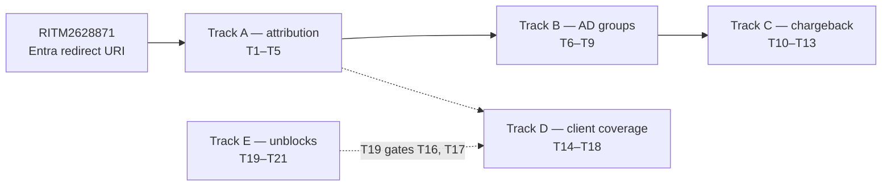

# Anthropic Client Product & ACP Integration — D3: Implementation Plan

> **Gate**: D3 — Tasks | **Status**: Draft | **Epic**: [EACPP-1319](https://sunlife.atlassian.net/browse/EACPP-1319)
> **Reads on**: [D0](d0-discovery.md) · [D1](d1-requirements.md) · [D2](d2-design.md)
>
> **Design approved at the review on 2026-09-17** (Justin Collery, Lalit Summan, Pavithra
> Viswanathan, Ranjula Rowel, Robert Chin, Seth Chalmers). Claude Code is working end to end
> through the gateway and the brokered-SSO method was accepted for the wider client wave.
> Everything below is execution rather than proposal.

## Reference material

| Document | Where |
|---|---|
| D0 Discovery | [Confluence 113249058863](https://sunlife.atlassian.net/wiki/spaces/T1KACP/pages/113249058863) |
| D1 Requirements — constraints C-1…C-8, gaps G-1…G-18 | [Confluence 113249222675](https://sunlife.atlassian.net/wiki/spaces/T1KACP/pages/113249222675) |
| D2 Design — decisions DD-1…DD-13 | [Confluence 113249255430](https://sunlife.atlassian.net/wiki/spaces/T1KACP/pages/113249255430) |
| Design review transcript, 2026-09-17 | [`references/anthropic-client-acp-design-review-2026-09-17.txt`](references/anthropic-client-acp-design-review-2026-09-17.txt) |
| Discovery session transcript | [`references/anthropic-client-acp-discovery-session.txt`](references/anthropic-client-acp-discovery-session.txt) |
| Client harness (config, preflight, failure modes) | `acp-claude-code-harness` |
| Keycloak desktop-SSO bootstrap | `luminate-sunlife-deploy` `helm/keycloak/bootstrap/bootstrap_desktop_sso.py` |

## Sequencing

**T1 is the gate for Track A, and RITM2628871 is the gate for T1.** Nothing about per-user
attribution can be demonstrated until a human completes a brokered login, and no human can
complete one until the broker redirect URI is registered on the Entra app (G-18).

**Track B gates Track C.** Cost reporting is an AD-group question before it is a cost
question — spend per user is only actionable once it rolls up to a manager.

---

## Track A — User attribution

The point of the exercise. If traffic flows but is not attributable, the gateway has added
latency and nothing else.

| Task | Description | Depends |
|------|-------------|---------|
| **T1** [EACPP-1352](https://sunlife.atlassian.net/browse/EACPP-1352) | **Complete the brokered human login once RITM2628871 lands.** Run the loopback-PKCE login through Entra → Keycloak and capture the resulting claims. Today it fails at **`AADSTS50011`** *after* the user authenticates, because `OIDC-LuminatePortal-DEV` carries only the portal's Django callback. Closes **G-18**. | RITM2628871 |
| **T2** [EACPP-1353](https://sunlife.atlassian.net/browse/EACPP-1353) | **Emit `luminate_sub` so a human token resolves to a portal user.** The gateway admits any token carrying `email`/`oid`/`preferred_username` as a user, then keys attribution off a *separate* `luminate_sub` claim holding the portal `User.id`. Without it the gateway falls back to the IdP subject, matches no portal user, logs chargeback as **"degraded"**, and serves the request anyway. T1 first, because the mapper has to be wired to whatever Entra actually returns. Closes **G-17**. | T1 |
| **T3** [EACPP-1354](https://sunlife.atlassian.net/browse/EACPP-1354) | **Prove per-user attribution end to end, through to the chargeback rows.** Follow one call from the trace store through the usage rollup into the chargeback rows, attributed to the named human. Includes checking the **rendered dashboard**, not just the rollup job's counters — the job reporting `rows=10` is not the same as a manager seeing a number. Closes **G-15**, clears the **G-16** residual. | T2 |
| **T4** [EACPP-1355](https://sunlife.atlassian.net/browse/EACPP-1355) | **Two-user attribution test with a second named person.** One identity cannot demonstrate attribution — it only proves the single caller was named. Justin Collery volunteered at the review; add him to the AD group and run both. | T3 |
| **T5** [EACPP-1356](https://sunlife.atlassian.net/browse/EACPP-1356) | **Define the user-provisioning path into Luminate `User` rows.** Confirmed in source: there is **no just-in-time user creation** anywhere on the request path, so the row must pre-exist or authorization returns `403`. Define how first-wave users get provisioned, and who runs it. Closes **G-3**. | — |

---

## Track B — AD groups: entitlement, cost dimension, residency

One mechanism, three consumers. Worth building once, deliberately.

| Task | Description | Depends |
|------|-------------|---------|
| **T6** [EACPP-1357](https://sunlife.atlassian.net/browse/EACPP-1357) | **Agree the AD group model and name its owner.** The group is the **entitlement** gate — who may use the client products at all. DD-2 is a recommendation with no owner. Decide granularity, joiner/leaver process, and owner. | — |
| **T7** [EACPP-1358](https://sunlife.atlassian.net/browse/EACPP-1358) | **Emit AD group membership as a token claim.** Add a group-claim mapper on the `entra` identity provider. Prerequisite for **both** T8 and T9. Realm groups are currently empty and the IdP maps only email, given name and family name, so neither has source data today. | T6 |
| **T8** [EACPP-1359](https://sunlife.atlassian.net/browse/EACPP-1359) | **Map user → AD group → manager for cost reporting.** What turns per-user spend into something a manager can act on. GitHub Copilot does this today off its cost API, mapped to AD groups to find the manager — but that process is manual and being retired, so design for the replacement rather than copying it. | T7, T3 |
| **T9** [EACPP-1360](https://sunlife.atlassian.net/browse/EACPP-1360) | **Route to a regional gateway by AD group so Canadian data stays in Canada.** Canadian users reach a Canadian gateway; everyone else the US one. **Routing must be decided before the call leaves the client** — a US gateway redirecting a Canadian user back to Canada has already moved the data, which is the failure Justin named explicitly. Shape: **one portal, multiple regional gateways** (EA alignment, per Lalit), with the region selected in harness configuration from the group claim. | T7 |

---

## Track C — Chargeback

Attribution happens in Luminate. **The mechanism of chargeback is what is missing** — and it
is an ownership question before it is a technical one.

| Task | Description | Depends |
|------|-------------|---------|
| **T10** [EACPP-1361](https://sunlife.atlassian.net/browse/EACPP-1361) | **Name the financial owner per product.** Rob Grant owns GitHub Copilot chargeback and is the likely owner for Claude Code; Cowork sits with the desktop / CTO organisation. ACP supplies telemetry and does not own recovery. Different products may land with different owners, and that is fine — what is not fine is no owner. | — |
| **T11** [EACPP-1362](https://sunlife.atlassian.net/browse/EACPP-1362) | **Define the telemetry handoff contract ACP publishes.** Fields, grain, cadence, delivery. Should serve both end-user clients *and* agents — Justin's point that GRS agents running through ACP need the same chargeback pattern, so designing it for humans only would mean building it twice. | T10, T3 |
| **T12** [EACPP-1363](https://sunlife.atlassian.net/browse/EACPP-1363) | **Manager and AVP usage report — notional daily, actuals monthly.** Managers need to see big spenders *and* under-users day to day; notional spend is sufficient for that. Actuals arrive at month end once AWS applies tax and the enterprise discount. Two numbers, two purposes — do not conflate them, and do not promise the monthly one daily. | T8, T11 |
| **T13** [EACPP-1364](https://sunlife.atlassian.net/browse/EACPP-1364) | **Align with the dev-tools chargeback rebuild rather than building a third system.** Dev tools, ACP and other groups each risk building separate end-user LLM chargeback. Agree one target and whether ACP feeds it. Raised by Robert Chin and unresolved at the review. | T10 |

---

## Track D — Client coverage beyond Claude Code

The identity design is **client-agnostic** — nothing in it depends on Claude Code. What
differs between products is the hook, not the auth.

| Task | Description | Depends |
|------|-------------|---------|
| **T14** [EACPP-1365](https://sunlife.atlassian.net/browse/EACPP-1365) | **Windows portability of the login helper.** Built and proven on macOS. Windows needs PowerShell or a native binary. A native CLI is more portable and has no runtime prerequisites, but becomes a patching commitment — decide on that trade, then prove it. | T1 |
| **T15** [EACPP-1366](https://sunlife.atlassian.net/browse/EACPP-1366) | **Cache the refresh token in the OS keychain.** Access tokens live **300 s** (C-1), so uncached the browser prompt returns every five minutes and no interactive session survives it. Caching reduces the browser to first-run and re-consent. This is what makes loopback PKCE viable as the primary path (DD-3, as revised). | T1 |
| **T16** [EACPP-1367](https://sunlife.atlassian.net/browse/EACPP-1367) | **Claude Cowork and Claude Chat desktop clients.** The same brokered-SSO method is expected to work. Cannot be tested until claude.ai is reachable. | T19, T15 |
| **T17** [EACPP-1368](https://sunlife.atlassian.net/browse/EACPP-1368) | **Microsoft Office add-ins.** Least certain surface. Add-ins can be set to use SSO, but they are not enabled on regular accounts — needs a test account, plus URL unblocks to download the add-in. | T19 |
| **T18** [EACPP-1369](https://sunlife.atlassian.net/browse/EACPP-1369) | **codex, opencode and Gemini CLI.** Clients with a credential-helper hook should be cheap once one is proven. A client with **no** helper hook needs OAuth endpoints configured natively — a different integration to size. Confirm which shape each supports **before** committing it to a wave. Narrows **G-9**. | T15 |

---

## Track E — Platform and unblocks

| Task | Description | Depends |
|------|-------------|---------|
| **T19** [EACPP-1370](https://sunlife.atlassian.net/browse/EACPP-1370) | **Unblock claude.ai (ISRA → ATG).** Currently blocked, which prevents testing the desktop and add-in surfaces. The unblock likely follows the ATG, which follows the ISRA. Owned by Justin Collery. | — |
| **T20** [EACPP-1371](https://sunlife.atlassian.net/browse/EACPP-1371) | **Bedrock capacity — account limits and token scaling.** Traffic will eventually hit AWS account limits. Mitigations: quota increases once consistently hitting them, AWS token-scaling guidance, and spreading traffic across accounts. Plan before rollout, not at the limit. | — |
| **T21** [EACPP-1372](https://sunlife.atlassian.net/browse/EACPP-1372) | **Update the architecture diagram.** The model-approval caveat at the bottom is out of date — every model available in the account now works with Claude Code. Remove it and re-sync Confluence. | — |

---

## Exit criteria

| # | Criterion |
|---|---|
| 1 | A real human completes a brokered login and the gateway serves the call |
| 2 | The call is attributed to **that named person**, not to a service principal or the IdP subject |
| 3 | Two different users are **distinguishable** in the ledger |
| 4 | Spend reaches the chargeback rows and is visible on the **rendered** dashboard, not only in the rollup job's counters |
| 5 | AD group membership arrives as a claim and drives both manager rollup and region selection |
| 6 | A Canadian user's traffic reaches a Canadian gateway **without** transiting the US |
| 7 | A named financial owner exists per product, and the telemetry contract they will consume is agreed |
| 8 | A manager can see big spenders and under-users without a manual process |
| 9 | The login helper works on Windows as well as macOS, and survives a session longer than the 300 s token |

## Known traps

| Symptom | Cause | Action |
|---|---|---|
| Login reaches the Microsoft page cleanly, then fails after sign-in | `redirect_uri` is validated **after** authentication — a clean pre-login page proves only that the `client_id` is recognised | Read the app registration, or complete a real login. An unauthenticated probe cannot reach this check |
| Call succeeds but no cost appears against the user | No `luminate_sub` claim — gateway falls back to the IdP subject and matches no portal user | T2. The warning is in the gateway log, not the response |
| Dashboard shows plausible but stale spend | The rollup fails **open** — it reports usage as ageing rather than as an outage | Check the worker log, not the dashboard |
| `403` after a successful login | No Luminate `User` row, or no access policy for that user | T5, then the access policy |
| `401` at the gateway | Audience mismatch — but note `GATEWAY_JWT_AUDIENCE` is unset in dev, so a working dev call is **no evidence** the mapper is right | Set the mapper anyway; it breaks on the first environment that enforces it |

## Definition of Done

- A named human's Claude Code session is governed, attributed and costed, end to end.
- AD group membership drives entitlement, manager rollup and region routing from one claim.
- Chargeback has an owner, a contract and a report — not just data.
- The client wave beyond Claude Code has a proven pattern and a sized list, not an assumption.

## Out of scope

Production deployment · enforcement of budgets and quotas · MCP and A2A lanes for these
clients · the enterprise-plan reporting Anthropic offers natively · retiring the existing
GitHub Copilot chargeback process (T13 aligns with it; it does not own it).
