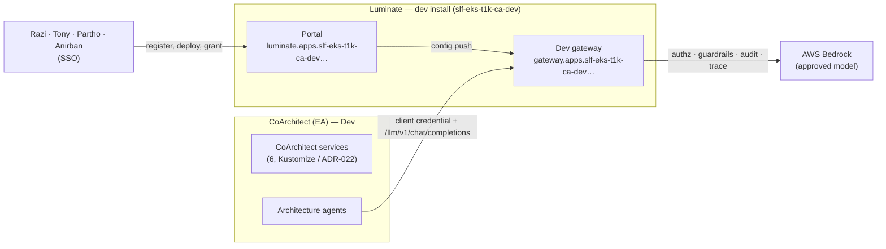
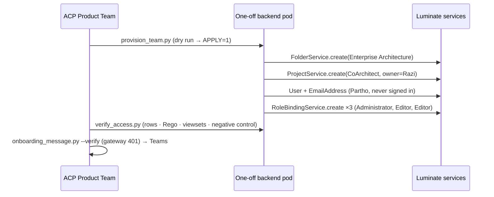
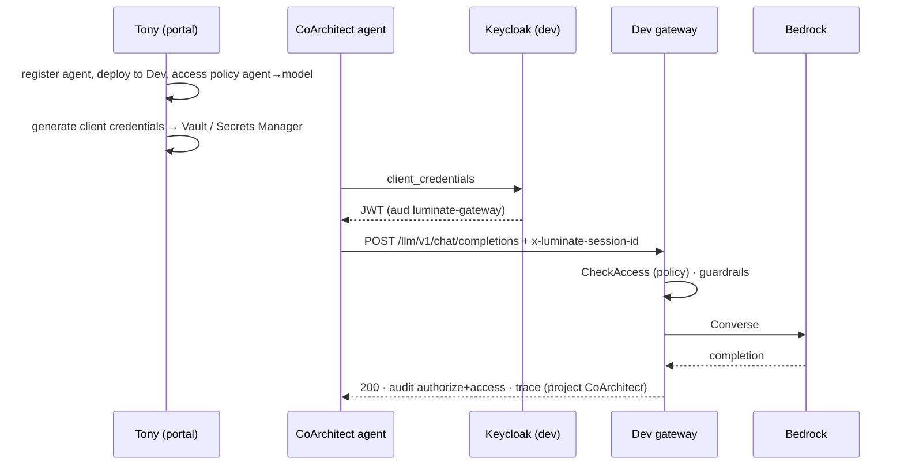

# CoArchitect Onboarding — D2: Design

> **Gate**: D2 — Design | **Status**: Draft | **Epic**: see `spec.yaml`
>
> Implements [D1 Requirements](d1-requirements.md). Dev Luminate install only.

## Architecture Overview

Tenancy (provisioned 2026-10-01):

| Object | Name | Id |
|---|---|---|
| Folder | Enterprise Architecture | `01a0f8ad-e571-7195-ba8f-06e51fa8234a` |
| Project | CoArchitect | `01a0f8ad-e57e-75d2-9a89-f9e3a04745a3` |
| Owner | razi.chaudhry@sunlife.com | via `ProjectService.create(owner=)` |
| Administrator | tony.xu@sunlife.com | RoleBinding `01a0f8ad-e91d-7733-864c-6aa86ea46880` |
| Editor | partho.mondal@sunlife.com (pre-provisioned) | RoleBinding `01a0f8ad-ea4f-7428-931c-3c72689bc7d8` |
| Editor | a.ukil@sunlife.com | RoleBinding `01a0f8ad-eb83-749b-a35c-3dae78b38ac9` |

The request that produced it is kept at
[`references/luminate-dev-request.json`](references/luminate-dev-request.json) — re-running it is
idempotent and reports `EXISTS`.

## Key Design Decisions

| # | Decision | Alternatives | Why |
|---|---|---|---|
| DD-1 | **Dev install only** for this round | Prod install's gw-dev | Requested scope. Every other tenant started on dev; the prod install is the next decision (T13). |
| DD-2 | Project named after the **product** (`CoArchitect`), folder after the **business area** | Project per agent | A project is the unit a team owns and costs roll up to; a second agent must not need a second project. |
| DD-3 | Tony = **Administrator** at project scope, not the four per-type Administrators | Agent+Model+MCP+Application Administrator | Per-type Administrators cannot create access policies — no "all development work" without the Owner. Administrator at project scope also permits approving his own access policies and transferring ownership; accepted for dev, **revisit before production**. |
| DD-4 | Partho and Anirban = **Editor** | Viewer; per-type Administrators | "Members" who build. Delete, credentials, policy and IAM stay with Owner/Administrator. |
| DD-5 | Individual bindings, no group | `CoArchitect builders` group | Owner cannot manage group membership; a group returns every joiner to ACP. |
| DD-6 | Workload authenticates to the gateway with a **Luminate-issued client credential** per deployment | Reuse CoArchitect's Okta M2M | The gateway trusts the install's own issuer (Keycloak on dev). Okta M2M stays inside CoArchitect, between its own services. Two credentials, two purposes. |

## Sequence Diagrams

### Flow 1: Tenancy (done)

### Flow 2: First governed call (T9–T12)

## Error Handling Strategy

| Symptom | Meaning | Action |
|---|---|---|
| Empty catalogue for a member | Missing binding | Re-run `verify_access.py` |
| 401 from the gateway | No / bad credential | Expected without a token |
| 403 `policy_denied` | No access policy agent→model | T10 |
| 404 `model_not_found` | Allowed but not deployed on this gateway | Deploy the model to Dev |
| 503 on generate-credentials | Resource description > 255 chars (Keycloak column) | Trim the description |

## Security Considerations

- **Grants verified, not assumed.** Rego decisions on 2026-10-01: Owner and Administrator ALLOW on
  create/credential/policy/IAM; Editors ALLOW on create, deny on delete/credential/policy/IAM;
  negative control (an unrelated tenant owner) deny on every write.
- Every write went through the services, so each emitted an `rbac_binding_mutation` audit event
  with Seth Chalmers as actor.
- Org-wide **read** comes from the dev baseline Viewer, not from this onboarding. It is a dev
  stopgap and must not be assumed on the production install.
- DD-3's self-approval exposure is the one deliberate widening; it is recorded for T13.

## Testing Strategy

- Tenancy: `verify_access.py` with an extended permission set (create, credentials, access policy,
  delete, IAM) and a negative control.
- Handover: `onboarding_message.py --verify` — 401 on `/llm/v1/chat/completions` and `/a2a/probe`.
- First call: one governed round trip with the audit pair and a trace (T12).

## Observability

Usage and cost land in the project chargeback ledger once `cost_centre` is set (T6) and a call has
flowed. Session correlation needs the caller to send `x-luminate-session-id`.

## Migration/Rollback Plan

- Bindings: delete the three RoleBindings above through `RoleBindingService`.
- Project/folder: empty until T9; delete via the portal while nothing is registered. After a
  deployment exists, the project cannot be emptied — another reason registration waits for T5.
- Partho's pre-created user is harmless if he never signs in; delete only if he is not joining.

## Requirement Traceability

| Requirement | Design element |
|---|---|
| FR-1, FR-2 | Tenancy table, DD-2..DD-5 |
| FR-3, FR-4 | Flow 1 |
| FR-5 | Flow 1, last step |
| FR-6, US-4 | Flow 2, DD-6 |
