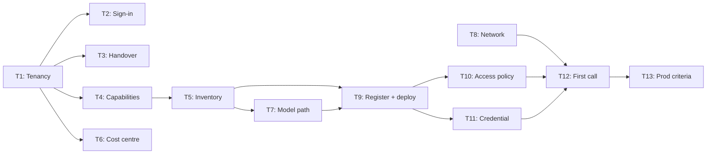

# CoArchitect Onboarding — D3: Implementation Plan

> **Gate**: D3 — Tasks | **Status**: Draft | **Epic**: [EACPP-1427](https://sunlife.atlassian.net/browse/EACPP-1427)
>
> Implements [D2 Design](d2-design.md). **Dev Luminate install only.**
> T1 follows the [Onboard a team to the Luminate portal](../../../process/portal-onboarding-ticket.md)
> ticket template; reuse it for the next team.

## Task Summary

| # | Task | Type | Points | Sprint | Depends On | Jira |
|---|------|------|--------|--------|------------|------|
| **T1** | Onboard the CoArchitect project team to the Luminate dev portal. Create folder Enterprise Architecture and project CoArchitect with Razi Chaudhry as Owner, grant Tony Xu Administrator and Partho Mondal and Anirban Ukil Editor on the project, pre-provision anyone who has never signed in, and prove the access at row, decision and viewset level with a negative control | Story | 1 | S1 | — | [EACPP-1428](https://sunlife.atlassian.net/browse/EACPP-1428) |
| **T2** | Confirm every member can sign in and sees the CoArchitect project. Partho Mondal was pre-provisioned and has never signed in; after his first SSO login re-run the verification and confirm no duplicate account was created | Task | 1 | S1 | T1 | [EACPP-1429](https://sunlife.atlassian.net/browse/EACPP-1429) |
| **T3** | Hand over the onboarding message and walk the team through the portal. Send the rendered message, then a short session covering the project, IAM role bindings, registration and the Deployments tab, and who does what | Task | 1 | S1 | T1 | [EACPP-1430](https://sunlife.atlassian.net/browse/EACPP-1430) |
| **T4** | Walk the D0 capability table with the team and record the outcome. Confirm, re-prioritise or decline each selected capability against its CAP id with Razi and Tony, and record the mandatory-baseline acknowledgement including CAP-12 modelled-not-enforced | Story | 2 | S1 | T1 | [EACPP-1431](https://sunlife.atlassian.net/browse/EACPP-1431) |
| **T5** | Inventory the CoArchitect AI assets to be registered. For each of the six services record whether it is an agent, an application, an MCP server or only a model consumer, with owner, environment and data classification | Story | 2 | S1 | T4 | [EACPP-1432](https://sunlife.atlassian.net/browse/EACPP-1432) |
| **T6** | Set the CoArchitect project cost centre and business attributes. Without a cost centre the chargeback ledger cannot attribute usage to Enterprise Architecture from the first call | Task | 1 | S1 | T1 | [EACPP-1433](https://sunlife.atlassian.net/browse/EACPP-1433) |
| **T7** | Decide the model access path for CoArchitect. Consume an approved platform-registered Bedrock model or bind CoArchitect's own account through an offering account binding, and settle the context-window question raised in DAL2-146 against the model's registered limits | Spike | 2 | S1 | T5 | [EACPP-1434](https://sunlife.atlassian.net/browse/EACPP-1434) |
| **T8** | Prove network reachability from the CoArchitect runtime to the Dev gateway. From the cluster and namespace CoArchitect runs in, show DNS, TCP, verified TLS and a 401 from the gateway host, and record which side of the proxy no_proxy split it falls on | Spike | 1 | S1 | — | [EACPP-1435](https://sunlife.atlassian.net/browse/EACPP-1435) |
| **T9** | Register the first CoArchitect agent and deploy it to the Dev gateway. Register the Architecture Agent in the CoArchitect project with its attributes and deploy it to the Dev environment with an agreed endpoint name | Story | 2 | S2 | T5, T7 | [EACPP-1436](https://sunlife.atlassian.net/browse/EACPP-1436) |
| **T10** | Author the access policy from the agent to its model. One policy, source the CoArchitect agent, target the model chosen in T7, created by the project Administrator | Story | 1 | S2 | T9 | [EACPP-1437](https://sunlife.atlassian.net/browse/EACPP-1437) |
| **T11** | Issue the workload credential and store it outside source control. Generate client credentials on the Dev deployment (Owner or Administrator only) and store them in Vault or Secrets Manager, never in a literal env file | Story | 1 | S2 | T9 | [EACPP-1438](https://sunlife.atlassian.net/browse/EACPP-1438) |
| **T12** | Prove the first governed round trip from CoArchitect dev. One call through the Dev gateway that returns 200, shows the authorize and access audit pair, carries x-luminate-session-id, and appears as usage attributed to the CoArchitect project | Story | 2 | S2 | T8, T10, T11 | [EACPP-1439](https://sunlife.atlassian.net/browse/EACPP-1439) |
| **T13** | Agree the criteria and sequence for production onboarding. Record what moves CoArchitect to the production install and its environment gateways, who approves it, and whether Tony's project Administrator grant is narrowed first | Task | 1 | S2 | T12 | [EACPP-1440](https://sunlife.atlassian.net/browse/EACPP-1440) |

**Total**: 13 tasks, 18 points across two sprints.

## Status

| Task | State | Evidence |
|------|-------|----------|
| T1 | **Done 2026-10-01** | Tenancy ids in [D2](d2-design.md#architecture-overview). Rego: Owner/Administrator ALLOW on create, credentials, access policy and IAM; Editors ALLOW on create, deny on delete/credentials/policy/IAM; negative control deny on every write. Dev gateway re-probed 401 on `/llm/v1/chat/completions` and `/a2a/probe`. |

## Luminate Support Checks

| Task | Luminate support | What to re-verify at pick-up |
|------|------------------|------------------------------|
| T6 | CAP-20 | `cost_centre` is still a first-class column on `ProjectUsageDaily` and is set from the project, so setting it on the project is enough |
| T7 | CAP-02 · INT-04 | Offering account bindings still select the Bedrock account per project, and the chosen model is on the GenAI Approved LLMs list for ca-central-1 |
| T8 | INT-03 | The dev gateway host still answers 401 from outside the cluster; SIT on the dev install still has no public address |
| T11 | CAP-06 | Client credentials minted per deployment still carry the gateway audience, and the dev issuer is still Keycloak |
| T12 | CAP-08 · CAP-18 · CAP-20 | The audit pair is still `gateway.llm.authorize` + `gateway.llm.access`, and the session header is still `x-luminate-session-id` |

## Dependency Graph

## Sprint Allocation

### Sprint 1: Tenancy, scope and prerequisites

| Task | Points | Assignee | Definition of Done |
|------|--------|----------|-------------------|
| T1 | 1 | Seth Chalmers | Done — see Status |
| T2 | 1 | Partho Mondal | Partho signs in; verification re-run shows one account with its binding |
| T3 | 1 | Seth Chalmers | Message sent; walkthrough held |
| T4 | 2 | Razi Chaudhry / Tony Xu | D0 capability table confirmed and dated |
| T5 | 2 | Tony Xu | Inventory table added to this spec |
| T6 | 1 | Razi Chaudhry | `cost_centre` set on the project |
| T7 | 2 | Tony Xu / ACP | Model and account chosen and written down |
| T8 | 1 | Tony Xu | 401 from the CoArchitect runtime, recorded |

### Sprint 2: First governed call

| Task | Points | Assignee | Definition of Done |
|------|--------|----------|-------------------|
| T9 | 2 | Tony Xu | Agent registered and deployed to Dev with an endpoint name |
| T10 | 1 | Tony Xu | Access policy active |
| T11 | 1 | Tony Xu | Credential issued and stored in a secret store |
| T12 | 2 | Tony Xu | 200 + audit pair + attributed usage |
| T13 | 1 | Razi Chaudhry / ACP | Production criteria recorded |

## Risk Mitigation

| Risk (from D0) | Mitigation Task | Sprint |
|-----------------|----------------|--------|
| Resource registered in the wrong place | T5 before T9 | S1 |
| Expectation of a spend cap | T4 | S1 |
| Context-window ceiling attributed to the gateway | T7 | S1 |
| Network path unknown | T8 | S1 |

## Notes

- Editors cannot generate credentials or author access policies; that is by design (D2 DD-4).
- The portal does not hide actions a user lacks. A button that fails is a missing grant.
- SIT and Prod rows on the dev install are not CoArchitect's SIT, and not production.
