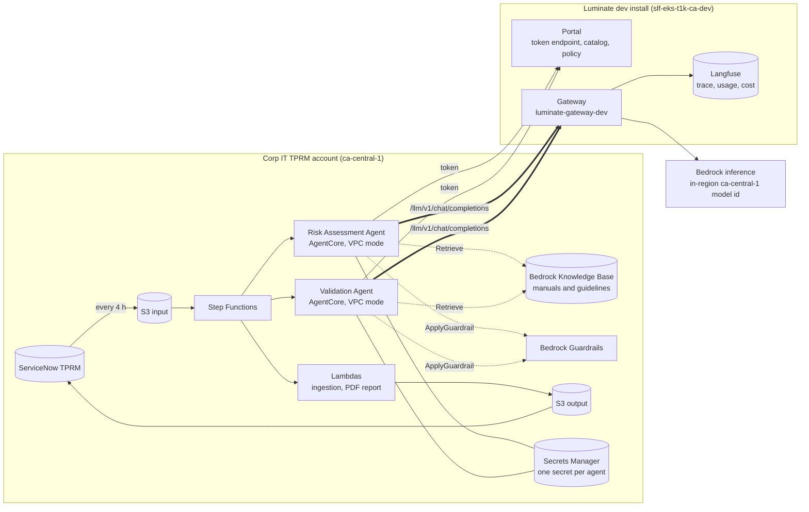
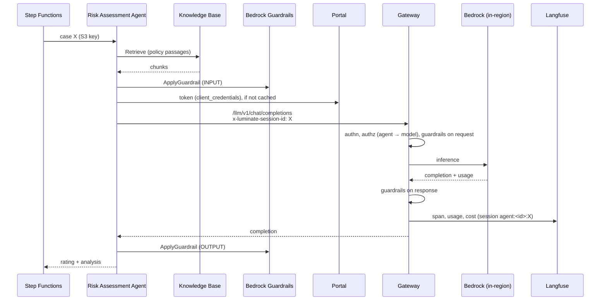
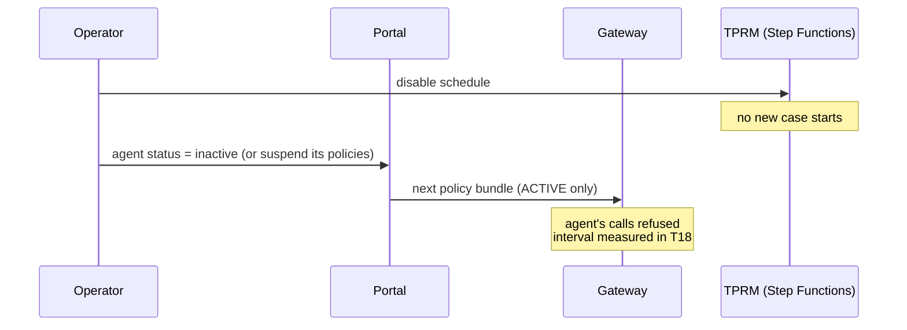

# Corp IT TPRM Use Case — D2: Design

> **Gate**: D2 — Design | **Status**: Draft | **D1 Approved**: TBD
> **Epic**: [EACPP-1318](https://sunlife.atlassian.net/browse/EACPP-1318) · Board label `acp-product-team`

This is an **onboarding design**, not a build design. It puts the two TPRM agents onto the Luminate
dev install using what ships today, and states the shape of each interim measure standing in for a
capability that does not. It follows the [AIMS D2](../aims-acp-integration/d2-design.md) wherever
TPRM is the same, and says so where it differs.

It is written against the architecture presented at discovery (D1 §0, C-1). If **Q1** comes back with
a different runtime for the ACP-enabled release, DD-6, DD-10 and DD-12 change; the rest do not.

---

## 1. Target topology

What the diagram is saying:

- **The thick arrows are the only inference path.** The agents' IAM roles lose direct Bedrock
  inference permissions (DD-6), so a direct call fails instead of quietly succeeding ungoverned.
- **The dotted arrows stay inside the TPRM account and are not governed by Luminate.** Knowledge
  Base retrieval (G2) and Bedrock Guardrails evaluation (G1) have no gateway route. Neither one
  invokes a generation model. Each is declared, not hidden (DD-4, DD-5).
- **Step Functions and the Lambdas are not on the gateway.** They are not agents, and they are
  registered only if they call a model (DD-2, Q5).
- **ServiceNow is untouched.** The agents never call it (D1 E-7), so there is no MCP server.

---

## 2. Design decisions

### DD-1 — One project, `TPRM`, in the existing `Corp IT` folder
The dev install already has a `Corp IT` folder holding one project, `AIMS` (queried 2026-10-01).
TPRM gets its own project beside it, not a place inside AIMS: cost rolls up per project, access is
granted per project, and project is permanent on every resource. The Owner is a **TPRM person**
(Q11), so the TPRM team can grant access to itself.

The project's **`cost_centre` is set at creation.** It is empty on all fifteen projects on the dev
install today, and it is the column the chargeback ledger filters by (G9).
**Effort S / Risk Low.**

### DD-2 — Register the agents; do not register the workflow
`tprm-risk-assessment` and `tprm-validation` are agents. Step Functions is a deterministic
orchestrator `[07:15]`: it calls no model and makes no decision, so it has no catalog entry — the
catalog has no workflow type, and registering it as an agent would misstate the inventory (D1 C-6).
A Lambda is registered as an **Application** only if it calls a model (Q5). The same rule as AIMS
DD-2: the inventory answers "which AI makes decisions", so it must not contain things that don't.
**Effort S / Risk Low.**

### DD-3 — Consume a platform-owned model with an in-region id; never another tenant's
The model is assigned by Sandra Lai (Q6). Where it comes from is a design decision:

| Source on the dev install | Verdict |
|---|---|
| A tenant's catalog entry (AIMS owns Sonnet 4.5 / 4.6; Pharmacy and Claims Demo own Claude 3 Haiku rows) | ✗ Another team's model, lifecycle and cost row |
| A platform-owned entry in the `Default` project with an **in-region** provider model id | ✓ **Preferred** |
| A new platform-owned entry, registered by the ACP Product Team | ✓ If the assigned model has none |
| An entry whose provider model id starts `us.` | ✗ A US geographic inference profile — fails NFR-4 whatever the offering's `region` says |

Offering: provider Bedrock, `ca-central-1`, **keyless** (the gateway's IRSA role chain), which stores
no secret. Before the access policy is created, confirm (a) the model id is fulfilled in Canada and
(b) **cost resolves to a non-zero figure**. No offering on the dev install carries a
`pricing_match_key` today, so zero cost must be ruled out by measurement, not assumed away.

This is the tension Dragana raised: on the dev install the in-region Anthropic ids are the Claude 3 /
3.5 generation and Opus 4.5, and every newer Anthropic entry is `us.`-prefixed. Residency and model
currency pull in opposite directions until AWS or the platform changes that.
**Effort S / Risk Med** — the risk is in Q6, not in the configuration.

### DD-4 — Two guardrail layers *(interim measure for G1)*
The gateway applies **its own** guardrails to TPRM traffic on request and response: PII detection
(Presidio) in redact mode and banned-content scanning, configured from Q9. That is the mandatory
baseline (CAP-10) and it is enforced at the gateway for every call.

It is **not** Bedrock Guardrails. The gateway has no field for a Bedrock `guardrailConfig`, and
Luminate has no contextual-grounding check — the one most relevant to an agent that scores vendors
against a policy manual. If Q3 confirms Bedrock Guardrails policies are part of the approved design,
the agent keeps them by calling the standalone **`ApplyGuardrail`** API on the prompt before the
gateway call and on the completion after it. `ApplyGuardrail` evaluates content without invoking a
model, so it does not create a second inference path.

| Option | Verdict |
|---|---|
| Drop Bedrock Guardrails, rely on gateway guardrails | ✗ Silently weakens a control the approvals may cite |
| Pass `guardrailConfig` through the gateway | ✗ Not supported |
| **Gateway guardrails + agent-side `ApplyGuardrail`** | ✓ **Chosen** |

**Effort M / Risk Med** — the risk is that the ISRA/ETAB scope names Bedrock Guardrails and nobody
checks (Q3, Q8).

### DD-5 — Knowledge Base: retrieval only, declared *(interim measure for G2)*

| Option | What it means | Verdict |
|---|---|---|
| **A** | Agents call `Retrieve` directly; retrieved chunks go into the governed completion | ✓ **Chosen for dev** |
| **B** | Wrap the Knowledge Base in an MCP server `tprm-knowledge-base`; retrieval becomes governed tool egress | ◻ Exit condition for A. Triggers CAP-03. |
| **C** | Replace the Knowledge Base with governed embeddings through the gateway and TPRM's own vector store | ✗ Rebuilds a working component for no governance gain the MVP needs |
| — | `RetrieveAndGenerate` | ✗ **Removed.** It runs a generation model outside the gateway. |

Under A the query embedding still runs inside TPRM's account on the Knowledge Base's configured
embedding model — a small, non-generative model call that the gateway does not see. That is stated
in the inventory (§4) so nobody reports "100% of model calls via ACP" without the footnote.
**Effort S / Risk Low.**

### DD-6 — IAM is what makes the gateway the only path
The TPRM AgentCore execution roles lose `bedrock:InvokeModel`, `bedrock:InvokeModelWithResponseStream`,
`bedrock:Converse`, `bedrock:ConverseStream` and `bedrock:RetrieveAndGenerate`. They keep
`bedrock:Retrieve` on the one Knowledge Base, `bedrock:ApplyGuardrail` on the one guardrail, and
`secretsmanager:GetSecretValue` on their own secret.

Without this, "all model calls go through ACP" is a coding convention. With it, a missed code path
fails in dev instead of succeeding ungoverned in production.
**Effort S / Risk Low.**

### DD-7 — Correlate on the ServiceNow case id
Every gateway call carries `x-luminate-session-id: <ServiceNow case id>` (printable ASCII, 128
characters maximum). The gateway namespaces it per entity — `agent:<id>:<case>` — so the two agents'
calls for one case land in two Langfuse sessions that join on the raw case id (D1 US-3).

TPRM **sets the header explicitly.** The harness SDK sets `x-session-id`, which the gateway ignores
(G10). A fix belongs in `acp-harness-sdk`; TPRM does not wait for it.
**Effort S / Risk Low.**

### DD-8 — Two stop levers, both measured
| Lever | Owner | Effect |
|---|---|---|
| **Platform** — agent `status = inactive`; and/or suspend each of its access policies | ACP Product Team | The policy fact export carries only ACTIVE agents and ACTIVE policies, so the next bundle refuses the agent's calls |
| **Platform** — governance suspension | ACP Product Team | Audited, with a previewed cascade. **Whether it refuses a *calling* agent is unverified** (G3): `authz.rego` files governance status under the call's target |
| **Application** — disable the Step Functions schedule | TPRM | No new case starts. Independent of the platform. |

T18 drills all three on a live agent and records the interval from action to first refusal. No
interval is quoted before that.
**Effort S / Risk Med.**

### DD-9 — The split of duties is fixed by the platform
| Step | TPRM | ACP Product Team |
|---|---|---|
| Create the project, set Owner and cost centre | — | ✓ |
| Grant roles inside the project | ✓ *(once an Owner exists)* | ✓ |
| Register agents and applications | ✓ | — |
| Model catalog entry and offering (DD-3) | — | ✓ |
| Create deployments, issue credentials, create access policies, set governance attributes | — | ✓ |
| Store secrets, change IAM, change agent code, run the verification call | ✓ | — |

**Effort S / Risk Low.**

### DD-10 — AgentCore reaches the dev install over the private network
AgentCore runtimes run in **VPC mode** (the org SCP denies public). From the TPRM VPC they need:

1. A route to the dev install's Traefik load balancer. Cross-account `ca-central-1` RFC1918 routing
   through the Transit Gateway is proven from the **dev** cluster to the **prod** cluster's load
   balancer; **from a tenant account to the dev install it is not yet proven.**
2. DNS resolution of the portal and gateway hostnames under `*.apps.slf-eks-t1k-ca-dev.aws.sunlifecorp.com`.
3. The Sun Life issuing CA in the container's trust store (`SSL_CERT_FILE` / `REQUESTS_CA_BUNDLE`).
   Public CA bundles such as `certifi` do not contain it.

The spike (T3) passes when an unauthenticated call from inside an AgentCore runtime returns **HTTP
401** from both `/llm/v1/chat/completions` and the portal token endpoint — a 401 proves route, DNS and
TLS in one request.
**Effort M / Risk Med** — the risk is entirely in the network path (Q7).

### DD-11 — Dev only; promotion is a separate plan
One environment, one gateway. Every deployment and credential is dev-scoped and is re-created per
environment later. Stage and prod are gated and no tenant has been onboarded to the prod install
(G11), so a production date for the ACP-enabled release cannot be committed from this plan.
**Effort S / Risk Low.**

### DD-12 — One credential per agent, in Secrets Manager
The four-key JSON the harness SDK reads (`token_url`, `client_id`, `client_secret`, `scope`), one
secret per agent, read by `LuminateAuthProvider.from_secrets_manager(...)`. Each execution role reads
only its own secret. Tokens are held in memory and re-minted on expiry; the secret is re-read at fetch
time so a rotation (no overlap window) does not need a redeploy. The gateway-audience fix
(AIC-589, `d6233ec47`) is on `main`; T10 confirms a freshly issued credential works without the
manual audience step AIMS needed.
**Effort S / Risk Low.**

---

## 3. Key flows

### Flow 1 — Assessing one vendor case

The Validation Agent follows the same flow with its own credential. A `403` means no access policy
for that model, or a model not deployed on this gateway; read the **status code**, not the body.

### Flow 2 — Stopping the workflow

---

## 4. What gets registered

| Object | Type | Key | Owner action | Notes |
|---|---|---|---|---|
| TPRM | Project | `tprm` | ACP Product Team | Folder `Corp IT`; TPRM Owner; **cost centre set** (DD-1) |
| Risk Assessment Agent | Agent | `tprm-risk-assessment` | TPRM | Runtime AgentCore; framework per Q2 |
| Validation Agent | Agent | `tprm-validation` | TPRM | As above |
| Ingestion / report Lambdas | Application | `tprm-document-ingestion`, `tprm-report-generation` | TPRM | **Only if Q5 says they call a model** |
| Step Functions workflow | — | — | — | Not registered (DD-2) |
| Assigned model | Model + offering | platform-owned | ACP Product Team | In-region id, keyless, non-zero cost (DD-3) |
| Deployments | Deployment | one per resource | ACP Product Team | `luminate-gateway-dev` |
| Credentials | Machine identity | one per (resource, gateway) | ACP Product Team | Secrets Manager (DD-12) |
| Knowledge Base | — | — | — | **Declared, not registered**: direct `Retrieve`, embedding call outside the gateway (DD-5) |
| Bedrock Guardrails | — | — | — | **Declared, not registered**: agent-side `ApplyGuardrail` (DD-4) |

Keys are lowercase-hyphen, `tprm-` prefixed and permanent. T1 is the last cheap moment to change them.

---

## 5. Access policy matrix

| Source | Assigned model |
|---|:--:|
| `tprm-risk-assessment` | ✓ |
| `tprm-validation` | ✓ |
| `tprm-document-ingestion` *(if registered)* | ✓ only if Q5 shows a model call |
| `tprm-report-generation` *(if registered)* | ✓ only if Q5 shows a model call |

If Sandra Lai assigns two models (for example a cheaper model for validation), the matrix gains a
column; the rule that absence denies does not change.

---

## 6. Security

- **Authentication**: OAuth2 client credentials per (resource, gateway), exchanged at the portal for a short-lived bearer. Humans sign in with SSO.
- **Authorization**: fail-closed at the gateway against §5.
- **Bypass**: prevented by IAM, not convention (DD-6).
- **Guardrails**: gateway PII/banned-content on request and response, plus agent-side `ApplyGuardrail` if Q3 requires it (DD-4).
- **Residency**: in-region model id, `ca-central-1` offering, `ca-central-1` gateway and Langfuse (DD-3).
- **Secrets**: Secrets Manager only, one per agent, role-scoped (DD-12).
- **Audit**: every governed call recorded immutably. The case lifecycle and the RM's decision are recorded in ServiceNow, not in the platform (G6).
- **Network**: private path only; no public exposure of the agents (DD-10).

---

## 7. Observability and cost

| Signal | Source | What TPRM gets |
|---|---|---|
| Trace per case | Gateway spans, session = ServiceNow case id (DD-7) | Every model call for case X, per agent |
| Usage and latency | Gateway | Tokens and latency per request |
| Cost | Pricing catalogue → Langfuse | Per request, per agent, per model — **non-zero only once pricing resolves** (DD-3) |
| Chargeback | `ProjectUsageDaily` ledger by cost centre | TPRM's spend, once `cost_centre` is set (DD-1). Inference no longer appears on Corp IT's own AWS bill. |
| Decisions | Authorization records | Allow/deny per call |
| Agent quality | **TPRM computes** agreement with RM decisions (T19) | Evidence for CAP-17 |

---

## 8. Interim measures and their exit conditions

| Gap | Interim measure | Exit condition |
|---|---|---|
| G1 | DD-4 — agent-side `ApplyGuardrail` beside gateway guardrails | Gateway supports Bedrock Guardrails, or Luminate guardrails cover the approved policies |
| G2 | DD-5 option A — direct `Retrieve`, declared | Option B (KB as a governed MCP server) delivered |
| G3 | DD-8 — status/policy levers plus the schedule, measured | A calling agent's governance suspension is shown to refuse its calls |
| G4 | T19 — agreement rate computed by TPRM, recorded by hand | A tenant path to submit evaluation scores exists and is used |
| G5 | Alerting on Langfuse volume | Quota counter store lands |
| G9 | Cost centre on the project | — (configuration, closes on T4) |
| G10 | Header set explicitly | SDK fixed |

---

## 9. Verification strategy

| Layer | What is proven | How |
|---|---|---|
| Network | AgentCore → portal and gateway | 401 from both, unauthenticated, from inside the runtime (T3) |
| Registration | §4 inventory exists with the right keys | Portal review |
| Identity | Each agent holds its own working credential | Token exchange per agent |
| Egress | Credential → token → gateway → policy → guardrail → Bedrock | Governed completion from each agent (T13) |
| **Bypass** | Direct inference is impossible | `bedrock:InvokeModel` from the runtime role is **denied** (T12) |
| **Residency** | Inference fulfilled in Canada | Model id checked for in-region fulfilment (T2) |
| Guardrails | PII in a synthetic vendor response is redacted; Bedrock Guardrails still evaluated | Probe (T14, T15) |
| Correlation | One case id shows both agents | Langfuse sessions for case X (T13) |
| Cost | Non-zero, correctly attributed; chargeback row carries the cost centre | Usage & Cost tab + chargeback summary (T20) |
| Stop | Each lever works; interval measured | Drill (T18) |

The negative tests — denied direct inference, denied unlisted model, refused call after a stop —
carry more weight than the completion.

---

## 10. Requirement traceability

| D1 requirement | Design element | Verified by |
|---|---|---|
| FR-1, FR-2 | DD-1, DD-2, §4 | Registration review |
| FR-3 | DD-3 | Residency check, completion |
| FR-4 | DD-12 | Token exchange |
| FR-5 | **DD-6** | Denied direct call |
| FR-6 | §5 | Completion + denied unlisted model |
| FR-7, FR-8 | **DD-4** | Guardrail probes |
| FR-9 | **DD-5** | IAM review; no `RetrieveAndGenerate` |
| FR-10 | DD-7 | Session lookup |
| FR-11 | DD-1, §7 | Chargeback summary |
| FR-12 | **DD-8** | Stop drill |
| FR-13 | §4 | Attribute review |
| FR-14 | §7, T19 | Agreement rate recorded |
| FR-15 | §6 | Audit record inspection |

---

## 11. Non-goals

- **Hosting the agents.** They stay on AgentCore in the TPRM account.
- **Replacing ServiceNow as the record of the risk decision**, or enforcing the RM's review.
- **Governing the Step Functions workflow**, which makes no decision and calls no model.
- **Enforcing a budget.** Nothing debits a counter (G5).
- **Production.** Promotion to stage/prod needs the prod-install onboarding path that no tenant has walked (G11).
- **The November release**, which goes live without ACP.

## References

- Spec: [D0](d0-discovery.md) · [D1](d1-requirements.md) · [D3](d3-tasks.md)
- Epic: [EACPP-1318](https://sunlife.atlassian.net/browse/EACPP-1318)
- Sibling onboarding: [AIMS D2](../aims-acp-integration/d2-design.md)
- [Luminate User Guides](https://bitbucket.sunlifecorp.com/projects/EDAEACP/repos/luminate-user-guides)
- Verification: `AI-Consortium/luminate` @ `5c98145d4` (2026-09-30) · `EDAEACP/acp-harness-sdk` @ `a0d62e9` · dev install, read-only, 2026-10-01
