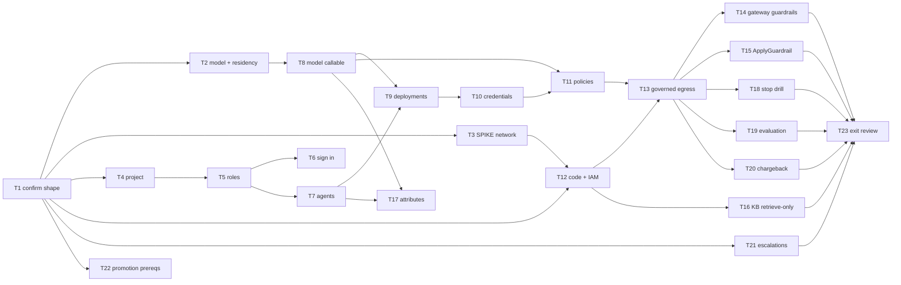

# Corp IT TPRM Use Case — D3: Implementation Plan

> **Gate**: D3 — Tasks | **Status**: Draft | **D2 Approved**: TBD
> **Epic**: [EACPP-1318](https://sunlife.atlassian.net/browse/EACPP-1318) · Board label `acp-product-team`

## Scope

**Dev onboarding of the ACP-enabled release only.** Two AgentCore agents, one assigned model, and
any model-calling Lambdas onto the **dev** install, proving governed model egress end to end, making
the gateway the only inference path, keeping the approved guardrail controls, and measuring the stop
levers.

Explicitly **not** in this plan: the November production release (it goes live without ACP), any
non-dev environment, MCP servers (there are none), building an evaluation runner, and anything that
depends on a capability the D1 gap register marks missing. Those become escalations (**T21**) or a
promotion plan (**T22**), not tasks.

> ⚠️ **T1 gates everything.** The D1/D2 are written against the architecture presented at
> discovery, and the transcript contradicts itself on whether AgentCore is in the release at all
> (D1 §0, C-1). If T1 changes the runtime, T3, T10 and T12 are re-planned before anything else runs.
>
> **No Jira tasks have been created from this table.** The spec is unreviewed.

---

## Tasks

| Task | Description | Depends |
|------|-------------|---------|
| **T1** | **Confirm the release shape and close the blocking questions.** Working session with Grant Du, Deepankar Pant, Priyanshu Dhama, Kamal Boorghani and Dragana Sikimic. Close D1 Q1 (what runs in production in November, and the architecture and date of the ACP-enabled release), Q2 (framework and how Bedrock is called today), Q3 (which Bedrock Guardrails policies, and whether the ISRA or ETAB conditions cite them), Q4 (Knowledge Base usage), Q5 (do any Lambdas call a model), Q7 (AgentCore network), Q8 (ATG number and ETAB conditions), Q9 (data classification) and Q11 (Owner, group, cost centre). Walk the D1 §3 capability table and §8 "will and will not" table so TPRM hears the limits from us first. Write the answers into D1. | — |
| **T2** | **Assign the model and prove residency.** With Sandra Lai and Dragana Sikimic (D1 Q6). Choose a model whose provider model id is fulfilled in `ca-central-1`; a `us.` prefix is a US geographic inference profile and fails NFR-4 whatever the offering's region field says. Prefer an existing platform-owned entry in the `Default` project; never grant another tenant's model (D2 DD-3). Record the model id and how its fulfilment region was checked. | T1 |
| **T3** | **SPIKE — prove the network path from AgentCore to the dev install.** From inside a VPC-mode AgentCore runtime in the TPRM account, call the dev gateway's `/llm/v1/chat/completions` and the portal token endpoint with no credentials. **Pass = HTTP 401 from both**, which proves route, DNS and TLS at once (D2 DD-10). Fix the container trust store with the Sun Life issuing CA if TLS fails. Run this in sprint 1 regardless — a failed route changes the plan and needs a network request with lead time. | T1 |
| **T4** | **Create the TPRM project with an Owner and a cost centre.** ACP Product Team creates project `TPRM` in the existing `Corp IT` folder with the TPRM Owner from Q11 and sets `cost_centre` at creation (D2 DD-1). Project is permanent on every resource registered into it. Guide: *Projects & Folders*. | T1 |
| **T5** | **Grant roles at the project.** Bind *Agent Administrator* (and *Model Administrator* only if TPRM will register a model) to the TPRM team's group at project scope, not to individuals. Guides: *Granting Access*, *Roles & Permissions*. | T4 |
| **T6** | **TPRM engineers sign in and see the project.** Dev portal, **Continue with SSO**. An empty catalog is a missing role binding, not a broken platform. Guide: *Signing In*. | T5 |
| **T7** | **Register the agents, and any model-calling Lambdas as Applications.** `tprm-risk-assessment` and `tprm-validation`, runtime AgentCore, framework from Q2. Register `tprm-document-ingestion` / `tprm-report-generation` as Applications **only** if Q5 shows they call a model. Do not register the Step Functions workflow (D2 DD-2). Keys are permanent. Guide: *Register an Agent*. | T5 |
| **T8** | **Make the assigned model callable and confirm cost resolves.** ACP Product Team confirms or creates the platform-owned catalog entry and a keyless Bedrock offering in `ca-central-1` for the T2 model id. No offering on the dev install carries a pricing match key today, so confirm a governed call produces a **non-zero** cost before relying on it. | T2 |
| **T9** | **Create deployments on the dev gateway.** One per agent and per registered Application, on `luminate-gateway-dev`. If the gateway dropdown is empty, the gateway is not bound to the environment. Guide: *Deploying Resources*. | T7, T8 |
| **T10** | **Issue credentials into Secrets Manager.** One credential per deployment, shown once, written straight into a Secrets Manager secret in the TPRM account in the four-key shape the harness SDK reads. Each AgentCore execution role may read only its own secret (D2 DD-12). The gateway-audience fix (AIC-589) is on `main`; confirm a new credential works without the manual audience step AIMS needed. Guides: *Issuing Credentials*, *Using Your Credentials*. | T9 |
| **T11** | **Create the access policies.** One per row of the D2 §5 matrix. Absence denies. ACP Product Team action. | T8, T10 |
| **T12** | **Move model calls to the gateway and close the direct path.** TPRM changes both agents to call `/llm/v1/chat/completions` through the harness SDK or `ChatOpenAI(base_url=…)`, setting `x-luminate-session-id` to the ServiceNow case id explicitly (D2 DD-7; the SDK sets the wrong header). Then remove `bedrock:InvokeModel*`, `bedrock:Converse*` and `bedrock:RetrieveAndGenerate` from the execution roles (D2 DD-6) and **prove a direct `InvokeModel` from the runtime is denied**. | T1, T3 |
| **T13** | **Prove governed egress end to end.** A real case through both agents on dev: completions return; Langfuse shows sessions `agent:<id>:<case>` for both agents joined on the case id; cost is non-zero and attributed per agent and per model; gateway latency is measured and recorded. Also prove a call to a model with no policy returns `403`. Guide: *Harness SDK*. | T11, T12 |
| **T14** | **Configure gateway guardrails and probe them.** Request and response scanning for TPRM traffic, PII in redact mode and banned content, configured from the Q9 classification. Probe with a synthetic vendor response containing personal data and confirm the redaction is recorded. Mandatory baseline (CAP-10). | T13 |
| **T15** | **Keep Bedrock Guardrails through `ApplyGuardrail`.** If Q3 shows Bedrock Guardrails policies are relied on, both agents call `ApplyGuardrail` on input before the gateway call and on output after it (D2 DD-4), keeping only `bedrock:ApplyGuardrail` on that guardrail. Probe it. Confirm with Grant Du that this satisfies the ISRA and ETAB scope as written. | T13 |
| **T16** | **Restrict the Knowledge Base to retrieval.** Agents use `Retrieve` only; retrieved passages feed the governed completion (D2 DD-5 option A). Record in the inventory that the query embedding runs outside the gateway. Decide with TPRM whether option B, the Knowledge Base as a governed MCP server, is wanted before promotion. | T12 |
| **T17** | **Tag governance attributes and set the risk band.** Owner, data classification and risk band on both agents and the model grant (CAP-13, CAP-15). The band comes from the Q10 LVT decision; record that the LVT-to-band method is a Sun Life gap (G12), so the tag is set by hand. ACP Product Team action. | T7, T8 |
| **T18** | **Drill the stop levers and measure them.** On a live dev agent: (a) set status `inactive`, (b) suspend its access policy, (c) apply governance suspension, (d) disable the Step Functions schedule. Record for each the time from action to first refused call or first missed case. (c) settles gap G3: whether a *calling* agent's suspension refuses its calls. Write the runbook with the owner from Q14 (D2 DD-8). | T13 |
| **T19** | **Define the evaluation method using RM decisions.** With Deepankar Pant (Q12): export per case the agent's rating and the RM's final rating from ServiceNow, compute an agreement rate per agent, and agree a pass threshold for promotion (D1 FR-14). Establish whether TPRM can write scores into the platform's Langfuse so Luminate records them as evidence (AIC-38); if not, that is part of G4. | T13 |
| **T20** | **Confirm chargeback attribution.** After a week of dev traffic, confirm the chargeback summary shows TPRM spend under the project's cost centre, and tell Corp IT finance that inference moves off their own AWS bill (D2 §7). | T13 |
| **T21** | **Raise the capability gap escalations.** One EACPP issue per D1 gap register row not already tracked, linked to EACPP-1318: G1 (Bedrock Guardrails passthrough), G3 (caller stop, if T18 confirms), G4 (tenant evaluation-score path), G10 (SDK session header — a fix in `acp-harness-sdk`, not a consortium ask). Consortium ideas go through Seth or Walter. | T1 |
| **T22** | **Write the promotion prerequisites.** What SIT, stage and prod need for TPRM: the prod-install onboarding path no tenant has walked (G11), gated promotion approvers, the evaluation threshold from T19, and per-environment deployments and credentials. A plan, not an execution. | T1 |
| **T23** | **Exit review and capability map update.** Walk the D2 §9 verification table with TPRM and Corp IT risk. Then update the capability map: CAP-17 evaluation evidence ingest **has merged** (AIC-38, 2026-09-16); CAP-11 governance suspension is keyed on the call's target (per T18); CAP-10 has no Bedrock Guardrails passthrough. | T14, T15, T16, T18, T19, T20, T21 |

---

## Luminate support checks

Verdicts were taken on 2026-09-30 against `AI-Consortium/luminate` `origin/main` @ `5c98145d4`.
Re-verify at pick-up against the live repository — never against the capability map or a feature
branch.

| Task | Luminate support | What to re-verify at pick-up |
|------|------------------|------------------------------|
| T2 | CAP-26 · G8 | Whether jurisdiction control has shipped; until it has, residency rests entirely on the model id chosen. |
| T8 | CAP-20 | Whether cost resolves for the offering without a pricing match key. |
| T10 | CAP-06 · AIC-589 | That a new credential carries the gateway audience with no manual step. |
| T12 | G10 | Whether `acp-harness-sdk` now sends `x-luminate-session-id`. If so, the explicit header is redundant. |
| T15 | CAP-10 · G1 | Whether the gateway now carries Bedrock Guardrails, which would make agent-side `ApplyGuardrail` unnecessary. |
| T16 | G2 | Whether a Knowledge Base or Retrieve route exists in the gateway. |
| T18 | CAP-11 · G3 | Which subjects `authz.rego` files governance status under, and what the AIC-467 suspension cascade touches. |
| T19 | CAP-17 · G4 | Whether a tenant path to submit evaluation scores exists, and whether a runner has landed. |
| T20 | CAP-20 · G9 | Whether chargeback endpoints are still behind the interim usage-admin permission. |
| T21 | G1–G12 | Every row, before raising tickets. A closed gap is not escalated. |
| T23 | G1–G12 · capability map | Every row again — this task writes verdicts back to the map. |

Every other task relies only on capabilities verified as ✅ Available.

---

## Dependency graph

The critical path is **T1 → T3 → T12 → T13**. The network spike and the code change are on it; the
portal steps are not.

---

## Sprint allocation

### Sprint 1 — confirm, prove the path, register

| Task | Owner | Definition of Done |
|------|-------|--------------------|
| T1 | Product Team + TPRM | Q1–Q5, Q7–Q9, Q11 answered and written into D1 |
| T2 | Sandra Lai + Product Team | Model id chosen; Canadian fulfilment evidenced |
| T3 | TPRM + Product Team | 401 from gateway and portal, from inside AgentCore |
| T4 | Product Team | `TPRM` project in `Corp IT`, TPRM Owner, cost centre set |
| T5 | Product Team | Roles bound to the TPRM group |
| T6 | TPRM | Engineers see a non-empty catalog |
| T7 | TPRM | Two agents (and any Applications) registered |
| T8 | Product Team | Model callable; non-zero cost confirmed |
| T9 | Product Team | Deployments on `luminate-gateway-dev` |
| T10 | Product Team + TPRM | One secret per agent, role-scoped |
| T11 | Product Team | Policies match D2 §5 |

### Sprint 2 — cut over, control, measure, close

| Task | Owner | Definition of Done |
|------|-------|--------------------|
| T12 | TPRM | Agents on the gateway; **direct InvokeModel denied** |
| T13 | TPRM + Product Team | Governed case end to end; sessions joined; cost non-zero; latency recorded; unlisted model → 403 |
| T14 | Product Team | Gateway guardrails active; PII probe redacted and recorded |
| T15 | TPRM | `ApplyGuardrail` in place if Q3 requires; Grant Du confirms approval scope |
| T16 | TPRM | Retrieve only; `RetrieveAndGenerate` removed; option B decided |
| T17 | Product Team | Owner, classification, band on every TPRM resource |
| T18 | Product Team + TPRM | Four levers drilled and timed; runbook with owner |
| T19 | TPRM + Product Team | Agreement-rate method and threshold agreed; score path known |
| T20 | Product Team | Chargeback shows TPRM under its cost centre |
| T21 | Product Team | Escalations raised and linked to EACPP-1318 |
| T22 | Product Team | Promotion prerequisites written |
| T23 | Product Team + TPRM + Corp IT risk | Verification table walked; capability map updated |

---

## Which guide for which step

Procedures live in [luminate-user-guides](https://bitbucket.sunlifecorp.com/projects/EDAEACP/repos/luminate-user-guides); this plan does not restate them.

| Step | Guide | The thing teams get wrong |
|------|-------|---------------------------|
| T4 | [Projects & Folders](https://bitbucket.sunlifecorp.com/projects/EDAEACP/repos/luminate-user-guides/browse/docs/getting-started/projects.md) | Project is permanent on every resource |
| T5 | [Granting Access](https://bitbucket.sunlifecorp.com/projects/EDAEACP/repos/luminate-user-guides/browse/docs/administration/granting-access.md) · [Roles & Permissions](https://bitbucket.sunlifecorp.com/projects/EDAEACP/repos/luminate-user-guides/browse/docs/reference/roles.md) | Onboarding something new needs *Administrator*, not *Editor* |
| T6 | [Signing In](https://bitbucket.sunlifecorp.com/projects/EDAEACP/repos/luminate-user-guides/browse/docs/getting-started/signing-in.md) | An empty catalog is a missing role binding |
| T7 | [Register an Agent](https://bitbucket.sunlifecorp.com/projects/EDAEACP/repos/luminate-user-guides/browse/docs/building/register-agent.md) | Registering grants no model access — that is an access policy |
| T9 | [Deploying Resources](https://bitbucket.sunlifecorp.com/projects/EDAEACP/repos/luminate-user-guides/browse/docs/administration/deploying.md) | A malformed target is skipped, not rejected |
| T10 | [Issuing Credentials](https://bitbucket.sunlifecorp.com/projects/EDAEACP/repos/luminate-user-guides/browse/docs/administration/credentials.md) · [Using Your Credentials](https://bitbucket.sunlifecorp.com/projects/EDAEACP/repos/luminate-user-guides/browse/docs/building/using-credentials.md) | Shown once; one active per pair; no rotation overlap |
| T12, T13 | [Harness SDK](https://bitbucket.sunlifecorp.com/projects/EDAEACP/repos/luminate-user-guides/browse/docs/building/harness-sdk.md) | 401 and 403 share a message — read the status code. Install `acp-harness-sdk`, not the `acp-aws-harness-sdk` the guide still names. |
| Any failure | [Troubleshooting](https://bitbucket.sunlifecorp.com/projects/EDAEACP/repos/luminate-user-guides/browse/docs/reference/troubleshooting.md) | — |

---

## Risk mitigation

| Risk | Mitigation | Sprint |
|---|---|---|
| The ACP-enabled release is not the architecture this spec assumes (C-1) | **T1** before anything is built | S1 |
| No network path from AgentCore to the dev install | **T3** spike first; network request raised early if it fails | S1 |
| Residency quietly lost to a `us.` inference profile | **T2** evidences fulfilment before T11 grants the model | S1 |
| An approved Bedrock Guardrails control disappears on migration | T15, and Grant Du confirms the approval scope | S2 |
| Code bypasses the gateway | T12 removes direct inference from IAM and **proves the denial** | S2 |
| Cost reports zero and nobody notices | T8 and T13 require a non-zero figure | S1–S2 |
| Stop levers assumed rather than known | T18 drills and times all four | S2 |
| Agents influence vendor-risk decisions with no evidence of quality | T19 method before any promotion (T22) | S2 |

---

## Definition of Done for dev onboarding

- Both agents make every model call through `luminate-gateway-dev` on their own credentials, and a direct Bedrock inference call from their roles is **denied**.
- The model is fulfilled in Canada, with evidence.
- Gateway guardrails are active, and Bedrock Guardrails are still evaluated if the approvals rely on them.
- Knowledge Base use is retrieval only, and declared.
- One ServiceNow case id finds both agents' calls in Langfuse, with non-zero attributed cost and a chargeback row under TPRM's cost centre.
- The stop runbook exists, with a measured interval for each lever.
- An evaluation method and threshold are agreed.
- Every gap has an EACPP ticket or an existing track; the capability map carries the corrected verdicts.

## Jira ticket map

Not created. Run `scripts/create_jira_from_spec.py specs/onboarding/corpit-tprm-usecase --dry-run` once D2 is
approved, then without `--dry-run`. Record keys here, not as a column in the task table.

## References

- Spec: [D0](d0-discovery.md) · [D1](d1-requirements.md) · [D2](d2-design.md)
- Epic: [EACPP-1318](https://sunlife.atlassian.net/browse/EACPP-1318)
- Sibling plan: [AIMS D3](../aims-acp-integration/d3-tasks.md)
- [ACP Capability Map](../../../capability-map.md) · [Capability Gap Escalation](../../../process/capability-gap-escalation.md)
- Harness SDK: [`acp-harness-sdk`](https://bitbucket.sunlifecorp.com/projects/EDAEACP/repos/acp-harness-sdk)
