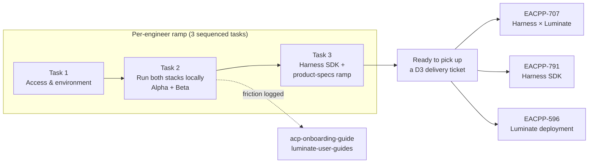

# Engineer Onboarding for the ACP Program — D0: Discovery

> **Gate**: D0 — Discovery | **Status**: Draft (retroactive) | **Epic**: [EACPP-896](https://sunlife.atlassian.net/browse/EACPP-896)
> **Owner**: Lalit Summan · **Reporter**: David Nguyen · **Cohort**: Alex Mckenzie, Kieran Gibney, Sam Mamelli, Rushik Patel

> **Why this spec is retroactive.** The epic and its 12 tickets were created on 2026-08-12
> without a corresponding spec, so `spec_type` could not route them and the O7 delivery report
> fell back to a hardcoded epic list. This spec closes that gap and records what was already
> agreed in the tickets; it does not propose new work.

## Problem Statement

Four engineers joined the ACP product team into a program that is already mid-flight: two
parallel stacks (the internal ACP build and the consortium Luminate build), seven-plus
repositories across two Bitbucket projects, an existing Jenkins JTE pipeline estate, an EKS dev
cluster, and a set of D3-level specs whose delivery work is waiting to be picked up.

Without a deliberate ramp, the failure mode is predictable and expensive: an engineer spends
their first weeks blocked on access requests they did not know to raise, forms a mental model of
only one of the two stacks, and picks up a delivery ticket without the context to know which of
the two codebases it targets or why. The cost is not only the lost weeks — it is the rework when
a change lands against the wrong stack.

The complicating factor specific to this program is that **there are two builds**, they are both
live, and the go-forward answer is Luminate. An engineer who only ever runs the internal build
will not understand the migration work that most of the D3 specs describe.

## Background & Drivers

- **The infrastructure already exists.** Dev/test environments, Jenkins JTE pipelines and the
  DevOps tooling are stood up. Despite the epic title mentioning "Infrastructure Setup", the
  ticket body is explicit: *"This epic is engineer enablement — access, ramp, and hands-on
  learning — not infrastructure build-out."*
- **The delivery work is already specced.** `aws-harness-integration` (EACPP-707),
  `acp-harness-sdk` (EACPP-791) and `sunlife-deployment` (EACPP-596) are all at D3. This
  track exists to make engineers ready for those tickets, not to define new ones.
- **Two stacks, one direction.** Alpha (internal `agent-control-plane`) proved the concepts;
  Beta (Luminate) is the go-forward runtime. Understanding the delta between them *is* the
  onboarding content, because that delta is what the integration specs are about.
- **The onboarding guide already exists** as a published site and source repo, so the ramp
  consumes documentation rather than inventing it — and friction found during the ramp feeds
  back into that guide.

## Opportunity

A repeatable three-task ramp, instantiated per engineer, that ends at a named delivery ticket
the engineer has already read and scoped — and that improves the onboarding guide as a
by-product, because every engineer who hits friction records it.

## Scope

### In Scope

| # | Capability | Description |
|---|-----------|-------------|
| 1 | Access onboarding | AWS SSO (`users_aws_edae_acp_run`), Jenkins (`User_JenkinsProdACPMember_ML`), Bitbucket `T1KACP` + `EDAEACP`, kubectl context to `slf-eks-t1k-ca-dev` |
| 2 | Alpha stack locally | `agent-control-plane/deploy/local` — `task up`, `task smoke`, UI on `:3002`, Jaeger on `:16686`; optional model backend via `task up-llm` or `task bedrock:up` |
| 3 | Beta stack locally | `luminate` — `task start`, portal `:3000`, gateway `:18080`, Langfuse `:3001`, `task urls` |
| 4 | Registry walkthrough | Register one agent / model / MCP server through each stack — SDK self-register on Alpha, portal UI on Beta |
| 5 | Harness SDK hands-on | `examples/local/quickstart_local.py` against Alpha; `ACPSettings`, `GatewayClient`, `RegistryClient`, `OktaAuthProvider`; re-point at local Luminate via `ACP_*` env vars |
| 6 | Spec ramp | Read `aws-harness-integration` D3 and `acp-harness-sdk` D3; produce a written "what changes for Luminate" summary |
| 7 | Delivery handoff | Each engineer picks one EACPP-707 / EACPP-791 task to shadow or scope |
| 8 | Guide feedback loop | Setup friction recorded as ticket comments → fixes to `acp-onboarding-guide` and `luminate-user-guides` |

### Out of Scope

- **Infrastructure build-out.** Environments, pipelines and tooling exist; this is enablement onto them.
- The delivery work itself — EACPP-707, EACPP-791, EACPP-596 own that.
- Authoring the onboarding guide content (owned by `acp-onboarding-guide`); this track consumes it and files friction.
- Business-group use-case onboarding — a different meaning of "onboarding", tracked per use case (EACPP-909, 911, 912, 914, 987, 895).
- Access *provisioning* itself — AD group membership is granted by the owning teams; this track raises and tracks the requests.

## Stakeholders

| Stakeholder | Role | Key Concern |
|-------------|------|-------------|
| Lalit Summan | Epic owner | Cohort reaches productive contribution; blockers surfaced early |
| David Nguyen | Reporter / ramp author | The ramp reflects how the program actually works |
| Alex Mckenzie, Kieran Gibney, Sam Mamelli, Rushik Patel | Onboarding engineers | Unblocked access; a clear path to a first real ticket |
| Colin Bell | ACP lead | Engineers land on the go-forward stack, not only the internal build |
| Ranjula Rowel | Harness SDK owner (EACPP-791) | Engineers understand the SDK surface before changing it |

## Open Questions

| # | Question | Owner |
|---|---|---|
| EO-Q1 | What is the target ramp duration per engineer, and is Task 1 access lead time inside or outside it? Access requests are the one step the team does not control. | Lalit |
| EO-Q2 | Is there a definition of "ramped" beyond completing the three tasks — e.g. a first merged PR? | Lalit, David |
| EO-Q3 | Do future joiners get a cloned set of these three tickets, or does the ramp move into `acp-onboarding-guide` as self-serve? Twelve tickets for four engineers does not scale. | David |
| EO-Q4 | Should the Alpha stack remain part of the ramp once Luminate is the sole runtime, or does it become optional history? | Colin, Seth |

## References

- Epic: [EACPP-896](https://sunlife.atlassian.net/browse/EACPP-896)
- [ACP Onboarding Guide (published)](https://bitbucket-static.sunlifecorp.com/pages/EDAEACP/acp-onboarding-guide/bb-pages/browse/) ·
  [source repo](https://bitbucket.sunlifecorp.com/projects/EDAEACP/repos/acp-onboarding-guide/browse)
- [acp_links_and_groups.md](https://bitbucket.sunlifecorp.com/projects/T1KACP/repos/agent-control-plane/browse/acp_links_and_groups.md) — DevOps tools, AD groups, internal build
- [Jenkins — EDAEAgentControlPlane](https://jenkins-dna.sunlifecorp.com/job/EDAEAgentControlPlane/)
- Alpha: [agent-control-plane/deploy/local](https://bitbucket.sunlifecorp.com/projects/T1KACP/repos/agent-control-plane/browse/deploy/local)
- Beta: [luminate](https://bitbucket.sunlifecorp.com/projects/EDAEACP/repos/luminate/browse) ·
  [luminate-sunlife-deploy](https://bitbucket.sunlifecorp.com/projects/EDAEACP/repos/luminate-sunlife-deploy/browse)
- [acp-harness-sdk](https://bitbucket.sunlifecorp.com/projects/EDAEACP/repos/acp-harness-sdk/browse) ·
  [user guide](https://bitbucket-static.sunlifecorp.com/pages/EDAEACP/acp-harness-sdk/bb-pages/browse/user-guide/)
- [acp-agentcore-sample](https://bitbucket.sunlifecorp.com/projects/T1KACP/repos/acp-agentcore-sample/browse)
- Downstream delivery: [`aws-harness-integration`](../../integration/aws-harness-integration/d3-tasks.md) (EACPP-707) ·
  [`acp-harness-sdk`](../../platform/acp-harness-sdk/d3-tasks.md) (EACPP-791) ·
  [`sunlife-deployment`](../../platform/sunlife-deployment/d3-tasks.md) (EACPP-596)
