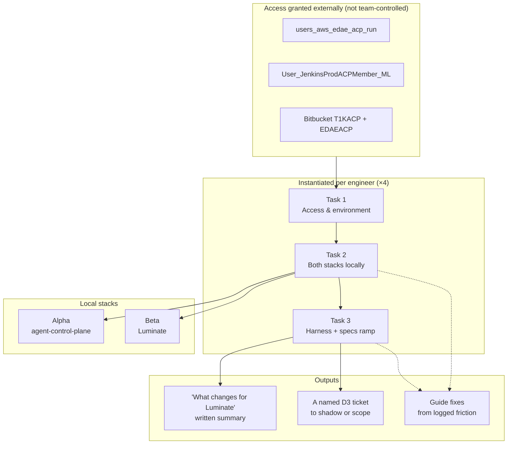

# Engineer Onboarding for the ACP Program — D2: Design

> **Gate**: D2 — Design | **Status**: Draft (retroactive) | **D1 Approved**: n/a
> Records the design already expressed in the EACPP-896 ticket structure, and names the decisions
> that structure implies.

## Design Overview

## Design Decisions

### DD-1 — Three sequenced tasks, instantiated per engineer
One ticket set per person rather than one shared ticket with four assignees, so each engineer's
progress and blockers are individually visible and an access stall on one person does not mask
another's. Cost: 12 tickets for 4 engineers, which does not scale past a small cohort (EO-Q3).
**Effort S / Risk Low.**

### DD-2 — Both stacks are mandatory, not either/or
An engineer runs **Alpha and Beta**. The delta between them — Bearer JWT replacing the
`x-acp-agent-id` header, the catalog viewsets, the portal token provider, dropping the
cross-account Bedrock assume-role — *is* the substance of the EACPP-707 and EACPP-791 delivery
work. An engineer who has run only one stack cannot review a diff against the other.
**Effort M / Risk Low.**

### DD-3 — The ramp ends at a named ticket, not at a tutorial
Task 3 closes with the engineer picking a specific EACPP-707 or EACPP-791 task to shadow or
scope. Without a named exit the ramp has no completion signal and drifts. This is what makes
"ramped" observable — see EO-Q2 for whether it should be tightened to a first merged PR.
**Effort S / Risk Low.**

### DD-4 — The written summary is the comprehension check
Requiring a "what changes for Luminate" write-up, with four specific points it must cover, tests
understanding in a way that "read the docs" does not. It is also directly reusable as onboarding
content for the next joiner. **Effort S / Risk Low.**

### DD-5 — Tickets link to the guide; they never restate it
Acceptance criteria reference the published onboarding guide, the stack READMEs and the specs.
Duplicating that content into Jira would create a second source of truth that silently rots.
**Effort S / Risk Low.**

### DD-6 — Friction found during the ramp is an output, not a nuisance
Setup problems are logged as ticket comments and become candidate fixes to
`acp-onboarding-guide` and `luminate-user-guides`. With four engineers ramping concurrently, a
guide defect blocks four people, so the loop repays itself within the same cohort.
**Effort S / Risk Low.**

### DD-7 — Access is the critical path and is externally owned
Task 1 depends on AD group grants the team does not control, so it is sequenced first and
tracked separately from the work that follows. Everything else is self-service.
**Effort S / Risk Med** — the risk is schedule, not design, and it cannot be engineered away.

### DD-8 — `spec_type: onboarding`, routing to Workstream 3
This spec classifies as `onboarding`, which routes EACPP-896 to Workstream 3 on the O7 delivery
report — matching where the hardcoded fallback already placed it. Note this is *engineer*
onboarding, distinct from the business-group use-case onboarding specs that share the
classification; the shared workstream is intentional, the shared word is a coincidence.
See D3 for the reporting follow-up this unblocks.
**Effort S / Risk Low.**

## Non-Goals

- Building or changing infrastructure. Environments, pipelines and tooling already exist.
- Authoring onboarding guide content — this track consumes it and files defects against it.
- Defining delivery work. EACPP-707, EACPP-791 and EACPP-596 already own that at D3.
- A generalised, self-serve onboarding path for arbitrary future joiners — that is EO-Q3, and
  the answer is probably to move the ramp into `acp-onboarding-guide` rather than clone tickets.
