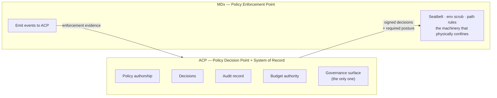

# MDx (AI-Native SDLC Platform) — D1: Requirements

> **Gate**: D1 — Requirements | **Status**: Draft | **Epic**: [EACPP-912](https://sunlife.atlassian.net/browse/EACPP-912)
> **Sources**: [D0 Discovery](d0-discovery.md) · [MDx High-Level Architecture](reference/MDx-Architecture.md) ·
> **Luminate `origin/main` @ `48cc106b`, verified 2026-08-19** (`Code/Luminate/luminate`, the upstream
> working repo — not the read-only mirror, which was 80 commits stale and produced three wrong
> findings in the first draft of this spec).

---

## 0. The framing that shapes every requirement

**ACP owns governance. MDx does not have a governance surface.**

That is the whole point of the control plane: if every AI system builds its own governance, Sun
Life gets N inconsistent implementations, N audit stores, and N answers to the same regulator
question — which is precisely the *"technical debt accumulation"* and *"inconsistent controls"* the
D0 names as the problem to solve. The D0's own success criteria say it plainly: **"Zero custom
audit code required (all audit via ACP)"** and **"Future MDx features inherit ACP governance
framework automatically."**

### What makes this non-trivial

MDx today ships a substantial local governance kernel:

| MDx component | What it does today | Where it goes |
|---|---|---|
| **Ledger** | Append-only receipt chain (BLAKE3 spine); the local trust root | **Authority moves to ACP.** Becomes a durable local emit-buffer, not a system of record |
| **ConstraintEvaluator** | Evaluates its own policy rules before every action | **Becomes an enforcement point.** Executes ACP decisions; authors none |
| **Treasury** | Budget authorization for runs, workers, fleets | **ACP owns budgets.** ACP's Quota primitive is the budget authority; Treasury enforces an ACP-issued ceiling. Blocked on **G-A** |
| **Charter** | Charter records backing authority grants | **Authority moves to ACP** RBAC and access policies |
| **Execution postures** | Seatbelt confinement, env scrub, path rules | **Stays local as _mechanism_** — ACP dictates the required posture; MDx enforces it |
| **Self-modification firewall** | `PROTECTED_PATHS` unwritable by self-delivery | **Stays local as _mechanism_**, declared to and evidenced in ACP |

So this integration is not a bolt-on. It is MDx **giving up governance authority** while keeping
the local machinery that physically enforces it.

### The distinction that makes it workable: authority vs mechanism

ACP cannot Seatbelt a process on a developer's laptop — that mechanism must be local. But deciding
*what is allowed*, holding *the record*, and presenting *the governance surface* are ACP's, without
exception. MDx executes and reports; it does not decide or retain.

**The requirement that follows:** MDx exposes **no** governance API, **no** governance UI, and
**no** independent policy authorship. Every governance question about an MDx run is answered from
ACP.

### The one genuine constraint this creates

MDx is local-first and works offline by design. If ACP is the decision point, an offline developer
has no decision authority. This does **not** justify a second governance system — it is solved the
standard way, with **signed policy bundles cached locally under a TTL**, fail-closed on expiry.
ACP remains authoritative; the cache is a distribution optimisation, not a fallback authority.
See **FR-21** and **OQ-1**.

---

## 1. What ACP enforces today — verified against `origin/main`

The question is not what ACP *could* govern, it is what it governs **at runtime today**. Three
verdicts: **ENFORCED** (works now), **MODELLED** (data model and API exist, nothing enforces at
runtime), **ABSENT**.

| Capability | Verdict | Evidence |
|---|---|---|
| **Access control on model / MCP / agent calls** | **ENFORCED** | `gateway/app/middleware/authz.py` → portal authz → `policy_engine/rego/authz.rego`; deny = 403 before upstream |
| **Guardrails — banned words, PII (Presidio), Model Armor** | **ENFORCED** | `gateway/app/middleware/guardrails.py`; inline, block/redact/warn, request **and** response direction |
| **Audit events** | **ENFORCED** | `backend/app/audit_events/` — append-only (DB trigger), Plane/EventClass/Sensitivity/Fidelity/Outcome, `correlation_id`, dedup on `producer_event_id`; decisions, denials and high-sensitivity events pinned to FULL fidelity and unsampled by CHECK constraint |
| **Audit ingest contract** | **ENFORCED** (gRPC) | `luminate.audit.v1.CaptureIngest` — `backend/app/audit/grpc/servicer.py`, bearer-authenticated |
| **Token usage + cost attribution** | **ENFORCED** | `backend/app/metrics/` → Langfuse OTLP; dimensions `entity_{type,id,name}` × model × time; pricing via `model_pricing_catalog` |
| **Machine identity + credential lifecycle** | **ENFORCED** | `backend/app/iam/` service principals; `OAuthCredential` per (entity, gateway); `POST /api/v1/iam/auth/token`, client_credentials, 300s |
| **Registries** | **ENFORCED** | `POST /api/v1/catalog/{agents,models,mcp-servers}/` |
| **Quotas / budgets** | **MODELLED** | `backend/app/quotas/` — full schema (dimension × period × counting × source/target selectors), default quotas, **protected hard caps** bounded by provider ceilings, CRUD API, and quotas collected into the policy input in `policy_engine/facts.py`. **But**: no counter store, no rego rule consumes them, and the gateway has no quota awareness — nothing debits. See **G-A** |
| **Signed policy bundle distribution** | **ABSENT** | Evaluation is in-process regorus, portal-side only. `PolicyBundleVersion` is a monotonic cache-invalidation counter, not a distributable artifact. See **G-C** |
| **Execution-constraint policy** | **ABSENT** | `authz.rego` covers access to models/MCP/agents. No vocabulary for required sandbox posture, permitted write scope or blocked paths. See **G-D** |
| **Evaluations** | **ABSENT** | No evaluations app, no evaluation record, no ingest for externally-produced results. See **G-E** |
| **External (non-gateway) audit producer** | **ABSENT** | *"There is deliberately no public producer REST endpoint"* — `backend/app/audit_events/ingest.py`. See **G-B** |
| **Caller-supplied cost attribution labels** | **PRESENT** | `x-luminate-project-id` per request → project chargeback ledger with `cost_centre`, cost and currency. See **G-F** |

### The LLM data path

OpenAI-compatible completions, reached on the agentgateway LLM port (`AGENTGATEWAY_LLM_PORT`).
The portal's own client uses `/llm/v1/chat/completions` (`backend/app/feedback/inference.py:44`) and
the upstream mapping is `{"type": "completions", "path": "/v1/chat/completions"}`
(`gateway/app/services/resource_translator.py:225`). Data-plane routing is **configuration-driven**
rather than a fixed REST convention, so **the exact base path MDx should call must be confirmed
against the deployed dev gateway** — a Phase 0 task, not an assumption.

What matters for the design holds either way: the surface is OpenAI-compatible, so MDx's
`ModelGateway` is a driver/base-URL change rather than a protocol rewrite.

### How authorization works on the data path

Middleware order is Routing → Authn → Authz → Guardrails → Forward, with Capture recording *after*
the response is sent so it never blocks (`gateway/app/main.py`).

- The **selector** is the `model` field for LLM traffic, or the first path segment for MCP/A2A.
- Denial is **`403`** before the upstream call. Guardrail violation is **`422`**.
- Fail-closed: missing identity → 401; any validation error denies.

**The model slug is the policy subject**, so model selection is itself the governed decision.

### What capture records — and what it does not

A `decision` event and an `access` event per proxied request, carrying `{producer, caller, target,
protocol, outcome, request_id, producer_event_id}` plus status. `caller` is a single flattened
identity string. **Token counts are not in the capture path** — they arrive via OTel/Langfuse with
`gen_ai.usage.*` and `luminate_entity_*` attributes.

---

## 2. The two hard constraints

These are not risks to be mitigated later; they are shaping constraints on the design.

### C1 — MDx is local-first by design; ACP is a network dependency

MDx foundational idea #3: *"Local first, cloud optional. The default path runs on a developer's
machine without Docker or Postgres."* Making ACP the decision point and system of record makes the
network load-bearing for the core loop.

Further, MDx's execution boundary denies network to proof commands (*"proof commands run with
network denied; setup commands keep network"*).

**Resolution direction.** Two separate mechanisms, neither of which is a second governance system:

1. **Model traffic** — the `ModelGateway` lives in the kernel/server, **outside** the Seatbelt
   sandbox, so the network-denied proof phase is unaffected. Offline means no model call, which is
   already true today.
2. **Policy decisions** — ACP issues **signed policy bundles** that MDx caches under a TTL and
   evaluates locally. ACP authors and signs; MDx only evaluates what it was given. On TTL expiry
   the cache is refused and MDx fails closed. This is policy *distribution*, not policy *authority*
   — the distinction that keeps ACP the single governance owner (**FR-21**, **OQ-1**).

### C2 — MDx scrubs credentials out of the execution environment, deliberately

*"subprocess environment is scrubbed to a toolchain allowlist (PATH, HOME, TMPDIR, locale, cache
— never provider keys or credentials)"*.

An ACP token is a credential. It must therefore **never** be injected into the sandbox
environment; it lives only in the server process that owns the `ModelGateway`. Any design that
passes `ACP_*` credentials into a Forge build subprocess violates an MDx invariant and will be
rejected at their kernel protection ring.

---

## 3. Functional Requirements

### Model traffic routing

| ID | Requirement | Priority |
|----|-------------|----------|
| FR-1 | Route Forge model invocations through the ACP gateway's **OpenAI-compatible** completions surface, configured as a `ModelGateway` driver in `mdx-core`. Exact base path confirmed in Phase 0 (**OQ-4**). | Must |
| FR-2 | The gateway call is made by the **server/kernel process only**, never from inside a Forge execution sandbox, satisfying **C2**. | Must |
| FR-3 | Support **streaming** responses, since Forge's coding loop is interactive. | Must |
| FR-4 | Model selection uses the Luminate **model slug as the selector** — the value policy is evaluated against — so model choice is the governed decision. | Must |
| FR-5 | A gateway **`403` denial maps to an MDx policy-denial receipt**, not a transport error, so a governance block is recorded as a governance event in the Ledger. | Must |
| FR-6 | Preserve MDx's fail-closed posture: an ambiguous or failed authorization blocks the action and names what is missing in human language. | Must |

### Identity, auth and registration

| ID | Requirement | Priority |
|----|-------------|----------|
| FR-7 | Obtain credentials via OAuth2 `client_credentials` (S4) or a `lum_` API key (S5); tokens are held in the server process and refreshed before the 300s expiry. | Must |
| FR-8 | Register Forge in the ACP agent catalog (S6). Decide and record the **identity granularity** — see **OQ-2**, which is also the answer to cost attribution. | Must |
| FR-9 | Register the Bedrock models Forge consumes in the ACP model catalog (S7) so they are selectable and governable. | Must |
| FR-10 | Ephemeral **workers** are registered with ACP identities; a worker's model traffic must be attributable to the worker, its sponsor chain and its run. | Should |
| FR-11 | **Worker spawn authority moves to ACP.** MDx's five local spawn receipts become enforcement of an ACP-issued authorization, not an independent grant. Phased — see §8. | Should |

### Governance record, evidence and audit

| ID | Requirement | Priority |
|----|-------------|----------|
| FR-12 | **ACP is the system of record for governance.** The MDx Ledger is not a competing audit store: it is a durable local **emit buffer** that guarantees delivery to ACP. Governance questions are answered from ACP, never from the Ledger. | Must |
| FR-13 | Correlate on a **shared correlation id** — the gateway records `request_id` per capture event; MDx stamps the same id on everything it emits. This is what lets ACP hold one complete narrative rather than a fragment. | Must |
| FR-14 | MDx **emits a governance event to ACP** for every governed outcome — allowed, denied, enforced, unreachable. Local persistence exists only to survive an ACP outage and drain afterwards. | Must |
| FR-15 | Emit the enforcement-evidence set to ACP: work classification, execution posture, tool-plane decisions, ship-gate decisions, self-delivery events, worker lifecycle. **MDx reports what it enforced; ACP records and adjudicates it.** | Must |
| FR-16 | **MDx exposes no governance surface** — no governance API, no governance UI, no independent policy authoring, no audit query interface. All of it is ACP's. Any such surface in MDx today is retired or hidden as part of this integration. | Must |
| FR-17 | **Blocked on G-B** — the audit ingest contract exists but has no external producer path. Until one lands, emission is export-based. The *destination* is ACP either way; only the transport is phased. | Must |

### Observability and cost

| ID | Requirement | Priority |
|----|-------------|----------|
| FR-18 | Emit OTLP traces from `crates/mdx-observability` to the Luminate-managed Langfuse endpoint with the `gen_ai.*` attribute set. MDx's OpenTelemetry substrate is currently `PENDING-LIVE-RUN`, so this is a live-run milestone for them, not a retrofit. | Must |
| FR-19 | Token usage and cost must be attributable to **squad** and **business unit** (the D0's core financial ask). **Unblocked** — `G-F` closed by project chargeback; MDx sets `x-luminate-project-id` per squad. What remains is agreeing the squad → project map. | Must |
| FR-20 | Surface Forge model consumption — tokens, latency, cost — via the **ACP** metrics API. MDx does not build a consumption dashboard; that is a governance surface. | Must |
| FR-21 | Measure and report the **latency delta** introduced by gateway routing, against a pre-integration baseline. | Must |

### Policy

| ID | Requirement | Priority |
|----|-------------|----------|
| FR-22 | **ACP is the Policy Decision Point and the sole policy author.** MDx's ConstraintEvaluator is reduced to a Policy Enforcement Point: it evaluates ACP-issued signed bundles and enforces the result. It holds no rules of its own. | Must |
| FR-23 | ACP-issued policy covers **model access and execution constraints alike** — required execution posture, permitted write scope, blocked paths, ship-gate conditions. MDx supplies the *mechanism* (Seatbelt, env scrub, path rules) because it must run locally; ACP supplies the *policy*. | Must |
| FR-24 | **ACP owns budgets.** MDx consumes ACP Quotas rather than authoring its own; Treasury enforces the ACP-issued ceiling. Requires **G-A** (quota enforcement) and the `spend` dimension for a true cost budget. | Must |
| FR-25 | Signed policy bundles carry a **TTL**; on expiry MDx refuses the cache and fails closed rather than falling back to local judgement. | Must |
| FR-26 | Where a pre-flight authorization check is useful, use the policy test endpoint — currently **admin-only** (**G-G**). | Could |
| FR-27 | MDx model traffic is subject to ACP **guardrails** (PII, banned words, Model Armor) with no MDx-side opt-out. A `422` guardrail block is handled like a `403` denial per DD-4. | Must |

---

## 4. Non-Functional Requirements

| ID | Requirement | Priority |
|----|-------------|----------|
| NFR-1 | **ACP is the single governance owner.** No requirement here may be satisfied by building governance capability inside MDx. | Must |
| NFR-2 | **Enforcement strength is not reduced.** Moving authority to ACP must not weaken what is physically enforced locally — Seatbelt confinement, env scrub, path rules and the self-modification firewall keep working, now under ACP-issued policy. | Must |
| NFR-3 | **Fail-closed end to end.** An absent, expired or unverifiable ACP decision blocks the action and names what is missing in human language. Neither side may fail open. | Must |
| NFR-4 | **Latency budget** — gateway routing must not degrade squad velocity. Target agreed against the FR-21 baseline before rollout (**OQ-3**). | Must |
| NFR-5 | **No credentials in the sandbox** (C2). | Must |
| NFR-6 | **No custom audit code in MDx**, per the D0. Emission to ACP is plumbing; adjudication, retention and reporting are ACP's. | Must |
| NFR-7 | Token handling: refreshed server-side, never logged, never written to an emitted event payload. | Must |
| NFR-8 | **Reversible during the PoC** — integration ships behind configuration so a pilot squad can be rolled back without a code change. | Must |
| NFR-9 | Policy bundles are **signed and verified**; an unverifiable bundle is refused, not used. | Must |

---

## 5. Luminate gap register — prioritised

ACP is the AI governance layer for the organisation; adoption is not optional and is not a
per-system negotiation. What *is* open is which Luminate gaps get closed, in what order, so that
onboarding systems like MDx are governed rather than partially governed.

Every gap below is a **Luminate platform ask**, not an MDx workaround. Priority reflects governance
consequence first and MDx unblocking second.

| # | Gap | Verdict today | Governance consequence | MDx impact | Priority |
|---|---|---|---|---|---|
| **G-A** | **Quota / budget enforcement.** Full schema, default quotas, protected hard caps, CRUD API and policy-input collection all exist. Nothing debits a counter, no rego rule consumes quotas, the gateway has no quota awareness. Consortium ticket **AIC-43** *Enforce Quotas at the gateway* is To Do. | **MODELLED** | Budgets are authored and visible but **cannot stop anything**. A runaway agent is detected after the spend, not prevented. This is the single largest governance claim ACP cannot currently honour. | The D0's cost-control goal is reportable but not enforceable | **P0** |
| **G-B** | **External audit producer path.** The ingest contract is excellent — `luminate.audit.v1.CaptureIngest`, bearer-authed, dedup, sensitivity lanes, append-only. It is *deliberately* gateway-and-in-process only. | **ABSENT** (contract exists) | Any system whose governance-relevant events happen off the data path has **no sanctioned way to put them in the record**. That is every onboarding system with its own execution surface. | Blocks MDx enforcement evidence reaching ACP | **P0** |
| **G-C** | **Signed policy distribution.** Evaluation is in-process regorus, portal-side. `PolicyBundleVersion` is a cache-invalidation counter, not a distributable artifact. **Specced** as `distributed-gateway` **T14** (EACPP-770) — on that spec's critical path, gated on Option 1 being adopted. | **ABSENT, specced** | Enforcement points that cannot reach the portal have no governed mode. Forces either an ungoverned path or an unusable product. | Blocks MDx offline/local-first operation | **P1** || **G-D** | **Execution-constraint policy vocabulary.** `authz.rego` governs access to models/MCP/agents. It cannot express required sandbox posture, permitted write scope, or blocked paths. | **ABSENT** | ACP cannot author execution policy, so onboarding systems keep authoring it themselves — and the single-governance-layer position quietly fails in exactly the place it matters most. | MDx would retain execution authority by default | **P1** |
| **G-E** | **Evaluations.** No evaluations app, no evaluation record, no ingest for externally-produced results. | **ABSENT** | No quality or safety evidence can be attached to a governed asset. Directly limits the OSFI/NIST evidence story. | Blocks eval evidence; not on the PoC path | **P1** |
| **G-F** | **Caller-supplied cost attribution.** `x-luminate-project-id` is stamped on the observation and rolled into a daily project usage ledger carrying `cost_centre`, cost and currency, reportable at `/api/v1/chargeback/`. | **CLOSED** — shipped as `[ACP-577]`, after this spec's original survey | Chargeback no longer requires minting an identity per cost centre, so the identity model is not distorted by a billing requirement. | Simplifies OQ-2 to a mapping question | — |
| **G-G** | **Policy pre-check is admin-only.** | **ABSENT** for non-admins | Callers cannot ask "would this be allowed?" before committing work. Encourages optimistic execution and wasted spend. | Minor; convenience | **P3** |
| **G-H** | **No credential rotation grace window** — rotation is delete-then-create. | **ABSENT** | Rotation is an outage for every machine consumer. | Handle re-auth on 401 | **P3** |
| **G-I** | **No SDK.** REST + OAuth2 hand-rolled per consumer. | **ABSENT** | Every onboarding system re-implements auth, retry and token refresh, each with its own bugs. | MDx writes a thin Rust client | **P3** |

### The P0s, and why

**G-A and G-B are the two that make ACP's governance claim true or false**, independent of MDx.

- **G-A**: ACP already *owns* budgets — the primitive, the hard caps, the authoring API and the  provider ceilings are built, which is precisely why this should be finished rather than
  redesigned. The `rate-limiting` D1 design (`luminate-designs`, DRAFT / PENDING since 2026-05-15)
  already specifies a Redis-backed counter store and enforcement in the authz pipeline. **The design
  is ahead of the implementation; the ask is to prioritise the build, not to re-spec it.**
  Note `spend` is deferred in the MVP — `requests` and `tokens` only — so a true cost budget needs
  the spend dimension too.
- **G-B**: the contract is already the hard part and it is done well. The ask is narrow — an
  authenticated external producer profile over the existing envelope, with org resolution and
  per-producer trust. Without it, "ACP is the system of record" is only true for traffic that
  happens to traverse the gateway.

### G-C is already the consortium's direction of travel

An earlier revision of this spec called signed policy distribution an unspecced new ask. That was
wrong. It is **T14** in the consortium `distributed-gateway` spec (**EACPP-770**) — *"the portal
compiles and signs a policy bundle; participating gateways pull, verify and enforce locally"* —
and that spec names T14 as its critical path.

Three consequences for MDx:

- **DD-10 is not a bespoke mechanism.** Signed, TTL-bounded bundles enforced locally are the stated
  end state, so MDx's offline requirement rides an existing direction rather than creating one.
- **It is conditional.** The spec's own recommendation is *"Option 3 near-term, Option 1 as
  direction of travel."* Post-PoC design must not assume local enforcement is imminent — the
  near-term remains the central request path.
- **The single-authority position is corroborated.** Its open decision #2 — *"whether there is
  exactly one policy authority"* — is answered **"Yes, and it is Luminate"**, on the grounds that
  two permission models *"produce two answers to the question an OSFI B-13 or E-23 review asks."*
  That is the same conclusion this spec reaches, arrived at independently.

**G-C and G-D are what the single-governance-layer position costs.** They are not MDx-specific:
any system with a local execution surface and offline operation raises both. Closing them once
makes the next onboarding cheaper; not closing them means each system keeps its own governance,
which is the outcome ACP exists to prevent.

## 6. Open questions — these need answers before D3

| # | Question | Why it blocks | Owner |
|---|---|---|---|
| **OQ-1** | Does MDx accept **signed, TTL-bounded ACP policy bundles** as the offline mechanism, fail-closed on expiry — and is **G-C** prioritised to build it? | The load-bearing question for local-first operation under single-owner governance. | ACP platform + MDx |
| **OQ-2** | What is the **ACP identity granularity** — one entity for Forge, one per squad, one per MDx workspace? | The only lever for cost attribution until **G-F** lands. An identity decision driven by a billing requirement. | ACP + MDx + Finance |
| **OQ-3** | What latency delta is acceptable? A number, agreed before the PoC reports. | Without it, FR-21 produces a measurement nobody can call pass or fail. | MDx product + pilot squads |
| **OQ-4** | What **exact gateway base path** does MDx call, and does `ModelGateway` accept an arbitrary OpenAI-compatible base URL? Data-plane routing is config-driven, so the path must be confirmed against the deployed dev gateway. | Config change vs Rust change — a large scoping difference, and the PoC cannot start without the path. | ACP platform + MDx engineering |
| **OQ-5** | **Sequencing of authority migration**, given G-A/G-C/G-D are not yet built. Model access and audit can move now; execution policy and budget cannot move until ACP can express and enforce them. | Determines what Phase 1 can honestly claim. Migrating authority to a capability that does not exist yet would leave a governance hole, not close one. | ACP + MDx leads |
| **OQ-6** | Which MDx surfaces present governance state today — Observatory's evidence dashboard, Concierge's receipt-backed answers, `FirstViewport`'s *"what evidence backs this"* — and what is the retirement plan? | Needed to size FR-16. | MDx product |
| **OQ-7** | **Do G-A and G-B get prioritised on the Luminate roadmap, and when?** | These are P0 platform gaps that MDx surfaces but does not own. If they are not scheduled, MDx onboards into a control plane that cannot enforce budgets or record its evidence. | ACP platform / consortium |

---

## 7. Authority migration — what moves, and how hard

Not everything can move at once. Ordered by increasing resistance:

| Authority | Today | Target | Blocked on | Why |
|---|---|---|---|---|
| Model access | MDx picks the model | **ACP** — selector is the model slug | — **ready now** | Already how the gateway works |
| Guardrails on model traffic | none | **ACP** — PII, banned words, Model Armor | — **ready now** | Enforced inline today; MDx inherits by routing through the gateway |
| Governance record | MDx Ledger | **ACP** audit events | **G-B** | Contract exists; needs an external producer profile |
| Governance surface | Observatory / Concierge evidence views | **ACP only** | OQ-6 | Product surfaces exist; needs an inventory |
| Budget / spend ceiling | MDx Treasury | **ACP** Quotas | **G-A** + `spend` dimension | ACP owns budgets by design; enforcement not built |
| Execution policy | ConstraintEvaluator rules | **ACP** issues, MDx enforces | **G-D** | ACP cannot express execution constraints yet |
| Offline governed operation | MDx decides locally | **ACP** signed bundle, MDx evaluates | **G-C** | No distribution mechanism today |
| Worker spawn authority | 5 local authority receipts | **ACP** authorizes | G-D + MDx kernel work | Deepest change; workers are `PENDING-LIVE-RUN`, so timing helps |

**Sequencing rule:** authority only moves when ACP can actually hold it. Moving budget authority to
ACP before **G-A** ships would replace an enforced local ceiling with an unenforced remote one — a
governance regression wearing the right label. Model access, guardrails and the record can move
now; the rest follows its blocking gap.

---

## 8. Constraints & Assumptions

- **Assumption (verify — OQ-4):** MDx's `ModelGateway` can be pointed at an arbitrary
  OpenAI-compatible endpoint by configuration. The architecture lists `ModelGateway` in the
  Runtime ring and a `TensorZero model driver` as `PENDING-LIVE-RUN`, implying a driver seam.
- **ACP adoption is mandated, not negotiated.** ACP is the organisation's AI governance layer;
  onboarding systems do not opt out of it and do not run a parallel governance stack. What is
  negotiable is *sequencing* — which authority moves when — not *whether*.
- **MDx's kernel protection ring raises the bar on authority migration.** Their rule is that
  changes touching receipts, evidence, auth admission or migrations move the review from *"does
  this pass checks"* to *"does this preserve the trust model months from now."* Execution-policy
  and budget migration need MDx-side design ownership, not just an ACP-side decision.
- **Timing helps in one place:** workers and OpenTelemetry are `PENDING-LIVE-RUN`. Authority that
  has not shipped yet is far cheaper to place in ACP than authority already in production.
- **Luminate token lifetime is 300 seconds** — refresh must be automatic and invisible to a long
  Forge run.
- **Pilot scale:** 5 squads in SL Canada. Small enough that per-squad identity (OQ-2) is
  operationally feasible.
- **ACP dev environment** is `slf-eks-t1k-ca-dev`; the gateway is reachable there for PoC work.

---

## References

- [D0 Discovery](d0-discovery.md) · [MDx High-Level Architecture](reference/MDx-Architecture.md)
- Luminate: `gateway/app/middleware/authz.py`, `gateway/app/middleware/capture.py`,
  `backend/app/feedback/inference.py`, `backend/app/metrics/views.py`,
- Luminate `origin/main` @ `48cc106b` (`Code/Luminate/luminate`): `gateway/app/middleware/{authz,capture,guardrails}.py` ·
  `gateway/app/main.py` (middleware order) · `backend/app/quotas/` · `backend/app/audit_events/` ·
  `backend/app/audit/grpc/servicer.py` · `backend/app/policy_engine/{facts.py,models.py,rego/}` ·
  `backend/app/metrics/` · `backend/app/iam/` · `backend/app/feedback/inference.py:44` ·
  `gateway/app/services/resource_translator.py:225`
- `luminate-designs`: `designs/rate-limiting/d1-rate-limiting.md` (DRAFT/PENDING — the G-A design)
- ACP governance work this depends on: `EACPP-915` (Governance Mode, evidence contract),
  [`governance-intake`](../../governance/governance-intake/d1-requirements.md) (EACPP-877)
- Related product specs: [`acp-harness-sdk`](../../platform/acp-harness-sdk/d1-requirements.md) ·
  [`sunlife-deployment`](../../platform/sunlife-deployment/d0-discovery.md)
