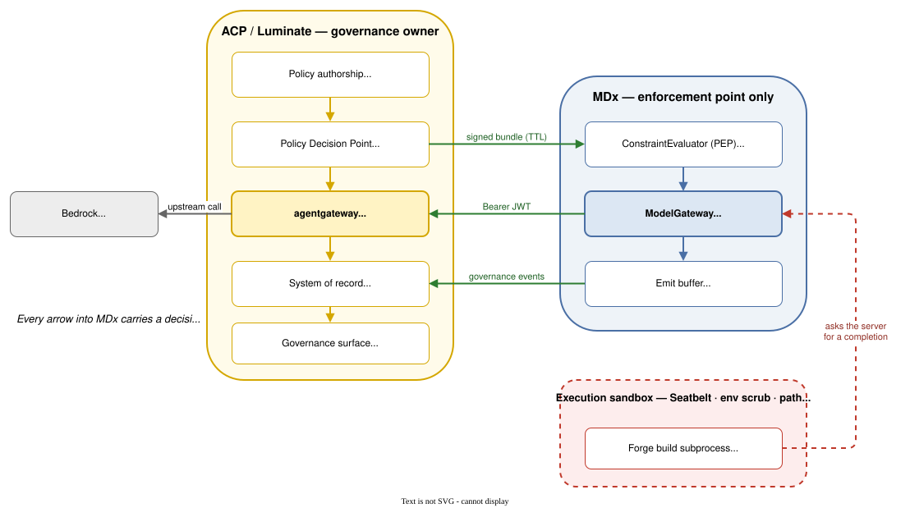
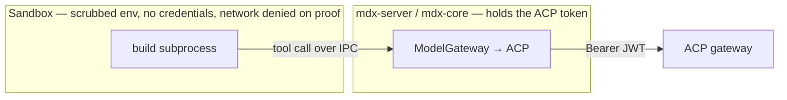
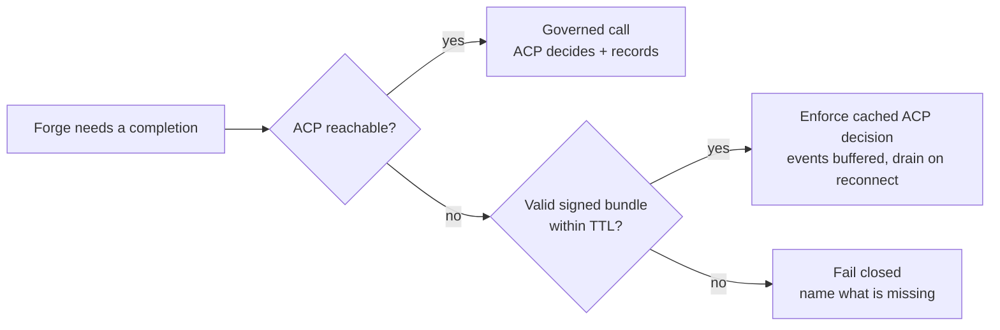
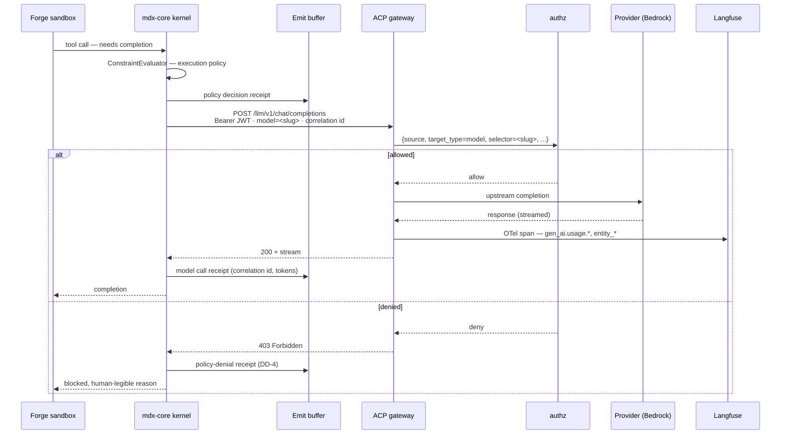
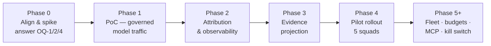

# MDx (AI-Native SDLC Platform) — D2: Design

> **Gate**: D2 — Design | **Status**: Draft | **Epic**: [EACPP-912](https://sunlife.atlassian.net/browse/EACPP-912)
> **Reads on**: [D1 Requirements](d1-requirements.md) · [D0 Discovery](d0-discovery.md) ·
> [MDx High-Level Architecture](reference/MDx-Architecture.md)
>
> Design for alignment between the MDx and ACP teams. §8–§10 carry the phased plan and PoC
> definition that become D3 stories once agreed.
>
> **Re-verified against Luminate `origin/main` @ `284008a19`, 2026-09-08** (previously `48cc106b`,
> 98 commits earlier). G-A, G-B, G-C and G-E were re-checked in the source and all still hold.
> **G-F is now closed** — project chargeback shipped in the interval, and DD-7 is rewritten on it.

---

## 1. Design overview — one governance owner, one enforcement point

**ACP is the Policy Decision Point and the system of record. MDx is a Policy Enforcement Point.**
MDx keeps the local machinery that physically confines execution, because that machinery has to run
on the developer's machine. It keeps no authority and no record.

**Read it as:** every arrow into MDx carries a decision ACP made. Every arrow out carries evidence
of what MDx enforced. MDx presents no governance surface of its own — the only place anyone asks a
governance question is ACP.

### Why not let MDx keep its kernel as a co-authority

It was tempting, because MDx's kernel is genuinely good and already built. It is still the wrong
answer:

- **It defeats the purpose of a control plane.** If MDx keeps governance, the next system does
  too, and Sun Life ends up with the *"inconsistent controls and technical debt"* the D0 set out to
  eliminate.
- **It contradicts the D0's own success criteria** — *"Zero custom audit code required (all audit
  via ACP)"* and *"Future MDx features inherit ACP governance framework automatically."* Neither
  holds if MDx retains its own governance stack.
- **Two audit stores means two answers to a regulator**, and an argument about which is
  authoritative at exactly the wrong moment.
- **A "clean split" of policy ownership does not stay clean.** Boundaries between two live policy
  engines drift, and each drift is a silent governance gap.

---

## 2. Design decisions

### DD-1 — ACP is the system of record; the MDx Ledger becomes an emit buffer

The Ledger stops being a trust root and becomes **transport with durability**: MDx writes
governance events locally so nothing is lost during an ACP outage, then drains them to ACP. ACP
holds the record and answers every governance question.

This is a real concession from MDx, because *"receipts or it did not happen"* is their first
principle. The mechanism survives intact — every consequential action still produces a receipt, and
nothing about local integrity checking changes. What changes is the **claim**: the receipt is no
longer the authoritative record, it is the evidence MDx owes ACP.

It is also the only way to satisfy the D0's *"zero custom audit code"* criterion, which is
otherwise unachievable while MDx maintains an audit store.

**Effort L / Risk High** — high because it touches MDx's kernel protection ring and their stated
first principle. This needs MDx-side design ownership, not an ACP mandate (**OQ-7**).

### DD-2 — `ModelGateway` driver swap is the integration; not a Forge rewrite

The gateway speaks **OpenAI-compatible** chat completions (`backend/app/feedback/inference.py:38`,
confirmed in `local/notebooks/e2e_lg1_authz.ipynb`). MDx already abstracts model access behind
`ModelGateway` in the Runtime ring and has an unfilled `TensorZero model driver` slot. So the
integration is *"add an ACP driver"*, not *"change how Forge works"*.

This is the decision that makes a two-week PoC plausible instead of a quarter of work. It is also
the one carrying an unverified assumption — **OQ-4**.

**Effort S–M / Risk Med** (Med only until OQ-4 is answered).

### DD-3 — The gateway call is made by the server, never the sandbox

MDx scrubs the subprocess environment to a toolchain allowlist and *never* passes provider keys or
credentials. An ACP token is a credential.

The sandboxed process asks the server for a completion; the server holds the credential and makes
the call. This satisfies C2 **and** sidesteps the network-denied proof phase entirely, because the
sandbox never needs egress. **Effort S / Risk Low** — and it is the single most important
structural decision in this design.

### DD-4 — A 403 is a governance event, not an error

`gateway/app/middleware/authz.py` denies with a bare `HTTP 403 Forbidden` before the upstream call.
Naively, an HTTP client treats that as a transport failure. In MDx it must become a
**policy-denial receipt** with a human-legible reason, so a governed block is indistinguishable in
the record from a locally-enforced denial.

Both systems are already fail-closed; this decision makes them fail closed *the same way*.

**Effort S / Risk Low** — but easy to get wrong by omission, and the failure is silent: governance
blocks would look like outages.

### DD-5 — ACP authors all policy; MDx supplies mechanism only

The split is **authority vs mechanism**, not *model policy vs execution policy*:

| Concern | Policy authored by | Enforced by | Status today |
|---|---|---|---|
| Which model may be called, by whom, where | **ACP** | ACP gateway | **Works now** — selector is the model slug |
| Content safety — PII, banned words, Model Armor | **ACP** | ACP gateway, inline | **Works now** — `422` on block |
| Budget / spend ceiling | **ACP** Quotas | ACP (target) → MDx Treasury (interim) | **Blocked on G-A** — quotas are modelled, nothing debits |
| Required execution posture | **ACP** | MDx (Seatbelt / env scrub) | **Blocked on G-D** — no vocabulary to express it |
| Permitted write scope, blocked paths | **ACP** | MDx (path rules) | **Blocked on G-D** |
| Ship-gate conditions | **ACP** | MDx (ship route) | **Blocked on G-D** |
| Worker spawn authorization | **ACP** | MDx | **Blocked on G-D** + MDx kernel work |

The earlier draft proposed a "two-tier, non-overlapping split" where MDx retained execution policy.
That was wrong — two policy authors means two governance systems and the boundary drifts. There is
one author.

**But authority only moves when ACP can hold it.** Four of the seven rows above are blocked on
platform gaps. Declaring ACP the author of execution policy before **G-D** exists would move
authority to a system that cannot express it — a governance regression wearing the right label.
The honest position is: ACP is the author by design *and* by roadmap; the migration lands per gap.

**Effort L / Risk High** — dominated by G-A and G-D, which are Luminate platform work, not MDx work.

### DD-6 — Correlate on request id; do not merge the stores

The gateway's capture middleware records `request_id` on both the `decision` and `access` events
(`gateway/app/middleware/capture.py`). MDx receipts carry their own ids.

Propagating a correlation id across the boundary gives one join key, from which a complete
narrative can be reconstructed — *this intent → this plan → this model call → this policy decision
→ this token spend → this PR* — without either system copying the other's data.

**Effort S / Risk Low.** Cheap now, and effectively unbuildable later if the id is not carried
from the start.

### DD-7 — Identity granularity is the cost-attribution mechanism

**This decision has been overtaken by the platform — for the better.** An earlier revision recorded
gap **G2/G-F** as absent and concluded the D0's chargeback requirement had only two workable
answers, both compromises. `[ACP-577]` has since landed a project chargeback ledger, so the option
this design called "correct long-term shape, not available for the PoC" is available now.

The mechanism is caller-supplied and needs no identity gymnastics:

`x-luminate-project-id` request header → stamped as `luminate_project_id` on the observation →
rolled into `ProjectUsageDaily` (`project_id`, `project_name`, **`cost_centre`**, tokens, cost,
currency) → served at `/api/v1/chargeback/{rows,summary,export}/`.

| Option | How attribution works | Verdict |
|---|---|---|
| **A — one ACP identity per squad** | `entity_id` *is* the squad | **Superseded.** Costs 5 identities plus credential lifecycle per squad, and re-registration every time squads change — an identity model distorted by a billing requirement |
| **B — one identity for Forge, attribute MDx-side** | MDx joins its own squad metadata to spend on `request_id` (DD-6) | **Rejected.** Rebuilds in MDx exactly the reporting the D0 set out to eliminate (NFR-5) |
| **C — project attribution per request** | Forge keeps **one** identity and sets the project header per squad | **Recommended.** No new identities, no credential churn, and `cost_centre` is already the finance system's own coding — the D0's "business unit" ask answered natively |

Two further properties matter. Attribution is stamped even on a **denied** request, so a policy
block is still attributable rather than vanishing from the ledger. And because the header is
per-request rather than per-credential, squad membership can change without touching identity or
credentials at all.

This also relaxes **OQ-2**: identity granularity and chargeback granularity are no longer competing
on one axis. Register **per agent** — which is what policy and attribution need — and attribute
**per project**. What remains for OQ-2 is only the mapping question: whether a squad is a Luminate
project or a cost-centre value.

**Effort S / Risk Low** — one header on the outbound call, plus agreeing the squad → project map.

### DD-8 — Evidence reaches ACP export-first, API-second — but always reaches ACP

Gap **G1**: there is no external evidence-ingest API in Luminate today. Phase the *transport*, never
the *destination*:

1. **Phase 1** — MDx exports a governance-evidence bundle per run; ACP ingests and attaches it.
2. **Phase 2** — switch to the evidence contract once `EACPP-915` T5 lands, with no change to what
   MDx produces.

Designing the payload now and the transport later means the ACP-side gap never becomes an excuse
for MDx to keep the record.

**Effort M / Risk Low.**

### DD-9 — Execution governance is ACP's; MDx is where it is executed

The D0 lists CLI governance as a key open question. MDx has strong *machinery* — Seatbelt
confinement, scrubbed env, path rules, tool-plane decisions, allowlisted proof commands, a
self-modification firewall.

An earlier draft concluded that execution governance should therefore stay MDx's. That was the same
mistake as DD-5: it confuses having the best mechanism with owning the policy. The correct
position is that **ACP declares the required execution constraints and MDx enforces them**, because
only MDx can. The firewall and postures continue to exist; what changes is who decides their
configuration and who holds the record that they held.

This keeps the strong enforcement and still gives Sun Life one governance owner.

**Effort M / Risk High** — requires an ACP-side policy vocabulary for execution constraints that
does not exist yet. See §4.

### DD-10 — No ungoverned fallback; offline is solved by signed policy bundles

An earlier draft offered a choice between failing closed and falling back to direct Bedrock. The
fallback option is not acceptable: an ungoverned path recreates exactly the problem the D0 exists
to solve, and "ungoverned but marked" is still ungoverned.

Offline operation is preserved by **distributing ACP's decisions**, not by substituting local
judgement for them. The bundle is signed, TTL-bounded, and refused on expiry. ACP stays
authoritative in every branch — there is no path where MDx decides.

**This depends on G-C, which does not exist.** Evaluation today is in-process regorus, portal-side
only; `PolicyBundleVersion` is a cache-invalidation counter, not a distributable artifact. Until
G-C ships, MDx offline means **no governed model call** — which is acceptable for the PoC (the
sandbox already has no egress during proof) but not acceptable as the steady state for a local-first
product.

**Effort M / Risk Med** — the MDx side is small; the ACP side is a platform build.

### DD-11 — MDx retires its governance-facing surfaces

Governance is asked and answered in one place. Any MDx surface that presents governance state —
Observatory's evidence dashboard, Concierge's receipt-backed governance answers — is either retired
or re-pointed at ACP as its data source.

MDx keeps operational surfaces: what is running, what needs my judgment, what is the safe next
move. The line is that MDx may show an operator **the state of their work**; it may not be the
place anyone establishes **compliance**.

Requires an inventory (**OQ-6**) — `FirstViewport.svelte` explicitly answers *"what evidence backs
this"*, which is on the wrong side of the line as written.

**Effort M / Risk Med.**

---

## 3. Request path — governed completion

Note the ordering: **MDx evaluates its own execution policy first**, then ACP evaluates model
access. Two gates, different concerns, both recorded (DD-5).

---

## 4. What each side builds

| Component | Side | Description |
|---|---|---|
| ACP `ModelGateway` driver | **MDx** | OpenAI-compatible client in `mdx-core`; base URL + credential config |
| Token manager | **MDx** | `client_credentials` exchange, refresh ahead of 300s expiry, never logged, never in a receipt payload |
| 403 → denial receipt mapping | **MDx** | DD-4 |
| Correlation id propagation | **MDx** | DD-6 — outbound header, recorded on the receipt |
| Degraded-mode handler | **MDx** | DD-10 — enforce cached signed bundle, fail closed on expiry |
| OTLP exporter → Langfuse | **MDx** | `crates/mdx-observability`; moves their OTel substrate off `PENDING-LIVE-RUN` |
| Evidence bundle export | **MDx** | DD-8 phase 1 — projected receipt kinds per run |
| Agent + model registration | **Joint** | Forge and its Bedrock models in the ACP catalog; granularity per OQ-2 |
| Squad identities + credentials | **ACP** | DD-7 option A — one entity per squad, credentials issued and rotated |
| Access policies | **ACP** | Which squad may call which model slug in which environment |
| Cost/usage views | **ACP** | Existing metrics API (S10); no new build if DD-7A is chosen |
| Evidence ingest — external producer profile | **ACP** | **G-B (P0)** — contract exists; needs an authenticated external producer path |
| **Quota enforcement — counter store + debit + gateway check** | **ACP** | **G-A (P0)** — the `rate-limiting` D1 design already specifies it; needs prioritising, plus the `spend` dimension |
| Signed policy bundle distribution | **ACP** | **G-C (P1)** — required by DD-10 for governed offline operation |
| Execution-constraint policy vocabulary | **ACP** | **G-D (P1)** — required by DD-5/DD-9 so ACP can author what it owns |
| Evaluation record + ingest | **ACP** | **G-E (P1)** — no evaluations app exists |
| Caller attribution labels | **ACP** | **G-F — CLOSED.** Shipped as project chargeback (`[ACP-577]`); MDx sets `x-luminate-project-id` (DD-7) |

---

## 5. Non-goals

- Building any governance capability inside MDx — that is the thing this design exists to prevent.
- Preserving the MDx Ledger as an authoritative audit store (DD-1).
- Any ungoverned model path, marked or otherwise (DD-10).
- Forge Fleet multi-agent governance, kill switches, MCP tool governance — all D0 phase 2.
- Production deployment. The PoC targets the ACP dev cluster and pilot squads.

---

## 6. Risks specific to this design

| Risk | Likelihood | Severity | Mitigation |
|---|---|---|---|
| **G-A (quota enforcement) is not prioritised** — ACP owns budgets on paper but cannot stop spend | High | High | Escalate as a platform P0 independent of MDx. The `rate-limiting` D1 design already exists; the ask is scheduling, not design. Interim: Treasury keeps enforcing locally, explicitly labelled as a stopgap |
| **G-B (external audit producer) is not prioritised** — MDx enforcement evidence cannot reach the record | High | High | Platform P0. Interim: export-based bundles (DD-8 phase 1) |
| **G-D (execution policy vocabulary) never lands** — MDx keeps authoring execution policy by default, and single-owner governance quietly fails | Medium | High | Name it as the acceptance condition for "MDx is governed by ACP". Track separately from the PoC so it is not silently dropped once model traffic works |
| Authority migration stalls at MDx's kernel protection ring | High | Medium | Sequence by blocking gap (D1 §7); take model access, guardrails and the record first |
| Exact gateway base path unknown until tested against dev | Medium | Medium | OQ-4 — first Phase 0 task; data-plane routing is config-driven so this cannot be read off the source alone |
| `ModelGateway` does not accept an arbitrary OpenAI-compatible base URL | Medium | High | Spike in Phase 0 alongside OQ-4 |
| Governance blocks read as outages to pilot squads | Medium | Medium | DD-4 — `403` and `422` both become legible denials with reasons |
| 300s token expiry breaks long Forge runs | Medium | Medium | Refresh ahead of expiry; retry-once-on-401; exercise with a long mission |
| Credential rotation with no grace window (G-H) causes a hard failure | Low | Medium | Handle re-auth on 401; avoid rotation during PoC windows |
| Squad → project mapping is not agreed before the pilot, so spend lands in the `unattributed` bucket | Medium | Low | Agree the map in Phase 0; the ledger makes the unattributed bucket explicitly selectable, so drift is visible rather than silent |

---

## 7. What is genuinely undecided

Carried from D1 and blocking D3: **OQ-1** signed bundles + G-C priority · **OQ-2** identity
granularity · **OQ-3** latency budget · **OQ-4** exact gateway base path and ModelGateway seam ·
**OQ-5** authority-migration sequencing against the gaps · **OQ-6** MDx governance-surface inventory ·
**OQ-7** are **G-A and G-B** prioritised on the Luminate roadmap.

**OQ-7 is the gate that matters most**, and it is not an MDx question. MDx onboarding surfaces two
P0 platform gaps — budgets that cannot be enforced and evidence that cannot be ingested from an
external producer. Both are Luminate work, both affect every future onboarding, and neither is
caused by MDx. OQ-4 unblocks the PoC; OQ-1 and OQ-5 shape the programme; OQ-2 and OQ-3 size it.

---

## 8. Phased delivery plan

| Phase | Outcome | Depends on |
|---|---|---|
| **0 — Align & spike** | **OQ-4 first** — confirm the gateway base path against the deployed dev gateway and prove the `ModelGateway` seam. Then OQ-1, OQ-2, OQ-5. Latency baseline captured pre-integration (FR-21). Raise **G-A** and **G-B** as platform P0s. | Joint session |
| **1 — PoC** | One squad's Forge model traffic governed end-to-end, with ACP access policy **and guardrails** enforced. See §9. | Phase 0 |
| **2 — Attribution & observability** | Per-squad identities (DD-7A); OTLP → Langfuse live; cost visible in the metrics API; latency delta reported against the Phase 0 baseline. | Phase 1, OQ-2 |
| **3 — Record moves to ACP** | Governance events emitted to ACP as the system of record (DD-1, DD-8); MDx governance surfaces retired or re-pointed (DD-11). | Phase 1, OQ-5, OQ-6 |
| **4 — Pilot rollout** | All 5 squads; runbooks; degraded-mode behaviour exercised deliberately. | Phases 2–3 |
| **5+ — Authority migration** | Budget authority to ACP Quotas (needs **G-A**); execution policy to ACP (needs **G-D**); governed offline (needs **G-C**); evaluations (needs **G-E**). Each lands when its gap ships — not before. | Luminate platform roadmap |

Phases 2 and 3 are independent and can run in parallel; phase 3 is the one exposed to the ACP
evidence-API gap (G1), which is why it is not allowed to gate phase 2.

---

## 9. PoC definition

**The one question the PoC answers:** *can Forge's model traffic be governed by ACP without
degrading developer velocity or weakening MDx's kernel guarantees?*

### Scope — deliberately narrow

- **One squad**, one MDx workspace, ACP dev cluster (`slf-eks-t1k-ca-dev`).
- **Two agents registered: Forge builder and Twin.** Twin is a separate model consumer (it uses the
  model the operator connected at setup); routing only Forge would leave it ungoverned. Two also
  makes per-agent attribution and per-agent policy *testable* rather than assumed.
- **Model calls go directly to the ACP gateway** from `mdx-core`. `ModelGateway` is the in-process
  code path where the request is built, not a proxy in front of ACP.
- **Differentiated policy**: a model allowed for one agent and denied for the other, to prove
  enforcement distinguishes agents rather than merely working.
- Correlation id propagated; receipts on both outcomes.

### Explicitly out of PoC scope

Workers, Fleet, MCP/A2A paths, evidence projection, budget enforcement, production, multi-squad.

### Exit criteria — all measurable

| # | Criterion | Evidence |
|---|---|---|
| 1 | Forge completes a real build end-to-end with **all** model traffic through ACP | ACP capture events and MDx emitted events reconcile 1:1 on correlation id |
| 2 | A **denied** model returns 403 and is recorded in **ACP** as a policy denial, surfaced to the operator in legible language | ACP record + Forge output |
| 3 | **Latency delta** measured against the Phase 0 baseline and within the OQ-3 budget | p50/p95/p99 per completion, before vs after |
| 4 | **Token usage visible** in `/api/v1/metrics/agent-model-token-timeseries/` attributed to the expected agent, and spend attributed to the expected project in `/api/v1/chargeback/rows/` | Metrics + chargeback API responses |
| 4b | An ACP **guardrail** (PII or banned words) blocks a Forge completion with `422` and is recorded | Deliberate trigger; ACP audit event |
| 5 | **Zero custom audit code** added to MDx; no new governance surface in MDx | Diff review — NFR-6, FR-16 |
| 6 | **Enforcement strength unchanged** — no credential in the sandbox, Seatbelt and path rules still enforced, fail-closed preserved end to end | MDx kernel protection ring review — NFR-2, NFR-3 |
| 7 | With ACP unreachable, MDx enforces the **cached signed bundle** and fails closed on expiry — no ungoverned call occurs | Deliberate outage; ACP record shows no gap |
| 8 | A long-running mission survives **token refresh** across the 300s expiry | Run log |

### What "good" looks like

The PoC succeeds if a pilot squad engineer **cannot tell the difference** in their build loop,
while finance can see that squad's token spend and compliance can trace any model call from intent
to receipt. It fails if velocity drops measurably, or if governance blocks are indistinguishable
from outages.

### The Phase 0 gate

Phase 0 is a gate, not a formality. If **OQ-4** shows `ModelGateway` cannot take an arbitrary
OpenAI-compatible endpoint, stop and re-scope before committing PoC effort — that finding changes
the shape of the work more than anything else in this design.

---

## 10. Toward D3

Once OQ-1, OQ-2 and OQ-4 are answered, D3 stories fall out of §4 (what each side builds) sequenced
by §8 (phases), with §9's exit criteria as the PoC acceptance tests. Deliberately not written yet —
three of the answers would change the story set.

---

## References

- [D0 Discovery](d0-discovery.md) · [D1 Requirements](d1-requirements.md) ·
  [MDx High-Level Architecture](reference/MDx-Architecture.md)
- Luminate verified sources: `gateway/app/middleware/authz.py` ·
  `gateway/app/middleware/capture.py` · `backend/app/feedback/inference.py` ·
  `backend/app/metrics/views.py` · `local/notebooks/e2e_lg1_authz.ipynb`
- ACP dependencies: `EACPP-915` (Governance Mode — evidence contract, G1) ·
  [`governance-intake`](../../governance/governance-intake/d2-design.md) (EACPP-877, DD-10 reference-by-default)
