# MDx × ACP — Integration Brief

> Companion to [D2 Design](d2-design.md) · [D1 Requirements](d1-requirements.md) · Epic **EACPP-912**
> For joint MDx / ACP Product sessions. Detail lives in D1/D2; this is the picture.

---

## 1. The split

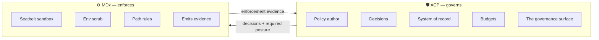

**One rule:** ACP decides and records. MDx executes and reports.
MDx keeps the local machinery — only it can confine a process on a laptop — but keeps **no
authority and no record**, and presents **no governance surface**.

---

## 2. Where MDx plugs in

The governed subjects are **MDx's agents**. Each calls the ACP gateway **directly** — there is no
MDx-side proxy in front of it.

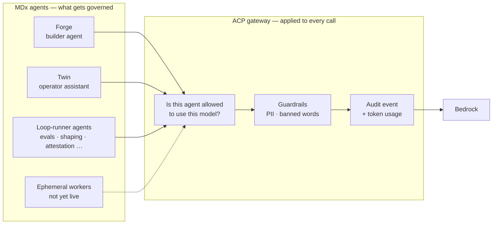

### What actually changes in MDx

`ModelGateway` is MDx's **existing in-process client abstraction** for model calls — the code path,
not a network hop. Changing its endpoint to ACP is the integration.

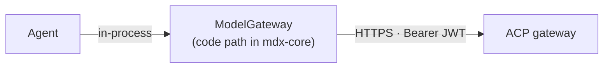

- **Not a proxy chain.** The agent's request goes straight to ACP. `ModelGateway` is where the
  request is *constructed*, so it is the one file to change rather than an extra service to run.
- **One change point, every agent.** All model calls already route through it, so every agent is
  governed at once instead of one at a time.
- **It runs in mdx-core, not the sandbox.** The Forge build subprocess has no credentials and no
  egress, so it cannot call ACP itself — it asks the server, which holds the token.
- **Driver swap, not a rewrite.** The ACP gateway is OpenAI-compatible.

### The three seams

| Seam | What changes |
|---|---|
| Model calls | `ModelGateway` endpoint → ACP |
| Telemetry | OTLP exporter → ACP |
| Evidence | Emit enforcement events → ACP |

Everything else is configuration.

---

## 3. What ACP enforces today

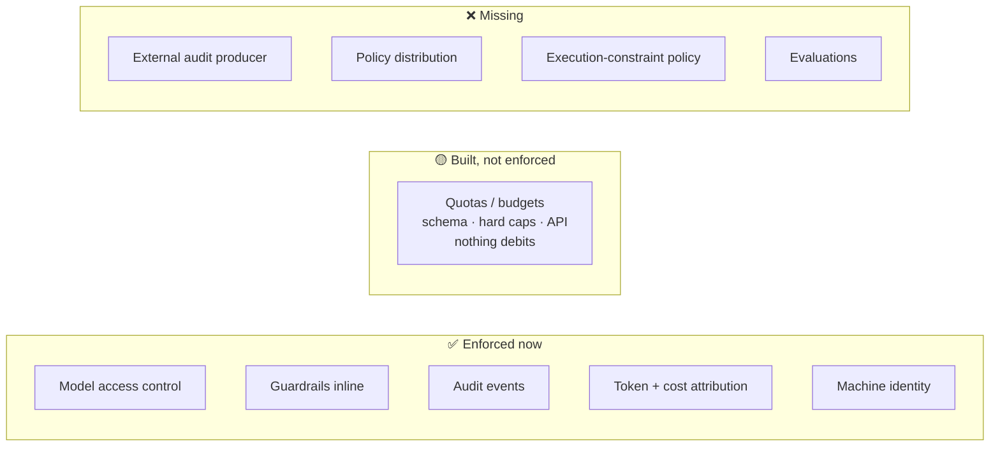

| Priority | Gap | Why it matters |
|---|---|---|
| **P0** | **G-A** quota enforcement | ACP owns budgets but **cannot stop spend**. Design exists, unbuilt |
| **P0** | **G-B** external audit producer | Evidence off the data path **cannot reach the record** |
| **P1** | **G-C** signed policy distribution | No governed offline mode |
| **P1** | **G-D** execution-constraint policy | ACP can't author what it owns |
| **P1** | **G-E** evaluations | No quality/safety evidence |

Neither P0 is caused by MDx. Both affect **every** future onboarding.

---

## 4. Onboarding prerequisites

MDx is not the first workload onto ACP — there is an existing path.

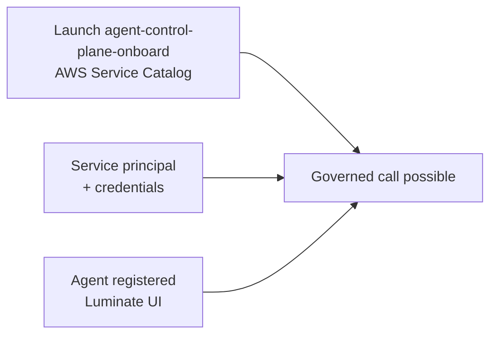

| Step | Owner | Self-serve? |
|---|---|---|
| Launch **`agent-control-plane-onboard`** (AWS Service Catalog) | Workload team | **Yes** |
| Enable Bedrock model entitlements | Account admin | **Yes** |
| Service principal + credentials | ACP product | No — request |
| Register the agent | ACP product (UI) | No — manual |

---

## 5. Reuse vs build

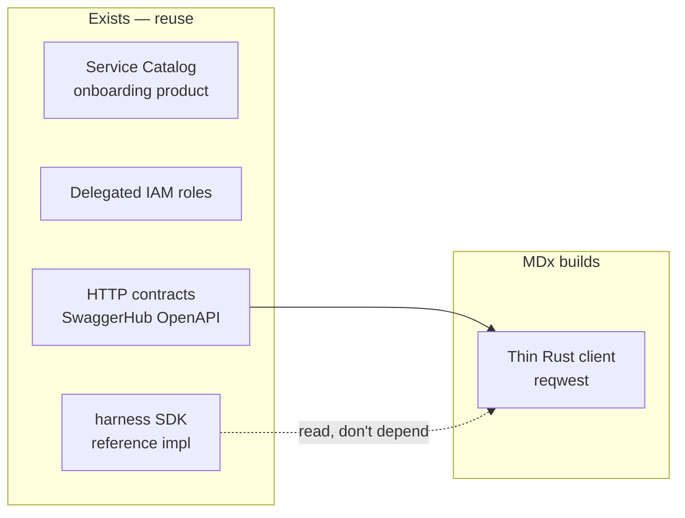

The harness SDK is **Python**; MDx is **Rust**. MDx takes no dependency on it — it targets the
**same HTTP contracts**, using the SDK as the reference implementation for auth, retry and token
refresh. The rest of the onboarding path is language-agnostic and reused as-is.

---

## 6. PoC — ordered steps

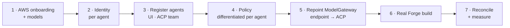

| # | Step | Owner | Notes |
|---|---|---|---|
| 0 | Confirm the gateway base path and that `ModelGateway` accepts it (**OQ-4**) | ACP + MDx | Gate — stop if this fails |
| 0 | Capture latency baseline **before** integration | MDx | Otherwise step 7 is unmeasurable |
| 1 | AWS onboarding done; Bedrock models entitled | ACP platform + workload team | §4 |
| 2 | Credentials for **each agent being registered** | ACP product | One identity per agent — see below |
| 3 | **Register the agents in the Luminate UI** | **ACP product team** | No registration API |
| 4 | Policies that **differ per agent**, plus one deliberate deny; attach guardrails | ACP product | Differentiation is the point — see below |
| 5 | Repoint the `ModelGateway` endpoint at ACP; wire token refresh + correlation id | MDx | Server-side only — never in the sandbox |
| 6 | Run a real Forge build end to end | MDx + squad | Not a synthetic call |
| 7 | Reconcile events 1:1; measure latency; trigger a guardrail | Joint | Exit criteria below |

### Which agents to register

MDx has several model consumers. Registering only one proves plumbing; registering two proves
**governance**.

| MDx agent | Calls models? | In PoC? | Why |
|---|---|---|---|
| **Forge builder** | Yes — the coding loop | **Yes** | The primary use case |
| **Twin** | Yes — operator assistant, uses the model connected at setup | **Yes** | A *separate* consumer with its own model path. Ungoverned if forgotten |
| Loop-runner agents | Some (evals, shaping) | No — follow-on | Adds surface without adding proof |
| Ephemeral workers | Yes, when live | No | `PENDING-LIVE-RUN` upstream |

**Register two: Forge and Twin.** With a single identity you cannot tell whether attribution
actually resolves per agent or just happens to name the only caller — and you cannot demonstrate
that policy distinguishes agents at all. Give them **different model permissions** so the PoC shows
one agent allowed a model the other is denied.

> **Twin is the find worth flagging.** It is a user-facing assistant that reaches a model the
> operator connected during setup. If only Forge is routed through ACP, Twin keeps an ungoverned
> model path — precisely the problem the D0 exists to close.

**Question the PoC answers:** *can MDx's agents be governed per-agent without slowing developers or
weakening MDx's guarantees?*

**Out of scope:** workers · Fleet · MCP/A2A · evidence projection · budgets · production

**Success =** the engineer notices nothing · Finance sees spend · Compliance traces any call.

| # | Exit criterion |
|---|---|
| 1 | All model traffic from **both** agents through ACP; events reconcile 1:1 |
| 2 | Attribution resolves to the **correct agent** — Forge traffic is not attributed to Twin |
| 3 | A model allowed for one agent is **denied** for the other, and the denial is recorded |
| 4 | Guardrail block (422) recorded |
| 5 | Latency delta within agreed budget |
| 6 | Token usage attributed per agent in the metrics API |
| 7 | Zero custom audit code, no new MDx governance surface |
| 8 | Enforcement strength unchanged (no credential in sandbox) |
| 9 | Token refresh survives a long run (300s expiry) |

---

## 7. Roadmap

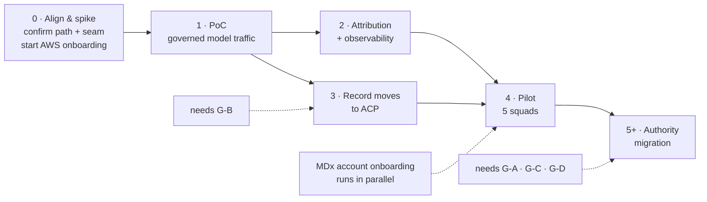

Phases 2 and 3 run in parallel — the audit gap must not block cost attribution.

### Post-PoC: the distributed gateway question

The consortium `distributed-gateway` spec (**EACPP-770**) draws three end states for agent traffic.
Which one is adopted changes MDx's post-PoC shape.

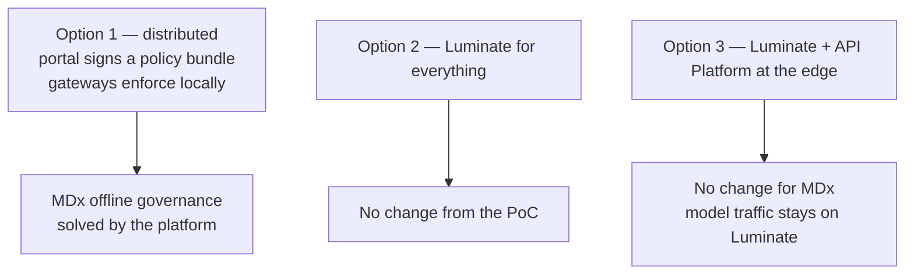

| | Bearing on MDx |
|---|---|
| **Near term** | Spec recommends **Option 3 now, Option 1 as direction of travel**. So the PoC and pilot design stands — central request path |
| **Post-PoC** | If Option 1 lands, its **T14** (signed bundle + local CEL evaluation) closes **G-C** and MDx's local-first offline gap is solved by the platform, not by an MDx mechanism |
| **Do not assume** | T14 is on that spec's critical path but the spec is at **D0** and Option 1 is explicitly the *later* of the two. Design post-PoC work for the central path; treat local enforcement as an upgrade |
| **Corroboration** | Its open decision #2 answers *"exactly one policy authority?"* with **"Yes, and it is Luminate"** — the same position §1 takes |

### Authority migration — gated by capability

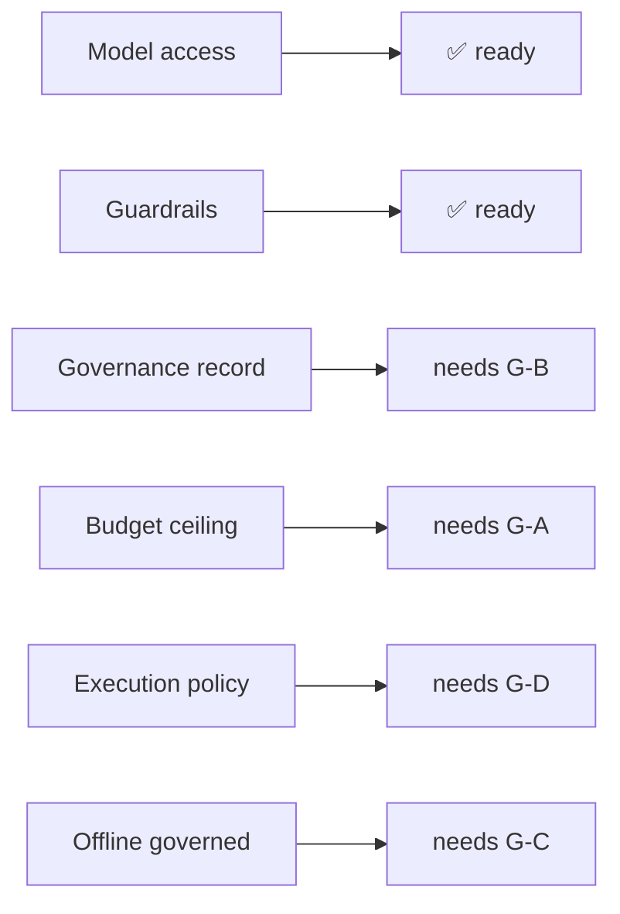

> **Rule:** authority only moves when ACP can hold it.
> Moving budgets before **G-A** replaces an enforced local ceiling with an unenforced remote one.

---

## 8. Who builds what

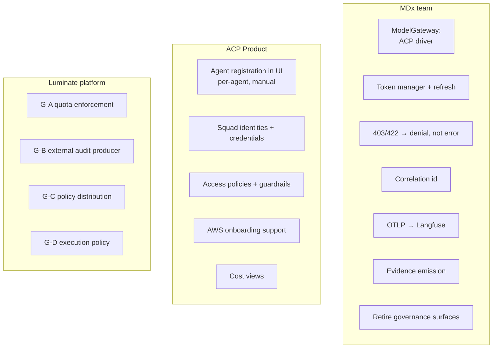

---

## 9. Decisions needed

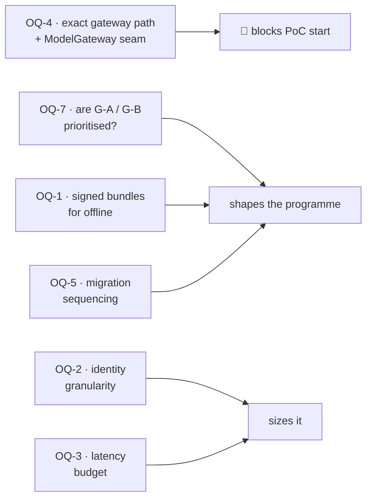

| # | Question | Owner |
|---|---|---|
| **OQ-4** | Exact gateway base path; does `ModelGateway` take an arbitrary OpenAI-compatible URL? | ACP + MDx eng |
| **OQ-7** | Are **G-A** and **G-B** on the Luminate roadmap, and when? | ACP platform |
| **OQ-1** | Signed TTL policy bundles for offline? | ACP + MDx |
| **OQ-5** | Authority migration sequencing | ACP + MDx leads |
| **OQ-2** | Identity granularity. Two axes pull apart: **per agent** is what policy and attribution need; **per squad** is what chargeback needs (G-F). Reconcile before pilot | ACP + MDx + Finance |
| **OQ-3** | Acceptable latency delta — a number | MDx + squads |
| **OQ-6** | Which MDx governance surfaces retire? | MDx product |
| **OQ-8** | Which AWS account does MDx use for Bedrock — its own, or an existing one? | MDx + ACP platform |
| **OQ-9** | Registration is **manual UI** per agent. Two agents is fine; MDx has loop-runners and ephemeral workers to come. What is the path at that scale? | ACP product |

---

## 10. Watch items

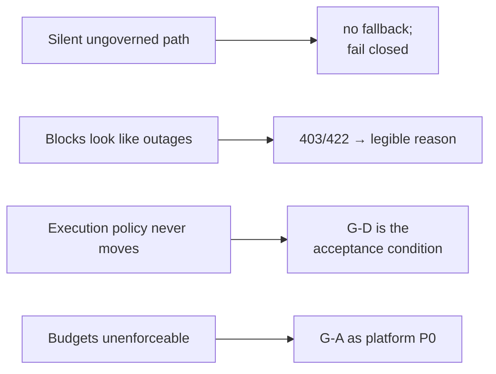

---

**Next:** answer **OQ-4** and **OQ-7** → then D3 stories.
