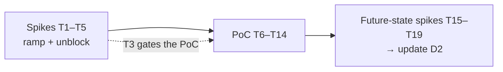

# MDx (AI-Native SDLC Platform) — D3: Implementation Plan

> **Gate**: D3 — Tasks | **Status**: Draft | **Epic**: [EACPP-912](https://sunlife.atlassian.net/browse/EACPP-912)
> **Reads on**: [D0](d0-discovery.md) · [D1](d1-requirements.md) · [D2](d2-design.md) · [Integration Brief](d2-integration-brief.md)
>
> **D0, D1 and D2 approved by MDx on 2026-09-08.** The design is agreed and the PoC proceeds
> against **dev Luminate** (`slf-eks-t1k-ca-dev`) with Forge and Twin. Everything below is now
> execution rather than proposal.

## Reference material

| Document | Where |
|---|---|
| D1 Requirements — capability verdicts, gap register | [Confluence 113135649068](https://sunlife.atlassian.net/wiki/spaces/T1KACP/pages/113135649068) |
| D2 Design — decisions DD-1…DD-11 | [Confluence 113135419712](https://sunlife.atlassian.net/wiki/spaces/T1KACP/pages/113135419712) |
| Integration Brief — diagrams for sessions | [Confluence 113134109034](https://sunlife.atlassian.net/wiki/spaces/T1KACP/pages/113134109034) |
| D0 Discovery | [Confluence 113134961121](https://sunlife.atlassian.net/wiki/spaces/T1KACP/pages/113134961121) |
| **Luminate user guides** (published) | <https://bitbucket-static.sunlifecorp.com/pages/EDAEACP/luminate-user-guides/bb-pages/browse/> |
| MDx architecture (as supplied) | [`reference/MDx-Architecture.md`](reference/MDx-Architecture.md) |
| Consortium distributed-gateway options | `acp-consortium-specs` `specs/distributed-gateway/` (EACPP-770) |

## Sequencing

**T3 is the gate.** If `ModelGateway` cannot take an arbitrary OpenAI-compatible base URL, stop and
re-scope before spending PoC effort.

---

## Spikes — product team ramp and unblock

| Task | Description | Depends |
|------|-------------|---------|
| **T1** [EACPP-1044](https://sunlife.atlassian.net/browse/EACPP-1044) | **Read-in and working session.** Product team reads D1, D2 and the Integration Brief, then runs a joint session with MDx to walk the brief's diagrams. Output: a written list of disagreements and unknowns, not a sign-off. (D2 §1–§2) | — |
| **T2** [EACPP-1045](https://sunlife.atlassian.net/browse/EACPP-1045) | **Get Luminate portal access and prove it.** Each product-team member signs in at the dev portal with **Continue with SSO**, then requests a role binding from the platform admin — *who / what role / which project / why*. Confirm via **IAM → Role Bindings** filtered by name. An empty catalog is an access problem, never an absence problem. (user guides: *Signing in*, *Getting access*, *Roles*) | — |
| **T3** [EACPP-1046](https://sunlife.atlassian.net/browse/EACPP-1046) | **Prove the gateway seam (OQ-4).** Confirm the exact gateway base path against the deployed dev gateway, and confirm with MDx engineering whether `ModelGateway` accepts an arbitrary OpenAI-compatible base URL or needs an `mdx-core` change. Output: the literal URL to call, and a config-vs-code verdict. **Gate for the whole PoC.** (D2 DD-2) | — |
| **T4** [EACPP-1047](https://sunlife.atlassian.net/browse/EACPP-1047) | **Baseline MDx latency before any integration.** Capture p50/p95/p99 per completion on the current direct-to-Bedrock path, and agree the acceptable delta as a number (OQ-3). Without this the PoC's latency criterion cannot be evaluated. | — |
| **T5** [EACPP-1048](https://sunlife.atlassian.net/browse/EACPP-1048) | **Inventory MDx model consumers and governance surfaces.** Confirm which agents call models (Forge builder, Twin, which loop-runners) and which MDx surfaces present governance state — Observatory's evidence dashboard, Concierge's receipt-backed answers, `FirstViewport`'s *"what evidence backs this"* (OQ-6). Output: the agent list for T8 and a retirement list for the D2 update. (D2 DD-11) | T1 |

---

## PoC — governed model traffic for two agents

Ordered. Each task names the Luminate UI path where one exists.

| Task | Description | Depends |
|------|-------------|---------|
| **T6** [EACPP-1049](https://sunlife.atlassian.net/browse/EACPP-1049) | **Create the MDx project in Luminate, and agree the squad → project map.** **Project Explorer → New Project** — Name, Parent Folder (optional), Owner. Every resource belongs to exactly one project and **the project cannot be changed afterwards**, so agree the name and owner before creating. The project is also the **chargeback dimension** — the usage ledger rolls up on `project_id` and carries `cost_centre` — so decide here whether a pilot squad is its own project or a `cost_centre` value within one MDx project, and get the cost centre from Finance. (user guide: *Projects*; D2 DD-7) | T2 |
| **T7** [EACPP-1050](https://sunlife.atlassian.net/browse/EACPP-1050) | **Request the roles needed to register.** **Agent Administrator** on the MDx project for whoever registers agents, **Model Administrator** if models are registered. Note **Editor cannot create** for agents — only Administrator can. (user guides: *Getting access*, *Roles*) | T6 |
| **T8** [EACPP-1051](https://sunlife.atlassian.net/browse/EACPP-1051) | **Register the Forge builder agent.** **Agents → Add Agent** — Agent Name, Agent Key (**permanent**, lowercase-and-hyphens), Project (**permanent**), Type, Framework, Deployment Type. (user guide: *Register an agent*) | T7, T5 |
| **T9** [EACPP-1052](https://sunlife.atlassian.net/browse/EACPP-1052) | **Register Twin as a second agent.** Same form. Registering two is what makes per-agent attribution and per-agent policy testable — with one identity you cannot tell whether attribution resolved or merely named the only caller. Twin is a distinct model consumer; leaving it out leaves an ungoverned model path. (D2 §9) | T7, T5 |
| **T10** [EACPP-1053](https://sunlife.atlassian.net/browse/EACPP-1053) | **Confirm the models are registered and reachable, and note the Gateway Slug.** The slug is what agent code references and is stable — changing it later changes every caller. Request the offering and provider credentials from the platform admin if the models are not already available. (user guide: *Register a model*) | T7 |
| **T11** [EACPP-1054](https://sunlife.atlassian.net/browse/EACPP-1054) | **Request differentiated access policies.** Tell the platform admin which models each agent may call, deliberately giving Forge and Twin **different** permissions so the PoC can demonstrate a cross-agent denial. Policies are platform-admin-created; builders cannot self-serve them. Attach guardrails at the same time. (user guide: *Register an agent* step 3, *Granting access*) | T8, T9, T10 |
| **T12** [EACPP-1055](https://sunlife.atlassian.net/browse/EACPP-1055) | **Request credentials per agent.** Resource → **Deployments** tab → select deployment → **Generate Credentials**. The **secret is shown once** — have it pasted directly into the secret store as it is issued, never sent by email or chat. Exactly **one active credential per (resource, gateway)**; a second issue attempt returns a conflict. (user guide: *Issuing credentials*) | T11 |
| **T13** [EACPP-1056](https://sunlife.atlassian.net/browse/EACPP-1056) | **Point the `ModelGateway` endpoint at ACP and wire the client.** Base URL, Bearer JWT, token refresh ahead of the 300s expiry, retry-once-on-401, and correlation-id propagation. **Set `x-luminate-project-id` on every outbound call** using the map agreed in T6 — this is what makes spend attributable without minting an identity per squad, and spend without it lands in the ledger's `unattributed` bucket. Runs in `mdx-core` only — the ACP token must never enter the execution sandbox. Map a `403` (policy) and a `422` (guardrail) to policy-denial outcomes, not transport errors. (D2 DD-3, DD-4, DD-7) | T3, T12 |
| **T14** [EACPP-1057](https://sunlife.atlassian.net/browse/EACPP-1057) | **Run a real Forge build end to end and evaluate.** Not a synthetic call. Then reconcile ACP capture events against MDx-emitted events 1:1 on correlation id, confirm attribution resolves to the right agent, **confirm the spend lands against the expected project and `cost_centre` in `/api/v1/chargeback/rows/` with nothing in the `unattributed` bucket**, trigger the cross-agent denial and a guardrail block, measure the latency delta against T4, and confirm token refresh survives a long run. | T13 |

### PoC exit criteria

| # | Criterion |
|---|---|
| 1 | All model traffic from **both** agents flows through ACP; events reconcile 1:1 on correlation id |
| 2 | Attribution resolves to the **correct agent** — Forge traffic is not attributed to Twin |
| 3 | A model allowed for one agent is **denied** for the other, and the denial is recorded in ACP |
| 4 | A guardrail block (`422`) is recorded |
| 5 | Latency delta within the number agreed in T4 |
| 6 | Token usage attributed **per agent** in `/api/v1/metrics/agent-model-token-timeseries/` |
| 6b | Spend attributed **per project and cost centre** in `/api/v1/chargeback/rows/`, with none of the PoC's spend in the `unattributed` bucket |
| 7 | No custom audit code added to MDx, and no new MDx governance surface |
| 8 | Enforcement strength unchanged — no credential in the sandbox, Seatbelt and path rules still enforced |
| 9 | Token refresh survives a long-running mission across the 300s expiry |

### Known traps

Pre-empted from the Luminate troubleshooting guide so they are not diagnosed live:

| Symptom | Cause | Action |
|---|---|---|
| Catalog appears empty | No role binding — the default for a new account | Request a role (T2, T7). It is never absence |
| Button visible but action fails | The portal does not hide actions you lack permission for | Check the role binding |
| Registered but the URL does not respond | Not deployed | Deployment is platform-admin only |
| Deployed but never appears | Silently **skipped** — bad URL or unsupported transport | Ask the admin for the skip list; users cannot see it |
| Calls rejected at the gateway | Missing or expired credentials | Check the token; rotate if needed |
| Catalog entry will not delete | A deployment still exists | Remove the deployment first |

---

## Future-state spikes — post-PoC design, feeding the D2 update

| Task | Description | Depends |
|------|-------------|---------|
| **T15** [EACPP-1058](https://sunlife.atlassian.net/browse/EACPP-1058) | **Design evidence emission to ACP (G-B).** MDx emits enforcement evidence — work classification, execution posture, tool-plane decisions, ship-gate and self-delivery events, worker lifecycle. The audit envelope exists (`luminate.audit.v1.CaptureIngest`, dedup on `producer_event_id`, append-only) but has **no external producer path**. Design the payload against the existing envelope now and the transport when the producer profile lands. Output: evidence payload spec + a D2 update. (D1 G-B, D2 DD-8) | T14 |
| **T16** [EACPP-1059](https://sunlife.atlassian.net/browse/EACPP-1059) | **Design the budget and quota position (G-A).** ACP owns budgets — schema, hard caps and authoring API all exist — but nothing debits a counter and the gateway has no quota awareness (**AIC-43**, To Do). Decide what MDx's Treasury does in the interim and what changes when enforcement lands. Note `spend` is deferred upstream, so a true cost ceiling needs that dimension. Output: a D2 update and a platform ask. (D1 G-A, D2 DD-5) | T14 |
| **T17** [EACPP-1060](https://sunlife.atlassian.net/browse/EACPP-1060) | **Design governed offline operation (G-C).** Signed, TTL-bounded policy bundles evaluated locally, fail-closed on expiry. This is **T14** of the consortium `distributed-gateway` spec (EACPP-770) and on its critical path — but that spec recommends *Option 3 near-term, Option 1 as direction of travel*, so design for the central path and treat local enforcement as an upgrade. Output: a D2 update and an explicit dependency on EACPP-770. (D1 G-C, D2 DD-10) | T14 |
| **T18** [EACPP-1061](https://sunlife.atlassian.net/browse/EACPP-1061) | **Design the execution-policy vocabulary (G-D) and the authority migration.** ACP cannot currently express required sandbox posture, permitted write scope or blocked paths, so MDx keeps authoring execution policy by default — the point at which the single-governance-layer position quietly fails. Sequence the migration against its blocking gaps. **The identity-granularity tension is resolved** — G-F closed, so register per agent and attribute per project (D2 DD-7); what remains of OQ-2 is confirming the T6 map holds once more than one squad is on. Output: a D2 update and a platform ask. (D1 §7, D2 DD-5, DD-9) | T14 |
| **T19** [EACPP-1062](https://sunlife.atlassian.net/browse/EACPP-1062) | **Fold T15–T18 into D2 and advance the gate.** Update the design decisions, the gap register and the authority-migration table with what the spikes settled; re-sync Confluence. | T15, T16, T17, T18 |

---

## Definition of Done

- Product team has portal access, has run the read-in session, and has recorded its disagreements.
- The gateway seam is proven or the PoC is re-scoped on the evidence.
- Forge and Twin are registered, governed, differentiated by policy, attributable per agent, and their spend attributable to the right project and cost centre.
- A real Forge build runs end to end with all nine exit criteria evidenced.
- T15–T18 have produced concrete design positions, and D2 reflects them.

## Out of scope

Ephemeral workers (`PENDING-LIVE-RUN` upstream) · Forge Fleet · MCP and A2A paths · budget
enforcement · evidence projection beyond the T15 design · production deployment · multi-squad rollout.
