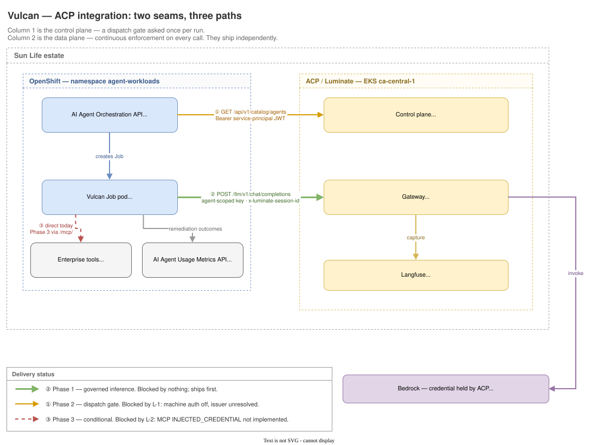
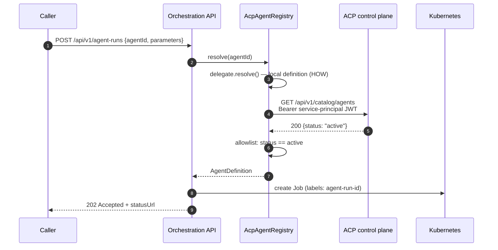
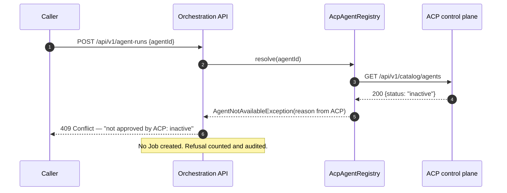
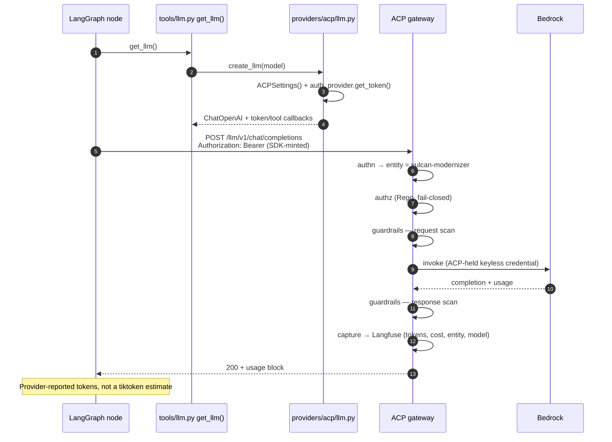
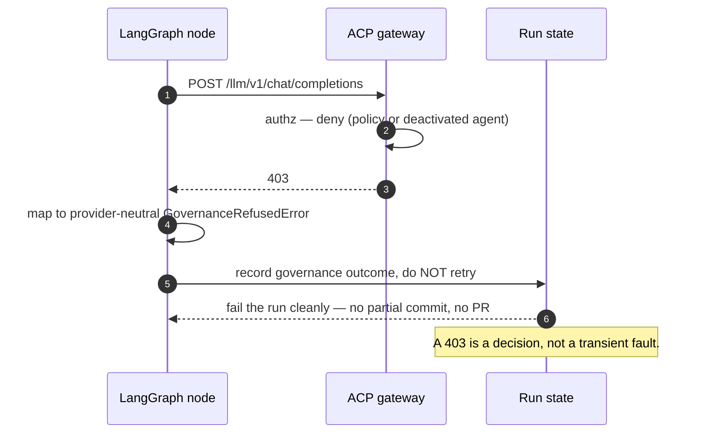
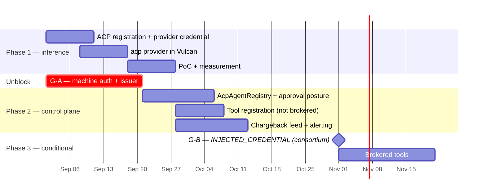

# Vulcan Onboarding — D2: Design

> **Gate**: D2 — Design | **Status**: **Approved 2026-09-03** | **Epic**: [EACPP-1133](https://sunlife.atlassian.net/browse/EACPP-1133)
>
> Satisfies [D1 Requirements](d1-requirements.md). Verified against
> `AGI/vulcan-agent-langchain` @ `main`, `AGI/ai-agent-orchestration-api` @ `main`,
> `Code/Luminate/luminate` @ `origin/main` `89356d74` (re-verified 2026-08-30) and
> `luminate-sunlife-deploy` @ `origin/main` `623f1b2`.



*Source: [`diagrams/vulcan-acp-architecture.drawio`](diagrams/vulcan-acp-architecture.drawio) —
edit in draw.io and re-export the SVG alongside it.*

## 1. Design overview — two seams, two deliveries

The design is deliberately not one integration. Column 1 and column 2 attach to different
repositories, fail differently, and depend on different unblocks. Coupling them would mean the
issuer question (G-A) holds up inference, which is the half that is ready.

| Path | Delivers | Blocked by | Ships |
|---|---|---|---|
| ① Approval check | FR-1 – FR-5 | **G-A / [L-1](d1-requirements.md#l-1)** — machine auth off, issuer unresolved | Phase 2 |
| ② Governed inference | FR-6 – FR-11 | nothing | **Phase 1** |
| ③ Brokered tools | FR-12 – FR-14 | **G-B / [L-2](d1-requirements.md#l-2)** — `INJECTED_CREDENTIAL` not implemented | Phase 3, conditional |

The dashed line on ③ is the honest state of it. Nothing in this design pretends otherwise.

---

## 2. Design decisions

### DD-1 — Use `acp-harness-sdk` for auth and config; `ChatOpenAI` for the chat model itself

`acp-harness-sdk` is the platform's supported way for a workload to reach ACP ([INT-09](../../../capability-map.md)),
and it explicitly covers "Kubernetes, a container" — which is what a Vulcan Job is. It is used
here. But it does **not** replace the chat model, and the reason is specific rather than
dismissive.

**What the SDK gives Vulcan, and is used for:**

| Module | What it provides | Requirement it serves |
|---|---|---|
| `auth.py` | `LuminateAuthProvider` / `OktaAuthProvider` — expiry-aware token cache, `get_token(force_refresh=True)`, `get_expires_in()` | **FR-11** — a credential that outlives a long remediation run, refreshed without agent-visible failure |
| `config.py` | `ACPSettings`, `ACP_TARGET=luminate`, the `ACP_*` env convention | Vulcan configures like every other onboarded workload rather than inventing its own keys |
| `mcp_gateway.py` | `gateway_mcp_url()`, `gateway_mcp_headers()` | Phase 3 tool brokering (DD-8), when [L-2](d1-requirements.md#l-2) lands |

**What it does not give Vulcan — a LangChain chat model.** `GatewayClient` is a raw httpx client:
`chat(messages) -> ChatResult`, `complete(prompt)`, `list_models()`. The package declares only
`httpx`, `pydantic` and `pydantic-settings`; there is **no LangChain anywhere in it**, and no
`bind_tools`. Vulcan is a LangGraph application whose remediation nodes bind repository
read / write / replace tools to the model — that needs LangChain's tool-calling interface, which a
`ChatResult` dataclass cannot satisfy.

The adapter that would close this is already specified — `ACPChatModel` / `ACPToolkit` under the
harness SDK's **US-P3 Framework Adapters** — but its acceptance criteria are unchecked and it is
listed among the capabilities not present in the shipped version. So it is a real gap with a
named consumer, not an argument against the SDK: see [L-10](d1-requirements.md#l-10).

Until it lands, the chat model is LangChain's own `ChatOpenAI` pointed at the gateway, built from
SDK-resolved configuration and an SDK-minted token:

```python
# src/vulcan/providers/acp/llm.py
def create_llm(*, model: str, temperature: float = 0, timeout: int = 120) -> BaseChatModel:
    """Chat model served by the ACP gateway.

    Swap the body for the SDK's ACPChatModel once US-P3 ships; the call site
    and every agent node stay unchanged.
    """
    settings = ACPSettings()                      # ACP_TARGET=luminate, gateway URL, agent id
    token = auth_provider(settings).get_token()   # cached, refreshed near expiry
    return ChatOpenAI(
        model=model,
        base_url=f"{settings.gateway_llm_url}/v1",
        api_key=token,
        temperature=temperature,
        timeout=timeout,
    )
```

**Alternatives considered.** Driving `GatewayClient` directly and writing a LangChain adapter
inside Vulcan (rejected: that adapter is `ACPChatModel`, it belongs in the SDK where every
LangGraph workload gets it, and forking it into one consumer is how a platform ends up with five
of them). Keeping `ChatBedrockConverse` and pointing it at ACP (rejected: it signs SigV4, which
the gateway does not want and Vulcan would then still need AWS credentials for, defeating the
point).

Two consequences worth stating. **Provider-reported usage arrives for free** — `ChatOpenAI`
surfaces the `usage` block, which LangChain's callback machinery already reads, so FR-9 is
satisfied by the same change as FR-6. And because the seam is `get_llm()`, migrating to
`ACPChatModel` later is a change inside one function, not a change to any agent.

### DD-2 — Additive, config-switched, and the interim path stays

`llm.provider` gains a third value. `github` and `bedrock` are untouched.

```yaml
llm:
  provider: acp          # github | bedrock | acp
  model: <acp-registered-model-id>
  acp:
    timeout_seconds: 120
    # Gateway URL, target and credentials come from the SDK's ACP_* settings
    # (ACPSettings) rather than being restated here — see DD-1.
```

This mirrors `BedrockLLMConfig` in shape — a nested dataclass under `LLMConfig`, resolved in
`load_config` — but deliberately does **not** restate the gateway URL or a key env-var name. Those
are the SDK's `ACP_*` settings, and duplicating them into `vulcan.yaml` would create two places to
change when the gateway host moves. No new pattern is introduced.

This is the decision that makes the September fork harmless. Vulcan ships the interim Bedrock
path; when ACP is ready, the migration is one key in `vulcan.yaml` and one Secret swap in
`agents.json`. **No rebuild, no re-integration, and it reverts the same way** (NFR-10).

### DD-3 — ACP decides *whether*; Vulcan's registry keeps deciding *how*

The natural over-reach here is to move `agents.json` into ACP. That is the wrong split.
`agents.json` carries image, args, `envFrom`, resources, timeout and retry limit — Kubernetes
workload policy, owned by the orchestrator because the orchestrator is what enforces it. ACP has
no equivalent and should not grow one.

So `AcpAgentRegistry` **decorates** rather than replaces:

```java
// resolve() delegates to the local definition for HOW,
// then asks ACP whether the agent may run at all.
public AgentDefinition resolve(String agentId) {
    AgentDefinition definition = delegate.resolve(agentId);   // JsonAgentRegistry
    AcpApproval approval = acpClient.approval(agentId);        // authority for WHETHER
    if (!approval.permitsDispatch()) {
        throw new AgentNotAvailableException(agentId, approval.reason());
    }
    return definition;
}
```

The `AgentRegistry` interface does not change. `JsonAgentRegistry` does not change. The
orchestrator selects the implementation by configuration, so local development and CI run
without ACP.

**Alternatives considered.** ACP serving the full definition (rejected: ACP would have to model
Kubernetes workload policy it has no concept of, and Vulcan would lose the ability to run
standalone). A sidecar doing the check (rejected: adds a hop and a deployment unit for one HTTP
call).

### DD-4 — Fail closed, with a bounded and explicit exception

FR-3 requires a declared posture. The design chooses **fail closed** — if ACP cannot be reached,
the submission is refused — with one bounded exception: a **positive** approval may be cached for
a configured TTL, so a brief ACP blip does not stop a batch mid-flight.

| Situation | Behaviour |
|---|---|
| ACP says approved | Dispatch. Cache the positive result for `acp.approval.cache-ttl` (default 5 minutes) |
| ACP says not approved | Refuse. **Never cached**, and a negative result evicts any cached positive |
| ACP unreachable, fresh positive cached | Dispatch, log `acp_approval_stale`, count it |
| ACP unreachable, no fresh cache | **Refuse**, log `acp_approval_unavailable` |

The asymmetry is the point: caching a *yes* trades a small window of staleness for batch
resilience; caching a *no* would mean an ACP outage could not stop a running fleet, which is the
opposite of what this control is for. The TTL is deliberately shorter than any realistic incident
response, and the stale-dispatch counter is an alertable signal rather than a debug line.

`AgentNotAvailableException` already maps to `409 Conflict` (FR-2). It gains the ACP reason, so
the refusal names its decider rather than looking like a Vulcan bug.

### DD-5 — Status mapping is an allowlist, not a translation table

Vulcan's `DRAFT`/`ACTIVE`/`DEPRECATED`/`REVOKED` and ACP's
`active`/`inactive`/`deprecated`/`unknown` do not correspond, and `REVOKED` — the state that
matters most — has no ACP equivalent (G-F). They also differ in case on the wire: `agents.json`
carries `"status": "ACTIVE"`, while ACP serialises the lowercase value. Comparing them
case-insensitively would quietly equate two vocabularies that are not equivalent.

Rather than a bidirectional mapping that will rot, the orchestrator applies an allowlist against
the exact ACP value:

```
permitsDispatch  ⇔  acpStatus.equals("active")     // exact, case-sensitive
```

Everything else — `inactive`, `deprecated`, `unknown`, and any value ACP adds later — refuses.
An unrecognised status is a refusal, not a warning. This is the only mapping that stays correct
when ACP's enum changes without the orchestrator being redeployed.

`REVOKED` is expressed as ACP `inactive` plus a governance attribute, so the distinction survives
for reporting even though it does not change the dispatch decision.

### DD-6 — Agent-scoped credentials are the attribution mechanism

Whatever the credential is, it must resolve at the gateway to **one** Vulcan agent. Vulcan issues
one per agent per environment:

| Agent | Credential | Resolves to |
|---|---|---|
| `vulcan-modernizer` | SDK client-credentials in Secret `acp-harness-modernizer` (fallback: agent-scoped `lum_…`) | ACP agent entity `vulcan-modernizer` |
| `vulcan-sast-fixer` | SDK client-credentials in Secret `acp-harness-sast-fixer` (fallback: agent-scoped `lum_…`) | ACP agent entity `vulcan-sast-fixer` |

This is what makes FR-7 and FR-18 work without a downstream join: the gateway stamps
`luminate_entity_id` from the credential, Langfuse attributes cost per entity and per model, and
Modernizer spend separates from SAST Fixer spend because the credentials differ — not because
someone tagged a request correctly.

A single shared Vulcan key was considered and rejected for exactly that reason: it would make
per-agent cost a reporting exercise instead of a property of the data.

**What this changes about the credential.** An earlier draft of this design accepted a
long-lived `lum_` key sitting in a Kubernetes Secret, on the grounds that short-lived credentials
were hard across a run spanning a full build and scan cycle. That is no longer true: the harness
SDK's auth providers already cache a token and refresh it near expiry (DD-1), so the Phase 1
credential should be an SDK-minted client-credentials token, not a static key. A static
agent-scoped key remains the fallback if the issuer work behind [L-1](d1-requirements.md#l-1) has
not completed — it is still strictly better than the AWS credential it replaces, being scoped to
one agent, centrally revocable and carrying no cloud-account blast radius — but it is the
fallback, not the design.

### DD-7 — Correlate on the run identifier; do not merge the stores

Vulcan already publishes to the AI Agent Usage Metrics API, and that API already owns things ACP
will never know: Snyk vulnerability counts before and after, Checkmarx scan identifiers and fix
iterations, the pull-request URL. ACP will own things the usage API currently guesses at: the
real model, provider-reported tokens, and cost.

Neither should absorb the other (FR-16). They are also fed differently, which is why neither can
substitute for the other: ACP's record is produced *on the path*, by the gateway, whether or not
Vulcan cooperates. The usage API's record is *published by Vulcan* after the run, and only Vulcan
knows those facts.

| Fact | Source of truth | Today |
|---|---|---|
| Model identity | **ACP** | `cfg.pr.model or "gpt-5.4"` — a hardcoded literal |
| Input / output tokens | **ACP** | `tiktoken` client-side estimate |
| Cost | **ACP** | does not exist |
| Guardrail and policy outcomes | **ACP** | do not exist |
| Vulnerabilities before / after | **Usage API** | correct today |
| Fix iterations, PR URL, run status | **Usage API** | correct today |
| Node timings | **Usage API** | correct today |

The join key is the identifier the orchestrator **already** stamps on the Job:
`agi.sunlife.ca/agent-run-id`. Inventing a second identifier when a correct one already exists
would be the easiest avoidable mistake in this design. It travels three ways:

| Destination | Carrier |
|---|---|
| The Job container | Environment variable, set from the label the orchestrator already writes |
| ACP | `x-luminate-session-id` on every gateway request. The gateway sanitises it, namespaces it as `{entity_type}:{entity_id}:{raw}` and maps it to the Langfuse session id |
| The usage metrics API | The `executedBy` / correlation field, currently empty and explicitly undecided |

Two properties of the ACP side are worth knowing because they remove work. The namespacing means
two agents sending the same raw `run-1` do not collide, and a caller cannot attribute traffic to
another principal's session. And if the header is absent the gateway falls back to the
`traceparent` trace-id, so an OTel-instrumented caller gets run grouping with no change at all.
Nothing is invented when the caller declares nothing, which is why sending the header explicitly
is the requirement rather than an optimisation.

The limit is on the read side, not the write side: the session groups the run in Langfuse, but the
chargeback ledger has no run dimension ([L-3](d1-requirements.md#l-3)). Correlation is solved;
retrieving a per-run cost from the finance-facing surface is not.

`aiModel` in the usage payload changes from the hardcoded fallback to the model ACP resolved.
That is a one-line fix that only becomes possible once ACP is on the path.

### DD-8 — Tools: register now, broker later, and split by trust boundary

Every Vulcan tool is a direct CLI or REST call authenticated by its own functional-ID token. To
be governed, each needs an MCP server in front of it, and that server's backend authentication
mode would be `INJECTED_CREDENTIAL` — **which is not implemented** (G-B). A server declared in
that mode today is served like `GATEWAY_IDENTITY`, with *no credential sent*, so it fails rather
than falling back to something unsafe.

The design therefore splits column 2b in two:

**Phase 2 — registration.** Register Bitbucket, Snyk, Checkmarx and Jenkins in ACP's MCP registry
with owner, approval state and access level, and bind them to the two Vulcan agents. This is
achievable now and delivers real value: inventory, named owners, and policy authoring. Every
artefact reporting it says **"registered, not brokered"**. It is not enforcement and must never be
counted as such.

**Phase 3 — brokering, conditional on G-B.** When `INJECTED_CREDENTIAL` lands, tools move behind
`/mcp/` one at a time, starting with Bitbucket.

**The design constraint that survives both phases.** `AccessPolicyTargetType` offers
`mcp_server`, `agent`, `model`, `location` and `environment` — **none of them a tool**.
`AccessPolicy.allowed_tool_ids` exists on the model and in the serializer, but at runtime it
appears only inside `audit_snapshot()`. **There is no per-tool authorization.** So the finest
boundary policy can name is the MCP server, and the way to get real separation is to define
servers along trust boundaries rather than along vendor lines:

| Server | Contains | Why separate |
|---|---|---|
| `bitbucket-read` | clone, read refs, read PRs | Read-only. Broad access is tolerable |
| `bitbucket-write` | push, create/update pull request | The mutating surface. Narrow policy, separate approval |
| `scanners-read` | Snyk scan, Checkmarx findings | Read-only against a separate credential domain |
| `jenkins-trigger` | trigger and poll a branch build | Causes side effects in CI; separate again |

This does not remove G-B. It means that when brokering arrives, the policy is expressed on
something ACP can actually enforce, instead of on `allowed_tool_ids`, which it cannot.

### DD-9 — ACP is the meter, not the biller

The chargeback conversation collapsed two different things. Separating them is most of the
design work (FR-19).

| Responsibility | Owner | Mechanism |
|---|---|---|
| Hold the provider relationship and the credential | **ACP** | `ProviderAuthMethod.KEYLESS` (IRSA) in the ACP account — no secret stored, no consumer-side AWS account |
| Meter consumption per request | **ACP** | Langfuse: cost per request, per model, per entity |
| Attribute consumption to a cost centre | **ACP** | `cost_centre` is a first-class column on the usage ledger, not a tag to be joined |
| Expose the feed | **ACP** | `/api/v1/chargeback` — `rows`, `summary`, streaming CSV `export`, filtered by cost centre, entity type, model and period |
| Reconcile against the automated cloud cost distribution | **Cost-management function** | The existing metric-driven cost-centre distribution |
| Recover from consuming teams | **Use case + finance function** | The use case holds the run→requester mapping; ACP does not know who asked |
| Dispute handling | **Use case + finance function** | — |

The consolidation being reached for is real: if every team brings its own provider account, every
team builds a recovery mechanism. Centralising inference in ACP means one metering point and one
billing relationship. **But ACP is not a billing system**, and the design should not let it drift
into becoming one. It produces attributable usage; the finance function decides what that costs
whom.

Routing all charges to the use case's cost centre and recovering by consumer from there is
compatible with this design and is the recommended starting point, because ACP already knows the
run and the use case already knows the requester. It needs sign-off from the cost-management
function before build, not after.

**The one thing this table asserts that the platform cannot yet do.** The feed is period-shaped:
`ProjectUsageDaily` aggregates by `usage_date`, cost centre, entity and model, and carries **no
run dimension**. Cost-centre chargeback is served. *"What did this remediation cost"* is not — it
exists only as a Langfuse session grouping, which is not the surface the finance path reads.
That is [L-3](d1-requirements.md#l-3), and it is a small, well-shaped addition that this use case
is the first to need concretely. The related constraint is that the feed's authorization is a
stopgap pending the portal RBAC cutover ([L-6](d1-requirements.md#l-6)), so a machine consumer has
no proper permission to hold yet.

### DD-10 — The spend requirement stands; what ships now is detection

A per-run spend limit is a stated requirement (FR-20) and it stays on the record regardless of
what the platform can do today. The precise position:

- The quota **authoring** model is real and good — dimensions, periods, selectors, approval
  routing. A quota can be created.
- **Nothing debits it.** The gateway tree contains zero quota references; `matched_quota_ids` is
  recorded on a span and returned on the decision. That is telemetry (G-C, [L-4](d1-requirements.md#l-4)).
- **Spend cannot be expressed at all.** The dimension enum stops at requests and tokens;
  `dimension=spend` is a later phase behind the pricing catalogue (G-D,
  [L-5](d1-requirements.md#l-5)). This is a stronger statement than "not enforced" and is the one
  most likely to be misheard.

So what ships now is **detection**: threshold alerts computed from ACP's usage and cost data, per
agent and per period. It is real and it is useful. It is not a cap, and every dashboard, report
and finance-facing artefact that carries it is labelled **"monitoring, not enforcement"**. The
moment that label is dropped, someone downstream plans as though a limit exists.

The corresponding platform action is not to re-specify anything — a design and a working
prototype already exist for the counter store. It is to attach this use case to that track as a
named consumer, which is what L-4 and L-5 are for.

### DD-11 — Containment is two-layer, and the propagation number is measured

An agent that edits source and opens pull requests across the estate is precisely the case where
"stop it" has to mean something. ACP's kill switch is a status edit (G-E) — an inactive agent
drops out of the *next* policy bundle, and there is no stop endpoint, no cascade and no audited
stop event.

The containment path is therefore both layers:

1. **Stop new runs** — deactivate the agent in ACP (which also refuses at the gateway once the
   bundle propagates) **and** stop dispatch at the orchestrator. The orchestrator layer is
   immediate; the ACP layer is not.
2. **Stop in-flight runs** — delete the Kubernetes Jobs. Kubernetes remains the final enforcement
   mechanism, exactly as the orchestrator's own architecture document states.

**The bundle propagation interval must be measured for Vulcan and published as a number.** It
must never be quoted from a design document. A containment procedure whose timing nobody has
measured is a procedure nobody can rely on, and this is the specific measurement the PoC exists
to produce (§7).

---

## 3. Request paths

### Flow 1 — dispatch with approval (column 1)





### Flow 2 — governed inference (column 2a)



### Flow 3 — governance refusal mid-run



The last note is the load-bearing one. Vulcan's existing metrics client retries `429`, `500`,
`502`, `503` and `504` with linear backoff. A `403` must not join that set: retrying a policy
refusal turns one denied call into a burst of denied calls and buries the governance signal
(FR-10).

---

## 4. Configuration design

### Vulcan agent — `vulcan.yaml`

```yaml
llm:
  provider: acp
  model: <acp-registered-model-id>
  acp:
    timeout_seconds: 120
```

### Gateway reachability and identity — SDK environment

Set on the Job, read by `ACPSettings`. This is the same shape every other onboarded workload
uses, which is the point of taking the SDK for configuration (DD-1):

```bash
ACP_TARGET=luminate
ACP_GATEWAY_LLM_URL=https://<acp-gateway-host>/llm
ACP_AGENT_ID=<registered agent id>          # vulcan-modernizer | vulcan-sast-fixer
ACP_LUMINATE_CLIENT_ID / ACP_LUMINATE_CLIENT_SECRET   # from the mounted Secret
```

### Agent definition — `agents.json`

```diff
   {
     "id": "vulcan-modernizer",
     "status": "ACTIVE",
     "image": "…/devopsagi/ai-agent-vulcan:<tag>",
     "args": ["vulcan", "modernize", "$(REPOSITORY)"],
-    "envFrom": ["aws-okta-credentials"],
+    "envFrom": ["acp-harness-modernizer"],
-    "timeoutSeconds": 120,
+    "timeoutSeconds": <real remediation budget — see open question>,
     "backoffLimit": 0
   }
```

Removing `aws-okta-credentials` is the observable form of SC-2, and it is verified by inspecting
the rendered Job spec rather than by intent (NFR-5).

### Orchestrator — `application.yaml`

```yaml
agent-registry:
  implementation: acp          # json | acp
  acp:
    base-url: https://<acp-control-plane-host>
    token:
      issuer-uri: <resolved by G-A>
      client-id: ai-agent-orchestration-api
      client-secret-env: ACP_CLIENT_SECRET
    approval:
      cache-ttl: PT5M
      fail-open: false
      timeout: PT2S
```

`fail-open: false` is the default and DD-4's posture. It is configurable because a rollout may
need to soften it briefly, and a setting that has to be edited under pressure is worse than one
that is declared.

---

## 5. What each side builds

### ACP / Sun Life deployment — configuration

| Item | Detail | Phase |
|---|---|---|
| Register both Vulcan agents | Owner, cost centre, business area, environment attributes (CAP-13) | 1 |
| Register the model and offering | Provider, region, pricing — pricing is what makes cost derivable | 1 |
| Configure the provider credential | `ProviderAuthMethod.KEYLESS` (IRSA) in the ACP account | 1 |
| Issue the workload credential | Client-credentials for the SDK auth provider (DD-1); an agent-scoped `lum_` key is the fallback if the issuer work is not done | 1 |
| Author access policy | Vulcan agents → the approved model | 1 |
| Confirm network reachability | OpenShift `agent-workloads` → ACP gateway, and the proxy `no_proxy` split | 1 |
| Consume the chargeback feed | `/api/v1/chargeback` filtered by cost centre — already built; confirm the period and filter shape the cost-recovery function needs | 2 |
| **Enable machine auth** | `SERVICE_PRINCIPAL_AUTH_ENABLED=true`, seed the principal, **resolve the issuer** | 2 — L-1 |
| Register the tool MCP servers | Split by trust boundary per DD-8; registration only | 2 |
| Threshold alerting | Computed from the usage feed. Labelled "monitoring, not enforcement" | 2 |

### Luminate — verify, then raise

Distinct from the table above because these are **not** things the Sun Life deployment can
configure its way out of. Each is a check against Luminate first, and a product ask only if the
check fails. The register with the current answers is
[D1 §5a](d1-requirements.md#5a-luminate-register-what-to-verify-and-what-to-raise); the
delivery consequence is here.

| Ref | Ask | Why it cannot be configured around | Consequence if it does not land |
|---|---|---|---|
| [L-2](d1-requirements.md#l-2) | Implement `INJECTED_CREDENTIAL` so the gateway can present a stored credential to a third-party-fronted MCP backend | The mechanism is declared but absent; a server in that mode is served with no credential | **Phase 3 does not happen.** Tool governance stays registration-only, indefinitely |
| [L-3](d1-requirements.md#l-3) | Add a run/session dimension to the usage ledger, or expose a supported session-level cost read | The ledger aggregates by `usage_date`; no filter recovers a per-run figure from a daily row | Per-run cost stays a Langfuse query outside the finance path. The value case is computed by hand |
| [L-4](d1-requirements.md#l-4), [L-5](d1-requirements.md#l-5) | Land the quota counter store; then the spend dimension | Nothing debits a counter, and spend is not an expressible dimension | Spend control stays detection-only. FR-20 is met as alerting, never as a cap |
| [L-6](d1-requirements.md#l-6) | A first-class permission for chargeback reads, sequenced with the portal RBAC cutover | The viewset's own docstring says adding a permission string before the cutover would be unsafe | The feed is read with a human admin credential — workable for a pilot, not for an automated monthly cycle |
| [L-7](d1-requirements.md#l-7) | A first-class stop control, with an audited stop event | Deactivation is a status edit; the propagation interval is a property of bundle distribution | Containment stays two-layer per DD-11, and its timing stays whatever E-10 measures |
| [L-8](d1-requirements.md#l-8) | An external-producer path for audit events | The contract deliberately has no public producer endpoint | Dispatch decisions stay in the orchestrator's audit, joined by run id rather than co-located |
| [L-9](d1-requirements.md#l-9) | Enforced lifecycle transitions and a revoked state | `AgentStatus` has no transition guard and no `REVOKED` equivalent | DD-5's allowlist remains the compensating control |
| [L-10](d1-requirements.md#l-10) | Ship `ACPChatModel` / `ACPToolkit` in `acp-harness-sdk` (US-P3) | `GatewayClient` returns a `ChatResult`; the SDK carries no LangChain, so a LangGraph agent cannot bind tools to it | Vulcan keeps LangChain's `ChatOpenAI` against the gateway. Reversible inside `get_llm()`, so it delays nothing — but every LangGraph workload rebuilds the same adapter until it lands |

None of these blocks Phase 1. L-2 blocks Phase 3 outright. L-3, L-6 and L-10 are the ones most
worth raising early: all three are small, this use case is the first to need each concretely, and
they surface at the worst moments — L-3 and L-6 during chargeback reconciliation, L-10 the moment
the second LangGraph workload starts writing the same adapter.

### Vulcan — `vulcan-agent-langchain`

| Item | Detail | Phase |
|---|---|---|
| Add `acp-harness-sdk` | From the internal Artifactory index. Used for auth, config and (Phase 3) MCP — not for the chat model, per DD-1 | 1 |
| `providers/acp/{llm,__init__}.py` | ~40 lines; `ChatOpenAI` against the gateway, built from `ACPSettings` and an SDK-minted token | 1 |
| `AcpLLMConfig` in `shared/config.py` | Mirrors `BedrockLLMConfig`; defers to the SDK's `ACP_*` settings rather than duplicating them | 1 |
| Route `acp` in `tools/llm.py` | Third branch; existing branches untouched | 1 |
| Provider-reported usage | Prefer the response `usage` block over the `tiktoken` estimate; keep both for one release to quantify variance | 1 |
| `GovernanceRefusedError` | In `shared/errors.py`; never retried | 1 |
| Correlation identifier | Read the run id from the environment; send it as `x-luminate-session-id` on every gateway call and to the usage API's correlation field | 1 |
| Fix `aiModel` | Use the ACP-resolved model instead of the `"gpt-5.4"` literal | 1 |
| Tests | Mocked gateway; auth failure, `403`, guardrail block, usage parsing. No live calls in the unit suite | 1 |

### Vulcan — `ai-agent-orchestration-api`

| Item | Detail | Phase |
|---|---|---|
| `AcpAgentRegistry` | Decorates `JsonAgentRegistry` per DD-3 | 2 |
| `AcpClient` | Bearer JWT, 2 s timeout, TTL cache | 2 |
| Approval posture | DD-4: cache positives, never cache negatives, refuse when unavailable | 2 |
| Reason propagation | `AgentNotAvailableException` → `409` carrying the ACP reason | 2 |
| Counters | `acp_approval_stale`, `acp_approval_unavailable`, `acp_approval_refused` — all alertable | 2 |
| Remove `aws-okta-credentials` | From both Vulcan definitions once Phase 1 lands | 1 |

**Not built by ACP, and not by this spec**: the orchestrator's caller authentication, typed input
schemas, digest pinning, durable run state and per-run authorization. They are on Vulcan's own
roadmap. The approval gate is materially weaker until caller authentication lands, and that
should be said out loud rather than assumed away.

---

## 6. Phased delivery



**Phase 1 is not blocked by anything.** That is the point of splitting the columns: the half
Vulcan needs before September is the half with no dependency on G-A.

**Phase 3 is conditional and dated only for shape.** It depends on a consortium change that has
not been scheduled. Committing a date to it would be inventing one.

---

## 7. PoC definition

### Scope — deliberately narrow

One agent (`vulcan-modernizer`), one non-production Java repository, one ACP-registered model,
in dev. Everything else is out.

### Exit criteria — all measurable

| # | Criterion | Measurement | Traces to |
|---|---|---|---|
| E-1 | A Modernizer run completes with `llm.provider: acp` | Pull request opened, run status `SUCCEEDED` | SC-1 |
| E-2 | The Job pod holds no AWS credential | Rendered Job spec inspected; `aws-okta-credentials` absent | SC-2, NFR-5 |
| E-3 | Provider-reported tokens are captured, and the estimate's error is quantified | Both figures recorded for the same run; variance stated as a percentage | SC-4 |
| E-4 | Cost for the run resolves per model and per entity | One figure, retrieved from ACP with no manual join. Also record what the chargeback surface *cannot* answer per run, so SC-5b has a measured baseline | SC-5, SC-5b |
| E-5 | The model can be changed in ACP with no image rebuild | Two runs, two models, one image digest | SC-6 |
| E-6 | Gateway overhead is measured, not assumed | p50/p95 per-call overhead, and the whole-run duration delta versus a Bedrock-direct run | NFR-2 |
| E-7 | Guardrails do not break legitimate remediation | False-block rate over ≥ 20 real remediation prompts, stated as a number | NFR-11 |
| E-8 | A credential survives the longest run | One run exceeding the credential lifetime completes with no auth failure | NFR-4, FR-11 |
| E-9 | A `403` fails the run cleanly and is not retried | Deactivate the agent mid-run; observe a clean failure, no partial commit, no pull request | FR-10 |
| E-10 | **Kill-switch propagation is measured** | Elapsed time from deactivating in ACP to the first refused gateway call, as a number | G-E, DD-11 |
| E-11 | The correlation identifier joins both stores | Send the run id as `x-luminate-session-id`; confirm one run reconciles ACP cost to the usage API's remediation outcome | FR-17 |

E-10 is the one most likely to be skipped and the one most worth keeping. It converts the kill
switch from a claim into a figure, and that figure is what an incident response actually plans
against.

### Explicitly out of PoC scope

Tool brokering; the approval check (Phase 2, gated on G-A); production repositories; concurrent
batch load; the SAST Fixer.

### What "good" looks like

E-1 through E-5 pass, and E-6, E-7 and E-10 produce **numbers** — not verdicts. A PoC that
reports "latency was acceptable" has failed at its actual job, which is to replace the
assumptions in this document with measurements.

---

## 8. Risks specific to this design

| Risk | Why it is real here | Mitigation |
|---|---|---|
| The long-lived `lum_` key in a Kubernetes Secret becomes the permanent answer | It is convenient, it works, and DD-6 accepts it for Phase 1 | Recorded as debt with a named review point. It is strictly better than the AWS credential it replaces, and it does not become right by being better |
| The Phase 2 approval gate is treated as the security control | It sits in front of a dispatch API with **no caller authentication** | The gate constrains *which agent* runs, not *who may ask*. Both are needed; only one is in this spec |
| "Registered" is reported as "governed" | Phase 2 tool registration produces registry entries that look like coverage | The words "registered, not brokered" are mandatory on every artefact reporting it |
| Guardrails misread source code and vulnerability detail | Remediation prompts contain exactly the patterns scanners hunt for | E-7 quantifies it before rollout, not after |
| A cached positive approval outlives an incident | DD-4 trades staleness for batch resilience | TTL of 5 minutes, negatives never cached and evicting, stale dispatch counted and alertable |
| Cost double-counting on Job retry | `backoffLimit` may produce two attempts under one run identifier | Attempts distinguishable within the run; verified in the PoC |
| ACP becomes a single point of failure for remediation | Phase 1 makes every LLM call a network dependency | Documented availability posture (NFR-3), and `llm.provider` reverts to `bedrock` config-only |
| The measured propagation number is uncomfortable and gets dropped | E-10 may produce a figure nobody likes | Publishing it is the point. An unmeasured containment path is not a containment path |

---

## 9. Observability

| Signal | Where | Detail |
|---|---|---|
| Approval decisions | Orchestrator | `acp_approval_{refused,stale,unavailable}` counters, all alertable |
| Inference usage and cost | ACP / Langfuse | Per request, per model (`luminate_model_id`), per entity (`luminate_entity_id`) |
| Policy and guardrail outcomes | ACP | Per call, retrievable for a named run |
| Remediation outcomes | Usage Metrics API | Vulnerabilities before/after, fix iterations, pull-request URL |
| Correlation | Both | `agi.sunlife.ca/agent-run-id` on the Job, ACP attribution, and the usage record |
| Spend thresholds | ACP | Alerting only — **monitoring, not enforcement** (DD-10) |

---

## 10. Migration and rollback

**Forward.** Register in ACP → mint keys → deploy the Vulcan image carrying the `acp` provider
while still configured for `bedrock` → flip `llm.provider: acp` in `vulcan.yaml` → swap `envFrom`
in `agents.json` → dispatch.

**Rollback.** Flip `llm.provider` back to `bedrock` and restore `envFrom`. **No image rebuild**
(NFR-10). The interim path is not deleted when ACP lands; it is kept as the rollback path and
removed only after a stated period of stable ACP operation.

**Backward compatibility.** `github` and `bedrock` continue to work unchanged. The usage API
contract is unchanged — `aiModel` merely becomes correct.

---

## 11. Requirement traceability

| D1 requirement | Design element | Verified by |
|---|---|---|
| FR-1, FR-2 | DD-3 `AcpAgentRegistry`, Flow 1 | Phase 2 integration test |
| FR-3 | DD-4 failure posture | Unit tests over all four states |
| FR-4 | DD-5 allowlist | Unit test: unknown status refuses |
| FR-5 | §5 service principal | Blocked on G-A |
| FR-6 | DD-1 — SDK for auth/config, `ChatOpenAI` for the model | E-1; L-10 raised |
| FR-7 | DD-6 agent-scoped credential | E-4 |
| FR-8 | §4 `envFrom` change | E-2 |
| FR-9 | DD-1 usage block, DD-7 | E-3 |
| FR-10 | Flow 3, `GovernanceRefusedError` | E-9 |
| FR-11 | DD-1 — SDK auth provider token cache | E-8 |
| FR-12, FR-13, FR-14 | DD-8 | Phase 2 registration review |
| FR-15 | §5 ACP registration | E-1 |
| FR-16, FR-17 | DD-7 correlation via `x-luminate-session-id` | E-11 |
| FR-18 | DD-6, DD-9 | E-4; per-run granularity blocked on L-3 |
| FR-19 | DD-9 responsibility split | Sign-off from the cost-management function; L-6 raised |
| FR-20 | DD-10 | Artefact review — the label is present; L-4 and L-5 raised |
| NFR-2 | — | E-6 |
| NFR-4 | DD-6 | E-8 |
| NFR-5, NFR-6 | §4, §5 | E-2 |
| NFR-10 | DD-2, §10 | E-5 |
| NFR-11 | — | E-7 |
| G-E containment | DD-11 | **E-10** |
| L-1 … L-9 | §5 *Luminate — verify, then raise* | Each carries its own verification; re-checked at every consortium release |

---

## 12. Toward D3

D3 breaks Phase 1 into sprint-ready tasks. The sequencing constraint is that ACP registration and
the provider credential precede the Vulcan provider work, because there is nothing to point at
until the model is registered and the credential is keyless.

Two things should be resolved before D3 opens, because both change task shape rather than task
order:

1. **The issuer decision (G-A).** It determines whether Phase 2 is a fortnight of configuration
   or a consortium request for multi-issuer support.
2. **The real run deadline.** `timeoutSeconds: 120` is not a remediation budget, and NFR-4 and
   E-8 both hang off whatever replaces it.

---

## References

- [D0 Discovery](d0-discovery.md) · [D1 Requirements](d1-requirements.md)
- [ACP Capability Map](../../../capability-map.md) ·
  [Capability Gap Escalation](../../../process/capability-gap-escalation.md)
- `AGI/ai-agent-orchestration-api` — `docs/ARCHITECTURE.md`, `agentregistry/`, `agentrun/AgentRunService.java`
- `AGI/vulcan-agent-langchain` — `docs/architecture/index.md`, `providers/bedrock/`,
  `shared/config.py`, `shared/tokens.py`, `services/metrics_runtime.py`
- `Code/Luminate/luminate` — `gateway/app/middleware/{authn,proxy}.py`,
  `backend/app/mcp_servers/models.py`, `backend/app/models/models.py`,
  `backend/app/shared/service_principal_authentication.py`
