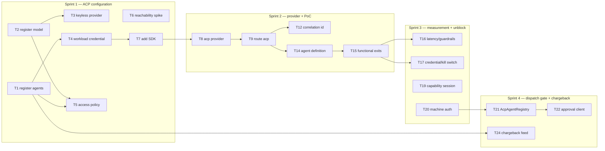

# Vulcan Onboarding — D3: Implementation Plan

> **Gate**: D3 — Tasks | **Status**: Draft | **Epic**: [EACPP-1133](https://sunlife.atlassian.net/browse/EACPP-1133)
>
> Implements [D2 Design](d2-design.md) against [D1 Requirements](d1-requirements.md).
> Confluence: [D2 — Design](https://sunlife.atlassian.net/wiki/spaces/T1KACP/pages/113192960215)
>
> **D0, D1 and D2 approved 2026-09-03.** One D0 exit condition is still open and is carried
> here as **T19** — see *Carried from D0* below. Nothing in Phase 1 depends on it.

## Carried from D0 — the open exit condition

D0's capability table is marked *proposed, not confirmed*, because the process requires it walked
with the use case against named capability IDs rather than inferred. **That walkthrough is not
recorded as having happened**, so the table stays proposed and the confirmation is T19 rather
than being back-filled with a date nobody can evidence.

This is deliberately not treated as a blocker. The capability selection drives *governance scope*,
not the Phase 1 build, and Phase 1 delivers value whether or not the table is signed. But it does
have to close before the onboarding can claim a confirmed governance scope, and the three
mandatory capabilities that cannot be honoured today — CAP-11 kill switch, CAP-12 quotas,
CAP-15 risk tiering — must be acknowledged explicitly in that session rather than discovered later.

## Task Summary

| # | Task | Type | Points | Sprint | Depends On |
|---|------|------|--------|--------|------------|
| **T1** | Register `vulcan-modernizer` and `vulcan-sast-fixer` as ACP agents, with owner, cost centre, business area and environment attributes | Story | 2 | S1 | — |
| **T2** | Register the approved model and its regional offering, including pricing, so cost is derivable rather than estimated | Story | 2 | S1 | — |
| **T3** | Configure the ACP-side provider credential as `ProviderAuthMethod.KEYLESS` (IRSA) in the ACP account, so no consumer AWS account is needed | Story | 3 | S1 | T2 |
| **T4** | Issue the workload credential for the SDK auth provider, with an agent-scoped `lum_` key as the documented fallback | Story | 2 | S1 | T1 |
| **T5** | Author the access policy binding both Vulcan agents to the approved model | Story | 1 | S1 | T1, T2 |
| **T6** | Confirm network reachability from the OpenShift `agent-workloads` namespace to the ACP gateway, including which side of the proxy `no_proxy` split the host falls on | Spike | 2 | S1 | — |
| **T7** | Add `acp-harness-sdk` to Vulcan and wire `ACPSettings` plus the auth provider, so config and token refresh come from the SDK rather than being rebuilt | Story | 3 | S1 | T4 |
| **T8** | Add `providers/acp/llm.py` returning a `ChatOpenAI` built from SDK-resolved config and an SDK-minted token | Story | 3 | S2 | T7 |
| **T9** | Route the `acp` provider in `tools/llm.py` and add `AcpLLMConfig`, leaving the `github` and `bedrock` branches untouched | Story | 2 | S2 | T8 |
| **T10** | Record provider-reported token usage in preference to the `tiktoken` estimate, keeping both for one release to quantify the variance | Story | 2 | S2 | T9 |
| **T11** | Add `GovernanceRefusedError` and stop a gateway 403 being retried as though it were transient | Story | 2 | S2 | T9 |
| **T12** | Propagate the run identifier as `x-luminate-session-id` on every gateway call and into the usage API correlation field | Story | 3 | S2 | T9 |
| **T13** | Replace the hardcoded `"gpt-5.4"` fallback in the usage payload with the model ACP resolved | Story | 1 | S2 | T10 |
| **T14** | Remove `aws-okta-credentials` from both agent definitions and replace the placeholder 120s timeout with a real remediation budget | Story | 2 | S2 | T9 |
| **T15** | PoC functional exits: a Modernizer run completes on `llm.provider: acp`, the pod carries no AWS credential, and the model can be switched with no image rebuild | Story | 3 | S2 | T14 |
| **T16** | PoC measurement: gateway latency overhead and whole-run delta, and the guardrail false-block rate over at least twenty real remediation prompts | Story | 3 | S3 | T15 |
| **T17** | PoC measurement: credential survival across the longest run, and the measured kill-switch propagation interval published as a number | Story | 3 | S3 | T15 |
| **T18** | PoC governance exits: a 403 fails the run cleanly with no partial commit, and one run reconciles ACP cost to its remediation outcome | Story | 2 | S3 | T12, T15 |
| **T19** | Walk the D0 capability table with the use case against named capability IDs and record the confirmations, priorities and declines, including the three mandatory capabilities that cannot be honoured today | Story | 2 | S3 | — |
| **T20** | Enable machine-to-machine authentication in the target environment, seed the service principal, and resolve which issuer ACP trusts | Story | 3 | S3 | — |
| **T21** | Implement `AcpAgentRegistry` decorating `JsonAgentRegistry`, so ACP decides whether an agent may run while the local definition still decides how | Story | 3 | S4 | T20 |
| **T22** | Implement the approval client with a TTL cache, the fail-closed posture, and alertable counters for refused, stale and unavailable decisions | Story | 3 | S4 | T21 |
| **T23** | Register the tool MCP servers split by trust boundary, labelled registered-not-brokered wherever the state is reported | Story | 2 | S4 | — |
| **T24** | Consume the chargeback feed and confirm the period and filter shape the cost-recovery function needs | Story | 2 | S4 | T1 |
| **T25** | Add threshold alerting computed from the usage feed, labelled monitoring rather than enforcement on every artefact that carries it | Story | 2 | S4 | T24 |
| **T26** | Raise the Luminate register items with this use case as the named consumer, and record the responses | Story | 2 | S4 | — |

**Total**: 26 tasks, 60 points across four sprints.

## Sequencing, Dependencies & Priority

The Luminate code targets column names where the work lands, so a picker-up does not have to
rediscover it. **Re-verify each against `origin/main` before building** — these were read at
`89356d74` and the platform moves.

| Task | Priority | Luminate / Vulcan code targets | Cross-epic or upstream dependency |
|---|---|---|---|
| T1 | P0 | Portal registry — agents | — |
| T2 | P0 | Portal registry — models, offerings, pricing catalogue | — |
| T3 | P0 | `backend/app/models/models.py` `ProviderAuthMethod.KEYLESS` | Cloud — IRSA role in the ACP account |
| T4 | P0 | `backend/app/gateways/models.py` API keys; `acp_harness_sdk/auth.py` | Depends on the T20 issuer decision if client-credentials |
| T5 | P0 | `backend/app/access_policies/` | — |
| T6 | P0 | Network / proxy configuration | Platform — OpenShift egress |
| T7 | P0 | `acp_harness_sdk/{config,auth}.py`; Vulcan `pyproject.toml` | — |
| T8 | P0 | Vulcan `src/vulcan/providers/acp/llm.py` | **L-10** — replaced by `ACPChatModel` when it ships |
| T9 | P0 | Vulcan `src/vulcan/tools/llm.py`, `shared/config.py` | — |
| T10 | P1 | Vulcan `shared/tokens.py`, `services/metrics_runtime.py` | — |
| T11 | P1 | Vulcan `shared/errors.py`, `services/metrics.py` retry list | — |
| T12 | P1 | `gateway/app/middleware/authz.py` `_raw_session_id`; Vulcan run id propagation | — |
| T13 | P2 | Vulcan `services/metrics_runtime.py` `aiModel` | — |
| T14 | P0 | `AGI/ai-agent-orchestration-api` `agent-registry/agents.json` | — |
| T15 | P0 | End-to-end | — |
| T16 | P1 | `gateway/app/middleware/guardrails.py` | — |
| T17 | P1 | `backend/app/policy_engine/facts.py` bundle export | **L-7** — no first-class stop control exists |
| T18 | P1 | `gateway/app/middleware/authz.py`; Langfuse session | **L-3** — per-run cost not on the finance surface |
| T19 | P0 | `docs/capability-map.md` | Use-case availability |
| T20 | P0 | `backend/app/shared/service_principal_authentication.py`; `luminate-sunlife-deploy` values | **L-1** — default-off, single issuer |
| T21 | P1 | `AGI/ai-agent-orchestration-api` `agentregistry/` | Blocked by T20 |
| T22 | P1 | `AGI/ai-agent-orchestration-api` `agentrun/` | Blocked by T20 |
| T23 | P2 | `backend/app/mcp_servers/` | **L-2** — `INJECTED_CREDENTIAL` unimplemented |
| T24 | P1 | `backend/app/metrics/` `ChargebackViewSet` | **L-6** — chargeback authz is a stopgap |
| T25 | P2 | Usage feed + alerting | **L-4 / L-5** — quotas do not enforce |
| T26 | P1 | — | Consortium backlog |

## Dependency Graph

## Sprint Allocation

### Sprint 1 — ACP configuration and the SDK seam

Nothing here depends on an unresolved gap. This is the sprint that proves centralised inference
is real: the credential moves to ACP and Vulcan stops needing an AWS account.

| Task | Points | Definition of Done |
|------|--------|-------------------|
| T1 | 2 | Both agents resolvable in the registry with all four attributes set |
| T2 | 2 | Model, offering and pricing present; a cost figure is derivable for a test call |
| T3 | 3 | A gateway call reaches Bedrock using the ACP pod role; no consumer-account credential involved |
| T4 | 2 | Credential issued and stored; the fallback path is documented, not just the primary |
| T5 | 1 | Policy allows both agents to the approved model and denies an unlisted one |
| T6 | 2 | Reachability proven from a pod in the target namespace, with the proxy behaviour recorded |
| T7 | 3 | `ACPSettings` resolves; a token is minted and refreshes near expiry in a canary longer than one lifetime |

### Sprint 2 — the provider, and a run that works

| Task | Points | Definition of Done |
|------|--------|-------------------|
| T8 | 3 | `create_llm` returns a `BaseChatModel`; tool binding works; unit tests mock the gateway |
| T9 | 2 | `llm.provider: acp` selects it; `github` and `bedrock` unchanged and still tested |
| T10 | 2 | Both figures recorded for one run; the variance is stated as a percentage |
| T11 | 2 | A 403 fails the run once, is not retried, and is distinguishable from a transport failure |
| T12 | 3 | One run id appears on the Job, on the gateway request, and in the usage record |
| T13 | 1 | `aiModel` matches the model ACP resolved, verified on a live run |
| T14 | 2 | Rendered Job spec carries no AWS credential; timeout reflects a real remediation |
| T15 | 3 | E-1, E-2 and E-5 pass; pull request opened by an ACP-served run |

### Sprint 3 — measurement, and unblocking the dispatch gate

The measurement tasks are the point of the PoC. Each must produce a **number**, not a verdict.

| Task | Points | Definition of Done |
|------|--------|-------------------|
| T16 | 3 | p50/p95 overhead and whole-run delta published; false-block rate stated over ≥ 20 prompts |
| T17 | 3 | A run exceeding one credential lifetime completes; propagation interval published as a measured figure |
| T18 | 2 | Deactivation mid-run fails cleanly with no partial commit; one run reconciles cost to outcome |
| T19 | 2 | Capability table confirmed, priorities and declines recorded, mandatory gaps acknowledged in writing |
| T20 | 3 | Machine auth enabled in the target environment; the orchestrator's token is accepted |

### Sprint 4 — dispatch gate, tools and chargeback

| Task | Points | Definition of Done |
|------|--------|-------------------|
| T21 | 3 | A deactivated agent is refused at submission with the ACP reason surfaced as a 409 |
| T22 | 3 | All four posture states covered by tests; counters emit and are alertable |
| T23 | 2 | Servers registered and bound; every report of the state says registered, not brokered |
| T24 | 2 | Feed consumed for one period; the shape is agreed with the cost-recovery function |
| T25 | 2 | Alerts fire on a threshold breach and carry the monitoring-not-enforcement label |
| T26 | 2 | Each register item raised with a link, and the response recorded back into D1 §5a |

## Risk Mitigation

| Risk (from D0) | Mitigation task | Sprint |
|---|---|---|
| The September fork — the interim Bedrock path becomes permanent | T9 keeps `acp` additive and config-switched, so migration is a key flip rather than a re-integration | S2 |
| ACP promised as a budget control it cannot be | T25 forces the monitoring-not-enforcement label onto every artefact | S4 |
| Tool governance heard as "ACP will front our scanners" | T23 registers only, and labels the state explicitly | S4 |
| Issuer mismatch discovered during build rather than design | T20 resolves it as a named task before T21 and T22 depend on it | S3 |
| Guardrails block legitimate remediation payloads | T16 quantifies the false-block rate before wider rollout | S3 |
| Latency of a network inference hop degrades long batch runs | T16 measures the delta rather than assuming it | S3 |
| An agent that edits source at scale needs a real stop control | T17 publishes the measured propagation interval; T26 raises L-7 | S3 |
| Two sources of usage truth | T12 and T18 prove the join on the run identifier | S2, S3 |

## Jira Ticket Map

> Created 2026-09-03 under [EACPP-1133](https://sunlife.atlassian.net/browse/EACPP-1133) by
> `scripts/create_jira_from_spec.py`, which is idempotent by task id. The 21 `Blocks` links
> implied by the *Depends On* column were created with them.
>
> The keys live in this table rather than in the task summary above on purpose: a Jira column in
> the main table makes the generator treat every row as uncached and rewrite the description of
> every existing ticket on the next run. Keep it here.

| Task | Jira | Priority | Sprint | Assignee |
|---|---|---|---|---|
| T1 | [EACPP-1205](https://sunlife.atlassian.net/browse/EACPP-1205) | P0 | S1 | **Rushik Patel** |
| T2 | [EACPP-1206](https://sunlife.atlassian.net/browse/EACPP-1206) | P0 | S1 | — |
| T3 | [EACPP-1207](https://sunlife.atlassian.net/browse/EACPP-1207) | P0 | S1 | — |
| T4 | [EACPP-1208](https://sunlife.atlassian.net/browse/EACPP-1208) | P0 | S1 | — |
| T5 | [EACPP-1209](https://sunlife.atlassian.net/browse/EACPP-1209) | P0 | S1 | — |
| T6 | [EACPP-1210](https://sunlife.atlassian.net/browse/EACPP-1210) | P0 | S1 | — |
| T7 | [EACPP-1211](https://sunlife.atlassian.net/browse/EACPP-1211) | P0 | S1 | — |
| T8 | [EACPP-1212](https://sunlife.atlassian.net/browse/EACPP-1212) | P0 | S2 | — |
| T9 | [EACPP-1213](https://sunlife.atlassian.net/browse/EACPP-1213) | P0 | S2 | — |
| T10 | [EACPP-1214](https://sunlife.atlassian.net/browse/EACPP-1214) | P1 | S2 | — |
| T11 | [EACPP-1215](https://sunlife.atlassian.net/browse/EACPP-1215) | P1 | S2 | — |
| T12 | [EACPP-1216](https://sunlife.atlassian.net/browse/EACPP-1216) | P1 | S2 | — |
| T13 | [EACPP-1217](https://sunlife.atlassian.net/browse/EACPP-1217) | P2 | S2 | — |
| T14 | [EACPP-1218](https://sunlife.atlassian.net/browse/EACPP-1218) | P0 | S2 | — |
| T15 | [EACPP-1219](https://sunlife.atlassian.net/browse/EACPP-1219) | P0 | S2 | — |
| T16 | [EACPP-1220](https://sunlife.atlassian.net/browse/EACPP-1220) | P1 | S3 | — |
| T17 | [EACPP-1221](https://sunlife.atlassian.net/browse/EACPP-1221) | P1 | S3 | — |
| T18 | [EACPP-1222](https://sunlife.atlassian.net/browse/EACPP-1222) | P1 | S3 | — |
| T19 | [EACPP-1223](https://sunlife.atlassian.net/browse/EACPP-1223) | P0 | S3 | — |
| T20 | [EACPP-1224](https://sunlife.atlassian.net/browse/EACPP-1224) | P0 | S3 | — |
| T21 | [EACPP-1225](https://sunlife.atlassian.net/browse/EACPP-1225) | P1 | S4 | — |
| T22 | [EACPP-1226](https://sunlife.atlassian.net/browse/EACPP-1226) | P1 | S4 | — |
| T23 | [EACPP-1227](https://sunlife.atlassian.net/browse/EACPP-1227) | P2 | S4 | — |
| T24 | [EACPP-1228](https://sunlife.atlassian.net/browse/EACPP-1228) | P1 | S4 | — |
| T25 | [EACPP-1229](https://sunlife.atlassian.net/browse/EACPP-1229) | P2 | S4 | — |
| T26 | [EACPP-1230](https://sunlife.atlassian.net/browse/EACPP-1230) | P1 | S4 | — |

**T1 is the first P0 and is assigned.** Everything else is unassigned and sits in Funnel; the
sprint column is the plan from this document, not a Jira sprint field.

## Notes

- **Phase 1 is T1 – T15 and is blocked by nothing.** That is the whole reason D2 split the two
  columns; if the issuer question drags, the inference half still lands.
- **T20 gates T21 and T22.** Do not start the dispatch gate before the issuer is resolved — the
  work is small once the answer exists and unbuildable before it.
- **The approval gate is weaker than it looks until the orchestrator authenticates its own
  callers.** That hardening is on the Vulcan roadmap, not in this plan, and T21 should not be
  reported as an access control on its own.
- **Every measurement task publishes a number.** T16, T17 and T18 exist to replace assumptions in
  D2 with figures; a result of "acceptable" means the task is not done.
- Re-verify the Luminate code targets against `origin/main` before building. They were read at
  `89356d74` and several are in areas under active change.
