<!-- GENERATED FILE — do not edit directly.
     Source: d2-design/ pages. Regenerate with scripts/assemble_d2_design.py -->

# D2 Design — The Agent Pattern

> **Gate**: D2 — Design | **Status**: Draft | **D1 Approved**: TBD
>
> `d2-design.md` beside this directory is **generated** from these pages by
> `scripts/assemble_d2_design.py` — edit the pages, not the generated file.

## The distinction that organises everything

An MCP server is only ever called. An agent both calls and is called, and those are two
registrations with two requirement sets. Establish which one you need before anything else.

**But first, one question comes before even that: is it an Agent at all?** The platform has two
consumer identities. **A chatbot is an Application, not an Agent** — and an Application is
egress-only by construction: no `ApplicationDeployment`, and no `application` member on
`AccessPolicyTargetType`, so nothing can ever be routed to it or granted it. The deciding test is
*can anything need to call it?* — see [Registration](d2-design/registration.md).

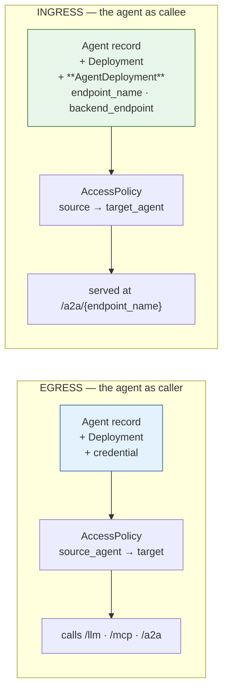

**Registering an agent and granting it a model makes it a governed caller. It does not make it
callable.** The thing that makes it callable is an `AgentDeployment` — a row carrying an
`endpoint_name` and a `backend_endpoint`. Eight of the ten agents registered in SLF dev do not
have one, and one of them is already the target of an active access policy.

## The pattern in one picture

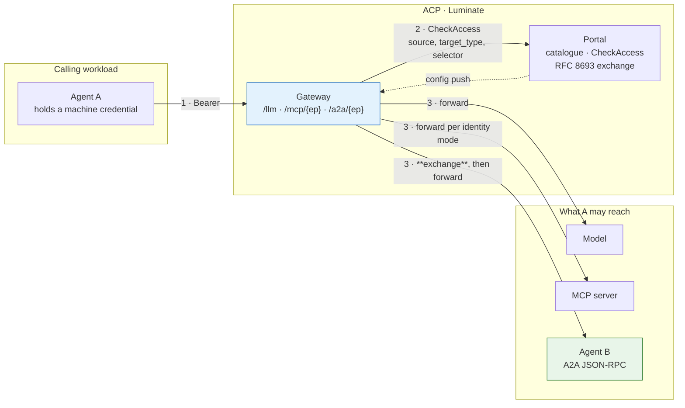

Steps 1 and 2 are identical on all three lanes. Step 3 is where they differ, and the A2A lane is
the one with a token exchange in the middle of it.

## Pick your shape

Four questions, answered in order. The first decides which requirement set you are reading; the
second is disqualifying for ingress; the third decides your substrate annex; the fourth decides
what your agent must implement.

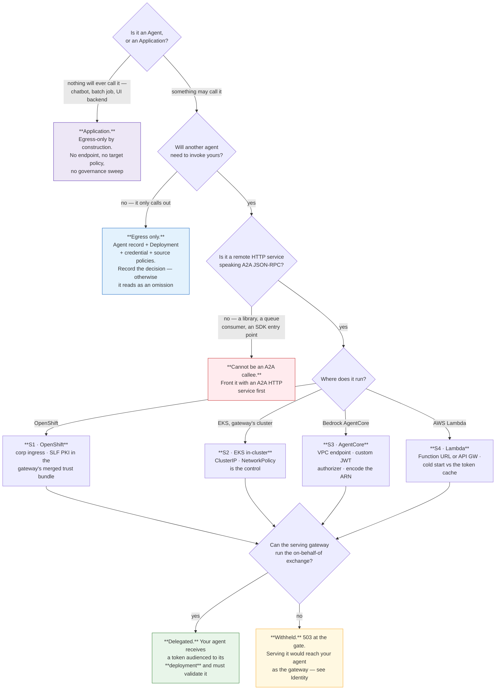

## The catalogue of shapes

| # | Shape | Who it is for | Egress | Ingress | Maturity |
|---|---|---|:--:|:--:|---|
| **S1** | **OpenShift-hosted** — behind Sun Life corporate ingress | Teams already on OpenShift | ✅ | ⚠️ needs SLF PKI in the gateway bundle | **Not yet exercised** for A2A |
| **S2** | **EKS in-cluster** — ClusterIP beside the gateway | Platform-owned and demo agents | ✅ | ✅ | **Works today** — `policy-assistant` |
| **S3** | **Bedrock AgentCore runtime** | Teams on AWS with an AgentCore footprint | ✅ | ✅ *(dev)* | **Works today via a VPC endpoint** — `fdes-pharmacy-agent`. Prod's registration is a different shape and serves no credential |
| **S4** | **AWS Lambda** | Event-driven and thin agents | ✅ | ⚠️ needs a stable URL | **Not yet exercised**; cold start vs the token cache is the real constraint |

Four substrates are specified in detail because they are in use or in flight. **They are not the
allowed list.** Any other hosting platform — vendor agent products, managed runtimes, whatever
ships next — is admitted on the same terms: assessed against the numbered **SUB-E** and **SUB-I**
criteria in [Hosting](d2-design/hosting.md). Meeting the egress set makes a platform viable for agents that
consume AI resources; meeting both makes it viable for agent-to-agent delegation. A platform that
falls short has a *named open criterion*, not a refusal.

## What is true on every shape

These are platform properties a team cannot change, and they drive most of the profile.

| Property | Consequence for the agent |
|---|---|
| **Registration ≠ reachability.** An `AgentDeployment` is what emits a route | Declare your direction, and create the deployment if you want to be callable — [Registration](d2-design/registration.md) |
| **One route per agent deployment.** `pathPrefix = /{endpoint_name}`; no shorthand ever existed for A2A | Your agent owns a path segment and is addressed at `{gateway}/a2a/{endpoint_name}`, **not** by its id or key |
| **There is no agent identity mode.** `Agent` has no `identity_mode`; `AgentAssignment` has no `backend_auth` | Every routable deployment is a delegated target. The only alternative is the degrade path, which sends nothing — [Identity](d2-design/identity.md) |
| **The control plane is on the request path.** `CheckAccess` per request, no cache; portal unreachable → deny | Your availability is bounded by the portal's; there is no fail-open posture |
| **Authorization is per agent, in each direction separately** | A source grant covers everything that agent may do; a target grant covers every method it exposes — [Authorization](d2-design/authorization.md) |
| **No guardrail can target an agent** | You cannot require a scan of your own inbound traffic. Every caller must carry one |
| **Quotas are not enforced anywhere** | Bound yourself at the substrate |
| **There is no REST lane.** The gateway matches `/llm/`, `/mcp/` and `/a2a/` and nothing else | An enterprise API is reached through an MCP server, and the API Platform owns that hop — [Reaching a REST API](d2-design/api-access.md) |
| **The platform never probes your agent** | Health, restarts and capacity are entirely yours — [Operations](d2-design/operations.md) |
| **Deactivation stops ingress, not egress** | The stop path is credential and policy revocation — [Operations](d2-design/operations.md) |
| **The registered query string is discarded** on the A2A hop | Put everything you need in the path — [Registration](d2-design/registration.md) |

## Reading order

| Page | Covers | Answers |
|---|---|---|
| [Registration](d2-design/registration.md) | **Agent vs Application**, the catalogue model, deployments, credentials, endpoint hygiene, lifecycle | *Is it even an agent — and what makes me reachable?* |
| [Hosting](d2-design/hosting.md) | S1–S4, the SUB-E / SUB-I admission bar, reachability, TLS, network control | *What must my platform provide?* |
| [Identity](d2-design/identity.md) | What the agent holds; what a callee receives; the exchange; RFC 9728 | *What credential reaches me, and what do I validate?* |
| [Authorization](d2-design/authorization.md) | Source and target policies, the boundary, guardrails, quotas | *What is actually enforced, and what must I enforce?* |
| [Reaching a REST API](d2-design/api-access.md) | The MCP boundary, the Keycloak→Okta break, API Resources and Skills | *How do I call a business system, and whose identity arrives?* |
| [Build pipeline](d2-design/pipeline.md) | The JTE path, SonarQube / Snyk / Checkmarx, image provenance | *How do I build it so it will be accepted?* |
| [Operations](d2-design/operations.md) | Audit, tracing, run correlation, cost, the stop path | *What is visible once it runs, and how do I stop it?* |
| [ETAB and ISRA](d2-design/assurance.md) | The architecture to present and the control table to assess | *What do I take to the board?* |
| [Gaps](d2-design/gaps.md) | What is blocked, who owns the ask | *What am I accepting as residual?* |

## The two rules that catch everyone

**1 · Registered is not reachable.**

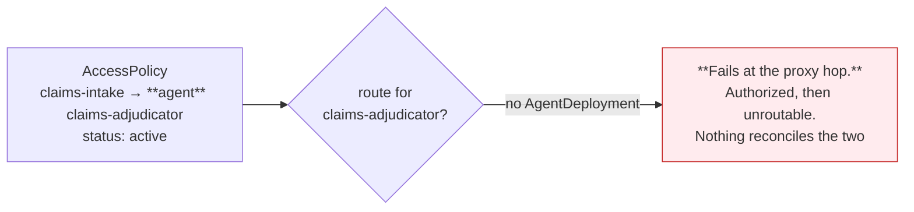

That policy is live in SLF dev today.

**2 · Deactivating an agent does not stop it.**

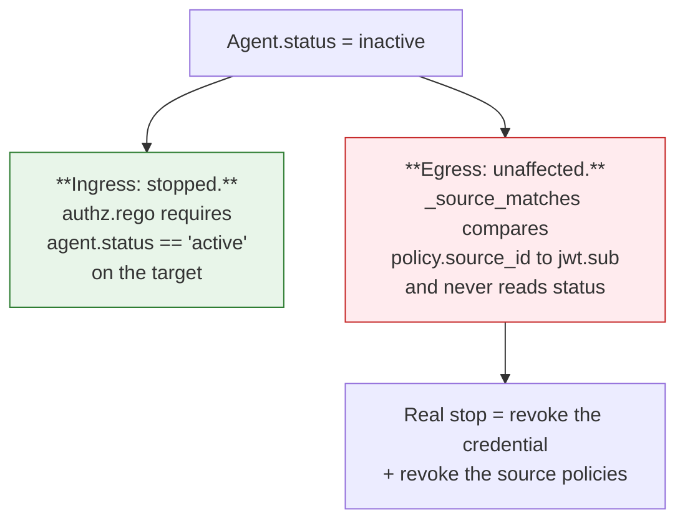

Design your incident runbook around the right-hand branch, not the left.

---

# Registration — the catalogue, the deployment and the credential

## First: is it an Agent at all?

Before anything else, answer this — the platform has two consumer identities and the choice is
not stylistic.

> **Are chatbots agents in the ACP? No. A chatbot is an Application.**

The deciding test is one question: **can anything need to call it?**

- **Yes** → **Agent.** It needs an A2A endpoint, so it needs the resource type that has one.
- **No — it only ever calls out** → **Application.** A chatbot, a batch job, an internal service, a
  UI backend. This is the platform's own framing: *"Register an application when a chatbot, batch
  job, internal service, or other workload needs to call governed AI resources through Luminate"*
  ([`register-application.md`](https://bitbucket.sunlifecorp.com/projects/EDAEACP/repos/luminate-user-guides/browse/docs/building/register-application.md)).

**An Application is egress-only by construction, not by convention.** There is no
`ApplicationDeployment`, so it has no `endpoint_name` and no `backend_endpoint`; and
`AccessPolicyTargetType` has no `application` member, so no policy can ever name one as a target.
Nothing can be routed to it, and nothing can be granted it.

### What the two actually differ on

| | **Agent** | **Application** |
|---|:--:|:--:|
| Policy **source** (may call) | ✅ | ✅ |
| Policy **target** (may be called) | ✅ `target_agent` | ❌ **no enum member** |
| Routable endpoint | ✅ `AgentDeployment` | ❌ no such model |
| Credential on a deployment | ✅ | ✅ |
| Source-scoped guardrails | ✅ | ✅ |
| Audit + trace attribution | ✅ | ✅ (a first-class `entity_type`) |
| `status` | ✅ | ❌ **no field at all** |
| `governance_state` | ✅ | ❌ **no column** |
| Swept by governance | ✅ | ❌ **deliberately excluded** |
| `type` / `framework` / `deployment_type` | ✅ | ❌ |
| Per-entity cost in the usage ledger | ✅ `SubjectType.AGENT` | ❌ **no member** |

Two of those rows are load-bearing and the platform states them itself.

**Governance does not cover Applications.** `SWEPT_REGISTRIES` is `agent`, `model`, `mcp_server`:

> The kinds that carry a governance state axis, and therefore the kinds governance can decide
> about. `application` is deliberately absent even though a verdict can be recorded against one:
> it has no `governance_state` column, so there is nothing for a published status to describe.
> — `backend/app/governance/sweep.py`

**An Application has no status field**, so it has no lifecycle control of any kind. For an Agent,
deactivation at least stops ingress; for an Application there is nothing to deactivate. The only
withdrawal is revoking its credential and its access policies — which, per
[Operations](d2-design/operations.md), is the real stop path for an Agent's egress too.

### The live worked example

`pharmacy-chatbot` is registered in SLF dev as an **Application**, with a deployment, an active
credential, and four active source policies:

```text
pharmacy-chatbot  (Application, project Pharmacy)
  → model       claude-haiku-4-5            active
  → model       claude-3-haiku-pharmacy     active
  → mcp_server  pharmacy-mcp-server         active
  → agent       fdes-pharmacy-agent         active     ← calls an agent over A2A
```

That last row is the point. **An Application can call an agent** — it is a first-class source on
the A2A lane. It simply can never be called. Across both clusters there are **zero** access
policies with `target_type = application`, and there cannot be one.

### Choosing wrongly, in both directions

| Mistake | What it costs |
|---|---|
| Registering a chatbot as an **Agent** | You get a governance axis, a status field and a `framework` you will never populate meaningfully, and a catalogue that overstates how many agents the organisation runs. Harmless operationally, misleading in an inventory — and OSFI E-23 asks for that inventory |
| Registering a callable service as an **Application** | **It can never be called.** No endpoint, no target policy, no route. You will discover this when the first caller cannot be granted access, and the fix is a re-registration under a new resource type |
| Assuming an Application is governed like an Agent | It is not swept, has no `governance_state`, and does not appear in the usage ledger. An assessor told "our chatbot is governed" will find no governance record for it |

**ASR-35** makes the choice a recorded decision, and the guides do not currently help: searching
`luminate-user-guides` for any statement of when to pick one over the other **returns nothing**.

---

Three separate things then happen, in order, and only the third of them is what most teams think
"registering an agent" means.

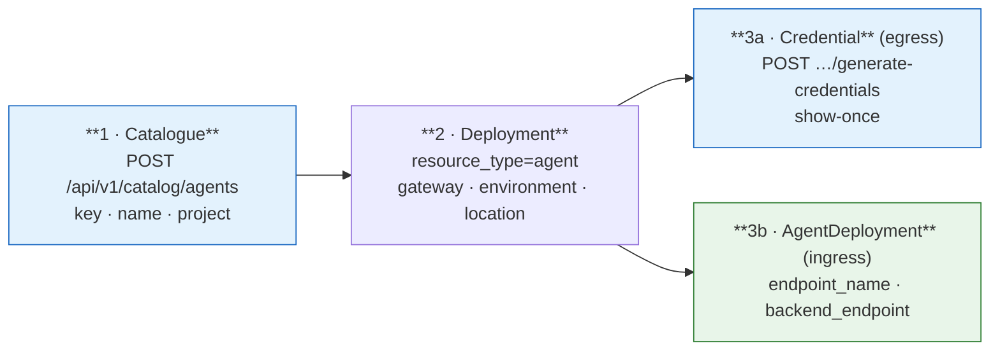

## 1 · The catalogue entry

`POST /api/v1/catalog/agents` (route `catalog/agents`). The create serializer accepts
`key`, `name`, `description`, `status`, `type`, `framework`, `deployment_type`, `project`,
`configuration` and attribute ids. **Mandatory in practice: `key`, `name`, `project`** —
`type` defaults to `assistant`, `deployment_type` to `cloud`, `status` to `active`.

| Field | What it is | What it is not |
|---|---|---|
| `key` | Globally unique slug, `validate_key` | Not the routing key — the gateway routes by `endpoint_name` |
| `name` | Case-insensitively unique display name | — |
| `status` | `active` \| `inactive` \| `deprecated` \| `unknown` — **lowercase on the wire** | Not a kill switch in both directions. See [Operations](d2-design/operations.md) |
| `governance_state` | `not_evaluated` → … → `approved` \| `suspended` \| `retired` | **Not enforceable.** No runtime consumer anywhere |
| `type`, `framework`, `deployment_type` | Free-text `CharField`s | Not a controlled vocabulary. ASR-8 makes one a process obligation |
| `configuration` | Free-form operator JSON | **Not a secret store.** Deliberately excluded from `audit_snapshot()` because it lands in an append-only store that cannot be redacted afterwards |
| `project` | Owning project, `PROTECT` on delete | Also the create-time authorization target |

There is **no `identity_mode`** field. `MCPServer` has one with five members; `Agent` has none,
and that asymmetry is deliberate on the platform's part — see [Identity](d2-design/identity.md).

### Vocabulary (ASR-8)

`framework` in SLF dev today: `bedrock-agentcore` ×5, `langgraph`, `strands`,
`Strands Framewrok`, `Other`, `acp-aws-harness-sdk` (a package renamed months ago), and one
blank. Adopt and publish a fixed set — the useful axis is the *runtime*, not the library:

| `deployment_type` | `framework` |
|---|---|
| `openshift`, `eks`, `agentcore`, `lambda`, `external` | `langgraph`, `strands`, `bedrock-agentcore`, `crewai`, `autogen`, `semantic-kernel`, `custom` |

### Governance state

Moved **only** by `POST /api/v1/catalog/agents/{id}/transition`, authorized on the *governance*
verb rather than the registry's update verb — deliberately, so that holding
`agents.agent.update` does not hand somebody the governance axis. A create or update payload
carrying `governance_state` or `governance_state_reason` is **refused**, not ignored, because
silently dropping it would let a caller believe the state moved.

```text
not_evaluated  → in_scope_unassessed | out_of_scope | retired
out_of_scope   → in_scope_unassessed | retired
in_scope_unassessed → assessed | suspended | out_of_scope | retired
assessed       → approved | in_scope_unassessed | out_of_scope | retired
approved       → in_scope_unassessed | suspended | out_of_scope | retired
suspended      → in_scope_unassessed | out_of_scope | retired
retired        → (terminal)
```

Every move needs a non-blank reason free of control characters. A move to `approved` refuses
self-approval. A move to `suspended` refuses unless the cascade has been previewed first, and the
preview names the deployments and access policies it reaches.

**All of that is evidence, not enforcement.** Record it; do not present it as a control.

## 2 · The deployment

`Deployment` requires `resource_type`, `project`, `environment`, `gateway`, `location` and
`deployment_key`, plus the typed FK (`agent`). It is what places the agent on a gateway, and it
is what a credential hangs off.

**One backing runtime per environment (ASR-9).** Prod today registers a single AgentCore runtime
ARN under four gateways spanning dev, SIT, stage and prod. That makes one runtime the failure
domain, the capacity pool and the blast radius for four environments at once. If it is
deliberate, record it as an exception with a stated radius; if it is not, split it.

## 3a · The credential (egress)

Registering issues nothing. `CREDENTIAL_RESOURCE_TYPES = {agent, application, mcp_server}` and
the mint is on the **deployment**:

```text
POST   /api/v1/deployment/deployments/{id}/generate-credentials
POST   /api/v1/deployment/deployments/{id}/rotate-credentials
POST   /api/v1/deployment/deployments/{id}/revoke-credentials
GET    /api/v1/deployment/deployments/{id}/credentials
```

The result is an `OAuthCredential` with a per-entity IdP client
(`agent-{agentUUID}-{gatewayUUID}`). **The secret is shown once.** A lost secret is *rotated*,
never *regenerated* — regenerating creates a second credential and leaves the first live.

Diagnostic that needs no secret: `OAuthCredential.client_secret_prefix` holds the first characters
of the live secret. If the caller's copy does not start with it, the caller's copy is stale.

An agent may also hold an `lum_` **API key** (`APIKey.owner_agent`). Read
[Identity](d2-design/identity.md) before choosing one — it is refused on the A2A lane.

## 3b · The A2A endpoint (ingress)

`AgentDeployment` is a one-to-one extension of `Deployment` carrying exactly two fields, and its
existence is what makes the agent callable.

| Field | Rule |
|---|---|
| `endpoint_name` | **A single URL-safe path segment.** The route matches it as a prefix and the authn gate reads it back as `upstream_path.split("/")[0]`, so a name containing `/` is gated under one name and served under another, and a blank one matches `/` and shadows every other agent on the lane. `translate_agent_assignment` raises rather than emit either |
| `backend_endpoint` | Absolute `http(s)` URL. The host becomes an agentgateway `host` backend (`host:port`, port inferred from the scheme) and **everything after the host becomes a `urlRewrite`** |

### Endpoint hygiene — three traps, all visible in the live estate

**The query string is discarded.** `_split_api_base` returns `parsed.path` and drops the query.
Prod registers `…/invocations?qualifier=DEFAULT`; the emitted rewrite is `…/invocations`. Harmless
for `DEFAULT`, a silent mis-route for any other qualifier.

**Reserved characters must be percent-encoded.** Dev registers the AgentCore ARN encoded, prod
registers it raw:

```text
dev   /runtimes/arn%3Aaws%3Abedrock-agentcore%3Aca-central-1%3A…%3Aruntime%2Fluminate_claims_orchestrator-…/invocations
prod  /runtimes/arn:aws:bedrock-agentcore:ca-central-1:…:runtime/acp_sample_agent-…/invocations
```

The raw form splits the ARN across two path segments. Nothing validates it — registration checks
only that the value is a URL.

**Nothing probes the backend.** `MCPServer` gained a health probe
(`supports_mcp_probe`, a `ProbeMcpCommand` the gateway acts on); `Agent` did not. A wrong URL is
accepted, routed and discovered at call time. **ASR-7 makes a post-registration call through
`{gateway}/a2a/{endpoint_name}` a release-time obligation.**

Verify what was actually emitted, rather than what you meant, by reading it back:

```bash
kubectl -n luminate exec deploy/luminate-gateway -c luminate-gateway -- \
  python3 -c "import json,urllib.request;d=json.load(urllib.request.urlopen('http://127.0.0.1:15080/config_dump'));print(json.dumps([r for b in d['binds'] if b['key'].endswith('5000') for l in b['listeners'].values() for r in l['routes'].values()],indent=1))"
```

## The grant, and the reconciliation nobody does

An `AccessPolicy(target_type=agent)` is accepted against **any** agent, whether or not it has an
`AgentDeployment`. `claims-intake → claims-adjudicator` is active in SLF dev against an agent with
no A2A endpoint: the call authorizes and then fails at the proxy hop, because no route was ever
emitted for it.

**ASR-11: no grant without an endpoint.** Until the platform reconciles it, the query in
[D1 FR-3](../d1-requirements.md#fr-3-make-non-conformance-queryable) is the control.

## What registration is *not* evidence of

| Claim | Reality |
|---|---|
| "The agent is callable" | Only if it has an `AgentDeployment` on the gateway the caller uses |
| "The agent has been assessed" | `governance_state` is `not_evaluated` for 10 of 10 dev agents |
| "The backend URL is right" | Nothing checks it |
| "The agent is running" | The platform never probes it |
| "The catalogue lists what it can do" | Only if ASR-12 was honoured — there is no agent card anywhere in the platform |
| "Deactivating it stops it" | Stops ingress only. See [Operations](d2-design/operations.md) |

---

# Hosting — the four specified substrates, and the bar for any other

An agent is a workload somewhere. The substrate decides four things: whether the gateway can
reach it for ingress, how it reaches the gateway for egress, what TLS trust each hop needs, and
what bounds its cost and concurrency.

Four substrates are specified in detail below because they are in use or in flight. **They are not
the allowed list.** Any other hosting platform is admitted on the same terms: assessed against the
numbered criteria in the next section, not approved or refused case by case. A platform that does
not meet a criterion today has a *named open criterion*, and is re-assessed when it changes.

Identity composes with all of them and is dealt with separately in [Identity](d2-design/identity.md). What
follows is only the reachability and platform side.

## The admission bar — what any substrate must provide

Two sets. **SUB-E** is what a platform needs to host an agent that *consumes* AI resources.
**SUB-I** is what it additionally needs for that agent to be *invocable* by another agent.

### SUB-E · Egress — the agent as a caller

| # | Requirement | Why it is on the list | Ties to |
|---|---|---|---|
| **SUB-E1** | **Outbound HTTPS to the gateway** from the workload's network position | No egress path, no governed call. On corporate networks this includes trusting the Netskope roots; on Lambda it means a NAT or VPC endpoint | — |
| **SUB-E2** | **Managed credential custody** — the workload holds a platform-issued OAuth client credential in a managed secret store (Vault / Secrets Manager), never on disk or an endpoint device, with central rotation and revocation | Credential and policy revocation is the actual stop control for egress, so it has to reach the credential | ASR-16, ASR-30 |
| **SUB-E3** | **Token acquisition with caching** across invocations | The portal token endpoint is rate-limited. A per-invocation mint throttles under load — this is the constraint that shapes S4 | ASR-16 |
| **SUB-E4** | **No alternative ungoverned route** to the same target. Where the substrate offers a native bypass (IAM-signed direct invocation, private service-to-service calls), it is closed by policy | Controls only exist on the path they sit on | ASR-36, DD-2 |
| **SUB-E5** | **A bounded execution envelope** the team controls — a concurrency or rate ceiling | The platform enforces no quota on any lane, so the bound has to come from the substrate | ASR-23 |
| **SUB-E6** | **Build provenance** — the artifact is produced by the approved pipeline with SAST, SCA and static-analysis evidence retrievable per build | An agent executes model-composed instructions against a deep dependency tree | ASR-25 – ASR-28 |
| **SUB-E7** | **Trace propagation** — the workload can set and forward `x-luminate-session-id` | Without it, run correlation falls back to `traceparent`, or to nothing | ASR-33 |

### SUB-I · Ingress — the agent as a callee

All of SUB-E, plus:

| # | Requirement | Why it is on the list | Ties to |
|---|---|---|---|
| **SUB-I1** | **A stable HTTPS endpoint speaking A2A JSON-RPC**, at an absolute URL including scheme and full path | `AgentDeployment.backend_endpoint` is a URL. A library, an SDK entry point or a queue consumer has nothing to register | ASR-2, ASR-6 |
| **SUB-I2** | **Tolerates being fronted** — served behind a path prefix with URL rewriting, emitting no absolute self-referential URLs | The route matches `/{endpoint_name}` and rewrites the path | ASR-4 |
| **SUB-I3** | **Reachable from the serving gateway and from nothing else**, provable by negative test from a non-gateway workload | The gateway is where authn, authz, guardrails and audit happen; a second path defeats all four at once | ASR-5 |
| **SUB-I4** | **An inbound authorizer that accepts a platform-issued bearer token**, validating issuer, signature, expiry and the deployment-scoped audience | Luminate emits an OAuth bearer on every hop and **never SigV4**. A signature-only scheme cannot be reached through the gateway | ASR-14, ASR-15 |
| **SUB-I5** | **A TLS chain the gateway trusts** — public roots, or an internal CA present in the gateway's merged trust bundle | agentgateway resolves roots from `SSL_CERT_FILE`; see the trust-bundle note below | ASR-6 |

### How the criteria classify a platform

| Assessment | Meaning |
|---|---|
| Meets **SUB-E1–E7** | Viable for **egress-only** agents — they consume models, tools and other agents under governance |
| Meets **SUB-E and SUB-I** | **Full participation**, including agent-to-agent delegation |
| Open criteria remain | A **candidate with named gaps**, recorded per criterion and re-assessed when the platform changes — not a refusal |

The last row matters. A platform is never rejected in the abstract; it has an open criterion with
a number, which is a thing a vendor roadmap or an internal control can close.

### The trust bundle — one detail that has already caused an outage

agentgateway resolves TLS roots through openssl-probe, where **`SSL_CERT_FILE` replaces the
system store rather than adding to it**. Pointing it at Sun Life's internal bundle alone trades
public TLS for internal TLS.

The chart therefore has two independent flags that do opposite things, and only one of them is
right for a gateway:

| Flag | Effect | Use |
|---|---|---|
| `gateway.caBundle.enabled` | An init container does `cat /etc/ssl/certs/ca-certificates.crt <slf>/ca.crt > /etc/ssl/merged/ca-bundle.crt` and points the agentgateway subprocess at the result — the image's public roots **plus** the internal CA | ✅ This is the one a gateway needs |
| `slf.caBundle.enabled` | **Substitutes** the backend's root store rather than adding to it (the values comment says so in those words) | Backend-side concern; enabling it for the gateway's benefit would cut backend trust |

Verified on the live prod cluster, all four gateways —
`luminate`, `luminate-gw-dev`, `luminate-gw-sit`, `luminate-gw-stage` — report
`SSL_CERT_FILE=/etc/ssl/merged/ca-bundle.crt` with **154 certificates**. The merge is on
everywhere it matters. *(The `values/gateways/*.yaml` files do not set the flag themselves; it
arrives from the base values file the release is deployed with. Read the pod, not the file.)*

The init container carries CPU and memory requests **and** limits, because Gatekeeper's
`container-must-have-limits-and-requests` applies to init containers too and the denial does not
surface in `rollout status` — the deployment reports `generation == observedGeneration` with no
updated replicas and the real reason appears only in `kubectl get events`.

---

## S1 · OpenShift, behind Sun Life corporate ingress

**Status: not yet exercised for A2A.** No agent is registered on this shape today; the precedent
is `pharmacy-mcp-server` on the MCP lane, which needed two separate fixes to work.

| Requirement | Detail |
|---|---|
| **Reachability (ingress)** | `https://{cluster-ingress}/{namespace}/{route}/…`. The route must be reachable **from the gateway's cluster**, which is a different cluster — this is an inter-cluster hop over corporate ingress, not an in-cluster one |
| **TLS** | The leaf is issued by `Sun Life Financial Issuing CA3` (or `CA4`), which no public root store carries. **`gateway.caBundle.enabled: true` is mandatory**, and the `slf-internal-ca` ConfigMap (key `ca.crt`) must exist in the gateway's namespace — it is created out of band, and a gateway whose ConfigMap is missing cannot start at all |
| **Failure signature** | Without the CA, agentgateway reports `invalid peer certificate: UnknownIssuer` and the caller sees **`500 upstream service error`** — naming neither TLS nor the certificate |
| **Restricting access (ASR-5)** | OpenShift NetworkPolicy plus route-level restriction. A corporate-ingress route is reachable by anything else on the corporate network by default, so this is the substrate where ASR-5 takes the most work and the negative test matters most |
| **Egress** | Corporate egress to the gateway hostname. Netskope MITMs TLS — the agent's own trust store needs the Netskope roots, or calls to the gateway fail with `SELF_SIGNED_CERT_IN_CHAIN` |
| **Bound (ASR-23)** | Deployment replicas and container concurrency |
| **Pod security (ASR-29)** | Non-root, `allowPrivilegeEscalation: false`, `capabilities: drop: ["ALL"]`, requests **and** limits on every container including init |
| **Build** | Standard JTE path; image to Quay. No `docker.io` egress — mirror every base image |

**Open item:** the inter-cluster path (EKS gateway → OpenShift corporate ingress) has been proven
for MCP and not for A2A. Prove it before committing an agent to this shape.

---

## S2 · EKS, in the gateway's own cluster

**Status: works today.** `policy-assistant` is registered as
`http://policy-assistant.luminate.svc.cluster.local:8080` and its route is live.

| Requirement | Detail |
|---|---|
| **Reachability (ingress)** | ClusterIP service FQDN. Simplest shape on the estate |
| **TLS** | **Plain HTTP is used today.** `translate_agent_assignment` emits `backendTLS` only for an `https` scheme, and the live `policy-assistant` route carries `a2a` and `urlRewrite` and **no `backendTLS`** |
| **Is plain HTTP defensible?** | Only as a stated control, not as a convenience. It rests on three properties, all of which must be asserted rather than assumed: the hop never leaves the pod network; a NetworkPolicy admits only the gateway's pods; and the cluster is not a shared tenancy where another workload could reach the service or observe the traffic. Any of the three failing turns an internal call into a cleartext one carrying a bearer token. **Record it as a control with an owner, or use TLS.** It stops being defensible the moment the agent moves namespace or the estate grows a second caller |
| **Restricting access (ASR-5)** | A NetworkPolicy admitting only the gateway's namespace. This is *the* control on this substrate — with plain HTTP and no backend credential in the degrade case, it is the only one |
| **Egress** | In-cluster to the gateway Service (`8443`). An in-cluster caller can skip the ingress hairpin |
| **Bound (ASR-23)** | Replicas, HPA ceiling, and the container's own concurrency |
| **Pod security (ASR-29)** | As S1. Gatekeeper applies identically |
| **Build** | JTE path; image to ECR |

---

## S3 · Bedrock AgentCore runtime

**Status: works today for ingress in dev, over an interface VPC endpoint.** This is the most
consequential substrate on the estate and the two environments have configured it differently.

### What is actually registered

| Env | Registered `backend_endpoint` | Emitted route |
|---|---|---|
| **dev** | `https://vpce-0bee…-….bedrock-agentcore.ca-central-1.vpce.amazonaws.com/runtimes/arn%3Aaws%3A…%2Fluminate_claims_orchestrator-…/invocations` | host `vpce-….vpce.amazonaws.com:443`, `backendTLS{systemRoots}`, `backendAuth.oauthTokenExchange` |
| **prod** | `https://bedrock-agentcore.ca-central-1.amazonaws.com/runtimes/arn:aws:…runtime/acp_sample_agent-…/invocations?qualifier=DEFAULT` | host `bedrock-agentcore.ca-central-1.amazonaws.com:443`, `backendTLS{systemRoots}`, **no `backendAuth`** |

Three differences, all of which matter:

- **VPC endpoint vs public regional endpoint.** Dev reaches AgentCore over a PrivateLink
  interface endpoint; prod reaches it over the internet-facing regional endpoint. Only the first
  keeps the hop inside the VPC.
- **Encoded vs raw ARN.** Dev's is percent-encoded and correct; prod's raw form splits the ARN
  across path segments.
- **Exchange vs no exchange.** Dev's route carries an RFC 8693 exchange audienced to the
  deployment; prod's carries nothing, because the prod build predates the feature.

### Requirements

| Requirement | Detail |
|---|---|
| **Ingress path** | `https://{vpc-endpoint}/runtimes/{percent-encoded-ARN}/invocations`. Use the **VPC endpoint**, not the public regional endpoint (ASR-5) |
| **ARN encoding** | Percent-encode the ARN — `:` → `%3A`, `/` → `%2F`. ASR-6 |
| **Qualifier** | **Do not rely on `?qualifier=…`** — the query string is discarded from the rewritten path. Use the default qualifier, or ask for the translator fix (D3 T26) |
| **TLS** | `backendTLS{systemRoots: true}` — AWS leaves chain to a public root, so no SLF bundle is needed on this hop |
| **Inbound auth (ASR-15)** | **Luminate emits an OAuth bearer and never SigV4.** An AgentCore runtime reached through the gateway therefore needs a **custom JWT authorizer** configured with the platform's issuer and the deployment audience `agent-{agentUUID}-{deploymentUUID}`. A runtime on IAM-only inbound auth cannot be reached this way at all |
| **Restricting access (ASR-5)** | The runtime's resource policy plus the VPC endpoint policy. The public regional endpoint must not be an alternative path to the same runtime |
| **Egress** | The runtime reaches the gateway over its own network path. **`us-east-1` has no egress from these clusters** — an AgentCore or Bedrock dependency there is unreachable |
| **Environment separation (ASR-9)** | One runtime per workload environment, or a recorded exception. Prod currently registers **one** runtime under four gateways |
| **Cross-account** | The gateway's own AWS access is a role chain: a web-identity `[profile base]` assuming `hubRoleArn`, then `[profile chain]` assuming a **single** `spokeRoleArn` with an external id, from a pod-mounted `~/.aws/config`. **One spoke per Helm release**, so the gateway count is environments × spoke accounts. That chain is for the gateway's own Bedrock access; an A2A hop to AgentCore is a bearer HTTP call and does not use it |
| **Build** | The runtime image is built by the JTE path and pushed to ECR; ASR-25 – ASR-28 apply unchanged |

### SigV4 vs bearer — the decisive point

There are two ways to invoke an AgentCore runtime and only one of them is governed:

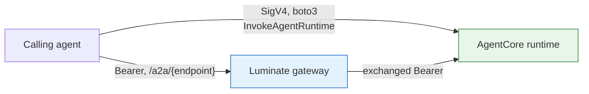

The SigV4 path is authorized by IAM and is **invisible to ACP** — no access decision, no
guardrail, no audit event, no cost attribution. It is not a governed path, and the harness SDK
offers it (`invoke_runtime`, `invoke_runtime_a2a`) alongside the governed one. The pattern's
position: **a governed delegation goes through the gateway**; the SigV4 methods are for
ungoverned internal use and must not be presented as an ACP integration.

---

## S4 · AWS Lambda

**Status: not yet exercised.** In scope, with two constraints that decide the design.

| Requirement | Detail |
|---|---|
| **Egress** | A Lambda in a VPC needs a NAT gateway or a VPC endpoint to reach the Luminate gateway; a Lambda outside a VPC has internet egress but cannot reach an in-cluster gateway at all. Egress-only agents are otherwise unremarkable on this substrate |
| **Ingress — needs a stable URL** | `AgentDeployment.backend_endpoint` is a URL, so a Lambda can only be an A2A callee behind a **Function URL** or an **API Gateway** endpoint. `InvokeFunction` over the AWS API is not reachable from the gateway |
| **Restricting access (ASR-5)** | A Function URL with `AuthType: NONE` is public — that alone fails ASR-5. `AuthType: AWS_IAM` requires SigV4, which the gateway does not send, so it fails ASR-15. **The workable shape is a private API Gateway behind a VPC endpoint, or a Function URL restricted by resource policy to the gateway's egress identity** |
| **Cold start vs the token cache** | This is the real constraint. A cold Lambda has an empty token cache, so it mints on the first invocation. The harness SDK caches with a 30-second refresh skew and a 600-second fallback lifetime — sound for a long-lived process and worth nothing to a container that is discarded. **The portal token endpoint is rate-limited, so a per-invocation mint will throttle under load.** The mitigations are, in order of preference: keep the token in a warm extension or provisioned concurrency; cache it in Secrets Manager or Parameter Store with a TTL shorter than its lifetime; or accept a low invocation rate and document the ceiling |
| **Timeouts** | An A2A task may exceed a Lambda's 15-minute maximum. An agent that can run long is a poor fit unless it returns a task id and reports completion asynchronously — which the A2A task lifecycle supports and the gateway does not model |
| **Bound (ASR-23)** | Reserved concurrency. The most effective ASR-23 control on any substrate |
| **Build** | JTE path producing a container image to ECR, or a signed zip. ASR-25 – ASR-28 apply unchanged |

---

## Assessing any other substrate

The criteria are the whole mechanism. Below are the three platforms asked about most often, worked
through as examples of how an assessment reads — **not** as a closed list, and not as refusals.
Each records which criteria are met, which are open, and what would close them.

### Microsoft Copilot agents

| | |
|---|---|
| **Egress (SUB-E)** | **Met.** A custom-engine agent or connector can call an HTTPS endpoint and hold a Luminate client credential in an Azure Key Vault-backed connection (SUB-E2), with token caching in the connector (SUB-E3). SUB-E4 needs the tenant to prevent a second, direct path to the same model |
| **Ingress (SUB-I)** | **Open on SUB-I3 and SUB-I4.** Invocation happens inside Microsoft 365's orchestration; no interposition point is exposed where a gateway could sit, and there is no inbound authorizer the platform can configure |
| **Viable today for** | **Egress-only.** Register it as an **Application** (nothing calls it — see [Registration](d2-design/registration.md)), issue a deployment credential, and grant models and MCP servers by access policy |
| **What would close the gap** | Microsoft exposing an inbound hook or an addressable agent endpoint. Re-assess on that change |

### AWS Quick Suite agents

| | |
|---|---|
| **Egress (SUB-E)** | **Met where its action groups call out through the gateway**, and its execution layer holds the credential |
| **Ingress (SUB-I)** | **Inherited from the execution target.** Where the agent executes on a Bedrock AgentCore runtime it inherits **S3** and is fully viable; where it executes on Lambda it inherits **S4**. The Quick Suite wrapper itself has no separately addressable endpoint today |
| **Viable today for** | **Full participation, assessed at the execution layer** — register the AgentCore runtime or Lambda, which is the thing the gateway actually routes to |
| **What would close the gap** | A stable, addressable endpoint for the Quick Suite agent itself, or confirmation of its extension model. Assess it then against SUB-I1–I5 like any other |

### GitHub Copilot and local developer agents

| | |
|---|---|
| **Egress (SUB-E)** | **Open on SUB-E2.** A credential on an endpoint device is outside managed custody: no central rotation, no revocation-latency guarantee. It also mis-attributes a person's actions to a machine principal, which is what the audit trail exists to prevent |
| **Ingress (SUB-I)** | **Open on SUB-I1.** Invocation is a keystroke; there is no stable endpoint |
| **Viable today for** | **A different pattern, which is supported.** Where a developer tool must reach a governed model, the fitting shape is a **user-delegated credential** (`lud_at_`) attributable to the individual — bounded by the delegation ceiling, and the subject of [`integration-patterns`](../../../platform/integration-patterns/d0-discovery.md) rather than this spec |
| **What would close the gap** | Managed credential custody on the endpoint (a brokered, rotatable, centrally revocable credential). Until then the delegated-user path is the better fit anyway, because it attributes correctly |

**The pattern to take from these three**: two are viable *today* in a specific shape, and the
third points at a different supported pattern. None of them is a door closed. Each states the
criterion that is open, which is what makes the assessment repeatable when the platform moves.

---

## Substrate comparison

| | **S1 OpenShift** | **S2 EKS in-cluster** | **S3 AgentCore** | **S4 Lambda** |
|---|---|---|---|---|
| Ingress capable | ⚠️ unproven | ✅ | ✅ (dev) | ⚠️ needs a stable URL |
| TLS on the hop | SLF PKI, **merged bundle required** | usually none (plain HTTP) | public roots | public roots |
| ASR-5 control | NetworkPolicy + route restriction | NetworkPolicy | resource policy + VPC endpoint policy | resource policy / private API GW |
| Inbound authorizer | the agent's own | the agent's own | **custom JWT authorizer required** | the function's own |
| Egress to the gateway | corp egress (Netskope roots) | in-cluster | AWS network path | NAT / VPC endpoint |
| Natural bound | replicas | replicas / HPA | runtime concurrency | reserved concurrency |
| Cold-start token risk | none | none | low | **high — see S4** |
| Live example | — | `policy-assistant` | `fdes-pharmacy-agent` (dev) | — |

---

# Identity — what the agent holds, and what a callee receives

Two questions, and they have different answers.

- **Egress**: what credential does the agent present to the gateway, and which ones are refused
  where?
- **Ingress**: what arrives at the agent, and what must the agent do with it?

## Egress — what an agent can hold

| Shape | What it is | Where it works | Where it is refused |
|---|---|---|---|
| **Client credentials → JWT** | An IdP client minted per (agent, gateway): `agent-{agentUUID}-{gatewayUUID}`. Exchange at `POST {portal}/api/v1/iam/auth/token`, then present the `access_token` as `Authorization: Bearer` | Every lane. **The only shape that works on `/a2a`** | — |
| **`lum_` API key** | Static key, `APIKey.owner_agent`, verified at the portal by gRPC | `/llm`; `/mcp` on a `none`-mode endpoint | **403 `api_key_not_exchangeable`** on a delegated A2A endpoint · **403 `platform_minted_not_forwardable`** on a `token_forward` MCP endpoint |
| **`lud_at_` delegated token** | The agent acting **on a user's behalf** | `/llm`, `/mcp`, `/a2a` where an exchange is configured | **403 `platform_minted_not_forwardable`** on a `token_forward` MCP endpoint |
| **Plain user JWT** | A user token with no actor claim | `/llm`; `/mcp` on a `none`-mode endpoint | **403 `not_exchangeable`** on a delegated A2A or MCP endpoint |

Two consequences worth stating loudly.

**An agent that delegates to another agent must hold client credentials.** Since every routable
agent endpoint on `main` is a delegated target, an API key is refused on the whole lane. This is
the single most likely first failure for a team following the SDK's defaults — see
[Gaps](d2-design/gaps.md).

**Sending the client id and secret to the gateway does not work.** They must be exchanged at the
portal token endpoint first, and the resulting `access_token` presented. The gateway sanitises
every proxy-route error, so a bad credential, a missing policy and an undeployed target all read
as the same string; get the real cause from the gateway logs, where **401 = authn** and
**403 = authorization**.

## Ingress — there is no identity mode, and that is the design

`MCPServer` has an `identity_mode` with five members and a matrix of consequences. **`Agent` has
no such field, and `AgentAssignment` has no `backend_auth`.** The platform states why:

> There is no identity-mode gate. An MCP server chooses among five identity modes and only
> `DELEGATED_EXCHANGE` is a swap target; an agent has no such field, because the A2A lane serves
> exactly one shape — an agent Luminate fronts and reaches on a caller's behalf. Every agent
> deployment the gateway can route is therefore a delegated target, and the degrade path is the
> provider check in `_agent_downstream_exchange` rather than a per-agent choice.
> — `backend/app/agents/audiences.py`

So the ingress design space is not "which of five modes" but "**delegated, or degraded**".

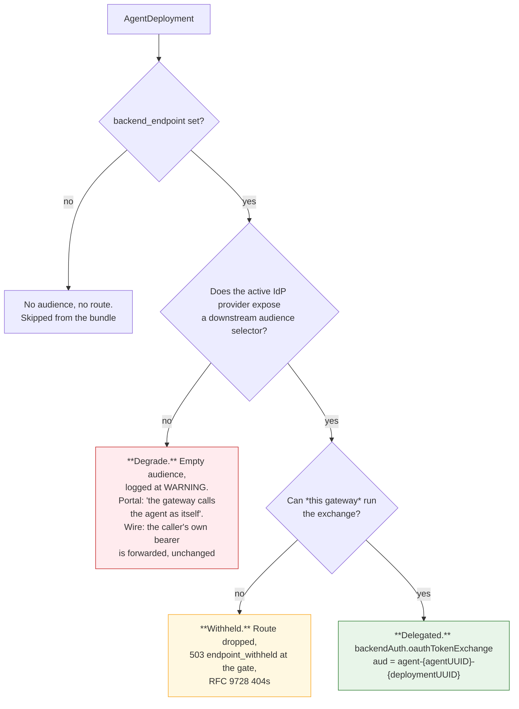

**ASR-13: only the green branch is conformant.** The amber branch is a safe refusal — the
platform prefers withholding to silently reaching the agent as itself. The red branch is the one
to catch, because it looks like it is working.

### Reading which branch you are on

The route's inline policies in the gateway's `/config_dump` are the ground truth:

```jsonc
// dev — delegated. Conformant.
"inlinePolicies": [
  {"a2a": {}},
  {"backendTLS": {"systemRoots": true}},
  {"backendAuth": {"oauthTokenExchange": {
    "grantType": "tokenExchange",
    "audiences": ["agent-01a01b8b-…-01a01d3b-…"],
    "subjectToken": {"source": {"header": {"name": "authorization", "prefix": "Bearer "}}},
    "clientAuth": {"clientId": "gw_019f8d0c-…", "method": "clientSecretBasic"}
  }}}
]

// prod — degraded. NOT conformant: no platform identity is attached, and the
// caller's own bearer travels to the backend.
"inlinePolicies": [ {"a2a": {}}, {"backendTLS": {"systemRoots": true}} ]
```

Prod is in the degraded state because its build predates the exchange — at `sha-89356d7`
`backend/app/agents/audiences.py` does not exist and `_build_agent_assignments` still carries the
docstring *"Agents aren't routed through agentgateway"*. Nothing is exposed today only because
prod has zero `target_type = agent` policies, so every A2A request denies at `CheckAccess` before
it is proxied. **The control holding the line is the absence of a grant, not the credential
handling** — which is why FR-11 gates any prod A2A grant on the image uplift.

### Why the degrade is dangerous rather than merely weaker

Two sources describe the degraded branch and they do not say quite the same thing, so state both.

The **portal** side records the intent — `AgentAssignment.delegated_identity_audience`: *"Empty means
the gateway calls the agent as itself."* No delegated identity is attached.

The **gateway** side decides the wire. `_forwards_caller_credential` returns `True` for any
non-MCP target, on the stated reasoning that *"LLM and A2A upstreams are the platform's own"*, and
the caller-credential headers are excluded only when it returns `False`. With no `backendAuth`
policy there is nothing to overwrite the `Authorization` header with, so **the caller's own bearer
travels to the backend** — while the gateway attaches no identity of its own.

That reasoning holds for an in-cluster agent. It does not hold for
`bedrock-agentcore.ca-central-1.amazonaws.com`, which is where every prod A2A route points. A
platform-minted credential forwarded to a third party is exactly what the MCP lane refuses with
`platform_minted_not_forwardable`; the A2A lane has no equivalent refusal because it assumes the
upstream is its own.

## The exchange, and what the callee gets

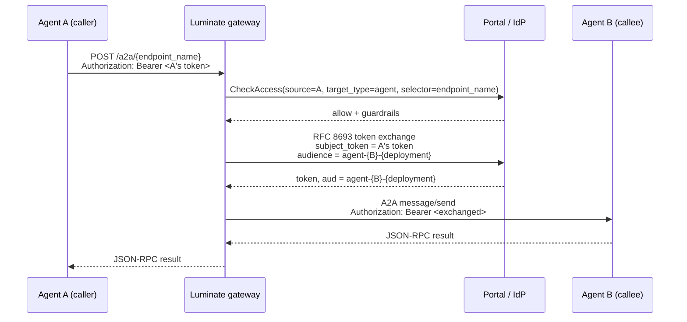

**What agent B must validate (ASR-14):**

| Check | Why |
|---|---|
| Signature against the platform JWKS | It is a real token |
| Issuer | It came from the platform's IdP |
| Expiry | Access tokens are short-lived |
| **`aud == agent-{its own agentUUID}-{its own deploymentUUID}`** | **The audience is deployment-scoped, not catalogue-scoped.** A catalogue-scoped audience would be spendable against production from staging. B must reject a token minted for a different deployment of itself |

**What B learns about who called.** The exchanged token's subject is the original caller and the
act chain names the intermediaries — the gateway forwards `actor_id`, `actor_type`, `actor_name`
and `actor_chain` as `x-luminate-*` headers on the same request. B can therefore authorize
per-caller, which is the whole point of the lane existing.

**What the gateway may swap for.** A gateway may only obtain a token for a deployment it actually
fronts (`swappable_agent_audiences_for_gateway`), and the exchange right is a scope
(`downstream:{deployment-pk}`) resolved against the catalogue at exchange time — so a deployment
removed since the token was minted authorises nothing. The `downstream:` namespace is shared with
MCP, and a scope cannot be spent across kinds because the id resolves back through the catalogue.

## Discovery — RFC 9728, and the agent card that does not exist

**What is served:**

```text
GET {gateway}/.well-known/oauth-protected-resource/a2a/{endpoint_name}
→ 200 { "resource": "agent-{agentUUID}-{deploymentUUID}",
        "bearer_methods_supported": ["header"],
        "resource_name": …, "authorization_servers": [issuer] }
   Cache-Control: max-age=300
```

Unauthenticated by construction — only `/llm/`, `/mcp/` and `/a2a/` are treated as proxy
requests, so `/.well-known/` never reaches the authn middleware. A discovery document a backend
must fetch before it holds a validated token cannot itself require one.

**404 is a meaningful answer, not a fault.** It means this gateway does not exchange for that
endpoint, so there is no per-resource audience to publish; claiming one would invite the agent to
enforce a value it will never see. A 404 here is a direct signal that you are on the degraded
branch.

**What is *not* served: an agent card.** Nothing in the platform stores, serves or proxies one —

```text
grep -rin "agent-card|agent.json|agentcard" gateway/app backend/app --include=*.py
  → 0
```

— and `/.well-known/` is answered locally by the gateway rather than proxied, so a caller cannot
reach a callee's own card even if the agent publishes one at its backend. A2A clients that
bootstrap from an agent card cannot do so through the gateway. **ASR-12 makes the catalogue entry
the capability inventory instead**, and the gap is raised as a consortium ask.

## Refusals, by cause

The one table to reach for when a call fails. Everything except the last row is a deliberate,
named refusal; the last row is the one with no signal at all.

| Symptom | Cause | Where |
|---|---|---|
| **401** | No credential, or one that does not validate | `_authenticate` |
| **403 `api_key_not_exchangeable`** | `lum_` API key at a delegated A2A endpoint | `_refuse_agent_unexchangeable` |
| **403 `not_exchangeable`** | Plain user token (no actor) at a delegated A2A endpoint | `_refuse_agent_unexchangeable` |
| **403 `platform_minted_not_forwardable`** | `lum_` or `lud_at_` at a `token_forward` MCP endpoint | `_refuse_platform_minted` |
| **403, no reason** | No `AccessPolicy` matches, or the target agent's `status != active` | `authz.rego` `allowed_agents` |
| **403, portal unreachable** | Fail-closed by design; there is no policy cache | `CheckAccess` |
| **503 `endpoint_withheld`** | The gateway cannot run the exchange for this endpoint | `_withhold_unexchangeable_agents` |
| **404 on `/.well-known/…/a2a/{ep}`** | The endpoint is not delegated on this gateway — intended | `well_known.py` |
| **500 `upstream service error`** | Often TLS: the backend leaf's issuer is not in the gateway's bundle | agentgateway |
| **Failure at the proxy hop, no gate refusal** | **A grant exists but no route does** — the agent has no `AgentDeployment` | Nothing reconciles the two |

## Summary

| Question | Answer |
|---|---|
| What does an agent hold to call out? | Client credentials exchanged for a JWT. An API key works on `/llm` and on `none`-mode MCP, and is refused on `/a2a` |
| What does a callee receive? | A token audienced to **its deployment**, whose subject is the original caller |
| Can a team choose the ingress identity mode? | No. There is no mode. Delegated, or degraded |
| How do I tell which I am on? | The route's `backendAuth` block in `/config_dump`, or whether RFC 9728 discovery 404s |
| Can a caller discover what a callee does? | Not through the gateway. There is no agent card anywhere in the platform |

---

# Authorization — two directions, two grants, and what is not enforced

## The grant, in each direction

`AccessPolicy` carries an `agent` member on **both** enums, so an agent is a first-class source
and a first-class target.

```text
AccessPolicySourceType = mcp_server | agent | user | user_group | application | location | environment
AccessPolicyTargetType = mcp_server | agent | model | location | environment
```

| Direction | Policy | What it authorizes |
|---|---|---|
| **Egress** | `source_type = agent`, `source_agent = A` → `target_type ∈ {model, mcp_server, agent}` | A may reach that target |
| **Ingress** | `source_type ∈ {agent, application, user, …}` → `target_type = agent`, `target_agent = B` | That source may invoke B |

Both are evaluated by the same Rego on every request, with no cache. A portal outage denies.

## How the decision is actually made — and the asymmetry inside it

The two sides of `authz.rego` are not symmetric, and the difference is the single most
consequential fact on this page.

```rego
# Target side — reads the catalogue and checks status
allowed_agents contains agent if {
        agent := input.agents[input.target_id]
        agent.status == "active"
        some policy in input.policies
        policy.status == "active"
        _source_matches(policy)
        policy.target_type == "agent"
        policy.target_agent_id == input.target_id
        _policy_required_constraints_match(policy)
}

# Source side — one line, and it never touches the catalogue
_source_matches(policy) if { policy.source_id == input.jwt.sub }
```

`input.agents` is built by `_collect_agents()`, which selects `status=ACTIVE` only. So:

- **A deactivated agent cannot be called.** It drops out of `input.agents`, `allowed_agents` is
  empty, and the request denies.
- **A deactivated agent can still call.** `_source_matches` compares a policy's `source_id` to
  the token subject and never consults `input.agents`. `_collect_policies()` filters on
  `AccessPolicyStatus.ACTIVE` and not on the source agent's status.

`Agent.status` has exactly three non-test runtime consumers in the whole repository —
`facts.py:674`, `access_policies/reach.py:274` (the delegation ceiling) and the model's own
default. None is on the egress path. `AuthNService.verify_api_key` checks the key's status and
expiry and never reads `owner_agent.status`.

**This is a control boundary, not a bug to work around locally.** It is stated here, made an
explicit requirement in ASR-32, drilled in [Operations](d2-design/operations.md) and raised as a consortium
ask in [Gaps](d2-design/gaps.md).

### Constraints narrow a grant

A policy may carry `required_gateway_id`, `required_environment_id`, `required_provider_id` and
`required_location_id`; an empty value means "any". For an agent or MCP target these are all
matched against the request, because the endpoint name identifies exactly one deployment and the
gateway resolves and sends its environment and location. Use them: a grant unconstrained by
environment is a grant in every environment that gateway serves.

## The boundary: a grant is per agent, in each direction

**Egress.** A source grant does not name a *capability* — it names a target. An agent granted a
model may send it anything; an agent granted an MCP server may call every tool that server
exposes, now and in future (the tool-granularity boundary that
[`mcp-server-patterns`](../../mcp-server-patterns/d2-design/authorization.md) makes explicit).

**Ingress.** A target grant does not name a *method*. Once a caller may invoke agent B, it may
send B any A2A message B accepts. There is no per-skill, per-task or per-method authorization,
and nothing in the request path parses the A2A payload before the decision.

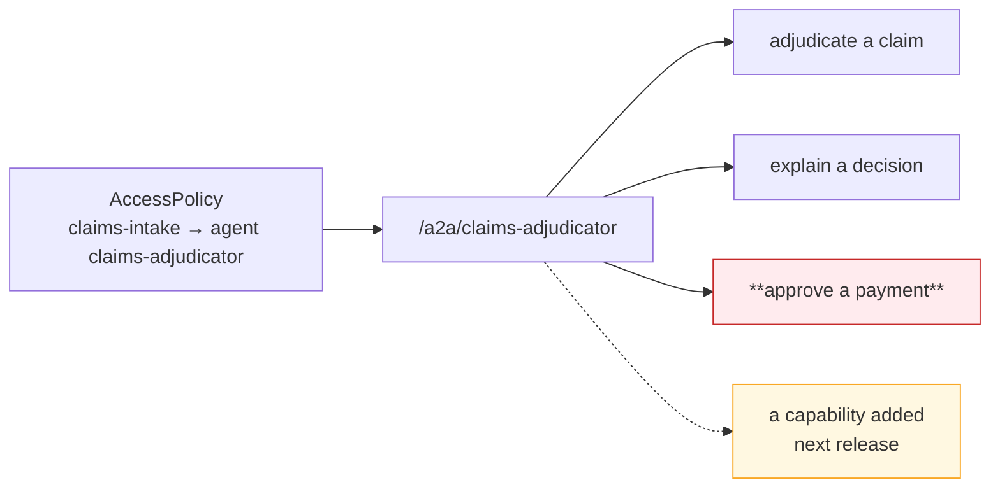

**ASR-24: split by privilege.** Where an agent's tasks differ materially in privilege — read
versus write, or across classification tiers — those are separate agents with separate endpoints
and separate grants. This is the same design rule the MCP pattern reaches for the same reason,
and it is cheap now and a migration later.

Where that cannot be met, the agent enforces per-capability authorization **itself**, from the
delegated identity it receives (ASR-14). It can do this — the exchanged token names the original
caller and the act chain — but the control then sits in the agent, and an ISRA must be told so.

## Guardrails — caller-scoped only

`GuardrailTargetType` has an `AGENT` member, which reads as though content control covers the
agent lane. It covers the agent **as caller**.

| Scope | Fires on | Available for agents? |
|---|---|---|
| `organization`, `project` | Anything under it | ✅ |
| `api_key` | The credential presented | ✅ |
| **`agent`** | Requests **made by** that agent | ✅ **source-side** |
| `application`, `mcp_server` | Requests made by that entity | ✅ |
| `target_model` | Every request **to** that model | ✅ |
| `target_mcp_server` | Every request **to** that MCP server | ✅ |
| **`target_agent`** | Every request **to** that agent | ❌ **does not exist** |

Proved twice over:

```text
grep -rn "target_agent" backend/app/guardrails/     → 0
```

```python
# backend/app/policy_engine/facts.py:885
_TARGET_SCOPED_FLOWS = frozenset({"model", "mcp_server"})
"""Flow types whose rego rules read ``target_guardrails``.

``authz.rego`` has a model branch and an mcp_server branch and no agent branch,
so on any other flow every key this collector could build is unreadable and the
scan is pure cost."""
```

**Consequence.** An agent that accepts A2A traffic **cannot require a prompt-injection or PII
scan of its own inbound requests**. Scanning happens only where the *caller* carries a
source-scoped guardrail with `agent` in `applies_to_target_types`. A caller without one is an
unscanned path into the agent, and the callee has no way to refuse it.

**ASR-22 is the interim**: the callee records the requirement on its onboarding record, and every
agent granted the endpoint carries a matching source-scoped attachment. It is a process control
standing in for a platform one, and it is only as good as the review that grants the next caller.

There are **zero** guardrail attachments of any kind in SLF dev today.

### What a scan actually inspects on this lane

`extract_input` recognises the OpenAI chat shape only when `target_type == "model"`. For every
other lane it falls through to the raw body decoded as UTF-8. So on the A2A lane a guardrail
scans the **entire JSON-RPC envelope as text** — method, id, params and message parts alike — and
a redaction rewrites raw bytes. That works for detection; treat it as coarse, and do not design a
control that depends on matching a specific field.

Guardrail attachments carry `mode` (`enforce` / `warn`) and `action` (`block` / `redact`), and
where several attachments reach one request the strictest wins per direction.

## Quotas — modelled, not enforced

```text
grep -ril quota gateway/app/     → 0 files
```

The gateway consumes no quota facts at all. `QuotaDimension` still stops at requests and tokens;
`matched_quota_ids` is computed in the backend, put on a span and returned on the decision — it
is telemetry. There is no dollar budget and none is scheduled.

For an autonomous caller this matters more than it does for a human-driven one: an agent in a
retry loop is unbounded by the platform. **ASR-23 pushes the bound to the substrate** —
replicas, HPA ceiling, runtime concurrency, or (best of all, on Lambda) reserved concurrency.
Name it, configure it, and record it as the control, because the platform is not providing one.

## What the decision does *not* consider

Worth stating explicitly, because each is easy to assume:

| Not considered | Consequence |
|---|---|
| The **source** agent's `status` | Deactivation does not stop egress |
| Either agent's `governance_state` | Governance suspension refuses nothing |
| Any quota | An agent is unbounded by the platform |
| The A2A method or skill | A grant covers everything the agent exposes |
| Whether the target agent has a **route** | A grant against an endpoint-less agent is accepted and fails later at the proxy hop |
| The agent card | There isn't one |

## Design rules

1. **Grant one target per policy, constrained by environment.** An unconstrained grant is a grant
   everywhere that gateway serves.
2. **Split by privilege, not by convenience** (ASR-24). The endpoint boundary is the authorization
   boundary; design it the way you would design a database role.
3. **Assume every caller is scanned by nobody.** Put the guardrail on the caller (ASR-22), and
   validate inbound content in the agent as well (ASR-21).
4. **Bound yourself** (ASR-23). The platform will not.
5. **Reconcile grants against routes** (ASR-11). An active policy against an agent with no
   endpoint is a silent dead end.

---

# Reaching a REST API — and where the identity chain breaks

Most of what an agent needs to *do* lives behind an enterprise REST API. This page answers the
question the other pages do not: **how does a governed agent call one, and whose identity arrives
at the far end?**

The short version: it does not call one directly, and the answer is a decision that has already
been taken rather than an open design question.

## The gateway has three lanes, and REST is not one of them

`gateway/app/middleware/proxy.py::_resolve_route` matches exactly three prefixes and returns
`None` for anything else:

```python
for prefix, port, target_type in (
    ("/llm/", self._llm_port, "model"),
    ("/mcp/", self._mcp_port, "mcp_server"),
    ("/a2a/", self._a2a_port, "agent"),
):
```

A request that matches none of them is never tagged as proxy traffic, never authorized, never
audited — it simply is not the gateway's. `AccessProtocol` does carry an `HTTP` member, which is
easy to misread as a REST lane; its own docstring says otherwise — it is *"the fallback lane for a
proxied request whose target isn't one of the typed resource kinds (or for a synthetic
capture-scope gap marker)"*. It labels an audit event. It does not route anything.

**There is no `target_type` for an API.** `AccessPolicyTargetType` is `mcp_server`, `agent`,
`model`, `location`, `environment`. An access policy cannot name a REST API, so there is nothing
for the platform to allow or deny.

## The decided architecture: the MCP boundary

This is not a gap to be worked around locally. It was decided on **2 September 2026 by Enterprise
Architecture and EDAE ACP** ([`agent-traffic-gateway-options.md`](https://bitbucket.sunlifecorp.com/projects/EDAEACP/repos/acp-consortium-specs/browse/specs/distributed-gateway/agent-traffic-gateway-options.md),
Option 2):

| Traffic | Path |
|---|---|
| Agent → LLM, MCP or A2A | **Luminate gateway** |
| **MCP server → enterprise REST API** | **API Platform gateway, unchanged** |
| Everything not originated by an agent | API Platform gateway, unchanged |

> **The MCP boundary is where Luminate's remit ends and the API Platform's begins.** Producing MCP
> tools from the REST estate remains the API Platform's to own.

So the governed path from an agent to a business system is three hops and two gateways:

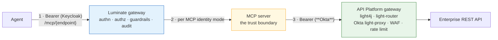

Hop 1 and hop 2 are this pattern's. **Hop 3 is the API Platform's, and it is unchanged** — same
Okta authentication, same rate limiting, same WAF the REST estate has today.

The API Platform gateway *may* also sit at the edge in front of an MCP server. That is permitted
but not preferred: it adds a gateway-to-gateway hop and its latency for no governance gain,
because Luminate is already the policy authority for that call.

## Where the identity chain breaks — and it is hop 3

Two identity domains meet at the MCP server, and they do not federate.

| Hop | Issuer | What carries the caller |
|---|---|---|
| Agent → Luminate | **Keycloak** (Luminate's IdP) | The agent's machine token, or a `lud_at_` delegated token naming the end user |
| Luminate → MCP server | **Keycloak** | On `delegated_exchange`, a token audienced to the MCP deployment whose subject is the original caller |
| MCP server → API Platform | **Okta** | ❌ **Nothing carries over.** Okta will not validate a Keycloak-issued token |

**Luminate cannot mint an Okta token.** The provider registry holds `keycloak`, `authentik` and
`entra` — there is no Okta `OAuthProvider`. Every Okta reference in the backend is about *human*
portal SSO federation (`sso/models.py` `OKTA = "okta"`, and `identity_providers/authentik/federation.py`,
whose docstring says admins use it *"to connect their corporate IDP (Azure AD, Okta, Google, SAML
IDPs)"*). And the exchange is single-provider by construction:

```python
def delegated_exchange_provider() -> OAuthProvider | None:
    """The active OAuth provider iff it supports RFC 8693 delegated exchange."""
    provider = registry.get(OAuthProvider, settings.SSO_OAUTH_PROVIDER)
```

One deploy-time provider. A **Keycloak → Okta cross-IdP exchange is not expressible in Luminate**,
today or with configuration.

### So what identity does the REST API actually see?

Two options, and the team must choose one deliberately and record it (ASR-38):

| Option | What the API sees | Cost |
|---|---|---|
| **A — Service identity** *(default, works today)* | The **MCP server's own Okta client**. Every call from every caller looks the same | **On-behalf-of is lost at hop 3.** The API cannot authorize per end user, and its audit names the MCP server, not the person |
| **B — MCP server exchanges** | The end user, if the MCP server itself swaps the Keycloak token for an Okta one | Requires **Okta to trust the Luminate issuer** — a federation decision nobody has taken. The exchange is the MCP server's code, not the platform's |

Option A is what every live server does. If per-user authorization at the REST API is a
requirement, that is a **trust-federation ask against Okta**, not a Luminate configuration change,
and it should be raised as one.

**The compensating control** is that the MCP server is the trust boundary and must enforce its own
authorization from the identity it *does* receive on hop 2 — which is exactly what
[`mcp-server-patterns`](../../mcp-server-patterns/d2-design/authorization.md) MSR-16 requires.
Luminate is an additional layer, never a replacement for the server's own controls.

### The second break: an Okta-fronted MCP backend cannot be reached with a credential

Hop 2 has its own version of the same problem, already recorded as
[`aims-acp-integration`](../../../onboarding/aims-acp-integration/d2-design.md) **G1 / DD-4**. Where the MCP
server itself sits behind Okta on the API platform:

| Mode | Verdict |
|---|---|
| `token_forward` | ✗ Okta will not validate a Keycloak-issued token |
| `injected_credential` / `external_exchange` | ✗ Enum-only — **silently degrades to no credential at all** |
| Register the backend on a cluster-internal address, **below** the Okta-fronted route | ✓ The interim, and it requires a network path plus the server enforcing its own authorization |

Do not re-derive this. Reference it.

## What this means for an agent

| Requirement | Why |
|---|---|
| **An agent never holds an enterprise API credential** (ASR-37) | The credential belongs to the MCP server behind the API Platform. An agent holding one is a copy of a secret outside the platform's custody, on an ungoverned path, invisible to both gateways |
| **An agent reaches a REST API only through an MCP server** (ASR-36) | It is the only path with an access decision, a guardrail, an audit event and cost attribution on it |
| **The identity the API sees is recorded at onboarding** (ASR-38) | Because it is usually *not* the end user, and an assessor will assume it is |
| **One MCP server per trust boundary** | The grant is per server, so the API surface behind one endpoint shares one blast radius — `mcp-server-patterns` MSR-15 |

### The anti-pattern this exists to prevent

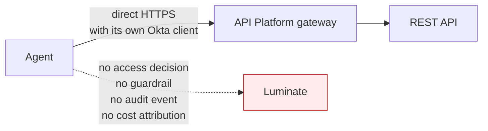

The call still authenticates — the API Platform is doing its job. But **ACP cannot see it**, and
absence of an audit event is the only detection signal. This is the same shape as the
SigV4-direct-to-AgentCore path in [Hosting](d2-design/hosting.md) S3, and it is refused for the same reason
(DD-2).

## The consortium designs — and a tension worth naming

Two unmerged designs by Andrew Culberson (TELUS) address this from the Luminate side. Both are
**Status: Draft, Decision: Pending**, on branch `d1/skills-registry`, which is **not merged** and
sits 30 commits behind `luminate-designs` `main`. Neither is a capability; both are proposals.

### D1 — API Resources

Would make a plain HTTP API a first-class callable resource type — registered in a Project,
deployed to a gateway, reached only through an explicit grant, with the **gateway injecting the
upstream credential** so callers never hold it. An optional OpenAPI description unlocks
**operation-level grants**. API Resources would be *targets only*, like models.

It names today's position exactly:

> Today a REST API can only be governed by wrapping it as an MCP server, or it is called directly
> and invisibly.

**The tension.** API Resources **as drafted** would put Luminate in front of the REST estate. The
Sun Life Option-2 decision says the API Platform keeps it, and that the MCP boundary is where
Luminate's remit ends. Those are not automatically compatible, and the difference is not a detail
— it decides which gateway owns enterprise API traffic. **If API Resources lands in that shape,
Sun Life has to decide whether to adopt it or hold the MCP boundary.** That decision is not this
spec's to take, but leaving it unstated would let two documents quietly contradict each other.
There is a third answer that fits both — see *Direction of travel* below — but it is not designed
and not in scope. Raised as G-14.

### D1 — Skills Registry

Would make agent skills — portable instruction bundles in the open Agent Skills format — governed
entities: immutable, integrity-pinned, individually reviewed versions, with provenance for
imported skills and platform-wide recall. Its access model is the part that matters here:

> a skill never grants access by itself — the APIs a skill relies on stay behind the Gateway's
> default-deny policies

and every skill **declares the APIs it relies on**, so adopting one checks those declarations
against the agent's existing grants and proposes the missing access through the normal approval
flow rather than granting it.

**It is blocked on API Resources.** The API Resources D1 says so directly — *"features that must
bind capabilities to governed APIs (the Skills Registry among them) have no governed API concept to
bind to"*.

For this pattern the consequence is narrow and worth stating: **a skill is content, not a
capability.** Adopting one changes what an agent will *try* to do; it changes nothing about what
the agent is *allowed* to do, because that is still the access policy. An agent whose skills imply
access it has not been granted fails at the gateway — which is the correct outcome, and the reason
skills do not belong in the conformance profile as a control.

That said, **the declaration model is the part Sun Life expects to build on** — see below.

## Direction of travel — bringing direct API calls into governance

**Not in scope for this pattern, and not committed.** It is recorded here so the boundary above is
read as a current position rather than a permanent one.

The intent is to bring direct agent→API calls into governance through an **Agent Skills / plugins
registry that integrates with the API Platform**: the agent declares the APIs its skills rely on,
ACP governs whether that agent may call them, and the API Platform continues to own the hop and the
Okta authentication. This is a **future roadmap item for the AI consortium** — no design, no
commitment, no date — and **nothing in this pattern depends on it**.

**This is also what resolves the tension named above**, and the distinction matters to whoever
carries the ask to the consortium:

| Shape | Who fronts the REST API | Compatible with the Option-2 decision? |
|---|---|---|
| **API Resources as drafted** — Luminate registers the API as a target and injects the upstream credential | Luminate | **No.** It moves the REST estate inside Luminate's remit |
| **Skills / plugins registry integrating with the API Platform** — ACP governs which agent may call which API; the call still traverses the API Platform with Okta | API Platform, unchanged | **Yes.** Governance moves; the traffic path does not |

So the ask is not "adopt API Resources". It is the narrower and more adoptable one: **govern the
declaration and the grant, leave the hop where it is.** Until that exists, the MCP boundary in this
document stands, and an agent that needs a REST API reaches it through an MCP server.

## Summary

| Question | Answer |
|---|---|
| Can an agent call a REST API through Luminate? | **No.** Three lanes, none of them REST, and no API target type |
| What is the sanctioned path? | Agent → Luminate → **MCP server** → API Platform (Okta) → API. Decided 2026-09-02 |
| Does the end user's identity reach the API? | **No, by default.** Okta will not validate a Keycloak token, and Luminate cannot mint an Okta one |
| Can it be made to? | Only by the MCP server exchanging, which needs **Okta to trust the Luminate issuer** — a federation ask, not a config change |
| What if the MCP server is itself behind Okta? | Reach it below the Okta hop on a cluster-internal address — `aims-acp-integration` DD-4 |
| Is a direct agent→API call ever acceptable? | **No.** It is ungoverned by ACP and detectable only by the absence of audit events |
| Will this change? | **It is intended to.** The direction is a skills / plugins registry that governs API access while the API Platform keeps the hop — a consortium roadmap item, out of scope here, with no design and no date |

---

# Build pipeline — the approved path and what its gates actually prove

The substance here is the same as
[`mcp-server-patterns` · Build pipeline](../../mcp-server-patterns/d2-design/pipeline.md), and this
page does not restate it in full. What it does is re-verify the two claims that matter, because
both were checked again for this spec and both still hold, and add the parts specific to an
agent.

An agent is not exempt because it is "just a client". It executes model-composed instructions,
pulls a large and fast-moving dependency tree, and holds a credential that reaches a governed
model and a system of record.

## The path

| Stage | JTE library | Requirement |
|---|---|---|
| Agent | `pod_template` | `iac-build-agent` or a language agent |
| Checkout | `git` | — |
| Build + unit test | `python` / `npm` / `maven` / `gradle` / `dotnet` | ASR-25 |
| Static analysis | `sonarqube` | ASR-28 |
| SCA | `snyk` (or the language library's `sca_scan`) | ASR-27 |
| SAST | `checkmarx` | ASR-26 |
| Image | `quay` / `ecr` | ASR-28 |

Configuration lives in `Jenkinsfile` + `pipeline_config.groovy`. The libraries are in
[`CSDP/pipeline-libraries`](https://bitbucket.sunlifecorp.com/projects/CSDP/repos/pipeline-libraries/browse).

## The library defaults are strict. The estate overrides them.

The gates ship **on**: `snyk` defaults `RUN_SNYK_SCAN = true`, `ENFORCE_SNYK_GATE = true`,
`SEVERITY_THRESHOLD = "high"`; `checkmarx` defaults `ENFORCE_CHECKMARX_GATE = true`.

Re-checked 2026-09-08 against the ACP repositories, including the one that *is* the agent
adoption path:

```groovy
// acp-harness-sdk/pipeline_config.groovy
run_snyk_scan = true
enforce_snyk_gate = false
disable_gate_reason_snyk = 'Snyk gate is disabled during initial CI setup for acp-harness-sdk.'
enforce_checkmarx_gate = false
disable_gate_reason_checkmarx = 'Checkmarx gate is disabled until the issue with
    java.lang.Exception: Host name and enforceCheckmarxGate is set to true is resolved.'
```

`agent-control-plane-ui` carries the same two overrides with the same Checkmarx reason. The scans
run; nothing fails on them. Each reason describes a setup-era workaround that has outlived its
setup.

**ASR-28: a disabled gate is an exception with an owner and an expiry, not a default.** An agent
repository is not the place to carry the estate's habit forward.

## A green Checkmarx stage is not a scan

`libraries/checkmarx/steps/code_analysis.groovy` does not scan. It resolves the latest **merged
pull request** for the repository, looks up the scan Checkmarx already ran for that PR, waits for
the gate evaluation and reports it. A repository with no merged PR logs

```text
New repository PR does not exist. Checkmarx scan is skipped.
```

and passes. The default `branches_to_scan` is `["develop"]`, so a repository whose integration
branch is `main` — which is every ACP repository — matches nothing unless it overrides.

**ASR-26 requires the scan id and the gate evaluation, not the stage colour.** This is the single
most load-bearing evidence rule in the profile, and it is inherited from the MCP pattern
unchanged because the defect is in the shared library.

## Agent-specific additions

| Concern | Why it is different for an agent | Requirement |
|---|---|---|
| **Dependency surface** | Agent frameworks pull deep, fast-moving trees — LangGraph, Strands, the AgentCore SDK, MCP clients, and whatever a tool integration drags in. Transitive CVEs land weekly | ASR-27, with the SBOM retained per build |
| **Prompt and tool assets** | System prompts, tool descriptions and skill definitions are code by any useful definition: they change behaviour, they are not covered by SAST, and a change to one can widen what the agent does | Review them under change control alongside code; ASR-12 keeps the catalogue record current |
| **Base images** | No `docker.io` egress from Sun Life cluster pods. Every base and runtime image must be mirrored to Quay or ECR first | ASR-28 |
| **Model and tool pinning** | An agent that resolves its model or its MCP endpoint at runtime from configuration can change what it reaches without a build. Pin them, or make the configuration a governed change | ASR-12, ASR-20 |
| **Lambda packaging** | A signed zip is acceptable in place of an image, provided it is produced by the same pipeline and referenced by version, never `$LATEST` | ASR-28 |
| **AgentCore packaging** | The runtime image is built by the JTE path and pushed to ECR like any other. AgentCore being managed does not move the supply chain out of scope | ASR-25 – ASR-28 |

## Evidence, per requirement

| Requirement | Evidence an assessor can retrieve |
|---|---|
| ASR-25 | The Jenkins job and its stage list |
| ASR-26 | The Checkmarx **scan id** and its gate evaluation, recorded on the build |
| ASR-27 | `snyk-results.html` and `snyk-sbom.json` as build artifacts |
| ASR-28 | SonarQube project + quality-gate status; registry digest matching the deployed digest; `runAsNonRoot` in the manifest |

> **The rule that makes this section worth anything:** a control is met when its artefact is
> retrievable. A green pipeline is not an assessment — the Checkmarx step reports success when no
> scan exists.

---

# Operations — what is visible, and how you stop it

## The stop path — read this before an incident, not during one

**Setting an agent inactive stops other agents calling it. It does not stop it calling
anything.**

| Action | Stops egress? | Stops ingress? | Mechanism |
|---|:--:|:--:|---|
| `Agent.status = inactive` | ❌ **No** | ✅ Yes | Drops out of `input.agents`; `allowed_agents` requires `status == "active"`. The source rule never reads it |
| **Revoke the agent's `OAuthCredential`** | ✅ Yes | — | `POST …/revoke-credentials`. The IdP client can no longer mint; **tokens already issued live until expiry** |
| **Revoke or expire the agent's `APIKey`** | ✅ Yes | — | `verify_api_key` refuses `revoked` / `expired` / non-`active` immediately. It does **not** check the owner agent's status, so this is a separate action |
| **Revoke or suspend the source `AccessPolicy` rows** | ✅ Yes | — | `_collect_policies` selects `status = ACTIVE` only, so a revoked policy stops matching at the next fact build |
| **Delete the `AgentDeployment`** | — | ✅ Yes | The route stops being emitted at the next config push |
| `governance_state = suspended` | ❌ No | ❌ No | **Records and audits. Refuses nothing.** |

### The runbook

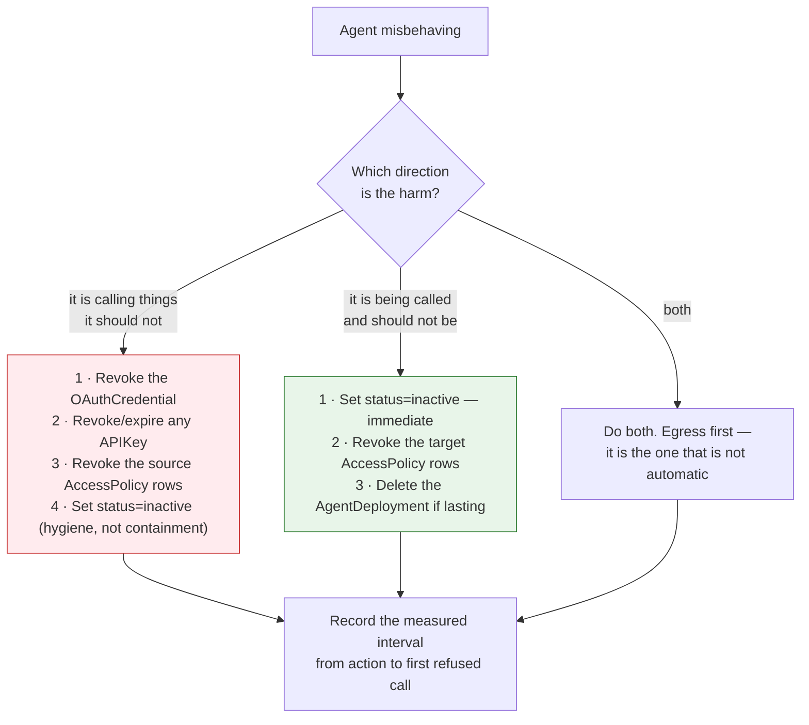

**Credential revocation has a tail.** Access tokens are short-lived but non-zero; a token minted
a second before revocation remains valid until it expires. Revoking the *access policies* closes
the hole for tokens already in flight, because the policy is consulted on every request. **Do
both, and do the policy revocation first if seconds matter.**

**ASR-32 requires this to have been exercised**, and FR-10 requires the interval to be measured
per environment and per direction. Configuration reaches gateways over a long-lived push stream
rather than a poll, so the number should be small — but it must be measured, never quoted.

## Audit

Two classes, both append-only.

| Class | What it records | Where |
|---|---|---|
| **Change** | Every mutation of an agent record — create, update, delete, and each governance transition with its reason | `audit_events`, from `AgentLifecycle` |
| **Access** | Every data-plane decision, with `CaptureProtocol.a2a` for the agent lane | Gateway capture → `luminate.audit.v1.CaptureIngest` |

Two properties worth knowing:

- **`Agent.audit_snapshot()` is an allow-list.** `key`, `name`, `description`, `status`, `type`,
  `framework`, `deployment_type`, `project_id`. `configuration` is deliberately excluded — it is
  free-form operator JSON headed for a store that cannot be redacted afterwards — but a change to
  it still reaches `changed_fields`, so the trail says the configuration moved without copying
  its contents. `governance_state` is likewise absent from the snapshot; its history is in the
  transition trail instead.
- **A call that bypasses the gateway emits nothing.** Absence of events is the detection signal
  for an ASR-5 violation, not presence of a denial.

## Tracing and attribution

The gateway stamps `x-luminate-*` headers onto the upstream request, which agentgateway lifts
into its span and Langfuse ingests. Callers cannot set them: the inbound allow-list holds no
`x-luminate-*` key and the values are appended after filtering.

| Header | On the agent lane |
|---|---|
| `x-luminate-target-id`, `-target-type` | ✅ the callee agent's id and `agent` |
| `x-luminate-entity-id`, `-entity-type`, `-entity-name` | ✅ the calling entity |
| `x-luminate-actor-id`, `-actor-type`, `-actor-name`, `-actor-chain` | ✅ where the call is delegated — the act chain, most recent first |
| `x-luminate-principal-id` | ✅ → `langfuse.user.id` |
| `x-luminate-session-id` | ✅ if the caller sent one |
| `x-luminate-project-id` | ✅ |
| `x-luminate-model-id`, `-offering-id`, `-model-pricing-key` | ❌ model lane only |
| `x-luminate-mcp-method` | ❌ MCP lane only |
| **`x-luminate-genai-operation`** | ❌ **deliberately absent** |

### The missing operation name, and what it costs

`_stash_genai_operation` stamps exactly two values, both from the OTel GenAI semantic
conventions' own vocabulary, and says why the agent lane gets neither:

> The agent lane stamps nothing for now — it is a proxied A2A call, and which operation name fits
> it is a question for whoever brings that lane's measures up.

That is honest rather than lazy — an invented value would be worse. The cost is concrete:

- Langfuse types the A2A hop as a plain **span**, not a generation. Every portal usage and cost
  query selects `type = GENERATION`, so **the hop itself carries no tokens and no cost**, which is
  correct — an A2A hop has none of its own.
- What *does* have cost is what the callee then does. And that is booked to the **callee**.

## Cost — and why a delegation's cost does not follow the caller

Per-agent usage is real: `UsageBucket` carries `SubjectType.AGENT`, `agent_model_timeseries`
gives a per-model token and cost series for one agent, and `AgentUsageSummary` gives executions,
model calls, MCP calls, denied executions and latency.

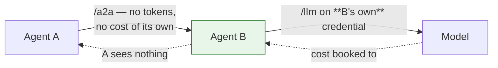

**ASR-31**: where the downstream cost must follow the original caller, **the callee forwards the
delegated token it received** rather than calling out on its own machine credential. The token
names the original caller as subject and carries the act chain, so the attribution headers on B's
onward call name A. If B uses its own credential instead, the chain is broken at B and the
chargeback lands on B's cost centre.

Decide this deliberately. Both answers are defensible — a shared service agent may *want* to own
its costs — but only one of them is what a chargeback conversation usually assumes.

`ProjectUsageDaily` (the finance-facing chargeback ledger) aggregates by `usage_date` and carries
`cost_centre` as a first-class column, but has **no run or session dimension**, so "what did this
delegation chain cost" is answerable only through Langfuse session grouping, not from the ledger.

## Run correlation

`_raw_session_id` picks the run id in this order:

1. **`Mcp-Session-Id`** — MCP lane only, and it wins there
2. **`x-luminate-session-id`** — the explicit header, reduced to printable non-whitespace ASCII
   and length-capped, then namespaced `{entity_type}:{entity_id}:{raw}` so `run-1` from two
   agents does not merge into one Langfuse session
3. **`traceparent`** trace-id — an OTel-instrumented caller gets run grouping for free
4. **nothing** — the request lands in the null-session row

**ASR-33: send `x-luminate-session-id`.** Two traps:

- The harness SDK sends **`x-session-id`**, and `grep -ri "x-session-id"` across `gateway/` and
  `backend/` **returns zero**. It is not read. Same for `x-acp-agent-id`.
- On a delegation chain, correlation only holds if **the callee propagates the same session id
  onto its own outbound calls**. The gateway does not invent one and does not carry it across the
  hop for you.

## Health

**The platform never probes an agent.** The asymmetry with the MCP lane is visible in the data
model itself: `MCPServerDeployment` carries `health_status`, `last_checked_at` and `last_error`,
fed by a `ProbeMcpCommand` the gateway acts on and a `supports_mcp_probe` capability the portal
checks before offering a manual health check. **`AgentDeployment` carries none of them** — it has
exactly two fields, `endpoint_name` and `backend_endpoint`. `Agent.status` is operator-set and
means "should this be served", not "is this up".

So liveness, restarts and capacity are entirely the hosting platform's job (ASR-29), and the
detection signal for a dead agent is **gateway 5xx per endpoint**. Alert on it, per endpoint
name, because nothing else will tell you.

## The operational checklist

- [ ] The stop runbook is written, names both directions, and has been **exercised**
- [ ] The propagation interval is measured per environment and per direction (FR-10)
- [ ] Alerting on gateway 5xx per endpoint name — this is the only liveness signal
- [ ] The agent sends `x-luminate-session-id` and propagates it across delegations (ASR-33)
- [ ] The delegated-token-vs-own-credential decision is recorded, with its cost consequence
      (ASR-31)
- [ ] `governance_state` is recorded and **not** cited as a control
- [ ] The FR-3 non-conformance queries run on a schedule, not on request

---

# Assurance — the ETAB submission and the ISRA control set

| Record | Identifier |
|---|---|
| Architecture governance (ATG) | **ATG0005678** |
| Security risk assessment (ISRA) | **26-1956** |

The control set below (C-1–C-35) and the residual risks (R-1–R-12) are the content submitted
against ISRA 26-1956. The scope those records cover is the four specified substrates plus the
**SUB-E / SUB-I admission criteria** in [Hosting](d2-design/hosting.md) — quoted verbatim under *What ETAB is
being asked to approve*. A platform admitted against those criteria is in assessed scope; changing
the criteria themselves is a change to the assessed scope, not an editorial one.

This page exists so that a board submission and a security risk assessment can be produced from
the spec rather than reconstructed from the gateway source and two disagreeing cluster estates.
It says four things: what the architecture is, which decisions were taken and why, which threats
an agent changes, and which controls exist with what evidence.

## The architecture, as submitted

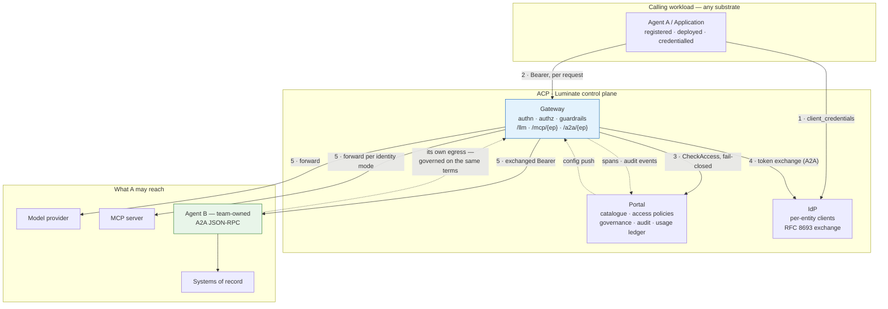

**The single assertion the architecture makes**: no agent reaches a model, a tool or another
agent except through a Luminate gateway, and every such call is authenticated, authorized against
a central policy decision, and audited. Every control below either supports that assertion or
bounds what happens when it does not hold.

**What the architecture deliberately does not assert**, and an assessor must be told:

- It does **not** assert that content is scanned on the A2A lane. No guardrail can be bound to an
  agent as a callee.
- It does **not** assert that deactivating an agent contains it. Deactivation stops ingress only.
- It does **not** assert that `governance_state` gates anything. It records.
- It does **not** assert that an agent's call volume or spend is bounded by the platform.

## Design decisions

| # | Decision | Rationale | Alternative rejected |
|---|---|---|---|
| **DD-1** | **Egress and ingress are two registrations with two requirement sets**, and the direction is declared | They differ in what must exist, what must be built and what must be authorized. Conflating them produces agents that are registered and unreachable — eight of ten in dev | A single "onboard my agent" step. It is what produced the current estate |
| **DD-2** | **The gateway is the only path** to a model, a tool or another agent | Controls only exist on the path they sit on. A second path defeats authn, authz, guardrails and audit at once. The SigV4 route to an AgentCore runtime is exactly such a path and is explicitly not an ACP integration | Direct SigV4 or direct service-to-service calls "for latency" |
| **DD-3** | **The agent is the unit of authorization, in each direction** | It is what the platform enforces. A source grant covers everything that agent may do; a target grant covers every capability it exposes | Pretending a grant is per-skill or per-method. Nothing parses the A2A payload before the decision |
| **DD-4** | **Split by privilege into separate agents** where tasks differ materially | Makes the platform's agent-granular grant coincide with the intended privilege boundary. Cheap now, a migration later | One large agent with self-enforced authorization — permitted, but the control moves off the platform and the ISRA must say so |
| **DD-5** | **An ingress endpoint is served only where the on-behalf-of exchange runs** | The alternative reaches the agent as the gateway, or forwards the caller's own credential to a backend that may be a third party's. The platform already prefers withholding to degrading; this makes it a requirement | Accepting the degraded branch because "it works". Prod is in that state today |
| **DD-6** | **Governance state is evidence, not a control** | It has zero runtime consumers. `suspension.py` says so itself: *"the state is real and the denial is not"* | Presenting `governance_state = suspended` to an assessor as a stop control |
| **DD-7** | **The stop control is credential and policy revocation**, not deactivation | The Rego's source rule matches on the token subject and never reads the agent's status. This is a property of the platform, not a misconfiguration | A runbook that says "set it inactive". It would contain half the problem and read as if it contained all of it |
| **DD-8** | **Content control on A2A ingress is a caller-side obligation** recorded on the callee | There is no `target_agent` scope and no agent branch in the Rego. The alternative is to claim a control that does not exist | Relying on `GuardrailTargetType.AGENT` as though it bound to the callee |
| **DD-9** | **The bound on an autonomous caller is substrate-side** | Quotas are not enforced anywhere; the gateway holds zero quota references. An agent in a retry loop is unbounded by the platform | Citing `Quota` records as a control |
| **DD-10** | **Fail-closed availability is accepted** | The control plane is on the request path with no policy cache. A cached allow is an unrevoked allow — and revocation is already the stop control (DD-7), so caching would undermine the one path that works | A local policy cache with a TTL |
| **DD-11** | **Everything an agent receives is untrusted** — inbound message, tool output, model output | All three re-enter a non-deterministic reasoning process. This is the defining difference from an ordinary internal service | Trusting an inbound A2A message because the caller was authorized |
| **DD-12** | **Evidence, not stage colour** | The Checkmarx step reports success when no scan exists. A green pipeline is not an assessment | Accepting build status as evidence |
| **DD-13** | **A workload that nothing calls is an Application, not an Agent** | The difference is structural: an Application has no routable endpoint, no target policy type, no `status`, no `governance_state`, and is deliberately excluded from the governance sweep. Registering a chatbot as an Agent overstates the agent inventory an E-23 review asks for | Treating the choice as naming preference |
| **DD-14** | **An enterprise REST API is reached through an MCP server, and the API Platform owns that hop** | The gateway has three lanes and none is REST. This is the 2026-09-02 Enterprise Architecture decision, not a workaround — the MCP boundary is where Luminate's remit ends. **A current position, not a permanent one** — see the direction of travel below | A direct agent→API call "because the API Platform already authenticates it". It does; ACP cannot see it |
| **DD-15** | **On-behalf-of stops at the MCP server, and that is declared rather than assumed** | Okta will not validate a Keycloak token and Luminate holds no Okta provider, so the API sees a service identity. Declaring it is the only honest option; the alternative is an ISRA that claims per-user attribution the estate cannot produce | Presenting the REST call as user-attributed because the agent hop was |

## Threat model — what an agent changes

An agent is not an ordinary internal service. It composes its own requests from
model output, it can be induced by content, and — uniquely on this lane — it is both a client
and a server.

| # | Threat | Where it bites | Control |
|---|---|---|---|
| **T1** | **Prompt injection through an inbound A2A message** — a caller induces the callee to act outside its purpose | Ingress. **No guardrail can be bound to the callee** | ASR-21 agent-side handling · ASR-22 caller-side guardrails · DD-8. **Residual — R-2** |
| **T2** | **Prompt injection through tool or model output** — content returned re-enters the agent's context | Egress response path | Response guardrails on the model/MCP target · ASR-21 · DD-11 |
| **T3** | **Confused deputy** — an agent is induced to use a grant it holds for a purpose it was not given it for | The grant is per agent, so entitlement is coarse | DD-4 split · ASR-20 least privilege · ASR-24 |
| **T4** | **Excessive agency** — a capability added next release is covered by a grant made last quarter | Ingress; nothing parses the method | ASR-12 catalogue currency · ASR-24 · change control |
| **T5** | **Runaway agent** — a retry or reasoning loop consumes budget or hammers a system of record | Egress. **The platform enforces no quota** | ASR-23 substrate-side bound. **Residual — R-5** |
| **T6** | **Containment failure** — an operator deactivates an agent and it keeps calling | Incident response | ASR-32 runbook + drill · DD-7. **Residual — R-1** |
| **T7** | **Path bypass** — a workload calls the agent's backend directly, or calls an AgentCore runtime by SigV4 | Network / IAM | ASR-5 negative test · DD-2. Bypass emits **no** audit event, so absence of events is the detection signal |
| **T8** | **Credential leakage to a third party** — a platform-minted credential forwarded to a backend the platform does not control | The degraded A2A branch, where the caller's credential is forwarded unchanged to a non-platform upstream | ASR-13 · DD-5 · FR-11. The MCP lane refuses this explicitly; the A2A lane has no equivalent refusal |
| **T9** | **Cross-environment token replay** — a staging token spent against production | Delegated tokens | The audience is scoped to the **deployment**, not the catalogue entry. ASR-14 requires the callee to check it |
| **T10** | **Silent unauthenticated serving** — a delegated endpoint degraded to gateway identity | Version skew, missing exchange config | The gateway **withholds** rather than downgrades; a 404 from RFC 9728 discovery is the tell |
| **T11** | **Unroutable grant** — an active policy against an agent with no endpoint, mistaken for working access | Registration | ASR-11 · FR-3 reconciliation query. Live in dev today |
| **T12** | **Mis-registered endpoint** — a wrong URL, an unencoded ARN, or a discarded qualifier routes somewhere unintended | Registration; **nothing probes it** | ASR-6 encoding rules · ASR-7 post-registration call |
| **T13** | **Environment collapse** — one backing runtime serves four environments, so a prod incident is a dev incident | Deployment | ASR-9 distinct runtime per environment, or a recorded exception. Prod is in this state today |
| **T14** | **Supply-chain compromise** — a dependency or image with a known vulnerability | Build. Agent stacks pull deep, fast-moving trees | ASR-25 – ASR-28, with evidence per DD-12 |
| **T15** | **Credential or PII in composed text** — an agent writes a secret or personal data into a prompt, a log or a trace attribute | Agent-side. The platform's redaction does not cover what the agent writes itself | ASR-19 · ASR-34 |
| **T16** | **Cost misattribution** — a delegation's downstream cost books to the callee, so the caller's budget looks clean | Chargeback | ASR-31 forward the delegated token, or accept and document |

## The ISRA control set

Each row is a control an assessor can test. **Type**: P = preventive, D = detective.
**Dir**: E = egress, I = ingress.

| # | Control | Type | Dir | Point | Evidence | Owner |
|---|---|:--:|:--:|---|---|---|
| **C-1** | Caller authenticated before any request is served | P | E+I | Gateway (JWKS / portal) | 401 on a negative test | Platform |
| **C-2** | Credential shape gated per lane and endpoint | P | E | Gateway authn | 403 with the specific refusal reason | Platform |
| **C-3** | Central, fail-closed access decision on every request | P | E+I | Portal `CheckAccess` | Decision recorded per request; deny on portal outage | Platform |
| **C-4** | Egress grants are explicit, least privilege and environment-constrained | P | E | `AccessPolicy(source_agent → …)` | The policy list, reviewed against the declared reach | Platform admin |
| **C-5** | Ingress grants are explicit and exist only against a routable endpoint | P | I | `AccessPolicy(→ target_agent)` + `AgentDeployment` | The reconciliation query returns zero mismatches | Platform admin |
| **C-6** | Privilege split across agents where tasks differ materially | P | E+I | Design review | Architecture record; the grant list per agent | Team |
| **C-7** | Backend unreachable except from the serving gateway | P | I | NetworkPolicy / SG / resource policy / VPC endpoint policy | Negative test from a non-gateway workload | Team |
| **C-8** | No ungoverned invocation path (no SigV4-direct, no service-to-service) | P | E | IAM policy + design review | The runtime's resource policy; absence of a second caller | Team |
| **C-9** | TLS on any hop leaving the pod network, with the correct trust chain | P | I | agentgateway `backendTLS` + merged CA bundle | Successful call; `grep -c BEGIN "$SSL_CERT_FILE"` in the gateway pod | Platform + Team |
| **C-10** | Plain-HTTP hops are a stated control, not a convenience | P | I | NetworkPolicy + recorded rationale | The rationale, its owner, and the policy | Team |
| **C-11** | An ingress endpoint is served only with the on-behalf-of exchange attached | P | I | `_agent_downstream_exchange`; translator withholding | The route's `backendAuth` block in `/config_dump`. **Absent = fail** | Platform |
| **C-12** | Callee validates issuer, signature, expiry and its **deployment** audience | P | I | Agent-side | Refusal of a token minted for another deployment | Team |
| **C-13** | Substrate inbound authorizer accepts the platform bearer | P | I | AgentCore JWT authorizer / API GW authorizer | The authorizer configuration; an end-to-end call | Team |
| **C-14** | Delegated target withheld when the exchange cannot run | P | I | Gateway translator | 503 `endpoint_withheld`; RFC 9728 404 | Platform |
| **C-15** | Content control on what the agent sends | P | E | Guardrails scoped to the agent | Attachment list; a positive detection test | Platform admin |
| **C-16** | Content control on what the agent receives over A2A | P | I | **Caller-side guardrails only** | Attachment on every granted caller. **Not enforceable by the callee — see R-2** | Platform admin |
| **C-17** | Agent treats inbound messages, tool output and model output as untrusted | P | I | Agent-side | Design review; a prompt-injection test case | Team |
| **C-18** | Call volume and spend bounded | P | E | Substrate (replicas / HPA / reserved concurrency) | The configured limit; a load test | Team |
| **C-19** | Egress can be stopped, and the stop has been exercised | P | E | Credential revocation + policy revocation | A recorded drill with a measured interval | Platform + Team |
| **C-20** | Ingress can be stopped | P | I | `status = inactive`; policy revocation | A measured interval | Platform |
| **C-21** | Distinct backing runtime per environment, or a recorded exception | P | E+I | Deployment records | Distinct `backend_endpoint` per environment | Team |
| **C-22** | SAST performed and gated | P | E+I | Checkmarx | Scan id + gate evaluation on the build | Team |
| **C-23** | SCA performed and gated; SBOM retained | P | E+I | Snyk | `snyk-sbom.json`, `snyk-results.html` | Team |
| **C-24** | Static analysis gated; image built by the pipeline and immutably referenced | P | E+I | SonarQube + registry | Project + gate status; digest match | Team |
| **C-25** | Container non-root, no privilege escalation, requests **and** limits everywhere | P | E+I | Gatekeeper | No admission denial in events; the pod is running | Team |
| **C-26** | Secrets from Vault / Secrets Manager only; never in `configuration` | P | E+I | VSO / SM | Manifest review; the secret's source | Team |
| **C-27** | Capability and reach declared and current in the catalogue | D | E+I | Catalogue record | The record, diffed against the agent's actual grants | Team |
| **C-28** | Endpoint registration correct — encoding, no query dependency, reachability proven | D | I | Onboarding process | The rewritten path from `/config_dump`; a recorded successful call | Team |
| **C-29** | Every control-plane mutation audited, append-only | D | E+I | `audit_events` | The audit record | Platform |
| **C-30** | Every data-plane decision audited | D | E+I | `CaptureProtocol.a2a` and siblings | Authorize + access events per call | Platform |
| **C-31** | Every served call attributable to caller, target and lane | D | E+I | `x-luminate-*` → Langfuse | A trace showing all three | Platform |
| **C-32** | Run correlation across a delegation chain | D | E+I | `x-luminate-session-id` propagated by the agent | A trace with a stable session across hops | Team |
| **C-33** | Cost attributable, and the delegated-cost decision recorded | D | E | `UsageBucket` `SubjectType.AGENT` | The per-agent series; the recorded decision | Team |
| **C-34** | No credential or regulated data in prompts, logs or trace attributes | P | E+I | Agent-side | Log and trace review | Team |
| **C-35** | Governance state recorded, moved only by the guarded transition | D | E+I | Transition action; direct writes refused | State + reason; a refused direct write. **Recording only — see R-3** | Governance |

## Residual risks to declare

None of these is mitigated by a control above. An assessment that does not name them is
incomplete.

| # | Residual risk | Why it remains | Compensating position |
|---|---|---|---|
| **R-1** | **Deactivating an agent does not stop it calling** | The Rego's source rule matches on the token subject and never reads the agent's status; `verify_api_key` never reads the owner's status | ASR-32 runbook — revoke the credential and the source policies — exercised and measured. Consortium ask raised |
| **R-2** | **A callee agent cannot require a content scan of its own inbound traffic** | No `target_agent` attachment scope; no agent branch in `authz.rego` | ASR-22 caller-side guardrails on every granted caller, recorded on the callee. A process control standing in for a platform one. Consortium ask raised |
| **R-3** | **The governance axis enforces nothing** | Zero runtime consumers; the enforcement epic has not landed | ASR-10 records it as evidence. **Do not present `governance_state` as an operating control** |
| **R-4** | **Prompt injection cannot be eliminated** | It is a property of putting model-readable content into a model's context, and an agent's inbound message is exactly that | ASR-21, response guardrails on the egress side, and least privilege on what the agent can do |
| **R-5** | **No per-agent call quota or spend budget** | Quota dimensions stop at requests and tokens, and the gateway consumes none of them | ASR-23 substrate-side bound. Consortium ask already raised by `mcp-server-patterns` |
| **R-6** | **The platform never probes an agent's health** | Not implemented; `MCPServer` has a probe, `Agent` does not | Hosting-platform probes plus alerting on gateway 5xx per endpoint name |
| **R-7** | **A grant can exist against an agent with no route** | Nothing reconciles a `target_type = agent` policy against an `AgentDeployment` | ASR-11 plus the FR-3 query on a schedule. Live in dev today |
| **R-8** | **A delegation's downstream cost does not follow the caller by default** | The callee's own credential books to the callee; the A2A hop itself has no operation name and produces no generation | ASR-31 — forward the delegated token — or accept and document |
| **R-9** | **Availability is bounded by the control plane** | Deliberate: no policy cache, so a portal outage denies | Accepted per DD-10; gateway and portal redundancy |
| **R-10** | **The A2A discovery contract cannot be met through the gateway** | No agent card anywhere in the platform, and `/.well-known/` is served locally | ASR-12 makes the catalogue the capability inventory. Consortium ask raised |
| **R-11** | **Prod serves A2A with no credential** | The prod build predates the on-behalf-of exchange | Not exploitable while prod holds zero `target_type = agent` policies. **FR-11 gates any such grant on the image uplift.** This is a time-boxed risk, not a standing one |
| **R-12** | **The end user's identity does not reach the enterprise REST estate** | No Okta provider in Luminate and a single-provider exchange, so a Keycloak→Okta on-behalf-of hop is not expressible | ASR-38 records which identity the API sees; the MCP server enforces its own authorization from the identity it does receive. Closing it needs an Okta trust-federation decision, not a code change |

## What ETAB is being asked to approve

1. **The pattern** — an agent reaches models, tools and other agents only through a Luminate
   gateway, on the four substrates specified in [Hosting](d2-design/hosting.md), with **any other platform
   admitted against the published SUB-E / SUB-I criteria** rather than case by case.
2. **The direction model** — egress and ingress as two registrations with two requirement sets
   (DD-1), which is the change that stops agents being registered and unreachable.
3. **The conformance profile** — ASR-1 to ASR-38 as the bar for any agent the platform will
   serve, with the verification methods stated.
4. **The fifteen design decisions** — in particular DD-5 (an ingress endpoint is served only with
   the exchange), DD-7 (the stop control is revocation, not deactivation), DD-8 (content control
   on ingress is a caller-side obligation) and DD-15 (on-behalf-of stops at the MCP server), each
   of which concedes a platform limitation and names the compensating architecture.
5. **The twelve residual risks** — accepted, with the consortium asks in [Gaps](d2-design/gaps.md) as the
   path to closing R-1, R-2, R-3, R-5, R-6, R-7 and R-10, the prod uplift as the path to closing
   R-11, and an Okta trust-federation decision as the path to closing R-12.

**One boundary is explicitly a staging post, and ETAB should approve it as one.** DD-14 puts the
REST estate behind an MCP server and leaves the hop with the API Platform. The intended direction
is to bring direct agent→API calls into governance through a **skills / plugins registry that
integrates with the API Platform** — governance moves into ACP, the traffic path stays where it is.
That is an **AI consortium roadmap item with no design and no date**, out of scope here, and
nothing in this submission depends on it. It is recorded so that its arrival reads as a
**re-submission trigger** rather than a surprise: it would change which decisions this board took,
not which controls are in force today.

---

# Gaps — what is blocked, and who owns the ask

Split by owner, because the two lists move at different speeds and through different forums. A
**consortium** gap needs Luminate itself to behave differently and goes to the AI Consortium via
the design and delivery process. A **Sun Life** gap is something ACP must do to reach a Sun Life
system, or to operate what already exists, and stays here.

The delineation rule is
[`docs/process/capability-gap-escalation.md`](../../../../process/capability-gap-escalation.md):
*does Luminate itself have to behave differently, or does ACP just have to reach a Sun Life
system?*

---

## Consortium asks — Luminate must behave differently

### G-1 · The kill switch does not stop egress · **CAP-11** · Severity: **high**

`authz.rego`'s source rule is `_source_matches(policy) if { policy.source_id == input.jwt.sub }`.
It never consults `input.agents`, so `Agent.status` is irrelevant to whether an agent may call.
`_collect_policies()` filters on `AccessPolicyStatus.ACTIVE` and not on the source's status, and
`AuthNService.verify_api_key` checks the key's status and never `owner_agent.status`.

**Ask.** Add a source-side status check symmetric with `allowed_agents`, so a non-`active` source
agent (and an API key whose owner is non-`active`) is denied. The fact bundle already carries
`input.agents` keyed by id, so the data is present.

**Interim.** ASR-32: revoke the credential and revoke or suspend the source access policies; the
runbook says so and the drill measures it. → D3 **T25**

### G-2 · A guardrail cannot be bound to an agent as a callee · **CAP-10** · Severity: **high**

`GuardrailAttachment` has `target_model` and `target_mcp_server` and no `target_agent`
(`grep -rn "target_agent" backend/app/guardrails/` → 0), and
`_TARGET_SCOPED_FLOWS = frozenset({"model", "mcp_server"})` because *"`authz.rego` has a model
branch and an mcp_server branch and no agent branch"*.

An agent accepting A2A traffic therefore cannot require a prompt-injection or PII scan of its own
inbound requests. This is the sharpest asymmetry with the MCP lane, which does have
target-scoped guardrails — and the agent lane is the one where the inbound payload was composed
by a model.

**Ask.** A `target_agent` attachment scope and an agent branch in the Rego, mirroring
`target_mcp_server`.

**Interim.** ASR-22: every caller granted the endpoint carries a source-scoped attachment with
`agent` in `applies_to_target_types`, and the callee records the requirement. → D3 **T26**

### G-3 · Governance state enforces nothing · **CAP-14** · Severity: **high**

```text
grep -rn "governance_state" backend/app/policy_engine/ backend/app/access_policies/ gateway/app/  → 0
grep -rn "governance"       backend/app/policy_engine/rego/                                        → 0
```

`backend/app/governance/suspension.py` is explicit that this is known and deliberate: the
enforcement half belongs to a later epic, and *"the state is real and the denial is not"*.

**Ask.** Land the enforcement epic so a `suspended` or non-`approved` resource is denied at the
access layer, and expose the derivation so an assessor can see which state produced which outcome.

**Interim.** ASR-10 records it as evidence. Declared as residual risk R-3 and never cited as a
control. → D3 **T27**, tracked with `governance-intake` (EACPP-877)

### G-4 · No reachability or health signal for an agent backend · **CAP-01** · Severity: medium

The asymmetry is in the data model. `MCPServerDeployment` carries `health_status`,
`last_checked_at` and `last_error`, fed by a `ProbeMcpCommand` the gateway acts on and reported
back on the health report. **`AgentDeployment` has exactly two fields** — `endpoint_name` and
`backend_endpoint` — and no probe anywhere. Registration accepts any well-formed URL, nothing
calls it, and `Agent.status` is operator-set and means "should this be served", not "is this up".

**Ask.** An agent equivalent of the MCP probe, and a registration-time reachability check.

**Interim.** ASR-7 makes a post-registration call a release obligation; alert on gateway 5xx per
endpoint name. → D3 **T28**

### G-5 · No agent card, and none can be fetched through the gateway · **CAP-01** · Severity: medium

```text
grep -rin "agent-card|agent.json|agentcard" gateway/app backend/app --include=*.py  → 0
```

and `/.well-known/` is **served locally** by the gateway rather than proxied, so a caller cannot
reach a callee's own card even where the agent publishes one. A2A clients that bootstrap from an
agent card cannot do so through the platform.

**Ask.** Either serve an agent card derived from the catalogue at
`{gateway}/a2a/{endpoint_name}/.well-known/agent-card.json`, or proxy the backend's own.

**Interim.** ASR-12 makes the catalogue record the capability inventory. → D3 **T29**

### G-6 · The agent lane stamps no GenAI operation name · **CAP-20** · Severity: medium

`_stash_genai_operation` is explicit that this is a deliberate deferral: *"The agent lane stamps
nothing for now — it is a proxied A2A call, and which operation name fits it is a question for
whoever brings that lane's measures up."* Langfuse therefore types an A2A hop as a plain span.

The consequence is not the hop's own cost — it genuinely has none — but that a delegation chain
has no first-class shape in the usage model. `ProjectUsageDaily` aggregates by `usage_date` with
no run dimension, so "what did this chain cost" is answerable only by Langfuse session grouping.

**Ask.** An operation name for the A2A lane from the OTel GenAI vocabulary (`invoke_agent` is the
obvious candidate), and a chain-aware view in the usage model.

**Interim.** ASR-31 (forward the delegated token) plus ASR-33 (propagate the session id). →
D3 **T30**

### G-7 · The registered query string is discarded on the A2A hop · Severity: low

`_split_api_base` returns `parsed.path` and drops the query. Prod registers
`…/invocations?qualifier=DEFAULT` and the emitted rewrite is `…/invocations`. Harmless for the
default qualifier; a silent mis-route for any other.

**Ask.** Preserve the registered query in `urlRewrite`, or reject a `backend_endpoint` carrying
one so the failure is loud.

**Interim.** ASR-6 states it; the AgentCore annex says to rely on the default qualifier. →
D3 **T31**

### G-8 · Quotas are not enforced on any lane · **CAP-13** · Severity: medium

`grep -ril quota gateway/app/` → 0 files. Already raised by
[`mcp-server-patterns`](../../mcp-server-patterns/d2-design/gaps.md); **not duplicated here**, but
it lands harder on this lane because an agent is an autonomous caller that can loop.

**Interim.** ASR-23 pushes the bound to the substrate. Residual risk R-5.

### G-14 · No governed path from an agent to a REST API · **CAP-08** · Severity: medium

The gateway matches `/llm/`, `/mcp/` and `/a2a/` and nothing else, and `AccessPolicyTargetType`
has no API member. An enterprise API can only be governed by wrapping it as an MCP server.

Andrew Culberson's **D1 — API Resources** (`luminate-designs` branch `d1/skills-registry`,
**Status: Draft, Decision: Pending, not merged**, 30 commits behind main) would make a plain HTTP
API a first-class target with gateway-injected upstream credentials and optional operation-level
grants. It also blocks the **Skills Registry** D1, which needs a governed API concept to bind
skill declarations to.

**This one is not purely a consortium ask.** Sun Life decided on 2026-09-02 (Enterprise
Architecture + EDAE ACP, Option 2) that the API Platform keeps the REST estate and that *"the MCP
boundary is where Luminate's remit ends"*. API Resources **as drafted** points the other way,
because it moves the REST estate inside Luminate's remit.

**The intended direction resolves that.** Sun Life wants direct API calls brought into governance
through an **Agent Skills / plugins registry integrating with the API Platform** — ACP governs
which agent may call which API; the API Platform keeps the hop and the Okta authentication.
Governance moves, the traffic path does not, and that shape is compatible with Option 2 where
API Resources as drafted is not. It is a **future roadmap item for the AI consortium** — no design,
no commitment, no date — and is **explicitly out of scope for this pattern**. The ask to carry to
the consortium is therefore the narrow one, not "adopt API Resources".

**Interim, and what this pattern assumes throughout.** ASR-36: reach APIs through an MCP server.
→ D3 **T32**

### G-15 · No cross-IdP exchange — the user's identity stops at the MCP server · **CAP-24** · Severity: medium

Luminate's provider registry holds `keycloak`, `authentik` and `entra`. **There is no Okta
`OAuthProvider`** — every Okta reference in the backend concerns *human* portal SSO federation.
And the exchange is single-provider by construction:

```python
def delegated_exchange_provider() -> OAuthProvider | None:
    """The active OAuth provider iff it supports RFC 8693 delegated exchange."""
    provider = registry.get(OAuthProvider, settings.SSO_OAUTH_PROVIDER)
```

So a **Keycloak → Okta on-behalf-of hop is not expressible**, and the enterprise REST API sees the
MCP server's own service identity rather than the end user.

**Two owners.** The platform side is a consortium ask (a second exchange target). The other side
is a **Sun Life trust-federation decision**: for the MCP server to exchange a Luminate token for
an Okta one, Okta must trust the Luminate issuer. Nobody has taken that decision, and it is not a
configuration change.

**Interim.** ASR-38 records which identity the API actually sees, and
[`mcp-server-patterns`](../../mcp-server-patterns/d1-requirements.md) MSR-16 makes the MCP server
enforce its own authorization from the identity it does receive. → D3 **T33**

---

## Sun Life work — ours to do

### G-9 · Prod runs a build that predates the A2A exchange · Severity: **high** · time-boxed

Every prod-cluster component is `sha-89356d7`, 49 commits behind `main`. At that revision
`backend/app/agents/audiences.py` does not exist and `_build_agent_assignments` carries the
docstring *"Agents aren't routed through agentgateway"*. All four prod A2A routes are therefore
emitted with `["a2a", "backendTLS"]` and **no `backendAuth`** — the caller's credential is
forwarded unchanged to `bedrock-agentcore.ca-central-1.amazonaws.com`.

Not exploitable today: prod holds **zero** `target_type = agent` access policies, so every A2A
request denies at `CheckAccess` before it is proxied. The control holding the line is the absence
of a grant.

**Fix.** Uplift the prod image past the exchange. **Until then, FR-11: no `target_type = agent`
policy is created in prod.** → D3 **T4**

### G-10 · The harness SDK cannot reach the A2A lane · Severity: **high**

Three independent defects in `A2AClient.invoke_gateway` at v0.13.0:

1. **No credential.** The method sets `content-type` and `x-acp-agent-id`; `build_http_client`
   adds only `x-session-id`. Searching `a2a.py` for `auth|authorization|bearer|get_token` returns
   three hits, all prose in docstrings. A Luminate gateway answers 401.
2. **Wrong credential shape.** `resolve_auth_provider(surface="gateway")` prefers a `lum_` API
   key, which a delegated A2A endpoint refuses with `api_key_not_exchangeable` — and every
   routable agent endpoint on `main` is delegated.
3. **Wrong key.** It builds `{a2a_gateway_url}/a2a/{target_agent_id}` while the gateway routes by
   **endpoint name**; and the default `a2a_gateway_url` already ends in `/a2a`, so the composed
   URL is `…/a2a/a2a/{id}`.

Plus: `x-session-id` and `x-acp-agent-id` are both unread by Luminate
(`grep -ri` over `gateway/` and `backend/` returns zero for each), so run correlation falls back
to `traceparent` or nothing.

**Fix.** Attach the resolved provider, select client credentials on the A2A surface, address by
endpoint name, and emit `x-luminate-session-id`. Each with a test. → D3 **W5** (T19)

### G-11 · The estate does not match its own grants · Severity: medium

`claims-intake → claims-adjudicator` is an active `target_type = agent` policy in dev against an
agent with no `AgentDeployment`. Ten of ten dev agents sit at `governance_state = not_evaluated`.
`framework` carries a typo, a stale package name and a blank. Prod registers one AgentCore runtime
under four gateways.

**Fix.** Run the FR-3 reconciliation queries, remediate, and put them on a schedule. →
D3 **W2** (T1, T10)

### G-12 · Scanning gates are disabled estate-wide · **INT-08** · Severity: medium

Re-verified 2026-09-08: `acp-harness-sdk` and `agent-control-plane-ui` both carry
`enforce_snyk_gate = false` and `enforce_checkmarx_gate = false` with setup-era reasons. Shared
with `mcp-server-patterns`; the Checkmarx step's PR-scan behaviour makes a green stage vacuous
where no merged-PR scan exists.

**Fix.** Enable the gates on agent repositories and evidence the scan id, not the stage. →
D3 **W3** (T11–T13)

### G-13 · No agent has been onboarded on OpenShift or Lambda · Severity: medium

S1 and S4 are specified and unexercised. The MCP lane needed two independent fixes before an
OpenShift-hosted backend worked — the CA bundle and the Gatekeeper init-container limits — and
the Lambda cold-start-versus-token-cache constraint is a design question, not a configuration one.

**Fix.** Prove one agent on each shape and fold the findings back into the annex. → D3 **W6** (T20, T21)

---

## Summary

| # | Gap | Owner | Capability | Severity | Interim | Ticket |
|---|---|---|---|---|---|---|
| **G-1** | Kill switch does not stop egress | Consortium | CAP-11 | **High** | Revoke credential + policies (ASR-32) | T25 |
| **G-2** | No guardrail can target an agent | Consortium | CAP-10 | **High** | Caller-side guardrails (ASR-22) | T26 |
| **G-3** | Governance state enforces nothing | Consortium | CAP-14 | **High** | Record only (ASR-10); R-3 | T27 |
| **G-4** | No reachability or health probe | Consortium | CAP-01 | Medium | Post-registration call (ASR-7) | T28 |
| **G-5** | No agent card through the gateway | Consortium | CAP-01 | Medium | Catalogue as inventory (ASR-12) | T29 |
| **G-6** | No GenAI operation name on the lane | Consortium | CAP-20 | Medium | Forward the delegated token (ASR-31) | T30 |
| **G-7** | Query string discarded | Consortium | — | Low | Use the default qualifier (ASR-6) | T31 |
| **G-8** | Quotas not enforced | Consortium | CAP-13 | Medium | Substrate bound (ASR-23) | *raised by MCP* |
| **G-14** | No governed agent→REST path | Consortium **+ SLF decision** | CAP-08 | Medium | Reach APIs via an MCP server (ASR-36) | T32 |
| **G-15** | No Keycloak→Okta exchange | Consortium **+ SLF federation** | CAP-24 | Medium | Record the identity the API sees (ASR-38) | T33 |
| **G-9** | Prod predates the A2A exchange | **Sun Life** | CAP-08 | **High** | No prod A2A grants (FR-11) | T4 |
| **G-10** | Harness SDK cannot reach the lane | **Sun Life** | — | **High** | — | T19 |
| **G-11** | Estate does not match its grants | **Sun Life** | CAP-01 | Medium | FR-3 queries | T1, T10 |
| **G-12** | Scanning gates disabled | **Sun Life** | INT-08 | Medium | — | T11–T13 |
| **G-13** | S1 and S4 unexercised | **Sun Life** | — | Medium | — | T20, T21 |

**Three of the four high-severity gaps are consortium-owned, and all three are the same shape**:
a governance surface that is modelled, visible in the portal, and does not act. That is the
message to take to the consortium — not seven separate feature requests.

**G-14 and G-15 are a different shape and need a different forum.** Neither is closable by the
consortium alone: one needs Sun Life to decide whether Luminate or the API Platform fronts the
REST estate, the other needs Okta to trust the Luminate issuer. Both are Enterprise Architecture
decisions with a consortium dependency, not feature requests.
