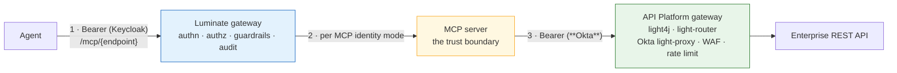
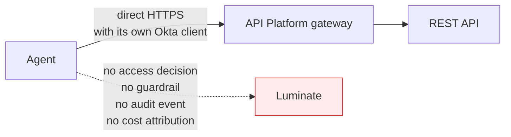

# Reaching a REST API — and where the identity chain breaks

Most of what an agent needs to *do* lives behind an enterprise REST API. This page answers the
question the other pages do not: **how does a governed agent call one, and whose identity arrives
at the far end?**

The short version: it does not call one directly, and the answer is a decision that has already
been taken rather than an open design question.

## The gateway has three lanes, and REST is not one of them

`gateway/app/middleware/proxy.py::_resolve_route` matches exactly three prefixes and returns
`None` for anything else:

```python
for prefix, port, target_type in (
    ("/llm/", self._llm_port, "model"),
    ("/mcp/", self._mcp_port, "mcp_server"),
    ("/a2a/", self._a2a_port, "agent"),
):
```

A request that matches none of them is never tagged as proxy traffic, never authorized, never
audited — it simply is not the gateway's. `AccessProtocol` does carry an `HTTP` member, which is
easy to misread as a REST lane; its own docstring says otherwise — it is *"the fallback lane for a
proxied request whose target isn't one of the typed resource kinds (or for a synthetic
capture-scope gap marker)"*. It labels an audit event. It does not route anything.

**There is no `target_type` for an API.** `AccessPolicyTargetType` is `mcp_server`, `agent`,
`model`, `location`, `environment`. An access policy cannot name a REST API, so there is nothing
for the platform to allow or deny.

## The decided architecture: the MCP boundary

This is not a gap to be worked around locally. It was decided on **2 September 2026 by Enterprise
Architecture and EDAE ACP** ([`agent-traffic-gateway-options.md`](https://bitbucket.sunlifecorp.com/projects/EDAEACP/repos/acp-consortium-specs/browse/specs/distributed-gateway/agent-traffic-gateway-options.md),
Option 2):

| Traffic | Path |
|---|---|
| Agent → LLM, MCP or A2A | **Luminate gateway** |
| **MCP server → enterprise REST API** | **API Platform gateway, unchanged** |
| Everything not originated by an agent | API Platform gateway, unchanged |

> **The MCP boundary is where Luminate's remit ends and the API Platform's begins.** Producing MCP
> tools from the REST estate remains the API Platform's to own.

So the governed path from an agent to a business system is three hops and two gateways:



Hop 1 and hop 2 are this pattern's. **Hop 3 is the API Platform's, and it is unchanged** — same
Okta authentication, same rate limiting, same WAF the REST estate has today.

The API Platform gateway *may* also sit at the edge in front of an MCP server. That is permitted
but not preferred: it adds a gateway-to-gateway hop and its latency for no governance gain,
because Luminate is already the policy authority for that call.

## Where the identity chain breaks — and it is hop 3

Two identity domains meet at the MCP server, and they do not federate.

| Hop | Issuer | What carries the caller |
|---|---|---|
| Agent → Luminate | **Keycloak** (Luminate's IdP) | The agent's machine token, or a `lud_at_` delegated token naming the end user |
| Luminate → MCP server | **Keycloak** | On `delegated_exchange`, a token audienced to the MCP deployment whose subject is the original caller |
| MCP server → API Platform | **Okta** | ❌ **Nothing carries over.** Okta will not validate a Keycloak-issued token |

**Luminate cannot mint an Okta token.** The provider registry holds `keycloak`, `authentik` and
`entra` — there is no Okta `OAuthProvider`. Every Okta reference in the backend is about *human*
portal SSO federation (`sso/models.py` `OKTA = "okta"`, and `identity_providers/authentik/federation.py`,
whose docstring says admins use it *"to connect their corporate IDP (Azure AD, Okta, Google, SAML
IDPs)"*). And the exchange is single-provider by construction:

```python
def delegated_exchange_provider() -> OAuthProvider | None:
    """The active OAuth provider iff it supports RFC 8693 delegated exchange."""
    provider = registry.get(OAuthProvider, settings.SSO_OAUTH_PROVIDER)
```

One deploy-time provider. A **Keycloak → Okta cross-IdP exchange is not expressible in Luminate**,
today or with configuration.

### So what identity does the REST API actually see?

Two options, and the team must choose one deliberately and record it (ASR-38):

| Option | What the API sees | Cost |
|---|---|---|
| **A — Service identity** *(default, works today)* | The **MCP server's own Okta client**. Every call from every caller looks the same | **On-behalf-of is lost at hop 3.** The API cannot authorize per end user, and its audit names the MCP server, not the person |
| **B — MCP server exchanges** | The end user, if the MCP server itself swaps the Keycloak token for an Okta one | Requires **Okta to trust the Luminate issuer** — a federation decision nobody has taken. The exchange is the MCP server's code, not the platform's |

Option A is what every live server does. If per-user authorization at the REST API is a
requirement, that is a **trust-federation ask against Okta**, not a Luminate configuration change,
and it should be raised as one.

**The compensating control** is that the MCP server is the trust boundary and must enforce its own
authorization from the identity it *does* receive on hop 2 — which is exactly what
[`mcp-server-patterns`](../../mcp-server-patterns/d2-design/authorization.md) MSR-16 requires.
Luminate is an additional layer, never a replacement for the server's own controls.

### The second break: an Okta-fronted MCP backend cannot be reached with a credential

Hop 2 has its own version of the same problem, already recorded as
[`aims-acp-integration`](../../../onboarding/aims-acp-integration/d2-design.md) **G1 / DD-4**. Where the MCP
server itself sits behind Okta on the API platform:

| Mode | Verdict |
|---|---|
| `token_forward` | ✗ Okta will not validate a Keycloak-issued token |
| `injected_credential` / `external_exchange` | ✗ Enum-only — **silently degrades to no credential at all** |
| Register the backend on a cluster-internal address, **below** the Okta-fronted route | ✓ The interim, and it requires a network path plus the server enforcing its own authorization |

Do not re-derive this. Reference it.

## What this means for an agent

| Requirement | Why |
|---|---|
| **An agent never holds an enterprise API credential** (ASR-37) | The credential belongs to the MCP server behind the API Platform. An agent holding one is a copy of a secret outside the platform's custody, on an ungoverned path, invisible to both gateways |
| **An agent reaches a REST API only through an MCP server** (ASR-36) | It is the only path with an access decision, a guardrail, an audit event and cost attribution on it |
| **The identity the API sees is recorded at onboarding** (ASR-38) | Because it is usually *not* the end user, and an assessor will assume it is |
| **One MCP server per trust boundary** | The grant is per server, so the API surface behind one endpoint shares one blast radius — `mcp-server-patterns` MSR-15 |

### The anti-pattern this exists to prevent



The call still authenticates — the API Platform is doing its job. But **ACP cannot see it**, and
absence of an audit event is the only detection signal. This is the same shape as the
SigV4-direct-to-AgentCore path in [Hosting](hosting.md) S3, and it is refused for the same reason
(DD-2).

## The consortium designs — and a tension worth naming

Two unmerged designs by Andrew Culberson (TELUS) address this from the Luminate side. Both are
**Status: Draft, Decision: Pending**, on branch `d1/skills-registry`, which is **not merged** and
sits 30 commits behind `luminate-designs` `main`. Neither is a capability; both are proposals.

### D1 — API Resources

Would make a plain HTTP API a first-class callable resource type — registered in a Project,
deployed to a gateway, reached only through an explicit grant, with the **gateway injecting the
upstream credential** so callers never hold it. An optional OpenAPI description unlocks
**operation-level grants**. API Resources would be *targets only*, like models.

It names today's position exactly:

> Today a REST API can only be governed by wrapping it as an MCP server, or it is called directly
> and invisibly.

**The tension.** API Resources **as drafted** would put Luminate in front of the REST estate. The
Sun Life Option-2 decision says the API Platform keeps it, and that the MCP boundary is where
Luminate's remit ends. Those are not automatically compatible, and the difference is not a detail
— it decides which gateway owns enterprise API traffic. **If API Resources lands in that shape,
Sun Life has to decide whether to adopt it or hold the MCP boundary.** That decision is not this
spec's to take, but leaving it unstated would let two documents quietly contradict each other.
There is a third answer that fits both — see *Direction of travel* below — but it is not designed
and not in scope. Raised as G-14.

### D1 — Skills Registry

Would make agent skills — portable instruction bundles in the open Agent Skills format — governed
entities: immutable, integrity-pinned, individually reviewed versions, with provenance for
imported skills and platform-wide recall. Its access model is the part that matters here:

> a skill never grants access by itself — the APIs a skill relies on stay behind the Gateway's
> default-deny policies

and every skill **declares the APIs it relies on**, so adopting one checks those declarations
against the agent's existing grants and proposes the missing access through the normal approval
flow rather than granting it.

**It is blocked on API Resources.** The API Resources D1 says so directly — *"features that must
bind capabilities to governed APIs (the Skills Registry among them) have no governed API concept to
bind to"*.

For this pattern the consequence is narrow and worth stating: **a skill is content, not a
capability.** Adopting one changes what an agent will *try* to do; it changes nothing about what
the agent is *allowed* to do, because that is still the access policy. An agent whose skills imply
access it has not been granted fails at the gateway — which is the correct outcome, and the reason
skills do not belong in the conformance profile as a control.

That said, **the declaration model is the part Sun Life expects to build on** — see below.

## Direction of travel — bringing direct API calls into governance

**Not in scope for this pattern, and not committed.** It is recorded here so the boundary above is
read as a current position rather than a permanent one.

The intent is to bring direct agent→API calls into governance through an **Agent Skills / plugins
registry that integrates with the API Platform**: the agent declares the APIs its skills rely on,
ACP governs whether that agent may call them, and the API Platform continues to own the hop and the
Okta authentication. This is a **future roadmap item for the AI consortium** — no design, no
commitment, no date — and **nothing in this pattern depends on it**.

**This is also what resolves the tension named above**, and the distinction matters to whoever
carries the ask to the consortium:

| Shape | Who fronts the REST API | Compatible with the Option-2 decision? |
|---|---|---|
| **API Resources as drafted** — Luminate registers the API as a target and injects the upstream credential | Luminate | **No.** It moves the REST estate inside Luminate's remit |
| **Skills / plugins registry integrating with the API Platform** — ACP governs which agent may call which API; the call still traverses the API Platform with Okta | API Platform, unchanged | **Yes.** Governance moves; the traffic path does not |

So the ask is not "adopt API Resources". It is the narrower and more adoptable one: **govern the
declaration and the grant, leave the hop where it is.** Until that exists, the MCP boundary in this
document stands, and an agent that needs a REST API reaches it through an MCP server.

## Summary

| Question | Answer |
|---|---|
| Can an agent call a REST API through Luminate? | **No.** Three lanes, none of them REST, and no API target type |
| What is the sanctioned path? | Agent → Luminate → **MCP server** → API Platform (Okta) → API. Decided 2026-09-02 |
| Does the end user's identity reach the API? | **No, by default.** Okta will not validate a Keycloak token, and Luminate cannot mint an Okta one |
| Can it be made to? | Only by the MCP server exchanging, which needs **Okta to trust the Luminate issuer** — a federation ask, not a config change |
| What if the MCP server is itself behind Okta? | Reach it below the Okta hop on a cluster-internal address — `aims-acp-integration` DD-4 |
| Is a direct agent→API call ever acceptable? | **No.** It is ungoverned by ACP and detectable only by the absence of audit events |
| Will this change? | **It is intended to.** The direction is a skills / plugins registry that governs API access while the API Platform keeps the hop — a consortium roadmap item, out of scope here, with no design and no date |
