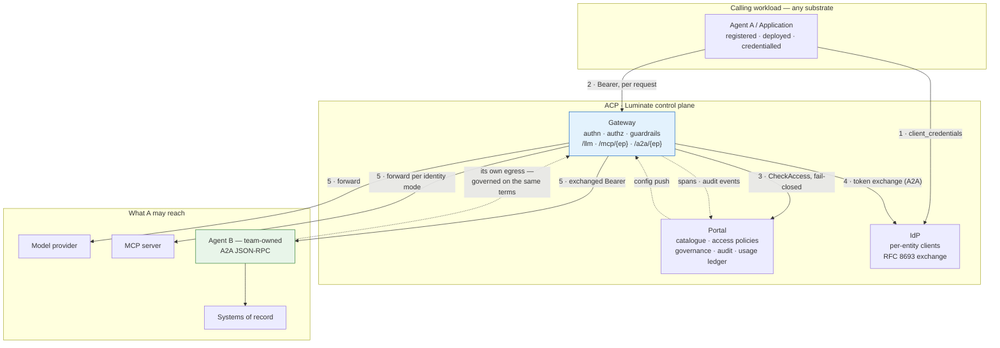

# Assurance — the ETAB submission and the ISRA control set

| Record | Identifier |
|---|---|
| Architecture governance (ATG) | **ATG0005678** |
| Security risk assessment (ISRA) | **26-1956** |

The control set below (C-1–C-35) and the residual risks (R-1–R-12) are the content submitted
against ISRA 26-1956. The scope those records cover is the four specified substrates plus the
**SUB-E / SUB-I admission criteria** in [Hosting](hosting.md) — quoted verbatim under *What ETAB is
being asked to approve*. A platform admitted against those criteria is in assessed scope; changing
the criteria themselves is a change to the assessed scope, not an editorial one.

This page exists so that a board submission and a security risk assessment can be produced from
the spec rather than reconstructed from the gateway source and two disagreeing cluster estates.
It says four things: what the architecture is, which decisions were taken and why, which threats
an agent changes, and which controls exist with what evidence.

## The architecture, as submitted

**The single assertion the architecture makes**: no agent reaches a model, a tool or another
agent except through a Luminate gateway, and every such call is authenticated, authorized against
a central policy decision, and audited. Every control below either supports that assertion or
bounds what happens when it does not hold.

**What the architecture deliberately does not assert**, and an assessor must be told:

- It does **not** assert that content is scanned on the A2A lane. No guardrail can be bound to an
  agent as a callee.
- It does **not** assert that deactivating an agent contains it. Deactivation stops ingress only.
- It does **not** assert that `governance_state` gates anything. It records.
- It does **not** assert that an agent's call volume or spend is bounded by the platform.

## Design decisions

| # | Decision | Rationale | Alternative rejected |
|---|---|---|---|
| **DD-1** | **Egress and ingress are two registrations with two requirement sets**, and the direction is declared | They differ in what must exist, what must be built and what must be authorized. Conflating them produces agents that are registered and unreachable — eight of ten in dev | A single "onboard my agent" step. It is what produced the current estate |
| **DD-2** | **The gateway is the only path** to a model, a tool or another agent | Controls only exist on the path they sit on. A second path defeats authn, authz, guardrails and audit at once. The SigV4 route to an AgentCore runtime is exactly such a path and is explicitly not an ACP integration | Direct SigV4 or direct service-to-service calls "for latency" |
| **DD-3** | **The agent is the unit of authorization, in each direction** | It is what the platform enforces. A source grant covers everything that agent may do; a target grant covers every capability it exposes | Pretending a grant is per-skill or per-method. Nothing parses the A2A payload before the decision |
| **DD-4** | **Split by privilege into separate agents** where tasks differ materially | Makes the platform's agent-granular grant coincide with the intended privilege boundary. Cheap now, a migration later | One large agent with self-enforced authorization — permitted, but the control moves off the platform and the ISRA must say so |
| **DD-5** | **An ingress endpoint is served only where the on-behalf-of exchange runs** | The alternative reaches the agent as the gateway, or forwards the caller's own credential to a backend that may be a third party's. The platform already prefers withholding to degrading; this makes it a requirement | Accepting the degraded branch because "it works". Prod is in that state today |
| **DD-6** | **Governance state is evidence, not a control** | It has zero runtime consumers. `suspension.py` says so itself: *"the state is real and the denial is not"* | Presenting `governance_state = suspended` to an assessor as a stop control |
| **DD-7** | **The stop control is credential and policy revocation**, not deactivation | The Rego's source rule matches on the token subject and never reads the agent's status. This is a property of the platform, not a misconfiguration | A runbook that says "set it inactive". It would contain half the problem and read as if it contained all of it |
| **DD-8** | **Content control on A2A ingress is a caller-side obligation** recorded on the callee | There is no `target_agent` scope and no agent branch in the Rego. The alternative is to claim a control that does not exist | Relying on `GuardrailTargetType.AGENT` as though it bound to the callee |
| **DD-9** | **The bound on an autonomous caller is substrate-side** | Quotas are not enforced anywhere; the gateway holds zero quota references. An agent in a retry loop is unbounded by the platform | Citing `Quota` records as a control |
| **DD-10** | **Fail-closed availability is accepted** | The control plane is on the request path with no policy cache. A cached allow is an unrevoked allow — and revocation is already the stop control (DD-7), so caching would undermine the one path that works | A local policy cache with a TTL |
| **DD-11** | **Everything an agent receives is untrusted** — inbound message, tool output, model output | All three re-enter a non-deterministic reasoning process. This is the defining difference from an ordinary internal service | Trusting an inbound A2A message because the caller was authorized |
| **DD-12** | **Evidence, not stage colour** | The Checkmarx step reports success when no scan exists. A green pipeline is not an assessment | Accepting build status as evidence |
| **DD-13** | **A workload that nothing calls is an Application, not an Agent** | The difference is structural: an Application has no routable endpoint, no target policy type, no `status`, no `governance_state`, and is deliberately excluded from the governance sweep. Registering a chatbot as an Agent overstates the agent inventory an E-23 review asks for | Treating the choice as naming preference |
| **DD-14** | **An enterprise REST API is reached through an MCP server, and the API Platform owns that hop** | The gateway has three lanes and none is REST. This is the 2026-09-02 Enterprise Architecture decision, not a workaround — the MCP boundary is where Luminate's remit ends. **A current position, not a permanent one** — see the direction of travel below | A direct agent→API call "because the API Platform already authenticates it". It does; ACP cannot see it |
| **DD-15** | **On-behalf-of stops at the MCP server, and that is declared rather than assumed** | Okta will not validate a Keycloak token and Luminate holds no Okta provider, so the API sees a service identity. Declaring it is the only honest option; the alternative is an ISRA that claims per-user attribution the estate cannot produce | Presenting the REST call as user-attributed because the agent hop was |

## Threat model — what an agent changes

An agent is not an ordinary internal service. It composes its own requests from
model output, it can be induced by content, and — uniquely on this lane — it is both a client
and a server.

| # | Threat | Where it bites | Control |
|---|---|---|---|
| **T1** | **Prompt injection through an inbound A2A message** — a caller induces the callee to act outside its purpose | Ingress. **No guardrail can be bound to the callee** | ASR-21 agent-side handling · ASR-22 caller-side guardrails · DD-8. **Residual — R-2** |
| **T2** | **Prompt injection through tool or model output** — content returned re-enters the agent's context | Egress response path | Response guardrails on the model/MCP target · ASR-21 · DD-11 |
| **T3** | **Confused deputy** — an agent is induced to use a grant it holds for a purpose it was not given it for | The grant is per agent, so entitlement is coarse | DD-4 split · ASR-20 least privilege · ASR-24 |
| **T4** | **Excessive agency** — a capability added next release is covered by a grant made last quarter | Ingress; nothing parses the method | ASR-12 catalogue currency · ASR-24 · change control |
| **T5** | **Runaway agent** — a retry or reasoning loop consumes budget or hammers a system of record | Egress. **The platform enforces no quota** | ASR-23 substrate-side bound. **Residual — R-5** |
| **T6** | **Containment failure** — an operator deactivates an agent and it keeps calling | Incident response | ASR-32 runbook + drill · DD-7. **Residual — R-1** |
| **T7** | **Path bypass** — a workload calls the agent's backend directly, or calls an AgentCore runtime by SigV4 | Network / IAM | ASR-5 negative test · DD-2. Bypass emits **no** audit event, so absence of events is the detection signal |
| **T8** | **Credential leakage to a third party** — a platform-minted credential forwarded to a backend the platform does not control | The degraded A2A branch, where the caller's credential is forwarded unchanged to a non-platform upstream | ASR-13 · DD-5 · FR-11. The MCP lane refuses this explicitly; the A2A lane has no equivalent refusal |
| **T9** | **Cross-environment token replay** — a staging token spent against production | Delegated tokens | The audience is scoped to the **deployment**, not the catalogue entry. ASR-14 requires the callee to check it |
| **T10** | **Silent unauthenticated serving** — a delegated endpoint degraded to gateway identity | Version skew, missing exchange config | The gateway **withholds** rather than downgrades; a 404 from RFC 9728 discovery is the tell |
| **T11** | **Unroutable grant** — an active policy against an agent with no endpoint, mistaken for working access | Registration | ASR-11 · FR-3 reconciliation query. Live in dev today |
| **T12** | **Mis-registered endpoint** — a wrong URL, an unencoded ARN, or a discarded qualifier routes somewhere unintended | Registration; **nothing probes it** | ASR-6 encoding rules · ASR-7 post-registration call |
| **T13** | **Environment collapse** — one backing runtime serves four environments, so a prod incident is a dev incident | Deployment | ASR-9 distinct runtime per environment, or a recorded exception. Prod is in this state today |
| **T14** | **Supply-chain compromise** — a dependency or image with a known vulnerability | Build. Agent stacks pull deep, fast-moving trees | ASR-25 – ASR-28, with evidence per DD-12 |
| **T15** | **Credential or PII in composed text** — an agent writes a secret or personal data into a prompt, a log or a trace attribute | Agent-side. The platform's redaction does not cover what the agent writes itself | ASR-19 · ASR-34 |
| **T16** | **Cost misattribution** — a delegation's downstream cost books to the callee, so the caller's budget looks clean | Chargeback | ASR-31 forward the delegated token, or accept and document |

## The ISRA control set

Each row is a control an assessor can test. **Type**: P = preventive, D = detective.
**Dir**: E = egress, I = ingress.

| # | Control | Type | Dir | Point | Evidence | Owner |
|---|---|:--:|:--:|---|---|---|
| **C-1** | Caller authenticated before any request is served | P | E+I | Gateway (JWKS / portal) | 401 on a negative test | Platform |
| **C-2** | Credential shape gated per lane and endpoint | P | E | Gateway authn | 403 with the specific refusal reason | Platform |
| **C-3** | Central, fail-closed access decision on every request | P | E+I | Portal `CheckAccess` | Decision recorded per request; deny on portal outage | Platform |
| **C-4** | Egress grants are explicit, least privilege and environment-constrained | P | E | `AccessPolicy(source_agent → …)` | The policy list, reviewed against the declared reach | Platform admin |
| **C-5** | Ingress grants are explicit and exist only against a routable endpoint | P | I | `AccessPolicy(→ target_agent)` + `AgentDeployment` | The reconciliation query returns zero mismatches | Platform admin |
| **C-6** | Privilege split across agents where tasks differ materially | P | E+I | Design review | Architecture record; the grant list per agent | Team |
| **C-7** | Backend unreachable except from the serving gateway | P | I | NetworkPolicy / SG / resource policy / VPC endpoint policy | Negative test from a non-gateway workload | Team |
| **C-8** | No ungoverned invocation path (no SigV4-direct, no service-to-service) | P | E | IAM policy + design review | The runtime's resource policy; absence of a second caller | Team |
| **C-9** | TLS on any hop leaving the pod network, with the correct trust chain | P | I | agentgateway `backendTLS` + merged CA bundle | Successful call; `grep -c BEGIN "$SSL_CERT_FILE"` in the gateway pod | Platform + Team |
| **C-10** | Plain-HTTP hops are a stated control, not a convenience | P | I | NetworkPolicy + recorded rationale | The rationale, its owner, and the policy | Team |
| **C-11** | An ingress endpoint is served only with the on-behalf-of exchange attached | P | I | `_agent_downstream_exchange`; translator withholding | The route's `backendAuth` block in `/config_dump`. **Absent = fail** | Platform |
| **C-12** | Callee validates issuer, signature, expiry and its **deployment** audience | P | I | Agent-side | Refusal of a token minted for another deployment | Team |
| **C-13** | Substrate inbound authorizer accepts the platform bearer | P | I | AgentCore JWT authorizer / API GW authorizer | The authorizer configuration; an end-to-end call | Team |
| **C-14** | Delegated target withheld when the exchange cannot run | P | I | Gateway translator | 503 `endpoint_withheld`; RFC 9728 404 | Platform |
| **C-15** | Content control on what the agent sends | P | E | Guardrails scoped to the agent | Attachment list; a positive detection test | Platform admin |
| **C-16** | Content control on what the agent receives over A2A | P | I | **Caller-side guardrails only** | Attachment on every granted caller. **Not enforceable by the callee — see R-2** | Platform admin |
| **C-17** | Agent treats inbound messages, tool output and model output as untrusted | P | I | Agent-side | Design review; a prompt-injection test case | Team |
| **C-18** | Call volume and spend bounded | P | E | Substrate (replicas / HPA / reserved concurrency) | The configured limit; a load test | Team |
| **C-19** | Egress can be stopped, and the stop has been exercised | P | E | Credential revocation + policy revocation | A recorded drill with a measured interval | Platform + Team |
| **C-20** | Ingress can be stopped | P | I | `status = inactive`; policy revocation | A measured interval | Platform |
| **C-21** | Distinct backing runtime per environment, or a recorded exception | P | E+I | Deployment records | Distinct `backend_endpoint` per environment | Team |
| **C-22** | SAST performed and gated | P | E+I | Checkmarx | Scan id + gate evaluation on the build | Team |
| **C-23** | SCA performed and gated; SBOM retained | P | E+I | Snyk | `snyk-sbom.json`, `snyk-results.html` | Team |
| **C-24** | Static analysis gated; image built by the pipeline and immutably referenced | P | E+I | SonarQube + registry | Project + gate status; digest match | Team |
| **C-25** | Container non-root, no privilege escalation, requests **and** limits everywhere | P | E+I | Gatekeeper | No admission denial in events; the pod is running | Team |
| **C-26** | Secrets from Vault / Secrets Manager only; never in `configuration` | P | E+I | VSO / SM | Manifest review; the secret's source | Team |
| **C-27** | Capability and reach declared and current in the catalogue | D | E+I | Catalogue record | The record, diffed against the agent's actual grants | Team |
| **C-28** | Endpoint registration correct — encoding, no query dependency, reachability proven | D | I | Onboarding process | The rewritten path from `/config_dump`; a recorded successful call | Team |
| **C-29** | Every control-plane mutation audited, append-only | D | E+I | `audit_events` | The audit record | Platform |
| **C-30** | Every data-plane decision audited | D | E+I | `CaptureProtocol.a2a` and siblings | Authorize + access events per call | Platform |
| **C-31** | Every served call attributable to caller, target and lane | D | E+I | `x-luminate-*` → Langfuse | A trace showing all three | Platform |
| **C-32** | Run correlation across a delegation chain | D | E+I | `x-luminate-session-id` propagated by the agent | A trace with a stable session across hops | Team |
| **C-33** | Cost attributable, and the delegated-cost decision recorded | D | E | `UsageBucket` `SubjectType.AGENT` | The per-agent series; the recorded decision | Team |
| **C-34** | No credential or regulated data in prompts, logs or trace attributes | P | E+I | Agent-side | Log and trace review | Team |
| **C-35** | Governance state recorded, moved only by the guarded transition | D | E+I | Transition action; direct writes refused | State + reason; a refused direct write. **Recording only — see R-3** | Governance |

## Residual risks to declare

None of these is mitigated by a control above. An assessment that does not name them is
incomplete.

| # | Residual risk | Why it remains | Compensating position |
|---|---|---|---|
| **R-1** | **Deactivating an agent does not stop it calling** | The Rego's source rule matches on the token subject and never reads the agent's status; `verify_api_key` never reads the owner's status | ASR-32 runbook — revoke the credential and the source policies — exercised and measured. Consortium ask raised |
| **R-2** | **A callee agent cannot require a content scan of its own inbound traffic** | No `target_agent` attachment scope; no agent branch in `authz.rego` | ASR-22 caller-side guardrails on every granted caller, recorded on the callee. A process control standing in for a platform one. Consortium ask raised |
| **R-3** | **The governance axis enforces nothing** | Zero runtime consumers; the enforcement epic has not landed | ASR-10 records it as evidence. **Do not present `governance_state` as an operating control** |
| **R-4** | **Prompt injection cannot be eliminated** | It is a property of putting model-readable content into a model's context, and an agent's inbound message is exactly that | ASR-21, response guardrails on the egress side, and least privilege on what the agent can do |
| **R-5** | **No per-agent call quota or spend budget** | Quota dimensions stop at requests and tokens, and the gateway consumes none of them | ASR-23 substrate-side bound. Consortium ask already raised by `mcp-server-patterns` |
| **R-6** | **The platform never probes an agent's health** | Not implemented; `MCPServer` has a probe, `Agent` does not | Hosting-platform probes plus alerting on gateway 5xx per endpoint name |
| **R-7** | **A grant can exist against an agent with no route** | Nothing reconciles a `target_type = agent` policy against an `AgentDeployment` | ASR-11 plus the FR-3 query on a schedule. Live in dev today |
| **R-8** | **A delegation's downstream cost does not follow the caller by default** | The callee's own credential books to the callee; the A2A hop itself has no operation name and produces no generation | ASR-31 — forward the delegated token — or accept and document |
| **R-9** | **Availability is bounded by the control plane** | Deliberate: no policy cache, so a portal outage denies | Accepted per DD-10; gateway and portal redundancy |
| **R-10** | **The A2A discovery contract cannot be met through the gateway** | No agent card anywhere in the platform, and `/.well-known/` is served locally | ASR-12 makes the catalogue the capability inventory. Consortium ask raised |
| **R-11** | **Prod serves A2A with no credential** | The prod build predates the on-behalf-of exchange | Not exploitable while prod holds zero `target_type = agent` policies. **FR-11 gates any such grant on the image uplift.** This is a time-boxed risk, not a standing one |
| **R-12** | **The end user's identity does not reach the enterprise REST estate** | No Okta provider in Luminate and a single-provider exchange, so a Keycloak→Okta on-behalf-of hop is not expressible | ASR-38 records which identity the API sees; the MCP server enforces its own authorization from the identity it does receive. Closing it needs an Okta trust-federation decision, not a code change |

## What ETAB is being asked to approve

1. **The pattern** — an agent reaches models, tools and other agents only through a Luminate
   gateway, on the four substrates specified in [Hosting](hosting.md), with **any other platform
   admitted against the published SUB-E / SUB-I criteria** rather than case by case.
2. **The direction model** — egress and ingress as two registrations with two requirement sets
   (DD-1), which is the change that stops agents being registered and unreachable.
3. **The conformance profile** — ASR-1 to ASR-38 as the bar for any agent the platform will
   serve, with the verification methods stated.
4. **The fifteen design decisions** — in particular DD-5 (an ingress endpoint is served only with
   the exchange), DD-7 (the stop control is revocation, not deactivation), DD-8 (content control
   on ingress is a caller-side obligation) and DD-15 (on-behalf-of stops at the MCP server), each
   of which concedes a platform limitation and names the compensating architecture.
5. **The twelve residual risks** — accepted, with the consortium asks in [Gaps](gaps.md) as the
   path to closing R-1, R-2, R-3, R-5, R-6, R-7 and R-10, the prod uplift as the path to closing
   R-11, and an Okta trust-federation decision as the path to closing R-12.

**One boundary is explicitly a staging post, and ETAB should approve it as one.** DD-14 puts the
REST estate behind an MCP server and leaves the hop with the API Platform. The intended direction
is to bring direct agent→API calls into governance through a **skills / plugins registry that
integrates with the API Platform** — governance moves into ACP, the traffic path stays where it is.
That is an **AI consortium roadmap item with no design and no date**, out of scope here, and
nothing in this submission depends on it. It is recorded so that its arrival reads as a
**re-submission trigger** rather than a surprise: it would change which decisions this board took,
not which controls are in force today.
