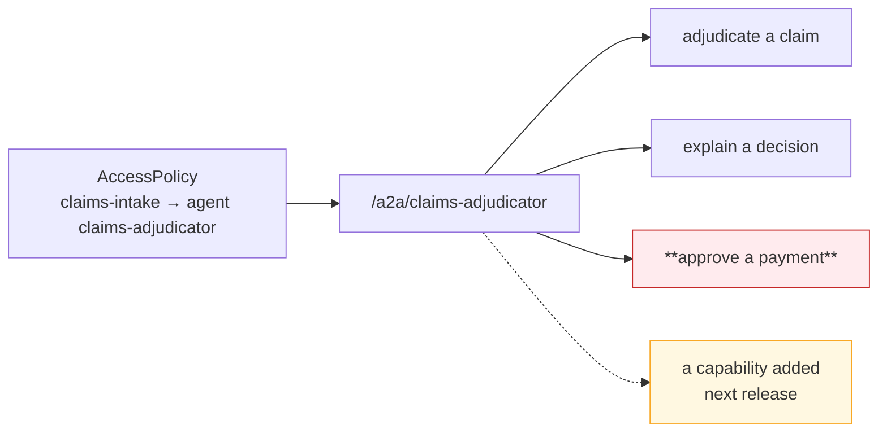

# Authorization — two directions, two grants, and what is not enforced

## The grant, in each direction

`AccessPolicy` carries an `agent` member on **both** enums, so an agent is a first-class source
and a first-class target.

```text
AccessPolicySourceType = mcp_server | agent | user | user_group | application | location | environment
AccessPolicyTargetType = mcp_server | agent | model | location | environment
```

| Direction | Policy | What it authorizes |
|---|---|---|
| **Egress** | `source_type = agent`, `source_agent = A` → `target_type ∈ {model, mcp_server, agent}` | A may reach that target |
| **Ingress** | `source_type ∈ {agent, application, user, …}` → `target_type = agent`, `target_agent = B` | That source may invoke B |

Both are evaluated by the same Rego on every request, with no cache. A portal outage denies.

## How the decision is actually made — and the asymmetry inside it

The two sides of `authz.rego` are not symmetric, and the difference is the single most
consequential fact on this page.

```rego
# Target side — reads the catalogue and checks status
allowed_agents contains agent if {
        agent := input.agents[input.target_id]
        agent.status == "active"
        some policy in input.policies
        policy.status == "active"
        _source_matches(policy)
        policy.target_type == "agent"
        policy.target_agent_id == input.target_id
        _policy_required_constraints_match(policy)
}

# Source side — one line, and it never touches the catalogue
_source_matches(policy) if { policy.source_id == input.jwt.sub }
```

`input.agents` is built by `_collect_agents()`, which selects `status=ACTIVE` only. So:

- **A deactivated agent cannot be called.** It drops out of `input.agents`, `allowed_agents` is
  empty, and the request denies.
- **A deactivated agent can still call.** `_source_matches` compares a policy's `source_id` to
  the token subject and never consults `input.agents`. `_collect_policies()` filters on
  `AccessPolicyStatus.ACTIVE` and not on the source agent's status.

`Agent.status` has exactly three non-test runtime consumers in the whole repository —
`facts.py:674`, `access_policies/reach.py:274` (the delegation ceiling) and the model's own
default. None is on the egress path. `AuthNService.verify_api_key` checks the key's status and
expiry and never reads `owner_agent.status`.

**This is a control boundary, not a bug to work around locally.** It is stated here, made an
explicit requirement in ASR-32, drilled in [Operations](operations.md) and raised as a consortium
ask in [Gaps](gaps.md).

### Constraints narrow a grant

A policy may carry `required_gateway_id`, `required_environment_id`, `required_provider_id` and
`required_location_id`; an empty value means "any". For an agent or MCP target these are all
matched against the request, because the endpoint name identifies exactly one deployment and the
gateway resolves and sends its environment and location. Use them: a grant unconstrained by
environment is a grant in every environment that gateway serves.

## The boundary: a grant is per agent, in each direction

**Egress.** A source grant does not name a *capability* — it names a target. An agent granted a
model may send it anything; an agent granted an MCP server may call every tool that server
exposes, now and in future (the tool-granularity boundary that
[`mcp-server-patterns`](../../mcp-server-patterns/d2-design/authorization.md) makes explicit).

**Ingress.** A target grant does not name a *method*. Once a caller may invoke agent B, it may
send B any A2A message B accepts. There is no per-skill, per-task or per-method authorization,
and nothing in the request path parses the A2A payload before the decision.



**ASR-24: split by privilege.** Where an agent's tasks differ materially in privilege — read
versus write, or across classification tiers — those are separate agents with separate endpoints
and separate grants. This is the same design rule the MCP pattern reaches for the same reason,
and it is cheap now and a migration later.

Where that cannot be met, the agent enforces per-capability authorization **itself**, from the
delegated identity it receives (ASR-14). It can do this — the exchanged token names the original
caller and the act chain — but the control then sits in the agent, and an ISRA must be told so.

## Guardrails — caller-scoped only

`GuardrailTargetType` has an `AGENT` member, which reads as though content control covers the
agent lane. It covers the agent **as caller**.

| Scope | Fires on | Available for agents? |
|---|---|---|
| `organization`, `project` | Anything under it | ✅ |
| `api_key` | The credential presented | ✅ |
| **`agent`** | Requests **made by** that agent | ✅ **source-side** |
| `application`, `mcp_server` | Requests made by that entity | ✅ |
| `target_model` | Every request **to** that model | ✅ |
| `target_mcp_server` | Every request **to** that MCP server | ✅ |
| **`target_agent`** | Every request **to** that agent | ❌ **does not exist** |

Proved twice over:

```text
grep -rn "target_agent" backend/app/guardrails/     → 0
```

```python
# backend/app/policy_engine/facts.py:885
_TARGET_SCOPED_FLOWS = frozenset({"model", "mcp_server"})
"""Flow types whose rego rules read ``target_guardrails``.

``authz.rego`` has a model branch and an mcp_server branch and no agent branch,
so on any other flow every key this collector could build is unreadable and the
scan is pure cost."""
```

**Consequence.** An agent that accepts A2A traffic **cannot require a prompt-injection or PII
scan of its own inbound requests**. Scanning happens only where the *caller* carries a
source-scoped guardrail with `agent` in `applies_to_target_types`. A caller without one is an
unscanned path into the agent, and the callee has no way to refuse it.

**ASR-22 is the interim**: the callee records the requirement on its onboarding record, and every
agent granted the endpoint carries a matching source-scoped attachment. It is a process control
standing in for a platform one, and it is only as good as the review that grants the next caller.

There are **zero** guardrail attachments of any kind in SLF dev today.

### What a scan actually inspects on this lane

`extract_input` recognises the OpenAI chat shape only when `target_type == "model"`. For every
other lane it falls through to the raw body decoded as UTF-8. So on the A2A lane a guardrail
scans the **entire JSON-RPC envelope as text** — method, id, params and message parts alike — and
a redaction rewrites raw bytes. That works for detection; treat it as coarse, and do not design a
control that depends on matching a specific field.

Guardrail attachments carry `mode` (`enforce` / `warn`) and `action` (`block` / `redact`), and
where several attachments reach one request the strictest wins per direction.

## Quotas — modelled, not enforced

```text
grep -ril quota gateway/app/     → 0 files
```

The gateway consumes no quota facts at all. `QuotaDimension` still stops at requests and tokens;
`matched_quota_ids` is computed in the backend, put on a span and returned on the decision — it
is telemetry. There is no dollar budget and none is scheduled.

For an autonomous caller this matters more than it does for a human-driven one: an agent in a
retry loop is unbounded by the platform. **ASR-23 pushes the bound to the substrate** —
replicas, HPA ceiling, runtime concurrency, or (best of all, on Lambda) reserved concurrency.
Name it, configure it, and record it as the control, because the platform is not providing one.

## What the decision does *not* consider

Worth stating explicitly, because each is easy to assume:

| Not considered | Consequence |
|---|---|
| The **source** agent's `status` | Deactivation does not stop egress |
| Either agent's `governance_state` | Governance suspension refuses nothing |
| Any quota | An agent is unbounded by the platform |
| The A2A method or skill | A grant covers everything the agent exposes |
| Whether the target agent has a **route** | A grant against an endpoint-less agent is accepted and fails later at the proxy hop |
| The agent card | There isn't one |

## Design rules

1. **Grant one target per policy, constrained by environment.** An unconstrained grant is a grant
   everywhere that gateway serves.
2. **Split by privilege, not by convenience** (ASR-24). The endpoint boundary is the authorization
   boundary; design it the way you would design a database role.
3. **Assume every caller is scanned by nobody.** Put the guardrail on the caller (ASR-22), and
   validate inbound content in the agent as well (ASR-21).
4. **Bound yourself** (ASR-23). The platform will not.
5. **Reconcile grants against routes** (ASR-11). An active policy against an agent with no
   endpoint is a silent dead end.
