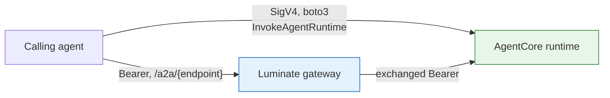

# Hosting — the four specified substrates, and the bar for any other

An agent is a workload somewhere. The substrate decides four things: whether the gateway can
reach it for ingress, how it reaches the gateway for egress, what TLS trust each hop needs, and
what bounds its cost and concurrency.

Four substrates are specified in detail below because they are in use or in flight. **They are not
the allowed list.** Any other hosting platform is admitted on the same terms: assessed against the
numbered criteria in the next section, not approved or refused case by case. A platform that does
not meet a criterion today has a *named open criterion*, and is re-assessed when it changes.

Identity composes with all of them and is dealt with separately in [Identity](identity.md). What
follows is only the reachability and platform side.

## The admission bar — what any substrate must provide

Two sets. **SUB-E** is what a platform needs to host an agent that *consumes* AI resources.
**SUB-I** is what it additionally needs for that agent to be *invocable* by another agent.

### SUB-E · Egress — the agent as a caller

| # | Requirement | Why it is on the list | Ties to |
|---|---|---|---|
| **SUB-E1** | **Outbound HTTPS to the gateway** from the workload's network position | No egress path, no governed call. On corporate networks this includes trusting the Netskope roots; on Lambda it means a NAT or VPC endpoint | — |
| **SUB-E2** | **Managed credential custody** — the workload holds a platform-issued OAuth client credential in a managed secret store (Vault / Secrets Manager), never on disk or an endpoint device, with central rotation and revocation | Credential and policy revocation is the actual stop control for egress, so it has to reach the credential | ASR-16, ASR-30 |
| **SUB-E3** | **Token acquisition with caching** across invocations | The portal token endpoint is rate-limited. A per-invocation mint throttles under load — this is the constraint that shapes S4 | ASR-16 |
| **SUB-E4** | **No alternative ungoverned route** to the same target. Where the substrate offers a native bypass (IAM-signed direct invocation, private service-to-service calls), it is closed by policy | Controls only exist on the path they sit on | ASR-36, DD-2 |
| **SUB-E5** | **A bounded execution envelope** the team controls — a concurrency or rate ceiling | The platform enforces no quota on any lane, so the bound has to come from the substrate | ASR-23 |
| **SUB-E6** | **Build provenance** — the artifact is produced by the approved pipeline with SAST, SCA and static-analysis evidence retrievable per build | An agent executes model-composed instructions against a deep dependency tree | ASR-25 – ASR-28 |
| **SUB-E7** | **Trace propagation** — the workload can set and forward `x-luminate-session-id` | Without it, run correlation falls back to `traceparent`, or to nothing | ASR-33 |

### SUB-I · Ingress — the agent as a callee

All of SUB-E, plus:

| # | Requirement | Why it is on the list | Ties to |
|---|---|---|---|
| **SUB-I1** | **A stable HTTPS endpoint speaking A2A JSON-RPC**, at an absolute URL including scheme and full path | `AgentDeployment.backend_endpoint` is a URL. A library, an SDK entry point or a queue consumer has nothing to register | ASR-2, ASR-6 |
| **SUB-I2** | **Tolerates being fronted** — served behind a path prefix with URL rewriting, emitting no absolute self-referential URLs | The route matches `/{endpoint_name}` and rewrites the path | ASR-4 |
| **SUB-I3** | **Reachable from the serving gateway and from nothing else**, provable by negative test from a non-gateway workload | The gateway is where authn, authz, guardrails and audit happen; a second path defeats all four at once | ASR-5 |
| **SUB-I4** | **An inbound authorizer that accepts a platform-issued bearer token**, validating issuer, signature, expiry and the deployment-scoped audience | Luminate emits an OAuth bearer on every hop and **never SigV4**. A signature-only scheme cannot be reached through the gateway | ASR-14, ASR-15 |
| **SUB-I5** | **A TLS chain the gateway trusts** — public roots, or an internal CA present in the gateway's merged trust bundle | agentgateway resolves roots from `SSL_CERT_FILE`; see the trust-bundle note below | ASR-6 |

### How the criteria classify a platform

| Assessment | Meaning |
|---|---|
| Meets **SUB-E1–E7** | Viable for **egress-only** agents — they consume models, tools and other agents under governance |
| Meets **SUB-E and SUB-I** | **Full participation**, including agent-to-agent delegation |
| Open criteria remain | A **candidate with named gaps**, recorded per criterion and re-assessed when the platform changes — not a refusal |

The last row matters. A platform is never rejected in the abstract; it has an open criterion with
a number, which is a thing a vendor roadmap or an internal control can close.

### The trust bundle — one detail that has already caused an outage

agentgateway resolves TLS roots through openssl-probe, where **`SSL_CERT_FILE` replaces the
system store rather than adding to it**. Pointing it at Sun Life's internal bundle alone trades
public TLS for internal TLS.

The chart therefore has two independent flags that do opposite things, and only one of them is
right for a gateway:

| Flag | Effect | Use |
|---|---|---|
| `gateway.caBundle.enabled` | An init container does `cat /etc/ssl/certs/ca-certificates.crt <slf>/ca.crt > /etc/ssl/merged/ca-bundle.crt` and points the agentgateway subprocess at the result — the image's public roots **plus** the internal CA | ✅ This is the one a gateway needs |
| `slf.caBundle.enabled` | **Substitutes** the backend's root store rather than adding to it (the values comment says so in those words) | Backend-side concern; enabling it for the gateway's benefit would cut backend trust |

Verified on the live prod cluster, all four gateways —
`luminate`, `luminate-gw-dev`, `luminate-gw-sit`, `luminate-gw-stage` — report
`SSL_CERT_FILE=/etc/ssl/merged/ca-bundle.crt` with **154 certificates**. The merge is on
everywhere it matters. *(The `values/gateways/*.yaml` files do not set the flag themselves; it
arrives from the base values file the release is deployed with. Read the pod, not the file.)*

The init container carries CPU and memory requests **and** limits, because Gatekeeper's
`container-must-have-limits-and-requests` applies to init containers too and the denial does not
surface in `rollout status` — the deployment reports `generation == observedGeneration` with no
updated replicas and the real reason appears only in `kubectl get events`.

---

## S1 · OpenShift, behind Sun Life corporate ingress

**Status: not yet exercised for A2A.** No agent is registered on this shape today; the precedent
is `pharmacy-mcp-server` on the MCP lane, which needed two separate fixes to work.

| Requirement | Detail |
|---|---|
| **Reachability (ingress)** | `https://{cluster-ingress}/{namespace}/{route}/…`. The route must be reachable **from the gateway's cluster**, which is a different cluster — this is an inter-cluster hop over corporate ingress, not an in-cluster one |
| **TLS** | The leaf is issued by `Sun Life Financial Issuing CA3` (or `CA4`), which no public root store carries. **`gateway.caBundle.enabled: true` is mandatory**, and the `slf-internal-ca` ConfigMap (key `ca.crt`) must exist in the gateway's namespace — it is created out of band, and a gateway whose ConfigMap is missing cannot start at all |
| **Failure signature** | Without the CA, agentgateway reports `invalid peer certificate: UnknownIssuer` and the caller sees **`500 upstream service error`** — naming neither TLS nor the certificate |
| **Restricting access (ASR-5)** | OpenShift NetworkPolicy plus route-level restriction. A corporate-ingress route is reachable by anything else on the corporate network by default, so this is the substrate where ASR-5 takes the most work and the negative test matters most |
| **Egress** | Corporate egress to the gateway hostname. Netskope MITMs TLS — the agent's own trust store needs the Netskope roots, or calls to the gateway fail with `SELF_SIGNED_CERT_IN_CHAIN` |
| **Bound (ASR-23)** | Deployment replicas and container concurrency |
| **Pod security (ASR-29)** | Non-root, `allowPrivilegeEscalation: false`, `capabilities: drop: ["ALL"]`, requests **and** limits on every container including init |
| **Build** | Standard JTE path; image to Quay. No `docker.io` egress — mirror every base image |

**Open item:** the inter-cluster path (EKS gateway → OpenShift corporate ingress) has been proven
for MCP and not for A2A. Prove it before committing an agent to this shape.

---

## S2 · EKS, in the gateway's own cluster

**Status: works today.** `policy-assistant` is registered as
`http://policy-assistant.luminate.svc.cluster.local:8080` and its route is live.

| Requirement | Detail |
|---|---|
| **Reachability (ingress)** | ClusterIP service FQDN. Simplest shape on the estate |
| **TLS** | **Plain HTTP is used today.** `translate_agent_assignment` emits `backendTLS` only for an `https` scheme, and the live `policy-assistant` route carries `a2a` and `urlRewrite` and **no `backendTLS`** |
| **Is plain HTTP defensible?** | Only as a stated control, not as a convenience. It rests on three properties, all of which must be asserted rather than assumed: the hop never leaves the pod network; a NetworkPolicy admits only the gateway's pods; and the cluster is not a shared tenancy where another workload could reach the service or observe the traffic. Any of the three failing turns an internal call into a cleartext one carrying a bearer token. **Record it as a control with an owner, or use TLS.** It stops being defensible the moment the agent moves namespace or the estate grows a second caller |
| **Restricting access (ASR-5)** | A NetworkPolicy admitting only the gateway's namespace. This is *the* control on this substrate — with plain HTTP and no backend credential in the degrade case, it is the only one |
| **Egress** | In-cluster to the gateway Service (`8443`). An in-cluster caller can skip the ingress hairpin |
| **Bound (ASR-23)** | Replicas, HPA ceiling, and the container's own concurrency |
| **Pod security (ASR-29)** | As S1. Gatekeeper applies identically |
| **Build** | JTE path; image to ECR |

---

## S3 · Bedrock AgentCore runtime

**Status: works today for ingress in dev, over an interface VPC endpoint.** This is the most
consequential substrate on the estate and the two environments have configured it differently.

### What is actually registered

| Env | Registered `backend_endpoint` | Emitted route |
|---|---|---|
| **dev** | `https://vpce-0bee…-….bedrock-agentcore.ca-central-1.vpce.amazonaws.com/runtimes/arn%3Aaws%3A…%2Fluminate_claims_orchestrator-…/invocations` | host `vpce-….vpce.amazonaws.com:443`, `backendTLS{systemRoots}`, `backendAuth.oauthTokenExchange` |
| **prod** | `https://bedrock-agentcore.ca-central-1.amazonaws.com/runtimes/arn:aws:…runtime/acp_sample_agent-…/invocations?qualifier=DEFAULT` | host `bedrock-agentcore.ca-central-1.amazonaws.com:443`, `backendTLS{systemRoots}`, **no `backendAuth`** |

Three differences, all of which matter:

- **VPC endpoint vs public regional endpoint.** Dev reaches AgentCore over a PrivateLink
  interface endpoint; prod reaches it over the internet-facing regional endpoint. Only the first
  keeps the hop inside the VPC.
- **Encoded vs raw ARN.** Dev's is percent-encoded and correct; prod's raw form splits the ARN
  across path segments.
- **Exchange vs no exchange.** Dev's route carries an RFC 8693 exchange audienced to the
  deployment; prod's carries nothing, because the prod build predates the feature.

### Requirements

| Requirement | Detail |
|---|---|
| **Ingress path** | `https://{vpc-endpoint}/runtimes/{percent-encoded-ARN}/invocations`. Use the **VPC endpoint**, not the public regional endpoint (ASR-5) |
| **ARN encoding** | Percent-encode the ARN — `:` → `%3A`, `/` → `%2F`. ASR-6 |
| **Qualifier** | **Do not rely on `?qualifier=…`** — the query string is discarded from the rewritten path. Use the default qualifier, or ask for the translator fix (D3 T26) |
| **TLS** | `backendTLS{systemRoots: true}` — AWS leaves chain to a public root, so no SLF bundle is needed on this hop |
| **Inbound auth (ASR-15)** | **Luminate emits an OAuth bearer and never SigV4.** An AgentCore runtime reached through the gateway therefore needs a **custom JWT authorizer** configured with the platform's issuer and the deployment audience `agent-{agentUUID}-{deploymentUUID}`. A runtime on IAM-only inbound auth cannot be reached this way at all |
| **Restricting access (ASR-5)** | The runtime's resource policy plus the VPC endpoint policy. The public regional endpoint must not be an alternative path to the same runtime |
| **Egress** | The runtime reaches the gateway over its own network path. **`us-east-1` has no egress from these clusters** — an AgentCore or Bedrock dependency there is unreachable |
| **Environment separation (ASR-9)** | One runtime per workload environment, or a recorded exception. Prod currently registers **one** runtime under four gateways |
| **Cross-account** | The gateway's own AWS access is a role chain: a web-identity `[profile base]` assuming `hubRoleArn`, then `[profile chain]` assuming a **single** `spokeRoleArn` with an external id, from a pod-mounted `~/.aws/config`. **One spoke per Helm release**, so the gateway count is environments × spoke accounts. That chain is for the gateway's own Bedrock access; an A2A hop to AgentCore is a bearer HTTP call and does not use it |
| **Build** | The runtime image is built by the JTE path and pushed to ECR; ASR-25 – ASR-28 apply unchanged |

### SigV4 vs bearer — the decisive point

There are two ways to invoke an AgentCore runtime and only one of them is governed:

The SigV4 path is authorized by IAM and is **invisible to ACP** — no access decision, no
guardrail, no audit event, no cost attribution. It is not a governed path, and the harness SDK
offers it (`invoke_runtime`, `invoke_runtime_a2a`) alongside the governed one. The pattern's
position: **a governed delegation goes through the gateway**; the SigV4 methods are for
ungoverned internal use and must not be presented as an ACP integration.

---

## S4 · AWS Lambda

**Status: not yet exercised.** In scope, with two constraints that decide the design.

| Requirement | Detail |
|---|---|
| **Egress** | A Lambda in a VPC needs a NAT gateway or a VPC endpoint to reach the Luminate gateway; a Lambda outside a VPC has internet egress but cannot reach an in-cluster gateway at all. Egress-only agents are otherwise unremarkable on this substrate |
| **Ingress — needs a stable URL** | `AgentDeployment.backend_endpoint` is a URL, so a Lambda can only be an A2A callee behind a **Function URL** or an **API Gateway** endpoint. `InvokeFunction` over the AWS API is not reachable from the gateway |
| **Restricting access (ASR-5)** | A Function URL with `AuthType: NONE` is public — that alone fails ASR-5. `AuthType: AWS_IAM` requires SigV4, which the gateway does not send, so it fails ASR-15. **The workable shape is a private API Gateway behind a VPC endpoint, or a Function URL restricted by resource policy to the gateway's egress identity** |
| **Cold start vs the token cache** | This is the real constraint. A cold Lambda has an empty token cache, so it mints on the first invocation. The harness SDK caches with a 30-second refresh skew and a 600-second fallback lifetime — sound for a long-lived process and worth nothing to a container that is discarded. **The portal token endpoint is rate-limited, so a per-invocation mint will throttle under load.** The mitigations are, in order of preference: keep the token in a warm extension or provisioned concurrency; cache it in Secrets Manager or Parameter Store with a TTL shorter than its lifetime; or accept a low invocation rate and document the ceiling |
| **Timeouts** | An A2A task may exceed a Lambda's 15-minute maximum. An agent that can run long is a poor fit unless it returns a task id and reports completion asynchronously — which the A2A task lifecycle supports and the gateway does not model |
| **Bound (ASR-23)** | Reserved concurrency. The most effective ASR-23 control on any substrate |
| **Build** | JTE path producing a container image to ECR, or a signed zip. ASR-25 – ASR-28 apply unchanged |

---

## Assessing any other substrate

The criteria are the whole mechanism. Below are the three platforms asked about most often, worked
through as examples of how an assessment reads — **not** as a closed list, and not as refusals.
Each records which criteria are met, which are open, and what would close them.

### Microsoft Copilot agents

| | |
|---|---|
| **Egress (SUB-E)** | **Met.** A custom-engine agent or connector can call an HTTPS endpoint and hold a Luminate client credential in an Azure Key Vault-backed connection (SUB-E2), with token caching in the connector (SUB-E3). SUB-E4 needs the tenant to prevent a second, direct path to the same model |
| **Ingress (SUB-I)** | **Open on SUB-I3 and SUB-I4.** Invocation happens inside Microsoft 365's orchestration; no interposition point is exposed where a gateway could sit, and there is no inbound authorizer the platform can configure |
| **Viable today for** | **Egress-only.** Register it as an **Application** (nothing calls it — see [Registration](registration.md)), issue a deployment credential, and grant models and MCP servers by access policy |
| **What would close the gap** | Microsoft exposing an inbound hook or an addressable agent endpoint. Re-assess on that change |

### AWS Quick Suite agents

| | |
|---|---|
| **Egress (SUB-E)** | **Met where its action groups call out through the gateway**, and its execution layer holds the credential |
| **Ingress (SUB-I)** | **Inherited from the execution target.** Where the agent executes on a Bedrock AgentCore runtime it inherits **S3** and is fully viable; where it executes on Lambda it inherits **S4**. The Quick Suite wrapper itself has no separately addressable endpoint today |
| **Viable today for** | **Full participation, assessed at the execution layer** — register the AgentCore runtime or Lambda, which is the thing the gateway actually routes to |
| **What would close the gap** | A stable, addressable endpoint for the Quick Suite agent itself, or confirmation of its extension model. Assess it then against SUB-I1–I5 like any other |

### GitHub Copilot and local developer agents

| | |
|---|---|
| **Egress (SUB-E)** | **Open on SUB-E2.** A credential on an endpoint device is outside managed custody: no central rotation, no revocation-latency guarantee. It also mis-attributes a person's actions to a machine principal, which is what the audit trail exists to prevent |
| **Ingress (SUB-I)** | **Open on SUB-I1.** Invocation is a keystroke; there is no stable endpoint |
| **Viable today for** | **A different pattern, which is supported.** Where a developer tool must reach a governed model, the fitting shape is a **user-delegated credential** (`lud_at_`) attributable to the individual — bounded by the delegation ceiling, and the subject of [`integration-patterns`](../../../platform/integration-patterns/d0-discovery.md) rather than this spec |
| **What would close the gap** | Managed credential custody on the endpoint (a brokered, rotatable, centrally revocable credential). Until then the delegated-user path is the better fit anyway, because it attributes correctly |

**The pattern to take from these three**: two are viable *today* in a specific shape, and the
third points at a different supported pattern. None of them is a door closed. Each states the
criterion that is open, which is what makes the assessment repeatable when the platform moves.

---

## Substrate comparison

| | **S1 OpenShift** | **S2 EKS in-cluster** | **S3 AgentCore** | **S4 Lambda** |
|---|---|---|---|---|
| Ingress capable | ⚠️ unproven | ✅ | ✅ (dev) | ⚠️ needs a stable URL |
| TLS on the hop | SLF PKI, **merged bundle required** | usually none (plain HTTP) | public roots | public roots |
| ASR-5 control | NetworkPolicy + route restriction | NetworkPolicy | resource policy + VPC endpoint policy | resource policy / private API GW |
| Inbound authorizer | the agent's own | the agent's own | **custom JWT authorizer required** | the function's own |
| Egress to the gateway | corp egress (Netskope roots) | in-cluster | AWS network path | NAT / VPC endpoint |
| Natural bound | replicas | replicas / HPA | runtime concurrency | reserved concurrency |
| Cold-start token risk | none | none | low | **high — see S4** |
| Live example | — | `policy-assistant` | `fdes-pharmacy-agent` (dev) | — |
