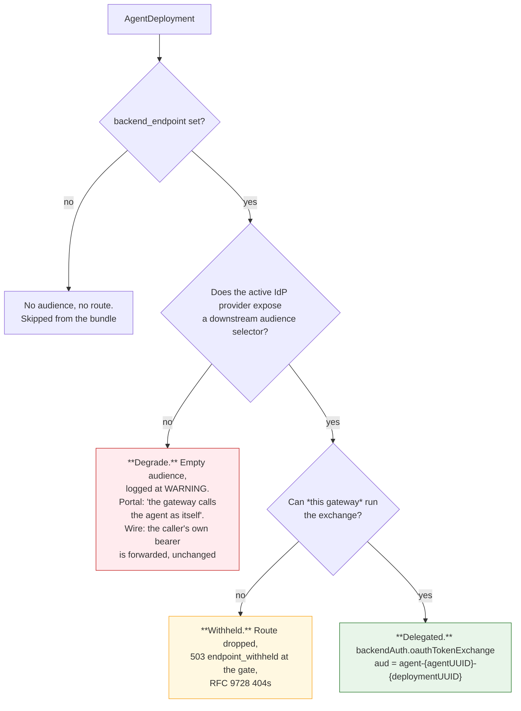
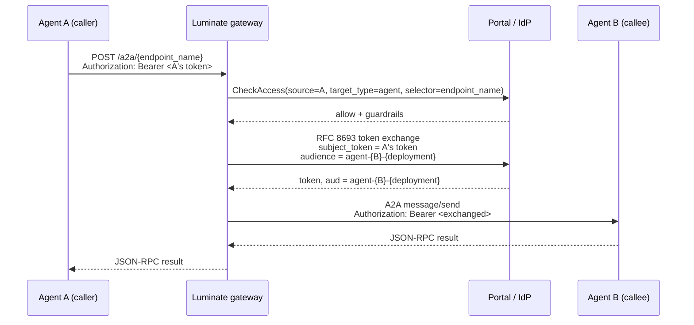

# Identity — what the agent holds, and what a callee receives

Two questions, and they have different answers.

- **Egress**: what credential does the agent present to the gateway, and which ones are refused
  where?
- **Ingress**: what arrives at the agent, and what must the agent do with it?

## Egress — what an agent can hold

| Shape | What it is | Where it works | Where it is refused |
|---|---|---|---|
| **Client credentials → JWT** | An IdP client minted per (agent, gateway): `agent-{agentUUID}-{gatewayUUID}`. Exchange at `POST {portal}/api/v1/iam/auth/token`, then present the `access_token` as `Authorization: Bearer` | Every lane. **The only shape that works on `/a2a`** | — |
| **`lum_` API key** | Static key, `APIKey.owner_agent`, verified at the portal by gRPC | `/llm`; `/mcp` on a `none`-mode endpoint | **403 `api_key_not_exchangeable`** on a delegated A2A endpoint · **403 `platform_minted_not_forwardable`** on a `token_forward` MCP endpoint |
| **`lud_at_` delegated token** | The agent acting **on a user's behalf** | `/llm`, `/mcp`, `/a2a` where an exchange is configured | **403 `platform_minted_not_forwardable`** on a `token_forward` MCP endpoint |
| **Plain user JWT** | A user token with no actor claim | `/llm`; `/mcp` on a `none`-mode endpoint | **403 `not_exchangeable`** on a delegated A2A or MCP endpoint |

Two consequences worth stating loudly.

**An agent that delegates to another agent must hold client credentials.** Since every routable
agent endpoint on `main` is a delegated target, an API key is refused on the whole lane. This is
the single most likely first failure for a team following the SDK's defaults — see
[Gaps](gaps.md).

**Sending the client id and secret to the gateway does not work.** They must be exchanged at the
portal token endpoint first, and the resulting `access_token` presented. The gateway sanitises
every proxy-route error, so a bad credential, a missing policy and an undeployed target all read
as the same string; get the real cause from the gateway logs, where **401 = authn** and
**403 = authorization**.

## Ingress — there is no identity mode, and that is the design

`MCPServer` has an `identity_mode` with five members and a matrix of consequences. **`Agent` has
no such field, and `AgentAssignment` has no `backend_auth`.** The platform states why:

> There is no identity-mode gate. An MCP server chooses among five identity modes and only
> `DELEGATED_EXCHANGE` is a swap target; an agent has no such field, because the A2A lane serves
> exactly one shape — an agent Luminate fronts and reaches on a caller's behalf. Every agent
> deployment the gateway can route is therefore a delegated target, and the degrade path is the
> provider check in `_agent_downstream_exchange` rather than a per-agent choice.
> — `backend/app/agents/audiences.py`

So the ingress design space is not "which of five modes" but "**delegated, or degraded**".



**ASR-13: only the green branch is conformant.** The amber branch is a safe refusal — the
platform prefers withholding to silently reaching the agent as itself. The red branch is the one
to catch, because it looks like it is working.

### Reading which branch you are on

The route's inline policies in the gateway's `/config_dump` are the ground truth:

```jsonc
// dev — delegated. Conformant.
"inlinePolicies": [
  {"a2a": {}},
  {"backendTLS": {"systemRoots": true}},
  {"backendAuth": {"oauthTokenExchange": {
    "grantType": "tokenExchange",
    "audiences": ["agent-01a01b8b-…-01a01d3b-…"],
    "subjectToken": {"source": {"header": {"name": "authorization", "prefix": "Bearer "}}},
    "clientAuth": {"clientId": "gw_019f8d0c-…", "method": "clientSecretBasic"}
  }}}
]

// prod — degraded. NOT conformant: no platform identity is attached, and the
// caller's own bearer travels to the backend.
"inlinePolicies": [ {"a2a": {}}, {"backendTLS": {"systemRoots": true}} ]
```

Prod is in the degraded state because its build predates the exchange — at `sha-89356d7`
`backend/app/agents/audiences.py` does not exist and `_build_agent_assignments` still carries the
docstring *"Agents aren't routed through agentgateway"*. Nothing is exposed today only because
prod has zero `target_type = agent` policies, so every A2A request denies at `CheckAccess` before
it is proxied. **The control holding the line is the absence of a grant, not the credential
handling** — which is why FR-11 gates any prod A2A grant on the image uplift.

### Why the degrade is dangerous rather than merely weaker

Two sources describe the degraded branch and they do not say quite the same thing, so state both.

The **portal** side records the intent — `AgentAssignment.delegated_identity_audience`: *"Empty means
the gateway calls the agent as itself."* No delegated identity is attached.

The **gateway** side decides the wire. `_forwards_caller_credential` returns `True` for any
non-MCP target, on the stated reasoning that *"LLM and A2A upstreams are the platform's own"*, and
the caller-credential headers are excluded only when it returns `False`. With no `backendAuth`
policy there is nothing to overwrite the `Authorization` header with, so **the caller's own bearer
travels to the backend** — while the gateway attaches no identity of its own.

That reasoning holds for an in-cluster agent. It does not hold for
`bedrock-agentcore.ca-central-1.amazonaws.com`, which is where every prod A2A route points. A
platform-minted credential forwarded to a third party is exactly what the MCP lane refuses with
`platform_minted_not_forwardable`; the A2A lane has no equivalent refusal because it assumes the
upstream is its own.

## The exchange, and what the callee gets



**What agent B must validate (ASR-14):**

| Check | Why |
|---|---|
| Signature against the platform JWKS | It is a real token |
| Issuer | It came from the platform's IdP |
| Expiry | Access tokens are short-lived |
| **`aud == agent-{its own agentUUID}-{its own deploymentUUID}`** | **The audience is deployment-scoped, not catalogue-scoped.** A catalogue-scoped audience would be spendable against production from staging. B must reject a token minted for a different deployment of itself |

**What B learns about who called.** The exchanged token's subject is the original caller and the
act chain names the intermediaries — the gateway forwards `actor_id`, `actor_type`, `actor_name`
and `actor_chain` as `x-luminate-*` headers on the same request. B can therefore authorize
per-caller, which is the whole point of the lane existing.

**What the gateway may swap for.** A gateway may only obtain a token for a deployment it actually
fronts (`swappable_agent_audiences_for_gateway`), and the exchange right is a scope
(`downstream:{deployment-pk}`) resolved against the catalogue at exchange time — so a deployment
removed since the token was minted authorises nothing. The `downstream:` namespace is shared with
MCP, and a scope cannot be spent across kinds because the id resolves back through the catalogue.

## Discovery — RFC 9728, and the agent card that does not exist

**What is served:**

```text
GET {gateway}/.well-known/oauth-protected-resource/a2a/{endpoint_name}
→ 200 { "resource": "agent-{agentUUID}-{deploymentUUID}",
        "bearer_methods_supported": ["header"],
        "resource_name": …, "authorization_servers": [issuer] }
   Cache-Control: max-age=300
```

Unauthenticated by construction — only `/llm/`, `/mcp/` and `/a2a/` are treated as proxy
requests, so `/.well-known/` never reaches the authn middleware. A discovery document a backend
must fetch before it holds a validated token cannot itself require one.

**404 is a meaningful answer, not a fault.** It means this gateway does not exchange for that
endpoint, so there is no per-resource audience to publish; claiming one would invite the agent to
enforce a value it will never see. A 404 here is a direct signal that you are on the degraded
branch.

**What is *not* served: an agent card.** Nothing in the platform stores, serves or proxies one —

```text
grep -rin "agent-card|agent.json|agentcard" gateway/app backend/app --include=*.py
  → 0
```

— and `/.well-known/` is answered locally by the gateway rather than proxied, so a caller cannot
reach a callee's own card even if the agent publishes one at its backend. A2A clients that
bootstrap from an agent card cannot do so through the gateway. **ASR-12 makes the catalogue entry
the capability inventory instead**, and the gap is raised as a consortium ask.

## Refusals, by cause

The one table to reach for when a call fails. Everything except the last row is a deliberate,
named refusal; the last row is the one with no signal at all.

| Symptom | Cause | Where |
|---|---|---|
| **401** | No credential, or one that does not validate | `_authenticate` |
| **403 `api_key_not_exchangeable`** | `lum_` API key at a delegated A2A endpoint | `_refuse_agent_unexchangeable` |
| **403 `not_exchangeable`** | Plain user token (no actor) at a delegated A2A endpoint | `_refuse_agent_unexchangeable` |
| **403 `platform_minted_not_forwardable`** | `lum_` or `lud_at_` at a `token_forward` MCP endpoint | `_refuse_platform_minted` |
| **403, no reason** | No `AccessPolicy` matches, or the target agent's `status != active` | `authz.rego` `allowed_agents` |
| **403, portal unreachable** | Fail-closed by design; there is no policy cache | `CheckAccess` |
| **503 `endpoint_withheld`** | The gateway cannot run the exchange for this endpoint | `_withhold_unexchangeable_agents` |
| **404 on `/.well-known/…/a2a/{ep}`** | The endpoint is not delegated on this gateway — intended | `well_known.py` |
| **500 `upstream service error`** | Often TLS: the backend leaf's issuer is not in the gateway's bundle | agentgateway |
| **Failure at the proxy hop, no gate refusal** | **A grant exists but no route does** — the agent has no `AgentDeployment` | Nothing reconciles the two |

## Summary

| Question | Answer |
|---|---|
| What does an agent hold to call out? | Client credentials exchanged for a JWT. An API key works on `/llm` and on `none`-mode MCP, and is refused on `/a2a` |
| What does a callee receive? | A token audienced to **its deployment**, whose subject is the original caller |
| Can a team choose the ingress identity mode? | No. There is no mode. Delegated, or degraded |
| How do I tell which I am on? | The route's `backendAuth` block in `/config_dump`, or whether RFC 9728 discovery 404s |
| Can a caller discover what a callee does? | Not through the gateway. There is no agent card anywhere in the platform |
