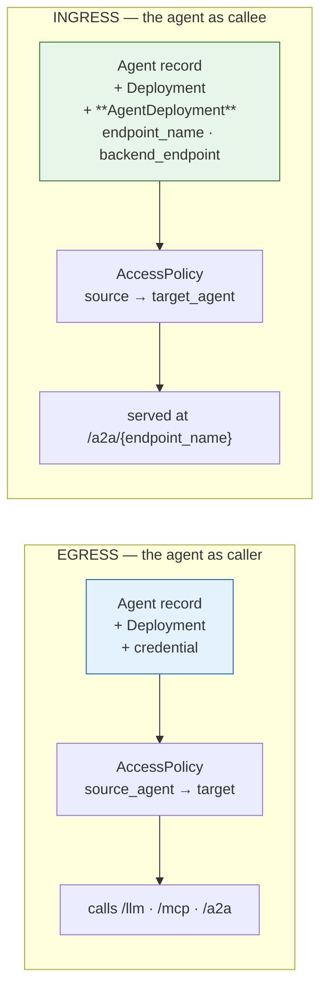
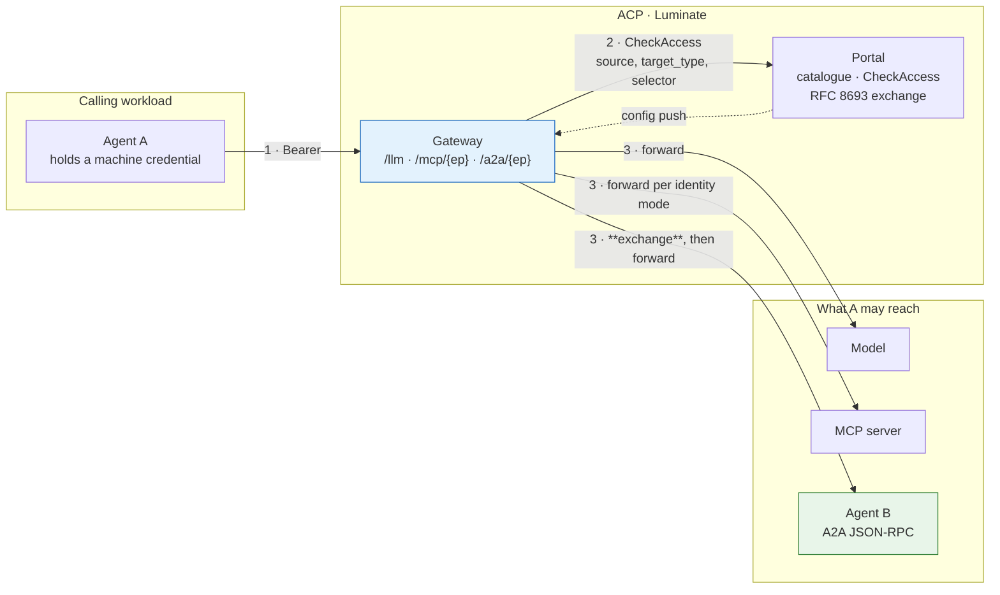
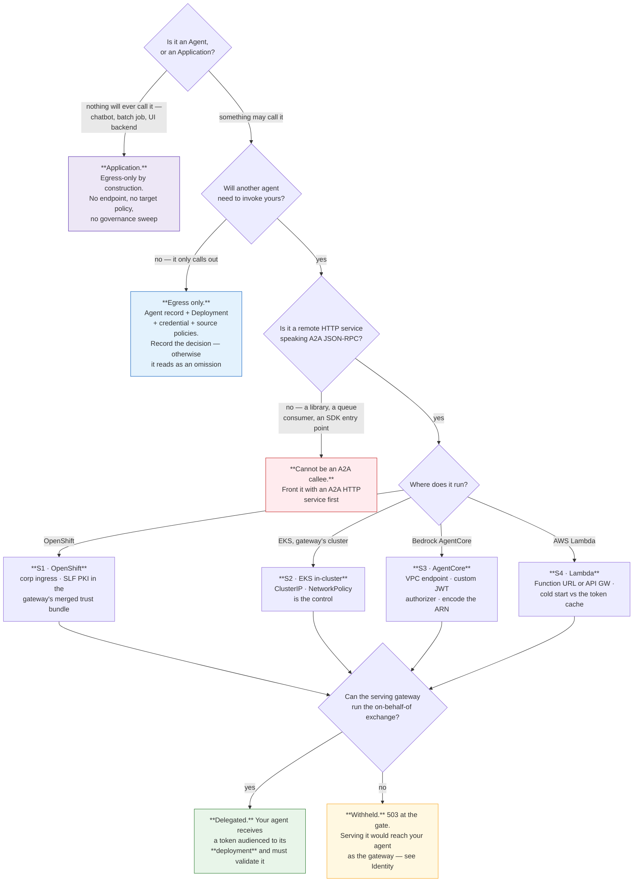
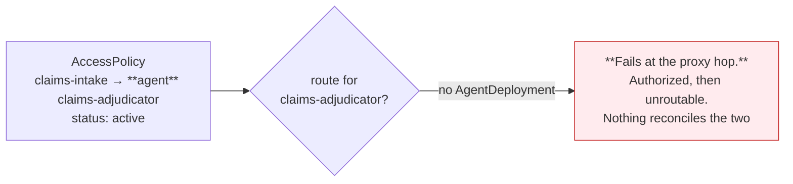
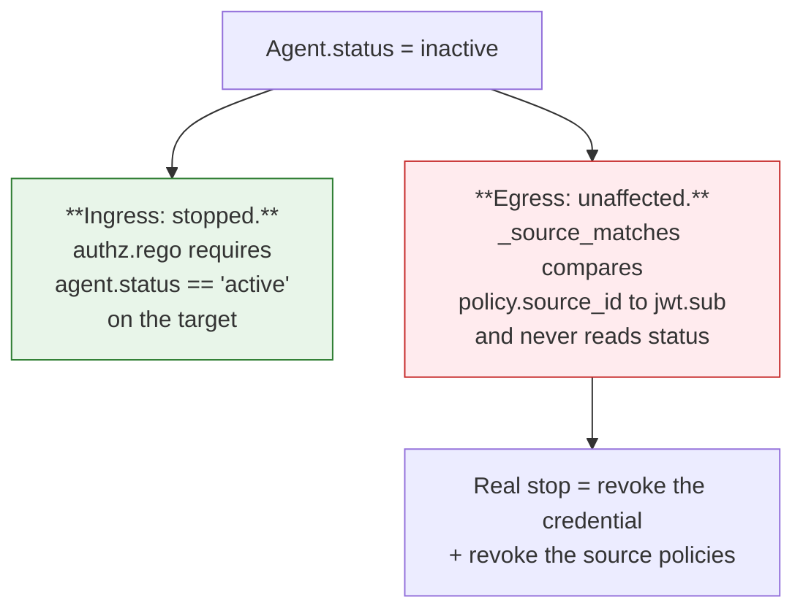

# D2 Design — The Agent Pattern

> **Gate**: D2 — Design | **Status**: Draft | **D1 Approved**: TBD
>
> `d2-design.md` beside this directory is **generated** from these pages by
> `scripts/assemble_d2_design.py` — edit the pages, not the generated file.

## The distinction that organises everything

An MCP server is only ever called. An agent both calls and is called, and those are two
registrations with two requirement sets. Establish which one you need before anything else.

**But first, one question comes before even that: is it an Agent at all?** The platform has two
consumer identities. **A chatbot is an Application, not an Agent** — and an Application is
egress-only by construction: no `ApplicationDeployment`, and no `application` member on
`AccessPolicyTargetType`, so nothing can ever be routed to it or granted it. The deciding test is
*can anything need to call it?* — see [Registration](registration.md).

**Registering an agent and granting it a model makes it a governed caller. It does not make it
callable.** The thing that makes it callable is an `AgentDeployment` — a row carrying an
`endpoint_name` and a `backend_endpoint`. Eight of the ten agents registered in SLF dev do not
have one, and one of them is already the target of an active access policy.

## The pattern in one picture

Steps 1 and 2 are identical on all three lanes. Step 3 is where they differ, and the A2A lane is
the one with a token exchange in the middle of it.

## Pick your shape

Four questions, answered in order. The first decides which requirement set you are reading; the
second is disqualifying for ingress; the third decides your substrate annex; the fourth decides
what your agent must implement.

## The catalogue of shapes

| # | Shape | Who it is for | Egress | Ingress | Maturity |
|---|---|---|:--:|:--:|---|
| **S1** | **OpenShift-hosted** — behind Sun Life corporate ingress | Teams already on OpenShift | ✅ | ⚠️ needs SLF PKI in the gateway bundle | **Not yet exercised** for A2A |
| **S2** | **EKS in-cluster** — ClusterIP beside the gateway | Platform-owned and demo agents | ✅ | ✅ | **Works today** — `policy-assistant` |
| **S3** | **Bedrock AgentCore runtime** | Teams on AWS with an AgentCore footprint | ✅ | ✅ *(dev)* | **Works today via a VPC endpoint** — `fdes-pharmacy-agent`. Prod's registration is a different shape and serves no credential |
| **S4** | **AWS Lambda** | Event-driven and thin agents | ✅ | ⚠️ needs a stable URL | **Not yet exercised**; cold start vs the token cache is the real constraint |

Four substrates are specified in detail because they are in use or in flight. **They are not the
allowed list.** Any other hosting platform — vendor agent products, managed runtimes, whatever
ships next — is admitted on the same terms: assessed against the numbered **SUB-E** and **SUB-I**
criteria in [Hosting](hosting.md). Meeting the egress set makes a platform viable for agents that
consume AI resources; meeting both makes it viable for agent-to-agent delegation. A platform that
falls short has a *named open criterion*, not a refusal.

## What is true on every shape

These are platform properties a team cannot change, and they drive most of the profile.

| Property | Consequence for the agent |
|---|---|
| **Registration ≠ reachability.** An `AgentDeployment` is what emits a route | Declare your direction, and create the deployment if you want to be callable — [Registration](registration.md) |
| **One route per agent deployment.** `pathPrefix = /{endpoint_name}`; no shorthand ever existed for A2A | Your agent owns a path segment and is addressed at `{gateway}/a2a/{endpoint_name}`, **not** by its id or key |
| **There is no agent identity mode.** `Agent` has no `identity_mode`; `AgentAssignment` has no `backend_auth` | Every routable deployment is a delegated target. The only alternative is the degrade path, which sends nothing — [Identity](identity.md) |
| **The control plane is on the request path.** `CheckAccess` per request, no cache; portal unreachable → deny | Your availability is bounded by the portal's; there is no fail-open posture |
| **Authorization is per agent, in each direction separately** | A source grant covers everything that agent may do; a target grant covers every method it exposes — [Authorization](authorization.md) |
| **No guardrail can target an agent** | You cannot require a scan of your own inbound traffic. Every caller must carry one |
| **Quotas are not enforced anywhere** | Bound yourself at the substrate |
| **There is no REST lane.** The gateway matches `/llm/`, `/mcp/` and `/a2a/` and nothing else | An enterprise API is reached through an MCP server, and the API Platform owns that hop — [Reaching a REST API](api-access.md) |
| **The platform never probes your agent** | Health, restarts and capacity are entirely yours — [Operations](operations.md) |
| **Deactivation stops ingress, not egress** | The stop path is credential and policy revocation — [Operations](operations.md) |
| **The registered query string is discarded** on the A2A hop | Put everything you need in the path — [Registration](registration.md) |

## Reading order

| Page | Covers | Answers |
|---|---|---|
| [Registration](registration.md) | **Agent vs Application**, the catalogue model, deployments, credentials, endpoint hygiene, lifecycle | *Is it even an agent — and what makes me reachable?* |
| [Hosting](hosting.md) | S1–S4, the SUB-E / SUB-I admission bar, reachability, TLS, network control | *What must my platform provide?* |
| [Identity](identity.md) | What the agent holds; what a callee receives; the exchange; RFC 9728 | *What credential reaches me, and what do I validate?* |
| [Authorization](authorization.md) | Source and target policies, the boundary, guardrails, quotas | *What is actually enforced, and what must I enforce?* |
| [Reaching a REST API](api-access.md) | The MCP boundary, the Keycloak→Okta break, API Resources and Skills | *How do I call a business system, and whose identity arrives?* |
| [Build pipeline](pipeline.md) | The JTE path, SonarQube / Snyk / Checkmarx, image provenance | *How do I build it so it will be accepted?* |
| [Operations](operations.md) | Audit, tracing, run correlation, cost, the stop path | *What is visible once it runs, and how do I stop it?* |
| [ETAB and ISRA](assurance.md) | The architecture to present and the control table to assess | *What do I take to the board?* |
| [Gaps](gaps.md) | What is blocked, who owns the ask | *What am I accepting as residual?* |

## The two rules that catch everyone

**1 · Registered is not reachable.**

That policy is live in SLF dev today.

**2 · Deactivating an agent does not stop it.**

Design your incident runbook around the right-hand branch, not the left.
