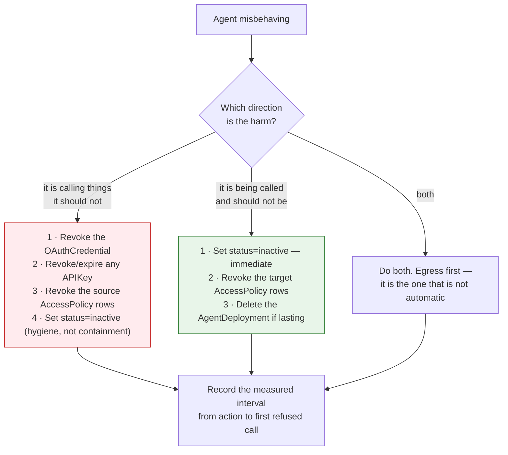
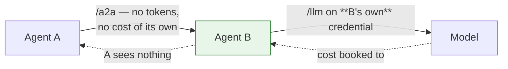

# Operations — what is visible, and how you stop it

## The stop path — read this before an incident, not during one

**Setting an agent inactive stops other agents calling it. It does not stop it calling
anything.**

| Action | Stops egress? | Stops ingress? | Mechanism |
|---|:--:|:--:|---|
| `Agent.status = inactive` | ❌ **No** | ✅ Yes | Drops out of `input.agents`; `allowed_agents` requires `status == "active"`. The source rule never reads it |
| **Revoke the agent's `OAuthCredential`** | ✅ Yes | — | `POST …/revoke-credentials`. The IdP client can no longer mint; **tokens already issued live until expiry** |
| **Revoke or expire the agent's `APIKey`** | ✅ Yes | — | `verify_api_key` refuses `revoked` / `expired` / non-`active` immediately. It does **not** check the owner agent's status, so this is a separate action |
| **Revoke or suspend the source `AccessPolicy` rows** | ✅ Yes | — | `_collect_policies` selects `status = ACTIVE` only, so a revoked policy stops matching at the next fact build |
| **Delete the `AgentDeployment`** | — | ✅ Yes | The route stops being emitted at the next config push |
| `governance_state = suspended` | ❌ No | ❌ No | **Records and audits. Refuses nothing.** |

### The runbook

**Credential revocation has a tail.** Access tokens are short-lived but non-zero; a token minted
a second before revocation remains valid until it expires. Revoking the *access policies* closes
the hole for tokens already in flight, because the policy is consulted on every request. **Do
both, and do the policy revocation first if seconds matter.**

**ASR-32 requires this to have been exercised**, and FR-10 requires the interval to be measured
per environment and per direction. Configuration reaches gateways over a long-lived push stream
rather than a poll, so the number should be small — but it must be measured, never quoted.

## Audit

Two classes, both append-only.

| Class | What it records | Where |
|---|---|---|
| **Change** | Every mutation of an agent record — create, update, delete, and each governance transition with its reason | `audit_events`, from `AgentLifecycle` |
| **Access** | Every data-plane decision, with `CaptureProtocol.a2a` for the agent lane | Gateway capture → `luminate.audit.v1.CaptureIngest` |

Two properties worth knowing:

- **`Agent.audit_snapshot()` is an allow-list.** `key`, `name`, `description`, `status`, `type`,
  `framework`, `deployment_type`, `project_id`. `configuration` is deliberately excluded — it is
  free-form operator JSON headed for a store that cannot be redacted afterwards — but a change to
  it still reaches `changed_fields`, so the trail says the configuration moved without copying
  its contents. `governance_state` is likewise absent from the snapshot; its history is in the
  transition trail instead.
- **A call that bypasses the gateway emits nothing.** Absence of events is the detection signal
  for an ASR-5 violation, not presence of a denial.

## Tracing and attribution

The gateway stamps `x-luminate-*` headers onto the upstream request, which agentgateway lifts
into its span and Langfuse ingests. Callers cannot set them: the inbound allow-list holds no
`x-luminate-*` key and the values are appended after filtering.

| Header | On the agent lane |
|---|---|
| `x-luminate-target-id`, `-target-type` | ✅ the callee agent's id and `agent` |
| `x-luminate-entity-id`, `-entity-type`, `-entity-name` | ✅ the calling entity |
| `x-luminate-actor-id`, `-actor-type`, `-actor-name`, `-actor-chain` | ✅ where the call is delegated — the act chain, most recent first |
| `x-luminate-principal-id` | ✅ → `langfuse.user.id` |
| `x-luminate-session-id` | ✅ if the caller sent one |
| `x-luminate-project-id` | ✅ |
| `x-luminate-model-id`, `-offering-id`, `-model-pricing-key` | ❌ model lane only |
| `x-luminate-mcp-method` | ❌ MCP lane only |
| **`x-luminate-genai-operation`** | ❌ **deliberately absent** |

### The missing operation name, and what it costs

`_stash_genai_operation` stamps exactly two values, both from the OTel GenAI semantic
conventions' own vocabulary, and says why the agent lane gets neither:

> The agent lane stamps nothing for now — it is a proxied A2A call, and which operation name fits
> it is a question for whoever brings that lane's measures up.

That is honest rather than lazy — an invented value would be worse. The cost is concrete:

- Langfuse types the A2A hop as a plain **span**, not a generation. Every portal usage and cost
  query selects `type = GENERATION`, so **the hop itself carries no tokens and no cost**, which is
  correct — an A2A hop has none of its own.
- What *does* have cost is what the callee then does. And that is booked to the **callee**.

## Cost — and why a delegation's cost does not follow the caller

Per-agent usage is real: `UsageBucket` carries `SubjectType.AGENT`, `agent_model_timeseries`
gives a per-model token and cost series for one agent, and `AgentUsageSummary` gives executions,
model calls, MCP calls, denied executions and latency.

**ASR-31**: where the downstream cost must follow the original caller, **the callee forwards the
delegated token it received** rather than calling out on its own machine credential. The token
names the original caller as subject and carries the act chain, so the attribution headers on B's
onward call name A. If B uses its own credential instead, the chain is broken at B and the
chargeback lands on B's cost centre.

Decide this deliberately. Both answers are defensible — a shared service agent may *want* to own
its costs — but only one of them is what a chargeback conversation usually assumes.

`ProjectUsageDaily` (the finance-facing chargeback ledger) aggregates by `usage_date` and carries
`cost_centre` as a first-class column, but has **no run or session dimension**, so "what did this
delegation chain cost" is answerable only through Langfuse session grouping, not from the ledger.

## Run correlation

`_raw_session_id` picks the run id in this order:

1. **`Mcp-Session-Id`** — MCP lane only, and it wins there
2. **`x-luminate-session-id`** — the explicit header, reduced to printable non-whitespace ASCII
   and length-capped, then namespaced `{entity_type}:{entity_id}:{raw}` so `run-1` from two
   agents does not merge into one Langfuse session
3. **`traceparent`** trace-id — an OTel-instrumented caller gets run grouping for free
4. **nothing** — the request lands in the null-session row

**ASR-33: send `x-luminate-session-id`.** Two traps:

- The harness SDK sends **`x-session-id`**, and `grep -ri "x-session-id"` across `gateway/` and
  `backend/` **returns zero**. It is not read. Same for `x-acp-agent-id`.
- On a delegation chain, correlation only holds if **the callee propagates the same session id
  onto its own outbound calls**. The gateway does not invent one and does not carry it across the
  hop for you.

## Health

**The platform never probes an agent.** The asymmetry with the MCP lane is visible in the data
model itself: `MCPServerDeployment` carries `health_status`, `last_checked_at` and `last_error`,
fed by a `ProbeMcpCommand` the gateway acts on and a `supports_mcp_probe` capability the portal
checks before offering a manual health check. **`AgentDeployment` carries none of them** — it has
exactly two fields, `endpoint_name` and `backend_endpoint`. `Agent.status` is operator-set and
means "should this be served", not "is this up".

So liveness, restarts and capacity are entirely the hosting platform's job (ASR-29), and the
detection signal for a dead agent is **gateway 5xx per endpoint**. Alert on it, per endpoint
name, because nothing else will tell you.

## The operational checklist

- [ ] The stop runbook is written, names both directions, and has been **exercised**
- [ ] The propagation interval is measured per environment and per direction (FR-10)
- [ ] Alerting on gateway 5xx per endpoint name — this is the only liveness signal
- [ ] The agent sends `x-luminate-session-id` and propagates it across delegations (ASR-33)
- [ ] The delegated-token-vs-own-credential decision is recorded, with its cost consequence
      (ASR-31)
- [ ] `governance_state` is recorded and **not** cited as a control
- [ ] The FR-3 non-conformance queries run on a schedule, not on request
