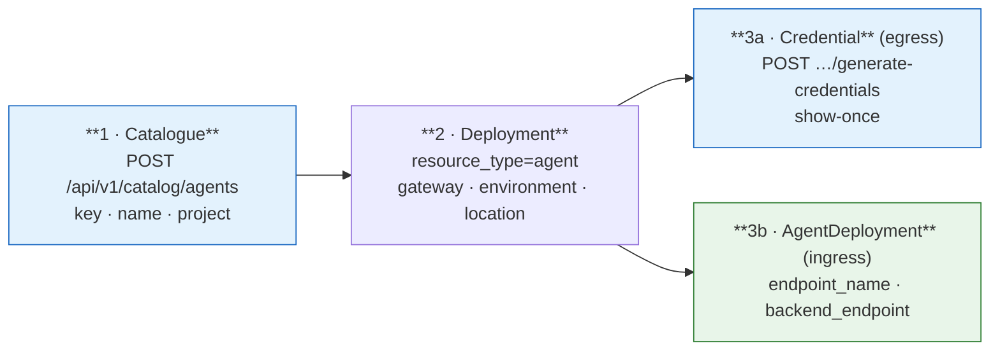

# Registration — the catalogue, the deployment and the credential

## First: is it an Agent at all?

Before anything else, answer this — the platform has two consumer identities and the choice is
not stylistic.

> **Are chatbots agents in the ACP? No. A chatbot is an Application.**

The deciding test is one question: **can anything need to call it?**

- **Yes** → **Agent.** It needs an A2A endpoint, so it needs the resource type that has one.
- **No — it only ever calls out** → **Application.** A chatbot, a batch job, an internal service, a
  UI backend. This is the platform's own framing: *"Register an application when a chatbot, batch
  job, internal service, or other workload needs to call governed AI resources through Luminate"*
  ([`register-application.md`](https://bitbucket.sunlifecorp.com/projects/EDAEACP/repos/luminate-user-guides/browse/docs/building/register-application.md)).

**An Application is egress-only by construction, not by convention.** There is no
`ApplicationDeployment`, so it has no `endpoint_name` and no `backend_endpoint`; and
`AccessPolicyTargetType` has no `application` member, so no policy can ever name one as a target.
Nothing can be routed to it, and nothing can be granted it.

### What the two actually differ on

| | **Agent** | **Application** |
|---|:--:|:--:|
| Policy **source** (may call) | ✅ | ✅ |
| Policy **target** (may be called) | ✅ `target_agent` | ❌ **no enum member** |
| Routable endpoint | ✅ `AgentDeployment` | ❌ no such model |
| Credential on a deployment | ✅ | ✅ |
| Source-scoped guardrails | ✅ | ✅ |
| Audit + trace attribution | ✅ | ✅ (a first-class `entity_type`) |
| `status` | ✅ | ❌ **no field at all** |
| `governance_state` | ✅ | ❌ **no column** |
| Swept by governance | ✅ | ❌ **deliberately excluded** |
| `type` / `framework` / `deployment_type` | ✅ | ❌ |
| Per-entity cost in the usage ledger | ✅ `SubjectType.AGENT` | ❌ **no member** |

Two of those rows are load-bearing and the platform states them itself.

**Governance does not cover Applications.** `SWEPT_REGISTRIES` is `agent`, `model`, `mcp_server`:

> The kinds that carry a governance state axis, and therefore the kinds governance can decide
> about. `application` is deliberately absent even though a verdict can be recorded against one:
> it has no `governance_state` column, so there is nothing for a published status to describe.
> — `backend/app/governance/sweep.py`

**An Application has no status field**, so it has no lifecycle control of any kind. For an Agent,
deactivation at least stops ingress; for an Application there is nothing to deactivate. The only
withdrawal is revoking its credential and its access policies — which, per
[Operations](operations.md), is the real stop path for an Agent's egress too.

### The live worked example

`pharmacy-chatbot` is registered in SLF dev as an **Application**, with a deployment, an active
credential, and four active source policies:

```text
pharmacy-chatbot  (Application, project Pharmacy)
  → model       claude-haiku-4-5            active
  → model       claude-3-haiku-pharmacy     active
  → mcp_server  pharmacy-mcp-server         active
  → agent       fdes-pharmacy-agent         active     ← calls an agent over A2A
```

That last row is the point. **An Application can call an agent** — it is a first-class source on
the A2A lane. It simply can never be called. Across both clusters there are **zero** access
policies with `target_type = application`, and there cannot be one.

### Choosing wrongly, in both directions

| Mistake | What it costs |
|---|---|
| Registering a chatbot as an **Agent** | You get a governance axis, a status field and a `framework` you will never populate meaningfully, and a catalogue that overstates how many agents the organisation runs. Harmless operationally, misleading in an inventory — and OSFI E-23 asks for that inventory |
| Registering a callable service as an **Application** | **It can never be called.** No endpoint, no target policy, no route. You will discover this when the first caller cannot be granted access, and the fix is a re-registration under a new resource type |
| Assuming an Application is governed like an Agent | It is not swept, has no `governance_state`, and does not appear in the usage ledger. An assessor told "our chatbot is governed" will find no governance record for it |

**ASR-35** makes the choice a recorded decision, and the guides do not currently help: searching
`luminate-user-guides` for any statement of when to pick one over the other **returns nothing**.

---

Three separate things then happen, in order, and only the third of them is what most teams think
"registering an agent" means.



## 1 · The catalogue entry

`POST /api/v1/catalog/agents` (route `catalog/agents`). The create serializer accepts
`key`, `name`, `description`, `status`, `type`, `framework`, `deployment_type`, `project`,
`configuration` and attribute ids. **Mandatory in practice: `key`, `name`, `project`** —
`type` defaults to `assistant`, `deployment_type` to `cloud`, `status` to `active`.

| Field | What it is | What it is not |
|---|---|---|
| `key` | Globally unique slug, `validate_key` | Not the routing key — the gateway routes by `endpoint_name` |
| `name` | Case-insensitively unique display name | — |
| `status` | `active` \| `inactive` \| `deprecated` \| `unknown` — **lowercase on the wire** | Not a kill switch in both directions. See [Operations](operations.md) |
| `governance_state` | `not_evaluated` → … → `approved` \| `suspended` \| `retired` | **Not enforceable.** No runtime consumer anywhere |
| `type`, `framework`, `deployment_type` | Free-text `CharField`s | Not a controlled vocabulary. ASR-8 makes one a process obligation |
| `configuration` | Free-form operator JSON | **Not a secret store.** Deliberately excluded from `audit_snapshot()` because it lands in an append-only store that cannot be redacted afterwards |
| `project` | Owning project, `PROTECT` on delete | Also the create-time authorization target |

There is **no `identity_mode`** field. `MCPServer` has one with five members; `Agent` has none,
and that asymmetry is deliberate on the platform's part — see [Identity](identity.md).

### Vocabulary (ASR-8)

`framework` in SLF dev today: `bedrock-agentcore` ×5, `langgraph`, `strands`,
`Strands Framewrok`, `Other`, `acp-aws-harness-sdk` (a package renamed months ago), and one
blank. Adopt and publish a fixed set — the useful axis is the *runtime*, not the library:

| `deployment_type` | `framework` |
|---|---|
| `openshift`, `eks`, `agentcore`, `lambda`, `external` | `langgraph`, `strands`, `bedrock-agentcore`, `crewai`, `autogen`, `semantic-kernel`, `custom` |

### Governance state

Moved **only** by `POST /api/v1/catalog/agents/{id}/transition`, authorized on the *governance*
verb rather than the registry's update verb — deliberately, so that holding
`agents.agent.update` does not hand somebody the governance axis. A create or update payload
carrying `governance_state` or `governance_state_reason` is **refused**, not ignored, because
silently dropping it would let a caller believe the state moved.

```text
not_evaluated  → in_scope_unassessed | out_of_scope | retired
out_of_scope   → in_scope_unassessed | retired
in_scope_unassessed → assessed | suspended | out_of_scope | retired
assessed       → approved | in_scope_unassessed | out_of_scope | retired
approved       → in_scope_unassessed | suspended | out_of_scope | retired
suspended      → in_scope_unassessed | out_of_scope | retired
retired        → (terminal)
```

Every move needs a non-blank reason free of control characters. A move to `approved` refuses
self-approval. A move to `suspended` refuses unless the cascade has been previewed first, and the
preview names the deployments and access policies it reaches.

**All of that is evidence, not enforcement.** Record it; do not present it as a control.

## 2 · The deployment

`Deployment` requires `resource_type`, `project`, `environment`, `gateway`, `location` and
`deployment_key`, plus the typed FK (`agent`). It is what places the agent on a gateway, and it
is what a credential hangs off.

**One backing runtime per environment (ASR-9).** Prod today registers a single AgentCore runtime
ARN under four gateways spanning dev, SIT, stage and prod. That makes one runtime the failure
domain, the capacity pool and the blast radius for four environments at once. If it is
deliberate, record it as an exception with a stated radius; if it is not, split it.

## 3a · The credential (egress)

Registering issues nothing. `CREDENTIAL_RESOURCE_TYPES = {agent, application, mcp_server}` and
the mint is on the **deployment**:

```text
POST   /api/v1/deployment/deployments/{id}/generate-credentials
POST   /api/v1/deployment/deployments/{id}/rotate-credentials
POST   /api/v1/deployment/deployments/{id}/revoke-credentials
GET    /api/v1/deployment/deployments/{id}/credentials
```

The result is an `OAuthCredential` with a per-entity IdP client
(`agent-{agentUUID}-{gatewayUUID}`). **The secret is shown once.** A lost secret is *rotated*,
never *regenerated* — regenerating creates a second credential and leaves the first live.

Diagnostic that needs no secret: `OAuthCredential.client_secret_prefix` holds the first characters
of the live secret. If the caller's copy does not start with it, the caller's copy is stale.

An agent may also hold an `lum_` **API key** (`APIKey.owner_agent`). Read
[Identity](identity.md) before choosing one — it is refused on the A2A lane.

## 3b · The A2A endpoint (ingress)

`AgentDeployment` is a one-to-one extension of `Deployment` carrying exactly two fields, and its
existence is what makes the agent callable.

| Field | Rule |
|---|---|
| `endpoint_name` | **A single URL-safe path segment.** The route matches it as a prefix and the authn gate reads it back as `upstream_path.split("/")[0]`, so a name containing `/` is gated under one name and served under another, and a blank one matches `/` and shadows every other agent on the lane. `translate_agent_assignment` raises rather than emit either |
| `backend_endpoint` | Absolute `http(s)` URL. The host becomes an agentgateway `host` backend (`host:port`, port inferred from the scheme) and **everything after the host becomes a `urlRewrite`** |

### Endpoint hygiene — three traps, all visible in the live estate

**The query string is discarded.** `_split_api_base` returns `parsed.path` and drops the query.
Prod registers `…/invocations?qualifier=DEFAULT`; the emitted rewrite is `…/invocations`. Harmless
for `DEFAULT`, a silent mis-route for any other qualifier.

**Reserved characters must be percent-encoded.** Dev registers the AgentCore ARN encoded, prod
registers it raw:

```text
dev   /runtimes/arn%3Aaws%3Abedrock-agentcore%3Aca-central-1%3A…%3Aruntime%2Fluminate_claims_orchestrator-…/invocations
prod  /runtimes/arn:aws:bedrock-agentcore:ca-central-1:…:runtime/acp_sample_agent-…/invocations
```

The raw form splits the ARN across two path segments. Nothing validates it — registration checks
only that the value is a URL.

**Nothing probes the backend.** `MCPServer` gained a health probe
(`supports_mcp_probe`, a `ProbeMcpCommand` the gateway acts on); `Agent` did not. A wrong URL is
accepted, routed and discovered at call time. **ASR-7 makes a post-registration call through
`{gateway}/a2a/{endpoint_name}` a release-time obligation.**

Verify what was actually emitted, rather than what you meant, by reading it back:

```bash
kubectl -n luminate exec deploy/luminate-gateway -c luminate-gateway -- \
  python3 -c "import json,urllib.request;d=json.load(urllib.request.urlopen('http://127.0.0.1:15080/config_dump'));print(json.dumps([r for b in d['binds'] if b['key'].endswith('5000') for l in b['listeners'].values() for r in l['routes'].values()],indent=1))"
```

## The grant, and the reconciliation nobody does

An `AccessPolicy(target_type=agent)` is accepted against **any** agent, whether or not it has an
`AgentDeployment`. `claims-intake → claims-adjudicator` is active in SLF dev against an agent with
no A2A endpoint: the call authorizes and then fails at the proxy hop, because no route was ever
emitted for it.

**ASR-11: no grant without an endpoint.** Until the platform reconciles it, the query in
[D1 FR-3](../d1-requirements.md#fr-3-make-non-conformance-queryable) is the control.

## What registration is *not* evidence of

| Claim | Reality |
|---|---|
| "The agent is callable" | Only if it has an `AgentDeployment` on the gateway the caller uses |
| "The agent has been assessed" | `governance_state` is `not_evaluated` for 10 of 10 dev agents |
| "The backend URL is right" | Nothing checks it |
| "The agent is running" | The platform never probes it |
| "The catalogue lists what it can do" | Only if ASR-12 was honoured — there is no agent card anywhere in the platform |
| "Deactivating it stops it" | Stops ingress only. See [Operations](operations.md) |
