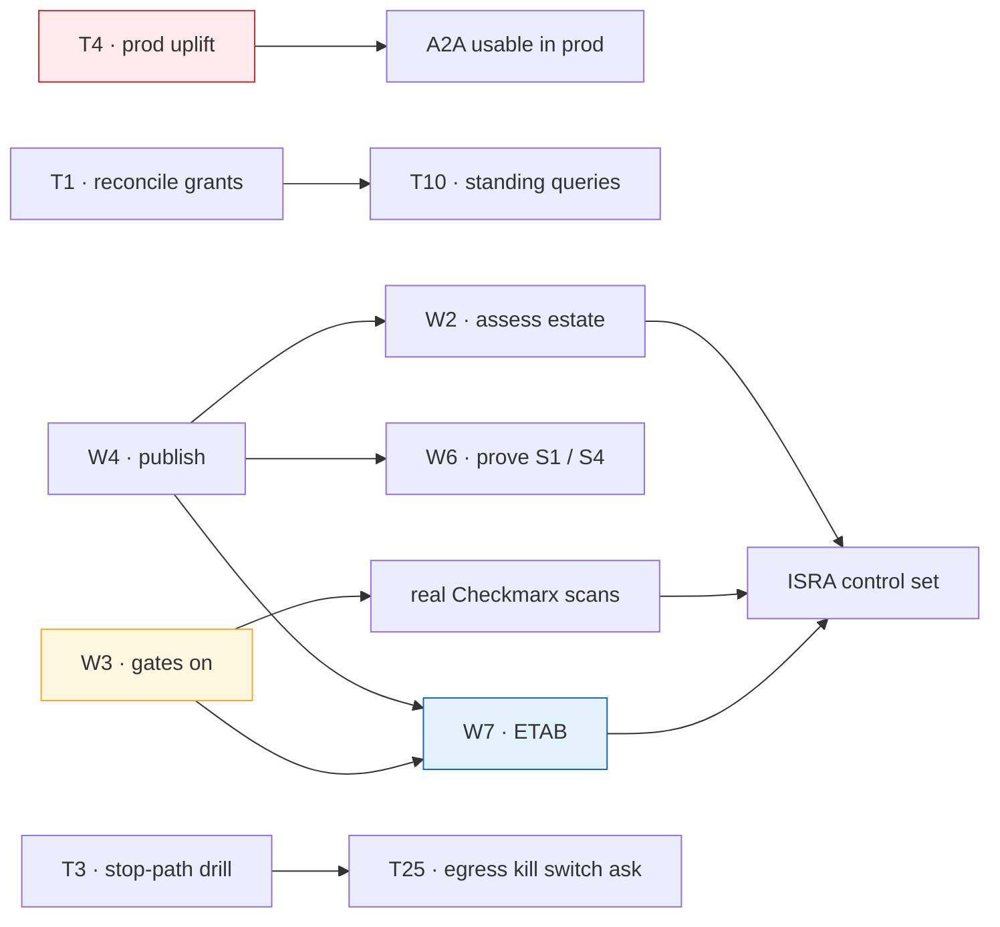

# Agent Patterns — D3: Implementation Plan

> **Gate**: D3 — Tasks | **Status**: Draft | **D2 Approved**: TBD
> **Epic**: [EACPP-1290](https://sunlife.atlassian.net/browse/EACPP-1290) · Board label `acp-product-team`
>
> **The Jira tasks below have not been created.** They are created by
> `scripts/create_jira_from_spec.py` once D2 is reviewed and approved — creating them earlier
> commits the team to a plan nobody has agreed. A `--dry-run` parses all 29 cleanly.

## Overview

Eight workstreams, and the order matters more here than in most plans, because the lane is
already in use and two of its properties are currently unsafe to rely on.

| WS | Purpose | Blocks anything? |
|---|---|---|
| **W1 · Unblock the lane** | Four things that must be true before anyone else uses A2A | **Yes — everything** |
| **W2 · Reconcile the estate** | Bring the eleven registered agents up to the profile | W7 |
| **W3 · Close the supply-chain gaps** | The two gaps that are ours alone | **W7** |
| **W4 · Publish the pattern** | So teams can self-serve | W2, W6 |
| **W5 · Fix the adoption path** | The harness SDK cannot reach the lane | — |
| **W6 · Prove the unexercised substrates** | S1 OpenShift and S4 Lambda are specified and untested | W7 |
| **W7 · Assurance** | ETAB and the ISRA | — |
| **W8 · Consortium asks** | What only Luminate can fix | — |

**W1 and W4 start together.** W3 is the long pole into W7 — an ISRA cannot claim SAST and SCA
coverage the pipelines do not enforce. W8 is long-lead and runs in parallel throughout; none of
its items blocks anything, because each already has a stated compensating control.

## W1 · Unblock the lane

Four things, none of which is optional and none of which is large.

| Task | Description | Depends |
|---|---|---|
| **T1** | **Reconcile every `target_type = agent` grant against an actual route.** `claims-intake → claims-adjudicator` is active in dev against an agent with no `AgentDeployment`: the call authorizes and then fails at the proxy hop. Either create the deployment or revoke the policy, and make the query standing. (ASR-11, FR-3) | — |
| **T2** | **Record a direction for every registered agent** — egress only, ingress only, or both — and reconcile it against the agent's deployments. Eight of ten dev agents are egress-only with no record that this was decided. (ASR-1, FR-2) | — |
| **T2a** | **Confirm the resource type of every registered workload** (ASR-35). A chatbot is an Application, not an Agent — `pharmacy-chatbot` is correctly registered as one, and the guides state no rule, so the choice needs writing down before the next one is registered. | — |
| **T3** | **Write and exercise the stop-path runbook.** It must state that deactivation stops ingress and **not** egress, and that stopping egress means revoking the credential *and* revoking or suspending the source access policies. Drill it in dev. (ASR-32, DD-7) | — |
| **T4** | **Uplift the prod image past the A2A on-behalf-of exchange**, and **hold every `target_type = agent` policy in prod until it lands.** Prod runs `sha-89356d7`, which predates the exchange, so all four A2A routes are emitted with no `backendAuth` and forward the caller's credential unchanged to an AWS endpoint. Nothing is exposed today only because prod holds zero such grants. (FR-11, G-9, R-11) | — |

## W2 · Reconcile the estate

Eleven agents are registered across the two clusters. None has been assessed, and the two
environments disagree about what an A2A call is.

| Task | Description | Depends |
|---|---|---|
| **T5** | **Assess each registered agent against ASR-1 to ASR-38** and record the result: `policy-assistant`, `fdes-pharmacy-agent`, `claims-intake`, `claims-adjudicator`, `risk-assessor`, `underwriting-intake`, `slm-analyst`, `acp-harness-sample`, `aims-rca-agent`, `aims-incident-correlation` (dev) and `acp-harness-sample` (prod). | T13 |
| **T6** | **Evidence the network control for every ingress agent** (ASR-5): prove by negative test that the backend is unreachable from a non-gateway workload, and commit the NetworkPolicy, resource policy or VPC endpoint policy that makes it so. `policy-assistant` is plain HTTP in-cluster, so this is its only control — record the rationale with an owner (ASR-5, C-10). | T5 |
| **T7** | **Verify every registered `backend_endpoint`** against ASR-6 and ASR-7: read the emitted `urlRewrite` back from the gateway's `/config_dump`, fix the un-encoded prod AgentCore ARN, and record a successful call through `{gateway}/a2a/{endpoint_name}` for each. | T5 |
| **T8** | **Adopt and backfill the `framework` / `type` / `deployment_type` vocabulary** (ASR-8). The live values include a typo, a stale package name and a blank, which makes the inventory unqueryable. | T13 |
| **T9** | **Decide the environment-separation question** (ASR-9). Prod registers one AgentCore runtime under four gateways spanning dev, SIT, stage and prod. Split it, or record it as an exception with a stated blast radius. | T5 |
| **T10** | **Stand up the FR-3 non-conformance queries on a schedule** — grants without routes, deployments with an empty delegated audience, `http://` backends, `not_evaluated` governance state, agents with a credential and no policy or the reverse. | T1 |

## W3 · Close the supply-chain gaps that are ours

Neither needs a consortium change. Both are the weakest part of any assurance submission, and one
of them sits on the agent adoption path itself.

| Task | Description | Depends |
|---|---|---|
| **T11** | **Turn the scanning gates on** for every agent repository — including `acp-harness-sdk`, which carries `enforce_snyk_gate = false` with the reason *"disabled during initial CI setup"*. `enforce_snyk_gate = true`, `enforce_checkmarx_gate = true`, `severity_threshold` no weaker than `high`, and `branches_to_scan` set explicitly (the library default `["develop"]` matches nothing on `main`). (ASR-26, ASR-27, G-12) | — |
| **T12** | **Establish Checkmarx projects and PR scanning** for each agent repository, and verify a real **scan id and gate evaluation** appear on a build. A green stage is not evidence — the step reads an existing PR scan and skips silently when there is none. (ASR-26, DD-12) | T11 |
| **T13** | **Retain and locate the evidence**: `snyk-sbom.json` and `snyk-results.html` per build, the SonarQube gate status, and the registry digest matching the deployed digest. Wire the APM number so findings are attributable. (ASR-27, ASR-28) | T11 |

## W4 · Publish the pattern

| Task | Description | Depends |
|---|---|---|
| **T14** | **Publish the pattern** into [`luminate-user-guides`](https://bitbucket.sunlifecorp.com/projects/EDAEACP/repos/luminate-user-guides/browse) — the egress-or-ingress question first, then the substrate decision tree, then ASR-1 to ASR-38. This is the page a team is sent to *before* it builds. (FR-1) | — |
| **T15** | **Publish the substrate annex** — one page each for OpenShift, EKS in-cluster, Bedrock AgentCore and Lambda, **plus the SUB-E / SUB-I admission bar** so a platform not on the list is assessed against stated criteria rather than negotiated. Include the worked assessments as examples. (FR-7) | T14 |
| **T16** | **Publish the failure-mode table** (FR-8) and the **identity page** (FR-2): the refusal reasons and their causes, the withheld-endpoint 503, the RFC 9728 404 that means "not delegated", the `500 upstream service error` that is really a trust-store problem, and the case with no refusal at all — a grant against an agent with no route. | T14 |
| **T17** | **Build the reference agent**: an A2A JSON-RPC service that validates its deployment audience (ASR-14), a Dockerfile and manifest satisfying ASR-29 and ASR-30, and a `pipeline_config.groovy` with the gates **on**. (FR-6) | T14, T11 |
| **T18** | **Point the onboarding specs at this pattern** — `vulcan`, `aims`, `nova`, `gbd`, `mdx`, `orcc`, `waldo` — and reconcile any that assumed an agent was callable by virtue of being registered, or that cited deactivation as a stop control. | T14 |

## W5 · Fix the adoption path

| Task | Description | Depends |
|---|---|---|
| **T19** | **Fix `A2AClient.invoke_gateway` in `acp-harness-sdk`**, four defects, each with a test: (a) attach the resolved auth provider — it currently sends no `Authorization` header at all; (b) select **client credentials** on the A2A surface, because a delegated endpoint refuses the API key `resolve_auth_provider` prefers; (c) address the route by **endpoint name**, not agent id, and stop composing `…/a2a/a2a/{id}` from a default that already ends in `/a2a`; (d) emit `x-luminate-session-id` — `x-session-id` is not read by Luminate. (FR-9, G-10) | — |

## W6 · Prove the unexercised substrates

| Task | Description | Depends |
|---|---|---|
| **T20** | **Onboard one agent on OpenShift (S1)** end to end, including the inter-cluster hop from the EKS gateway over corporate ingress, `gateway.caBundle.enabled: true` with the `slf-internal-ca` ConfigMap present, and Gatekeeper-compliant init containers. Fold the findings back into the annex. (G-13) | T14, T15 |
| **T21** | **Onboard one agent on Lambda (S4)** end to end and **measure the cold-start token cost** against the portal token endpoint's rate limit. Record which mitigation is adopted — warm extension, provisioned concurrency, or a shared cache with a TTL — and the invocation-rate ceiling it supports. (G-13) | T14, T15 |

## W7 · Assurance

| Task | Description | Depends |
|---|---|---|
| **T22** | **Prepare the ETAB submission** (**ATG0005678**) from [`d2-design/assurance.md`](d2-design/assurance.md): the architecture, the fifteen design decisions, the sixteen-item threat model and the twelve residual risks. | T14, T11 |
| **T23** | **Produce the ISRA control set** for **26-1956** — C-1 to C-35 with evidence collected for at least one agent on each live substrate, so the substrate-level rows are reusable for the next agent. | T6, T12, T22 |
| **T24** | **Take the residual risks through explicit acceptance.** R-1 (deactivation does not stop egress), R-2 (a callee cannot require a content scan) and R-3 (governance enforces nothing) are the three that need a decision rather than a mitigation, because each is a control an assessor would otherwise assume exists. | T22 |

## W8 · Consortium asks

Long-lead, raised in parallel. Each has a stated compensating control, so none blocks W7.

| Task | Description | Depends |
|---|---|---|
| **T25** | Raise the **egress kill switch** ask: a source-side status check symmetric with `allowed_agents`, so a non-`active` source agent — and an API key whose owner is non-`active` — is denied. The fact bundle already carries `input.agents`. (G-1) | T3 |
| **T26** | Raise the **agent-target guardrail** ask: a `target_agent` attachment scope and an agent branch in `authz.rego`, mirroring `target_mcp_server`, so a callee can require a scan of its own inbound traffic. (G-2) | — |
| **T27** | Raise the **governance enforcement** ask: land the epic that reads `governance_state` at the access layer, so a suspended resource is actually denied. Track jointly with `governance-intake` (EACPP-877). (G-3) | — |
| **T28** | Raise the **agent health and reachability probe** ask: an agent equivalent of the MCP probe, plus a registration-time reachability check, so a wrong URL is not accepted in silence. (G-4) | T7 |
| **T29** | Raise the **agent card** ask: serve a card derived from the catalogue at `{gateway}/a2a/{endpoint_name}/.well-known/agent-card.json`, or proxy the backend's own, so the A2A discovery contract can be met through the gateway. (G-5) | — |
| **T30** | Raise the **A2A operation name and chain attribution** ask: an OTel GenAI operation name for the lane, and a chain-aware view in the usage model so a delegation's cost has a shape. (G-6) | — |
| **T31** | Raise the **query-string preservation** ask: preserve the registered query in `urlRewrite`, or reject a `backend_endpoint` carrying one so the failure is loud rather than silent. (G-7) | — |
| **T32** | **Raise governed API access with the consortium in the shape Sun Life can adopt.** The intended direction is a **skills / plugins registry that governs which agent may call which API while the API Platform keeps the hop** — not `API Resources` as drafted, which makes a plain HTTP API a first-class Luminate target and so moves the REST estate inside Luminate's remit, conflicting with the 2026-09-02 Option-2 decision. Put that distinction to the consortium; record an EA verdict if API Resources lands first. **Roadmap, not delivery** — nothing in this spec depends on it. (G-14) | T14 |
| **T33** | **Decide the on-behalf-of position for the REST estate.** Either accept that the API sees the MCP server's service identity (ASR-38, and document it), or open a **trust-federation ask with Okta** to accept Luminate-issued tokens. Raise the platform half — a second exchange target — with the consortium in parallel. (G-15) | — |

## Sequencing



**T4 is the one with a deadline that is not ours to set.** It is safe today only because prod
holds zero A2A grants; the first person to create one turns a documented gap into a live one.
Treat the hold as a control until the uplift ships.

**W3 is the critical path into W7.** T11 to T13 have no dependencies and no external blockers.

## Definition of done

- [ ] No `target_type = agent` grant exists without a matching route, and the query runs on a
      schedule
- [ ] Every registered agent has a recorded direction, and it matches its deployments
- [ ] The stop-path runbook exists, names both directions, and has been exercised with a measured
      interval per environment
- [ ] Prod serves no A2A route without the on-behalf-of exchange, or holds no A2A grant
- [ ] Every registered agent is assessed against ASR-1 to ASR-38 with the result recorded
- [ ] Every ingress agent has an evidenced network control
- [ ] Every agent repository enforces SonarQube, Snyk and Checkmarx with retrievable evidence per
      build
- [ ] A team can determine, from one published page, everything its agent must satisfy in each
      direction
- [ ] The harness SDK can invoke a Luminate A2A endpoint end to end, with a test
- [ ] One agent has been proven on OpenShift and one on Lambda, and the annex reflects what was
      learned
- [ ] The ETAB submission (ATG0005678) is accepted and the ISRA control set (26-1956) is signed
- [ ] The capability map reflects what is enforced for CAP-01, CAP-08, CAP-10, CAP-11 and CAP-14
- [ ] Every gap in [`d2-design/gaps.md`](d2-design/gaps.md) is closed or raised against a named
      owner

## Jira

**Not yet created.** Run once D2 is approved:

```bash
python3 scripts/create_jira_from_spec.py agent-patterns --dry-run   # verify 31 tasks parse
python3 scripts/create_jira_from_spec.py agent-patterns
```

The generator is idempotent by `T<n>` id and creates the `Blocks` links implied by the *Depends*
column. Do **not** add a Jira column to the tables above: a Jira column makes the generator treat
every row as uncached and rewrite the description of every existing ticket on the next run. The
keys go in a separate map below this line once they exist.
