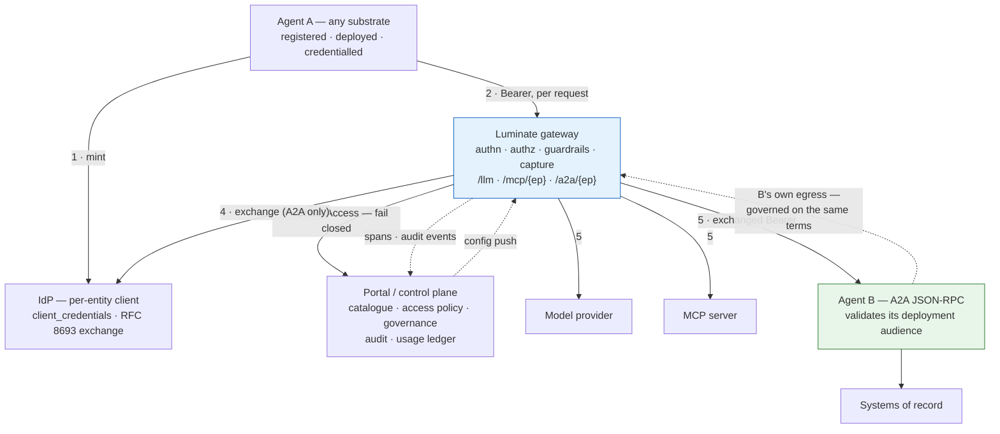

# Design Pattern: Governed Agent — Egress and Ingress on the Agentic Control Plane

**Document status:** Draft
**Pattern owner:** Sun Life ACP Product Team (EDAE)
**Approvers:** EA | Security Architecture | Platform | Operations
**Assurance records:** ATG0005678 (architecture) · ISRA 26-1956 (security)
**Version:** 0.1
**Last updated:** 2026-09-09
**Review cadence:** Quarterly
**Primary audience:** Enterprise architects, solution architects, engineering, security, operations
**Pattern category:** AI/ML
**Cloud scope:** AWS | On-prem (OpenShift) | Hybrid
**Technology neutrality:** Preferred — the pattern is framework-agnostic; the substrate annex is not

---

## 1. Executive Summary

An AI agent on the Agentic Control Plane is a governed identity that reaches models, tools and
other agents **only** through a Luminate gateway, and — where it is meant to be invoked — is
reached by other agents only through the same gateway. Every such call is authenticated, decided
against a central policy with no local cache, and recorded in an append-only trail.

The distinction that organises this pattern, and that the platform surface does not currently
draw, is between the two directions an agent operates in. **Egress** is the agent as a caller: it
needs a catalogue entry, a deployment, a credential and source access policies. **Ingress** is
the agent as a callee: it additionally needs an A2A endpoint — an `AgentDeployment` carrying a
routable backend — and a target access policy. Registering an agent and granting it a model
produces a governed caller and nothing a caller can reach. Eight of the ten agents registered in
the Sun Life development estate are in exactly that state, and one of them is already the target
of an active access policy that can never succeed.

This pattern states the requirements for both directions across four specified hosting substrates,
publishes the criteria any other platform is assessed against, and is explicit about what the
platform does **not** enforce
— because three of the controls an assessor would reasonably assume exist do not. Deactivating an
agent stops it being called and does not stop it calling. Its governance state is recorded and
enforces nothing. A guardrail cannot be attached to an agent as a callee. Each is stated, given a
compensating control, and raised with its owner rather than papered over.

> **Governing principle:** An agent reaches nothing, and is reached by nothing, except through a
> gateway that authenticates, authorizes and records the call — and every control the pattern
> claims must be one that actually runs.

## 2. Business Context and Outcomes

### 2.1 Business capability supported

Enterprise AI enablement: allowing business units to build and operate autonomous agents against
approved models and systems of record, under a single set of access, content, audit and cost
controls, without each team negotiating its own path.

### 2.2 Measurable outcomes

| Outcome | KPI | Target |
|---|---|---|
| Teams self-serve the requirements | Agents onboarded without a bespoke platform design engagement | 100% after publication |
| No unreachable grants | `target_type = agent` policies with no matching route | 0 |
| Direction is a decision | Registered agents with a recorded direction matching their deployments | 100% |
| Containment is real and timed | Measured interval from stop action to first refused call, per direction, per environment | Documented; under 60s |
| Supply chain is evidenced | Agent repositories with enforced SAST, SCA and static-analysis gates and retrievable evidence | 100% |
| Assurance is reusable | Substrate-level ISRA controls evidenced once and reused | Second agent on a substrate assessed on agent-specific rows only |
| The estate is assessed | Agents at `governance_state = not_evaluated` | 0 |

## 3. Problem Statement and Intent

### 3.1 Problem

Without this pattern, each team negotiates its own answer and the estate drifts into states
nobody chose:

- Agents are registered and not reachable, with no record of whether that was intended.
- An access policy can grant a caller an agent that has no endpoint; the call authorizes and then
  fails at the proxy hop with nothing explaining why.
- Operators believe deactivating an agent contains it. It contains half of it.
- Governance state is presented in the portal and in assessments as though it gates something.
- A callee agent has no way to require a content scan of its own inbound traffic, so an inbound
  message composed by a model reaches it unscanned unless every caller independently carries a
  guardrail.
- Two environments serve the same lane differently — one with an on-behalf-of token exchange, one
  with no credential at all — because their builds differ by 49 commits.
- The published adoption path cannot reach the lane it advertises.

### 3.2 Pattern intent

Standardize: the two-direction registration model; the identity that reaches an agent and what it
must validate; the authorization boundary in each direction; the hosting requirements per
substrate; the supply-chain gates; and the operational surface, including a stop path that is
honest about what it reaches. Produce, from one document, the ETAB architecture and the ISRA
control set.

### 3.3 Non-goals

- Building any specific agent, or selecting an agent framework.
- The MCP server an agent calls — a separate pattern owns the callee side of that lane.
- Gateway internals: routing, guardrail evaluation and the proxy data path are owned by the AI
  Consortium.
- Re-specifying the harness SDK; it is referenced and its defects are raised.
- Authoring end-user guides; the pattern is the source, the guides are the surface.

## 4. Pattern Summary

| Attribute | Description |
|---|---|
| Pattern name | Governed Agent — Egress and Ingress on ACP |
| Pattern type | Platform / integration pattern for autonomous workloads |
| Primary runtime/orchestrator | Luminate control plane + agentgateway data plane; agents on OpenShift, EKS, Bedrock AgentCore or AWS Lambda |
| Reliability model | Fail-closed authorization with no policy cache; per-request policy decision; configuration delivered by long-lived push stream; agent liveness owned entirely by the hosting substrate |
| Security model | Per-entity machine identity; explicit access policy in each direction; RFC 8693 on-behalf-of exchange to a deployment-scoped audience on the A2A lane; caller-scoped content guardrails; append-only audit |
| Best suited for | Server-hosted agents reaching approved models and governed tools, and multi-agent delegation where the callee must know who is calling |
| Not suited for | Developer-laptop agents; agents invoked inside a third party's orchestration with no interposition point; agents requiring per-capability platform authorization; workloads needing a platform-enforced spend budget |
| Maturity | **Validated** — egress is production-proven; ingress (A2A) is proven in development on two substrates and not yet uplifted in production |

## 5. Applicability

### 5.1 Good fit

| Use case | Why fit |
|---|---|
| A business agent calling approved models and MCP tools | The egress path is production-proven and is the majority of the estate today |
| Multi-agent delegation where the callee must authorize per caller | The on-behalf-of exchange hands the callee a token naming the original caller and the act chain |
| An agent whose invocation must be audited and attributed | Every gateway-mediated call produces an access event and a trace attributable to entity, actor and target |
| An agent reached from more than one workload environment | One catalogue entry, one deployment per gateway, promotion by deployment |
| An AgentCore runtime that must be reached under governance | A VPC-endpoint backend with a custom JWT authorizer is a working, evidenced shape |

### 5.2 Poor fit

| Use case | Why not fit |
|---|---|
| A developer-laptop or IDE agent | Its invocation cannot be interposed, and a credential on a laptop is outside the platform's custody. Use a user-delegated credential attributable to the human instead |
| An agent whose invocation cannot be interposed by a gateway *and* whose credential cannot be held in managed custody | Both are admission criteria (SUB-I3/I4 and SUB-E2). A platform failing one has a named open criterion and a fitting alternative shape — egress-only registration, assessment at the execution layer, or a user-delegated credential — rather than no path at all |
| An agent whose capabilities differ materially in privilege behind one endpoint | Authorization is per agent, not per capability. Split it, or accept that the control sits inside the agent |
| A workload needing a platform-enforced token or spend budget | Quotas are modelled and not enforced on any lane |
| A long-running task on a substrate with a hard execution ceiling | The A2A task lifecycle supports asynchrony; the gateway does not model it |
| A library, SDK entry point or queue consumer | An A2A callee must be a remote HTTP service at a stable URL |
| **A chatbot, batch job or UI backend** | Nothing calls it, so it is an **Application** — an egress-only identity with no routable endpoint, no target policy type, no `status`, no governance state, and no governance sweep. Registering it as an Agent overstates the agent inventory |
| **An agent that must call an enterprise REST API directly** | The gateway has three lanes and none is REST. The sanctioned path is an MCP server, with the API Platform gateway owning the hop to the API |

## 6. Reference Architecture

### 6.1 Architecture diagram

### 6.2 Logical layers

| Layer | Responsibility |
|---|---|
| Catalogue | Agent identity, ownership, declared capability and reach, lifecycle and governance state |
| Deployment | Placement on a gateway in an environment; the anchor for credentials and, for ingress, the routable endpoint |
| Identity | Per-entity IdP client; client-credentials for egress; RFC 8693 exchange to a deployment-scoped audience for A2A ingress |
| Decision | Central, per-request, fail-closed access decision over source, target type and selector |
| Data plane | Authenticate, authorize, apply caller-scoped guardrails, translate, forward, capture |
| Agent | Validate the token it receives, treat all received content as untrusted, bound its own concurrency, and enforce any per-capability rule the platform cannot |
| Assurance | Audit trail, traces and usage ledger; the control evidence an ISRA is written against |

## 7. Core Design Principles

### 7.1 Direction is declared, not inferred
Egress and ingress are two registrations with two requirement sets. An agent declares which it
operates in, and the declaration is reconciled against its deployments.

### 7.2 The gateway is the only path
No agent reaches a model, a tool or another agent by any other route, and no agent is reached by
any other route. A second path defeats authentication, authorization, content control and audit
simultaneously — including an IAM-signed call direct to a managed runtime.

### 7.3 The agent is the unit of authorization, in each direction
A source grant covers everything that agent may do; a target grant covers every capability it
exposes. Where privileges differ materially, split into separate agents.

### 7.4 Serve an ingress endpoint only with the exchange attached
The alternative reaches the agent as the gateway, or forwards the caller's own credential to a
backend the platform may not control. The platform prefers withholding to degrading; this pattern
makes that a requirement.

### 7.5 Everything the agent receives is untrusted
Inbound A2A messages, tool output and model output all re-enter a non-deterministic reasoning
process. This is the defining difference from an ordinary internal service.

### 7.6 Claim only controls that run
A field, a serializer and an admin page are not a control. Where the platform records rather than
enforces, this pattern says so and names the compensating measure.

## 8. Component Model

### 8.1 Component catalog

| Component | Purpose | Failure mode | Scaling model |
|---|---|---|---|
| Catalogue entry (`Agent`) | Identity, ownership, declared reach, governance state | Stale or unqueryable metadata; no capability inventory | n/a |
| `Deployment` | Places the agent on a gateway in an environment; anchors credentials | Missing → no credential can be issued | One per gateway |
| `AgentDeployment` | Endpoint name + backend URL; **its existence makes the agent callable** | Missing → grants exist with no route; malformed → routed nowhere, undetected | One per deployment |
| Credential (`OAuthCredential` / `APIKey`) | Machine identity for egress | Show-once secret lost → rotate, never regenerate; revocation has a token-expiry tail | One active per (entity, gateway) |
| Access policy | The grant, in each direction | Absent → deny; unconstrained → grant in every environment that gateway serves | Horizontal |
| Gateway (data plane) | Authn, authz, guardrails, translation, capture | Portal unreachable → deny (by design) | Horizontal; one per workload environment |
| Portal (control plane) | Catalogue, decisions, exchange, audit, usage | On the request path; an outage denies | Horizontal |
| Agent runtime | The agent itself | **Never probed by the platform**; detected only via gateway 5xx | Substrate-specific |

### 8.2 Interaction contracts

| Interface | Protocol | Contract | Versioning |
|---|---|---|---|
| Agent → gateway (model) | HTTPS | OpenAI-compatible chat completions at `/llm/...` | Provider wire format |
| Agent → gateway (tool) | HTTPS | MCP Streamable HTTP at `/mcp/{endpoint_name}` | MCP specification revision |
| Agent → gateway (agent) | HTTPS | A2A JSON-RPC 2.0 `message/send` at `/a2a/{endpoint_name}` | A2A protocol |
| Gateway → agent (ingress) | HTTPS/HTTP | A2A JSON-RPC to the rewritten backend path, `Authorization: Bearer <exchanged>` | A2A protocol |
| Gateway → portal | gRPC | Per-request access decision; long-lived bidirectional config stream | Protobuf, additive |
| Discovery | HTTPS | RFC 9728 protected-resource metadata at `/.well-known/oauth-protected-resource/a2a/{endpoint_name}`; 404 means "not delegated here" | RFC 9728 |
| Capability discovery | — | **Not available.** No agent card is served or proxied; the catalogue record is the inventory | — |

## 9. Non-Functional Requirements (NFR)

| NFR | Target | Validation method |
|---|---|---|
| Availability | Bounded by the control plane; no policy cache, so a portal outage denies rather than fails open | Chaos test the portal dependency; confirm deny |
| Latency | Gateway overhead published per lane; the A2A lane carries an extra token-exchange round trip | Load test per lane per environment |
| Throughput | Bounded by the substrate, not by the platform — no quota is enforced | Load test to the configured substrate ceiling |
| RTO | Gateway and portal redundancy per environment | Failover exercise |
| RPO | Catalogue and audit are transactional; no agent state is held by the platform | Restore test |
| Containment | Egress and ingress each stoppable, with a measured interval | **Drill**: time from stop action to first refused call, in each direction |
| Attribution | Every served call attributable to caller, target and lane | Trace inspection |
| Supply chain | Every served agent image traceable to a scanned build with retrievable evidence | Scan id and gate evaluation on the build |

## 10. Security and Compliance Baseline

### 10.1 Identity and access model

| Identity type | Scope | Least-privilege guidance |
|---|---|---|
| Agent machine identity (client credentials) | Per (agent, gateway) IdP client, issued on a deployment | The only shape that works on the A2A lane. One policy per target, constrained by environment |
| Agent API key (`lum_`) | Per agent, gateway-plane only | Acceptable on `/llm` and credential-less MCP endpoints; **refused** on a delegated A2A endpoint. Avoid where any A2A use is foreseeable |
| Delegated user token (`lud_at_`) | The agent acting for a user | Bounded by the delegation ceiling, not the agent's own grants. Use where the action is the user's |
| Exchanged downstream token | Audienced to the callee's **deployment** | The callee validates issuer, signature, expiry and its own deployment audience — never a catalogue-scoped one |
| Gateway identity | The gateway's own IdP client | May obtain a downstream token only for deployments it actually fronts |

### 10.2 Control baseline

Abridged; the full set is C-1 to C-35 in the D2 assurance page.

| Control ID | Standard/Policy | Requirement | Applies when | Evidence artifact |
|---|---|---|---|---|
| CTRL-001 | OSFI B-13 P.15 | Caller authenticated before any request is served | Always | 401 on a negative test |
| CTRL-002 | OSFI B-13 P.15 | Central, fail-closed access decision per request | Always | Decision record; deny on portal outage |
| CTRL-003 | OSFI B-13 P.15 | Explicit, least-privilege, environment-constrained grants in each direction | Always | The policy list per agent |
| CTRL-004 | Internal — network | Agent backend unreachable except from the serving gateway | Ingress | Negative test from a non-gateway workload |
| CTRL-005 | Internal — crypto | TLS with the correct trust chain on any hop leaving the pod network | Ingress off-cluster | Successful call; CA count in the gateway pod |
| CTRL-006 | Internal — identity | Ingress served only with the on-behalf-of exchange attached | Ingress | The route's `backendAuth` block in the gateway config dump |
| CTRL-007 | Internal — identity | Callee validates its **deployment** audience | Ingress, delegated | Refusal of a token minted for another deployment |
| CTRL-008 | Law 25 / PIPEDA | Content control on what the agent sends; caller-side control on what it receives | Regulated data | Guardrail attachments; a positive detection test |
| CTRL-009 | OSFI B-13 P.17 | Egress and ingress each stoppable, and exercised | Always | A recorded drill with a measured interval |
| CTRL-010 | OSFI E-23 | Capability and reach declared and current in the catalogue | Always | The record, diffed against actual grants |
| CTRL-011 | Internal — SDLC | SAST, SCA and static analysis performed **and gated**, with retrievable evidence | Always | Scan id, SBOM, gate status |
| CTRL-012 | Internal — platform | Non-root, no privilege escalation, requests and limits on every container including init | Kubernetes / OpenShift | No admission denial; pod running |
| CTRL-013 | Internal — secrets | Secrets from Vault or Secrets Manager only; never in the catalogue `configuration` | Always | Manifest review |
| CTRL-014 | OSFI E-23 | Append-only audit of every control-plane mutation and data-plane decision | Always | The audit records |

### 10.3 Threat model

Abridged; the full set is T1 to T16 in the D2 assurance page.

| Threat | Risk | Mitigation | Residual risk |
|---|---|---|---|
| Prompt injection through an inbound A2A message | High | Agent-side handling; caller-side guardrails | **Yes — a callee cannot require a scan of its own ingress** |
| Prompt injection through tool or model output | High | Response guardrails on the egress target; least privilege | Yes — inherent to the medium |
| Confused deputy — a grant used for an unintended purpose | Medium | Split by privilege; least-privilege grants | Partly |
| Runaway agent consuming budget or hammering a system of record | High | Substrate-side concurrency bound | **Yes — no platform quota is enforced** |
| Containment failure — a deactivated agent keeps calling | High | Revoke credential and source policies; drilled runbook | **Yes — deactivation alone is not containment** |
| Path bypass — direct call to the backend, or IAM-signed call to a managed runtime | Medium | Network and resource policy; negative test | Detected only by the absence of audit events |
| Credential forwarded to a third party | Medium | Serve ingress only with the exchange | Time-boxed while production runs an older build |
| Cross-environment token replay | Low | Deployment-scoped audience, validated by the callee | No |
| Unroutable grant mistaken for working access | Medium | Reconciliation query on a schedule | Yes, until the platform reconciles |
| Supply-chain compromise | Medium | Gated SAST, SCA and static analysis with evidence | Yes, while gates remain disabled |

## 11. Data and State Architecture

### 11.1 Data classification and boundaries

| Data class | Allowed | Boundary rules | Retention |
|---|---:|---|---|
| Public / internal | Yes | Standard | Per system of record |
| Confidential | Yes | Least-privilege grants; request- and response-direction guardrails on the egress side; caller-side guardrails on the ingress side; classification declared at registration | Per system of record |
| Personal information (Law 25 / PIPEDA) | Conditional | As above, plus: no prompts, tool arguments or model output carrying PI in agent logs or trace attributes; the platform's redaction does not cover what the agent writes itself | Per privacy schedule |
| Credential material | **No** | Never in a prompt, log, trace attribute, tool argument or the catalogue `configuration` field | n/a |

### 11.2 State management

| State type | Storage | Consistency | TTL/retention |
|---|---|---|---|
| Catalogue, deployments, policies | Control-plane database | Strong | Lifetime of the agent |
| Governance state and its trail | Control-plane database, append-only trail | Strong | Permanent |
| Gateway configuration | In-memory, delivered by push stream | Eventual — **measure the interval** | Until the next push |
| Access tokens | Caller-side cache | Short-lived | Seconds to minutes; revocation has an expiry tail |
| Agent conversational state | **Agent-side only** — the platform holds none | Agent's own | Agent's own |
| Audit events | Append-only store | Strong | Per retention policy |
| Usage and cost | Materialised per-agent ledger; traces in the observability platform | Eventual | Per retention policy |

## 12. Reliability and Resilience Patterns

| Pattern | Trigger | Behavior | Recovery |
|---|---|---|---|
| Retry/backoff | 429 or 503 from the gateway | Bounded retries with exponential backoff and jitter, on idempotent methods only | Fail the task rather than loop — the platform enforces no quota |
| Circuit breaker | Repeated failure of a target | Agent-side; stop calling and degrade the task | Half-open probe |
| Fallback | Model or tool unavailable | Agent-side degradation to a stated reduced behaviour, never a silent unguarded path | Restore on recovery |
| Fail-closed authorization | Control plane unreachable | **Deny.** There is no policy cache and no permissive posture | Control-plane recovery |
| Withholding | Gateway cannot run the on-behalf-of exchange | The endpoint is dropped from the config and refused at the gate | Fix the exchange configuration |
| Token refresh | Cached token nearing expiry | Refresh ahead of expiry; on a cold start this is a mint against a rate-limited endpoint | Warm the cache; see the Lambda annex |
| Stop | Incident | **Revoke credential and source policies** for egress; deactivate and revoke target policies for ingress | Re-issue and re-grant |

## 13. Observability and Audit

### 13.1 Minimum telemetry

| Signal | Required fields | Retention |
|---|---|---|
| Logs | Agent-side application logs with no prompts, tool arguments, model output or credential material | Per policy |
| Metrics | Per-agent request counts, denials, latency and error rate, per lane and per endpoint | Per policy |
| Traces | Entity, actor and act chain, principal, target id and type, project, session id. **The A2A lane carries no GenAI operation name**, so the hop is an untyped span | Per policy |
| Audit — change | Every catalogue mutation and governance transition, with reason | Permanent |
| Audit — access | Every data-plane decision, with the protocol lane | Permanent |
| Usage | Per-agent tokens and cost for the agent's own model calls. A delegation's downstream cost books to the callee unless the delegated token is forwarded | Per policy |

### 13.2 Alerts and SLOs

| Alert | Threshold | On-call action |
|---|---|---|
| Gateway 5xx per endpoint name | Any sustained rate | **The only liveness signal for an agent** — the platform never probes it. Check the backend and its TLS chain |
| Authorization denials per agent | Step change | Check for a revoked policy, a deactivated target, or a caller using the wrong credential shape |
| A2A endpoint withheld | Any | The gateway cannot run the exchange — check the exchange configuration before the endpoint is used |
| RFC 9728 discovery returning 404 for an endpoint expected to be delegated | Any | The endpoint is on the degraded branch |
| Grants without routes | Any | Reconcile — the grant can never succeed |
| Agents at `not_evaluated` | Any, after assessment is due | Governance follow-up |
| Config-push propagation exceeding the measured baseline | Baseline + margin | Containment latency is degrading |

## 14. Deployment and Environment Strategy

### 14.1 IaC scope

Everything except the catalogue record: cluster manifests or runtime definitions, network and
resource policies, secret bindings, and the build pipeline configuration. Catalogue entries,
deployments, credentials and access policies are control-plane records created through the portal
or its API and captured in the onboarding record.

### 14.2 Environments

| Environment | Purpose | Entry criteria |
|---|---|---|
| Dev | Build and functional proof | Registered, credentialled, reachability proven through the gateway |
| Test / SIT | Integration with real tools and models | Conformance profile assessed; network control evidenced |
| Pre-prod / Stage | Non-functional and containment proof | Supply-chain gates enforced with retrievable evidence; stop path drilled and measured |
| Prod | Live | ISRA controls evidenced; ETAB accepted; **ingress served only with the on-behalf-of exchange**; distinct backing runtime per environment or a recorded exception |

### 14.3 Release and rollback

| Phase | Change scope | Rollback strategy |
|---|---|---|
| Agent code / image | New immutable digest through the pipeline | Redeploy the previous digest |
| Declared capability or reach | Catalogue record + access policies | Governed change; revert the record and the policies |
| Endpoint change | `AgentDeployment` backend or endpoint name | Revert the record; the config push re-emits the previous route. **Verify the emitted rewrite, not the intent** |
| Credential | Rotate | The previous secret is invalidated; tokens already minted live to expiry |
| Withdrawal | Stop | Egress: revoke credential and source policies. Ingress: deactivate and revoke target policies |

## 15. Operations and Support Model

### 15.1 Ownership (RACI)

| Role | Responsible | Accountable | Consulted | Informed |
|---|---|---|---|---|
| Building team | Y | Y | — | — |
| ACP Product Team (platform) | Y | — | Y | — |
| Platform administrators | Y | — | Y | — |
| Security Architecture / ISRA | — | Y | Y | — |
| Data governance | — | — | Y | Y |
| GDS / DevOps AppDev | Y | — | Y | — |
| AI Consortium (component owner) | Y | — | Y | Y |

### 15.2 Runbook topics

- **Stopping an agent** — the asymmetry, the correct order, and the measured interval
- Diagnosing a refusal: the failure-mode table by cause
- Diagnosing `500 upstream service error` — usually a trust-store problem, not the upstream
- Diagnosing a call that authorizes and then fails: a grant with no route
- Credential rotation and the show-once secret
- Reconciling grants against routes, and the standing non-conformance queries
- Capacity: the substrate-side bound, since the platform enforces none
- Incident response for a runaway or induced agent

## 16. Cost Model and FinOps

| Cost driver | Unit economics | Optimization lever |
|---|---|---|
| Model inference | Tokens × model rate, attributed per agent | Model selection; prompt and context size; caching |
| Tool calls | Compute on the tool's side | Fewer, coarser calls; agent-side result caching |
| A2A hops | **No cost of their own** — the hop carries no tokens | The cost is the callee's model calls |
| Delegated chains | Book to the **callee** unless the delegated token is forwarded | Decide deliberately; forward the token where cost must follow the caller |
| Agent runtime | Substrate-dependent — pods, runtime concurrency, or per-invocation | Right-size; reserved concurrency on Lambda |
| Retries and loops | **Unbounded by the platform** | Substrate-side concurrency bound; agent-side circuit breaker |

Per-agent usage and cost are materialised in the platform's ledger. The finance-facing chargeback
view carries a cost-centre column but has **no run or session dimension**, so "what did this
delegation chain cost" is answerable only through session grouping in the observability platform.

## 17. Risks, Assumptions, Constraints, Decisions

### 17.1 Risks

| Risk | Impact | Mitigation | Owner |
|---|---|---|---|
| An operator deactivates an agent believing it is contained | High | Documented, drilled stop path; consortium ask for a source-side status check | ACP Product Team |
| An inbound A2A message reaches an agent unscanned | High | Caller-side guardrails required and recorded on the callee; consortium ask for a target-agent scope | Platform admins |
| Governance state presented as a control | High | Declared ⚠️ recorded-not-enforced throughout; named as a residual risk | Governance |
| Production serves A2A with no credential | High | No A2A grant in production until the image is uplifted | Platform |
| A runaway agent consumes budget | Medium | Substrate-side bound as a named control | Building team |
| A grant exists against an agent with no route | Medium | Reconciliation query on a schedule | ACP Product Team |
| A mis-registered endpoint routes nowhere, undetected | Medium | Encoding rules plus a post-registration call | Building team |
| One runtime backs four environments | High | Distinct runtime per environment, or a recorded exception with a stated radius | Platform |
| Supply-chain gates remain nominal | Medium | Enable and evidence; a scan id, not a stage colour | Building team + AppSec |

### 17.2 Assumptions and constraints

- The control plane is on the request path; there is no policy cache and no fail-open posture.
- There is no agent identity mode — every routable agent deployment is a delegated target, and
  the only alternative is a degrade that sends no credential.
- The platform never probes an agent's health.
- Quotas are modelled and not enforced on any lane.
- Governance state has no runtime consumer.
- Guardrails cannot be bound to an agent as a callee.
- No agent card is served or proxied; the catalogue record is the capability inventory.
- A registered backend URL's query string is discarded on the A2A hop.
- Sun Life clusters deny pods without resource requests and limits, init containers included, and
  the denial does not surface in a rollout status.
- No public container-registry egress from Sun Life cluster pods; `us-east-1` has no egress.
- The portal token endpoint is rate-limited, which bounds any per-invocation credential mint.
- The REST estate stays behind the API Platform gateway; ACP governs the hop to an MCP server and
  no further. Bringing direct agent→API calls into governance — through a skills / plugins registry
  that integrates with the API Platform, so governance moves while the traffic path does not — is an
  intended **AI consortium roadmap item**, with no design and no date. It is out of scope here, and
  nothing in this pattern depends on it.

### 17.3 ADR references

- ADR — Egress and ingress are two registrations with two requirement sets
- ADR — The gateway is the only path; IAM-signed direct invocation is not an ACP integration
- ADR — An ingress endpoint is served only where the on-behalf-of exchange runs
- ADR — The stop control is credential and policy revocation, not deactivation
- ADR — Content control on A2A ingress is a caller-side obligation recorded on the callee
- ADR — Governance state is evidence, not a control
- ADR — Fail-closed availability is accepted in exchange for immediate revocation

## 18. Anti-Patterns

| Anti-pattern | Why problematic | Preferred approach |
|---|---|---|
| Registering an agent and assuming it is callable | It is a governed caller with no route. The grant will authorize and then fail at the proxy hop | Declare the direction; create the `AgentDeployment` for ingress |
| Granting a caller an agent that has no endpoint | An active policy that can never succeed, and nothing reconciles it | Reconcile grants against routes on a schedule |
| Deactivating an agent to contain it | Stops ingress only; the agent keeps calling | Revoke the credential **and** the source access policies |
| Citing governance suspension as a stop control | It records and refuses nothing | Use the credential and policy path; declare the governance axis as evidence |
| Assuming the A2A lane is content-scanned | No guardrail can bind to the callee | Require caller-side guardrails; validate inbound content in the agent |
| Using an API key for an agent that will delegate | A delegated A2A endpoint refuses it | Use client credentials |
| Calling a managed runtime by IAM signature "for latency" | An ungoverned path with no decision, no guardrail, no audit, no cost attribution | Route through the gateway |
| Serving an ingress endpoint on the degraded branch | The caller's credential is forwarded to a backend the platform may not control | Withhold, or fix the exchange |
| One runtime backing four environments | A production incident is a development incident | One runtime per environment, or a recorded exception |
| Putting a secret in the catalogue `configuration` field | Free-form operator JSON headed for an append-only store that cannot be redacted | Vault or Secrets Manager |
| Treating a green pipeline as an assessment | The SAST step reports success when no scan exists | Evidence the scan id and gate evaluation |
| Relying on a query string in the backend URL | It is discarded from the emitted rewrite | Put everything needed in the path |
| Registering a chatbot as an Agent | It can never be called, so the agent inventory overstates itself and the record carries a governance axis nothing sweeps | Register it as an Application |
| Registering a callable service as an Application | It can never be called — no endpoint, no target policy, no route — and the fix is re-registration | Register it as an Agent |
| An agent calling an enterprise REST API directly | Authenticated by the API Platform, invisible to ACP: no access decision, no guardrail, no audit event, no cost attribution | Reach it through an MCP server |
| Assuming the end user's identity reaches the REST API | Okta will not validate a Keycloak token; the API sees the MCP server's service identity | Record what the API actually sees; enforce per-user rules in the MCP server |

## 19. Decision Matrix

| Question | Recommendation |
|---|---|
| **Is my workload an Agent or an Application?** | Ask whether anything may need to **call** it. If not — a chatbot, a batch job, a UI backend — it is an Application, and that is structural, not stylistic |
| Does my agent need to be callable? | Only if another agent will invoke it. If not, declare it egress-only and record that as a decision |
| Which credential should my agent hold? | Client credentials. An API key is refused on the A2A lane, so it is a dead end for anything that may delegate |
| Where should my agent run? | The substrate you already operate. In-cluster EKS is simplest; AgentCore is proven; OpenShift and Lambda are specified and unexercised |
| **My platform is not one of the four — can I use it?** | Assess it against **SUB-E1–E7** (egress) and **SUB-I1–I5** (ingress) in Hosting. Meeting the egress set is enough to consume AI resources under governance; both sets are needed for agent-to-agent delegation. Falling short of one criterion is an open item to close, not a refusal |
| Public regional endpoint or VPC endpoint for a managed runtime? | VPC endpoint. The public endpoint fails the "reachable only from the gateway" requirement |
| How do I authenticate an inbound A2A call? | Validate the exchanged token: issuer, signature, expiry and **your deployment's** audience |
| How do I stop content injection over A2A? | You cannot do it at the platform. Require caller-side guardrails and validate inbound content in the agent |
| How do I bound cost and concurrency? | At the substrate. Reserved concurrency, replica ceiling or runtime concurrency — the platform enforces none |
| **How does my agent call an enterprise REST API?** | Through an **MCP server**. The MCP server calls the API through the API Platform gateway with Okta, unchanged. There is no REST lane on the Luminate gateway |
| **Will the API see the end user?** | **No, by default** — it sees the MCP server's Okta service identity. Carrying the user through needs Okta to trust the Luminate issuer, which is a federation decision |
| How do I stop the agent in an incident? | Egress: revoke the credential and the source policies. Ingress: deactivate and revoke the target policies. Drill it |
| Should the callee forward the delegated token? | Yes, if the downstream cost must follow the original caller. No, if the callee is a shared service that should own its costs. Decide and record |
| My agent runs on a laptop — can I onboard it? | Not as an agent identity: managed credential custody (SUB-E2) is not available on an endpoint device, and a machine identity would mis-attribute a person's actions. Use a **user-delegated credential** attributable to the individual — a supported pattern, just a different one |

## 20. Implementation Checklist

### 20.1 Architecture
- [ ] Direction declared — egress, ingress, or both — and reconciled against deployments
- [ ] For ingress: a remote A2A JSON-RPC service at a stable URL, with a single-segment endpoint name
- [ ] Backend URL carries scheme, host and full path, percent-encoded, with no query dependency
- [ ] Reachability proven through the gateway after registration
- [ ] Privileges split across agents where they differ materially
- [ ] Distinct backing runtime per environment, or a recorded exception

### 20.2 Security
- [ ] Credential issued on a deployment; show-once secret stored safely
- [ ] Client credentials, not an API key, wherever delegation is foreseeable
- [ ] Backend unreachable except from the serving gateway, proven by negative test
- [ ] TLS with the correct trust chain on any hop leaving the pod network
- [ ] Ingress route carries the on-behalf-of exchange — verified in the gateway config dump
- [ ] Callee validates issuer, signature, expiry and its **deployment** audience
- [ ] Caller-side guardrails required and recorded for every caller granted the endpoint
- [ ] Inbound messages, tool output and model output all treated as untrusted
- [ ] No credential or regulated data in prompts, logs or trace attributes
- [ ] Secrets from Vault or Secrets Manager; never in the catalogue `configuration`

### 20.3 Reliability
- [ ] Substrate-side concurrency and spend bound configured and named as the control
- [ ] Bounded retries with backoff; a circuit breaker on repeated target failure
- [ ] Fail-closed authorization understood and designed around
- [ ] Token caching sized for the runtime — cold-start mint cost measured where it applies
- [ ] Non-root, no privilege escalation, requests and limits on every container including init

### 20.4 Operations
- [ ] Alerting on gateway 5xx per endpoint name — the only liveness signal
- [ ] `x-luminate-session-id` sent and propagated across delegations
- [ ] Stop runbook written for both directions and **exercised**, with a measured interval
- [ ] The delegated-token-versus-own-credential decision recorded with its cost consequence
- [ ] Named owner recorded in the catalogue entry

### 20.5 Compliance/Audit
- [ ] Capability and reach declared in the catalogue and current
- [ ] Data reached and its classification declared at registration
- [ ] SAST, SCA and static analysis enforced, with the scan id and SBOM retrievable
- [ ] Image built by the approved pipeline and referenced by immutable digest
- [ ] Governance state recorded via the guarded transition — and **not** cited as a control
- [ ] ISRA control set evidenced; residual risks explicitly accepted

## 21. Reference Implementation (Optional)

A reference agent is a deliverable of this pattern, not a prerequisite: an A2A JSON-RPC service
that validates its deployment audience, a container definition and manifest meeting the pod
security requirements, a pipeline configuration with the scanning gates enabled, and a worked
registration in both directions. It is illustrative and non-prescriptive — the conformance
profile is the requirement, not the sample.

## 22. Source References

- **Assurance records** — ATG0005678 (architecture governance) · ISRA 26-1956 (security risk
  assessment). The control table and residual risks in the D2 assurance page are the content
  submitted against both.
- `AI-Consortium/luminate` — `origin/main` @ `1c4a0003`, 2026-09-08. The catalogue model, the A2A
  translation, the request-time gates, the fact bundle and the Rego policy.
- `AI-Consortium/luminate-designs` — `origin/main` @ `013d406`, 2026-09-08.
- SLF Luminate development and production estates, queried 2026-09-08 (both `sha-89356d7`; the
  development backend on an A2A branch build).
- `EDAEACP/luminate-sunlife-deploy` — `origin/main` @ `e7c9750`. Helm chart, trust bundle,
  NetworkPolicy, AWS role chain.
- `EDAEACP/acp-harness-sdk` — `origin/main` @ `4634fe2`, v0.13.0.
- `CSDP/pipeline-libraries` — the approved JTE libraries and their gate defaults.
- ACP Capability Map and the Capability Gap Escalation process.
- MCP Server Patterns (EACPP-1176) — the callee side of the tool lane, and the shared
  supply-chain findings.
- Integration Patterns (EACPP-1112); Gateway and Environment Strategy (EACPP-1089).
- OSFI E-23 (model risk management); OSFI B-13 Principles 15 and 17; Quebec Law 25; PIPEDA.
- RFC 8693 (OAuth 2.0 Token Exchange); RFC 9728 (OAuth 2.0 Protected Resource Metadata); the A2A
  protocol specification; the Model Context Protocol specification.
